# UI 组件库

<cite>
**本文引用的文件**   
- [my_button.dart](file://lib/widgets/my_button.dart)
- [my_card.dart](file://lib/widgets/my_card.dart)
- [progress_dialog.dart](file://lib/widgets/progress_dialog.dart)
- [load_image.dart](file://lib/widgets/load_image.dart)
- [auth_permission_dialog.dart](file://lib/components/auth_permission_dialog.dart)
- [confirm_dialog.dart](file://lib/components/confirm_dialog.dart)
- [base_dialog.dart](file://lib/widgets/base_dialog.dart)
- [popup_window.dart](file://lib/widgets/popup_window.dart)
- [select_field_item.dart](file://lib/widgets/select_field_item.dart)
- [text_field_item.dart](file://lib/widgets/text_field_item.dart)
- [colors.dart](file://lib/res/colors.dart)
- [dimens.dart](file://lib/res/dimens.dart)
- [styles.dart](file://lib/res/styles.dart)
- [resources.dart](file://lib/res/resources.dart)
- [gaps.dart](file://lib/res/gaps.dart)
- [theme_provider.dart](file://lib/setting/provider/theme_provider.dart)
- [theme_utils.dart](file://lib/util/theme_utils.dart)
- [image_utils.dart](file://lib/util/image_utils.dart)
- [pubspec.yaml](file://pubspec.yaml)
</cite>

## 目录

1. [引言](#引言)
2. [项目结构](#项目结构)
3. [核心设计原则](#核心设计原则)
4. [样式与主题系统](#样式与主题系统)
5. [通用 UI 组件](#通用-ui-组件)
6. [业务弹窗与表单组件](#业务弹窗与表单组件)
7. [图片加载体系](#图片加载体系)
8. [组件使用示例与最佳实践](#组件使用示例与最佳实践)
9. [依赖关系分析](#依赖关系分析)
10. [性能优化建议](#性能优化建议)
11. [可访问性与响应式设计](#可访问性与响应式设计)
12. [测试与调试指南](#测试与调试指南)
13. [结论](#结论)

## 引言

聚客美滋滋应用的 UI 组件库围绕点餐、桌台管理、订单结算等业务场景构建，目标是提供一套统一、可复用、可维护的 Flutter 界面基础。组件库同时承担两类职责：

- **通用 UI 能力**：按钮、卡片、进度提示、图片加载、弹出窗口、基础输入等。
- **业务交互能力**：权限授权、确认弹窗、金额输入、表单选择行等面向收银和点餐流程的弹窗与表单控件。

该组件库的设计重点包括：

- 遵循 Material Design 的基础交互语义，但不过度依赖 Material 3 默认样式，而是通过主题配置形成品牌化外观。
- 将颜色、尺寸、字体、间距集中管理，避免页面级硬编码。
- 将通用组件和业务组件分层：`lib/widgets` 偏向通用能力，`lib/components` 偏向业务弹窗和表单。
- 通过主题提供者统一管理亮色与暗色模式，使组件在不同主题下保持一致体验。
- 针对移动端键盘、弹窗遮挡、网络图片、本地资源等常见移动场景提供封装。

## 项目结构

UI 相关代码主要分布在以下位置：

| 路径 | 职责 |
|---|---|
| `lib/widgets` | 通用 UI 组件，如按钮、卡片、进度对话框、图片加载、基础弹窗模板、弹出窗口、表单输入项等 |
| `lib/components` | 业务弹窗和表单组件，如权限授权弹窗、确认弹窗、金额输入弹窗等 |
| `lib/res` | 主题资源：颜色、尺寸、文本样式、间隔、资源导出入口 |
| `lib/setting/provider` | 主题状态管理，负责持久化主题模式并生成全局 `ThemeData` |
| `lib/util` | 工具类，包括主题辅助、图片路径处理等 |
| `pubspec.yaml` | 应用依赖声明，包含图片缓存、网络请求、状态管理等关键第三方库 |

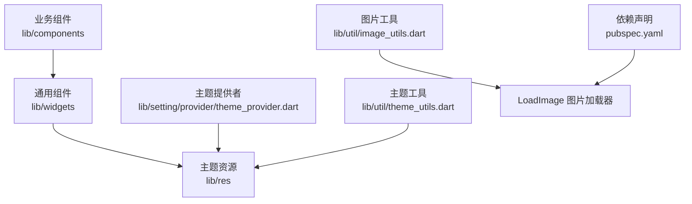

**图表来源**
- [my_button.dart:1-75](file://lib/widgets/my_button.dart#L1-L75)
- [theme_provider.dart:1-92](file://lib/setting/provider/theme_provider.dart#L1-L92)
- [resources.dart:1-12](file://lib/res/resources.dart#L1-L12)
- [image_utils.dart:1-34](file://lib/util/image_utils.dart#L1-L34)
- [pubspec.yaml:1-111](file://pubspec.yaml#L1-L111)

**章节来源**
- [pubspec.yaml:1-111](file://pubspec.yaml#L1-L111)

## 核心设计原则

### Material Design 规范遵循

组件库没有完全照搬 Material 3 默认风格，而是基于 Material 2 的交互语义进行品牌化定制：

- 使用 `MaterialButton`、`OutlinedButton`、`ElevatedButton` 等原生控件承载点击行为。
- 通过 `ThemeData` 控制主色、背景色、分割线、文字主题、输入框主题、AppBar 主题等。
- 使用圆角、阴影、水波纹反馈等视觉语言，保持现代移动应用的质感。
- 在需要高度自定义时，自绘容器（如 `MyCard`、`ConfirmDialog`）仍保持统一的圆角、阴影和品牌色。

### 主题系统的统一性

所有颜色来自 `Colours`，所有字号和间距来自 `Dimens`，所有文本样式来自 `TextStyles`。组件不应直接写死颜色或字号，而应优先从资源层读取。例如：

- 按钮背景色、禁用色、文字色由主题和 `Colours` 共同决定。
- 卡片背景色会根据暗色模式切换。
- 主题提供者通过 `ThemeProvider.getTheme` 生成全局主题，供应用根节点使用。

### 可复用性的设计原则

通用组件强调“最小必要参数 + 合理默认值”：

- `MyButton` 提供文案、字号、颜色、尺寸、内边距、圆角、边框等常用属性。
- `MyCard` 只暴露子元素、背景色、阴影色，内部统一处理圆角和阴影。
- `ProgressDialog` 固定展示加载指示器和提示文案，适合覆盖式等待场景。
- `LoadImage` 自动区分本地资源和网络图片，并提供占位图、缓存尺寸等选项。

业务组件则强调“明确的生命周期 + 清晰的返回值”：

- 权限授权弹窗返回布尔值表示是否授权成功。
- 确认弹窗返回布尔值表示用户是否确认。
- 金额输入弹窗返回字符串或空值，便于上层判断取消或提交。

**章节来源**
- [my_button.dart:1-75](file://lib/widgets/my_button.dart#L1-L75)
- [my_card.dart:1-36](file://lib/widgets/my_card.dart#L1-L36)
- [progress_dialog.dart:1-44](file://lib/widgets/progress_dialog.dart#L1-L44)
- [theme_provider.dart:1-92](file://lib/setting/provider/theme_provider.dart#L1-L92)

## 样式与主题系统

### 颜色体系

`Colours` 是颜色主题的核心，包含主色、背景色、文字色、禁用色、分割线色、阴影蓝等。其关键特征如下：

| 类别 | 说明 |
|---|---|
| 主色 | `app_main` 用于浅色模式主色调，`dark_app_main` 用于深色模式 |
| 背景色 | `bg_color`、`material_bg`、`bg_gray` 及其暗色对应值 |
| 文字色 | `text`、`text_gray`、`dark_text`、`dark_text_gray` |
| 禁用色 | `text_disabled`、`button_disabled` 及其暗色对应值 |
| 功能色 | `red`、`dark_red`、`gradient_blue`、`shadow_blue`、`orange` |

组件中引用颜色的方式有两种：

1. 直接通过 `Colours` 静态字段。
2. 通过 `Theme.of(context).primaryColor` 等主题 API。

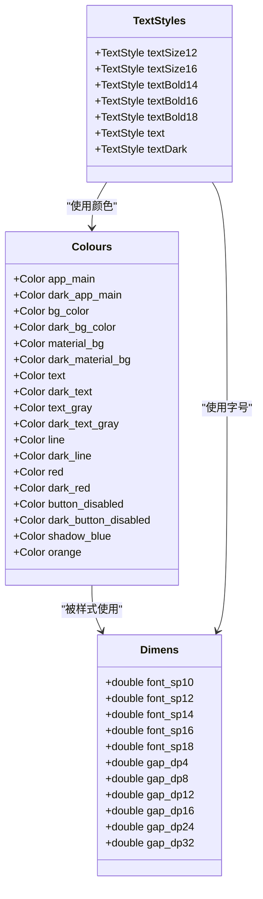

**图表来源**
- [colors.dart:1-46](file://lib/res/colors.dart#L1-L46)
- [dimens.dart:1-19](file://lib/res/dimens.dart#L1-L19)
- [styles.dart:1-76](file://lib/res/styles.dart#L1-L76)

### 尺寸与间距

`Dimens` 定义标准字号和间距，`Gaps` 将其包装为可复用的 Widget：

- 字号以 `font_sp10` 到 `font_sp18` 为主。
- 间距以 `gap_dp4` 到 `gap_dp50` 为主。
- `Gaps.hGap*`、`Gaps.vGap*` 可直接作为横向或纵向间距插入布局。
- `Gaps.line`、`Gaps.vLine`、`Gaps.empty` 提供常见分隔与空白。

### 文本样式

`TextStyles` 统一了字号、字重、颜色和基线对齐：

- 标题类样式：`textBold14`、`textBold16`、`textBold18`、`textBold24`、`textBold26`。
- 正文类样式：`text`、`textDark`、`textGray12`、`textDarkGray12`。
- 提示类样式：`textHint14`。
- 所有文本样式都绑定到 `Colours` 和 `Dimens`，避免页面散落硬编码。

### 主题提供者

`ThemeProvider` 负责：

1. 从本地存储读取主题模式。
2. 设置、保存当前主题。
3. 生成全局 `ThemeData`。

生成的主题包含：

- `useMaterial3: false`，说明项目未启用 Material 3。
- 主色根据明暗模式切换。
- `scaffoldBackgroundColor`、`canvasColor`、`indicatorColor` 等视觉主题。
- `textTheme`、`inputDecorationTheme`、`appBarTheme`、`dividerTheme`。
- `cupertinoOverrideTheme`，保证 iOS 风格控件也跟随主题。
- `visualDensity: VisualDensity.standard`，避免系统密度调整影响布局。

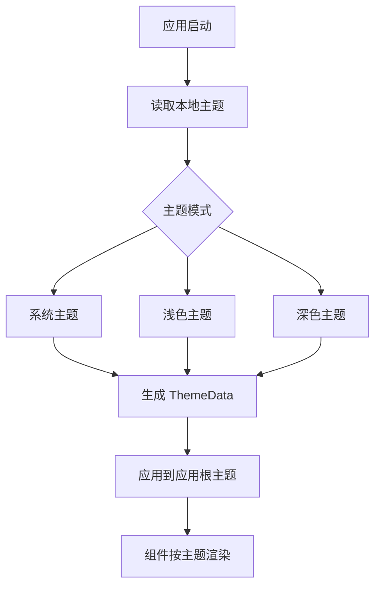

**图表来源**
- [theme_provider.dart:1-92](file://lib/setting/provider/theme_provider.dart#L1-L92)
- [theme_utils.dart:1-52](file://lib/util/theme_utils.dart#L1-L52)

**章节来源**
- [colors.dart:1-46](file://lib/res/colors.dart#L1-L46)
- [dimens.dart:1-19](file://lib/res/dimens.dart#L1-L19)
- [styles.dart:1-76](file://lib/res/styles.dart#L1-L76)
- [gaps.dart:1-48](file://lib/res/gaps.dart#L1-L48)
- [resources.dart:1-12](file://lib/res/resources.dart#L1-L12)
- [theme_provider.dart:1-92](file://lib/setting/provider/theme_provider.dart#L1-L92)
- [theme_utils.dart:1-52](file://lib/util/theme_utils.dart#L1-L52)

## 通用 UI 组件

### MyButton 自定义按钮

`MyButton` 是基于 `TextButton` 封装的通用按钮，默认白字蓝底、字号 18、高度 48。它支持以下特性：

| 属性 | 含义 |
|---|---|
| `text` | 按钮文案 |
| `fontSize` | 文字大小 |
| `textColor` | 正常状态文字颜色 |
| `disabledTextColor` | 禁用状态文字颜色 |
| `backgroundColor` | 正常状态背景色 |
| `disabledBackgroundColor` | 禁用状态背景色 |
| `minHeight` | 按钮最小高度 |
| `minWidth` | 按钮最小宽度 |
| `padding` | 内边距 |
| `radius` | 圆角半径 |
| `side` | 边框样式 |
| `onPressed` | 点击回调 |

实现要点：

- 通过 `MaterialStateProperty.resolveWith` 处理正常、禁用、按压等状态。
- 水波纹颜色由文字颜色派生，保证对比度一致。
- 形状使用 `RoundedRectangleBorder`，圆角由 `radius` 控制。
- 当 `minWidth` 或 `minHeight` 为空时不强制最小尺寸，保持灵活布局。

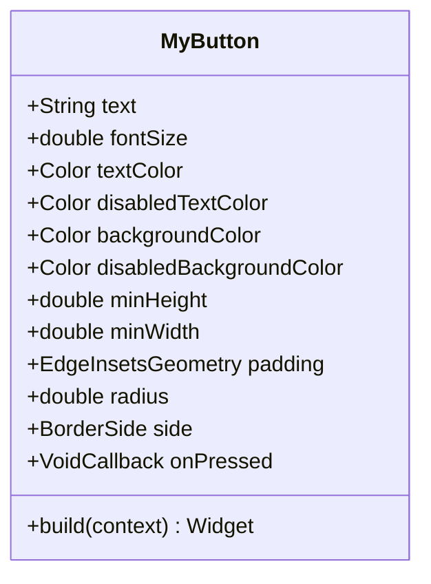

**图表来源**
- [my_button.dart:1-75](file://lib/widgets/my_button.dart#L1-L75)

**章节来源**
- [my_button.dart:1-75](file://lib/widgets/my_button.dart#L1-L75)

### MyCard 卡片容器

`MyCard` 是一个简单容器，用于统一卡片背景、圆角和阴影。它适用于商品卡、订单摘要、统计面板等场景。

| 属性 | 含义 |
|---|---|
| `child` | 卡片内容 |
| `color` | 卡片背景色；为空时根据暗色模式选择默认背景 |
| `shadowColor` | 阴影颜色；暗色模式下透明，浅色模式下默认浅蓝灰 |

实现要点：

- 使用 `DecoratedBox` 绘制背景和阴影。
- 圆角固定为 8。
- 阴影偏移为 `(0, 2)`，模糊半径为 8，营造轻微浮起效果。
- 暗色模式下阴影透明，避免暗色背景下出现突兀阴影。

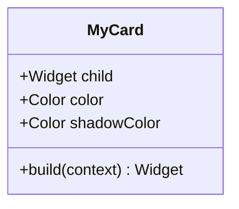

**图表来源**
- [my_card.dart:1-36](file://lib/widgets/my_card.dart#L1-L36)

**章节来源**
- [my_card.dart:1-36](file://lib/widgets/my_card.dart#L1-L36)

### ProgressDialog 进度对话框

`ProgressDialog` 是一个轻量级加载弹窗，通常用于网络请求、权限校验、数据同步等等待场景。

| 属性 | 含义 |
|---|---|
| `hintText` | 加载提示文案 |

实现要点：

- 继承 `Dialog`，使用半透明 `MaterialType.transparency` 背景。
- 居中显示圆形进度指示器和提示文字。
- 容器宽高固定为 120×88，圆角 8，背景深灰。
- 适合覆盖整个屏幕的等待提示，不适合复杂交互。

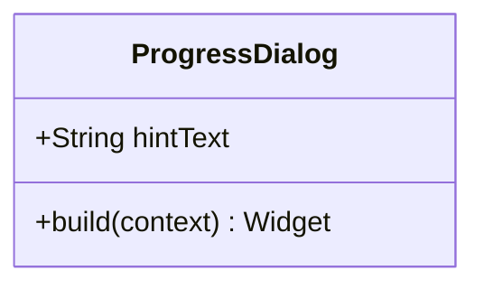

**图表来源**
- [progress_dialog.dart:1-44](file://lib/widgets/progress_dialog.dart#L1-L44)

**章节来源**
- [progress_dialog.dart:1-44](file://lib/widgets/progress_dialog.dart#L1-L44)

### BaseDialog 基础弹窗模板

`BaseDialog` 提供带标题、内容区和双按钮的弹窗模板，常用于需要统一底部操作栏的场景。

| 属性 | 含义 |
|---|---|
| `title` | 弹窗标题 |
| `hiddenTitle` | 是否隐藏标题 |
| `child` | 弹窗内容 |
| `onPressed` | 确定按钮回调 |

实现要点：

- 内部使用 `Material` 包裹内容，圆角 8。
- 底部按钮使用 `MyButton`，左侧取消、右侧确定。
- 通过 `MediaQuery.removeViewInsets` 移除系统键盘对布局的影响。
- Android 11 及以上使用普通 `Padding`，避免与系统键盘动画冲突。

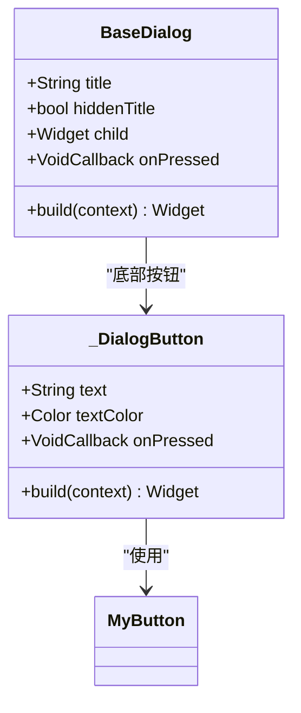

**图表来源**
- [base_dialog.dart:1-129](file://lib/widgets/base_dialog.dart#L1-L129)
- [my_button.dart:1-75](file://lib/widgets/my_button.dart#L1-L75)

**章节来源**
- [base_dialog.dart:1-129](file://lib/widgets/base_dialog.dart#L1-L129)

### PopupWindow 弹出窗口

`PopupWindow` 不是传统对话框，而是一个基于 Overlay 的弹出窗口，适合下拉菜单、排序面板、筛选面板等锚点定位场景。

| 参数 | 含义 |
|---|---|
| `context` | 弹出上下文 |
| `anchor` | 锚点 RenderBox |
| `child` | 弹出内容 |
| `offset` | 相对锚点的偏移 |
| `semanticLabel` | 无障碍标签 |
| `isShowBg` | 是否显示遮罩 |

实现要点：

- 计算锚点在屏幕上的坐标，得到 `RelativeRect`。
- 使用自定义 `_PopupWindowRoute` 作为路由。
- 通过 `_PopupWindowLayoutDelegate` 控制弹出位置和尺寸约束。
- 支持可选遮罩，点击遮罩关闭。
- 提供淡入和缩放动画。

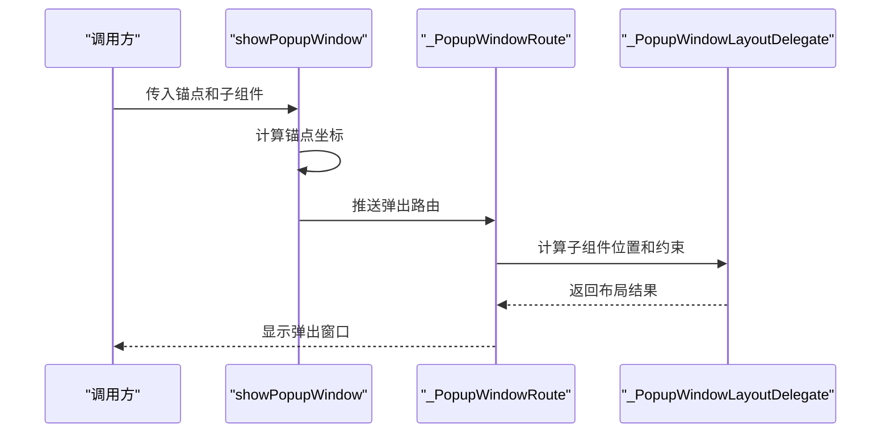

**图表来源**
- [popup_window.dart:1-200](file://lib/widgets/popup_window.dart#L1-L200)

**章节来源**
- [popup_window.dart:1-200](file://lib/widgets/popup_window.dart#L1-L200)

## 业务弹窗与表单组件

### AuthPermissionDialog 权限授权弹窗

`AuthPermissionDialog` 用于敏感操作的权限校验，例如打折、退菜、赠送等。它与原生端 `smdcapp AuthPermissionPopup.kt` 对齐，支持两种授权方式：

| 授权类型 | 说明 |
|---|---|
| 授权码模式 | 输入授权码，可带时间戳格式 |
| 用户名模式 | 输入用户名和用户密码 |

| 属性 | 含义 |
|---|---|
| `title` | 弹窗标题，如“打折”“退菜” |
| `codeid` | 权限码，对应后端菜单或权限标识 |

交互流程如下：

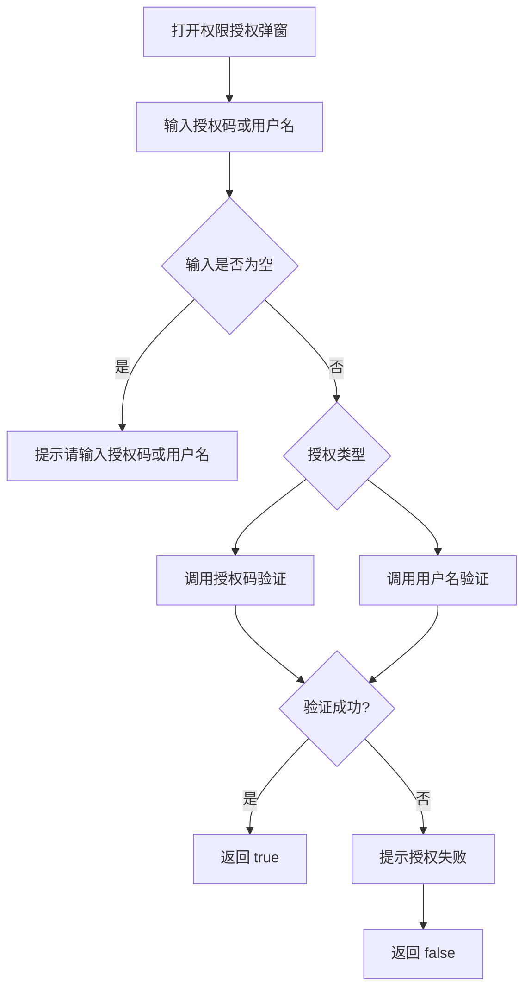

**图表来源**
- [auth_permission_dialog.dart:1-275](file://lib/components/auth_permission_dialog.dart#L1-L275)

关键实现要点：

- 使用 `showDialog` 弹出，`barrierDismissible: false`，防止误触关闭。
- 通过 Tab 切换授权码模式和用户名模式。
- 输入框支持回车提交。
- 验证期间禁用确定按钮并显示加载指示器。
- 授权码支持两种格式：
  - 普通授权码：直接传 `rfid`。
  - 带时间授权码：按 `-` 拆分，分别传 `rfid` 和 `time`。
- 用户名模式传 `usercode`、`userpwd`、`menuid`。
- 网络请求失败时记录日志并提示授权失败。

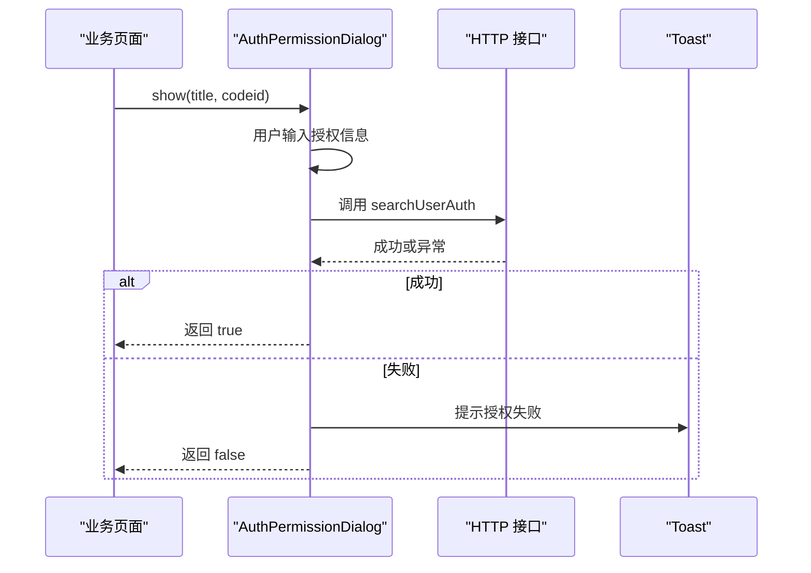

**图表来源**
- [auth_permission_dialog.dart:1-275](file://lib/components/auth_permission_dialog.dart#L1-L275)

**章节来源**
- [auth_permission_dialog.dart:1-275](file://lib/components/auth_permission_dialog.dart#L1-L275)

### ConfirmDialog 确认弹窗

`ConfirmDialog` 是通用确认弹窗，标题居中、内容居中、按钮并排，支持单按钮模式。

| 属性 | 含义 |
|---|---|
| `title` | 弹窗标题 |
| `content` | 弹窗内容 |
| `cancelText` | 取消按钮文案 |
| `confirmText` | 确定按钮文案 |
| `singleButton` | 是否只显示确定按钮 |
| `confirmColor` | 确定按钮颜色 |
| `barrierDismissible` | 点击遮罩是否可关闭 |

返回值：

- 点击确定返回 `true`。
- 点击取消或关闭返回 `false`。

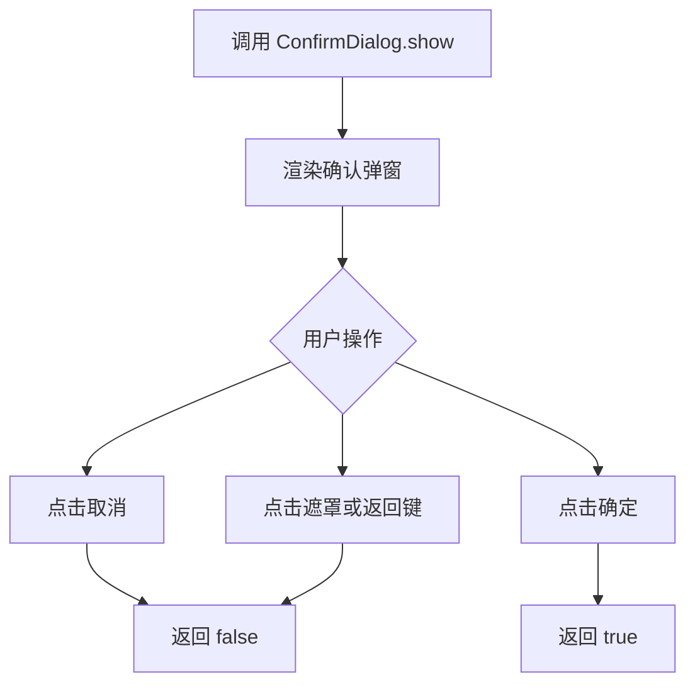

**图表来源**
- [confirm_dialog.dart:1-537](file://lib/components/confirm_dialog.dart#L1-L537)

**章节来源**
- [confirm_dialog.dart:1-537](file://lib/components/confirm_dialog.dart#L1-L537)

### InputDialog 输入弹窗

`InputDialog` 是与 `ConfirmDialog` 同风格的通用输入弹窗，适合整单备注、找零输入、数量输入等场景。

| 属性 | 含义 |
|---|---|
| `title` | 弹窗标题 |
| `hintText` | 输入框占位提示 |
| `initialValue` | 初始值 |
| `cancelText` | 取消按钮文案 |
| `confirmText` | 确定按钮文案 |
| `maxLines` | 最大行数 |
| `keyboardType` | 键盘类型 |
| `inputFormatters` | 输入格式化器 |
| `changeBaseAmount` | 应收金额，超过时显示找零 |
| `suffixText` | 输入框后缀文字 |
| `autoSelectAll` | 获得焦点时自动全选 |
| `submitOnEnter` | 按完成键直接提交 |

返回值：

- 点击确定返回输入文本。
- 点击取消或关闭返回 `null`。

关键实现要点：

- 使用 `KeyboardAvoidingDialogBody` 包裹内容，避免键盘遮挡底部按钮。
- 支持自动全选，适合数字输入快速覆盖。
- 支持找零提示：当输入金额大于应收金额时实时显示找零。
- 支持自定义键盘类型和输入格式化器。
- 默认 `barrierDismissible: false`，防止误触遮罩丢失输入。

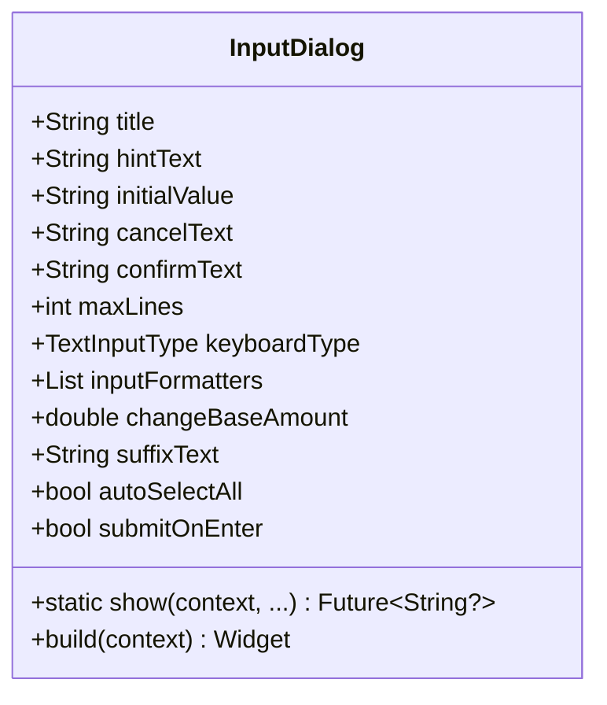

**图表来源**
- [confirm_dialog.dart:201-537](file://lib/components/confirm_dialog.dart#L201-L537)

**章节来源**
- [confirm_dialog.dart:201-537](file://lib/components/confirm_dialog.dart#L201-L537)

### SelectFieldItem 表单选择行

`SelectFieldItem` 是左侧标签、右侧已选值、右箭头点击行的表单组件，适合地址选择、支付方式、配送方式等场景。

| 属性 | 含义 |
|---|---|
| `label` | 左侧标签 |
| `value` | 当前已选值 |
| `hint` | 未选择时的占位提示 |
| `onTap` | 点击回调 |
| `required` | 是否显示必填星号 |
| `labelWidth` | 标签宽度 |

特点：

- 必填星号固定占 8px，保证标签左对齐。
- 已选值和提示文字颜色不同，便于区分。
- 点击区域完整覆盖整行。
- 文本过长时使用省略号。

**章节来源**
- [select_field_item.dart:1-92](file://lib/widgets/select_field_item.dart#L1-L92)

### TextFieldItem 表单输入行

`TextFieldItem` 是简单的表单输入行，适合短文本、电话、金额等输入场景。

| 属性 | 含义 |
|---|---|
| `controller` | 输入控制器 |
| `title` | 左侧标题 |
| `hintText` | 占位提示 |
| `keyboardType` | 键盘类型 |
| `focusNode` | 焦点节点 |

智能输入格式化：

- 小数数字键盘：使用自定义数字格式化器。
- 纯数字或电话键盘：限制仅数字。
- 其他类型：不限制。

可访问性：

- 外层使用 `Semantics`，将提示文案暴露给读屏器。

**章节来源**
- [text_field_item.dart:1-73](file://lib/widgets/text_field_item.dart#L1-L73)

## 图片加载体系

### LoadImage 网络与本地图片统一加载器

`LoadImage` 自动判断图片来源：

- 空字符串或 HTTP 开头：走网络图片加载。
- 其他情况：走本地资源图片加载。

| 属性 | 含义 |
|---|---|
| `image` | 图片地址或本地资源名 |
| `width` | 宽度 |
| `height` | 高度 |
| `fit` | 缩放模式 |
| `format` | 本地图片格式 |
| `holderImg` | 占位图 |
| `cacheWidth` | 内存缓存宽度 |
| `cacheHeight` | 内存缓存高度 |

### LoadAssetImage 本地资源图片加载器

`LoadAssetImage` 负责本地资源图片加载，底层通过 `Image.asset` 加载，并使用 `ImageUtils.getImgPath` 拼接资源路径。

| 属性 | 含义 |
|---|---|
| `image` | 资源文件名 |
| `width` | 宽度 |
| `height` | 高度 |
| `fit` | 缩放模式 |
| `format` | 图片格式 |
| `color` | 图片着色 |
| `cacheWidth` | 内存缓存宽度 |
| `cacheHeight` | 内存缓存高度 |

### ImageUtils 图片工具

`ImageUtils` 提供：

- `getAssetImage`：获取本地图片 Provider。
- `getImgPath`：拼接 `assets/images/文件名.格式`。
- `getImageProvider`：空地址返回占位图，非空地址返回网络图片 Provider。

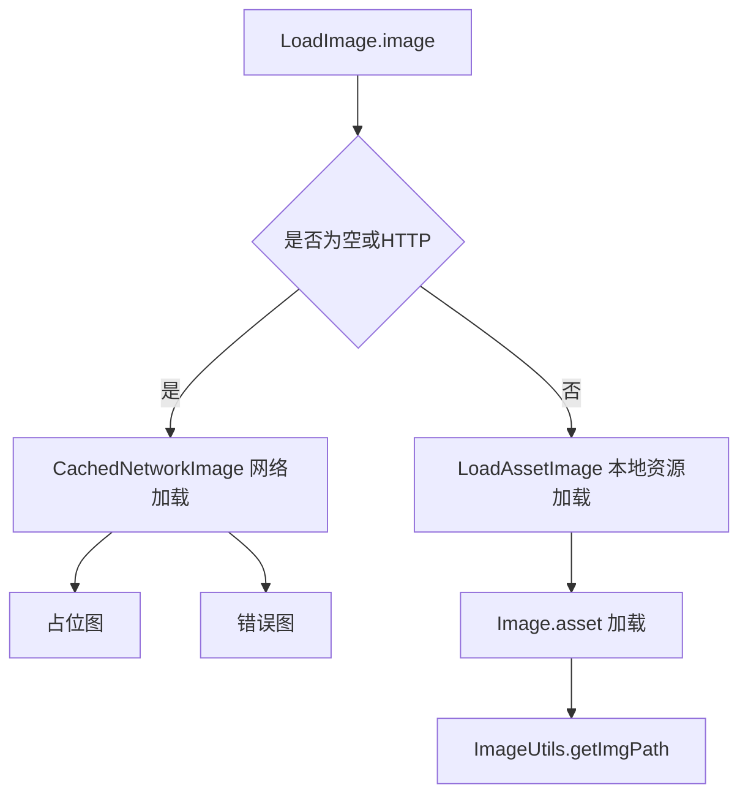

**图表来源**
- [load_image.dart:1-94](file://lib/widgets/load_image.dart#L1-L94)
- [image_utils.dart:1-34](file://lib/util/image_utils.dart#L1-L34)

**章节来源**
- [load_image.dart:1-94](file://lib/widgets/load_image.dart#L1-L94)
- [image_utils.dart:1-34](file://lib/util/image_utils.dart#L1-L34)
- [pubspec.yaml:1-111](file://pubspec.yaml#L1-L111)

## 组件使用示例与最佳实践

### 通用按钮使用

推荐使用 `MyButton` 替代直接使用 `TextButton`，原因：

- 默认主题适配更好。
- 默认禁用态颜色符合品牌规范。
- 可通过 `minWidth`、`minHeight`、`radius`、`side` 精细控制外观。

最佳实践：

- 主操作按钮使用默认蓝色背景。
- 次要操作按钮使用透明背景加边框。
- 危险操作可使用红色主题色。
- 禁用状态不要手动设置不可点击，而是通过 `onPressed` 传空。

### 卡片容器使用

推荐将业务区块放入 `MyCard`，原因：

- 统一圆角和阴影。
- 自动适配暗色模式背景。
- 减少页面级样式重复。

最佳实践：

- 卡片内部不要再包一层多余容器。
- 如果需要更复杂阴影，可传入 `shadowColor`。
- 如果卡片背景需要完全自定义，传入 `color`。

### 进度提示使用

推荐在网络请求、权限校验、数据同步前展示 `ProgressDialog`，完成后立即关闭。

最佳实践：

- 提示文案要具体，如“正在同步桌台数据”。
- 不要在长时间任务中让用户反复触发相同请求。
- 配合业务逻辑判断请求失败后关闭弹窗并提示错误。

### 权限授权弹窗使用

推荐在敏感操作前调用 `AuthPermissionDialog.show`，例如：

- 打折
- 退菜
- 赠送
- 免单

最佳实践：

- `codeid` 必须与后端权限映射一致。
- 授权码格式要与后端约定一致。
- 用户输入为空时不要发起网络请求。
- 授权失败时要给出明确提示。

### 确认弹窗使用

推荐在删除、清空、退出等不可逆操作前调用 `ConfirmDialog.show`。

最佳实践：

- 标题简洁，内容明确。
- 取消按钮颜色偏中性，确定按钮使用品牌红。
- 单按钮模式用于不需要取消的场景。

### 输入弹窗使用

推荐在整单备注、找零、数量、价格等场景使用 `InputDialog.show`。

最佳实践：

- 金额输入设置 `keyboardType` 和 `inputFormatters`。
- 需要快速覆盖输入时开启 `autoSelectAll`。
- 需要回车提交时开启 `submitOnEnter`。
- 找零场景传入 `changeBaseAmount`。

### 表单选择行使用

推荐在支付方式、配送方式、桌台区域等场景使用 `SelectFieldItem`。

最佳实践：

- `value` 为空时显示 `hint`。
- `required` 为真时显示必填标记。
- 点击回调中打开选择器或跳转页面。

### 表单输入行使用

推荐在简单表单中使用 `TextFieldItem`。

最佳实践：

- 数字输入使用对应 `keyboardType`。
- 长表单中结合滚动视图使用。
- 注意焦点管理和键盘避让。

[本节为使用指导，不直接分析具体代码片段]

## 依赖关系分析

### 组件依赖图

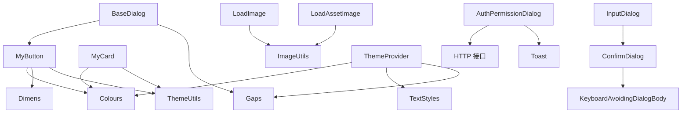

**图表来源**
- [my_button.dart:1-75](file://lib/widgets/my_button.dart#L1-L75)
- [my_card.dart:1-36](file://lib/widgets/my_card.dart#L1-L36)
- [base_dialog.dart:1-129](file://lib/widgets/base_dialog.dart#L1-L129)
- [confirm_dialog.dart:1-537](file://lib/components/confirm_dialog.dart#L1-L537)
- [load_image.dart:1-94](file://lib/widgets/load_image.dart#L1-L94)
- [theme_provider.dart:1-92](file://lib/setting/provider/theme_provider.dart#L1-L92)
- [auth_permission_dialog.dart:1-275](file://lib/components/auth_permission_dialog.dart#L1-L275)

### 外部依赖

| 依赖 | 用途 |
|---|---|
| `cached_network_image` | 网络图片缓存 |
| `dio` | HTTP 网络请求 |
| `oktoast` | Toast 提示 |
| `sp_util` | 本地偏好存储，用于持久化主题 |
| `flutter_svg` | SVG 图标渲染 |
| `provider` | 状态管理 |
| `sqflite` | 本地数据库 |
| `common_utils` | 通用工具类，包括字符串、图片格式等 |

**章节来源**
- [pubspec.yaml:1-111](file://pubspec.yaml#L1-L111)

## 性能优化建议

### 图片加载优化

- 使用 `LoadImage` 而非直接 `Image.network`，以获得占位图和错误图处理。
- 对于大图，传入 `cacheWidth` 和 `cacheHeight`，避免内存中保留过大像素图。
- 本地资源图片使用 `LoadAssetImage`，并通过 `ImageUtils.getImgPath` 统一路径。
- 避免在同一页面重复加载相同网络图片，必要时在上层做缓存。
- 列表中的图片建议使用懒加载和复用策略。

### 主题渲染优化

- 主题变化通过 `ThemeProvider` 通知监听者，避免全量重建。
- 组件内部通过 `Theme.of(context)` 或 `context.isDark` 读取主题，不要缓存过期的主题值。
- 暗色模式下避免使用高对比度阴影，`MyCard` 已在暗色模式下使用透明阴影。

### 弹窗性能

- `ProgressDialog` 应尽量短时展示，避免阻塞用户操作。
- `AuthPermissionDialog` 在验证期间禁用按钮，防止重复提交。
- `ConfirmDialog` 和 `InputDialog` 使用 `showDialog`，生命周期由框架管理。
- 大量弹窗嵌套时应避免同时打开多个模态弹窗。

### 输入优化

- `InputDialog` 使用 `TextEditingController` 和 `FocusNode`，并在 `dispose` 中释放。
- 自动全选场景下，只在焦点存在时更新选择范围。
- 金额输入场景使用格式化器，避免无效字符进入模型。

[本节为通用性能建议，不直接分析具体代码片段]

## 可访问性与响应式设计

### 可访问性支持

组件库部分组件提供了可访问性支持：

- `TextFieldItem` 使用 `Semantics` 暴露输入提示，帮助读屏器理解输入框用途。
- `LoadAssetImage` 使用 `excludeFromSemantics: true`，因为装饰性图标通常不需要语义描述。
- `PopupWindow` 使用 `Semantics.scopesRoute`、`namesRoute`、`explicitChildNodes`，并设置 `semanticLabel`。
- 按钮和可点击区域尽量使用原生控件或明确的 `GestureDetector`。

改进建议：

- 为业务弹窗添加 `Semantic` 包裹，描述弹窗用途。
- 为图片添加有意义的 `Semantics`，特别是功能型图片。
- 确保所有可点击区域有足够点击面积。
- 在高对比度模式下检查颜色可读性。

### 响应式设计考虑

组件库主要面向移动端，但仍有一些响应式考虑：

- `AuthPermissionDialog` 宽度使用屏幕宽度的 85%。
- `ConfirmDialog` 和 `InputDialog` 使用固定宽度 300，适合手机竖屏。
- `BaseDialog` 使用 `MediaQuery.removeViewInsets` 和平台差异处理键盘弹出。
- `PopupWindow` 基于 `RenderBox` 计算位置，适应不同屏幕尺寸。
- 主题系统通过 `ThemeData` 适配横竖屏和系统主题变化。

改进建议：

- 平板场景下可增大弹窗宽度。
- 横屏场景下检查弹窗是否被键盘或状态栏遮挡。
- 大字号模式下检查文本溢出和布局压缩。

[本节为通用可访问性和响应式设计讨论，不直接分析具体代码片段]

## 测试与调试指南

### 单元测试

通用组件适合进行单元和 widget 测试：

- `MyButton`：模拟点击事件，验证 `onPressed` 是否触发。
- `MyCard`：验证背景色、圆角、阴影是否符合预期。
- `LoadImage`：可模拟网络图片和本地资源路径。
- `SelectFieldItem`：验证点击回调和必填标记。
- `TextFieldItem`：验证输入格式化器和语义标签。

测试建议：

- 使用 `flutter_test` 提供的 `WidgetTester`。
- 使用 `fake_async` 或 `mockito` 模拟异步行为。
- 对主题相关组件，使用 `MaterialApp` 包裹并设置主题。

### 黄金测试

黄金测试适合验证组件视觉一致性：

- 对比按钮、卡片、弹窗在不同主题下的截图。
- 检查暗色模式下颜色是否正确。
- 检查键盘弹起时弹窗是否上移。

### 调试技巧

- 使用 `debugPaintSizeEnabled` 查看布局边界。
- 使用 `debugDumpTree()` 打印组件树，排查冗余节点。
- 对网络请求失败的权限弹窗，检查日志输出。
- 对键盘遮挡问题，检查 `MediaQuery.viewInsets` 和 `KeyboardAvoidingDialogBody`。
- 对图片加载问题，检查 `ImageUtils.getImgPath` 和资源路径是否正确。

**章节来源**
- [pubspec.yaml:1-111](file://pubspec.yaml#L1-L111)

## 结论

聚客美滋滋应用的 UI 组件库以资源层为核心，向上提供通用 UI 组件和业务弹窗组件，向下依赖主题、颜色、尺寸、文本样式等基础资源。其优势在于：

- 主题统一：颜色、尺寸、文本样式集中管理，支持明暗模式。
- 组件清晰：通用组件与业务组件分离，职责明确。
- 交互完善：权限授权、确认、输入、进度提示等常见场景都有封装。
- 扩展性强：可在现有组件基础上继续扩展更多业务弹窗和表单控件。

后续建议：

- 补充组件文档站点或使用示例页面。
- 为关键组件补充单元测试和黄金测试。
- 逐步引入组件文档注解，提升开发体验。
- 对平板和大屏设备做额外适配验证。
- 持续收集业务页面中的自定义样式，提炼为新的通用组件。

[本节为总结性内容，不直接分析具体代码片段]