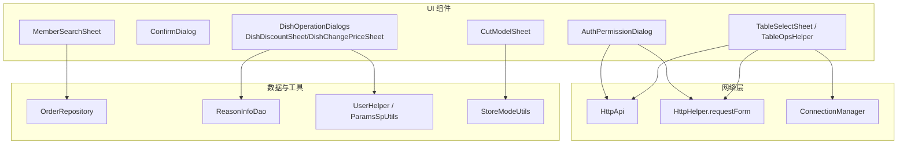
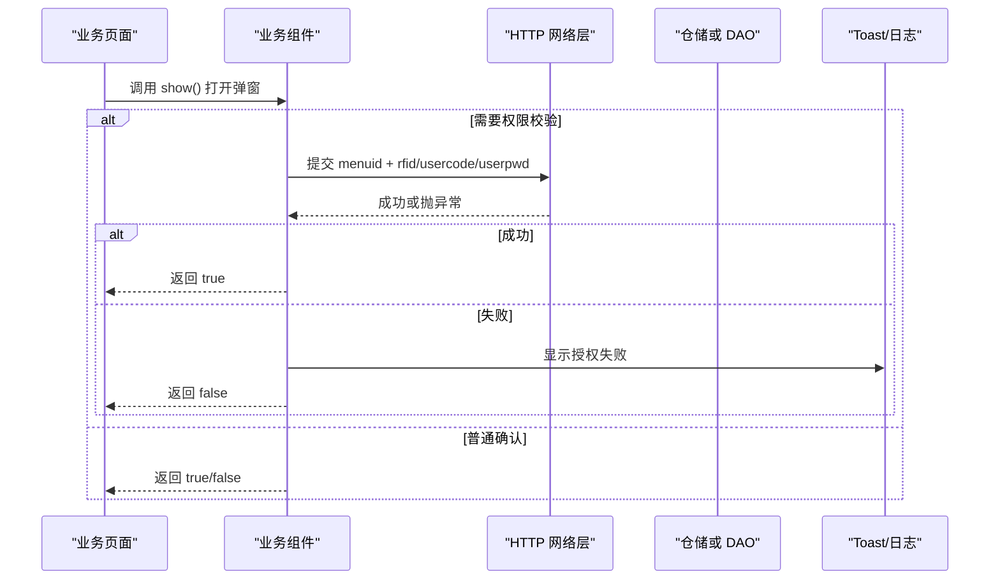
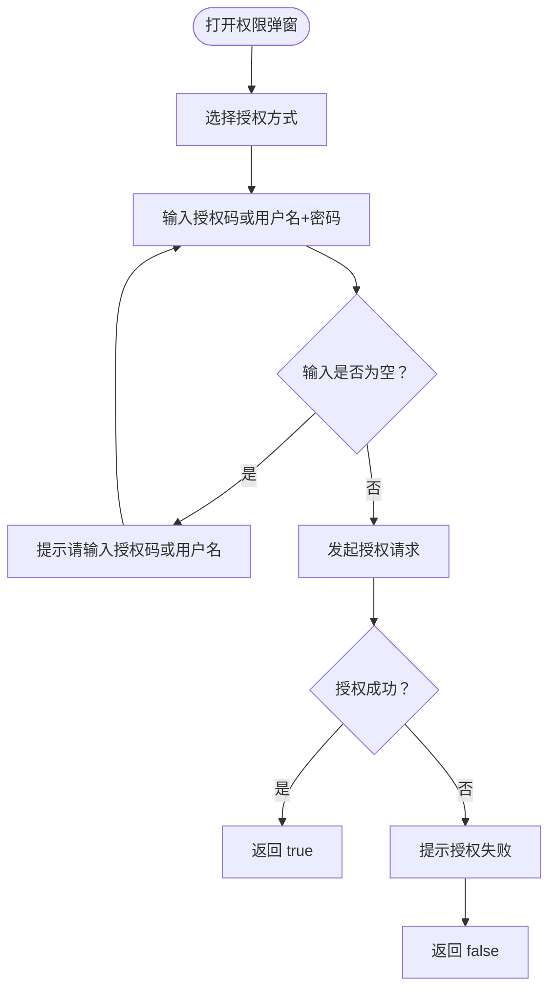
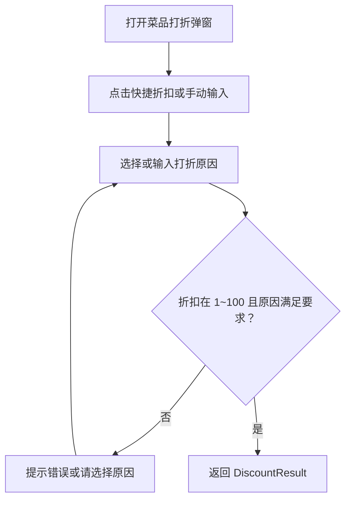
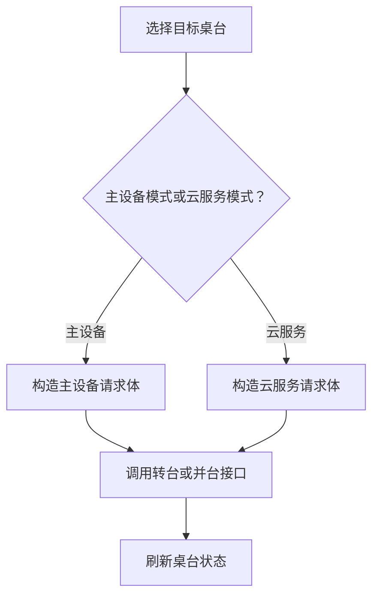
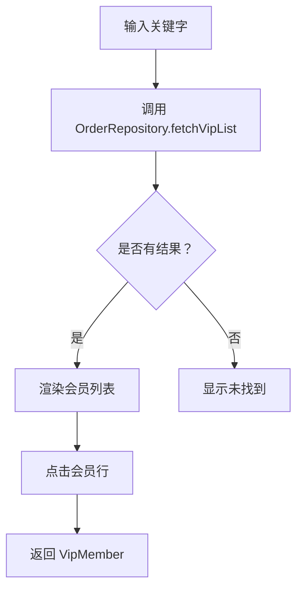
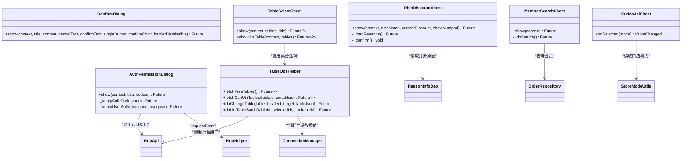

# 业务专用组件

<cite>
**本文引用的文件**   
- [auth_permission_dialog.dart](file://lib/components/auth_permission_dialog.dart)
- [confirm_dialog.dart](file://lib/components/confirm_dialog.dart)
- [dish_operation_dialogs.dart](file://lib/components/dish_operation_dialogs.dart)
- [table_select_sheet.dart](file://lib/components/table_select_sheet.dart)
- [member_search_sheet.dart](file://lib/components/member_search_sheet.dart)
- [cut_model_sheet.dart](file://lib/components/cut_model_sheet.dart)
- [order_repository.dart](file://lib/pages/order/order_repository.dart)
- [http_api.dart](file://lib/net/http_api.dart)
- [http_helper.dart](file://lib/net/http_helper.dart)
- [connection_manager.dart](file://lib/net/connection_manager.dart)
- [store_mode_utils.dart](file://lib/util/store_mode_utils.dart)
- [reason_info_dao.dart](file://lib/db/dao/reason_info_dao.dart)
- [user_helper.dart](file://lib/util/user_helper.dart)
- [params_sp_utils.dart](file://lib/util/params_sp_utils.dart)
</cite>

## 目录
1. [介绍](#介绍)
2. [项目结构](#项目结构)
3. [核心组件总览](#核心组件总览)
4. [架构总览](#架构总览)
5. [组件详细分析](#组件详细分析)
6. [依赖关系分析](#依赖关系分析)
7. [性能与可维护性建议](#性能与可维护性建议)
8. [常见问题与排错](#常见问题与排错)
9. [结论](#结论)

## 介绍
本文面向餐饮业务场景中的专用 Flutter 组件，重点说明以下六个组件的实现细节、调用方式和错误处理：
- 权限验证弹窗 `AuthPermissionDialog`
- 通用确认对话框 `ConfirmDialog`
- 菜品操作对话框集合 `DishOperationDialogs`（包含打折、改价等）
- 桌台选择与操作 `TableSelectSheet` 及工具类 `TableOpsHelper`
- 会员搜索弹窗 `MemberSearchSheet`
- 切模选择弹窗 `CutModelSheet`

这些组件共同承担点餐、结账、转台、并台、会员绑定和门店模式切换等业务关键流程。文档不仅解释“怎么用”，还深入说明内部校验逻辑、网络请求路径、状态反馈和异常分支，帮助开发者在真实订单场景中正确集成。

## 项目结构
这些组件位于 `lib/components` 目录下，属于 UI 层业务组件；它们通过 `net` 层发起 HTTP 请求，通过 `db` 层读取配置数据，并通过 `util` 层获取用户、参数和门店模式等信息。调用方通常位于 `lib/pages` 下的订单、桌台、设置等页面。



**图表来源**
- [auth_permission_dialog.dart:1-275](file://lib/components/auth_permission_dialog.dart#L1-L275)
- [dish_operation_dialogs.dart:1-600](file://lib/components/dish_operation_dialogs.dart#L1-L600)
- [table_select_sheet.dart:1-531](file://lib/components/table_select_sheet.dart#L1-L531)
- [member_search_sheet.dart:1-261](file://lib/components/member_search_sheet.dart#L1-L261)
- [cut_model_sheet.dart:1-162](file://lib/components/cut_model_sheet.dart#L1-L162)
- [http_api.dart](file://lib/net/http_api.dart)
- [http_helper.dart](file://lib/net/http_helper.dart)
- [connection_manager.dart](file://lib/net/connection_manager.dart)
- [order_repository.dart](file://lib/pages/order/order_repository.dart)
- [reason_info_dao.dart](file://lib/db/dao/reason_info_dao.dart)
- [user_helper.dart](file://lib/util/user_helper.dart)
- [params_sp_utils.dart](file://lib/util/params_sp_utils.dart)
- [store_mode_utils.dart](file://lib/util/store_mode_utils.dart)

**章节来源**
- [auth_permission_dialog.dart:1-275](file://lib/components/auth_permission_dialog.dart#L1-L275)
- [confirm_dialog.dart:1-537](file://lib/components/confirm_dialog.dart#L1-L537)
- [dish_operation_dialogs.dart:1-600](file://lib/components/dish_operation_dialogs.dart#L1-L600)
- [table_select_sheet.dart:1-531](file://lib/components/table_select_sheet.dart#L1-L531)
- [member_search_sheet.dart:1-261](file://lib/components/member_search_sheet.dart#L1-L261)
- [cut_model_sheet.dart:1-162](file://lib/components/cut_model_sheet.dart#L1-L162)

## 核心组件总览

| 组件 | 主要职责 | 输入 | 输出或回调 | 典型调用场景 |
|---|---|---|---|---|
| `AuthPermissionDialog` | 对敏感操作进行权限校验 | 标题、权限码 | `Future<bool>` 授权是否成功 | 打折、退菜、赠送等需二次授权的操作 |
| `ConfirmDialog` | 通用确认提示 | 标题、内容、按钮文案 | `Future<bool>` 是否确认 | 清空购物车、删除订单、关闭桌台前确认 |
| `DishOperationDialogs` | 菜品打折、改价、改名、赠送等操作 | 菜品名称、当前折扣/价格等 | 结构化结果对象，如 `DiscountResult` | 下单页、购物车、订单修改页 |
| `TableSelectSheet` | 桌台单选或多选展示 | 桌台列表、标题 | 选中桌台 JSON 或列表 | 转台、并台、拆台目标桌选择 |
| `MemberSearchSheet` | 会员搜索与选择 | 无 | 选中的 `VipMember` | 绑定会员、查询余额积分 |
| `CutModelSheet` | 门店模式选择 | 无 | 模式码回调 | 正餐/快餐模式切换 |

**章节来源**
- [auth_permission_dialog.dart:1-275](file://lib/components/auth_permission_dialog.dart#L1-L275)
- [confirm_dialog.dart:1-200](file://lib/components/confirm_dialog.dart#L1-L200)
- [dish_operation_dialogs.dart:1-200](file://lib/components/dish_operation_dialogs.dart#L1-L200)
- [table_select_sheet.dart:1-200](file://lib/components/table_select_sheet.dart#L1-L200)
- [member_search_sheet.dart:1-200](file://lib/components/member_search_sheet.dart#L1-L200)
- [cut_model_sheet.dart:1-162](file://lib/components/cut_model_sheet.dart#L1-L162)

## 架构总览



**图表来源**
- [auth_permission_dialog.dart:201-275](file://lib/components/auth_permission_dialog.dart#L201-L275)
- [confirm_dialog.dart:1-200](file://lib/components/confirm_dialog.dart#L1-L200)
- [http_helper.dart](file://lib/net/http_helper.dart)
- [http_api.dart](file://lib/net/http_api.dart)

**章节来源**
- [auth_permission_dialog.dart:201-275](file://lib/components/auth_permission_dialog.dart#L201-L275)
- [confirm_dialog.dart:1-200](file://lib/components/confirm_dialog.dart#L1-L200)

## 组件详细分析

### 权限验证弹窗 `AuthPermissionDialog`

#### 功能概述
该组件用于打折、退菜、赠送等敏感操作的权限校验。它支持两种授权方式：
- 授权码模式：输入授权码，调用统一认证接口。
- 用户名密码模式：输入用户名和密码，调用统一认证接口。

最终返回 `bool`，表示授权是否成功；失败时通过 Toast 提示，并记录日志。

#### 交互流程


**图表来源**
- [auth_permission_dialog.dart:1-200](file://lib/components/auth_permission_dialog.dart#L1-L200)
- [auth_permission_dialog.dart:201-275](file://lib/components/auth_permission_dialog.dart#L201-L275)

#### 权限检查逻辑
- 若未输入授权码或用户名，直接提示并阻止提交。
- 若选择用户名模式但未输入密码，提示并阻止提交。
- 授权码可能为普通授权码或带时间的授权码：
  - 不含分隔符的授权码按普通授权码处理。
  - 含分隔符时，拆分为授权码和时间两个字段。
- 用户名密码模式直接提交用户名、密码和权限码。
- 所有请求均通过统一的表单请求方法发起；成功后返回布尔值，失败则捕获异常并返回 false。

#### 调用方式示例
业务页面可以在执行敏感操作前调用：
```dart
final authorized = await AuthPermissionDialog.show(
  context,
  title: '打折',
  codeid: '菜单权限码',
);
if (authorized) {
  // 执行打折、退菜、赠送等操作
}
```

#### 错误处理
- 输入为空时即时提示。
- 网络异常或接口失败时提示“授权失败”。
- 异常信息会写入日志，便于排查。

**章节来源**
- [auth_permission_dialog.dart:1-275](file://lib/components/auth_permission_dialog.dart#L1-L275)
- [http_api.dart](file://lib/net/http_api.dart)
- [http_helper.dart](file://lib/net/http_helper.dart)

### 确认对话框 `ConfirmDialog`

#### 功能概述
`ConfirmDialog` 提供居中标题、居中内容、双按钮或单按钮模式的通用确认弹窗。它还配套提供了风格一致的输入弹窗 `InputDialog`，支持金额找零显示、自动全选、回车提交等能力。

#### 消息展示与用户确认逻辑
- 标题默认“提示”，内容必填。
- 取消按钮返回 `false`。
- 确定按钮返回 `true`。
- 可通过 `singleButton` 仅显示确定按钮。
- 遮罩可配置是否允许点击关闭。
- `InputDialog` 支持：
  - 初始值。
  - 键盘类型和输入格式化器。
  - 最大行数。
  - 后缀单位文本。
  - 输入超过应收金额时实时显示找零。
  - 获得焦点时自动全选。
  - 按完成键直接提交。

#### 调用方式示例
```dart
final confirmed = await ConfirmDialog.show(
  context,
  title: '提示',
  content: '确定要清空购物车吗？',
);
if (confirmed) {
  // 清空购物车
}
```

#### 输入弹窗扩展用法
```dart
final remark = await InputDialog.show(
  context,
  title: '整单备注',
  hintText: '输入整单备注…',
  initialValue: _orderRemark,
);
if (remark != null) {
  // 使用备注
}
```

**章节来源**
- [confirm_dialog.dart:1-537](file://lib/components/confirm_dialog.dart#L1-L537)

### 菜品操作对话框 `DishOperationDialogs`

#### 功能概述
`DishOperationDialogs` 聚合了多个菜品操作弹窗，包括：
- 菜品打折弹窗 `DishDiscountSheet`
- 菜品改价弹窗 `DishChangePriceSheet`
- 以及命名结果、赠送结果等数据结构

其中打折弹窗还支持快捷折扣按钮、内置数字键盘和打折原因选择。

#### 打折逻辑
- 快捷按钮支持“不打折”“60%”“70%”“80%”“90%”。
- 折扣输入限制为 1~100。
- 当后台要求必须填写打折原因时，如果折扣小于 100%，必须选择或输入原因。
- 原因来源于后台配置的打折原因类型。
- 返回值是 `DiscountResult`，包含折扣率和原因备注。

#### 改价逻辑
- 输入价格必须大于 0。
- 输入为空或非数字时提示错误。
- 返回值是修改后的价格。

#### 调用方式示例
```dart
// 菜品打折
final discount = await DishDiscountSheet.show(
  context,
  dishName: '招牌菜',
  currentDiscount: 100,
  showNumpad: false,
);
if (discount != null) {
  // 使用折扣率与原因
}

// 菜品改价
final price = await DishChangePriceSheet.show(
  context,
  dishName: '招牌菜',
  currentPrice: 38.0,
);
if (price != null) {
  // 使用新价格
}
```

#### 数据流


**图表来源**
- [dish_operation_dialogs.dart:1-600](file://lib/components/dish_operation_dialogs.dart#L1-L600)
- [reason_info_dao.dart](file://lib/db/dao/reason_info_dao.dart)
- [user_helper.dart](file://lib/util/user_helper.dart)
- [params_sp_utils.dart](file://lib/util/params_sp_utils.dart)

**章节来源**
- [dish_operation_dialogs.dart:1-600](file://lib/components/dish_operation_dialogs.dart#L1-L600)
- [reason_info_dao.dart](file://lib/db/dao/reason_info_dao.dart)
- [user_helper.dart](file://lib/util/user_helper.dart)
- [params_sp_utils.dart](file://lib/util/params_sp_utils.dart)

### 桌台选择 `TableSelectSheet` 与工具类 `TableOpsHelper`

#### 功能概述
`TableSelectSheet` 提供桌台选择和并台/拆台多选界面：
- 单选：返回选中桌台的 JSON。
- 多选：返回选中桌台列表，常用于并台、拆台。
- 多选卡片根据 `unitableid` 显示徽章：“已合并”“待合并”“拆台”。

`TableOpsHelper` 封装了桌台相关网络操作：
- 获取空闲桌台列表。
- 获取可并台桌台列表。
- 执行转台。
- 执行并台或拆台。
- 解析不同响应格式的桌台列表。

#### 区域筛选与桌台状态
- 空闲桌台查询会传入桌台状态过滤条件。
- 主设备模式和云服务模式使用不同的 API 和请求体。
- 可并台查询会根据是否已有并台主桌决定传 `tableid` 还是 `unitableid`。
- 响应解析兼容 `data.list`、`Data.tableMasterTmpList`、`tableList` 等多种字段。

#### 调用方式示例
```dart
// 选择目标桌台
final target = await TableSelectSheet.show(
  context,
  tables: freeTables,
  title: '选择目标桌台',
);
if (target != null) {
  // 执行转台
}

// 并台多选
final selected = await TableSelectSheet.showUniTable(
  context,
  tables: canUniTables,
);
if (selected != null) {
  // 批量并台
}
```

#### 转台与并台流程


**图表来源**
- [table_select_sheet.dart:201-531](file://lib/components/table_select_sheet.dart#L201-L531)
- [connection_manager.dart](file://lib/net/connection_manager.dart)
- [http_api.dart](file://lib/net/http_api.dart)
- [http_helper.dart](file://lib/net/http_helper.dart)

**章节来源**
- [table_select_sheet.dart:1-531](file://lib/components/table_select_sheet.dart#L1-L531)
- [connection_manager.dart](file://lib/net/connection_manager.dart)
- [http_api.dart](file://lib/net/http_api.dart)
- [http_helper.dart](file://lib/net/http_helper.dart)

### 会员搜索 `MemberSearchSheet`

#### 功能概述
会员搜索弹窗用于录入会员：
- 支持卡号、姓名、手机号搜索。
- 搜索结果以列表展示，包含会员名称、类型、卡号、余额、积分。
- 选中后返回 `VipMember` 对象。

#### 搜索算法
- 输入为空时不发起搜索。
- 点击搜索按钮或按回车时触发搜索。
- 搜索期间显示加载状态。
- 搜索失败时停止加载状态，但不会中断用户继续输入。
- 实际搜索委托给 `OrderRepository.fetchVipList`。

#### 调用方式示例
```dart
final member = await MemberSearchSheet.show(context);
if (member != null) {
  // 使用会员信息，如绑定到订单
}
```

#### 数据流


**图表来源**
- [member_search_sheet.dart:1-261](file://lib/components/member_search_sheet.dart#L1-L261)
- [order_repository.dart](file://lib/pages/order/order_repository.dart)

**章节来源**
- [member_search_sheet.dart:1-261](file://lib/components/member_search_sheet.dart#L1-L261)
- [order_repository.dart](file://lib/pages/order/order_repository.dart)

### 切模选择 `CutModelSheet`

#### 功能概述
切模选择弹窗用于切换门店模式：
- 选项包括正餐模式和快餐模式。
- 配送模式入口隐藏，暂不开放。
- 选中后立即关闭弹窗，并通过回调通知上层。
- 初始选中态来自当前门店模式。

#### 模式选择与价格计算
- 组件本身不直接计算价格，而是传递模式码给上层。
- 上层可根据模式码调整菜单展示、计价策略或订单行为。
- 模式常量由 `StoreModeUtils` 提供。

#### 调用方式示例
```dart
Navigator.of(context).push(
  MaterialPageRoute(
    builder: (_) => CutModelSheet(
      onSelected: (mode) {
        // mode 为 1=快餐，2=正餐，3=配送
        // 根据模式更新页面状态或重新加载菜单
      },
    ),
  ),
);
```

**章节来源**
- [cut_model_sheet.dart:1-162](file://lib/components/cut_model_sheet.dart#L1-L162)
- [store_mode_utils.dart](file://lib/util/store_mode_utils.dart)

## 依赖关系分析



**图表来源**
- [auth_permission_dialog.dart:1-275](file://lib/components/auth_permission_dialog.dart#L1-L275)
- [confirm_dialog.dart:1-537](file://lib/components/confirm_dialog.dart#L1-L537)
- [dish_operation_dialogs.dart:1-600](file://lib/components/dish_operation_dialogs.dart#L1-L600)
- [table_select_sheet.dart:1-531](file://lib/components/table_select_sheet.dart#L1-L531)
- [member_search_sheet.dart:1-261](file://lib/components/member_search_sheet.dart#L1-L261)
- [cut_model_sheet.dart:1-162](file://lib/components/cut_model_sheet.dart#L1-L162)
- [http_api.dart](file://lib/net/http_api.dart)
- [http_helper.dart](file://lib/net/http_helper.dart)
- [connection_manager.dart](file://lib/net/connection_manager.dart)
- [order_repository.dart](file://lib/pages/order/order_repository.dart)
- [reason_info_dao.dart](file://lib/db/dao/reason_info_dao.dart)
- [store_mode_utils.dart](file://lib/util/store_mode_utils.dart)

**章节来源**
- [auth_permission_dialog.dart:1-275](file://lib/components/auth_permission_dialog.dart#L1-L275)
- [dish_operation_dialogs.dart:1-600](file://lib/components/dish_operation_dialogs.dart#L1-L600)
- [table_select_sheet.dart:1-531](file://lib/components/table_select_sheet.dart#L1-L531)
- [member_search_sheet.dart:1-261](file://lib/components/member_search_sheet.dart#L1-L261)
- [cut_model_sheet.dart:1-162](file://lib/components/cut_model_sheet.dart#L1-L162)

## 性能与可维护性建议

1. **避免重复网络请求**
   - 桌台列表和可并台列表建议在父页面缓存，弹窗内只负责展示和选择。
   - 会员搜索应加入防抖，避免频繁请求。

2. **合理管理弹窗生命周期**
   - 输入框控制器应在 `dispose` 中释放，避免内存泄漏。
   - 弹窗关闭前应确保异步任务已完成或取消。

3. **统一错误提示**
   - 权限失败、输入非法、网络异常等应统一使用 Toast 或 SnackBar 提示。
   - 严重异常应记录日志，便于线上问题定位。

4. **保持与原生行为一致**
   - 组件注释多处对齐原生实现，新增逻辑时应优先参考原生行为，减少体验差异。

5. **主设备与云服务模式兼容**
   - 桌台相关操作需严格区分主设备和云服务模式，避免请求体字段不一致导致后端解析失败。

[本节为通用建议，不直接分析具体文件]

## 常见问题与排错

### 权限弹窗始终失败
- 检查权限码是否正确。
- 检查授权码格式是否符合“普通授权码”或“带时间授权码”规则。
- 检查用户名密码模式是否同时输入用户名和密码。
- 查看日志中授权失败的异常信息。

**章节来源**
- [auth_permission_dialog.dart:201-275](file://lib/components/auth_permission_dialog.dart#L201-L275)

### 打折原因必填但未提示
- 检查后台是否开启打折原因必填。
- 检查折扣是否小于 100%。
- 检查是否选择了原因或手动输入了原因。

**章节来源**
- [dish_operation_dialogs.dart:1-600](file://lib/components/dish_operation_dialogs.dart#L1-L600)
- [params_sp_utils.dart](file://lib/util/params_sp_utils.dart)

### 桌台列表为空
- 检查桌台状态过滤条件是否正确。
- 检查主设备模式与云服务模式对应的 API 是否调用正确。
- 检查响应字段是否被正确解析。

**章节来源**
- [table_select_sheet.dart:201-531](file://lib/components/table_select_sheet.dart#L201-L531)

### 会员搜索无结果
- 检查搜索关键词是否为空。
- 检查 `OrderRepository.fetchVipList` 是否返回空列表。
- 检查网络连接是否正常。

**章节来源**
- [member_search_sheet.dart:1-261](file://lib/components/member_search_sheet.dart#L1-L261)
- [order_repository.dart](file://lib/pages/order/order_repository.dart)

### 切模选择后页面状态未更新
- 检查 `onSelected` 回调是否被调用。
- 检查上层是否在回调中更新了状态或重新加载菜单。
- 注意弹窗先关闭再触发回调的设计，避免路由冲突。

**章节来源**
- [cut_model_sheet.dart:1-162](file://lib/components/cut_model_sheet.dart#L1-L162)

## 结论
这六个业务专用组件覆盖了餐饮点餐系统中权限校验、用户确认、菜品操作、桌台管理和会员查找等关键环节。它们在 UI 层提供清晰的交互入口，在网络层对接统一接口，在数据层依赖仓库和 DAO，并在工具层复用用户、参数和门店模式信息。使用时应重点关注：
- 权限校验的输入合法性与失败反馈。
- 打折、改价的数值范围与原因约束。
- 桌台模式差异和响应字段兼容性。
- 会员搜索的加载状态和无结果处理。
- 切模选择的回调时机和状态同步。

遵循本文的使用示例和排错建议，可在真实订单场景中稳定集成这些组件，并保持与原生应用一致的体验和逻辑。