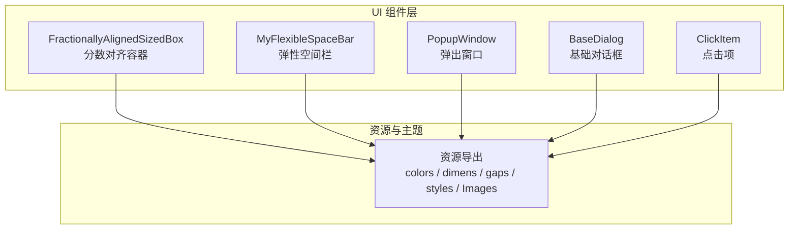
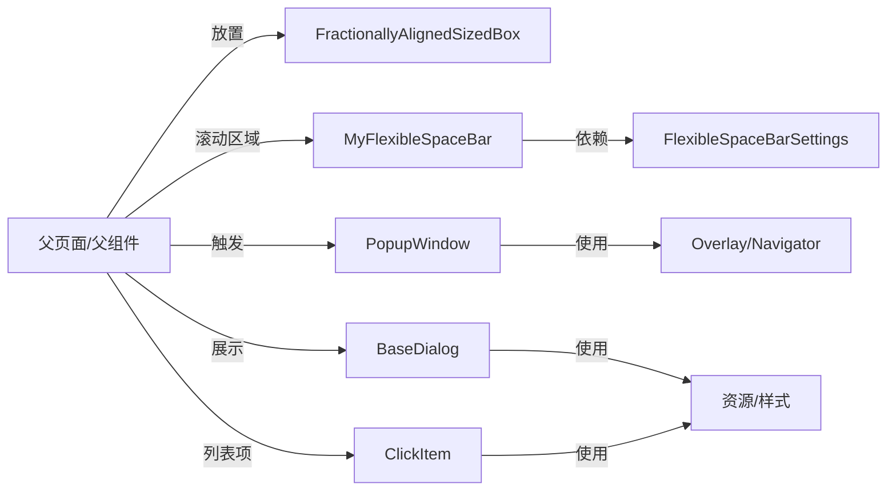
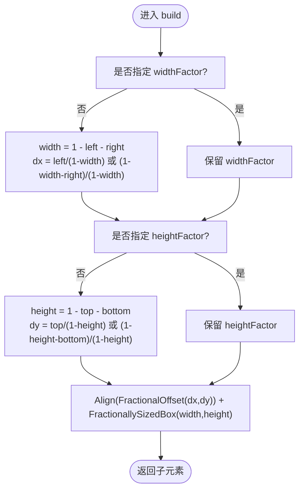
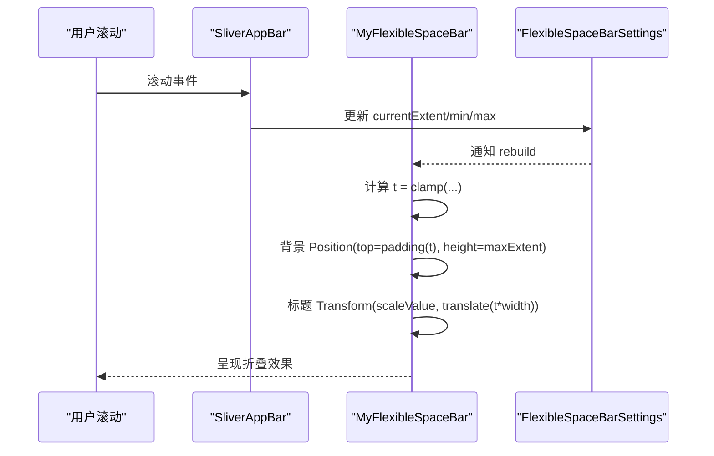
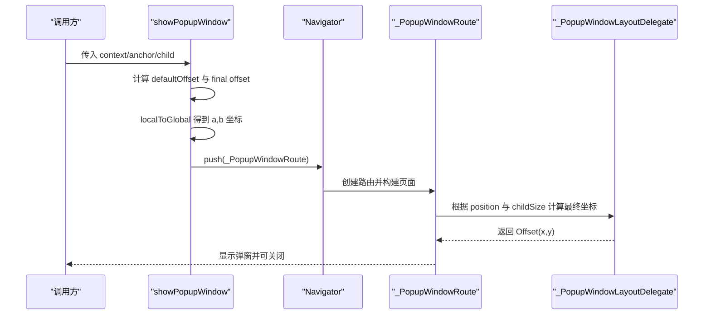
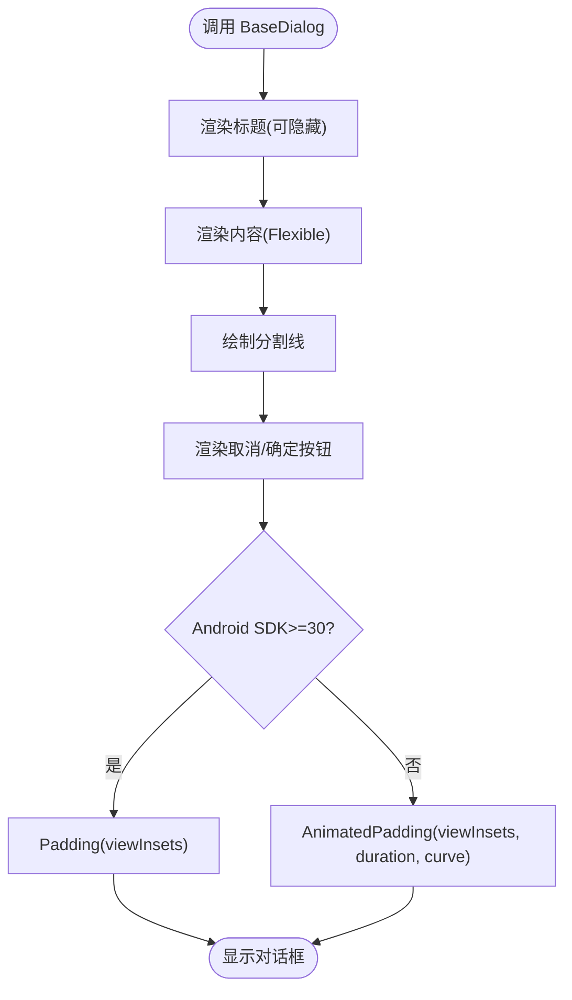
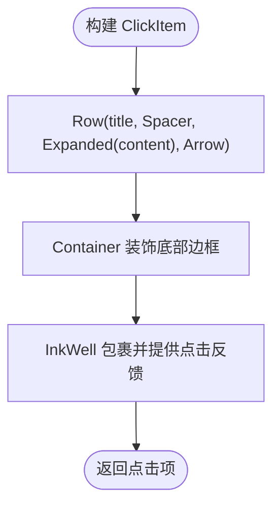
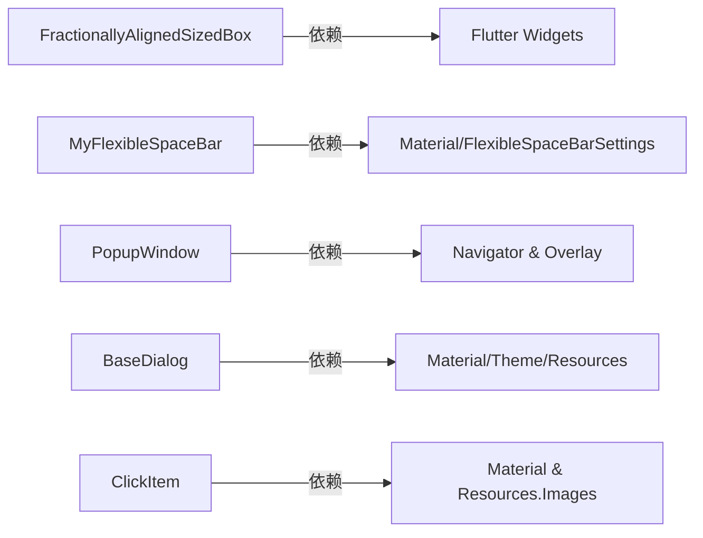
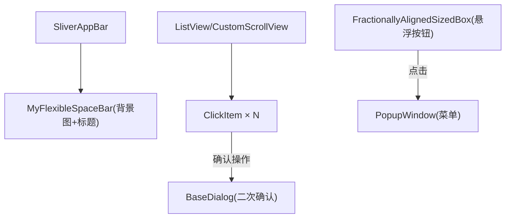
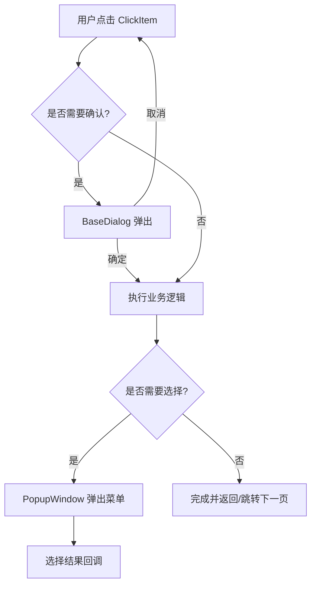

# 布局与导航组件

<cite>
**本文引用的文件**   
- [fractionally_aligned_sized_box.dart](file://lib/widgets/fractionally_aligned_sized_box.dart)
- [my_flexible_space_bar.dart](file://lib/widgets/my_flexible_space_bar.dart)
- [popup_window.dart](file://lib/widgets/popup_window.dart)
- [base_dialog.dart](file://lib/widgets/base_dialog.dart)
- [click_item.dart](file://lib/widgets/click_item.dart)
- [resources.dart](file://lib/res/resources.dart)
</cite>

## 目录
1. [引言](#引言)
2. [项目结构定位](#项目结构定位)
3. [核心组件总览](#核心组件总览)
4. [架构总览](#架构总览)
5. [组件详解](#组件详解)
6. [依赖关系分析](#依赖关系分析)
7. [复杂页面布局构建方法](#复杂页面布局构建方法)
8. [导航流程设计模式](#导航流程设计模式)
9. [性能优化建议](#性能优化建议)
10. [内存泄漏防护最佳实践](#内存泄漏防护最佳实践)
11. [故障排查指南](#故障排查指南)
12. [结论](#结论)

## 引言
本文面向 Flutter 项目中“布局与导航类”辅助组件的使用与维护，重点覆盖以下五个组件：
- FractionallyAlignedSizedBox：分数对齐容器，用于按父容器尺寸比例定位子元素。
- MyFlexibleSpaceBar：弹性空间栏，支持折叠、标题缩放平移和背景图视差效果。
- PopupWindow：弹出窗口，提供锚点定位、遮罩控制、入场动画与层级管理。
- BaseDialog：基础对话框模板，封装标题、内容区、底部按钮及键盘避让。
- ClickItem：点击项组件，统一标题、副标题、箭头图标与点击反馈。

文档目标：
- 解释各组件的布局算法、交互行为与生命周期。
- 给出复杂页面的组合方法与导航路径组织方式。
- 总结性能优化与内存安全实践，帮助避免常见陷阱。

## 项目结构定位
这些组件位于 lib/widgets 目录下，属于可复用的 UI 能力层；资源与样式通过 lib/res 暴露。  

图表来源
- [fractionally_aligned_sized_box.dart:1-106](file://lib/widgets/fractionally_aligned_sized_box.dart#L1-L106)
- [my_flexible_space_bar.dart:1-247](file://lib/widgets/my_flexible_space_bar.dart#L1-L247)
- [popup_window.dart:1-251](file://lib/widgets/popup_window.dart#L1-L251)
- [base_dialog.dart:1-129](file://lib/widgets/base_dialog.dart#L1-L129)
- [click_item.dart:1-73](file://lib/widgets/click_item.dart#L1-L73)
- [resources.dart:1-12](file://lib/res/resources.dart#L1-L12)

章节来源
- [fractionally_aligned_sized_box.dart:1-106](file://lib/widgets/fractionally_aligned_sized_box.dart#L1-L106)
- [my_flexible_space_bar.dart:1-247](file://lib/widgets/my_flexible_space_bar.dart#L1-L247)
- [popup_window.dart:1-251](file://lib/widgets/popup_window.dart#L1-L251)
- [base_dialog.dart:1-129](file://lib/widgets/base_dialog.dart#L1-L129)
- [click_item.dart:1-73](file://lib/widgets/click_item.dart#L1-L73)
- [resources.dart:1-12](file://lib/res/resources.dart#L1-L12)

## 核心组件总览
- FractionallyAlignedSizedBox：基于 Align + FractionallySizedBox，用 left/top/right/bottom/width/height 六个因子描述子元素在父容器中的相对位置与尺寸。
- MyFlexibleSpaceBar：继承 Material FlexibleSpaceBar 的设计思路，实现 parallax/pin/none 三种折叠模式，并自定义标题缩放、平移与透明度变化。
- PopupWindow：通过 Overlay 路由与 CustomSingleChildLayout 计算菜单相对锚点的坐标，支持可选遮罩、线性淡入与宽高渐变动画。
- BaseDialog：封装 Material 圆角卡片、标题、内容区、取消/确定按钮，并在 Android 11+ 上采用 Padding 而非 AnimatedPadding 以规避键盘动画冲突。
- ClickItem：使用 Row + Expanded 排版标题与内容，根据是否设置 onTap 显示/隐藏箭头，并通过 InkWell 提供点击反馈。

章节来源
- [fractionally_aligned_sized_box.dart:1-106](file://lib/widgets/fractionally_aligned_sized_box.dart#L1-L106)
- [my_flexible_space_bar.dart:1-247](file://lib/widgets/my_flexible_space_bar.dart#L1-L247)
- [popup_window.dart:1-251](file://lib/widgets/popup_window.dart#L1-L251)
- [base_dialog.dart:1-129](file://lib/widgets/base_dialog.dart#L1-L129)
- [click_item.dart:1-73](file://lib/widgets/click_item.dart#L1-L73)

## 架构总览
下图展示了五个组件之间的职责边界与典型组合方式：

图表来源
- [my_flexible_space_bar.dart:1-247](file://lib/widgets/my_flexible_space_bar.dart#L1-L247)
- [popup_window.dart:1-251](file://lib/widgets/popup_window.dart#L1-L251)
- [base_dialog.dart:1-129](file://lib/widgets/base_dialog.dart#L1-L129)
- [click_item.dart:1-73](file://lib/widgets/click_item.dart#L1-L73)

## 组件详解

### FractionallyAlignedSizedBox 分数对齐容器
用途与适用场景
- 需要按父容器百分比精确放置子元素，例如浮动操作按钮、悬浮标签、半透明提示框等。
- 替代手动计算偏移量，使布局声明式且自适应屏幕尺寸。

定位算法与参数约束
- 水平方向：leftFactor、rightFactor、widthFactor 三者中最多只能有一个为 null；至少一个为 null，保证唯一解。
- 垂直方向：topFactor、bottomFactor、heightFactor 同理。
- widthFactor 与 heightFactor 若存在必须非负。
- 当未显式指定 widthFactor 时，由 leftFactor 与 rightFactor 推导 width = 1 - left - right；随后根据 left（或 right）计算 dx。
- 当 widthFactor 已给定且不等于 1 时，dx 由 leftFactor 或 (1 - width - right) 决定。
- 最终通过 Align(FractionalOffset(dx, dy)) 与 FractionallySizedBox(widthFactor, heightFactor) 组合完成定位与缩放。

复杂度与性能
- build 过程仅做少量算术运算与两个轻量容器的组合，时间复杂度 O(1)。
- 无额外状态，不会主动触发重绘；仅在父尺寸变化时重建。

常见问题与注意事项
- 如果同时传入三个水平或三个垂直因子，断言会失败；应确保每组最多一个为 null。
- 当 widthFactor=1 或 heightFactor=1 时，dx/dy 不生效，因为此时没有剩余空间供偏移。
- 对于极端值（如 left+right≥1），会导致宽度为零或负数，需在上层校验。

图示：定位计算流程

图表来源
- [fractionally_aligned_sized_box.dart:20-106](file://lib/widgets/fractionally_aligned_sized_box.dart#L20-L106)

章节来源
- [fractionally_aligned_sized_box.dart:1-106](file://lib/widgets/fractionally_aligned_sized_box.dart#L1-L106)

### MyFlexibleSpaceBar 弹性空间栏
用途与适用场景
- 作为 SliverAppBar.flexibleSpace 的子组件，实现顶部工具栏展开/收起过程中的背景图视差、标题缩放与平移。
- 适用于商品详情、订单详情、个人中心等长页面。

折叠模式与效果
- CollapseMode.parallax：背景图与标题随滚动产生视差位移，标题在收缩时缩小并横向平移。
- CollapseMode.pin：标题固定在顶部，背景图收起时无视差。
- CollapseMode.none：禁用折叠动效，保持静态。

标题与背景处理
- 标题居中与否由 centerTitle 与平台决定；Android/iOS 等平台默认不同。
- 标题样式根据 toolbarOpacity 调整透明度，并在折叠过程中改变字重。
- 背景图通过 Positioned 叠加在 Stack 底层，高度跟随 maxExtent。

关键时序与计算
- 使用 context.dependOnInheritedWidgetOfExactType<FlexibleSpaceBarSettings>() 获取 min/max/current 高度信息。
- t 表示从展开到收起的进度，范围 0~1；背景偏移通过 Tween(begin:0, end:delta/4) 计算。
- 标题使用 Matrix4 进行 scale 与 translate 变换，并根据文本方向选择对齐方向。

生命周期与状态
- 组件为 StatefulWidget，内部维护 GlobalKey 与 _offset，用于在首帧后测量标题宽度的一半，从而计算标题平移距离。
- initState 中通过 addPostFrameCallback 读取 RenderBox 尺寸，避免空引用。

图示：折叠与标题变换时序

图表来源
- [my_flexible_space_bar.dart:29-247](file://lib/widgets/my_flexible_space_bar.dart#L29-L247)

章节来源
- [my_flexible_space_bar.dart:1-247](file://lib/widgets/my_flexible_space_bar.dart#L1-L247)

### PopupWindow 弹出窗口
用途与适用场景
- 针对某个锚点控件弹出菜单或面板，常用于更多操作、筛选菜单等。
- 支持可选遮罩、点击外部关闭、语义标签与跨平台本地化文案。

定位策略
- 默认将弹窗放置在锚点下方；若传入 offset，则在默认基础上累加。
- 通过 anchor.localToGlobal 得到锚点左上与右下在 Overlay 坐标系下的位置，构造 RelativeRect。
- _PopupWindowLayoutDelegate 根据屏幕尺寸与 childSize 计算 x/y，确保不超出屏幕边缘，并考虑 textDirection（RTL/LTR）。

动画与层级
- 使用 Navigator.push(_PopupWindowRoute) 进入全屏透明 Material 路由。
- barrierColor 为 null，barrierDismissible 为 true；可通过 isShowBg 控制是否添加半透明蒙层。
- 动画使用 CurvedAnimation + Interval 曲线，先淡入再渐显宽高，营造平滑弹出效果。
- 层级由 Overlay 管理，保证在所有常规 Widget 之上。

交互与手势
- 外层 GestureDetector 点击空白区域调用 Navigator.pop(context) 关闭。
- 内部 SingleChildScrollView 允许长内容滚动。

图示：弹出窗口定位与动画序列

图表来源
- [popup_window.dart:12-160](file://lib/widgets/popup_window.dart#L12-L160)
- [popup_window.dart:201-251](file://lib/widgets/popup_window.dart#L201-L251)

章节来源
- [popup_window.dart:1-251](file://lib/widgets/popup_window.dart#L1-L251)

### BaseDialog 基础对话框
用途与适用场景
- 快速构建带标题、内容区与“取消/确定”双按钮的标准对话框。
- 统一圆角卡片、分隔线、按钮样式与间距。

结构与生命周期
- StatelessWidget，build 中构造 dialogTitle、content、bottomButton。
- 使用 MediaQuery.removeViewInsets 包裹 body，消除系统边距对布局的影响。
- Android 11+（SDK >= 30）使用 Padding 直接应用 viewInsets，避免与系统键盘动画冲突；低版本使用 AnimatedPadding 配合缓动曲线。

交互逻辑
- “取消”按钮调用 NavigatorUtils.goBack(context) 返回上一页。
- “确定”按钮由调用方传入 onPressed 回调。
- 标题可通过 hiddenTitle 隐藏，child 使用 Flexible 自适应高度。

图示：对话框构建流程

图表来源
- [base_dialog.dart:1-129](file://lib/widgets/base_dialog.dart#L1-L129)

章节来源
- [base_dialog.dart:1-129](file://lib/widgets/base_dialog.dart#L1-L129)

### ClickItem 点击项组件
用途与适用场景
- 表单行、设置项、订单明细等单行可点击条目，统一视觉与交互。

布局与显示
- Row 布局：左侧 title，Spacer，右侧 Expanded 承载 content，最右为箭头图标。
- 当 maxLines==1 时，title 与 content 垂直居中对齐；多行时左对齐。
- content 支持最大行数与省略号截断，字体大小通过 Theme 与 Dimens 配置。
- 箭头图标使用 Images.arrowRight，并在 onTap 为空时将 Opacity 置 0 隐藏。

点击反馈
- 外层使用 InkWell 包裹，提供水波纹反馈。
- 整体使用 Container 装饰底部边框，最小高度 50，左右内边距统一。

图示：点击项渲染流程

图表来源
- [click_item.dart:1-73](file://lib/widgets/click_item.dart#L1-L73)
- [resources.dart:1-12](file://lib/res/resources.dart#L1-L12)

章节来源
- [click_item.dart:1-73](file://lib/widgets/click_item.dart#L1-L73)
- [resources.dart:1-12](file://lib/res/resources.dart#L1-L12)

## 依赖关系分析

图表来源
- [fractionally_aligned_sized_box.dart:1-106](file://lib/widgets/fractionally_aligned_sized_box.dart#L1-L106)
- [my_flexible_space_bar.dart:1-247](file://lib/widgets/my_flexible_space_bar.dart#L1-L247)
- [popup_window.dart:1-251](file://lib/widgets/popup_window.dart#L1-L251)
- [base_dialog.dart:1-129](file://lib/widgets/base_dialog.dart#L1-L129)
- [click_item.dart:1-73](file://lib/widgets/click_item.dart#L1-L73)

章节来源
- [fractionally_aligned_sized_box.dart:1-106](file://lib/widgets/fractionally_aligned_sized_box.dart#L1-L106)
- [my_flexible_space_bar.dart:1-247](file://lib/widgets/my_flexible_space_bar.dart#L1-L247)
- [popup_window.dart:1-251](file://lib/widgets/popup_window.dart#L1-L251)
- [base_dialog.dart:1-129](file://lib/widgets/base_dialog.dart#L1-L129)
- [click_item.dart:1-73](file://lib/widgets/click_item.dart#L1-L73)

## 复杂页面布局构建方法
推荐组合范式
- 顶部使用 MyFlexibleSpaceBar 包裹 SliverAppBar，承载背景图与标题，实现视差折叠。
- 主体内容使用 SliverList/SliverGrid，每行使用 ClickItem 展示键值项或操作项。
- 悬浮操作使用 FractionallyAlignedSizedBox 定位到右下角或任意相对位置。
- 触发动作时使用 PopupWindow 弹出菜单，或在必要时使用 BaseDialog 确认操作。

示例布局结构

图表来源
- [my_flexible_space_bar.dart:1-247](file://lib/widgets/my_flexible_space_bar.dart#L1-L247)
- [click_item.dart:1-73](file://lib/widgets/click_item.dart#L1-L73)
- [fractionally_aligned_sized_box.dart:1-106](file://lib/widgets/fractionally_aligned_sized_box.dart#L1-L106)
- [popup_window.dart:1-251](file://lib/widgets/popup_window.dart#L1-L251)
- [base_dialog.dart:1-129](file://lib/widgets/base_dialog.dart#L1-L129)

## 导航流程设计模式
常用模式
- 模态确认：点击 ClickItem 触发 BaseDialog 确认；确认后执行业务逻辑并返回。
- 上下文菜单：点击某项打开 PopupWindow，菜单内再次跳转或使用回调返回结果。
- 页面级导航：通过 Navigator.push/pop 或框架提供的路由工具在页面间切换；弹窗与对话框使用独立路由或 Overlay。

典型流程图

图表来源
- [click_item.dart:1-73](file://lib/widgets/click_item.dart#L1-L73)
- [base_dialog.dart:1-129](file://lib/widgets/base_dialog.dart#L1-L129)
- [popup_window.dart:1-251](file://lib/widgets/popup_window.dart#L1-L251)

## 性能优化建议
- 减少不必要的重建
  - FractionallyAlignedSizedBox 本身轻量，但应避免将其放在频繁 rebuild 的父节点中；必要时使用 const 或缓存子树。
  - MyFlexibleSpaceBar 的标题计算依赖媒体查询与滚动进度，注意不要在其子树中触发全局 setState。
- 图像与背景
  - MyFlexibleSpaceBar 的背景图建议使用复用图片与合适的 BoxFit；大图尽量延迟加载。
- 动画与过渡
  - PopupWindow 使用 CurvedAnimation + Interval 控制淡入与宽高展开，避免在大量菜单项中使用复杂动画。
- 滚动性能
  - PopupWindow 内容较长时使用 SingleChildScrollView 合理分页；避免在菜单内嵌套重型列表。
- 布局开销
  - FractionallyAlignedSizedBox 使用 Align + FractionallySizedBox，尽量避免多层嵌套；必要时改用更直接的 Positioned 布局以提升性能。

[本节为通用指导，不直接分析具体代码文件]

## 内存泄漏防护最佳实践
- PopupWindow 路由关闭
  - 确保 PopupWindow 被正确 pop；在页面 dispose 前检查是否存在未关闭的弹窗，必要时使用防抖或守卫变量。
- 监听器与回调
  - MyFlexibleSpaceBar 在 initState 中注册 addPostFrameCallback，应确保不在 widget 销毁后仍持有相关引用；当前实现通过 key 获取 RenderBox，建议在正常生命周期内访问。
- 全局状态
  - 避免在组件中保存 BuildContext 或 Navigator 引用；如需持久化回调，使用弱引用或作用域安全的闭包。
- 资源释放
  - 图片、动画控制器等应在 dispose 中释放；弹窗内的临时对象不应长期驻留。

章节来源
- [my_flexible_space_bar.dart:120-150](file://lib/widgets/my_flexible_space_bar.dart#L120-L150)
- [popup_window.dart:12-160](file://lib/widgets/popup_window.dart#L12-L160)

## 故障排查指南
常见问题与解决
- FractionallyAlignedSizedBox 断言失败
  - 现象：同时传入三个水平或三个垂直因子导致断言失败。
  - 解决：确保每组最多一个为 null；widthFactor/heightFactor 非负。
- 标题重叠或位置异常
  - 现象：MyFlexibleSpaceBar 标题在折叠后位置不正确。
  - 解决：检查 centerTitle 与 titlePadding；确认 FlexibleSpaceBarSettings 的 min/max/current 值正确传递。
- 弹窗被遮挡或超出屏幕
  - 现象：PopupWindow 部分被裁剪。
  - 解决：检查 anchor 是否为正确的 RenderBox；确认 overlay 可用；必要时调整 offset。
- 对话框键盘遮挡
  - 现象：输入框被键盘遮挡。
  - 解决：BaseDialog 已在 Android 11+ 使用 Padding(viewInsets)，低版本使用 AnimatedPadding；确保上层未覆盖 viewInsets。
- 点击项箭头不可见
  - 现象：ClickItem 右侧箭头不显示。
  - 解决：确认 onTap 不为空；Images.arrowRight 资源路径是否正确。

章节来源
- [fractionally_aligned_sized_box.dart:20-106](file://lib/widgets/fractionally_aligned_sized_box.dart#L20-L106)
- [my_flexible_space_bar.dart:29-247](file://lib/widgets/my_flexible_space_bar.dart#L29-L247)
- [popup_window.dart:12-251](file://lib/widgets/popup_window.dart#L12-L251)
- [base_dialog.dart:1-129](file://lib/widgets/base_dialog.dart#L1-L129)
- [click_item.dart:1-73](file://lib/widgets/click_item.dart#L1-L73)
- [resources.dart:1-12](file://lib/res/resources.dart#L1-L12)

## 结论
- FractionallyAlignedSizedBox 提供了简洁的分数对齐定位能力，适合悬浮与半固定元素。
- MyFlexibleSpaceBar 实现了完整的折叠动画与标题变换，适配 Material 设计规范。
- PopupWindow 提供稳健的定位与层级管理，支持遮罩与流畅动画。
- BaseDialog 统一了对话框的结构与键盘避让行为，提升一致性。
- ClickItem 规范化了点击项的展示与反馈，便于大规模复用。

在实际工程中，建议将这些组件与页面级导航、状态管理与数据流结合，形成清晰的“展示层—交互层—业务层”分层，确保可维护性与扩展性。