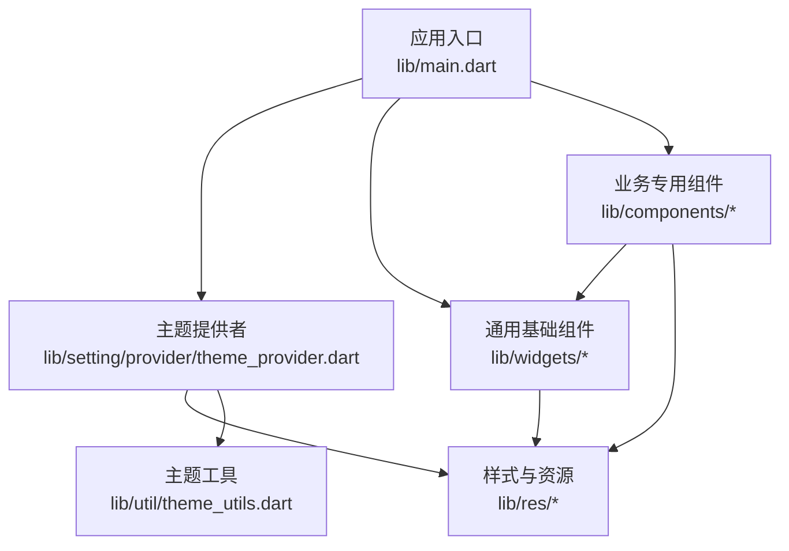
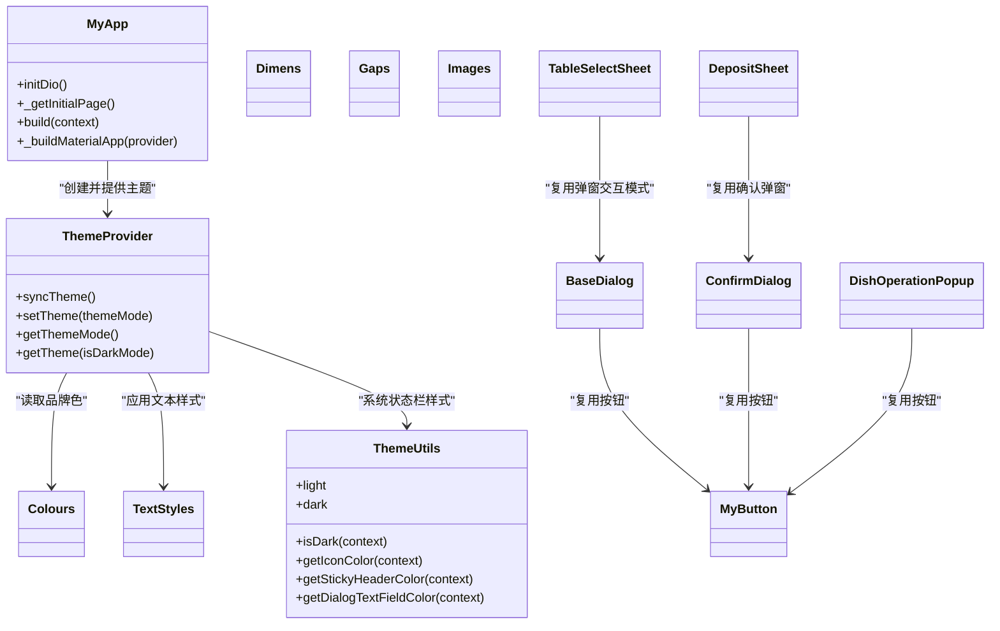
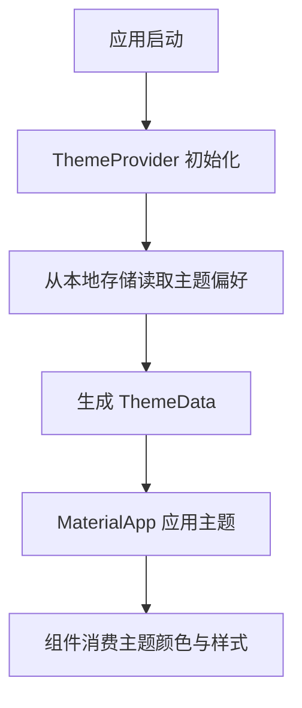
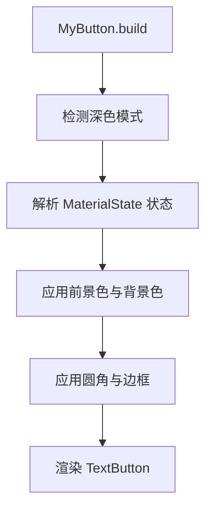
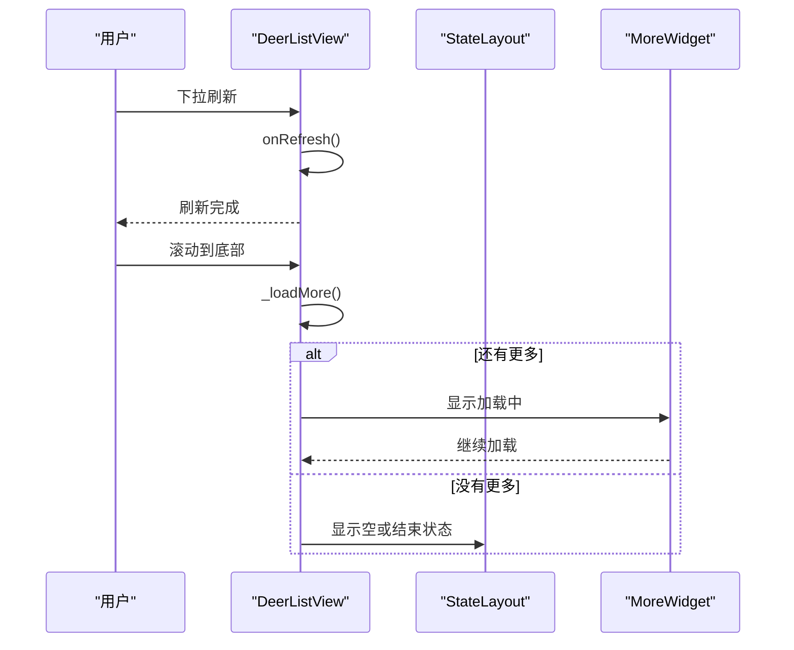
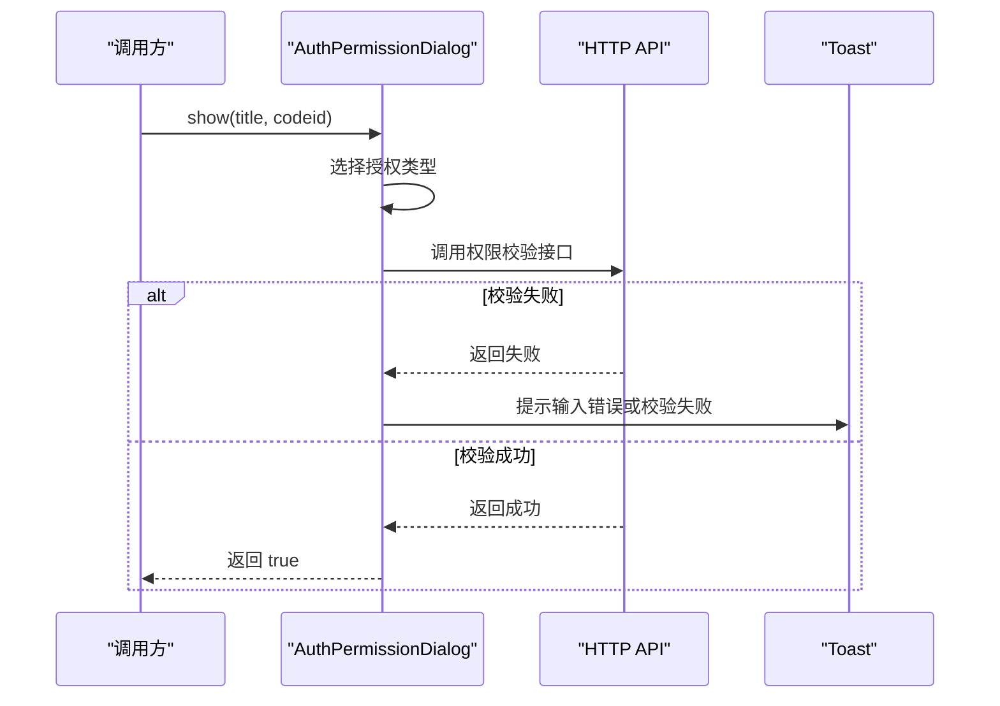
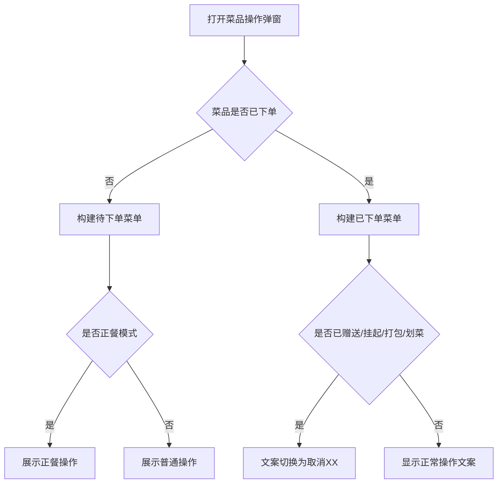
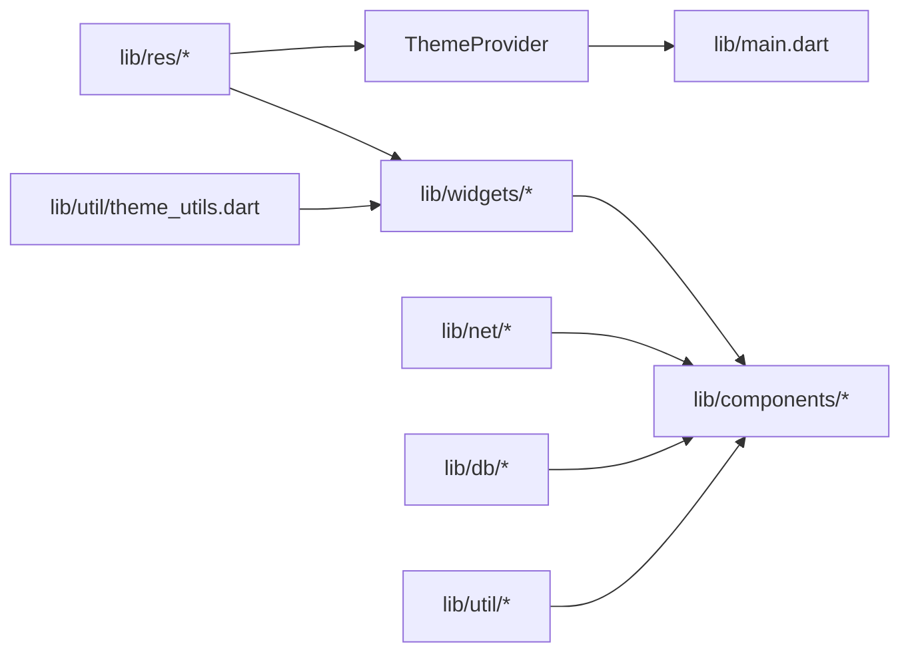

# 组件库概览与设计规范

<cite>
**本文引用的文件**   
- [lib/main.dart](file://lib/main.dart)
- [pubspec.yaml](file://pubspec.yaml)
- [README.md](file://README.md)
- [lib/res/colors.dart](file://lib/res/colors.dart)
- [lib/res/dimens.dart](file://lib/res/dimens.dart)
- [lib/res/styles.dart](file://lib/res/styles.dart)
- [lib/res/gaps.dart](file://lib/res/gaps.dart)
- [lib/res/resources.dart](file://lib/res/resources.dart)
- [lib/setting/provider/theme_provider.dart](file://lib/setting/provider/theme_provider.dart)
- [lib/util/theme_utils.dart](file://lib/util/theme_utils.dart)
- [lib/widgets/my_button.dart](file://lib/widgets/my_button.dart)
- [lib/widgets/my_card.dart](file://lib/widgets/my_card.dart)
- [lib/widgets/base_dialog.dart](file://lib/widgets/base_dialog.dart)
- [lib/widgets/progress_dialog.dart](file://lib/widgets/progress_dialog.dart)
- [lib/widgets/my_app_bar.dart](file://lib/widgets/my_app_bar.dart)
- [lib/widgets/my_search_bar.dart](file://lib/widgets/my_search_bar.dart)
- [lib/widgets/my_refresh_list.dart](file://lib/widgets/my_refresh_list.dart)
- [lib/widgets/state_layout.dart](file://lib/widgets/state_layout.dart)
- [lib/components/auth_permission_dialog.dart](file://lib/components/auth_permission_dialog.dart)
- [lib/components/confirm_dialog.dart](file://lib/components/confirm_dialog.dart)
- [lib/components/dish_operation_dialogs.dart](file://lib/components/dish_operation_dialogs.dart)
- [lib/components/dish_operation_popup.dart](file://lib/components/dish_operation_popup.dart)
- [lib/components/table_select_sheet.dart](file://lib/components/table_select_sheet.dart)
- [lib/components/deposit_sheet.dart](file://lib/components/deposit_sheet.dart)
</cite>

## 目录
1. [引言](#引言)
2. [项目结构](#项目结构)
3. [核心组件分类](#核心组件分类)
4. [架构总览](#架构总览)
5. [主题与样式系统](#主题与样式系统)
6. [通用基础组件分析](#通用基础组件分析)
7. [业务专用组件分析](#业务专用组件分析)
8. [依赖关系分析](#依赖关系分析)
9. [组件选择指南](#组件选择指南)
10. [性能考虑与最佳实践](#性能考虑与最佳实践)
11. [常见问题排查](#常见问题排查)
12. [结论](#结论)

## 引言
本文件面向聚客美滋滋应用的 UI 组件库，目标是帮助开发者快速理解：
- 组件库的整体设计理念、Material Design 遵循程度与主题统一机制
- 通用基础组件与业务专用组件的分类、职责和命名约定
- 颜色、尺寸、字体、间距等资源组织方式
- 组件之间的依赖关系、数据流与交互流程
- 组件选择建议、性能优化策略与常见故障定位方法

该组件库不是独立的 Flutter Package，而是应用内 `lib/widgets` 与 `lib/components` 中可复用 UI 片段的集合。它依托 Material 组件构建，通过自定义主题、资源常量与工具类实现品牌风格统一，并围绕“桌台操作”“点菜结账”等餐饮业务场景封装高复用组件。

**章节来源**
- [README.md:1-50](file://README.md#L1-L50)
- [pubspec.yaml:1-111](file://pubspec.yaml#L1-L111)

## 项目结构
组件库在仓库中的关键位置如下：
- 应用入口与全局主题：`lib/main.dart`、`lib/setting/provider/theme_provider.dart`
- 样式与资源定义：`lib/res/colors.dart`、`lib/res/dimens.dart`、`lib/res/styles.dart`、`lib/res/gaps.dart`、`lib/res/resources.dart`
- 通用基础组件：`lib/widgets/*`
- 业务专用组件：`lib/components/*`
- 主题与工具：`lib/util/theme_utils.dart`

**图示来源**
- [lib/main.dart:1-159](file://lib/main.dart#L1-L159)
- [lib/setting/provider/theme_provider.dart:1-92](file://lib/setting/provider/theme_provider.dart#L1-L92)
- [lib/util/theme_utils.dart:1-52](file://lib/util/theme_utils.dart#L1-L52)
- [lib/res/resources.dart:1-12](file://lib/res/resources.dart#L1-L12)

**章节来源**
- [README.md:1-50](file://README.md#L1-L50)
- [pubspec.yaml:1-111](file://pubspec.yaml#L1-L111)

## 核心组件分类
组件库按职责分为两大类：

| 类别 | 典型组件 | 主要职责 | 设计模式 |
| --- | --- | --- | --- |
| 通用基础组件 | MyButton、MyCard、BaseDialog、ProgressDialog、MyAppBar、MySearchBar、DeerListView、StateLayout | 提供按钮、卡片、对话框、进度提示、导航栏、搜索栏、列表刷新、空状态等跨页面复用的 UI 能力 | 无状态 Widget 为主；少量有状态封装交互细节 |
| 业务专用组件 | AuthPermissionDialog、ConfirmDialog、DishOperationPopup、DishDiscountSheet、TableSelectSheet、DepositSheet | 围绕权限校验、确认弹窗、菜品操作、桌台选择、押金收退等业务场景封装的复合交互组件 | StatefulWidget 或静态 show 工厂方法 + BottomSheet/Dialog |

### 命名约定
- 通用组件以 `My` 前缀命名，如 `MyButton`、`MyCard`、`MyAppBar`、`MySearchBar`
- 业务组件以业务语义命名，如 `AuthPermissionDialog`、`DishOperationPopup`、`TableSelectSheet`、`DepositSheet`
- 组件通常提供静态 `show` 或 `showXxx` 方法，便于直接调用并返回结果
- 资源类使用 `Colours`、`Dimens`、`TextStyles`、`Gaps`、`Images` 等集中管理

### 目录结构与依赖关系
- `lib/widgets`：基础 UI 控件，依赖 `lib/res/*` 与 `lib/util/theme_utils.dart`
- `lib/components`：业务复合组件，依赖 `lib/widgets`、`lib/net/*`、`lib/db/*`、`lib/util/*`
- `lib/res`：样式、颜色、尺寸、间距与图片资源出口
- `lib/setting/provider/theme_provider.dart`：统一管理亮色/暗色主题，被 `lib/main.dart` 作为根 Provider 注入

**章节来源**
- [lib/widgets/my_button.dart:1-75](file://lib/widgets/my_button.dart#L1-L75)
- [lib/widgets/my_card.dart:1-36](file://lib/widgets/my_card.dart#L1-L36)
- [lib/widgets/base_dialog.dart:1-129](file://lib/widgets/base_dialog.dart#L1-L129)
- [lib/components/dish_operation_popup.dart:1-200](file://lib/components/dish_operation_popup.dart#L1-L200)
- [lib/components/table_select_sheet.dart:1-200](file://lib/components/table_select_sheet.dart#L1-L200)
- [lib/res/resources.dart:1-12](file://lib/res/resources.dart#L1-L12)

## 架构总览
组件库整体遵循“资源与主题统一 → 通用组件抽象 → 业务组件组合”的分层思想：

**图示来源**
- [lib/main.dart:1-159](file://lib/main.dart#L1-L159)
- [lib/setting/provider/theme_provider.dart:1-92](file://lib/setting/provider/theme_provider.dart#L1-L92)
- [lib/util/theme_utils.dart:1-52](file://lib/util/theme_utils.dart#L1-L52)
- [lib/res/colors.dart:1-46](file://lib/res/colors.dart#L1-L46)
- [lib/res/styles.dart:1-76](file://lib/res/styles.dart#L1-L76)
- [lib/widgets/my_button.dart:1-75](file://lib/widgets/my_button.dart#L1-L75)
- [lib/widgets/base_dialog.dart:1-129](file://lib/widgets/base_dialog.dart#L1-L129)
- [lib/components/confirm_dialog.dart:1-200](file://lib/components/confirm_dialog.dart#L1-L200)
- [lib/components/dish_operation_popup.dart:1-200](file://lib/components/dish_operation_popup.dart#L1-L200)
- [lib/components/table_select_sheet.dart:1-200](file://lib/components/table_select_sheet.dart#L1-L200)
- [lib/components/deposit_sheet.dart:1-200](file://lib/components/deposit_sheet.dart#L1-L200)

## 主题与样式系统
### Material Design 遵循程度
- 项目启用 `uses-material-design: true`，并通过 `MaterialApp` 配置主题。
- `ThemeProvider.getTheme` 显式设置 `useMaterial3: false`，说明当前主题偏向 Material 2 风格，同时自定义 `primaryColor`、`colorScheme`、`indicatorColor`、`scaffoldBackgroundColor`、`canvasColor`、`textSelectionTheme`、`textTheme`、`inputDecorationTheme`、`appBarTheme`、`dividerTheme`、`cupertinoOverrideTheme` 等属性。
- 系统状态栏与导航栏样式通过 `ThemeUtils.light` 与 `ThemeUtils.dark` 统一管理，并在 `MyAppBar`、`MySearchBar` 中使用 `AnnotatedRegion<SystemUiOverlayStyle>` 适配不同背景。

### 颜色主题管理
- 品牌主色定义为 `Colours.app_main` 与 `Colours.dark_app_main`，用于按钮、指示器与强调元素。
- 明暗模式下的背景、文字、分割线、禁用态颜色均成对定义，例如 `bg_color` / `dark_bg_color`、`text` / `dark_text`、`line` / `dark_line`。
- `ThemeProvider.getTheme` 根据 `isDarkMode` 切换对应颜色族，确保主题一致性。

### 尺寸规范定义
- `Dimens` 集中定义字号与间距，例如 `font_sp10` 到 `font_sp18`、`gap_dp4` 到 `gap_dp50`。
- 组件内部优先引用 `Dimens`，避免散落硬编码像素值。

### 字体体系规范
- `TextStyles` 暴露常用 TextStyle，包括常规字重、加粗字重、灰色文本、白色文本、提示文本等。
- 默认文本使用 `Dimens.font_sp14`，标题常用 `font_sp16`、`font_sp18`，强调内容使用 `FontWeight.bold`。
- `ThemeProvider` 将 `titleMedium`、`bodyMedium`、`titleSmall` 映射到 `TextStyles`，保证全局文本层级一致。

### 资源文件组织
- `lib/res/resources.dart` 导出 `colors.dart`、`dimens.dart`、`gaps.dart`、`styles.dart`，并集中声明图片资源访问入口 `Images`。
- `lib/res/gaps.dart` 提供水平/垂直间隔 Widget，以及分隔线和空 Widget，方便布局拼装。
- 应用资源清单在 `pubspec.yaml` 的 `flutter.assets` 中声明图片与 SVG 目录。

**图示来源**
- [lib/main.dart:1-159](file://lib/main.dart#L1-L159)
- [lib/setting/provider/theme_provider.dart:1-92](file://lib/setting/provider/theme_provider.dart#L1-L92)

**章节来源**
- [pubspec.yaml:1-111](file://pubspec.yaml#L1-L111)
- [lib/main.dart:1-159](file://lib/main.dart#L1-L159)
- [lib/setting/provider/theme_provider.dart:1-92](file://lib/setting/provider/theme_provider.dart#L1-L92)
- [lib/util/theme_utils.dart:1-52](file://lib/util/theme_utils.dart#L1-L52)
- [lib/res/colors.dart:1-46](file://lib/res/colors.dart#L1-L46)
- [lib/res/dimens.dart:1-19](file://lib/res/dimens.dart#L1-L19)
- [lib/res/styles.dart:1-76](file://lib/res/styles.dart#L1-L76)
- [lib/res/gaps.dart:1-48](file://lib/res/gaps.dart#L1-L48)
- [lib/res/resources.dart:1-12](file://lib/res/resources.dart#L1-L12)

## 通用基础组件分析
### MyButton：统一按钮
- 封装 `TextButton`，统一高度、圆角、边框、水波纹、禁用态颜色。
- 支持覆盖文字颜色、背景颜色、最小宽高、内边距、圆角半径与边框。
- 自动识别深色模式，使用 `Colours.dark_button_text`、`Colours.dark_button_disabled` 等颜色。

**图示来源**
- [lib/widgets/my_button.dart:1-75](file://lib/widgets/my_button.dart#L1-L75)

**章节来源**
- [lib/widgets/my_button.dart:1-75](file://lib/widgets/my_button.dart#L1-L75)

### MyCard：统一卡片容器
- 使用 `DecoratedBox` 包裹子组件，统一圆角与阴影。
- 深色模式下背景色与阴影透明度自动调整。
- 适合用于订单卡片、商品卡片、信息面板等。

**章节来源**
- [lib/widgets/my_card.dart:1-36](file://lib/widgets/my_card.dart#L1-L36)

### BaseDialog：通用对话框模板
- 提供标题区、内容区、分隔线与底部双按钮（取消/确定）。
- 使用 `MediaQuery.removeViewInsets` 处理键盘弹出时的布局偏移。
- 针对 Android 11+ 使用 `Padding` 替代动画以避免键盘过渡冲突。
- 底部按钮复用 `MyButton`，保持视觉一致。

**章节来源**
- [lib/widgets/base_dialog.dart:1-129](file://lib/widgets/base_dialog.dart#L1-L129)

### ProgressDialog：加载提示
- 半透明背景的居中加载框，包含圆形进度指示与提示文案。
- 适用于网络请求、数据落库等异步操作的短暂等待。

**章节来源**
- [lib/widgets/progress_dialog.dart:1-44](file://lib/widgets/progress_dialog.dart#L1-L44)

### MyAppBar：统一导航栏
- 支持标题、居中标题、右侧操作按钮、返回图标。
- 根据背景亮度计算状态栏样式，适配深色/浅色系统图标。
- 返回逻辑先尝试 `Navigator.maybePop`，再回退到 `SystemNavigator.pop`。

**章节来源**
- [lib/widgets/my_app_bar.dart:1-110](file://lib/widgets/my_app_bar.dart#L1-L110)

### MySearchBar：搜索页导航栏
- 集成返回按钮、搜索输入框、清空按钮与搜索按钮。
- 使用 `FocusNode` 管理焦点，点击清空后延迟清空文本以规避输入法问题。
- 顶部状态栏样式根据深色模式动态切换。

**章节来源**
- [lib/widgets/my_search_bar.dart:1-184](file://lib/widgets/my_search_bar.dart#L1-L184)

### DeerListView：下拉刷新与加载更多
- 封装 `RefreshIndicator` 与 `ListView.builder`，自动监听滚动到底部触发加载更多。
- 支持分页参数、空状态、加载中状态与更多提示。
- 结合 `StateLayout` 展示空状态或错误状态。

**图示来源**
- [lib/widgets/my_refresh_list.dart:1-123](file://lib/widgets/my_refresh_list.dart#L1-L123)
- [lib/widgets/state_layout.dart:1-75](file://lib/widgets/state_layout.dart#L1-L75)

**章节来源**
- [lib/widgets/my_refresh_list.dart:1-123](file://lib/widgets/my_refresh_list.dart#L1-L123)
- [lib/widgets/state_layout.dart:1-75](file://lib/widgets/state_layout.dart#L1-L75)

## 业务专用组件分析
### AuthPermissionDialog：权限授权弹窗
- 用于打折、退菜、赠送等敏感操作的权限校验。
- 支持授权码模式与用户名密码模式两种授权方式。
- 提供静态 `show` 方法，返回布尔结果表示是否授权成功。

**图示来源**
- [lib/components/auth_permission_dialog.dart:1-200](file://lib/components/auth_permission_dialog.dart#L1-L200)

**章节来源**
- [lib/components/auth_permission_dialog.dart:1-200](file://lib/components/auth_permission_dialog.dart#L1-L200)

### ConfirmDialog：通用确认弹窗
- 居中标题、居中内容、双按钮或单按钮模式。
- 支持品牌红自定义、取消/确定文案自定义、遮罩可点击关闭控制。
- 提供静态 `show` 方法，返回布尔结果。

**章节来源**
- [lib/components/confirm_dialog.dart:1-200](file://lib/components/confirm_dialog.dart#L1-L200)

### DishOperationPopup：菜品操作弹窗
- 根据菜品状态展示不同操作菜单：待下单与已下单菜单不同。
- 支持正餐与快餐模式差异，动态显示套餐、规格做法、改价、挂起、打包、备注、删除、服务员、改名等操作。
- 已处于某种状态时，文案切换为“取消 XX”，用于取消赠送、取消挂起、取消打包、取消划菜。

**图示来源**
- [lib/components/dish_operation_popup.dart:1-200](file://lib/components/dish_operation_popup.dart#L1-L200)

**章节来源**
- [lib/components/dish_operation_popup.dart:1-200](file://lib/components/dish_operation_popup.dart#L1-L200)

### DishDiscountSheet：菜品打折底部弹窗
- 提供快捷折扣按钮、折扣输入与原因选择。
- 对接后台原因配置，要求必填原因时进行校验。
- 返回 `DiscountResult`，包含折扣率与原因备注。

**章节来源**
- [lib/components/dish_operation_dialogs.dart:1-200](file://lib/components/dish_operation_dialogs.dart#L1-L200)

### TableSelectSheet：桌台选择弹窗
- 单选与多选模式，支持并台/拆台场景。
- 网格展示桌台名称或编号，选中项带徽章标识合并状态。
- 返回选中的桌台数据或列表，供转台、并台等流程使用。

**章节来源**
- [lib/components/table_select_sheet.dart:1-200](file://lib/components/table_select_sheet.dart#L1-L200)

### DepositSheet：押金收退弹窗
- 金额输入、支付方式选择、打印押金单开关。
- 过滤有效支付方式，排除抖音、会员卡、挂账等不允许交押金的支付方式。
- 调用押金相关接口，支持查看押金记录。

**章节来源**
- [lib/components/deposit_sheet.dart:1-200](file://lib/components/deposit_sheet.dart#L1-L200)

## 依赖关系分析
组件之间形成清晰的分层依赖：

**图示来源**
- [lib/main.dart:1-159](file://lib/main.dart#L1-L159)
- [lib/setting/provider/theme_provider.dart:1-92](file://lib/setting/provider/theme_provider.dart#L1-L92)
- [lib/util/theme_utils.dart:1-52](file://lib/util/theme_utils.dart#L1-L52)
- [lib/res/resources.dart:1-12](file://lib/res/resources.dart#L1-L12)

**章节来源**
- [lib/main.dart:1-159](file://lib/main.dart#L1-L159)
- [lib/setting/provider/theme_provider.dart:1-92](file://lib/setting/provider/theme_provider.dart#L1-L92)
- [lib/util/theme_utils.dart:1-52](file://lib/util/theme_utils.dart#L1-L52)

## 组件选择指南
### 何时使用通用基础组件
- 需要标准按钮样式：使用 `MyButton`，避免直接使用 `TextButton` 或 `ElevatedButton` 导致样式不一致。
- 需要卡片容器：使用 `MyCard`，统一圆角与阴影。
- 需要简单确认或提示：使用 `ConfirmDialog` 或 `BaseDialog`。
- 需要全局导航栏：使用 `MyAppBar`，保证返回逻辑与状态栏样式一致。
- 需要搜索页导航栏：使用 `MySearchBar`，内置输入、清空与搜索按钮。
- 需要列表刷新与分页：使用 `DeerListView`，结合 `StateLayout` 展示空状态。

### 何时使用业务专用组件
- 需要对打折、退菜、赠送等敏感操作进行权限校验：使用 `AuthPermissionDialog`。
- 需要菜品操作菜单：使用 `DishOperationPopup`，并根据菜品状态传入相应参数。
- 需要菜品打折：使用 `DishDiscountSheet`。
- 需要选择目标桌台：使用 `TableSelectSheet`。
- 需要交押金或查看押金记录：使用 `DepositSheet`。

### 决策建议
- 如果需求是“通用 UI 能力”，优先选择 `lib/widgets` 中的基础组件。
- 如果需求涉及“餐厅业务规则”，优先选择 `lib/components` 中的业务组件。
- 若现有组件无法满足样式或交互细节，可在基础组件基础上扩展，而不是复制粘贴 Material 组件代码。

**章节来源**
- [lib/widgets/my_button.dart:1-75](file://lib/widgets/my_button.dart#L1-L75)
- [lib/widgets/my_card.dart:1-36](file://lib/widgets/my_card.dart#L1-L36)
- [lib/widgets/base_dialog.dart:1-129](file://lib/widgets/base_dialog.dart#L1-L129)
- [lib/widgets/my_app_bar.dart:1-110](file://lib/widgets/my_app_bar.dart#L1-L110)
- [lib/widgets/my_search_bar.dart:1-184](file://lib/widgets/my_search_bar.dart#L1-L184)
- [lib/widgets/my_refresh_list.dart:1-123](file://lib/widgets/my_refresh_list.dart#L1-L123)
- [lib/widgets/state_layout.dart:1-75](file://lib/widgets/state_layout.dart#L1-L75)
- [lib/components/auth_permission_dialog.dart:1-200](file://lib/components/auth_permission_dialog.dart#L1-L200)
- [lib/components/dish_operation_popup.dart:1-200](file://lib/components/dish_operation_popup.dart#L1-L200)
- [lib/components/table_select_sheet.dart:1-200](file://lib/components/table_select_sheet.dart#L1-L200)
- [lib/components/deposit_sheet.dart:1-200](file://lib/components/deposit_sheet.dart#L1-L200)

## 性能考虑与最佳实践
- 避免重复构造复杂 Widget：尽量复用 `MyButton`、`MyCard`、`BaseDialog` 等基础组件，减少重复布局树。
- 合理使用 `const`：对于静态资源与不可变 Widget，使用 `const` 构造以减少重建开销。
- 列表性能：使用 `DeerListView` 的 `itemExtent` 固定行高，提高滚动性能；分页加载时使用 `hasMore` 控制加载更多。
- 主题切换成本：`ThemeProvider` 通过 `ChangeNotifier` 通知更新，避免频繁手动重建整棵 Widget 树。
- 键盘避让：`BaseDialog` 与业务弹窗已处理键盘弹出布局，避免底部按钮被遮挡。
- 图片资源：统一通过 `LoadAssetImage` 与 `Images` 访问，避免硬编码路径。
- 深色模式：所有组件应通过 `context.isDark` 或 `ThemeUtils` 获取颜色，不要硬编码明暗颜色。

[本节为通用指导，不直接分析具体代码文件]

## 常见问题排查
- 主题颜色不生效
  - 检查是否通过 `ThemeProvider` 提供主题，且 `MaterialApp` 使用了 `provider.getTheme()`。
  - 检查组件是否使用 `Colours` 与 `ThemeUtils`，而非直接写死颜色。
- 深色模式下文字或图标不可见
  - 检查图标颜色是否通过 `ThemeUtils.getIconColor(context)` 或 `context.isDark` 判断。
  - 检查 `MyAppBar`、`MySearchBar` 的状态栏样式是否正确。
- 弹窗被键盘遮挡
  - 使用 `BaseDialog` 或 `KeyboardAvoidingDialogBody`，避免自绘弹窗未处理 `viewInsets`。
- 列表没有加载更多
  - 检查 `DeerListView` 是否传入 `loadMore` 与 `hasMore`，并确保滚动监听逻辑未被外层 `SafeArea` 或 `padding` 破坏。
- 业务组件返回结果为空
  - 检查静态 `show` 方法是否被正确 await，以及弹窗是否被取消。

**章节来源**
- [lib/main.dart:1-159](file://lib/main.dart#L1-L159)
- [lib/setting/provider/theme_provider.dart:1-92](file://lib/setting/provider/theme_provider.dart#L1-L92)
- [lib/util/theme_utils.dart:1-52](file://lib/util/theme_utils.dart#L1-L52)
- [lib/widgets/base_dialog.dart:1-129](file://lib/widgets/base_dialog.dart#L1-L129)
- [lib/widgets/my_refresh_list.dart:1-123](file://lib/widgets/my_refresh_list.dart#L1-L123)

## 结论
聚客美滋滋应用的 UI 组件库以 Material 为基础，通过 `ThemeProvider` 与 `lib/res/*` 建立统一的主题与样式体系，再通过 `lib/widgets` 沉淀通用基础组件，最后由 `lib/components` 封装餐饮业务复合交互。这种分层设计让组件具备良好可复用性、一致性与可维护性。

在实际开发中，建议：
- 优先使用通用基础组件保证视觉一致性
- 使用业务组件承载复杂业务交互
- 通过 `Colours`、`Dimens`、`TextStyles`、`Gaps` 统一资源
- 关注主题切换、键盘避让、列表性能等关键点
- 遇到问题时优先对照组件源码与依赖关系定位

[本节为总结性内容，不直接分析具体代码文件]