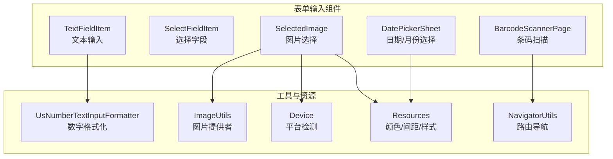
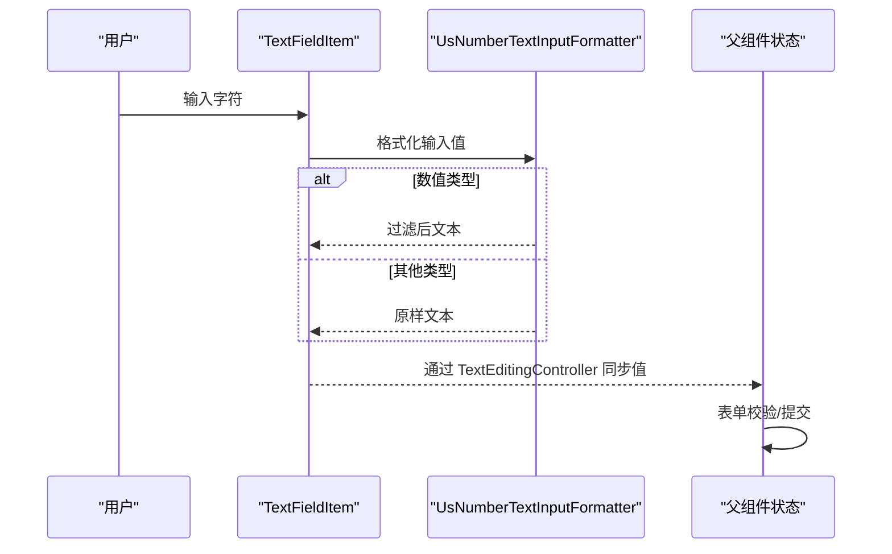
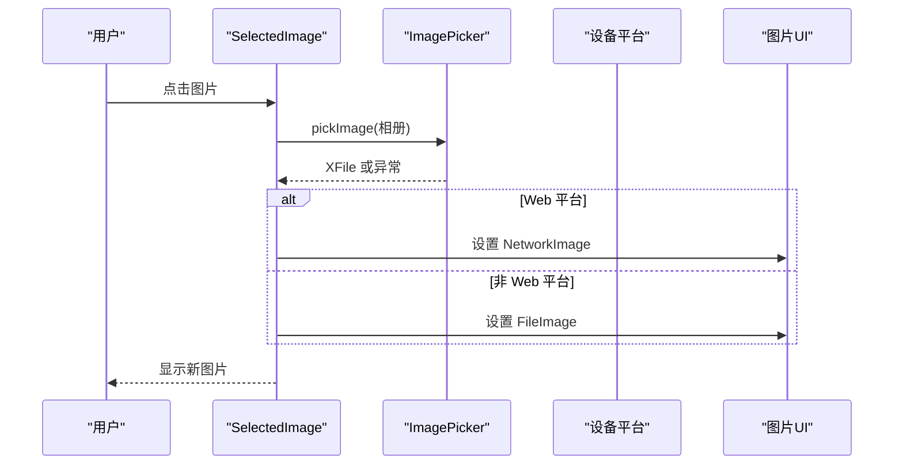
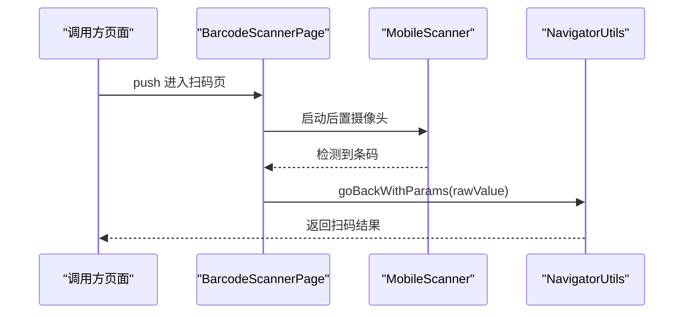
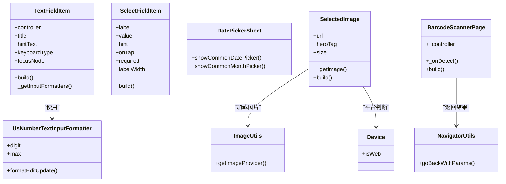
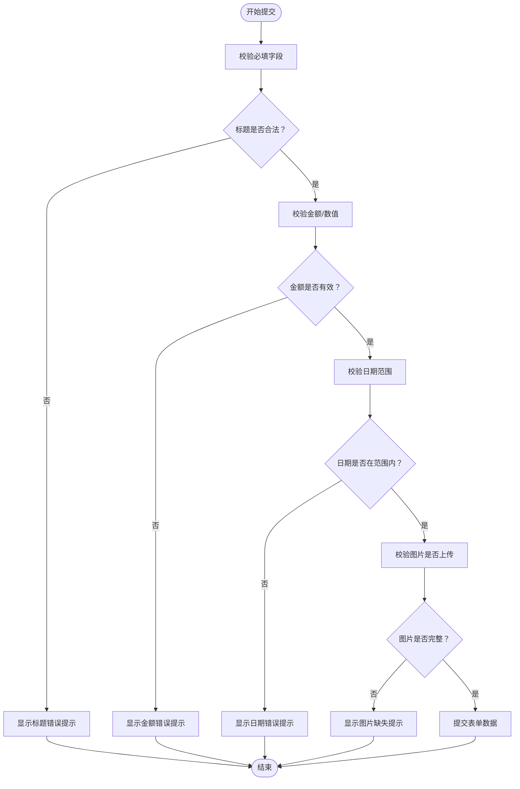

# 表单输入组件

<cite>
**本文引用的文件**
- [lib/widgets/text_field_item.dart](file://lib/widgets/text_field_item.dart)
- [lib/util/input_formatter/number_text_input_formatter.dart](file://lib/util/input_formatter/number_text_input_formatter.dart)
- [lib/widgets/select_field_item.dart](file://lib/widgets/select_field_item.dart)
- [lib/widgets/date_picker_sheet.dart](file://lib/widgets/date_picker_sheet.dart)
- [lib/widgets/selected_image.dart](file://lib/widgets/selected_image.dart)
- [lib/util/image_utils.dart](file://lib/util/image_utils.dart)
- [lib/util/device_utils.dart](file://lib/util/device_utils.dart)
- [lib/res/resources.dart](file://lib/res/resources.dart)
- [lib/widgets/barcode_scanner_page.dart](file://lib/widgets/barcode_scanner_page.dart)
- [lib/routers/fluro_navigator.dart](file://lib/routers/fluro_navigator.dart)
</cite>

## 目录
1. [引言](#引言)
2. [项目结构与组件总览](#项目结构与组件总览)
3. [核心组件详解](#核心组件详解)
4. [架构与数据流](#架构与数据流)
5. [依赖关系分析](#依赖关系分析)
6. [性能与可用性考虑](#性能与可用性考虑)
7. [表单组合最佳实践](#表单组合最佳实践)
8. [故障排查指南](#故障排查指南)
9. [结论](#结论)

## 引言
本文面向 Flutter 端表单输入类组件，系统性梳理以下五个关键控件的实现原理、使用方式与扩展点：
- TextFieldItem：文本输入框的格式化验证、错误提示与输入监听。
- SelectFieldItem：选择字段的标签、占位值、必填标记与点击交互。
- DatePickerSheet：日期选择器与月份选择器的界面、格式化和范围限制。
- SelectedImage：图片选择的相册选取、平台适配与占位图展示。
- BarcodeScannerPage：条码扫描页面的相机预览、扫描框遮罩和识别结果返回。

文档同时给出表单组合使用的最佳实践，包括字段校验、数据提交、错误处理、无障碍访问支持和键盘适配方案。

## 项目结构与组件总览
本项目采用“页面 + 组件 + 工具”的分层组织方式。表单相关 UI 集中在 widgets 目录，输入格式化逻辑在 util/input_formatter 中，设备能力与图片加载等通用能力封装在 util 与 res 目录中。

图表来源
- [lib/widgets/text_field_item.dart:1-73](file://lib/widgets/text_field_item.dart#L1-L73)
- [lib/util/input_formatter/number_text_input_formatter.dart:1-53](file://lib/util/input_formatter/number_text_input_formatter.dart#L1-L53)
- [lib/widgets/select_field_item.dart:1-92](file://lib/widgets/select_field_item.dart#L1-L92)
- [lib/widgets/date_picker_sheet.dart:1-193](file://lib/widgets/date_picker_sheet.dart#L1-L193)
- [lib/widgets/selected_image.dart:1-97](file://lib/widgets/selected_image.dart#L1-L97)
- [lib/util/image_utils.dart:1-34](file://lib/util/image_utils.dart#L1-L34)
- [lib/util/device_utils.dart:1-118](file://lib/util/device_utils.dart#L1-L118)
- [lib/res/resources.dart:1-12](file://lib/res/resources.dart#L1-L12)
- [lib/widgets/barcode_scanner_page.dart:1-177](file://lib/widgets/barcode_scanner_page.dart#L1-L177)
- [lib/routers/fluro_navigator.dart:1-72](file://lib/routers/fluro_navigator.dart#L1-L72)

章节来源
- [lib/widgets/text_field_item.dart:1-73](file://lib/widgets/text_field_item.dart#L1-L73)
- [lib/widgets/select_field_item.dart:1-92](file://lib/widgets/select_field_item.dart#L1-L92)
- [lib/widgets/date_picker_sheet.dart:1-193](file://lib/widgets/date_picker_sheet.dart#L1-L193)
- [lib/widgets/selected_image.dart:1-97](file://lib/widgets/selected_image.dart#L1-L97)
- [lib/widgets/barcode_scanner_page.dart:1-177](file://lib/widgets/barcode_scanner_page.dart#L1-L177)

## 核心组件详解

### TextFieldItem 文本输入框
TextFieldItem 是一个轻量级输入行，用于在表单中呈现带标题的文本输入区域。其核心职责包括：
- 显示标题与输入区域，支持占位提示文本。
- 根据 keyboardType 自动应用输入格式化器。
- 提供 FocusNode 接入外部焦点管理。
- 通过 Semantics 暴露可访问性标签。

输入格式化策略：
- 当 keyboardType 为带小数的数字类型时，使用 UsNumberTextInputFormatter 控制小数位数与最大值。
- 当 keyboardType 为纯数字或电话类型时，仅允许数字输入。
- 其他情况不附加格式化器，交由系统默认行为处理。

可访问性与布局：
- 外层 Container 设置底部边框，左侧内边距，宽度撑满。
- 内部 Row 将标题与 Expanded 包裹的 TextField 并列排列。
- TextField 被 Semantics 包裹，label 优先使用 hintText，否则回退到“请输入+标题”，便于读屏软件播报。

典型用法要点：
- 使用 TextEditingController 绑定双向数据。
- 通过 keyboardType 选择 numberWithOptions(decimal: true)、number 或 phone，以启用不同格式化。
- 如需自定义焦点行为，传入 FocusNode。

注意事项：
- 当前未内置错误提示 UI；建议在上层表单状态中根据 controller.value.text 进行校验并显示错误信息。
- 若需要更多输入规则（如正则），可在上层统一包装一个校验格式化器。

章节来源
- [lib/widgets/text_field_item.dart:1-73](file://lib/widgets/text_field_item.dart#L1-L73)
- [lib/util/input_formatter/number_text_input_formatter.dart:1-53](file://lib/util/input_formatter/number_text_input_formatter.dart#L1-L53)

### SelectFieldItem 选择字段
SelectFieldItem 是通用选择项行，负责：
- 左侧显示标签，可选必填星号。
- 右侧显示已选值或占位提示。
- 右箭头图标表示可点击。
- 通过 onTap 回调通知父组件打开选择面板。

设计要点：
- required 为 true 时显示红色星号，固定宽度保证对齐。
- labelWidth 控制标签宽度，避免长标签换行影响布局。
- value 为空时显示 hint 占位文字，并以蓝色区分未选中状态。
- 整体高度与上下内边距适合移动端手指点击。

多选支持说明：
- 该组件本身只负责单值展示与点击触发。多选场景通常由上层业务维护 List<String> 并通过格式化后的字符串（如逗号分隔）赋值给 value。
- 下拉选择面板建议使用独立的 Sheet 或 Dialog 实现，并在确认后将结果写入 SelectFieldItem 的 value。

无障碍建议：
- 可结合上层业务在 onTap 前聚焦该行，或在面板关闭后调用 NavigatorUtils.unfocus 清理焦点。

章节来源
- [lib/widgets/select_field_item.dart:1-92](file://lib/widgets/select_field_item.dart#L1-L92)

### DatePickerSheet 日期与月份选择器
DatePickerSheet 提供两个全局函数：
- showCommonDatePicker：年/月/日三列选择器，适用于精确日期选择。
- showCommonMonthPicker：年/月两列选择器，适用于“本月”等仅需年月范围的场景。

功能特性：
- 基于 CupertinoPicker 构建滚轮式选择界面。
- 顶部包含取消与确定按钮，底部为滚轮选择区。
- 自动适配深色/浅色主题，颜色取自当前 ThemeData.colorScheme。
- 日列会根据所选年份与月份动态计算最大天数，避免非法日期。
- 月份选择器返回值 day 字段固定为 1，调用方需自行计算起止日期。

范围限制说明：
- 当前实现未对可选年份范围做硬性限制；可通过初始值和滚动控制器位置间接引导用户。
- 若业务需要严格范围限制，建议在确定回调中校验 DateTime，不符合则提示并重新选择。

典型用法：
- 在表单中点击选择行时调用 showCommonDatePicker 或 showCommonMonthPicker。
- 拿到返回 DateTime 后，更新表单状态并刷新显示。

章节来源
- [lib/widgets/date_picker_sheet.dart:1-193](file://lib/widgets/date_picker_sheet.dart#L1-L193)

### SelectedImage 图片选择
SelectedImage 是一个可点击的图片选择控件，主要功能：
- 从相册选择图片。
- 非 Web 平台使用本地文件路径渲染图片。
- Web 平台直接使用 URL 作为网络图片源。
- 无图片时使用占位图，并根据主题切换滤镜颜色。
- 可选 HeroTag 在非 Web 平台启用 Hero 动画。

工作流程：
1. 用户点击控件触发 _getImage。
2. 使用 ImagePicker 从相册读取 XFile。
3. 根据 Device.isWeb 分支构造 ImageProvider。
4. setState 刷新 UI。
5. 捕获 MissingPluginException 或其他异常，提示权限或平台不支持。

图片加载：
- 通过 ImageUtils.getImageProvider 获取网络图片缓存提供者，空地址回退到占位图。
- 占位图名称由业务配置，示例中使用 store/icon_zj。

平台差异：
- Web 环境不支持 FileImage，因此直接以 NetworkImage 渲染。
- 非 Web 环境使用 FileImage 渲染本地文件。

无障碍：
- 外层包裹 Semantics，label 为“选择图片”，hint 为“跳转相册选择图片”。

章节来源
- [lib/widgets/selected_image.dart:1-97](file://lib/widgets/selected_image.dart#L1-L97)
- [lib/util/image_utils.dart:1-34](file://lib/util/image_utils.dart#L1-L34)
- [lib/util/device_utils.dart:1-118](file://lib/util/device_utils.dart#L1-L118)
- [lib/res/resources.dart:1-12](file://lib/res/resources.dart#L1-L12)

### BarcodeScannerPage 条码扫描页面
BarcodeScannerPage 是基于 MobileScanner 的扫码页，主要职责：
- 启动后置摄像头进行实时扫描。
- 绘制半透明遮罩与绿色四角扫描框。
- 首次成功识别后返回条形码原始内容。
- 支持开关闪光灯。

关键流程：
- 初始化 MobileScannerController，设置 detectionSpeed、facing、torchEnabled。
- onDetect 回调中取第一个 Barcode 的 rawValue。
- 使用 hasScanned 标志防止重复返回。
- 通过 NavigatorUtils.goBackWithParams 将扫描结果传回上一页。

遮罩绘制：
- CustomPainter 在半透明黑色背景上挖出一个圆角矩形孔洞。
- 在孔洞四角绘制短横线，形成扫描框视觉提示。

注意事项：
- 页面 dispose 时释放控制器，避免内存泄漏。
- 若业务需要记录扫描历史，应在调用方侧保存结果。

章节来源
- [lib/widgets/barcode_scanner_page.dart:1-177](file://lib/widgets/barcode_scanner_page.dart#L1-L177)
- [lib/routers/fluro_navigator.dart:1-72](file://lib/routers/fluro_navigator.dart#L1-L72)

## 架构与数据流

### 文本输入数据流

图表来源
- [lib/widgets/text_field_item.dart:1-73](file://lib/widgets/text_field_item.dart#L1-L73)
- [lib/util/input_formatter/number_text_input_formatter.dart:1-53](file://lib/util/input_formatter/number_text_input_formatter.dart#L1-L53)

### 图片选择数据流

图表来源
- [lib/widgets/selected_image.dart:1-97](file://lib/widgets/selected_image.dart#L1-L97)
- [lib/util/device_utils.dart:1-118](file://lib/util/device_utils.dart#L1-L118)

### 扫码结果返回流程

图表来源
- [lib/widgets/barcode_scanner_page.dart:1-177](file://lib/widgets/barcode_scanner_page.dart#L1-L177)
- [lib/routers/fluro_navigator.dart:1-72](file://lib/routers/fluro_navigator.dart#L1-L72)

## 依赖关系分析

图表来源
- [lib/widgets/text_field_item.dart:1-73](file://lib/widgets/text_field_item.dart#L1-L73)
- [lib/util/input_formatter/number_text_input_formatter.dart:1-53](file://lib/util/input_formatter/number_text_input_formatter.dart#L1-L53)
- [lib/widgets/select_field_item.dart:1-92](file://lib/widgets/select_field_item.dart#L1-L92)
- [lib/widgets/date_picker_sheet.dart:1-193](file://lib/widgets/date_picker_sheet.dart#L1-L193)
- [lib/widgets/selected_image.dart:1-97](file://lib/widgets/selected_image.dart#L1-L97)
- [lib/util/image_utils.dart:1-34](file://lib/util/image_utils.dart#L1-L34)
- [lib/util/device_utils.dart:1-118](file://lib/util/device_utils.dart#L1-L118)
- [lib/widgets/barcode_scanner_page.dart:1-177](file://lib/widgets/barcode_scanner_page.dart#L1-L177)
- [lib/routers/fluro_navigator.dart:1-72](file://lib/routers/fluro_navigator.dart#L1-L72)

## 性能与可用性考虑

性能要点：
- TextFieldItem 的格式化器在输入时执行，UsNumberTextInputFormatter 对超长输入或频繁变更场景下应关注解析开销；必要时在上层做节流。
- SelectedImage 使用 CachedNetworkImageProvider 缓存网络图片，减少重复下载。
- BarcodeScannerPage 在 dispose 时释放 MobileScannerController，避免持续占用相机资源。

可用性要点：
- TextFieldItem 使用 Semantics 暴露 label，提升读屏体验。
- SelectedImage 同样提供 Semantics label 与 hint，明确“选择图片”操作。
- DatePickerSheet 使用系统原生滚轮控件，符合平台交互习惯。
- 表单提交前建议显式 unfocus，避免键盘遮挡与意外输入。

## 表单组合最佳实践

### 表单字段组织
- 将 TextFieldItem、SelectFieldItem、DatePickerSheet、SelectedImage 组合在一个可滚动容器内。
- 每个字段对应一个表单状态字段，例如：
  - 文本字段：String 或金额 Number。
  - 选择字段：String 或枚举。
  - 日期字段：DateTime。
  - 图片字段：String 图片地址或字节数据。

### 表单验证流程

具体建议：
- 文本字段：根据 keyboardType 和业务规则校验长度、格式、数值范围。
- 选择字段：校验是否为空；多选场景校验数量上限。
- 日期字段：校验起始与结束日期大小关系；对于“本月”场景用 start/end 计算。
- 图片字段：校验是否选择了图片；Web 与非 Web 平台分别处理上传。

### 数据提交与错误处理
- 所有校验失败时，集中收集错误信息，按字段名映射显示。
- 提交成功后，使用 NavigatorUtils.goBack 或 pushResult 返回上一页并传递结果。
- 网络请求失败时，统一使用 Toast 或业务弹窗提示。

### 键盘适配
- 表单容器使用可滚动视图，确保输入框被键盘遮挡时可滚动到可视区域。
- 在页面进入时主动 unfocus，避免旧焦点残留。
- 对于金额输入，优先使用 numberWithOptions(decimal: true)，配合 UsNumberTextInputFormatter 控制小数位数。

### 无障碍访问
- 为所有可交互控件添加 Semantics label/hint。
- 选择面板关闭后恢复焦点到上一个输入框或表单根节点。
- 日期选择器和图片选择器的按钮文案应清晰明确，避免歧义。

章节来源
- [lib/widgets/text_field_item.dart:1-73](file://lib/widgets/text_field_item.dart#L1-L73)
- [lib/util/input_formatter/number_text_input_formatter.dart:1-53](file://lib/util/input_formatter/number_text_input_formatter.dart#L1-L53)
- [lib/widgets/select_field_item.dart:1-92](file://lib/widgets/select_field_item.dart#L1-L92)
- [lib/widgets/date_picker_sheet.dart:1-193](file://lib/widgets/date_picker_sheet.dart#L1-L193)
- [lib/widgets/selected_image.dart:1-97](file://lib/widgets/selected_image.dart#L1-L97)
- [lib/routers/fluro_navigator.dart:1-72](file://lib/routers/fluro_navigator.dart#L1-L72)

## 故障排查指南

常见问题与解决方案：
- 金额输入异常：
  - 现象：小数位过多或超出最大值。
  - 原因：未使用 UsNumberTextInputFormatter 或 keyboardType 不正确。
  - 解决：使用 numberWithOptions(decimal: true) 并检查 formatter 的 digit 与 max 参数。
  - 参考：[lib/util/input_formatter/number_text_input_formatter.dart:1-53](file://lib/util/input_formatter/number_text_input_formatter.dart#L1-L53)

- 图片无法加载：
  - 现象：图片不显示或显示占位图。
  - 原因：URL 为空、网络不可达、平台不支持 FileImage。
  - 解决：使用 ImageUtils.getImageProvider 处理空地址；Web 平台使用 NetworkImage；非 Web 平台使用 FileImage。
  - 参考：[lib/util/image_utils.dart:1-34](file://lib/util/image_utils.dart#L1-L34)、[lib/widgets/selected_image.dart:1-97](file://lib/widgets/selected_image.dart#L1-L97)

- 相册权限或插件缺失：
  - 现象：提示没有权限或平台暂不支持。
  - 原因：缺少权限或未正确集成 image_picker。
  - 解决：检查权限申请；捕获 MissingPluginException 并提示用户。
  - 参考：[lib/widgets/selected_image.dart:1-97](file://lib/widgets/selected_image.dart#L1-L97)

- 扫码结果未返回：
  - 现象：扫码后仍停留在扫码页。
  - 原因：rawValue 为空或已扫描过。
  - 解决：确保 barcode.rawValue 非空；hasScanned 标志仅在首次扫描后生效。
  - 参考：[lib/widgets/barcode_scanner_page.dart:1-177](file://lib/widgets/barcode_scanner_page.dart#L1-L177)

- 日期无效：
  - 现象：选择月末 31 日但当月只有 30 天。
  - 原因：未动态计算当月最大天数。
  - 解决：使用日期选择器内部的 clamp(1, maxDay) 逻辑。
  - 参考：[lib/widgets/date_picker_sheet.dart:1-193](file://lib/widgets/date_picker_sheet.dart#L1-L193)

- 键盘遮挡输入框：
  - 现象：输入框被软键盘遮挡。
  - 原因：未使用可滚动容器或未 unfocus。
  - 解决：使用 SingleChildScrollView；提交前后调用 NavigatorUtils.unfocus。
  - 参考：[lib/routers/fluro_navigator.dart:1-72](file://lib/routers/fluro_navigator.dart#L1-L72)

## 结论
本仓库中的表单输入组件围绕简洁、可复用与跨平台兼容展开。TextFieldItem 通过 keyboardType 与格式化器实现基础校验；SelectFieldItem 提供统一的表单选择行；DatePickerSheet 提供稳定的日期与月份选择；SelectedImage 屏蔽平台差异；BarcodeScannerPage 完成扫码闭环。在实际项目中，建议将这些组件组合在统一表单状态中，配合集中校验、错误提示与无障碍支持，构建健壮的移动端表单体验。