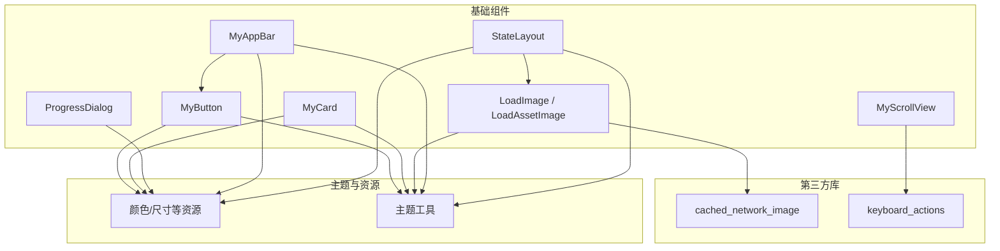
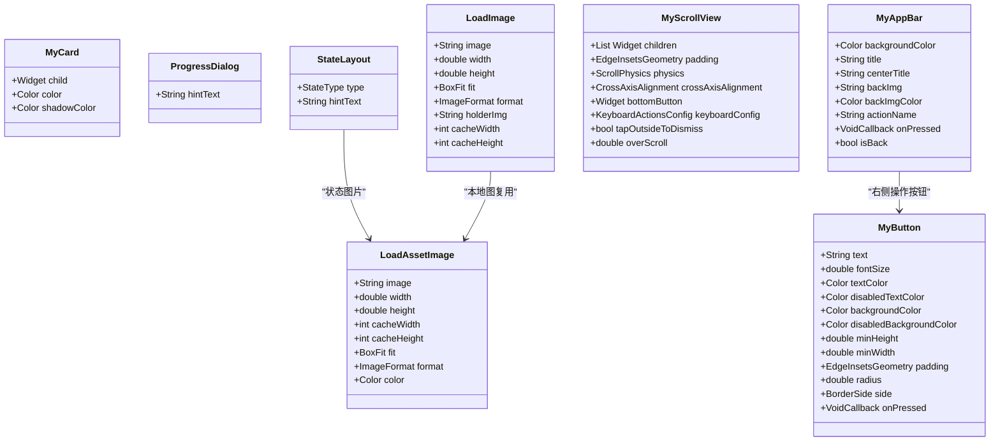
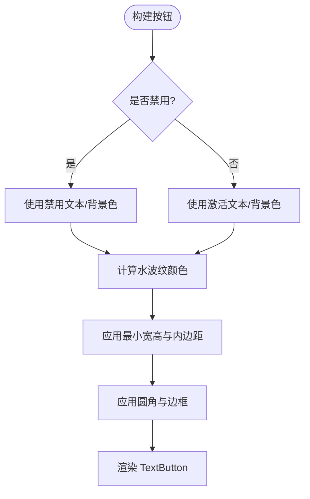
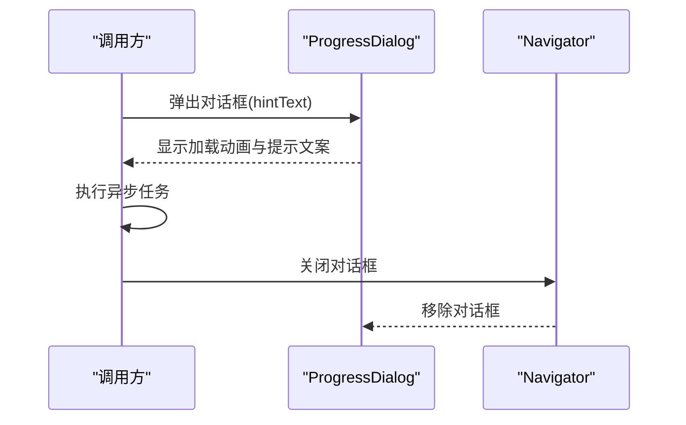
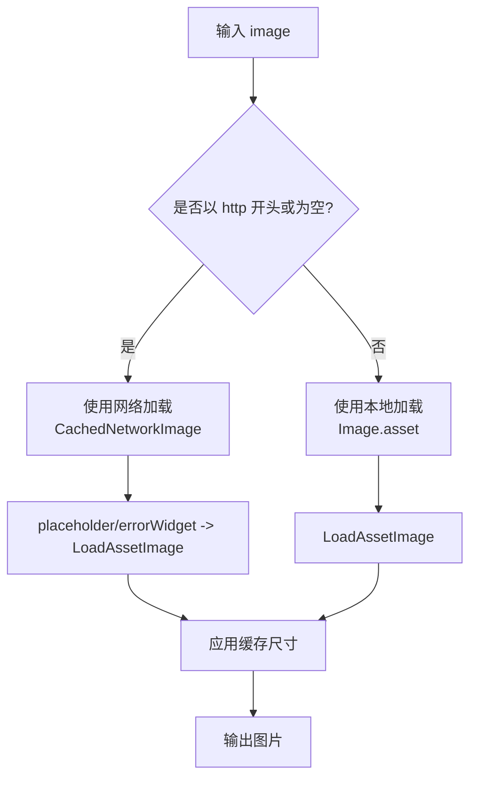
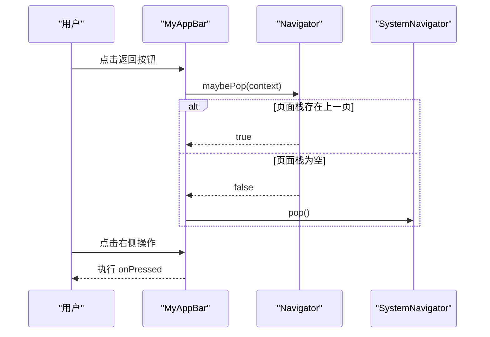
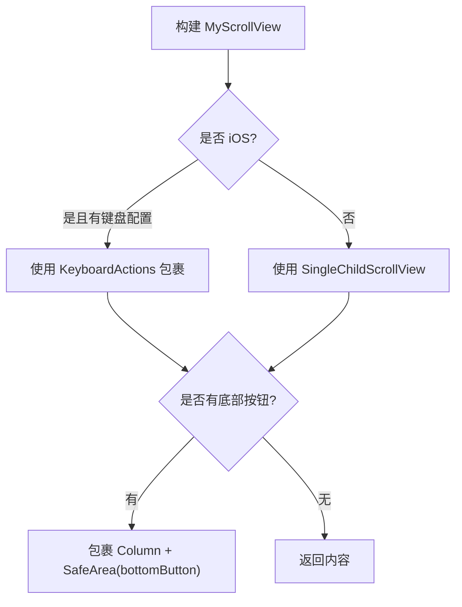
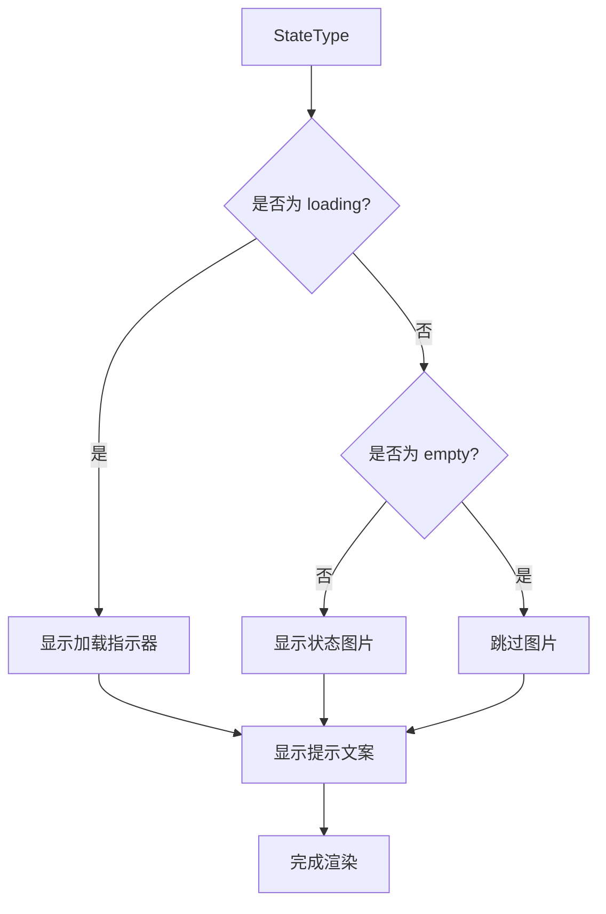
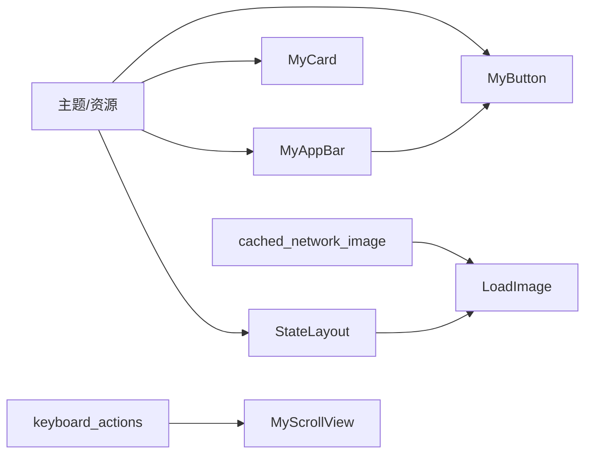

# 通用基础组件

<cite>
**本文引用的文件**   
- [my_button.dart](file://lib/widgets/my_button.dart)
- [my_card.dart](file://lib/widgets/my_card.dart)
- [progress_dialog.dart](file://lib/widgets/progress_dialog.dart)
- [load_image.dart](file://lib/widgets/load_image.dart)
- [my_app_bar.dart](file://lib/widgets/my_app_bar.dart)
- [my_scroll_view.dart](file://lib/widgets/my_scroll_view.dart)
- [state_layout.dart](file://lib/widgets/state_layout.dart)
</cite>

## 目录
1. [引言](#引言)
2. [项目结构](#项目结构)
3. [核心组件总览](#核心组件总览)
4. [架构总览](#架构总览)
5. [详细组件说明](#详细组件说明)
6. [依赖关系分析](#依赖关系分析)
7. [性能与可用性建议](#性能与可用性建议)
8. [常见问题排查](#常见问题排查)
9. [结论](#结论)

## 引言
本文件面向 Flutter 应用中的通用基础 UI 组件，系统梳理以下七个组件的功能、属性、事件、使用模式与注意事项：
- MyButton：自定义按钮，支持主题适配、禁用态、尺寸与边框等样式。
- MyCard：卡片容器，统一圆角、阴影和明暗主题背景色。
- ProgressDialog：轻量加载对话框，支持提示文案。
- LoadImage：图片加载器，统一本地与网络图加载、占位符与错误处理、缓存参数。
- MyAppBar：应用栏，支持标题、返回按钮、右侧操作按钮与状态栏配色。
- MyScrollView：滚动视图，提供 iOS 键盘集成、底部固定按钮与外部点击关闭能力。
- StateLayout：状态布局，用于空数据、错误、无网络、加载中等多状态展示。

## 项目结构
这些组件位于 widgets 目录下，属于跨页面复用的基础 UI 层，不依赖业务逻辑，主要引用资源、主题工具与第三方库。

**图表来源**
- [my_button.dart:1-75](file://lib/widgets/my_button.dart#L1-L75)
- [my_card.dart:1-36](file://lib/widgets/my_card.dart#L1-L36)
- [progress_dialog.dart:1-44](file://lib/widgets/progress_dialog.dart#L1-L44)
- [load_image.dart:1-94](file://lib/widgets/load_image.dart#L1-L94)
- [my_app_bar.dart:1-110](file://lib/widgets/my_app_bar.dart#L1-L110)
- [my_scroll_view.dart:1-85](file://lib/widgets/my_scroll_view.dart#L1-L85)
- [state_layout.dart:1-75](file://lib/widgets/state_layout.dart#L1-L75)

**章节来源**
- [my_button.dart:1-75](file://lib/widgets/my_button.dart#L1-L75)
- [my_card.dart:1-36](file://lib/widgets/my_card.dart#L1-L36)
- [progress_dialog.dart:1-44](file://lib/widgets/progress_dialog.dart#L1-L44)
- [load_image.dart:1-94](file://lib/widgets/load_image.dart#L1-L94)
- [my_app_bar.dart:1-110](file://lib/widgets/my_app_bar.dart#L1-L110)
- [my_scroll_view.dart:1-85](file://lib/widgets/my_scroll_view.dart#L1-L85)
- [state_layout.dart:1-75](file://lib/widgets/state_layout.dart#L1-L75)

## 核心组件总览
| 组件 | 职责 | 关键特性 | 典型用法 |
|---|---|---|---|
| MyButton | 可复用按钮 | 文字大小/颜色、背景/禁用背景、最小宽高、内边距、圆角、边框、水波纹、禁用态 | 表单提交、确认/取消、导航跳转 |
| MyCard | 内容卡片容器 | 背景色、阴影色、圆角、明暗主题自适应 | 列表项、信息块、弹窗内容 |
| ProgressDialog | 加载提示 | 半透明蒙层、旋转指示器、提示文案 | 请求前显示、异步任务期间保持可见 |
| LoadImage | 图片加载 | 自动区分本地/网络图、占位与错误图、内存缓存尺寸 | 商品图、头像、图标 |
| MyAppBar | 顶部导航栏 | 标题、居中标题、返回图标、右侧操作按钮、状态栏配色 | 页面主框架头 |
| MyScrollView | 滚动容器 | iOS 键盘适配、底部固定按钮、外部点击关闭、弹起偏移 | 表单页、设置页 |
| StateLayout | 状态占位 | 多状态枚举、默认文案、加载指示器、主题适配 | 列表为空、网络异常、加载失败 |

## 架构总览
各组件通过主题工具和资源文件实现一致的视觉风格；网络图片通过缓存库进行内存级缓存；iOS 键盘场景由 keyboard_actions 接管，Android 则回退到原生滚动行为。

**图表来源**
- [my_button.dart:1-75](file://lib/widgets/my_button.dart#L1-L75)
- [my_card.dart:1-36](file://lib/widgets/my_card.dart#L1-L36)
- [progress_dialog.dart:1-44](file://lib/widgets/progress_dialog.dart#L1-L44)
- [load_image.dart:1-94](file://lib/widgets/load_image.dart#L1-L94)
- [my_app_bar.dart:1-110](file://lib/widgets/my_app_bar.dart#L1-L110)
- [my_scroll_view.dart:1-85](file://lib/widgets/my_scroll_view.dart#L1-L85)
- [state_layout.dart:1-75](file://lib/widgets/state_layout.dart#L1-L75)

## 详细组件说明

### MyButton 自定义按钮
功能要点
- 基于 TextButton 封装，提供统一的字体、背景、禁用态、圆角、边框与水波纹。
- 支持深色主题下的文字与背景色切换。
- 可通过最小宽高控制整体尺寸，padding 控制内部留白，radius 控制圆角，side 控制边框。

关键属性
- text：按钮文案
- fontSize：字号
- textColor/disabledTextColor：启用/禁用文字颜色
- backgroundColor/disabledBackgroundColor：启用/禁用背景色
- minHeight/minWidth：最小高度/宽度
- padding：内边距
- radius：圆角半径
- side：边框样式
- onPressed：点击回调

交互与状态
- MaterialState.disabled：自动切换禁用文本与背景色。
- overlayColor：水波纹颜色根据当前文字颜色派生。

常见用法
- 主操作按钮：使用主题主色背景与白色文字。
- 次操作按钮：透明背景+描边边框，配合浅色或深色文字。
- 禁用态：在不可用状态下自动灰化文字与背景。

**图表来源**
- [my_button.dart:22-75](file://lib/widgets/my_button.dart#L22-L75)

**章节来源**
- [my_button.dart:1-75](file://lib/widgets/my_button.dart#L1-L75)

### MyCard 卡片容器
功能要点
- 使用 DecoratedBox 绘制圆角矩形，统一阴影与背景。
- 自动适配深色主题背景色与阴影透明度。

关键属性
- child：卡片子内容
- color：背景色（未指定时按主题选择）
- shadowColor：阴影色（未指定时按主题选择）

使用建议
- 作为列表项容器、信息区块或弹窗内容的外壳。
- 阴影在浅色模式下更明显，深色模式下阴影为透明以突出层次。

**章节来源**
- [my_card.dart:1-36](file://lib/widgets/my_card.dart#L1-L36)

### ProgressDialog 进度对话框
功能要点
- 基于 Dialog 的轻载提示框，包含圆形指示器与提示文案。
- 背景为半透明蒙层，内容区为带圆角的深色卡片。

关键属性
- hintText：提示文案

显示控制
- showDialog 弹出后，可在异步任务完成后调用 Navigator.pop 关闭。
- 适合网络请求、保存数据、初始化等短耗时操作。

**图表来源**
- [progress_dialog.dart:1-44](file://lib/widgets/progress_dialog.dart#L1-L44)

**章节来源**
- [progress_dialog.dart:1-44](file://lib/widgets/progress_dialog.dart#L1-L44)

### LoadImage 图片加载器
功能要点
- 自动判断是否为网络地址：网络图走 CachedNetworkImage，本地图走 Image.asset。
- 统一占位图与错误图，便于一致体验。
- 支持内存缓存尺寸，减少解码开销。

关键属性
- image：图片路径或 URL
- width/height：目标尺寸
- fit：缩放方式
- format：本地图格式
- holderImg：占位图
- cacheWidth/cacheHeight：内存缓存尺寸

缓存机制
- 网络图：使用缓存库进行磁盘/内存缓存。
- 本地图：通过 Image.asset 的 cacheWidth/cacheHeight 控制内存缓存。

错误重试
- 组件本身不提供重试按钮，建议在业务层捕获 errorWidget 的错误并触发重新加载。

**图表来源**
- [load_image.dart:1-94](file://lib/widgets/load_image.dart#L1-L94)

**章节来源**
- [load_image.dart:1-94](file://lib/widgets/load_image.dart#L1-L94)

### MyAppBar 应用栏
功能要点
- 自定义 AppBar，支持左侧返回按钮、居中标题、右侧操作按钮。
- 根据背景亮度自动调整状态栏图标颜色。
- 返回逻辑优先 Navigator.maybePop，否则调用 SystemNavigator.pop。

关键属性
- backgroundColor：背景色（未指定时使用主题背景）
- title：左对齐标题
- centerTitle：居中标题
- backImg：返回图标路径
- backImgColor：返回图标颜色
- actionName：右侧操作按钮文案
- onPressed：右侧操作按钮回调
- isBack：是否显示返回按钮

交互流程
- 点击返回：先尝试 pop，失败则退出应用。
- 点击右侧操作：触发业务回调。

**图表来源**
- [my_app_bar.dart:1-110](file://lib/widgets/my_app_bar.dart#L1-L110)

**章节来源**
- [my_app_bar.dart:1-110](file://lib/widgets/my_app_bar.dart#L1-L110)

### MyScrollView 滚动视图
功能要点
- 统一滚动容器，支持底部固定按钮。
- iOS 平台结合 keyboard_actions 处理软键盘遮挡与外部点击关闭。
- Android 平台使用 SingleChildScrollView 原生行为。

关键属性
- children：子元素列表
- padding：内边距
- physics：滚动物理效果
- crossAxisAlignment：主轴对齐方式
- bottomButton：底部固定按钮
- keyboardConfig：iOS 键盘配置
- tapOutsideToDismiss：外部点击是否关闭键盘
- overScroll：键盘弹起后的额外上滚距离

iOS 键盘处理流程
- 当 platform 为 iOS 且提供了 keyboardConfig：
  - 将 children 放入 Column，必要时包裹 Padding。
  - 外层使用 KeyboardActions 包裹，并根据 bottomButton 是否存在设置 isDialog。
  - 根据 tapOutsideToDismiss 设置 TapOutsideBehavior。
- 非 iOS 或未配置 keyboardConfig：
  - 直接使用 SingleChildScrollView。

**图表来源**
- [my_scroll_view.dart:1-85](file://lib/widgets/my_scroll_view.dart#L1-L85)

注意
- 文档注释提醒：若同时使用底部按钮与 keyboardConfig，Scaffold 应设置 resizeToAvoidBottomInset 在非 iOS 平台为 false，以避免键盘高度异常。

**章节来源**
- [my_scroll_view.dart:1-85](file://lib/widgets/my_scroll_view.dart#L1-L85)

### StateLayout 状态布局
功能要点
- 根据 StateType 展示不同状态：订单、商品、无网络、消息、提现账号、加载中、空。
- 加载中显示 CupertinoActivityIndicator，其他非空状态展示对应图片与默认文案。
- 文案可由 hintText 覆盖，默认文案来自枚举扩展。

关键属性
- type：状态类型
- hintText：自定义提示文案（可选）

状态枚举与文案映射
- order/goods/network/message/account/loading/empty
- 每种类型对应一张状态图片与默认提示文案。

**图表来源**
- [state_layout.dart:1-75](file://lib/widgets/state_layout.dart#L1-L75)

**章节来源**
- [state_layout.dart:1-75](file://lib/widgets/state_layout.dart#L1-L75)

## 依赖关系分析
- 主题与资源
  - MyButton、MyCard、MyAppBar、StateLayout 均引用主题工具与颜色/尺寸资源，确保统一视觉。
- 第三方库
  - LoadImage 依赖 cached_network_image 进行网络图片缓存。
  - MyScrollView 依赖 keyboard_actions 实现 iOS 键盘优化。
- 组件耦合
  - MyAppBar 内部使用 MyButton 作为右侧操作按钮。
  - StateLayout 内部使用 LoadAssetImage 渲染状态图片。

**图表来源**
- [my_button.dart:1-75](file://lib/widgets/my_button.dart#L1-L75)
- [my_card.dart:1-36](file://lib/widgets/my_card.dart#L1-L36)
- [my_app_bar.dart:1-110](file://lib/widgets/my_app_bar.dart#L1-L110)
- [state_layout.dart:1-75](file://lib/widgets/state_layout.dart#L1-L75)
- [load_image.dart:1-94](file://lib/widgets/load_image.dart#L1-L94)
- [my_scroll_view.dart:1-85](file://lib/widgets/my_scroll_view.dart#L1-L85)

**章节来源**
- [my_button.dart:1-75](file://lib/widgets/my_button.dart#L1-L75)
- [my_card.dart:1-36](file://lib/widgets/my_card.dart#L1-L36)
- [progress_dialog.dart:1-44](file://lib/widgets/progress_dialog.dart#L1-L44)
- [load_image.dart:1-94](file://lib/widgets/load_image.dart#L1-L94)
- [my_app_bar.dart:1-110](file://lib/widgets/my_app_bar.dart#L1-L110)
- [my_scroll_view.dart:1-85](file://lib/widgets/my_scroll_view.dart#L1-L85)
- [state_layout.dart:1-75](file://lib/widgets/state_layout.dart#L1-L75)

## 性能与可用性建议
- 图片加载
  - 为频繁展示的网络图设置合理的 cacheWidth/cacheHeight，避免重复解码大尺寸原图。
  - 对首屏大图使用合适的 BoxFit 与占位图，提升感知速度。
- 滚动与键盘
  - 在 iOS 使用 keyboard_config 时，注意 Scaffold 的 resizeToAvoidBottomInset 设置，避免键盘遮挡。
  - 长列表建议使用 ListView.builder 与分页加载，避免一次性构建大量子节点。
- 主题一致性
  - 所有颜色与尺寸尽量通过主题工具与资源获取，避免硬编码。
- 无障碍
  - MyAppBar 标题区域设置了语义标记，利于屏幕阅读器识别。
  - 图片可考虑 excludeFromSemantics 以减少冗余语义（LoadAssetImage 已默认忽略）。

[本节为通用指导，不涉及具体源码]

## 常见问题排查
- 问题：MyButton 点击无效
  - 检查 onPressed 是否为 null；确认按钮未被父容器拦截手势。
- 问题：MyCard 阴影不明显
  - 深色模式下阴影被设置为透明，属预期行为；如需强调层级，可传入 shadowColor。
- 问题：ProgressDialog 无法关闭
  - 确认异步任务结束后调用了 Navigator.pop；不要在 build 中直接 pop。
- 问题：LoadImage 显示错误图
  - 检查 imageUrl 是否有效；可为业务层增加重试逻辑或在 errorWidget 中提示重试。
- 问题：MyAppBar 状态栏图标颜色不正确
  - 检查 backgroundColor 是否与系统亮度匹配；未传值时会根据主题背景自动计算。
- 问题：MyScrollView 键盘遮挡
  - iOS 下需配置 keyboardConfig；同时确保 Scaffold 在非 iOS 平台设置 resizeToAvoidBottomInset 为 false。
- 问题：StateLayout 文案不生效
  - 传入 hintText 覆盖默认文案；确认 type 枚举与实际状态一致。

**章节来源**
- [my_button.dart:1-75](file://lib/widgets/my_button.dart#L1-L75)
- [my_card.dart:1-36](file://lib/widgets/my_card.dart#L1-L36)
- [progress_dialog.dart:1-44](file://lib/widgets/progress_dialog.dart#L1-L44)
- [load_image.dart:1-94](file://lib/widgets/load_image.dart#L1-L94)
- [my_app_bar.dart:1-110](file://lib/widgets/my_app_bar.dart#L1-L110)
- [my_scroll_view.dart:1-85](file://lib/widgets/my_scroll_view.dart#L1-L85)
- [state_layout.dart:1-75](file://lib/widgets/state_layout.dart#L1-L75)

## 结论
这组基础组件覆盖了按钮、卡片、进度提示、图片加载、应用栏、滚动视图与状态占位的常见场景。它们通过主题与资源保持一致的视觉风格，并通过第三方库增强特定平台体验。使用时建议：
- 优先使用主题与资源定义的颜色与尺寸。
- 在网络图片场景中合理设置缓存尺寸与占位图。
- 在 iOS 键盘场景中正确配置 keyboard_actions。
- 在状态展示中使用 StateLayout 统一空/错/网/加载表现。
- 在复杂页面中组合多个组件，形成稳定、可维护的基础 UI 体系。