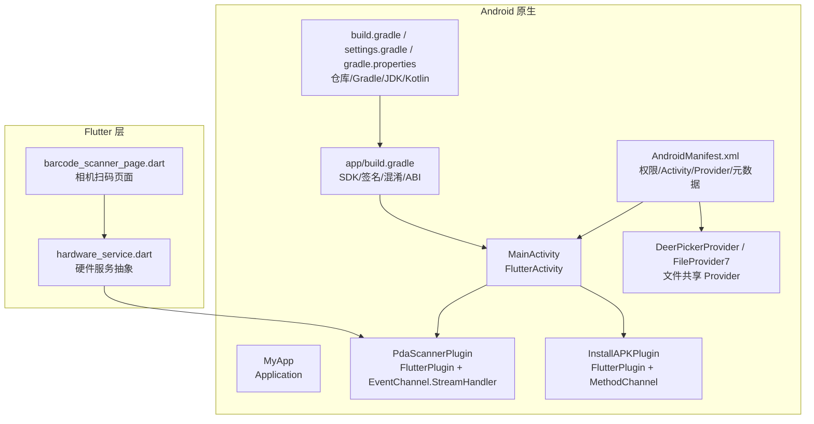
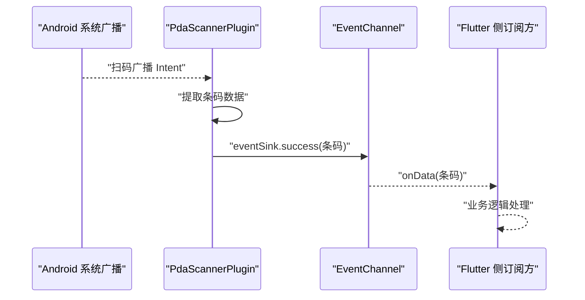
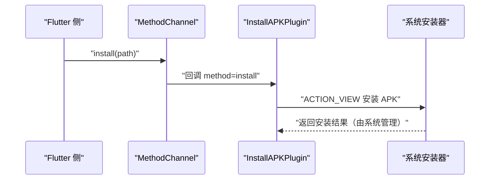
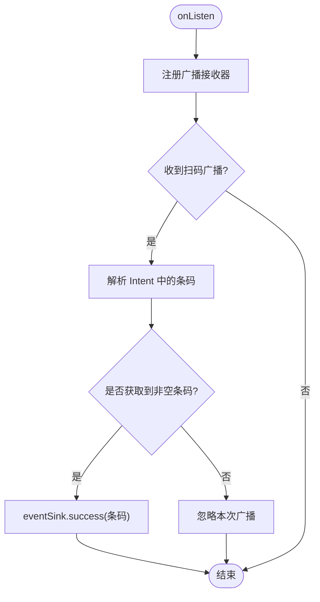
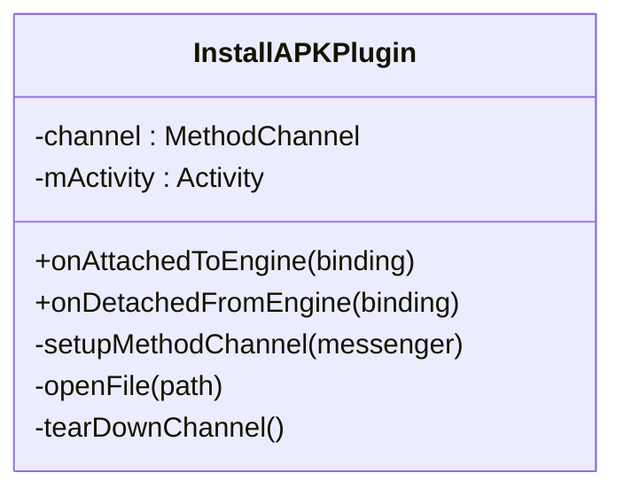
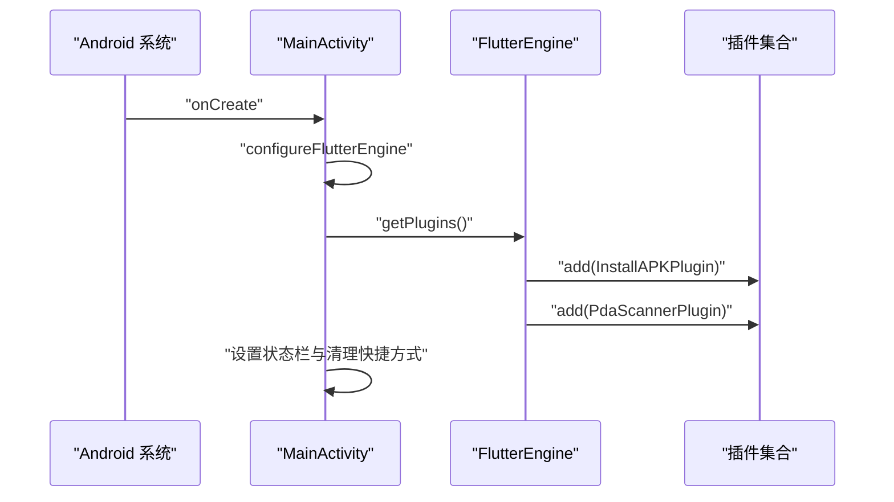
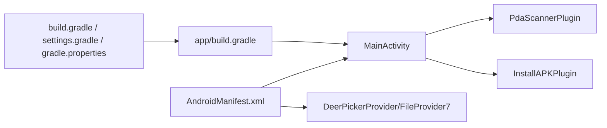

# Android 原生集成

<cite>
**本文引用的文件**   
- [PdaScannerPlugin.java](file://android/app/src/main/java/com/bycloud/smdc/PdaScannerPlugin.java)
- [InstallAPKPlugin.java](file://android/app/src/main/java/com/bycloud/smdc/InstallAPKPlugin.java)
- [MainActivity.java](file://android/app/src/main/java/com/bycloud/smdc/MainActivity.java)
- [MyApp.java](file://android/app/src/main/java/com/bycloud/smdc/MyApp.java)
- [AndroidManifest.xml](file://android/app/src/main/AndroidManifest.xml)
- [app/build.gradle](file://android/app/build.gradle)
- [build.gradle](file://android/build.gradle)
- [gradle.properties](file://android/gradle.properties)
- [settings.gradle](file://android/settings.gradle)
- [hardware_service.dart](file://lib/util/hardware_service.dart)
- [barcode_scanner_page.dart](file://lib/widgets/barcode_scanner_page.dart)
- [Android问题汇总.md](file://docs/Android问题汇总.md)
</cite>

## 目录
1. [引言](#引言)
2. [项目结构](#项目结构)
3. [核心组件](#核心组件)
4. [架构总览](#架构总览)
5. [详细组件分析](#详细组件分析)
6. [依赖关系分析](#依赖关系分析)
7. [性能与构建优化](#性能与构建优化)
8. [硬件设备集成最佳实践](#硬件设备集成最佳实践)
9. [调试与排错指南](#调试与排错指南)
10. [结论](#结论)

## 引言
本文面向聚客美滋滋应用的 Android 平台原生集成，重点说明：
- PdaScannerPlugin 条码扫描插件的 Java 实现、Intent 广播监听、权限与回调机制、错误处理。
- InstallAPKPlugin APK 安装插件的实现原理与调用方式。
- MainActivity 生命周期管理与 Flutter Engine 插件注册。
- MyApp 应用初始化入口与扩展点。
- AndroidManifest.xml 中的权限声明、Activity 配置、Provider 注册等关键项。
- build.gradle 系列脚本的配置项、签名、资源压缩与混淆设置。
- 扫码枪、打印机等外设集成的协议与数据格式建议。
- 调试技巧、性能优化建议与常见问题解决方案。

## 项目结构
Android 原生层代码位于 android/app/src/main 下，包含：
- Java 源码：com.bycloud.smdc 包下的 MainActivity、MyApp、PdaScannerPlugin、InstallAPKPlugin，以及 FileProvider 相关类。
- 清单与资源：AndroidManifest.xml、主题样式、网络与安全配置、文件路径映射。
- Gradle 工程：根 build.gradle、app/build.gradle、settings.gradle、gradle.properties。

图示来源
- [MainActivity.java:1-38](file://android/app/src/main/java/com/bycloud/smdc/MainActivity.java#L1-L38)
- [PdaScannerPlugin.java:1-165](file://android/app/src/main/java/com/bycloud/smdc/PdaScannerPlugin.java#L1-L165)
- [InstallAPKPlugin.java:1-62](file://android/app/src/main/java/com/bycloud/smdc/InstallAPKPlugin.java#L1-L62)
- [AndroidManifest.xml:1-89](file://android/app/src/main/AndroidManifest.xml#L1-L89)
- [app/build.gradle:1-85](file://android/app/build.gradle#L1-L85)
- [build.gradle:1-23](file://android/build.gradle#L1-L23)
- [settings.gradle:1-27](file://android/settings.gradle#L1-L27)
- [gradle.properties:1-27](file://android/gradle.properties#L1-L27)
- [hardware_service.dart:1-79](file://lib/util/hardware_service.dart#L1-L79)
- [barcode_scanner_page.dart:1-177](file://lib/widgets/barcode_scanner_page.dart#L1-L177)

章节来源
- [MainActivity.java:1-38](file://android/app/src/main/java/com/bycloud/smdc/MainActivity.java#L1-L38)
- [AndroidManifest.xml:1-89](file://android/app/src/main/AndroidManifest.xml#L1-L89)
- [app/build.gradle:1-85](file://android/app/build.gradle#L1-L85)

## 核心组件
本节聚焦四个原生关键点：
- PdaScannerPlugin：通过系统广播监听主流 PDA 扫码结果，经 EventChannel 推送给 Flutter。
- InstallAPKPlugin：封装 APK 安装流程，使用 MethodChannel 暴露 install 方法。
- MainActivity：FlutterActivity 子类，注册插件、配置状态栏与动态快捷方式清理。
- MyApp：Application 子类，作为全局初始化扩展点。

章节来源
- [PdaScannerPlugin.java:1-165](file://android/app/src/main/java/com/bycloud/smdc/PdaScannerPlugin.java#L1-L165)
- [InstallAPKPlugin.java:1-62](file://android/app/src/main/java/com/bycloud/smdc/InstallAPKPlugin.java#L1-L62)
- [MainActivity.java:1-38](file://android/app/src/main/java/com/bycloud/smdc/MainActivity.java#L1-L38)
- [MyApp.java:1-17](file://android/app/src/main/java/com/bycloud/smdc/MyApp.java#L1-L17)

## 架构总览
从 Flutter 到 Android 原生的主要交互路径如下：
- 扫码事件：PDA 系统广播 → PdaScannerPlugin 接收并解析 → EventChannel 推送 → Flutter 侧订阅处理。
- 安装 APK：Flutter 调用 MethodChannel.install → InstallAPKPlugin 打开系统安装界面。
- 应用启动：AndroidManifest 指定 MainActivity 为入口 → configureFlutterEngine 注册插件 → Flutter 引擎加载 Dart 代码。

图示来源
- [PdaScannerPlugin.java:1-165](file://android/app/src/main/java/com/bycloud/smdc/PdaScannerPlugin.java#L1-L165)

图示来源
- [InstallAPKPlugin.java:1-62](file://android/app/src/main/java/com/bycloud/smdc/InstallAPKPlugin.java#L1-L62)

## 详细组件分析

### PdaScannerPlugin 条码扫描插件
职责与行为
- 作为 FlutterPlugin 和 EventChannel.StreamHandler，绑定到 Flutter Engine 后创建名为 com.bycloud.smdc/pda_scanner 的事件通道。
- onListen/onCancel 控制 BroadcastReceiver 的生命周期，避免内存泄漏。
- 监听多个主流 PDA 厂商的扫码广播 Action，并从多种 Extra Key 中解析出条码字符串，统一通过 eventSink.success 推送给 Flutter。

关键设计要点
- 广播兼容面广：覆盖商米、优博音、新大陆、iData、霍尼韦尔、东大集成、智联天地等多个厂商。
- 容错健壮：对异常捕获忽略；在 SDK >= TIRAMISU 时使用 RECEIVER_EXPORTED；未找到条码时不推送空值。
- 生命周期安全：onDetachedFromEngine 中取消注册并释放引用。

图示来源
- [PdaScannerPlugin.java:1-165](file://android/app/src/main/java/com/bycloud/smdc/PdaScannerPlugin.java#L1-L165)

权限与系统集成
- 该插件本身未声明额外运行时权限；扫码广播来自系统或 PDA 厂商系统服务。
- 如需在更高版本系统中稳定接收外部广播，应确保应用在 AndroidManifest 中正确声明相关 queries 与 provider，当前清单已具备基础能力。

Flutter 侧对接建议
- Flutter 侧可通过 EventChannel 订阅 com.bycloud.smdc/pda_scanner，接收字符串形式的条码。
- 建议在 Flutter 侧去抖与校验条码格式，避免重复触发业务逻辑。

章节来源
- [PdaScannerPlugin.java:1-165](file://android/app/src/main/java/com/bycloud/smdc/PdaScannerPlugin.java#L1-L165)

### InstallAPKPlugin APK 安装插件
职责与行为
- 暴露 MethodChannel 名为 version，提供 install 方法。
- 接收 path 参数，构造 ACTION_VIEW Intent，并使用 FileProvider7 将 APK 文件 URI 安全地传递给系统安装器。

调用约定
- Flutter 端调用 MethodChannel.version 的 install 方法，传入待安装的 APK 绝对路径。
- 安装过程由系统 UI 完成；插件不直接等待安装结果。

注意事项
- 需要 REQUEST_INSTALL_PACKAGES 权限以允许安装包请求（已在清单中声明）。
- 对于 Android 7.0+，必须通过 FileProvider 暴露文件，避免 FileUriExposedException。
- 若需区分不同安装渠道或返回安装结果，可在 MethodChannel 中扩展回调或返回值。

图示来源
- [InstallAPKPlugin.java:1-62](file://android/app/src/main/java/com/bycloud/smdc/InstallAPKPlugin.java#L1-L62)

章节来源
- [InstallAPKPlugin.java:1-62](file://android/app/src/main/java/com/bycloud/smdc/InstallAPKPlugin.java#L1-L62)
- [AndroidManifest.xml:1-89](file://android/app/src/main/AndroidManifest.xml#L1-L89)

### MainActivity 生命周期与 Flutter Engine 配置
职责与行为
- 继承 FlutterActivity，重写 configureFlutterEngine 以注册 InstallAPKPlugin 与 PdaScannerPlugin。
- onCreate 中设置透明状态栏，清除旧版动态快捷方式残留。

关键点
- 插件注册顺序不影响功能，但应确保在 Flutter Engine 可用时完成注册。
- 清理动态快捷方式可避免覆盖安装导致的历史条目干扰用户体验。

图示来源
- [MainActivity.java:1-38](file://android/app/src/main/java/com/bycloud/smdc/MainActivity.java#L1-L38)

章节来源
- [MainActivity.java:1-38](file://android/app/src/main/java/com/bycloud/smdc/MainActivity.java#L1-L38)

### MyApp 应用初始化与全局配置
职责与行为
- 继承 Application，提供 onCreate 扩展点，目前为空实现。
- 适合作为第三方 SDK 初始化、日志框架、全局配置加载的统一入口。

建议
- 在此处统一初始化网络库、埋点、崩溃收集、打印服务等。
- 注意避免阻塞主线程，耗时任务应异步执行。

章节来源
- [MyApp.java:1-17](file://android/app/src/main/java/com/bycloud/smdc/MyApp.java#L1-L17)

### AndroidManifest.xml 关键配置
权限声明
- REQUEST_INSTALL_PACKAGES：用于触发系统安装 APK。
- INTERNET：网络访问。
- RECORD_AUDIO：可能用于扫码或语音相关能力（视业务而定）。

queries
- 针对 API 30+，声明可查询的 VIEW https 与 DIAL tel，解决隐式 Intent 可见性问题。

Activity
- MainActivity 配置 singleTop、portrait、adjustResize、hardwareAccelerated=true，适配扫码与输入场景。
- NormalTheme 与 LaunchTheme 分离，保证 Flutter 渲染主题及时生效。

Provider
- DeerPickerProvider 与 file_paths 配合，支持 Android 7.0+ 的文件共享，供安装或其他文件操作使用。

其他元数据
- flutterEmbedding=2 启用 Flutter 嵌入 V2。
- 高德地图 key、刘海屏与全面屏相关元数据。

章节来源
- [AndroidManifest.xml:1-89](file://android/app/src/main/AndroidManifest.xml#L1-L89)

## 依赖关系分析
模块耦合与职责边界
- MainActivity 仅负责插件注册与少量 UI 配置，低耦合。
- PdaScannerPlugin 与 InstallAPKPlugin 各自独立，分别通过 EventChannel 与 MethodChannel 与 Flutter 通信。
- AndroidManifest 集中声明权限、Activity、Provider 与元数据，便于统一管理。
- Gradle 脚本负责编译环境、签名、混淆与仓库源。

图示来源
- [MainActivity.java:1-38](file://android/app/src/main/java/com/bycloud/smdc/MainActivity.java#L1-L38)
- [PdaScannerPlugin.java:1-165](file://android/app/src/main/java/com/bycloud/smdc/PdaScannerPlugin.java#L1-L165)
- [InstallAPKPlugin.java:1-62](file://android/app/src/main/java/com/bycloud/smdc/InstallAPKPlugin.java#L1-L62)
- [AndroidManifest.xml:1-89](file://android/app/src/main/AndroidManifest.xml#L1-L89)
- [app/build.gradle:1-85](file://android/app/build.gradle#L1-L85)
- [build.gradle:1-23](file://android/build.gradle#L1-L23)
- [settings.gradle:1-27](file://android/settings.gradle#L1-L27)
- [gradle.properties:1-27](file://android/gradle.properties#L1-L27)

章节来源
- [MainActivity.java:1-38](file://android/app/src/main/java/com/bycloud/smdc/MainActivity.java#L1-L38)
- [AndroidManifest.xml:1-89](file://android/app/src/main/AndroidManifest.xml#L1-L89)
- [app/build.gradle:1-85](file://android/app/build.gradle#L1-L85)

## 性能与构建优化
构建与运行环境
- compileSdkVersion 36、targetSdkVersion 35、minSdkVersion 由 flutter.minSdkVersion 决定。
- NDK 版本固定为 28.2.13676358，Java 目标与源码兼容性为 17。
- 仓库源包含阿里云 Maven、Google、MavenCentral、JitPack，提升下载稳定性。

发布优化
- release 开启 shrinkResources、zipAlignEnabled、minifyEnabled，并引入 proguard-rules.pro。
- debug 也使用 release 签名配置，便于本地联调签名一致性。
- Gradle 并行、守护进程、缓存、JVM 堆增大与元空间限制，提升编译速度。

注意事项
- 若出现 Kotlin 版本冲突，settings.gradle 已将 Kotlin Gradle Plugin 对齐 2.2.20，避免内置 2.0.0 无法读取 kotlin-stdlib 2.2.20 的问题。
- gradle.properties 关闭 builtInKotlin 与增量编译，规避跨盘符路径异常。

章节来源
- [app/build.gradle:1-85](file://android/app/build.gradle#L1-L85)
- [build.gradle:1-23](file://android/build.gradle#L1-L23)
- [settings.gradle:1-27](file://android/settings.gradle#L1-L27)
- [gradle.properties:1-27](file://android/gradle.properties#L1-L27)

## 硬件设备集成最佳实践

### 扫码枪与摄像头扫码
两种路径并存：
- PDA 硬件扫码：PdaScannerPlugin 监听系统广播，适合外接扫码枪或内置扫码硬件。
- 摄像头扫码：barcode_scanner_page.dart 使用 mobile_scanner 进行相机扫码，适用于通用手机。

对比与建议
- PDA 广播方案无需相机权限，延迟低、功耗小，适合商用设备。
- 摄像头扫码更灵活，但需注意相机权限、预览性能与对焦策略。

Flutter 侧统一接入
- hardware_service.dart 定义硬件抽象，预留 NFC、电子秤、钱箱接口，当前扫码由 mobile_scanner 提供。
- 建议后续在 HardwareService 中增加 PdaScannerPlugin 的事件桥接，使上层统一调用。

章节来源
- [PdaScannerPlugin.java:1-165](file://android/app/src/main/java/com/bycloud/smdc/PdaScannerPlugin.java#L1-L165)
- [barcode_scanner_page.dart:1-177](file://lib/widgets/barcode_scanner_page.dart#L1-L177)
- [hardware_service.dart:1-79](file://lib/util/hardware_service.dart#L1-L79)

### 打印机与钱箱
- 钱箱通常通过 ESC/POS 指令驱动打印机弹出，HardwareService 预留 openCashDrawer 接口。
- 建议结合打印插件（如 esc_pos_utils、thermal_printer）发送 p 指令，并在结账成功后触发。

协议与数据格式建议
- ESC/POS 开钱箱：标准指令为 0x1B 0x70 0x00 0x19 0x19。
- 打印内容建议采用结构化文本或 JSON，便于后端核对与审计。

章节来源
- [hardware_service.dart:1-79](file://lib/util/hardware_service.dart#L1-L79)

### 电子秤
- 当前 HardwareService 预留 isScaleAvailable 与 readScaleWeight，需接入串口/蓝牙协议插件。
- 协议常见为 RS-232 或 BLE，建议封装为异步接口，返回重量与单位，并在 UI 上展示实时称重。

章节来源
- [hardware_service.dart:1-79](file://lib/util/hardware_service.dart#L1-L79)

## 调试与排错指南

### 常见问题与解决
- Flutter embedding 依赖解析失败：参考 Android 问题汇总文档，调整 Flutter Gradle 仓库源或替换镜像地址。
- 打包体积过大：使用 --target-platform 指定 ABI，--obfuscate 混淆，--split-debug-info 分离调试信息。

章节来源
- [Android问题汇总.md:1-56](file://docs/Android问题汇总.md#L1-L56)

### PdaScannerPlugin 调试建议
- 确认系统或 PDA 厂商确实发出对应广播 Action，可使用 adb logcat 过滤广播日志。
- 检查 EventChannel 订阅是否成功，Flutter 侧 onData 是否被触发。
- 若仅在部分机型无效，排查 EXTRA_KEY 是否与厂商实现一致，必要时在 extractBarcode 中添加更多 key。

### InstallAPKPlugin 调试建议
- 确认 APK 路径有效且可读，FileProvider7 配置的 authorities 与 file_paths 匹配。
- 若安装失败，检查 REQUEST_INSTALL_PACKAGES 权限与系统安装器返回结果。

### MainActivity 与主题
- 若状态栏颜色不生效，检查 NormalTheme 与 LaunchTheme 是否冲突，或 adjustResize 是否影响输入法遮挡。
- 动态快捷方式清理仅在较新版本系统生效，兼容 Build.VERSION_CODES.N_MR1。

章节来源
- [PdaScannerPlugin.java:1-165](file://android/app/src/main/java/com/bycloud/smdc/PdaScannerPlugin.java#L1-L165)
- [InstallAPKPlugin.java:1-62](file://android/app/src/main/java/com/bycloud/smdc/InstallAPKPlugin.java#L1-L62)
- [MainActivity.java:1-38](file://android/app/src/main/java/com/bycloud/smdc/MainActivity.java#L1-L38)

## 结论
本项目 Android 原生层围绕两个核心插件展开：PdaScannerPlugin 提供广谱 PDA 扫码广播支持，InstallAPKPlugin 简化 APK 安装流程。MainActivity 作为 Flutter Engine 的挂载点，统一注册插件并提供基础 UI 配置；MyApp 保留全局初始化扩展点。AndroidManifest 与 Gradle 脚本完成权限、Provider、主题与构建优化配置。结合 Flutter 层的 barcode_scanner_page 与 hardware_service 抽象，形成完整的硬件集成方案。建议后续在 HardwareService 中统一桥接 PdaScannerPlugin 事件，完善 NFC、电子秤、钱箱等外设能力，进一步提升多设备兼容性与可维护性。