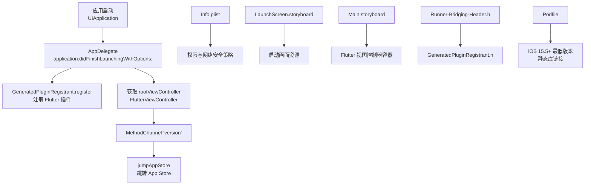
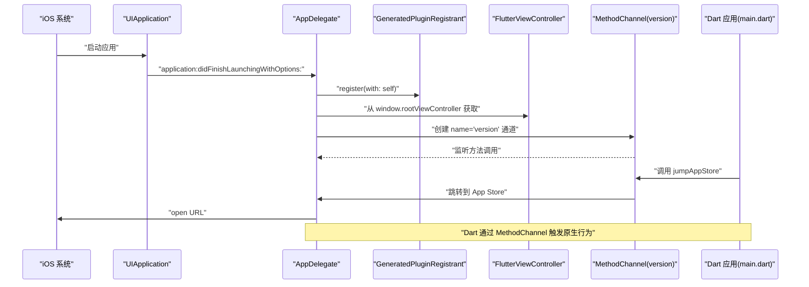
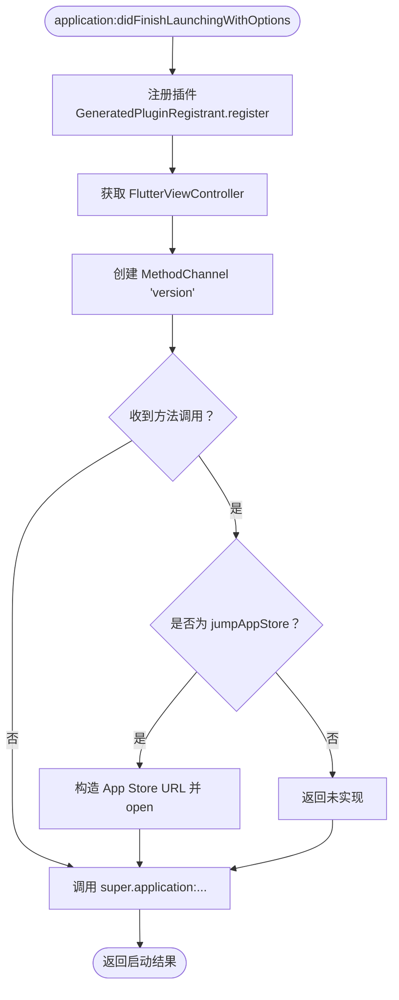
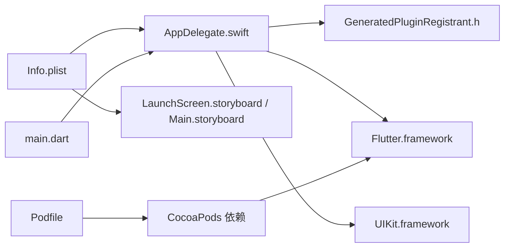

# iOS 原生集成

<cite>
**本文引用的文件**   
- [AppDelegate.swift](file://ios/Runner/AppDelegate.swift)
- [Info.plist](file://ios/Runner/Info.plist)
- [LaunchScreen.storyboard](file://ios/Runner/Base.lproj/LaunchScreen.storyboard)
- [Main.storyboard](file://ios/Runner/Base.lproj/Main.storyboard)
- [Runner-Bridging-Header.h](file://ios/Runner/Runner-Bridging-Header.h)
- [Podfile](file://ios/Podfile)
- [main.dart](file://lib/main.dart)
- [README.md](file://README.md)
</cite>

## 目录
1. [简介](#简介)
2. [项目结构](#项目结构)
3. [核心组件](#核心组件)
4. [架构总览](#架构总览)
5. [详细组件分析](#详细组件分析)
6. [依赖关系分析](#依赖关系分析)
7. [性能与兼容性](#性能与兼容性)
8. [Xcode 配置与发布](#xcode-配置与发布)
9. [故障排查指南](#故障排查指南)
10. [结论](#结论)

## 简介
本文件面向聚客美滋滋应用的 iOS 平台原生集成，聚焦以下目标：
- 解析 AppDelegate.swift 的应用生命周期、Flutter Engine 初始化、原生通道与系统事件处理。
- 梳理 Info.plist 的权限声明、网络安全策略、应用基础信息与界面入口配置。
- 说明 LaunchScreen.storyboard 与 Main.storyboard 在 Flutter 工程中的角色和定制方法。
- 解释 Runner-Bridging-Header.h 的 Swift 与 Objective-C 互操作作用。
- 给出推送通知、相机、相册、定位、麦克风等能力在 iOS 端的集成要点。
- 补充 Xcode 项目配置、签名证书管理、TestFlight 发布流程建议。
- 总结 iOS 平台的性能优化、内存管理与兼容性注意事项。

本项目基于 Flutter 构建，iOS 侧采用标准的 Runner 模板：Swift 应用入口通过 FlutterViewController 承载 Flutter UI，并通过 MethodChannel 暴露少量原生能力给 Dart 层调用。

## 项目结构
iOS 端关键文件及其职责如下：
- ios/Runner/AppDelegate.swift：应用启动入口，注册插件，建立版本升级通道。
- ios/Runner/Info.plist：Bundle 信息、权限描述、网络策略、界面与设备方向配置。
- ios/Runner/Base.lproj/LaunchScreen.storyboard：冷启动闪屏界面，用于显示启动图。
- ios/Runner/Base.lproj/Main.storyboard：主界面 Storyboard，承载 FlutterViewController。
- ios/Runner/Runner-Bridging-Header.h：桥接头文件，导入 Flutter 插件自动生成的注册头。
- ios/Podfile：CocoaPods 配置，指定最低系统版本、静态链接与部署目标。
- lib/main.dart：Dart 应用入口，负责全局初始化、路由、主题、日志、网络与 Toast。

图表来源
- [AppDelegate.swift:1-31](file://ios/Runner/AppDelegate.swift#L1-L31)
- [Info.plist:1-76](file://ios/Runner/Info.plist#L1-L76)
- [LaunchScreen.storyboard:1-45](file://ios/Runner/Base.lproj/LaunchScreen.storyboard#L1-L45)
- [Main.storyboard:1-30](file://ios/Runner/Base.lproj/Main.storyboard#L1-L30)
- [Runner-Bridging-Header.h:1-1](file://ios/Runner/Runner-Bridging-Header.h#L1-L1)
- [Podfile:1-53](file://ios/Podfile#L1-L53)

章节来源
- [AppDelegate.swift:1-31](file://ios/Runner/AppDelegate.swift#L1-L31)
- [Info.plist:1-76](file://ios/Runner/Info.plist#L1-L76)
- [LaunchScreen.storyboard:1-45](file://ios/Runner/Base.lproj/LaunchScreen.storyboard#L1-L45)
- [Main.storyboard:1-30](file://ios/Runner/Base.lproj/Main.storyboard#L1-L30)
- [Runner-Bridging-Header.h:1-1](file://ios/Runner/Runner-Bridging-Header.h#L1-L1)
- [Podfile:1-53](file://ios/Podfile#L1-L53)

## 核心组件
本节对 iOS 原生集成的核心组件进行概览式说明。

- AppDelegate.swift
  - 继承 FlutterAppDelegate，作为应用生命周期入口。
  - 通过 GeneratedPluginRegistrant 完成 Flutter 插件注册。
  - 从 window.rootViewController 取出 FlutterViewController，并创建名为 version 的 MethodChannel。
  - 处理 jumpAppStore 方法调用，打开 App Store 链接。
  - 最终调用 super.application(_:didFinishLaunchingWithOptions:) 完成默认启动流程。

- Info.plist
  - Bundle 基本信息：名称、标识符、版本号、本地化语言等。
  - 权限描述：相机、定位（使用期间）、相册、麦克风。
  - 网络安全策略：开启任意 HTTP 访问（当前为开发联调场景）。
  - 界面配置：启动 Storyboard、主 Storyboard、支持的方向、状态栏控制、间接输入事件支持等。

- LaunchScreen.storyboard 与 Main.storyboard
  - LaunchScreen.storyboard 展示启动图，配合 Assets 中的 LaunchImage 资源。
  - Main.storyboard 定义 FlutterViewController 容器，承载 Flutter UI。

- Runner-Bridging-Header.h
  - 仅导入 GeneratedPluginRegistrant.h，供 Swift 代码调用插件自动注册逻辑。

- Podfile
  - 指定最低 iOS 版本为 15.5。
  - 使用 use_frameworks! 并启用静态链接。
  - post_install 中统一提升部署目标至 15.5，确保第三方库兼容。

章节来源
- [AppDelegate.swift:1-31](file://ios/Runner/AppDelegate.swift#L1-L31)
- [Info.plist:1-76](file://ios/Runner/Info.plist#L1-L76)
- [LaunchScreen.storyboard:1-45](file://ios/Runner/Base.lproj/LaunchScreen.storyboard#L1-L45)
- [Main.storyboard:1-30](file://ios/Runner/Base.lproj/Main.storyboard#L1-L30)
- [Runner-Bridging-Header.h:1-1](file://ios/Runner/Runner-Bridging-Header.h#L1-L1)
- [Podfile:1-53](file://ios/Podfile#L1-L53)

## 架构总览
下图展示 iOS 原生层与 Dart 层之间的启动与通信关系：

图表来源
- [AppDelegate.swift:1-31](file://ios/Runner/AppDelegate.swift#L1-L31)
- [main.dart:1-159](file://lib/main.dart#L1-L159)

## 详细组件分析

### AppDelegate.swift 应用生命周期与通道处理
- 启动阶段
  - 继承 FlutterAppDelegate，重写 application(_:didFinishLaunchingWithOptions:)。
  - 调用 GeneratedPluginRegistrant.register(with:) 完成所有 Flutter 插件的注册。
  - 获取 window.rootViewController 并强转为 FlutterViewController。
  - 以 FlutterViewController 的二进制消息传递对象为媒介，创建名为 version 的 MethodChannel。
  - 设置方法回调处理器，处理 jumpAppStore 调用：构造 App Store URL，判断可打开后调用系统 open 接口。
  - 最后调用父类实现，返回启动结果。

- 深链接与系统事件
  - 当前实现未重写 openURL/openURL:options:completionHandler: 或 handleOpenURL，因此不直接处理自定义 URL Scheme。
  - 如需接入微信、支付宝等第三方 SDK 的 URL Scheme 回跳，需要在此处添加相应回调。

- 通知处理
  - 当前未包含 UNUserNotificationCenter 相关实现，如需推送需要在该文件中注册通知中心、处理授权与消息回调。

图表来源
- [AppDelegate.swift:1-31](file://ios/Runner/AppDelegate.swift#L1-L31)

章节来源
- [AppDelegate.swift:1-31](file://ios/Runner/AppDelegate.swift#L1-L31)

### Info.plist 权限、安全与界面配置
- 权限声明
  - NSCameraUsageDescription：相机权限，用于扫码等功能。
  - NSLocationWhenInUseUsageDescription：使用期间的定位权限，用于提升体验。
  - NSPhotoLibraryUsageDescription：相册读取权限。
  - NSMicrophoneUsageDescription：麦克风权限，用于语音识别录入商品信息。

- 网络安全策略
  - NSAppTransportSecurity.NSAllowsArbitraryLoads 设置为 true，允许任意 HTTP 请求。
  - 注释提示生产环境应收紧为 NSAllowsLocalNetworking，避免明文传输风险。

- Bundle 与国际化
  - CFBundleName/CFBundleDisplayName 为“聚客美滋滋”。
  - CFBundleShortVersionString 与 CFBundleVersion 由 FLUTTER_BUILD_NAME 与 FLUTTER_BUILD_NUMBER 生成。
  - CFBundleLocalizations 包含 en 与 zh_CN，CFBundleDevelopmentRegion 同时存在两套配置，建议保留一份。

- 界面与设备
  - UILaunchStoryboardName=LaunchScreen，UIMainStoryboardFile=Main。
  - UISupportedInterfaceOrientations 主屏竖屏；iPad 支持横竖屏多种方向。
  - UIViewControllerBasedStatusBarAppearance=false，禁用基于控制器的状态栏外观。
  - CADisableMinimumFrameDurationOnPhone=true，禁用最小帧时长限制。
  - UIApplicationSupportsIndirectInputEvents=true，支持间接输入事件。
  - ITSAppUsesNonExemptEncryption=false，表明不使用非豁免加密。

章节来源
- [Info.plist:1-76](file://ios/Runner/Info.plist#L1-L76)

### LaunchScreen.storyboard 与 Main.storyboard
- LaunchScreen.storyboard
  - 定义一个全屏 ViewController，居中显示 LaunchImage 资源。
  - 用于冷启动时快速展示品牌视觉，等待 Flutter 引擎加载。

- Main.storyboard
  - 定义一个 FlutterViewController 实例，背景为白色。
  - 作为 Flutter UI 的宿主容器，实际页面由 Flutter 路由控制。

- 定制建议
  - 更换启动图：更新 Assets.xcassets/LaunchImage.imageset 下的图片资源。
  - 调整主界面容器：如需隐藏导航栏或状态栏，可在 Flutter 层通过 SystemChrome 控制；或在 Storyboard 中调整约束。

章节来源
- [LaunchScreen.storyboard:1-45](file://ios/Runner/Base.lproj/LaunchScreen.storyboard#L1-L45)
- [Main.storyboard:1-30](file://ios/Runner/Base.lproj/Main.storyboard#L1-L30)

### Runner-Bridging-Header.h 桥接配置
- 仅导入 GeneratedPluginRegistrant.h，使 Swift 侧能调用插件自动注册的函数。
- 若新增原生模块（Objective-C/C++），可通过此桥接头引入公共头文件，便于 Swift 调用。

章节来源
- [Runner-Bridging-Header.h:1-1](file://ios/Runner/Runner-Bridging-Header.h#L1-L1)

### Podfile 与 CocoaPods 配置
- 最低系统版本
  - platform :ios, '15.5'，mobile_scanner 等插件要求较高系统版本。
- 构建目标
  - Debug、Profile、Release 分别映射到对应配置。
- Flutter 集成
  - flutter_ios_podfile_setup 与 flutter_install_all_ios_pods 自动安装 Flutter 相关 Pods。
- 静态库链接
  - use_frameworks! 且 linkage => :static，减少运行时符号冲突。
- 部署目标强制
  - post_install 中将 IPHONEOS_DEPLOYMENT_TARGET 不低于 15.5 的目标统一提升至 15.5。

章节来源
- [Podfile:1-53](file://ios/Podfile#L1-L53)

## 依赖关系分析
iOS 原生与 Dart 层的依赖关系如下：

图表来源
- [AppDelegate.swift:1-31](file://ios/Runner/AppDelegate.swift#L1-L31)
- [Runner-Bridging-Header.h:1-1](file://ios/Runner/Runner-Bridging-Header.h#L1-L1)
- [Info.plist:1-76](file://ios/Runner/Info.plist#L1-L76)
- [LaunchScreen.storyboard:1-45](file://ios/Runner/Base.lproj/LaunchScreen.storyboard#L1-L45)
- [Main.storyboard:1-30](file://ios/Runner/Base.lproj/Main.storyboard#L1-L30)
- [Podfile:1-53](file://ios/Podfile#L1-L53)
- [main.dart:1-159](file://lib/main.dart#L1-L159)

章节来源
- [AppDelegate.swift:1-31](file://ios/Runner/AppDelegate.swift#L1-L31)
- [Info.plist:1-76](file://ios/Runner/Info.plist#L1-L76)
- [Podfile:1-53](file://ios/Podfile#L1-L53)
- [main.dart:1-159](file://lib/main.dart#L1-L159)

## 性能与兼容性
- 最低系统与框架
  - iOS 15.5 起支持，满足 mobile_scanner 等插件要求。
  - 静态库链接可减少动态符号解析开销，降低启动时间抖动。
- 启动性能
  - LaunchScreen.storyboard 提供快速启动画面，缓解 Flutter 引擎冷启动延迟。
  - 建议在 Dart 层 main.dart 中进行必要初始化，避免阻塞首帧渲染。
- 内存与资源
  - 合理管理大图片或视频资源，避免一次性加载过多媒体。
  - 使用异步初始化日志、网络、设备等基础设施，分散 CPU 峰值。
- 兼容性
  - 注意 Info.plist 中重复键 CFBundleDevelopmentRegion，建议清理冗余配置。
  - 针对 iPad 多方向布局，需验证各页面在不同尺寸与方向的适配情况。
- 网络与安全
  - 当前开启任意 HTTP 访问，适合内网联调；上架前应按 NSAllowsLocalNetworking 收敛白名单，保障数据安全。

[本节为通用指导，不直接分析具体文件]

## Xcode 配置与发布
- 基本配置
  - 打开 ios/Runner.xcworkspace，选择 Runner Target。
  - General 中确认 Bundle Identifier、Display Name、Version 与 Build Number。
  - Signing & Capabilities 中选择团队、Provisioning Profile，并勾选需要的 Capability（如 Push Notifications、Background Modes 等）。
- 签名与证书
  - 在 Keychain Access 中确认证书有效；在 Apple Developer Center 创建 App ID、Provisioning Profile。
  - 将证书与 Profile 同步到 Xcode，选择 Automatic Signing 或手动选择。
- TestFlight 发布
  - 使用 Archive 构建 Release 包，上传至 App Store Connect。
  - 在 App Store Connect 中创建 TestFlight 测试组，邀请测试人员。
  - 若涉及内购或后台任务，需在 Capabilities 中开启相应功能并配置 Entitlements。
- 权限与隐私
  - 根据 Info.plist 中已配置的相机、定位、相册、麦克风描述文案，确保上架审核通过。
  - 如需推送，需集成 UNUserNotificationCenter 并在 AppDelegate 中完成授权与回调处理。

[本节为通用指导，不直接分析具体文件]

## 故障排查指南
- 无法打开 App Store 链接
  - 检查 jumpAppStore 通道是否被正确调用，确认 URL 可打开。
  - 参考通道处理逻辑位置：[AppDelegate.swift:1-31](file://ios/Runner/AppDelegate.swift#L1-L31)。
- 权限弹窗未出现或无效
  - 确认 Info.plist 已配置对应的 NS*UsageDescription 字段。
  - 参考权限配置位置：[Info.plist:1-76](file://ios/Runner/Info.plist#L1-L76)。
- HTTP 请求失败
  - 当前允许任意 HTTP，若仍失败，检查域名、端口与服务可用性。
  - 上线前请收敛为仅允许局域网或特定域名的 NSAllowsLocalNetworking。
  - 参考网络安全配置位置：[Info.plist:1-76](file://ios/Runner/Info.plist#L1-L76)。
- 启动黑屏或卡顿
  - 检查 LaunchScreen.storyboard 是否正确引用 LaunchImage。
  - 确认 Dart 层 main.dart 初始化逻辑未阻塞首帧。
  - 参考启动画面与主容器：[LaunchScreen.storyboard:1-45](file://ios/Runner/Base.lproj/LaunchScreen.storyboard#L1-L45)、[Main.storyboard:1-30](file://ios/Runner/Base.lproj/Main.storyboard#L1-L30)、[main.dart:1-159](file://lib/main.dart#L1-L159)。
- 插件未生效
  - 确认 GeneratedPluginRegistrant 已注册，且 Runner-Bridging-Header.h 正确导入。
  - 参考桥接头与插件注册位置：[Runner-Bridging-Header.h:1-1](file://ios/Runner/Runner-Bridging-Header.h#L1-L1)、[AppDelegate.swift:1-31](file://ios/Runner/AppDelegate.swift#L1-L31)。

章节来源
- [AppDelegate.swift:1-31](file://ios/Runner/AppDelegate.swift#L1-L31)
- [Info.plist:1-76](file://ios/Runner/Info.plist#L1-L76)
- [LaunchScreen.storyboard:1-45](file://ios/Runner/Base.lproj/LaunchScreen.storyboard#L1-L45)
- [Main.storyboard:1-30](file://ios/Runner/Base.lproj/Main.storyboard#L1-L30)
- [Runner-Bridging-Header.h:1-1](file://ios/Runner/Runner-Bridging-Header.h#L1-L1)
- [main.dart:1-159](file://lib/main.dart#L1-L159)

## 结论
聚客美滋滋的 iOS 原生集成遵循 Flutter Runner 标准模式：AppDelegate 负责插件注册与简单原生通道，Info.plist 集中管理权限与安全策略，Storyboard 承载启动与主视图容器，Podfile 锁定最低系统版本与静态库链接。当前实现已具备相机、相册、定位、麦克风权限与 App Store 跳转能力；如需扩展推送、深链接、后台任务等能力，可在 AppDelegate 中按需补充通知中心与 URL Scheme 回调，并在 Info.plist 与 Capabilities 中完善配置。上线前务必收敛网络策略、校验权限文案、完成签名与 TestFlight 发布流程。

[本节为总结性内容，不直接分析具体文件]