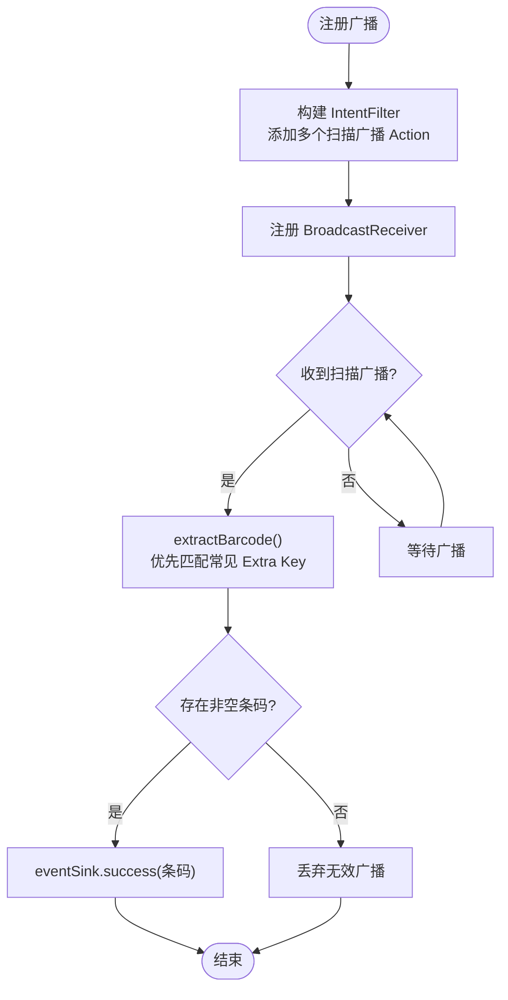
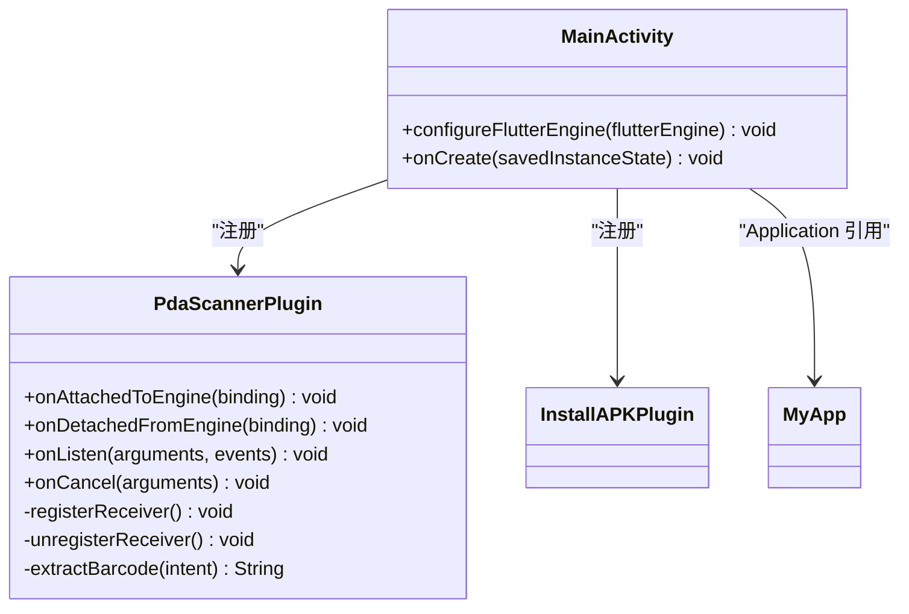
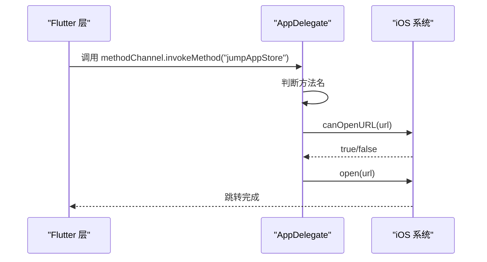
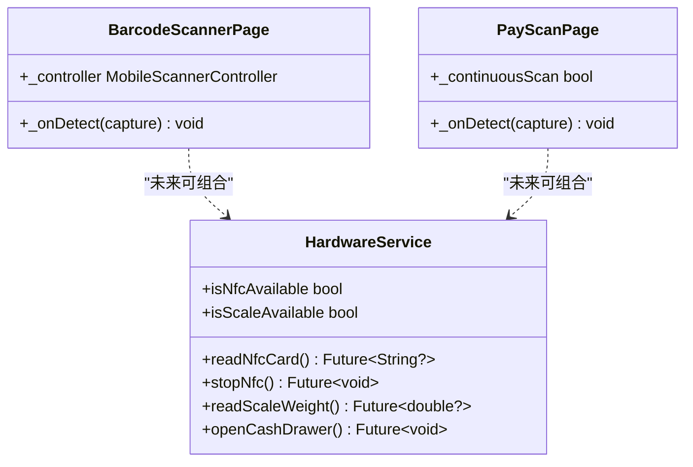
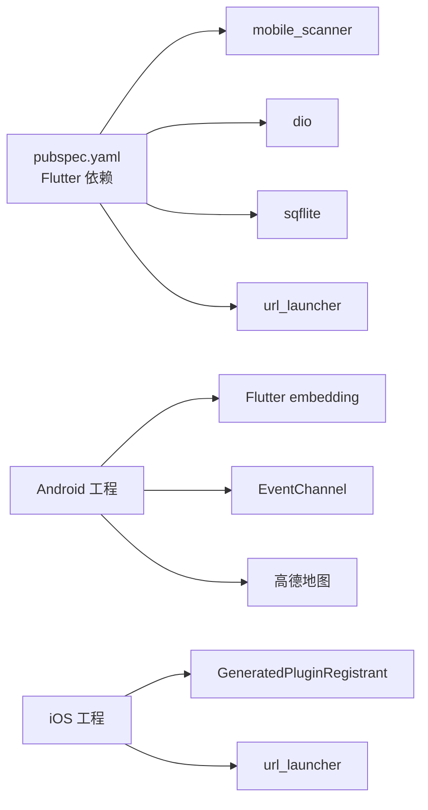
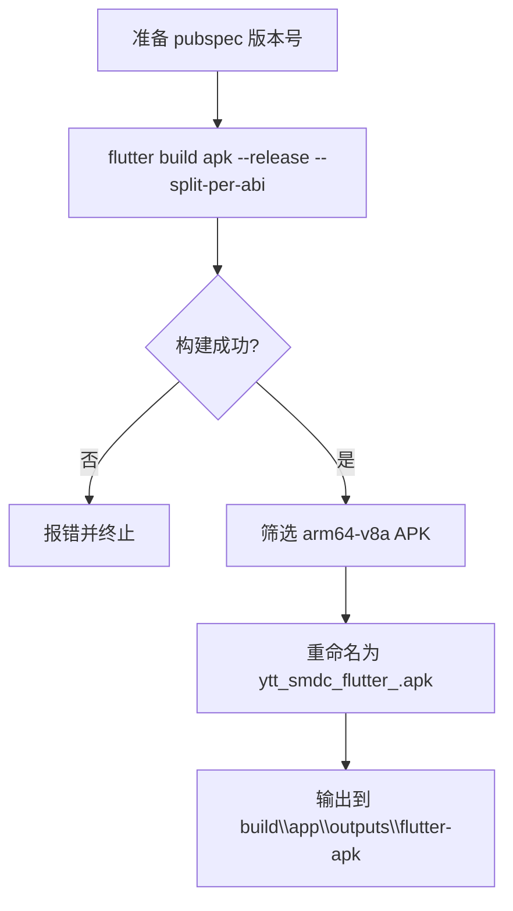

# 原生集成

<cite>
**本文引用的文件**   
- [PdaScannerPlugin.java](file://android/app/src/main/java/com/bycloud/smdc/PdaScannerPlugin.java)
- [MainActivity.java](file://android/app/src/main/java/com/bycloud/smdc/MainActivity.java)
- [MyApp.java](file://android/app/src/main/java/com/bycloud/smdc/MyApp.java)
- [AndroidManifest.xml](file://android/app/src/main/AndroidManifest.xml)
- [file_paths.xml](file://android/app/src/main/res/xml/file_paths.xml)
- [build.gradle](file://android/app/build.gradle)
- [build_apk.ps1](file://build_apk.ps1)
- [AppDelegate.swift](file://ios/Runner/AppDelegate.swift)
- [Info.plist](file://ios/Runner/Info.plist)
- [hardware_service.dart](file://lib/util/hardware_service.dart)
- [barcode_scanner_page.dart](file://lib/widgets/barcode_scanner_page.dart)
- [pay_scan_page.dart](file://lib/pages/order/pay_scan_page.dart)
- [pubspec.yaml](file://pubspec.yaml)
- [Android问题汇总.md](file://docs/Android问题汇总.md)
</cite>

## 目录
1. [引言](#引言)
2. [项目结构](#项目结构)
3. [核心组件](#核心组件)
4. [架构总览](#架构总览)
5. [详细组件分析](#详细组件分析)
6. [依赖关系分析](#依赖关系分析)
7. [性能与优化](#性能与优化)
8. [构建、签名与调试](#构建签名与调试)
9. [平台差异与统一处理](#平台差异与统一处理)
10. [外设硬件集成方案](#外设硬件集成方案)
11. [故障排查指南](#故障排查指南)
12. [结论](#结论)

## 引言
本文面向聚客美滋滋应用的跨平台原生集成，重点覆盖 Android 与 iOS 两端的原生插件、权限配置、系统生命周期、文件访问与回调机制，并给出扫码枪、打印机、电子秤、钱箱等硬件设备的集成思路。文档同时提供编译打包、签名发布和调试建议，以及平台兼容性与版本升级时的适配要点。

## 项目结构
本项目采用 Flutter 作为跨平台应用框架，Android 端通过 Java 原生插件暴露 PDA 扫描广播能力；iOS 端通过 AppDelegate 扩展原生方法通道以支持应用商店跳转等能力。Flutter 层通过 mobile_scanner 完成相机扫码，并通过统一的 HardwareService 抽象未来可扩展的 NFC、电子秤、钱箱等硬件能力。

```mermaid
graph TB
    subgraph "Flutter 应用"
        FL["Flutter 应用"]
        HW["HardwareService<br/>硬件服务抽象"]
        BSP["BarcodeScannerPage<br/>条码扫描页面"]
        PSP["PayScanPage<br/>支付扫码页面"]
    end

    subgraph "Android 原生"
        MA["MainActivity<br/>注册插件"]
        MSP["PdaScannerPlugin<br/>PDA 扫描广播监听"]
        MAN["AndroidManifest.xml<br/>权限与 Provider"]
        FP["file_paths.xml<br/>文件路径映射"]
    end

    subgraph "iOS 原生"
        AD["AppDelegate.swift<br/>方法通道"]
        IP["Info.plist<br/>权限声明"]
    end

    FL --> HW
    FL --> BSP
    FL --> PSP
    HW -. 待接入 .->|"NFC/电子秤/钱箱"| FL
    BSP -->|mobile_scanner| FL
    PSP -->|mobile_scanner| FL

    MA --> MSP
    MSP -->|EventChannel| FL
    MAN --> MA
    MAN --> FP
    AD --> FL
    IP --> AD
```

**图示来源**
- [MainActivity.java:12-20](file://android/app/src/main/java/com/bycloud/smdc/MainActivity.java#L12-L20)
- [PdaScannerPlugin.java:1-165](file://android/app/src/main/java/com/bycloud/smdc/PdaScannerPlugin.java#L1-L165)
- [AndroidManifest.xml:1-89](file://android/app/src/main/AndroidManifest.xml#L1-L89)
- [file_paths.xml:1-11](file://android/app/src/main/res/xml/file_paths.xml#L1-L11)
- [AppDelegate.swift:1-31](file://ios/Runner/AppDelegate.swift#L1-L31)
- [Info.plist:1-76](file://ios/Runner/Info.plist#L1-L76)
- [barcode_scanner_page.dart:1-177](file://lib/widgets/barcode_scanner_page.dart#L1-L177)
- [pay_scan_page.dart:1-200](file://lib/pages/order/pay_scan_page.dart#L1-L200)

**章节来源**
- [MainActivity.java:12-20](file://android/app/src/main/java/com/bycloud/smdc/MainActivity.java#L12-L20)
- [AndroidManifest.xml:1-89](file://android/app/src/main/AndroidManifest.xml#L1-L89)
- [AppDelegate.swift:1-31](file://ios/Runner/AppDelegate.swift#L1-L31)
- [Info.plist:1-76](file://ios/Runner/Info.plist#L1-L76)

## 核心组件
- Android PDA 扫描插件：PdaScannerPlugin 实现 FlutterPlugin 与 EventChannel.StreamHandler，注册多品牌 PDA 扫描广播，将条码数据推送给 Flutter 层。
- Android 主入口：MainActivity 继承 FlutterActivity，在 configureFlutterEngine 中注册 PdaScannerPlugin 与 InstallAPKPlugin。
- Android 清单与权限：AndroidManifest.xml 声明网络、录音、安装包等权限，配置高德地图、FileProvider 与刘海屏适配。
- iOS 应用代理：AppDelegate 注册 GeneratedPluginRegistrant，并提供 version 方法通道处理跳转应用商店。
- Info.plist：声明相机、定位、相册、麦克风权限，启用 ATS 宽松模式（局域网 HTTP），设置应用基本信息与方向。
- Flutter 硬件服务：HardwareService 为 NFC、扫码枪、电子秤、钱箱提供统一接口定义，当前扫码功能由 mobile_scanner 实现，其他功能预留 TODO。
- Flutter 扫码页面：BarcodeScannerPage 与 PayScanPage 基于 mobile_scanner 提供 UI 与扫描结果返回逻辑。

**章节来源**
- [PdaScannerPlugin.java:1-165](file://android/app/src/main/java/com/bycloud/smdc/PdaScannerPlugin.java#L1-L165)
- [MainActivity.java:12-20](file://android/app/src/main/java/com/bycloud/smdc/MainActivity.java#L12-L20)
- [AndroidManifest.xml:1-89](file://android/app/src/main/AndroidManifest.xml#L1-L89)
- [AppDelegate.swift:1-31](file://ios/Runner/AppDelegate.swift#L1-L31)
- [Info.plist:1-76](file://ios/Runner/Info.plist#L1-L76)
- [hardware_service.dart:1-79](file://lib/util/hardware_service.dart#L1-L79)
- [barcode_scanner_page.dart:1-177](file://lib/widgets/barcode_scanner_page.dart#L1-L177)
- [pay_scan_page.dart:1-200](file://lib/pages/order/pay_scan_page.dart#L1-L200)

## 架构总览
Android 侧通过广播接收器捕获主流 PDA 厂商的扫描广播，解析 Intent Extra 中的条码值，再通过 EventChannel 流式推送到 Flutter。iOS 侧未包含原生 PDA 扫描插件，主要使用 Flutter 的 mobile_scanner 进行相机扫码；原生层仅提供方法通道能力用于跳转应用商店。

```mermaid
sequenceDiagram
    participant PDA as "PDA 设备"
    participant AND as "Android 系统广播"
    participant PLUG as "PdaScannerPlugin"
    participant EVT as "EventChannel"
    participant FL as "Flutter 层"

    PDA->>AND: 发送扫描广播 Intent
    AND->>PLUG: 触发 BroadcastReceiver.onReceive
    PLUG->>PLUG: 从 Intent Extra 提取条码
    PLUG->>EVT: eventSink.success(条码)
    EVT-->>FL: 回调 Flutter 事件处理器
    FL-->>FL: 业务处理扫码结果
```

**图示来源**
- [PdaScannerPlugin.java:63-116](file://android/app/src/main/java/com/bycloud/smdc/PdaScannerPlugin.java#L63-L116)
- [PdaScannerPlugin.java:118-165](file://android/app/src/main/java/com/bycloud/smdc/PdaScannerPlugin.java#L118-L165)

## 详细组件分析

### Android PDA 扫描插件 PdaScannerPlugin
- 职责
  - 在 onAttachedToEngine 中创建 EventChannel 并设置 StreamHandler。
  - 在 onListen 时注册广播接收器，onCancel 时取消注册。
  - 监听多种 PDA 厂商的扫描广播 Action，解析常见 Extra Key 获取条码字符串。
  - 对 TIRAMISU 及以上系统使用 RECEIVER_EXPORTED 注册广播。
- 关键流程
  - registerReceiver：构造 IntentFilter，遍历 SCAN_ACTIONS 添加所有动作，尝试注册广播接收器。
  - extractBarcode：优先按预置 EXTRA_KEYS 顺序取 String 值，若为空则遍历 Bundle 中所有 String 类型键值兜底。
- 错误处理
  - 注册/注销广播接收器均捕获异常并忽略，避免影响主流程。
  - 当 eventSink 为 null 时直接返回，防止空指针。
- 复杂度
  - 广播监听为 O(ACTIONS + EXTRAS)，常量级别，开销很小。
- 可优化点
  - 可按机型或厂商白名单动态选择广播 Action 集合，减少无关广播处理。
  - 可在 Flutter 层增加去重与节流，避免同一批次重复扫码。



**图示来源**
- [PdaScannerPlugin.java:82-116](file://android/app/src/main/java/com/bycloud/smdc/PdaScannerPlugin.java#L82-L116)
- [PdaScannerPlugin.java:118-165](file://android/app/src/main/java/com/bycloud/smdc/PdaScannerPlugin.java#L118-L165)

**章节来源**
- [PdaScannerPlugin.java:1-165](file://android/app/src/main/java/com/bycloud/smdc/PdaScannerPlugin.java#L1-L165)

### Android MainActivity 与 MyApp
- MainActivity
  - 继承 FlutterActivity，重写 configureFlutterEngine 注册 PdaScannerPlugin 与 InstallAPKPlugin。
  - onCreate 中设置状态栏透明，清理动态快捷方式以避免覆盖安装残留。
- MyApp
  - 继承 Application，保留空实现，便于后续全局初始化。



**图示来源**
- [MainActivity.java:12-38](file://android/app/src/main/java/com/bycloud/smdc/MainActivity.java#L12-L38)
- [MyApp.java:1-17](file://android/app/src/main/java/com/bycloud/smdc/MyApp.java#L1-L17)

**章节来源**
- [MainActivity.java:12-38](file://android/app/src/main/java/com/bycloud/smdc/MainActivity.java#L12-L38)
- [MyApp.java:1-17](file://android/app/src/main/java/com/bycloud/smdc/MyApp.java#L1-L17)

### Android 权限与文件访问
- 权限
  - REQUEST_INSTALL_PACKAGES：安装 APK。
  - INTERNET：网络请求。
  - RECORD_AUDIO：录音权限（可能用于语音识别或交互）。
  - queries 节点声明 VIEW https 与 DIAL tel 的可查询意图。
- FileProvider
  - DeerPickerProvider 配合 file_paths.xml 暴露 root/files/cache/external 等路径，供图片选择与文件分享使用。
- 其他配置
  - 高德地图 API Key。
  - 刘海屏适配与最大宽高比。
  - flutterEmbedding=2。

**章节来源**
- [AndroidManifest.xml:1-89](file://android/app/src/main/AndroidManifest.xml#L1-L89)
- [file_paths.xml:1-11](file://android/app/src/main/res/xml/file_paths.xml#L1-L11)

### iOS AppDelegate 与 Info.plist
- AppDelegate
  - 注册 GeneratedPluginRegistrant。
  - 创建 version 方法通道，处理 jumpAppStore 方法，打开 App Store 链接。
- Info.plist
  - 声明 NSCameraUsageDescription、NSLocationWhenInUseUsageDescription、NSPhotoLibraryUsageDescription、NSMicrophoneUsageDescription。
  - 开启 NSAllowsArbitraryLoads（允许 HTTP，便于局域网设备通信）。
  - 设置应用名称、Bundle ID、版本、界面方向等基础信息。



**图示来源**
- [AppDelegate.swift:8-29](file://ios/Runner/AppDelegate.swift#L8-L29)

**章节来源**
- [AppDelegate.swift:1-31](file://ios/Runner/AppDelegate.swift#L1-L31)
- [Info.plist:1-76](file://ios/Runner/Info.plist#L1-L76)

### Flutter 硬件服务与扫码页面
- HardwareService
  - 提供 NFC 读卡、扫码枪、电子秤重量读取、钱箱开盒的统一接口。
  - 当前扫码由 mobile_scanner 承担，NFC、电子秤、钱箱标注 TODO，需引入对应插件或通过打印指令触发。
- BarcodeScannerPage
  - 使用 MobileScannerController 控制相机，检测条码后返回 rawValue。
  - 提供闪光灯开关与扫描框遮罩绘制。
- PayScanPage
  - 对齐 smdcapp 的支付扫码 UI，支持连续扫描模式与相册导入。
  - 同样基于 mobile_scanner 进行条码识别。



**图示来源**
- [hardware_service.dart:1-79](file://lib/util/hardware_service.dart#L1-L79)
- [barcode_scanner_page.dart:1-177](file://lib/widgets/barcode_scanner_page.dart#L1-L177)
- [pay_scan_page.dart:1-200](file://lib/pages/order/pay_scan_page.dart#L1-L200)

**章节来源**
- [hardware_service.dart:1-79](file://lib/util/hardware_service.dart#L1-L79)
- [barcode_scanner_page.dart:1-177](file://lib/widgets/barcode_scanner_page.dart#L1-L177)
- [pay_scan_page.dart:1-200](file://lib/pages/order/pay_scan_page.dart#L1-L200)

## 依赖关系分析
- Flutter 依赖
  - mobile_scanner：条码/二维码扫描。
  - dio、rxdart、sqflite、device_info_plus、url_launcher 等网络、状态管理、数据库、设备信息与 URL 启动。
- Android 依赖
  - Flutter embedding、EventChannel 与 FlutterPlugin 接口。
  - 高德地图 API Key 配置。
- iOS 依赖
  - GeneratedPluginRegistrant 自动注册插件。
  - url_launcher 在 Flutter 侧配合 iOS 原生跳转应用商店。



**图示来源**
- [pubspec.yaml:1-111](file://pubspec.yaml#L1-L111)
- [AndroidManifest.xml:39-58](file://android/app/src/main/AndroidManifest.xml#L39-L58)

**章节来源**
- [pubspec.yaml:1-111](file://pubspec.yaml#L1-L111)
- [AndroidManifest.xml:39-58](file://android/app/src/main/AndroidManifest.xml#L39-L58)

## 性能与优化
- Android 广播监听
  - 建议在 Flutter 层对扫码结果做去重与节流，避免短时间内多次触发业务逻辑。
  - 针对特定机型可裁剪 SCAN_ACTIONS 列表，减少无用广播处理。
- 相机扫描
  - 合理设置 detectionSpeed 与 torchEnabled，避免不必要的 CPU/GPU 负载。
  - 在后台或退出页面时及时释放控制器资源，防止内存泄漏。
- 网络与日志
  - 合理使用 dio 拦截器与缓存策略，避免重复请求。
  - 日志上传前压缩归档，降低带宽占用。

[本节为通用指导，不直接分析具体文件]

## 构建、签名与调试
- Android
  - Gradle 配置：compileSdkVersion 36、minSdkVersion 来自 flutter.minSdkVersion、targetSdkVersion 35，Java 17。
  - 签名：release 与 debug 均使用 app/key.properties 配置的 keystore。
  - 构建脚本 build_apk.ps1：执行 flutter build apk --release --split-per-abi，输出 arm64-v8a APK 并重命名为 ytt_smdc_flutter_<version>.apk。
  - ProGuard 与资源压缩：启用 shrinkResources、zipAlignEnabled、minifyEnabled。
- iOS
  - 云构建产出 .ipa，Windows 侧 build_ipa.ps1 负责查找、重命名并引导 Sideloadly 安装到 iPhone。
  - 本地开发需 Mac 环境，Xcode 工程与 Podfile 由 Flutter 生成与管理。



**图示来源**
- [build_apk.ps1:1-53](file://build_apk.ps1#L1-L53)
- [build.gradle:1-85](file://android/app/build.gradle#L1-L85)

**章节来源**
- [build_apk.ps1:1-53](file://build_apk.ps1#L1-L53)
- [build_ipa.ps1:1-69](file://build_ipa.ps1#L1-L69)
- [build.gradle:1-85](file://android/app/build.gradle#L1-L85)

## 平台差异与统一处理
- 权限管理
  - Android：清单静态声明权限，运行时仍可能需根据业务提示用户授权（如存储、相机）。
  - iOS：Info.plist 声明权限描述，系统弹窗时展示说明文本。
- 文件访问
  - Android：通过 FileProvider 暴露安全路径，避免直接 URI 共享风险。
  - iOS：沙盒文件系统，通常通过 Document 目录与临时目录操作。
- 系统通知
  - 当前仓库未包含原生通知实现，Flutter 层可使用 flutter_tts 做语音播报，或使用 platform channel 扩展通知能力。
- 统一处理建议
  - 在 HardwareService 中封装平台差异，对外暴露统一 API。
  - 对扫码、打印、钱箱等硬件能力建立统一的错误码与重试策略。

[本节为通用指导，不直接分析具体文件]

## 外设硬件集成方案
- 扫码枪
  - Android：通过 PdaScannerPlugin 监听 PDA 广播，已覆盖主流厂商 Action 与 Extra Key。
  - iOS：当前未提供原生 PDA 扫描插件，建议使用 mobile_scanner 进行相机扫码，或引入第三方 SDK。
- 打印机与钱箱
  - 通过 ESC/POS 指令触发钱箱开盒；打印通道需结合后端或蓝牙/WiFi 打印机协议实现。
  - HardwareService.openCashDrawer 预留接口，实际需对接打印插件或自定义蓝牙通道。
- 电子秤
  - 需定制串口或蓝牙协议插件，读取重量数据并转换为千克单位。
  - HardwareService.readScaleWeight 预留接口。
- 指纹识别
  - 可通过 flutter_local_authentication 或平台原生鉴权能力实现，当前仓库未包含相关实现。
- 数据传输格式与错误处理
  - 建议统一 JSON 格式封装：{deviceId, protocol, payload, timestamp}。
  - 错误分类：连接失败、超时、协议不匹配、数据校验失败；统一上报并提示用户。

[本节为通用指导，不直接分析具体文件]

## 故障排查指南
- Android 构建常见问题
  - Could not resolve io.flutter:flutter_embedding_xxx：检查 Flutter Gradle 仓库配置或添加 maven 源。
  - 包体积过大：使用 --target-platform android-arm64、--obfuscate、--split-debug-info 减小体积。
- 扫码无结果
  - 确认 PDA 设备广播 Action 是否被覆盖，必要时在 PdaScannerPlugin 中添加对应 Action。
  - 检查 Intent Extra Key 是否与设备一致，必要时在 extractBarcode 中添加新 key。
- 权限问题
  - Android：确保 AndroidManifest.xml 声明必要权限，并在需要时引导用户授权。
  - iOS：确保 Info.plist 中包含相应权限描述，避免系统拒绝访问。
- 文件访问
  - Android：确保 FileProvider authorities 与 file_paths.xml 配置正确。
  - iOS：检查沙盒路径与文件读写权限。

**章节来源**
- [Android问题汇总.md:1-56](file://docs/Android问题汇总.md#L1-L56)
- [AndroidManifest.xml:1-89](file://android/app/src/main/AndroidManifest.xml#L1-L89)
- [PdaScannerPlugin.java:82-165](file://android/app/src/main/java/com/bycloud/smdc/PdaScannerPlugin.java#L82-L165)

## 结论
本项目的原生集成以 Flutter 为核心，Android 端通过 PdaScannerPlugin 实现对主流 PDA 扫描广播的广泛兼容，iOS 端通过 AppDelegate 提供方法通道能力。扫码能力主要由 mobile_scanner 实现，HardwareService 为未来 NFC、电子秤、钱箱等硬件预留统一接口。构建与发布流程通过 Gradle 与 PowerShell 脚本自动化，便于团队协作与持续集成。后续可根据业务需求扩展平台特定的硬件能力，并完善错误处理与性能优化策略。