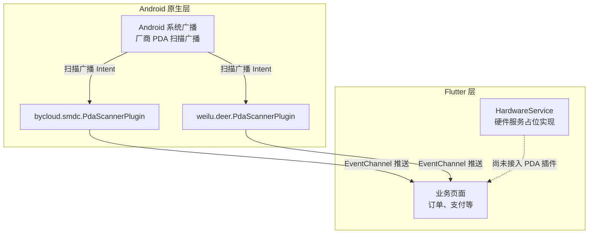
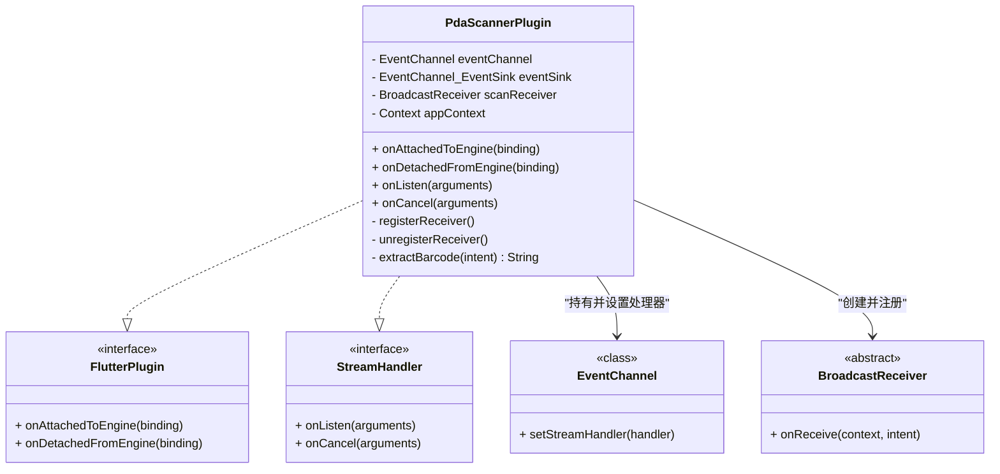
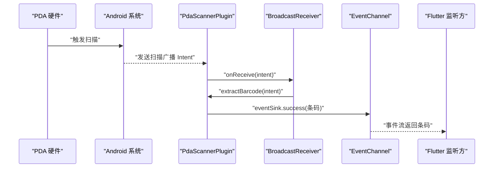
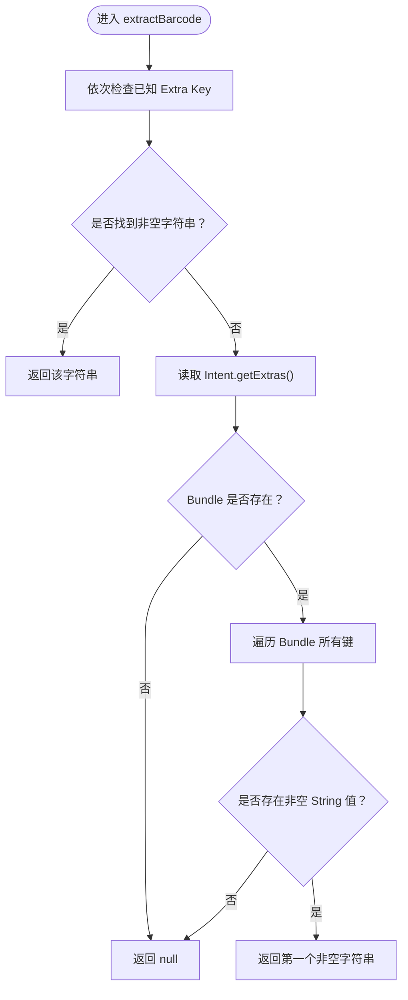
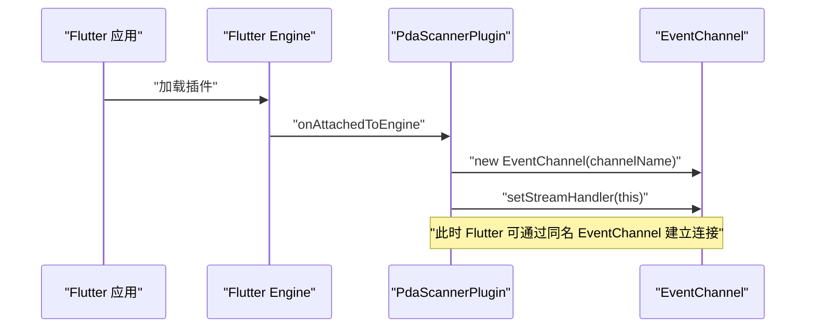
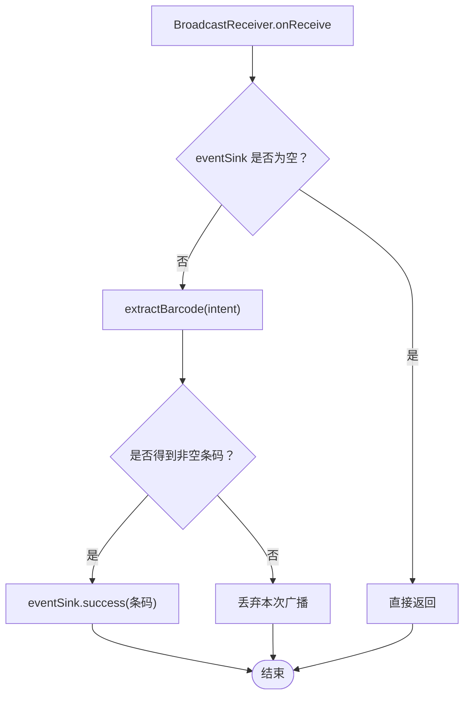
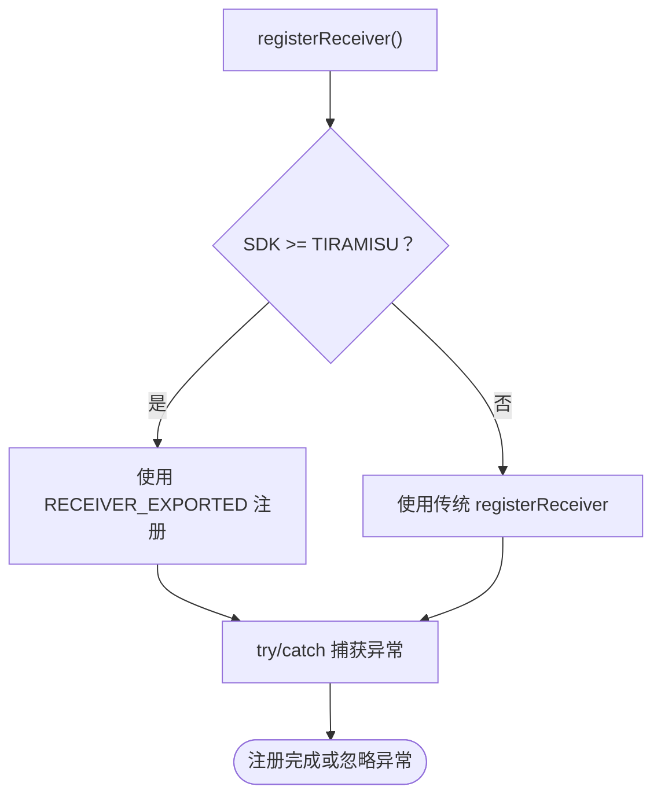
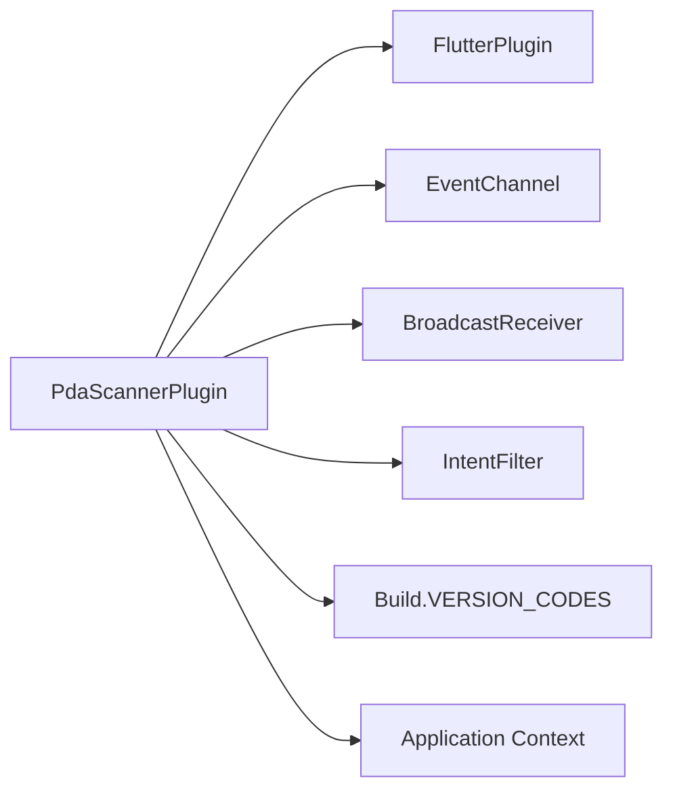
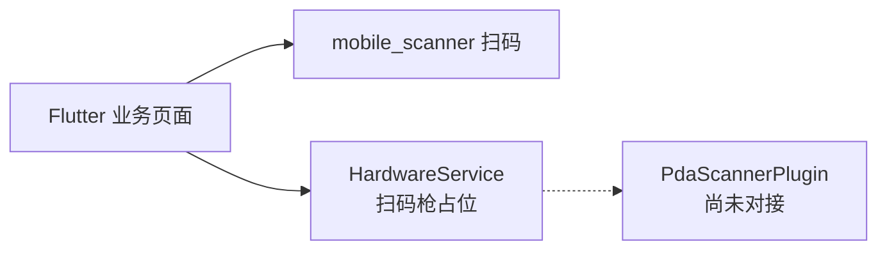
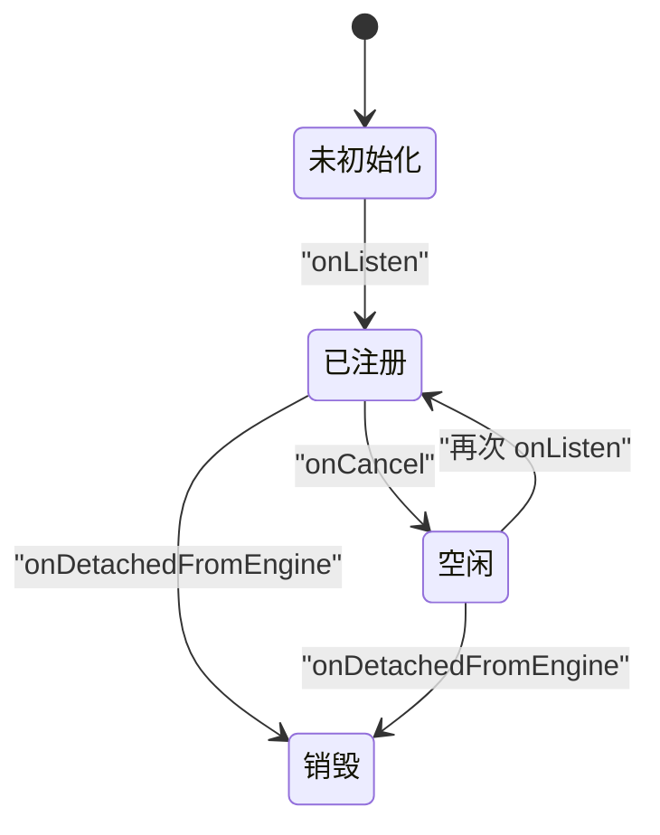

# PDA 扫码枪集成

<cite>
**本文引用的文件**   
- [PdaScannerPlugin.java（bycloud/smdc）](file://android/app/src/main/java/com/bycloud/smdc/PdaScannerPlugin.java)
- [PdaScannerPlugin.java（weilu/deer）](file://android/app/src/main/java/com/weilu/deer/PdaScannerPlugin.java)
- [hardware_service.dart](file://lib/util/hardware_service.dart)
</cite>

## 目录

1. [引言](#引言)
2. [项目结构](#项目结构)
3. [核心组件](#核心组件)
4. [架构总览](#架构总览)
5. [详细组件分析](#详细组件分析)
6. [依赖关系分析](#依赖关系分析)
7. [性能与生命周期](#性能与生命周期)
8. [设备配置指南](#设备配置指南)
9. [常见问题排查](#常见问题排查)
10. [结论](#结论)

## 引言

本项目为餐饮业务类 Flutter 应用，其中 Android 端提供了两套完全相同的 PDA 硬件扫描插件实现：`com.bycloud.smdc.PdaScannerPlugin` 与 `com.weilu.deer.PdaScannerPlugin`。它们通过监听系统或厂商 PDA 发出的扫描广播，把条码结果以事件流的形式推送到 Flutter 层。

本技术文档聚焦以下目标：

- 说明 Android 端 `PdaScannerPlugin` 的架构：FlutterPlugin、EventChannel、BroadcastReceiver。
- 整理已支持的 PDA 品牌和设备类型，以及对应的扫描广播 Action。
- 解释扫描结果提取逻辑：多 Extra Key 兼容和兜底 Bundle 遍历策略。
- 说明 Android TIRAMISU 及以上版本对 RECEIVER_EXPORTED 的要求。
- 给出设备配置建议、故障排查方法和性能优化建议，重点包括广播接收器的生命周期管理和内存泄漏防护。

需要特别说明的是：Flutter 侧当前并未直接引用该 PDA 插件。现有扫码能力主要由 `mobile_scanner` 提供，而 `HardwareService` 目前只是统一接口占位实现，实际扫码枪功能仍待接入。因此，本文同时指出“已有 Android 实现”和“Flutter 侧尚未对接”的现状，便于后续集成。

**章节来源**
- [PdaScannerPlugin.java（bycloud/smdc）:1-165](file://android/app/src/main/java/com/bycloud/smdc/PdaScannerPlugin.java#L1-L165)
- [PdaScannerPlugin.java（weilu/deer）:1-165](file://android/app/src/main/java/com/weilu/deer/PdaScannerPlugin.java#L1-L165)
- [hardware_service.dart:1-79](file://lib/util/hardware_service.dart#L1-L79)

## 项目结构

从仓库结构看，PDA 扫码枪相关代码主要分布在两个层次：

| 层次 | 位置 | 职责 |
|---|---|---|
| Android 原生插件 | `android/app/src/main/java/com/bycloud/smdc/PdaScannerPlugin.java` | 商米/业务包名下的 PDA 扫描插件实现 |
| Android 原生插件 | `android/app/src/main/java/com/weilu/deer/PdaScannerPlugin.java` | 鹿应用包名下的 PDA 扫描插件实现 |
| Flutter 硬件抽象 | `lib/util/hardware_service.dart` | NFC、扫码枪、电子秤、钱箱的统一接口占位实现 |

图中显示：Android 层已经具备两套相同逻辑的 PDA 扫描插件；Flutter 层目前有一个统一的 `HardwareService`，但扫码枪部分仍是占位实现，未直接调用上述插件。

**图表来源**
- [PdaScannerPlugin.java（bycloud/smdc）:1-165](file://android/app/src/main/java/com/bycloud/smdc/PdaScannerPlugin.java#L1-L165)
- [PdaScannerPlugin.java（weilu/deer）:1-165](file://android/app/src/main/java/com/weilu/deer/PdaScannerPlugin.java#L1-L165)
- [hardware_service.dart:1-79](file://lib/util/hardware_service.dart#L1-L79)

**章节来源**
- [PdaScannerPlugin.java（bycloud/smdc）:1-165](file://android/app/src/main/java/com/bycloud/smdc/PdaScannerPlugin.java#L1-L165)
- [PdaScannerPlugin.java（weilu/deer）:1-165](file://android/app/src/main/java/com/weilu/deer/PdaScannerPlugin.java#L1-L165)
- [hardware_service.dart:1-79](file://lib/util/hardware_service.dart#L1-L79)

## 核心组件

### PdaScannerPlugin 整体职责

`PdaScannerPlugin` 实现了两个关键 Android 接口：

1. **FlutterPlugin**：负责在 Flutter Engine 附加时注册 EventChannel，在分离时清理资源。
2. **EventChannel.StreamHandler**：负责处理 Flutter 侧开始监听和取消监听的生命周期回调。

插件的核心职责是：

- 维护一个全局 Application Context。
- 注册一个 BroadcastReceiver。
- 根据多个固定 Action 监听扫描广播。
- 从广播 Intent 中提取条码字符串。
- 通过 EventChannel.EventSink 把条码推给 Flutter 层。

**图表来源**
- [PdaScannerPlugin.java（bycloud/smdc）:1-165](file://android/app/src/main/java/com/bycloud/smdc/PdaScannerPlugin.java#L1-L165)
- [PdaScannerPlugin.java（weilu/deer）:1-165](file://android/app/src/main/java/com/weilu/deer/PdaScannerPlugin.java#L1-L165)

**章节来源**
- [PdaScannerPlugin.java（bycloud/smdc）:1-165](file://android/app/src/main/java/com/bycloud/smdc/PdaScannerPlugin.java#L1-L165)
- [PdaScannerPlugin.java（weilu/deer）:1-165](file://android/app/src/main/java/com/weilu/deer/PdaScannerPlugin.java#L1-L165)

### Flutter 侧硬件服务现状

Flutter 侧存在一个 `HardwareService`，其注释明确说明它用于对齐旧版 smdcapp 的 NFC、扫码枪、电子秤、钱箱等硬件能力。当前扫码枪部分的注释表示扫码已由 `mobile_scanner` 提供，且 `HardwareService` 中扫码相关方法仍为占位实现。

这意味着：

- Android 层的 `PdaScannerPlugin` 已经可用。
- Flutter 层尚未通过 `HardwareService` 或其他方式直接使用该插件。
- 如果要让 Flutter 业务页面统一使用 PDA 扫码枪，需要在 Flutter 侧补充 EventChannel 调用或 MethodChannel 封装。

**章节来源**
- [hardware_service.dart:1-79](file://lib/util/hardware_service.dart#L1-L79)

## 架构总览

PDA 扫码枪的数据流如下：

该流程的关键点是：

- 插件不主动发起扫描，而是被动接收系统或厂商广播。
- 广播可能来自多个 Action，插件通过预置 Action 列表进行匹配。
- 如果成功提取到非空条码，就通过 EventChannel 推送一次。
- 如果 Flutter 侧没有订阅事件，插件不会推送结果。

**图表来源**
- [PdaScannerPlugin.java（bycloud/smdc）:1-165](file://android/app/src/main/java/com/bycloud/smdc/PdaScannerPlugin.java#L1-L165)
- [PdaScannerPlugin.java（weilu/deer）:1-165](file://android/app/src/main/java/com/weilu/deer/PdaScannerPlugin.java#L1-L165)

## 详细组件分析

### 支持的 PDA 品牌和广播 Action

`PdaScannerPlugin` 内置了主流 PDA 品牌的扫描广播 Action 列表。这些 Action 是厂商或系统抛出的扫描完成信号，插件通过 `IntentFilter` 一次性注册全部 Action。

| 类别 | 典型 Action | 对应品牌或说明 |
|---|---|---|
| 通用 / 商米 | `android.intent.action.SCAN_RESULT` | 商米、通用 PDA |
| 通用 | `android.intent.action.SCAN` | 通用扫描广播 |
| 新大陆 / 通用 | `android.intent.action.DATA_AVAILABLE` | 新大陆、部分通用机型 |
| 优博音 | `android.intent.action.DECODE` | 优博音 UROVO |
| 部分机型 | `android.intent.action.BARCODE_RESULT` | 部分定制 PDA |
| 商米旧版 | `com.sunmi.scanner.SCAN` | 商米早期 SDK |
| 商米 L2/V2/Z1 | `com.sunmi.scanner.ACTION_DATA_CODE_RECEIVED` | 商米较新型号 |
| 新大陆 | `nlscan.action.SCANNER_RESULT` | 新大陆扫码 SDK |
| 优博音 | `UROVO_SCANNER_ACTION` | 优博音专用 Action |
| iData | `idata.scanner.ACTION_BARCODE` | iData 手持终端 |
| Honeywell | `android.intent.action.HONEYWELL_SCAN` | 霍尼韦尔部分机型 |
| WMS 定制 | `com.android.server.WMS_SCAN_RESULT` | WMS 定制系统 |
| 国产定制 | `barcode_broadcast_action` | 部分国产 PDA |
| 东大集成 / 优博讯 / 肖邦 | `com.android.server.scannerservice.broadcast` | 东大集成等 |
| 优博讯 i6200 | `android.intent.ACTION_DECODE_DATA` | 优博讯特定型号 |
| 智联天地 / 盈达 | `android.intent.action.SCANRESULT` | 智联天地、盈达 |
| 新大陆 N5/MT60 / 智联天地 | `android.intent.action.RECEIVE_SCANDATA_BROADCAST` | 新大陆及合作品牌 |
| 优博讯 CRUISE | `com.barcode.sendBroadcast` | 优博讯 CRUISE |
| 凯立 KAICOM | `com.android.receive_scan_action` | 凯立 |
| 霍尼韦尔 EDA | `com.honeywell.scan.broadcast` | 霍尼韦尔 EDA 系列 |
| 捷宝 | `com.jb.action.GET_SCANDATA` | 捷宝 |
| 新大陆 MT60E | `ACTION_BAR_SCAN` | 新大陆 MT60E |

注意：

- 同一 Action 可能被多个品牌复用，因此 Action 只能作为“是否收到扫描广播”的判断依据。
- 具体条码内容需要从 Intent Extra 中读取，而不是从 Action 中获取。
- 如果某个品牌不在列表中，可考虑新增对应 Action。

**章节来源**
- [PdaScannerPlugin.java（bycloud/smdc）:1-165](file://android/app/src/main/java/com/bycloud/smdc/PdaScannerPlugin.java#L1-L165)
- [PdaScannerPlugin.java（weilu/deer）:1-165](file://android/app/src/main/java/com/weilu/deer/PdaScannerPlugin.java#L1-L165)

### 扫描结果提取逻辑

扫描结果不是直接从 Action 读取，而是从广播 Intent 的 Extra 中解析。插件采用两层策略：

#### 第一层：优先尝试常见 Extra Key

插件按顺序检查一组常用 Extra Key，一旦找到非空字符串就立即返回。

| Extra Key | 典型含义或品牌 |
|---|---|
| `barcode` | 商米、新大陆等 |
| `barcode_string` | 商米 |
| `data` | 通用、商米 L2/V2/Z1、霍尼韦尔、凯立、捷宝 |
| `SCAN_BARCODE` | 优博音、Honeywell |
| `scan_result` | 通用 |
| `result` | 部分机型 |
| `BARCODE` | 通用大写、优博讯 |
| `scanData` | iData |
| `DECODE_DATA_MODE` | 新大陆 |
| `KEY_SCAN_DATA` | 东大集成 |
| `scan_barcode_data` | 定制 PDA |
| `scannerdata` | 东大、优博讯 |
| `SCAN_BARCODE1` | 智联天地 N7e、新大陆 |
| `value` | 智联天地、盈达 |
| `EXTRA_SCAN_DATA` | 新大陆 MT60E |
| `android.intent.extra.SCAN_BROADCAST_DATA` | 智联天地、新大陆 N5 |

#### 第二层：兜底遍历 Bundle

如果所有已知 Extra Key 都失败，插件会尝试读取整个 Intent Extras Bundle，找出任意非空的 String 类型值作为兜底结果。

该设计的好处是兼容性强：大多数品牌可以通过已知 Key 快速命中；少数异常机型也可以靠兜底机制提高成功率。

**图表来源**
- [PdaScannerPlugin.java（bycloud/smdc）:1-165](file://android/app/src/main/java/com/bycloud/smdc/PdaScannerPlugin.java#L1-L165)
- [PdaScannerPlugin.java（weilu/deer）:1-165](file://android/app/src/main/java/com/weilu/deer/PdaScannerPlugin.java#L1-L165)

**章节来源**
- [PdaScannerPlugin.java（bycloud/smdc）:1-165](file://android/app/src/main/java/com/bycloud/smdc/PdaScannerPlugin.java#L1-L165)
- [PdaScannerPlugin.java（weilu/deer）:1-165](file://android/app/src/main/java/com/weilu/deer/PdaScannerPlugin.java#L1-L165)

### EventChannel 事件通道建立

插件在 Flutter Engine 附加时创建并注册 EventChannel：

- bycloud/smdc 实现的 channel name 为 `com.bycloud.smdc/pda_scanner`。
- weilu/deer 实现的 channel name 为 `com.weilu.deer/pda_scanner`。

这两个 channel name 不同，意味着 Flutter 侧如果要使用插件，必须选择其中一个包名下的插件实现，并在 Flutter 端使用对应的 channel name。

需要注意：

- 插件本身没有在 AndroidManifest 中静态注册 BroadcastReceiver，而是动态注册。
- 广播接收器只在 Flutter 侧调用 `onListen` 后注册。
- 当 Flutter 侧取消监听时，插件会注销广播接收器。

**图表来源**
- [PdaScannerPlugin.java（bycloud/smdc）:1-165](file://android/app/src/main/java/com/bycloud/smdc/PdaScannerPlugin.java#L1-L165)
- [PdaScannerPlugin.java（weilu/deer）:1-165](file://android/app/src/main/java/com/weilu/deer/PdaScannerPlugin.java#L1-L165)

**章节来源**
- [PdaScannerPlugin.java（bycloud/smdc）:1-165](file://android/app/src/main/java/com/bycloud/smdc/PdaScannerPlugin.java#L1-L165)
- [PdaScannerPlugin.java（weilu/deer）:1-165](file://android/app/src/main/java/com/weilu/deer/PdaScannerPlugin.java#L1-L165)

### BroadcastReceiver 广播监听机制

插件内部创建一个 `BroadcastReceiver`，并将其注册到多个扫描 Action。广播到达后的处理流程如下：

1. 如果当前 `eventSink` 为空，直接返回，避免无消费者时浪费处理。
2. 调用 `extractBarcode` 提取条码。
3. 如果条码非空，调用 `eventSink.success(barcode)` 推送给 Flutter。
4. 如果为空，则丢弃该次广播。

**图表来源**
- [PdaScannerPlugin.java（bycloud/smdc）:1-165](file://android/app/src/main/java/com/bycloud/smdc/PdaScannerPlugin.java#L1-L165)
- [PdaScannerPlugin.java（weilu/deer）:1-165](file://android/app/src/main/java/com/weilu/deer/PdaScannerPlugin.java#L1-L165)

**章节来源**
- [PdaScannerPlugin.java（bycloud/smdc）:1-165](file://android/app/src/main/java/com/bycloud/smdc/PdaScannerPlugin.java#L1-L165)
- [PdaScannerPlugin.java（weilu/deer）:1-165](file://android/app/src/main/java/com/weilu/deer/PdaScannerPlugin.java#L1-L165)

### Android 版本兼容性：TIRAMISU 与 RECEIVER_EXPORTED

插件在注册广播接收器时做了 Android 版本判断：

- 当系统版本大于等于 TIRAMISU 时，使用 `Context.RECEIVER_EXPORTED` 参数注册。
- 低于 TIRAMISU 的系统使用传统注册方式。

这是为了适配 Android 13 及以上版本对动态广播接收器的导出权限要求。如果未在 TIRAMISU 及以上版本传入正确的导出标志，动态注册可能抛出异常或被系统拒绝。

**图表来源**
- [PdaScannerPlugin.java（bycloud/smdc）:1-165](file://android/app/src/main/java/com/bycloud/smdc/PdaScannerPlugin.java#L1-L165)
- [PdaScannerPlugin.java（weilu/deer）:1-165](file://android/app/src/main/java/com/weilu/deer/PdaScannerPlugin.java#L1-L165)

**章节来源**
- [PdaScannerPlugin.java（bycloud/smdc）:1-165](file://android/app/src/main/java/com/bycloud/smdc/PdaScannerPlugin.java#L1-L165)
- [PdaScannerPlugin.java（weilu/deer）:1-165](file://android/app/src/main/java/com/weilu/deer/PdaScannerPlugin.java#L1-L165)

## 依赖关系分析

### Android 层依赖

`PdaScannerPlugin` 依赖的 Android 系统能力包括：

- `android.content.BroadcastReceiver`：接收扫描广播。
- `android.content.Context`：Application Context 用于注册广播。
- `android.content.Intent` 和 `IntentFilter`：描述广播动作和过滤规则。
- `android.os.Build.VERSION_CODES.TIRAMISU`：判断 Android 13+。
- `io.flutter.embedding.engine.plugins.FlutterPlugin`：Flutter 插件生命周期。
- `io.flutter.plugin.common.EventChannel`：Flutter 与 Android 的事件通道。

**图表来源**
- [PdaScannerPlugin.java（bycloud/smdc）:1-165](file://android/app/src/main/java/com/bycloud/smdc/PdaScannerPlugin.java#L1-L165)
- [PdaScannerPlugin.java（weilu/deer）:1-165](file://android/app/src/main/java/com/weilu/deer/PdaScannerPlugin.java#L1-L165)

### Flutter 层依赖现状

Flutter 层当前并未直接使用 `PdaScannerPlugin` 暴露的 EventChannel。`HardwareService` 中的扫码枪部分仍然是占位实现，注释明确指向 `mobile_scanner` 作为扫码方案。

因此，当前依赖关系更准确地说应该是：

**图表来源**
- [hardware_service.dart:1-79](file://lib/util/hardware_service.dart#L1-L79)
- [PdaScannerPlugin.java（bycloud/smdc）:1-165](file://android/app/src/main/java/com/bycloud/smdc/PdaScannerPlugin.java#L1-L165)
- [PdaScannerPlugin.java（weilu/deer）:1-165](file://android/app/src/main/java/com/weilu/deer/PdaScannerPlugin.java#L1-L165)

**章节来源**
- [PdaScannerPlugin.java（bycloud/smdc）:1-165](file://android/app/src/main/java/com/bycloud/smdc/PdaScannerPlugin.java#L1-L165)
- [PdaScannerPlugin.java（weilu/deer）:1-165](file://android/app/src/main/java/com/weilu/deer/PdaScannerPlugin.java#L1-L165)
- [hardware_service.dart:1-79](file://lib/util/hardware_service.dart#L1-L79)

## 性能与生命周期

### 广播接收器生命周期

插件将广播接收器的注册与 Flutter 侧的 EventChannel 生命周期绑定：

| Flutter 状态 | Android 行为 |
|---|---|
| 首次调用 `onListen` | 保存 `eventSink`，注册 BroadcastReceiver |
| 调用 `onCancel` | 清空 `eventSink`，注销 BroadcastReceiver |
| 插件从 Engine 分离 | 确保注销广播接收器，清空 EventChannel 处理器 |

这种设计避免了在 Flutter 不需要扫描时长期持有广播监听，降低无效广播处理和内存占用。

**图表来源**
- [PdaScannerPlugin.java（bycloud/smdc）:1-165](file://android/app/src/main/java/com/bycloud/smdc/PdaScannerPlugin.java#L1-L165)
- [PdaScannerPlugin.java（weilu/deer）:1-165](file://android/app/src/main/java/com/weilu/deer/PdaScannerPlugin.java#L1-L165)

### 内存泄漏防护要点

插件在几个关键点做了防护：

1. 使用 Application Context 注册广播，避免持有 Activity Context 导致页面销毁后泄漏。
2. `onCancel` 中清空 `eventSink`，防止 Flutter 侧不再消费时继续推送。
3. `unregisterReceiver` 中将 `scanReceiver` 置空，避免重复注销或持有无用对象。
4. `onDetachedFromEngine` 中清理 EventChannel 处理器并置空。
5. 注册和注销广播都包裹 try/catch，避免因系统异常导致插件崩溃。

潜在风险点：

- 如果 Flutter 侧只调用 `onListen` 不调用 `onCancel`，可能导致广播接收器一直存活。
- 如果业务层在页面销毁时没有正确取消 EventChannel 监听，可能造成后台持续接收广播。
- 兜底 Bundle 遍历在极端情况下可能带来轻微性能开销，但由于只发生在无法通过已知 Key 命中时，影响通常很小。

**章节来源**
- [PdaScannerPlugin.java（bycloud/smdc）:1-165](file://android/app/src/main/java/com/bycloud/smdc/PdaScannerPlugin.java#L1-L165)
- [PdaScannerPlugin.java（weilu/deer）:1-165](file://android/app/src/main/java/com/weilu/deer/PdaScannerPlugin.java#L1-L165)

## 设备配置指南

### 选择正确的插件实现

仓库中存在两套相同逻辑的插件实现，区别在于包名和 EventChannel name：

| 包名 | EventChannel name | 适用场景 |
|---|---|---|
| `com.bycloud.smdc.PdaScannerPlugin` | `com.bycloud.smdc/pda_scanner` | 商米/业务包名风格 |
| `com.weilu.deer.PdaScannerPlugin` | `com.weilu.deer/pda_scanner` | 鹿应用包名风格 |

集成时应根据 Flutter 项目的 Android 包名选择一个实现，并保持 Flutter 侧使用的 channel name 与之一致。

### 确认设备支持

不同 PDA 品牌可能使用不同的广播 Action 和 Extra Key。如果某款设备扫描后 Flutter 收不到数据，应优先检查：

1. 该设备的扫描广播 Action 是否在插件的 ACTION 列表中。
2. 该设备的条码数据是否落在已知 Extra Key 中。
3. 是否走兜底 Bundle 遍历路径。
4. Flutter 侧是否正确订阅了对应 EventChannel。
5. 设备是否开启了硬件扫描开关或扫码快捷键。

### AndroidManifest 配置建议

由于插件使用动态注册广播，不需要在 AndroidManifest 中静态声明广播接收器。但如果是正式打包 PDA 应用，建议：

- 确认 targetSdkVersion 与 TIRAMISU 兼容性一致。
- 如需使用其他系统权限，按需添加。
- 若未来扩展为静态广播或前台服务，再评估是否需要额外权限。

### Flutter 侧接入建议

当前 Flutter 层尚未直接接入 PDA 插件。建议后续在 `HardwareService` 中补充：

- 定义统一的扫码入口。
- 根据平台判断使用 `mobile_scanner` 还是 PDA 插件 EventChannel。
- 统一管理 EventChannel 的创建、监听、取消。
- 向业务页面返回标准化扫码结果。

**章节来源**
- [PdaScannerPlugin.java（bycloud/smdc）:1-165](file://android/app/src/main/java/com/bycloud/smdc/PdaScannerPlugin.java#L1-L165)
- [PdaScannerPlugin.java（weilu/deer）:1-165](file://android/app/src/main/java/com/weilu/deer/PdaScannerPlugin.java#L1-L165)
- [hardware_service.dart:1-79](file://lib/util/hardware_service.dart#L1-L79)

## 常见问题排查

### 问题一：Flutter 侧收不到扫描结果

可能原因：

- Flutter 侧没有订阅与插件 channel name 一致的 EventChannel。
- Flutter 侧调用了 `onListen` 但没有保持监听，随后被 GC 或页面销毁。
- 使用了错误包名的插件实现，channel name 不匹配。
- 设备扫描广播 Action 不在插件支持的列表中。
- 设备扫码数据 Extra Key 不在已知 Key 中，也未命中兜底逻辑。

排查步骤：

1. 确认 Flutter 侧订阅的 channel name 与所选插件一致。
2. 在 `onListen` 处打断点，确认 BroadcastReceiver 已注册。
3. 在 `BroadcastReceiver.onReceive` 处打断点，确认广播是否到达。
4. 打印 Intent Action 和所有 Extra Key，判断是否命中已知 Key 或兜底逻辑。
5. 如未命中，新增对应 Action 或 Extra Key。

**章节来源**
- [PdaScannerPlugin.java（bycloud/smdc）:1-165](file://android/app/src/main/java/com/bycloud/smdc/PdaScannerPlugin.java#L1-L165)
- [PdaScannerPlugin.java（weilu/deer）:1-165](file://android/app/src/main/java/com/weilu/deer/PdaScannerPlugin.java#L1-L165)

### 问题二：Android TIRAMISU 上注册广播失败

可能原因：

- 未传入 `RECEIVER_EXPORTED`。
- 系统安全策略阻止动态广播。
- 应用上下文为空或已被销毁。

排查步骤：

1. 确认运行环境为 Android 13 或以上。
2. 确认插件使用 `Context.RECEIVER_EXPORTED` 注册。
3. 检查是否有其他模块重复注册相同广播。
4. 查看 Logcat 中是否出现注册异常。

**章节来源**
- [PdaScannerPlugin.java（bycloud/smdc）:1-165](file://android/app/src/main/java/com/bycloud/smdc/PdaScannerPlugin.java#L1-L165)
- [PdaScannerPlugin.java（weilu/deer）:1-165](file://android/app/src/main/java/com/weilu/deer/PdaScannerPlugin.java#L1-L165)

### 问题三：扫描结果重复或漏扫

可能原因：

- 多个 Action 同时匹配同一次扫描，导致多次回调。
- 设备自身发出多次广播。
- Flutter 侧在同一页面重复订阅 EventChannel。
- 业务逻辑没有做去重或节流。

建议：

- 在 Flutter 侧对连续相同条码做短时间去重。
- 在业务处理完成后避免重复订阅。
- 对高频扫码场景增加防抖或最小间隔控制。

**章节来源**
- [PdaScannerPlugin.java（bycloud/smdc）:1-165](file://android/app/src/main/java/com/bycloud/smdc/PdaScannerPlugin.java#L1-L165)
- [PdaScannerPlugin.java（weilu/deer）:1-165](file://android/app/src/main/java/com/weilu/deer/PdaScannerPlugin.java#L1-L165)

### 问题四：内存泄漏或后台持续广播

可能原因：

- 页面销毁但未取消 EventChannel 监听。
- 应用进程被回收后，Activity 生命周期与插件状态不一致。
- 业务层持有过长的 EventChannel 或 StreamSubscription 引用。

建议：

- 在页面 dispose 或路由离开时显式取消监听。
- 避免在长生命周期对象中持有短生命周期页面的 EventChannel 引用。
- 利用插件已有的 `onCancel` 和 `onDetachedFromEngine` 清理逻辑，确保 Flutter 侧正确释放。

**章节来源**
- [PdaScannerPlugin.java（bycloud/smdc）:1-165](file://android/app/src/main/java/com/bycloud/smdc/PdaScannerPlugin.java#L1-L165)
- [PdaScannerPlugin.java（weilu/deer）:1-165](file://android/app/src/main/java/com/weilu/deer/PdaScannerPlugin.java#L1-L165)

## 结论

本项目 Android 层已经提供了成熟的 PDA 扫码枪插件实现，能够覆盖商米、优博音、新大陆、iData、东大集成、霍尼韦尔等多个主流品牌。其核心优势包括：

- 基于 FlutterPlugin 和 EventChannel 的标准 Flutter 插件模式。
- 多 Action 广播监听，覆盖广泛 PDA 品牌。
- 多 Extra Key 兼容和兜底 Bundle 遍历，提升扫描结果命中率。
- TIRAMISU 及以上版本的 RECEIVER_EXPORTED 兼容。
- 与 Flutter 生命周期绑定的广播接收器管理，降低内存泄漏风险。

当前 Flutter 层尚未直接接入该插件，`HardwareService` 中的扫码枪部分仍是占位实现。后续集成建议：

1. 根据项目包名选择 `bycloud/smdc` 或 `weilu/deer` 的插件实现。
2. 在 Flutter 侧补充 EventChannel 调用，统一接入 `HardwareService`。
3. 对高频扫码场景增加去重和防抖。
4. 严格管理 EventChannel 订阅生命周期，避免内存泄漏。
5. 针对新设备新增缺失的 Action 或 Extra Key。

通过以上措施，可以将 Android 层已有的 PDA 扫码能力稳定地接入 Flutter 业务，满足 PDA 扫码枪在仓储、收银、盘点等场景中的实际使用需求。