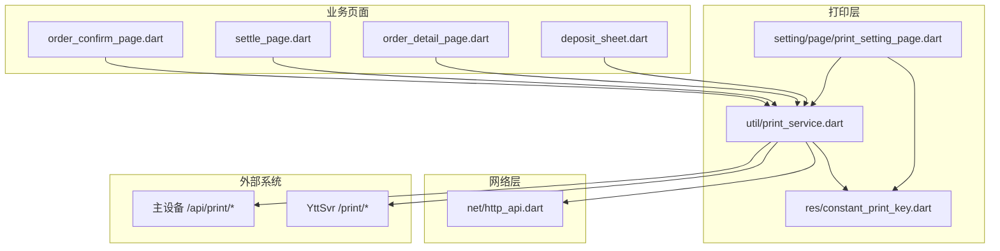
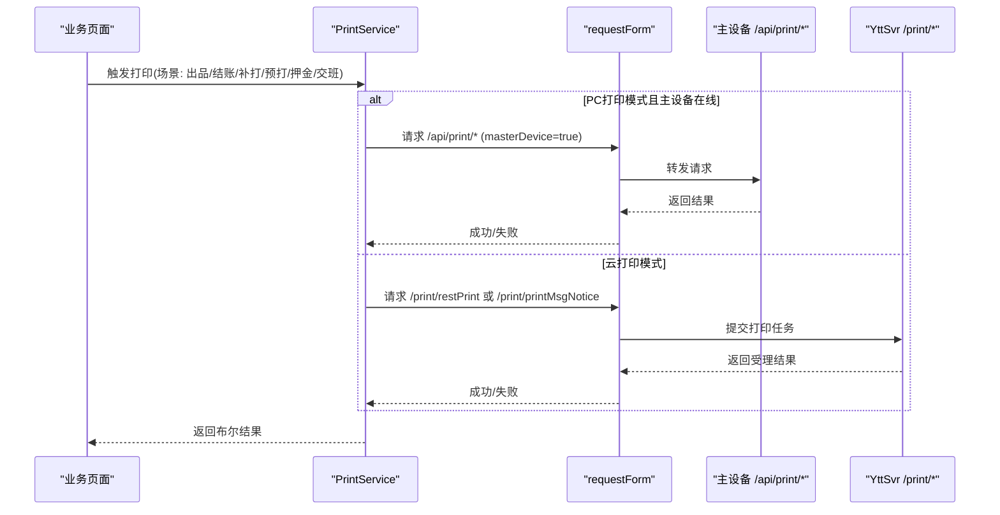
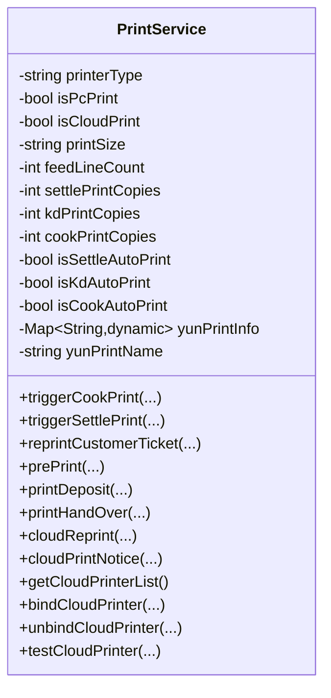
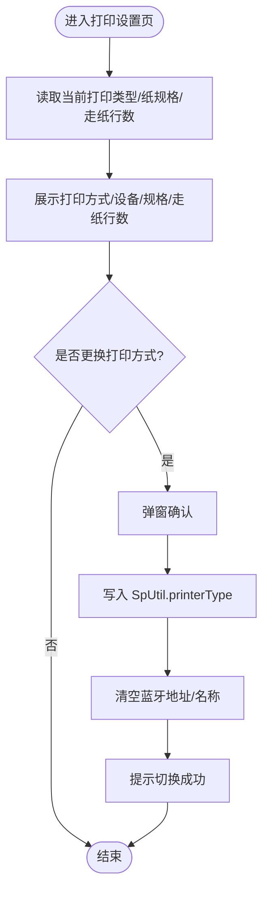
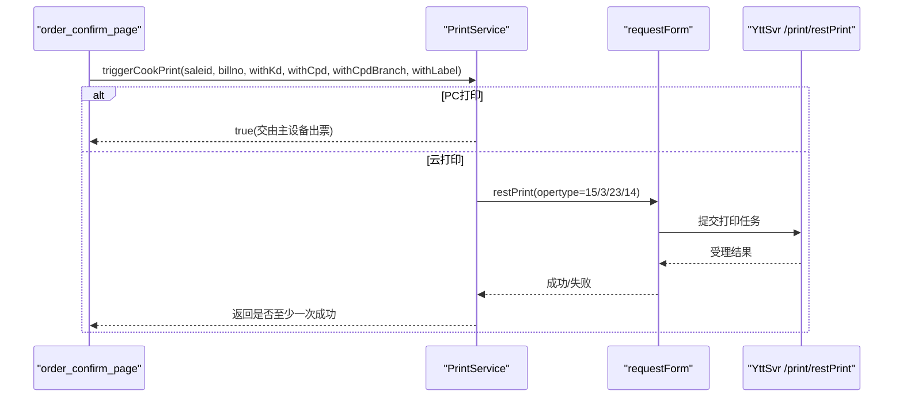
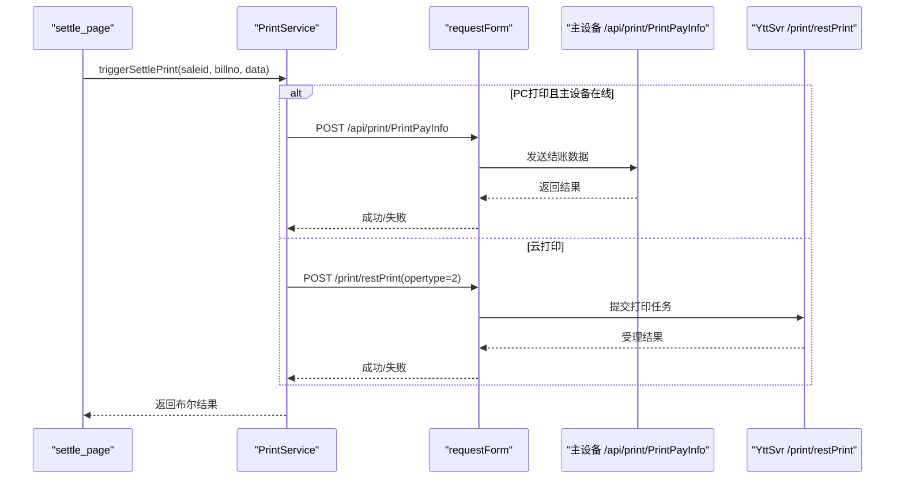
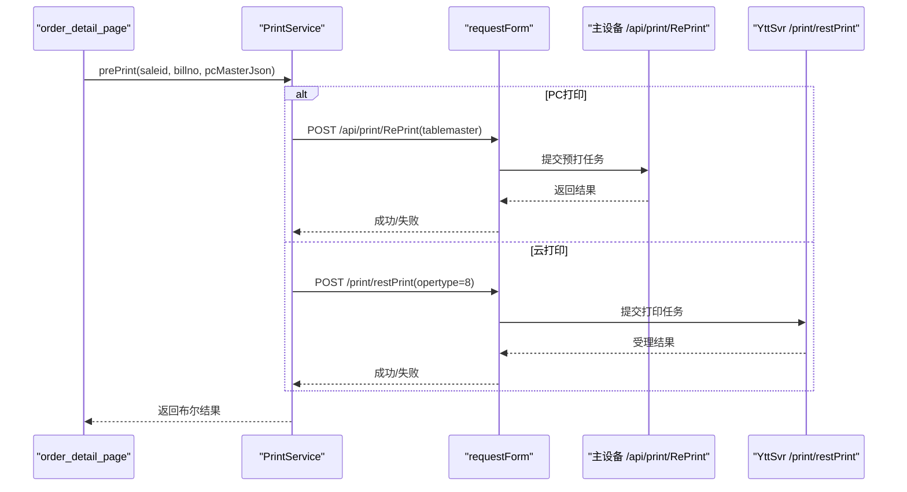
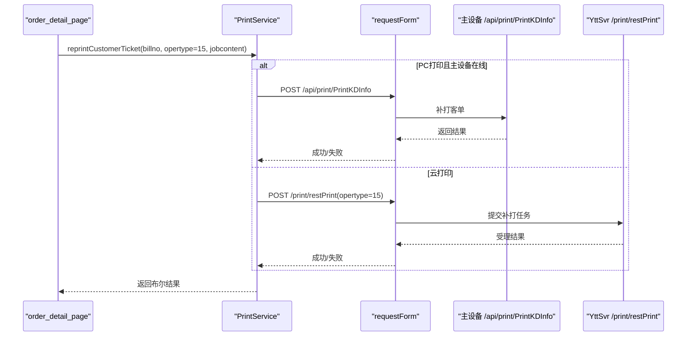
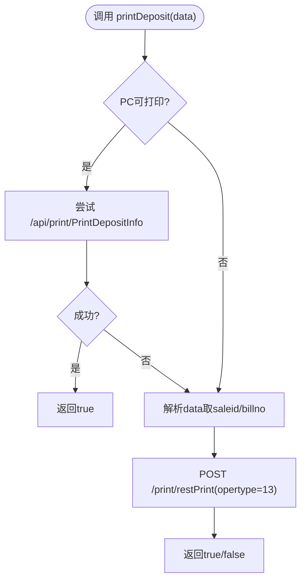
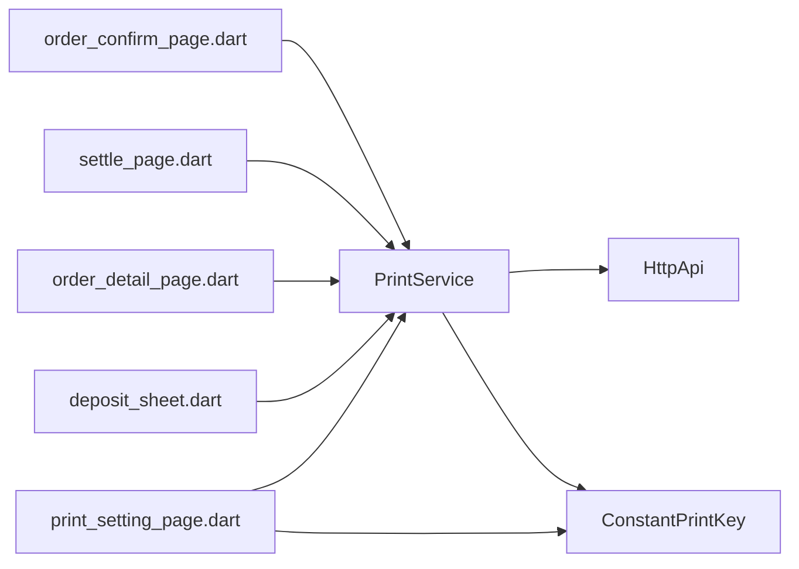

# 打印服务集成

<cite>
**本文引用的文件**   
- [lib/util/print_service.dart](file://lib/util/print_service.dart)
- [lib/res/constant_print_key.dart](file://lib/res/constant_print_key.dart)
- [lib/setting/page/print_setting_page.dart](file://lib/setting/page/print_setting_page.dart)
- [lib/net/http_api.dart](file://lib/net/http_api.dart)
- [lib/pages/order/order_confirm_page.dart](file://lib/pages/order/order_confirm_page.dart)
- [lib/pages/order/settle_page.dart](file://lib/pages/order/settle_page.dart)
- [lib/pages/order/order_detail_page.dart](file://lib/pages/order/order_detail_page.dart)
- [lib/components/deposit_sheet.dart](file://lib/components/deposit_sheet.dart)
</cite>

## 目录
1. [引言](#引言)
2. [项目结构](#项目结构)
3. [核心组件](#核心组件)
4. [架构总览](#架构总览)
5. [详细组件分析](#详细组件分析)
6. [依赖关系分析](#依赖关系分析)
7. [性能与可靠性](#性能与可靠性)
8. [故障诊断指南](#故障诊断指南)
9. [结论](#结论)

## 引言
本文面向打印服务集成，系统性说明 Flutter 端打印能力的设计与实现。重点包括：
- PrintService 的单例设计、打印类型动态切换与配置持久化。
- 双打印模式：PC 打印通过主设备 /api/print/* 接口触发，云打印通过 YttSvr /print/* 接口触发。
- 多场景打印处理：出品单、结账单、退菜单、催菜单、起菜、预打单、客单补打等 printalltype 语义。
- 打印配置的 SpUtil 持久化、份数控制与自动打印开关。
- 打印机兼容性建议、故障诊断方法与性能优化策略。

## 项目结构
打印相关代码主要分布在以下位置：
- 打印服务核心：lib/util/print_service.dart
- 打印配置常量键：lib/res/constant_print_key.dart
- 打印设置界面：lib/setting/page/print_setting_page.dart
- HTTP API 路径常量：lib/net/http_api.dart
- 业务调用方：下单页、结账页、订单详情页、押金单组件

**图示来源**
- [lib/util/print_service.dart:1-416](file://lib/util/print_service.dart#L1-L416)
- [lib/res/constant_print_key.dart:1-147](file://lib/res/constant_print_key.dart#L1-L147)
- [lib/setting/page/print_setting_page.dart:1-319](file://lib/setting/page/print_setting_page.dart#L1-L319)
- [lib/net/http_api.dart:260-494](file://lib/net/http_api.dart#L260-L494)

**章节来源**
- [lib/util/print_service.dart:1-416](file://lib/util/print_service.dart#L1-L416)
- [lib/net/http_api.dart:260-494](file://lib/net/http_api.dart#L260-L494)

## 核心组件
### PrintService 单例与服务边界
- 使用私有构造函数与静态 instance 字段提供全局唯一实例，确保打印配置和状态一致。
- 对外暴露的入口方法按业务场景划分：
  - triggerCookPrint：下单后触发出品单/厨打，支持客单、分单、杯贴组合打印。
  - triggerSettlePrint：结账后触出结账单。
  - reprintCustomerTicket：客单补打。
  - prePrint：预打单。
  - printDeposit：押金单打印/补打。
  - printHandOver：交班打印。
  - cloudReprint/cloudPrintNotice：云打印重打与通知。
  - getCloudPrinterList/bindCloudPrinter/unbindCloudPrinter/testCloudPrinter：云打印机管理。

**章节来源**
- [lib/util/print_service.dart:1-200](file://lib/util/print_service.dart#L1-L200)
- [lib/util/print_service.dart:201-416](file://lib/util/print_service.dart#L201-L416)

### 打印类型与配置常量
- ConstantPrintKey 集中定义所有本地持久化的键名，包括：
  - 打印机类型（PC打印、云打印、蓝牙打印、接口打印）。
  - 蓝牙/网口/远程打印参数。
  - 云打印模板与选中打印机信息 JSON。
  - 结账/客单/厨单的自动打印开关、打印份数、样式与规格。
  - 标签打印、票尾走纸行数、打印指令类型、交班统计标志等。
- 默认打印类型为 PC打印；printerTypeOptions 为 UI 选择列表。

**章节来源**
- [lib/res/constant_print_key.dart:1-147](file://lib/res/constant_print_key.dart#L1-L147)

### 打印设置界面
- PrintSettingPage 负责：
  - 打印方式选择（PC打印/云打印/蓝牙打印/接口打印）。
  - 打印设备描述与跳转。
  - 打印纸规格（58mm/80mm）同步到结账、客单、厨单。
  - 票尾走纸行数调整。
  - 云打印机管理与选中保存。
- 切换打印方式时清理蓝牙地址与名称，避免残留旧设备信息。

**章节来源**
- [lib/setting/page/print_setting_page.dart:1-319](file://lib/setting/page/print_setting_page.dart#L1-L319)

## 架构总览
### 双打印模式
- PC 打印模式：
  - 由主设备统一出票，Flutter 端通过 requestForm 并传入 masterDevice=true 调用 /api/print/* 接口。
  - 典型接口：/api/print/RePrint、/api/print/PrintKDInfo、/api/print/PrintPayInfo、/api/print/PrintTempPayInfo、/api/print/PrintHandOver、/api/print/PrintDepositInfo。
- 云打印模式：
  - Flutter 端直接调用 YttSvr /print/* 接口，服务端根据 saleid+opertype 重建票据并下发到已绑定的云打印机。
  - 典型接口：/print/restPrint、/print/getList、/print/bindPrint、/print/unBindPrint、/print/printTest、/print/printMsgNotice。

**图示来源**
- [lib/util/print_service.dart:1-416](file://lib/util/print_service.dart#L1-L416)
- [lib/net/http_api.dart:260-494](file://lib/net/http_api.dart#L260-L494)

**章节来源**
- [lib/util/print_service.dart:1-416](file://lib/util/print_service.dart#L1-L416)
- [lib/net/http_api.dart:260-494](file://lib/net/http_api.dart#L260-L494)

## 详细组件分析
### 单例设计与配置读取
- 单例：PrintService._() 私有构造 + static final instance，保证全局唯一。
- 配置读取：
  - printerType：从 SpUtil 读取，未设置则回退 ConstantPrintKey.defaultPrinterType。
  - isPcPrint/isCloudPrint：基于 printerType 判断当前模式。
  - printSize/feedLineCount/settlePrintCopies/kdPrintCopies/cookPrintCopies：分别读取打印规格、票尾走纸行数与各单据打印份数。
  - isSettleAutoPrint/isKdAutoPrint/isCookAutoPrint：读取自动打印开关。
  - yunPrintInfo/yunPrintName：解析云打印机 JSON 并获取显示名称。

**图示来源**
- [lib/util/print_service.dart:1-416](file://lib/util/print_service.dart#L1-L416)

**章节来源**
- [lib/util/print_service.dart:1-200](file://lib/util/print_service.dart#L1-L200)

### 打印类型动态切换
- 用户通过 PrintSettingPage 选择打印方式，内部调用 PrintService.setPrinterType(type) 写入 SpUtil。
- 切换时同时清空蓝牙地址与蓝牙名称，避免不同打印模式间设备信息污染。
- 打印方式改变后，各业务模块通过 isPcPrint/isCloudPrint 分支执行对应逻辑。

**图示来源**
- [lib/setting/page/print_setting_page.dart:1-319](file://lib/setting/page/print_setting_page.dart#L1-L319)
- [lib/util/print_service.dart:1-120](file://lib/util/print_service.dart#L1-L120)

**章节来源**
- [lib/setting/page/print_setting_page.dart:1-319](file://lib/setting/page/print_setting_page.dart#L1-L319)
- [lib/util/print_service.dart:1-120](file://lib/util/print_service.dart#L1-L120)

### 出品单与厨打（printalltype=3）
- 下单成功后，order_confirm_page 调用 PrintService.triggerCookPrint。
- PC 模式下，下单时已将 printtype/printkdflag/printcpdflag 传给主设备，由 PC 侧出票。
- 云打印模式下，根据 withKd/withCpd/withCpdBranch/withLabel 分别调用 cloudReprint：
  - opertype=15 客单
  - opertype=3 出品单
  - opertype=23 出品分单
  - opertype=14 杯贴

**图示来源**
- [lib/pages/order/order_confirm_page.dart:34](file://lib/pages/order/order_confirm_page.dart#L34)
- [lib/pages/order/order_confirm_page.dart:644](file://lib/pages/order/order_confirm_page.dart#L644)
- [lib/util/print_service.dart:110-170](file://lib/util/print_service.dart#L110-L170)

**章节来源**
- [lib/pages/order/order_confirm_page.dart:34](file://lib/pages/order/order_confirm_page.dart#L34)
- [lib/pages/order/order_confirm_page.dart:644](file://lib/pages/order/order_confirm_page.dart#L644)
- [lib/util/print_service.dart:110-170](file://lib/util/print_service.dart#L110-L170)

### 结账单（printalltype=2）
- settle_page 在结账成功后调用 PrintService.triggerSettlePrint。
- PC 模式且主设备在线：调用 _pcPrintPayInfo(data)，POST /api/print/PrintPayInfo。
- 云打印模式：调用 cloudReprint(opertype=2)，服务端按 saleid 重建结账单。

**图示来源**
- [lib/pages/order/settle_page.dart:1416](file://lib/pages/order/settle_page.dart#L1416)
- [lib/pages/order/settle_page.dart:1443](file://lib/pages/order/settle_page.dart#L1443)
- [lib/util/print_service.dart:170-200](file://lib/util/print_service.dart#L170-L200)
- [lib/net/http_api.dart:493-494](file://lib/net/http_api.dart#L493-L494)

**章节来源**
- [lib/pages/order/settle_page.dart:1416](file://lib/pages/order/settle_page.dart#L1416)
- [lib/pages/order/settle_page.dart:1443](file://lib/pages/order/settle_page.dart#L1443)
- [lib/util/print_service.dart:170-200](file://lib/util/print_service.dart#L170-L200)

### 退菜单（printalltype=4）、催菜单（printalltype=5）、起菜（printalltype=7）
- 这些操作在服务端通常以 updateDetailSign 或 updateAllDetailSign 更新明细标记，随后通过 cloudReprint 或 printMsgNotice 触发对应票据打印。
- 常见 opertype 映射：
  - 退菜单：printalltype=4
  - 催菜单：printalltype=5
  - 起菜单：printalltype=7
- 若业务需要自动打印，可在调用相应业务接口后追加 cloudReprint(opertype=4/5/7)。

**章节来源**
- [lib/net/http_api.dart:192-200](file://lib/net/http_api.dart#L192-L200)
- [lib/util/print_service.dart:360-390](file://lib/util/print_service.dart#L360-L390)
- [lib/res/constant_print_key.dart:127-147](file://lib/res/constant_print_key.dart#L127-L147)

### 预打单（printalltype=8）
- order_detail_page 在“预打”流程中调用 PrintService.prePrint。
- PC 模式：POST /api/print/RePrint，tablemaster 为 PCMasterBean JSON。
- 云打印模式：cloudReprint(opertype=8)，服务端按 saleid 重建预打单。

**图示来源**
- [lib/pages/order/order_detail_page.dart:2966](file://lib/pages/order/order_detail_page.dart#L2966)
- [lib/pages/order/order_detail_page.dart:3005](file://lib/pages/order/order_detail_page.dart#L3005)
- [lib/pages/order/order_detail_page.dart:3018](file://lib/pages/order/order_detail_page.dart#L3018)
- [lib/util/print_service.dart:201-235](file://lib/util/print_service.dart#L201-L235)

**章节来源**
- [lib/pages/order/order_detail_page.dart:2966](file://lib/pages/order/order_detail_page.dart#L2966)
- [lib/pages/order/order_detail_page.dart:3005](file://lib/pages/order/order_detail_page.dart#L3005)
- [lib/pages/order/order_detail_page.dart:3018](file://lib/pages/order/order_detail_page.dart#L3018)
- [lib/util/print_service.dart:201-235](file://lib/util/print_service.dart#L201-L235)

### 客单补打（printalltype=15）
- order_detail_page 在客单补打流程中调用 PrintService.reprintCustomerTicket。
- PC 模式：POST /api/print/PrintKDInfo，携带 billno 与 opertype。
- 云打印模式：POST /print/restPrint，携带 jobcontent/saleid、billno、opertype=15。

**图示来源**
- [lib/pages/order/order_detail_page.dart:1119](file://lib/pages/order/order_detail_page.dart#L1119)
- [lib/pages/order/order_detail_page.dart:2692](file://lib/pages/order/order_detail_page.dart#L2692)
- [lib/util/print_service.dart:200-235](file://lib/util/print_service.dart#L200-L235)

**章节来源**
- [lib/pages/order/order_detail_page.dart:1119](file://lib/pages/order/order_detail_page.dart#L1119)
- [lib/pages/order/order_detail_page.dart:2692](file://lib/pages/order/order_detail_page.dart#L2692)
- [lib/util/print_service.dart:200-235](file://lib/util/print_service.dart#L200-L235)

### 押金单打印（printalltype=13）
- deposit_sheet 在提交或退款完成后调用 PrintService.printDeposit。
- 有主设备地址或主设备在线时优先走 PC 打印 /api/print/PrintDepositInfo。
- 无主设备时回退云打印 /print/restPrint(opertype=13)，jobcontent 优先取 saleid，其次 billno。

**图示来源**
- [lib/components/deposit_sheet.dart:474](file://lib/components/deposit_sheet.dart#L474)
- [lib/components/deposit_sheet.dart:477](file://lib/components/deposit_sheet.dart#L477)
- [lib/components/deposit_sheet.dart:874](file://lib/components/deposit_sheet.dart#L874)
- [lib/util/print_service.dart:235-305](file://lib/util/print_service.dart#L235-L305)

**章节来源**
- [lib/components/deposit_sheet.dart:474](file://lib/components/deposit_sheet.dart#L474)
- [lib/components/deposit_sheet.dart:477](file://lib/components/deposit_sheet.dart#L477)
- [lib/components/deposit_sheet.dart:874](file://lib/components/deposit_sheet.dart#L874)
- [lib/util/print_service.dart:235-305](file://lib/util/print_service.dart#L235-L305)

### 打印配置持久化与自动打印
- SpUtil 作为本地存储后端，所有打印相关配置均以 ConstantPrintKey 定义的 key 进行读写。
- 关键配置项：
  - 打印类型：PRITER_TYPE
  - 结账/客单/厨单：自动打印开关、打印份数、样式、规格
  - 票尾走纸行数：TICKET_FEED_LINE
  - 云打印机：save_select_yun_print_info(JSON)、save_yun_print_template
- PrintService 提供 getter 封装，业务层无需感知具体 key。

**章节来源**
- [lib/res/constant_print_key.dart:1-147](file://lib/res/constant_print_key.dart#L1-L147)
- [lib/util/print_service.dart:1-120](file://lib/util/print_service.dart#L1-L120)
- [lib/setting/page/print_setting_page.dart:1-319](file://lib/setting/page/print_setting_page.dart#L1-L319)

## 依赖关系分析
### 组件耦合与职责
- PrintService 是打印能力中心，向上对接业务页面，向下封装 HTTP 请求与模式判断。
- http_api.dart 集中声明所有接口路径，避免硬编码字符串散落各处。
- constant_print_key.dart 集中管理配置键，降低键名不一致风险。
- print_setting_page.dart 负责用户交互与配置落地。

**图示来源**
- [lib/util/print_service.dart:1-416](file://lib/util/print_service.dart#L1-L416)
- [lib/net/http_api.dart:260-494](file://lib/net/http_api.dart#L260-L494)
- [lib/res/constant_print_key.dart:1-147](file://lib/res/constant_print_key.dart#L1-L147)
- [lib/setting/page/print_setting_page.dart:1-319](file://lib/setting/page/print_setting_page.dart#L1-L319)

**章节来源**
- [lib/util/print_service.dart:1-416](file://lib/util/print_service.dart#L1-L416)
- [lib/net/http_api.dart:260-494](file://lib/net/http_api.dart#L260-L494)

### 接口契约与错误传播
- 所有对外打印方法均返回 Future<bool>，用于业务层判断是否成功。
- 异常被捕获后记录日志并通过 Log.e 输出，最终返回 false，避免上层崩溃。
- 云打印管理方法（getList/bind/unbind/test）同样采用 try-catch 并返回布尔或空列表。

**章节来源**
- [lib/util/print_service.dart:200-416](file://lib/util/print_service.dart#L200-L416)

## 性能与可靠性
### 打印队列与并发
- 当前实现以异步 Future 形式发起网络请求，未内置队列。建议在高频打印场景下对业务侧做简单去重与限流，例如：
  - 同一 saleid 在短时间内重复触发同一 opertype 时合并请求。
  - 对云打印 restPrint 做串行化限制，避免短时间内大量任务堆积。
- 对于 PC 打印，注意主设备连接状态 ConnectionManager.pcAlive 的判断，避免无效重试。

### 错误重试机制
- 当前 PrintService 未内置指数退避重试。建议在 requestForm 外层包装通用重试策略：
  - 网络超时或服务器 5xx 时最多重试 2-3 次。
  - 每次重试前增加随机抖动，避免雪崩。
- 对云打印机绑定/测试等管理接口，失败时应明确提示用户检查云端设备状态。

### 打印份数与自动打印
- 结账/客单/厨单均可独立设置打印份数与自动打印开关。
- 自动打印为 true 时可直接调用打印；为 false 时可先弹出确认对话框，再执行打印，提升用户体验。

### 性能优化建议
- 批量补打时尽量复用 saleid，减少多次重建票据的网络开销。
- 云打印机列表获取频率不宜过高，可在设置页加载一次并缓存。
- 对大体积 JSON（如 PCMasterBean）压缩传输或分页构建，降低首屏卡顿。

[本节为通用性能指导，不直接分析具体文件]

## 故障诊断指南
### 常见问题定位
- 打印类型不正确：
  - 检查 PrintSettingPage 是否正确写入 PRITER_TYPE。
  - 确认业务侧是否根据 isPcPrint/isCloudPrint 分支调用对应接口。
- 云打印机未生效：
  - 检查 save_select_yun_print_info 是否存在有效 JSON。
  - 调用 getCloudPrinterList 确认云端存在可用打印机。
  - 使用 testCloudPrinter 验证绑定打印机是否可达。
- PC 打印失败：
  - 确认 ConnectionManager.pcAlive 是否为真。
  - 核对 /api/print/* 接口是否由主设备正确接收并转发至本地打印机。
- 打印内容缺失：
  - 核对 opertype 是否与业务意图一致（3/4/5/7/8/13/15 等）。
  - 检查 jobcontent 是否为有效的 saleid 或 billno。

### 日志与排错
- 关注 PrintService 中的 Log.e 输出，包含方法名与异常信息。
- 结合业务页面的调用栈，定位是参数组装问题还是网络层异常。
- 对于云打印，结合 /print/restPrint 与 /print/printMsgNotice 的返回结果区分“任务受理成功”与“实际打印成功”。

**章节来源**
- [lib/util/print_service.dart:200-416](file://lib/util/print_service.dart#L200-L416)
- [lib/setting/page/print_setting_page.dart:1-319](file://lib/setting/page/print_setting_page.dart#L1-L319)

### 打印机兼容性建议
- 云打印：
  - 优先使用服务端支持的模板与 opertype。
  - 不同品牌云打印机可能在纸张尺寸与边距上存在差异，需通过 printStyleJz/Kd/Cd 与 printSizeJz/Kd/Cd 校准。
- PC 打印：
  - 主设备需正确安装并维护本地打印机驱动。
  - 当主设备离线时，应提示用户切换到云打印模式或等待主设备恢复。
- 蓝牙/接口打印：
  - 当前设置页仅开放 PC 与云打印入口，其他模式需扩展 UI 与设备连接逻辑。
  - 若接入第三方蓝牙 SDK，注意权限申请与连接稳定性。

[本节为通用兼容性指导，不直接分析具体文件]

## 结论
PrintService 通过单例模式统一管理打印能力，结合 ConstantPrintKey 的持久化配置与 PrintSettingPage 的用户交互，实现了打印类型的动态切换与配置集中管理。双打印模式清晰分离了主设备 /api/print/* 与 YttSvr /print/* 的职责，使业务侧可按场景灵活选择出品单、结账单、退菜单、催菜单、起菜、预打单与客单补打等不同 printalltype 的处理路径。未来可在现有基础上引入打印队列、重试机制与更细粒度的错误码，以提升高并发场景下的稳定性与用户体验。