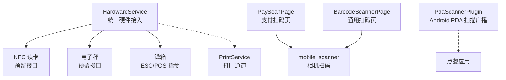
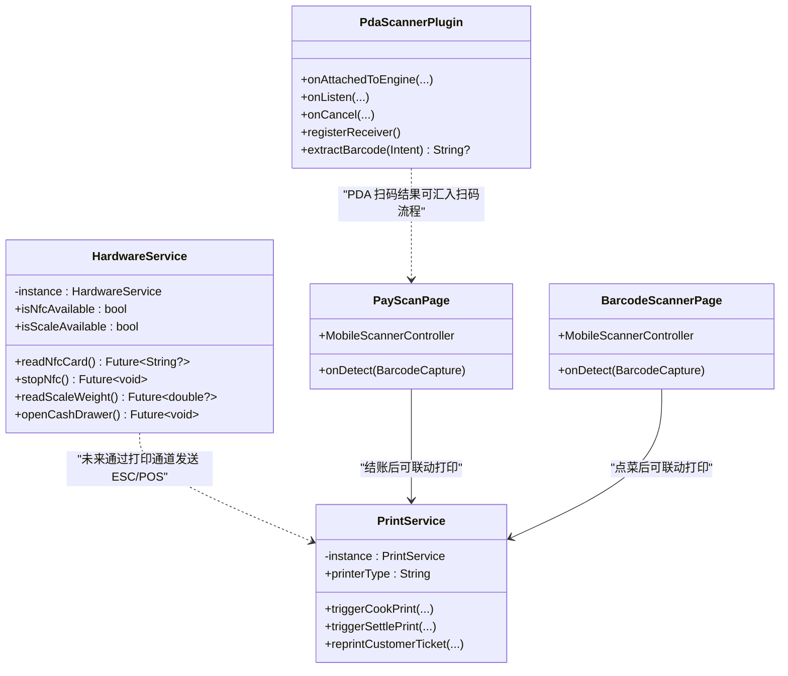
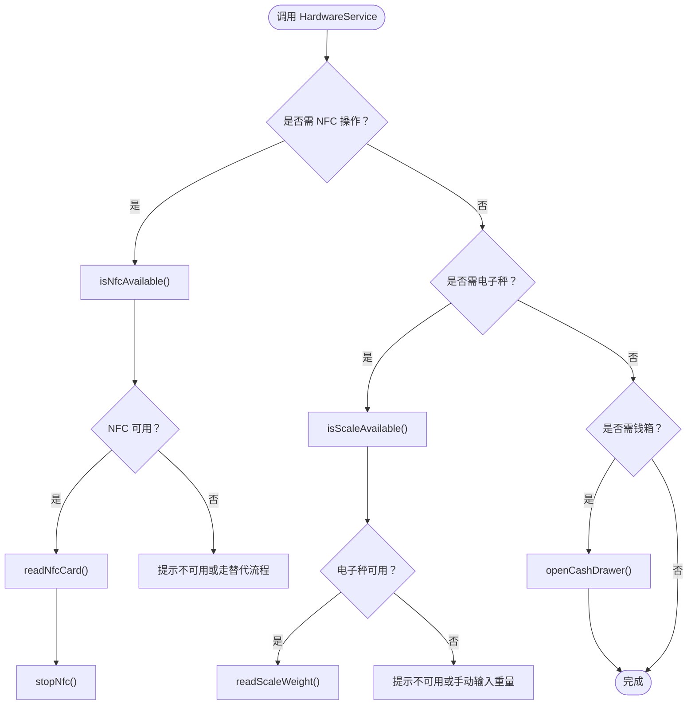
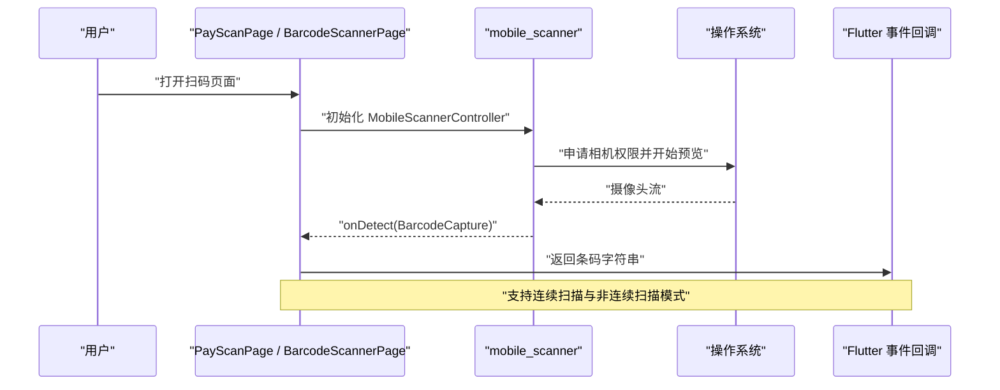
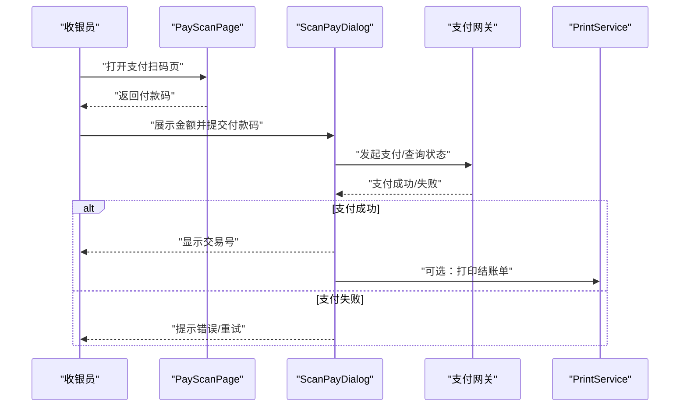
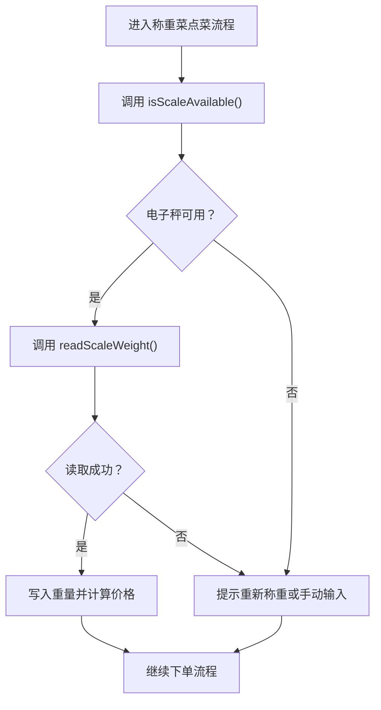
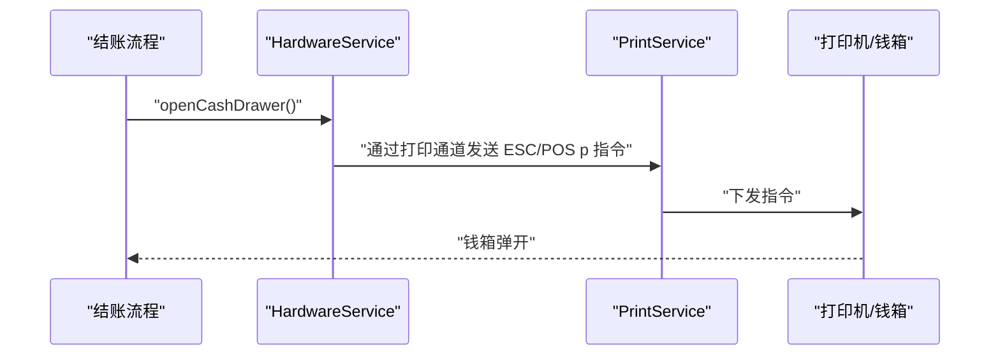
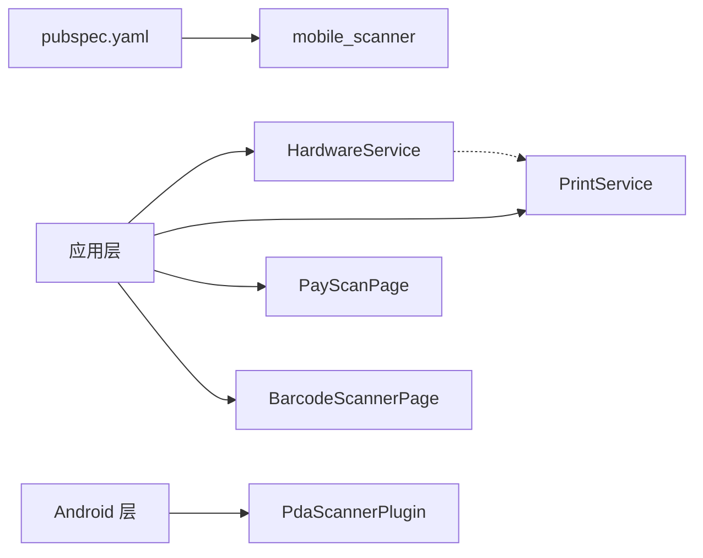

# 硬件服务框架

<cite>
**本文引用的文件**   
- [hardware_service.dart](file://lib/util/hardware_service.dart)
- [print_service.dart](file://lib/util/print_service.dart)
- [pay_scan_page.dart](file://lib/pages/order/pay_scan_page.dart)
- [barcode_scanner_page.dart](file://lib/widgets/barcode_scanner_page.dart)
- [scan_pay_dialog.dart](file://lib/pages/order/scan_pay_dialog.dart)
- [pubspec.yaml](file://pubspec.yaml)
- [PdaScannerPlugin.java（weilu 版本）](file://android/app/src/main/java/com/weilu/deer/PdaScannerPlugin.java)
- [PdaScannerPlugin.java（bycloud 版本）](file://android/app/src/main/java/com/bycloud/smdc/PdaScannerPlugin.java)
</cite>

## 目录
1. [引言](#引言)
2. [项目结构](#项目结构)
3. [核心组件](#核心组件)
4. [架构总览](#架构总览)
5. [详细组件分析](#详细组件分析)
6. [依赖关系分析](#依赖关系分析)
7. [性能与可靠性考虑](#性能与可靠性考虑)
8. [扩展指南与最佳实践](#扩展指南与最佳实践)
9. [故障排查](#故障排查)
10. [结论](#结论)

## 引言
本文档围绕 Flutter 点餐应用中的“硬件服务框架”展开，重点说明 HardwareService 的统一接入层设计、NFC 读卡预留接口、扫码枪集成方案、电子秤扩展设计以及钱箱控制与打印服务的协作关系。文档面向业务开发者，既提供高层架构视图，也给出具体代码路径和扩展建议，帮助快速接入 NFC、扫码、电子秤、钱箱等硬件能力。

## 项目结构
当前硬件相关代码主要位于 util 层与订单支付页面：
- 统一硬件接入：`lib/util/hardware_service.dart`
- 打印服务与 ESC/POS 通道：`lib/util/print_service.dart`
- 扫码 UI 与支付扫码流程：`lib/pages/order/pay_scan_page.dart`、`lib/widgets/barcode_scanner_page.dart`、`lib/pages/order/scan_pay_dialog.dart`
- 第三方扫描插件依赖：`pubspec.yaml`
- PDA 硬件扫描广播适配：`android/app/src/main/java/com/.../PdaScannerPlugin.java`

**图表来源**
- [hardware_service.dart:1-79](file://lib/util/hardware_service.dart#L1-L79)
- [print_service.dart:1-200](file://lib/util/print_service.dart#L1-L200)
- [pay_scan_page.dart:1-200](file://lib/pages/order/pay_scan_page.dart#L1-L200)
- [barcode_scanner_page.dart:1-177](file://lib/widgets/barcode_scanner_page.dart#L1-L177)
- [PdaScannerPlugin.java（weilu 版本）:1-165](file://android/app/src/main/java/com/weilu/deer/PdaScannerPlugin.java#L1-L165)
- [PdaScannerPlugin.java（bycloud 版本）:1-165](file://android/app/src/main/java/com/bycloud/smdc/PdaScannerPlugin.java#L1-L165)

**章节来源**
- [hardware_service.dart:1-79](file://lib/util/hardware_service.dart#L1-L79)
- [pubspec.yaml:1-111](file://pubspec.yaml#L1-L111)

## 核心组件
- HardwareService：硬件设备的统一抽象层，使用单例模式对外暴露 NFC、扫码、电子秤、钱箱等能力入口。
- PrintService：打印服务，负责 PC 打印与云打印触发，未来可作为 ESC/POS 指令的承载通道。
- 扫码页面组件：PayScanPage、BarcodeScannerPage 基于 mobile_scanner 实现扫码 UI 与结果回调。
- Android PdaScannerPlugin：在 PDA 设备上监听系统扫描广播，将扫码结果推送给 Flutter 层。

**章节来源**
- [hardware_service.dart:1-79](file://lib/util/hardware_service.dart#L1-L79)
- [print_service.dart:1-200](file://lib/util/print_service.dart#L1-L200)
- [pay_scan_page.dart:1-200](file://lib/pages/order/pay_scan_page.dart#L1-L200)
- [barcode_scanner_page.dart:1-177](file://lib/widgets/barcode_scanner_page.dart#L1-L177)
- [PdaScannerPlugin.java（weilu 版本）:1-165](file://android/app/src/main/java/com/weilu/deer/PdaScannerPlugin.java#L1-L165)
- [PdaScannerPlugin.java（bycloud 版本）:1-165](file://android/app/src/main/java/com/bycloud/smdc/PdaScannerPlugin.java#L1-L165)

## 架构总览
HardwareService 作为“硬件抽象层”，屏蔽底层设备差异，向上提供稳定 API；扫码功能由 mobile_scanner 直接驱动相机，同时 Android 侧提供 PdaScannerPlugin 以兼容 PDA 硬件扫描广播。打印服务承担票据输出，未来可扩展为 ESC/POS 指令通道，从而驱动钱箱。

**图表来源**
- [hardware_service.dart:1-79](file://lib/util/hardware_service.dart#L1-L79)
- [print_service.dart:1-200](file://lib/util/print_service.dart#L1-L200)
- [pay_scan_page.dart:1-200](file://lib/pages/order/pay_scan_page.dart#L1-L200)
- [barcode_scanner_page.dart:1-177](file://lib/widgets/barcode_scanner_page.dart#L1-L177)
- [PdaScannerPlugin.java（weilu 版本）:1-165](file://android/app/src/main/java/com/weilu/deer/PdaScannerPlugin.java#L1-L165)

## 详细组件分析

### HardwareService：统一硬件接入层
- 单例模式：通过私有构造函数与静态实例提供全局访问入口，确保硬件能力集中管理。
- NFC 预留接口：
  - isNfcAvailable：当前返回固定值，待接入 nfc_manager 或 flutter_nfc_kit 后实现真实检测。
  - readNfcCard：异步读取 NFC 卡号，对齐 smdcapp NfcUtils 会员卡读取逻辑，失败返回空。
  - stopNfc：用于停止 NFC 监听并释放资源。
- 扫码枪能力：注释中明确扫码已由 mobile_scanner 提供，不在 HardwareService 内实现。
- 电子秤预留接口：
  - isScaleAvailable：当前返回固定值，待接入串口/蓝牙插件。
  - readScaleWeight：异步读取重量（千克），失败返回空，对接称重菜场景。
- 钱箱控制：
  - openCashDrawer：预留方法，计划通过打印通道发送 ESC/POS p 指令打开钱箱，对齐 smdcapp 结账后自动弹开钱箱的流程。

**图表来源**
- [hardware_service.dart:1-79](file://lib/util/hardware_service.dart#L1-L79)

**章节来源**
- [hardware_service.dart:1-79](file://lib/util/hardware_service.dart#L1-L79)

### 扫码枪集成方案：mobile_scanner 与 PDA 扫描广播
- mobile_scanner 集成：
  - pubspec.yaml 已声明 mobile_scanner 依赖，应用通过 MobileScannerController 启动相机扫描。
  - PayScanPage：支付扫码页，红色标题栏、扫描框动画、连续扫描开关、相册图片按钮，UI 对齐 smdcapp MipcaActivityCapture。
  - BarcodeScannerPage：通用扫码页，返回条码/二维码字符串。
- Android PDA 扫描广播适配：
  - PdaScannerPlugin 注册 EventChannel，监听主流 PDA 厂商扫描广播（商米、优博音、新大陆、iData、东大集成等）。
  - 从 Intent Extra 中提取条码数据，并通过 EventSink 推送至 Flutter 层。
  - 两套包名实现：com.weilu.deer 与 com.bycloud.smdc，便于不同渠道定制。

**图表来源**
- [pay_scan_page.dart:1-200](file://lib/pages/order/pay_scan_page.dart#L1-L200)
- [barcode_scanner_page.dart:1-177](file://lib/widgets/barcode_scanner_page.dart#L1-L177)
- [pubspec.yaml:1-111](file://pubspec.yaml#L1-L111)

**章节来源**
- [pay_scan_page.dart:1-200](file://lib/pages/order/pay_scan_page.dart#L1-L200)
- [barcode_scanner_page.dart:1-177](file://lib/widgets/barcode_scanner_page.dart#L1-L177)
- [PdaScannerPlugin.java（weilu 版本）:1-165](file://android/app/src/main/java/com/weilu/deer/PdaScannerPlugin.java#L1-L165)
- [PdaScannerPlugin.java（bycloud 版本）:1-165](file://android/app/src/main/java/com/bycloud/smdc/PdaScannerPlugin.java#L1-L165)
- [pubspec.yaml:1-111](file://pubspec.yaml#L1-L111)

### 扫码支付与点菜扫码的应用场景
- 支付扫码：
  - PayScanPage 捕获付款码后，跳转到 ScanPayDialog，提交付款码到支付网关并轮询支付结果，超时关闭订单。
  - 该流程对齐 smdcapp 的收款对话框逻辑。
- 点菜扫码：
  - BarcodeScannerPage 可用于商品条码扫描，识别后进入点菜流程，后续可联动打印出品单或杯贴。

**图表来源**
- [pay_scan_page.dart:1-200](file://lib/pages/order/pay_scan_page.dart#L1-L200)
- [scan_pay_dialog.dart:1-200](file://lib/pages/order/scan_pay_dialog.dart#L1-L200)
- [print_service.dart:1-200](file://lib/util/print_service.dart#L1-L200)

**章节来源**
- [scan_pay_dialog.dart:1-200](file://lib/pages/order/scan_pay_dialog.dart#L1-L200)
- [pay_scan_page.dart:1-200](file://lib/pages/order/pay_scan_page.dart#L1-L200)

### 电子秤扩展设计
- isScaleAvailable：当前返回固定值，用于占位；接入串口/蓝牙插件后应返回真实可用性。
- readScaleWeight：异步读取重量（千克），失败返回空；用于称重菜点菜时自动获取重量字段。
- 业务对接建议：
  - 在点菜页增加“称重菜”选项，选择后调用 readScaleWeight。
  - 若设备不可用，提示手动输入重量，保证业务流程不中断。
  - 将重量转换为计费单位并与菜品价格计算模块对接。

**图表来源**
- [hardware_service.dart:1-79](file://lib/util/hardware_service.dart#L1-L79)

**章节来源**
- [hardware_service.dart:1-79](file://lib/util/hardware_service.dart#L1-L79)

### 钱箱控制与打印服务集成
- HardwareService.openCashDrawer：
  - 预留方法，注释中明确通过打印通道发送 ESC/POS p 指令（0x1B 0x70 0x00 0x19 0x19）。
  - 对齐 smdcapp 结账成功后自动弹开钱箱的业务习惯。
- PrintService：
  - 负责 PC 打印与云打印触发，包含厨打、客单、预打、重打等打印流程。
  - 未来可在 print_service.dart 中新增“发送 ESC/POS 指令”的方法，供 HardwareService 调用，从而打通钱箱控制链路。

**图表来源**
- [hardware_service.dart:1-79](file://lib/util/hardware_service.dart#L1-L79)
- [print_service.dart:1-200](file://lib/util/print_service.dart#L1-L200)

**章节来源**
- [hardware_service.dart:1-79](file://lib/util/hardware_service.dart#L1-L79)
- [print_service.dart:1-200](file://lib/util/print_service.dart#L1-L200)

## 依赖关系分析
- mobile_scanner：已在 pubspec.yaml 引入，用于相机扫码；PayScanPage 与 BarcodeScannerPage 直接依赖。
- PdaScannerPlugin：Android 原生插件，处理 PDA 扫描广播，适用于专用手持设备。
- HardwareService：目前为接口定义与占位实现，NFC、电子秤、钱箱尚未接入真实设备。
- PrintService：承担打印业务，未来扩展为 ESC/POS 指令通道。

**图表来源**
- [pubspec.yaml:1-111](file://pubspec.yaml#L1-L111)
- [hardware_service.dart:1-79](file://lib/util/hardware_service.dart#L1-L79)
- [print_service.dart:1-200](file://lib/util/print_service.dart#L1-L200)
- [pay_scan_page.dart:1-200](file://lib/pages/order/pay_scan_page.dart#L1-L200)
- [barcode_scanner_page.dart:1-177](file://lib/widgets/barcode_scanner_page.dart#L1-L177)
- [PdaScannerPlugin.java（weilu 版本）:1-165](file://android/app/src/main/java/com/weilu/deer/PdaScannerPlugin.java#L1-L165)

**章节来源**
- [pubspec.yaml:1-111](file://pubspec.yaml#L1-L111)
- [hardware_service.dart:1-79](file://lib/util/hardware_service.dart#L1-L79)
- [print_service.dart:1-200](file://lib/util/print_service.dart#L1-L200)

## 性能与可靠性考虑
- 扫码性能：
  - MobileScannerController 设置 DetectionSpeed.normal，避免高频回调导致卡顿。
  - 非连续扫描模式下使用 _hasScanned 防止重复触发，减少不必要的 UI 更新。
- 支付流程可靠性：
  - ScanPayDialog 使用倒计时与轮询机制，60 秒超时并关闭订单，避免长时间挂起。
  - 网络异常时回退到查询逻辑，提升弱网环境下的成功率。
- 硬件可用性检测：
  - NFC、电子秤当前返回固定值，建议在接入真实插件后加入设备枚举与状态检查，避免误判。
- 资源清理：
  - PayScanPage 与 BarcodeScannerPage 在 dispose 中释放控制器，避免内存泄漏。
  - PdaScannerPlugin 在 onDetachedFromEngine 中注销广播接收器，避免后台泄露。

[本节为通用指导，不直接分析具体文件]

## 扩展指南与最佳实践

### 接入新的硬件设备（以 NFC 为例）
- 步骤建议：
  1. 在 pubspec.yaml 添加 NFC 插件依赖（如 nfc_manager 或 flutter_nfc_kit）。
  2. 在 HardwareService.isNfcAvailable 中调用插件的设备检测方法。
  3. 在 readNfcCard 中调用插件读取标签 ID，返回字符串；失败返回空。
  4. 在 stopNfc 中调用插件停止监听并释放资源。
  5. 在业务层（如会员登录、会员积分）调用 HardwareService 的 NFC 接口。
- 注意事项：
  - 平台差异：iOS 与 Android 权限配置不同，需在各自平台清单中添加 NFC 权限。
  - 线程安全：异步读取时注意页面生命周期，避免在销毁后回调。
  - 日志与埋点：记录读取成功/失败及耗时，便于问题定位。

**章节来源**
- [hardware_service.dart:1-79](file://lib/util/hardware_service.dart#L1-L79)

### 接入新的硬件设备（以电子秤为例）
- 步骤建议：
  1. 开发或引入串口/蓝牙电子秤插件，封装 isScaleAvailable 与 readScaleWeight。
  2. 在 HardwareService 中调用插件检测与读取重量。
  3. 在点菜页增加称重菜选项，调用 readScaleWeight 获取重量并参与计价。
  4. 当设备不可用时，允许手动输入重量，保证业务连续性。
- 注意事项：
  - 重量单位换算：统一为千克或克，并在前端显示合适的单位。
  - 连接稳定性：处理断连、重连、超时等异常场景。
  - 精度控制：根据秤的分辨率进行四舍五入或截断。

**章节来源**
- [hardware_service.dart:1-79](file://lib/util/hardware_service.dart#L1-L79)

### 接入新的硬件设备（以钱箱为例）
- 步骤建议：
  1. 在 PrintService 中新增 sendEscPosCommand(data) 方法，封装 ESC/POS 指令发送。
  2. 在 HardwareService.openCashDrawer 中调用 PrintService.sendEscPosCommand，传入 p 指令字节序列。
  3. 在结账成功后触发 openCashDrawer，实现自动弹开钱箱。
- 注意事项：
  - 打印机类型判断：PC 打印与云打印模式可能不支持直接下发 ESC/POS，需要后端或主设备协助。
  - 指令兼容性：不同品牌打印机对 ESC/POS 支持存在差异，需做兼容测试。
  - 失败重试：钱箱弹开失败时可提示人工操作，不影响支付流程。

**章节来源**
- [hardware_service.dart:1-79](file://lib/util/hardware_service.dart#L1-L79)
- [print_service.dart:1-200](file://lib/util/print_service.dart#L1-L200)

### 插件集成示例与开发规范
- mobile_scanner 集成：
  - 在页面初始化 MobileScannerController，设置 detectionSpeed、facing、torchEnabled。
  - 在 onDetect 回调中取 barcodes.first.rawValue，校验非空后返回结果。
  - 在 dispose 中释放控制器。
- PDA 扫描广播适配：
  - 注册 EventChannel，监听多种厂商广播 Action。
  - 从 Intent Extra 按优先级提取条码，兜底遍历 Bundle。
  - 在 onDetach 时注销广播接收器。

**章节来源**
- [pay_scan_page.dart:1-200](file://lib/pages/order/pay_scan_page.dart#L1-L200)
- [barcode_scanner_page.dart:1-177](file://lib/widgets/barcode_scanner_page.dart#L1-L177)
- [PdaScannerPlugin.java（weilu 版本）:1-165](file://android/app/src/main/java/com/weilu/deer/PdaScannerPlugin.java#L1-L165)
- [PdaScannerPlugin.java（bycloud 版本）:1-165](file://android/app/src/main/java/com/bycloud/smdc/PdaScannerPlugin.java#L1-L165)

## 故障排查
- 扫码无结果：
  - 检查相机权限与 mobile_scanner 初始化参数。
  - 确认页面未提前销毁，控制器已正确释放。
  - PDA 设备需验证广播 Action 与 Extra Key 是否与机型匹配。
- 支付扫码超时：
  - 检查 ScanPayDialog 的倒计时与轮询逻辑是否正常执行。
  - 核对支付网关接口返回状态，确认是否终态失败。
- NFC 不可用：
  - 当前 isNfcAvailable 返回固定值，接入插件前会表现为不可用。
  - 接入后检查平台权限与设备能力。
- 电子秤无法读取：
  - 检查串口/蓝牙连接状态与权限。
  - 若失败，启用手动输入重量流程。
- 钱箱未弹开：
  - 确认 openCashDrawer 是否被调用。
  - 检查 PrintService 是否具备 ESC/POS 指令发送能力，以及打印机兼容性。

**章节来源**
- [hardware_service.dart:1-79](file://lib/util/hardware_service.dart#L1-L79)
- [scan_pay_dialog.dart:1-200](file://lib/pages/order/scan_pay_dialog.dart#L1-L200)
- [print_service.dart:1-200](file://lib/util/print_service.dart#L1-L200)

## 结论
HardwareService 为硬件设备提供了统一的抽象与接入点，当前 NFC、电子秤、钱箱仍为预留接口，扫码能力则由 mobile_scanner 与 PdaScannerPlugin 共同支撑。随着插件接入与 PrintService 的扩展，应用可逐步补齐硬件能力，形成“扫码—计价—打印—钱箱”的完整闭环。建议优先完善 NFC 与电子秤接入，再打通 ESC/POS 指令通道，最终实现稳定的全硬件业务流程。