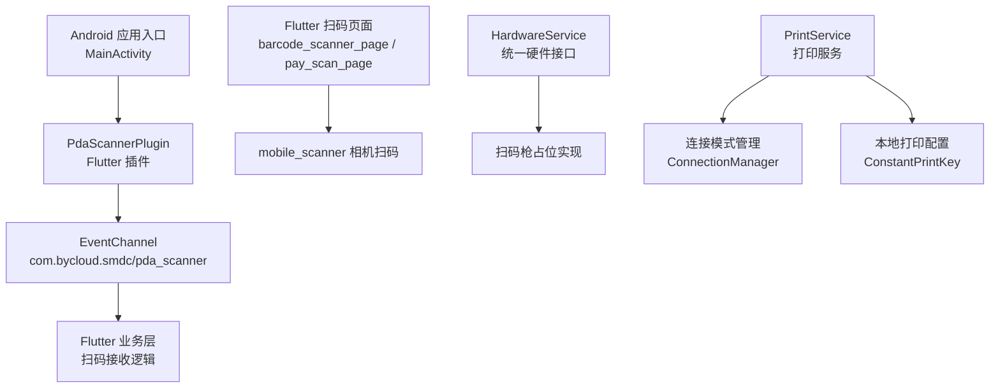
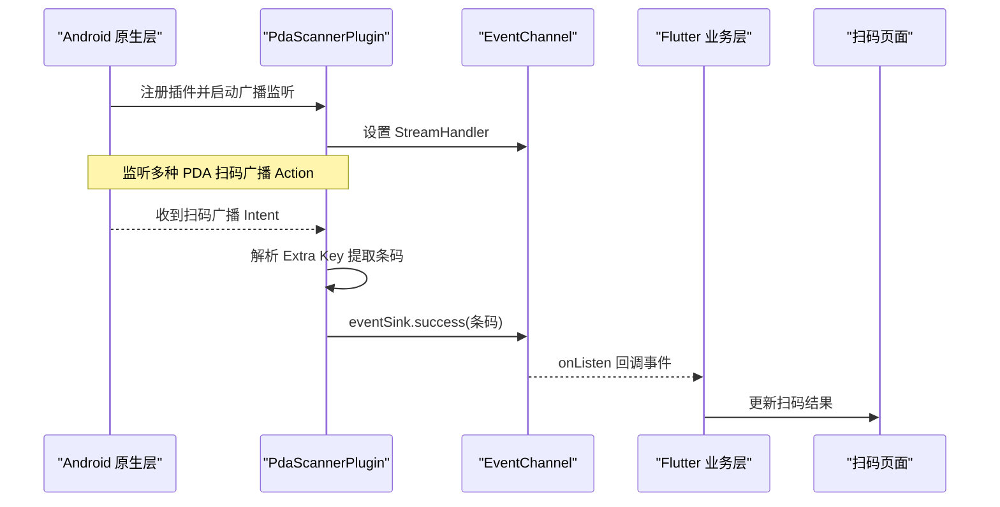
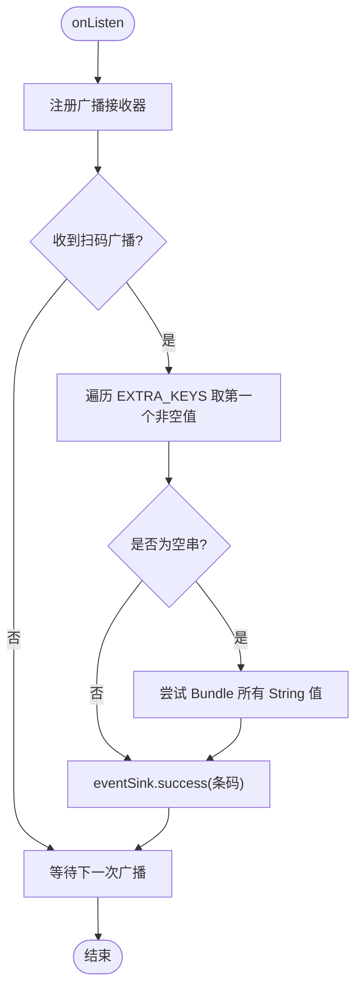
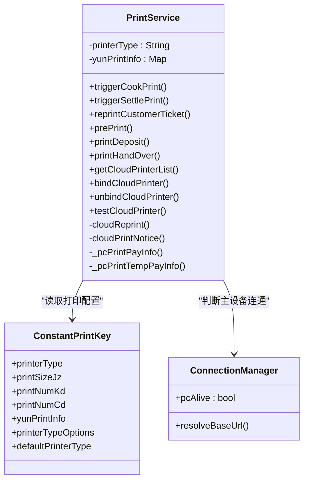
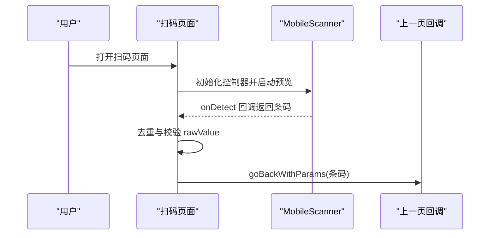
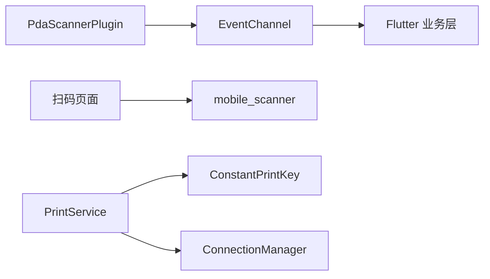

# 硬件设备集成

<cite>
**本文引用的文件**   
- [PdaScannerPlugin.java](file://android/app/src/main/java/com/bycloud/smdc/PdaScannerPlugin.java)
- [MainActivity.java](file://android/app/src/main/java/com/bycloud/smdc/MainActivity.java)
- [AndroidManifest.xml](file://android/app/src/main/AndroidManifest.xml)
- [pubspec.yaml](file://pubspec.yaml)
- [barcode_scanner_page.dart](file://lib/widgets/barcode_scanner_page.dart)
- [pay_scan_page.dart](file://lib/pages/order/pay_scan_page.dart)
- [hardware_service.dart](file://lib/util/hardware_service.dart)
- [print_service.dart](file://lib/util/print_service.dart)
- [constant_print_key.dart](file://lib/res/constant_print_key.dart)
- [connection_manager.dart](file://lib/net/connection_manager.dart)
</cite>

## 目录
1. [引言](#引言)
2. [项目结构](#项目结构)
3. [核心组件](#核心组件)
4. [架构总览](#架构总览)
5. [详细组件分析](#详细组件分析)
6. [依赖关系分析](#依赖关系分析)
7. [性能考虑](#性能考虑)
8. [故障排除指南](#故障排除指南)
9. [结论](#结论)

## 引言
本文面向聚客美滋滋应用的硬件设备集成，重点覆盖扫码枪与打印服务两大方向，并结合条码扫描页面、硬件服务接口、连接模式管理给出完整技术说明。内容涵盖：
- Android 端 PdaScannerPlugin 的广播监听机制、Flutter 事件通道推送、解码字段兼容策略；
- PrintService 的多模式打印路由（PC 主设备、云打印）、配置键体系、打印触发时机；
- 移动端条码扫描页面的相机预览、扫描框绘制与结果回调；
- 硬件设备连接协议规范、兼容性范围与扩展建议；
- 性能优化、错误处理与排障要点。

## 项目结构
本项目采用 Flutter 前端 + Android 原生插件的工程组织方式：
- Android 层通过 `PdaScannerPlugin` 注册为 Flutter 插件，监听主流 PDA 扫码广播并通过 `EventChannel` 将数据推送到 Dart 侧；
- Flutter 层提供统一的硬件接入抽象 `HardwareService`，并实现扫码 UI 页面；
- 打印服务以单例 `PrintService` 为核心，结合本地持久化配置和连接模式管理器进行多目标打印路由；
- 扫码功能同时支持系统相机扫码（`mobile_scanner`）和 PDA 硬件扫码（`PdaScannerPlugin`）。

图示来源
- [MainActivity.java:10-17](file://android/app/src/main/java/com/bycloud/smdc/MainActivity.java#L10-L17)
- [PdaScannerPlugin.java:28-63](file://android/app/src/main/java/com/bycloud/smdc/PdaScannerPlugin.java#L28-L63)
- [barcode_scanner_page.dart:11-27](file://lib/widgets/barcode_scanner_page.dart#L11-L27)
- [pay_scan_page.dart:17-40](file://lib/pages/order/pay_scan_page.dart#L17-L40)
- [hardware_service.dart:10-19](file://lib/util/hardware_service.dart#L10-L19)
- [print_service.dart:22-49](file://lib/util/print_service.dart#L22-L49)
- [constant_print_key.dart:6-20](file://lib/res/constant_print_key.dart#L6-L20)
- [connection_manager.dart:11-26](file://lib/net/connection_manager.dart#L11-L26)

章节来源
- [MainActivity.java:10-38](file://android/app/src/main/java/com/bycloud/smdc/MainActivity.java#L10-L38)
- [pubspec.yaml:1-20](file://pubspec.yaml#L1-L20)

## 核心组件
- PdaScannerPlugin：Android 端 PDA 扫码广播监听器，封装多品牌 Action 与 Extra Key，通过 Flutter EventChannel 推送字符串型扫码结果。
- HardwareService：硬件统一接入抽象，当前包含 NFC、电子秤、钱箱占位实现，并明确扫码枪由 mobile_scanner 承担。
- BarcodeScannerPage / PayScanPage：基于 mobile_scanner 的相机扫码页面，分别提供通用扫码与支付扫码场景。
- PrintService：打印服务单例，负责 PC 打印与云打印路由、单据触发、云打印机管理。
- ConstantPrintKey：打印相关本地配置键常量，涵盖打印类型、规格、份数、样式、打印类型枚举等。
- ConnectionManager：连接模式管理器，决定请求走主设备还是云服务，并提供主设备存活状态与丢失事件流。

章节来源
- [PdaScannerPlugin.java:12-165](file://android/app/src/main/java/com/bycloud/smdc/PdaScannerPlugin.java#L12-L165)
- [hardware_service.dart:10-79](file://lib/util/hardware_service.dart#L10-L79)
- [barcode_scanner_page.dart:11-177](file://lib/widgets/barcode_scanner_page.dart#L11-L177)
- [pay_scan_page.dart:17-200](file://lib/pages/order/pay_scan_page.dart#L17-L200)
- [print_service.dart:22-200](file://lib/util/print_service.dart#L22-L200)
- [constant_print_key.dart:6-147](file://lib/res/constant_print_key.dart#L6-L147)
- [connection_manager.dart:11-114](file://lib/net/connection_manager.dart#L11-L114)

## 架构总览
整体硬件集成采用“平台差异屏蔽 + 统一业务接口”的分层设计：
- Android 原生层负责设备底层能力（PDA 广播、权限声明、插件注册）；
- Flutter 层通过统一服务暴露能力（HardwareService），并在业务页面中调用；
- 打印服务通过配置与连接模式，自动选择 PC 或云打印路径；
- 扫码功能同时支持 PDA 硬件扫码与相机扫码两条链路，便于在不同终端形态下获得一致体验。

图示来源
- [PdaScannerPlugin.java:28-63](file://android/app/src/main/java/com/bycloud/smdc/PdaScannerPlugin.java#L28-L63)
- [PdaScannerPlugin.java:65-105](file://android/app/src/main/java/com/bycloud/smdc/PdaScannerPlugin.java#L65-L105)
- [PdaScannerPlugin.java:107-165](file://android/app/src/main/java/com/bycloud/smdc/PdaScannerPlugin.java#L107-L165)

## 详细组件分析

### PdaScannerPlugin 扫码枪集成
PdaScannerPlugin 是 Android 端的扫码桥接插件，职责包括：
- 在 FlutterEngine 中注册为插件；
- 维护一个 EventChannel，名称固定为 `com.bycloud.smdc/pda_scanner`；
- 监听主流 PDA 厂商的扫码广播 Action；
- 从 Intent Extra 中按多个常见 Key 取值，返回首个非空字符串作为扫码结果；
- 在 SDK 版本 >= TIRAMISU 时以 RECEIVER_EXPORTED 注册 Receiver，避免崩溃；
- 在 onListen/onCancel 中管理 Receiver 的生命周期，防止内存泄漏。

图示来源
- [PdaScannerPlugin.java:65-105](file://android/app/src/main/java/com/bycloud/smdc/PdaScannerPlugin.java#L65-L105)
- [PdaScannerPlugin.java:107-165](file://android/app/src/main/java/com/bycloud/smdc/PdaScannerPlugin.java#L107-L165)

关键实现要点：
- 支持的 PDA 品牌动作包括但不限于商米、新大陆、优博音、iData、Honeywell、东大集成、优博讯、智联天地、凯立、捷宝等。
- 支持的 Extra Key 包括 barcode、data、BARCODE、scan_result、value 等常见字段。
- 若未匹配到已知 Key，会兜底遍历 Bundle 中的所有 String 类型值。

错误处理与健壮性：
- registerReceiver/unregisterReceiver 均捕获异常并忽略，避免因部分机型广播限制导致崩溃。
- extractBarcode 对空串做过滤，避免无意义事件上抛。
- onDetachedFromEngine 确保取消订阅并清空 EventChannel 引用。

兼容性与注意事项：
- 该插件依赖各 PDA 厂商正确发送扫码广播；若某品牌未发送标准广播，需补充对应 Action 与 Extra Key。
- Android 13+ 使用 RECEIVER_EXPORTED 注册，需保证应用具备相应权限；当前清单未显式申请相机或传感器权限，但扫码广播由系统广播驱动，通常不依赖应用相机权限。

章节来源
- [MainActivity.java:10-17](file://android/app/src/main/java/com/bycloud/smdc/MainActivity.java#L10-L17)
- [PdaScannerPlugin.java:28-165](file://android/app/src/main/java/com/bycloud/smdc/PdaScannerPlugin.java#L28-L165)

### 打印服务 PrintService
PrintService 是打印能力的统一入口，采用单例模式，核心职责：
- 读取本地存储的打印类型（PC 打印、云打印、蓝牙打印、接口打印）；
- 根据业务阶段触发出品单、结账单、预打单、客单补打、押金单、交班单等；
- 在 PC 模式下通过主设备接口打印；
- 在云模式下通过服务端 restPrint 或 printMsgNotice 重建票据；
- 提供云打印机列表获取、绑定、解绑、测试能力。

图示来源
- [print_service.dart:22-200](file://lib/util/print_service.dart#L22-L200)
- [print_service.dart:201-416](file://lib/util/print_service.dart#L201-L416)
- [constant_print_key.dart:6-147](file://lib/res/constant_print_key.dart#L6-L147)
- [connection_manager.dart:11-114](file://lib/net/connection_manager.dart#L11-L114)

打印模式与触发时机：
- 下单确认后：出品单/厨打（printalltype=3），可附带杯贴（opertype=14）。
- 结账完成后：结账单（opertype=2）。
- 退菜：退菜单（printalltype=4）。
- 催菜：催菜单（printalltype=5）。
- 起菜：起菜单（printalltype=7）。
- 预打：预打单（printalltype=8）。
- 客单补打：客单（opertype=15）。

PC 打印与云打印路由：
- PC 打印：当 ConnectionManager.pcAlive 为真时，调用主设备接口（如 /api/print/PrintKDInfo、PrintPayInfo、PrintHandOver 等）。
- 云打印：调用服务端 restPrint 或 printMsgNotice，依据 opertype 重建票据。

配置项与持久化：
- 打印类型、纸规格、打印份数、是否自动打印、云打印机信息等均以 ConstantPrintKey 定义的 Key 存储于本地。
- 默认打印类型为 PC 打印，云打印机信息以 JSON 字符串存储。

章节来源
- [print_service.dart:22-416](file://lib/util/print_service.dart#L22-L416)
- [constant_print_key.dart:6-147](file://lib/res/constant_print_key.dart#L6-L147)

### 条码扫描页面实现
项目提供两类扫码页面：
- BarcodeScannerPage：通用扫码页面，适合点菜、商品扫码等场景。
- PayScanPage：支付扫码页面，对齐 smdcapp 的扫一扫 UI，支持连续扫描开关与相册图片导入。

共同特性：
- 使用 MobileScannerController 控制相机预览，设置 DetectionSpeed.normal、CameraFacing.back、torchEnabled=false。
- 在 onDetect 回调中提取 barcodes.first.rawValue，为空则丢弃。
- 通过 NavigatorUtils.goBackWithParams 将扫码结果回传给上一页。
- 顶部导航栏提供返回按钮与闪光灯切换。

差异化特性：
- BarcodeScannerPage：自定义半透明遮罩与绿色四角边线扫描框，底部提示“将条码/二维码放入框内，自动扫描”。
- PayScanPage：红色标题栏“扫一扫”，底部操作栏包含“连续扫描”开关与相册按钮，带蓝色扫描线动画。

权限与系统行为：
- 扫码页面依赖 mobile_scanner 插件访问相机；当前 AndroidManifest 未显式声明相机权限，实际权限申请与授权流程由 mobile_scanner 内部处理或在宿主应用中配置。
- 当前清单已声明 INTERNET、RECORD_AUDIO、REQUEST_INSTALL_PACKAGES 等权限，但未声明 CAMERA。

图示来源
- [barcode_scanner_page.dart:11-177](file://lib/widgets/barcode_scanner_page.dart#L11-L177)
- [pay_scan_page.dart:17-200](file://lib/pages/order/pay_scan_page.dart#L17-L200)

章节来源
- [barcode_scanner_page.dart:11-177](file://lib/widgets/barcode_scanner_page.dart#L11-L177)
- [pay_scan_page.dart:17-200](file://lib/pages/order/pay_scan_page.dart#L17-L200)
- [AndroidManifest.xml:1-89](file://android/app/src/main/AndroidManifest.xml#L1-L89)
- [pubspec.yaml:56-68](file://pubspec.yaml#L56-L68)

### 硬件服务 HardwareService
HardwareService 作为硬件接入的统一抽象，当前主要职责：
- 定义 NFC 读卡、电子秤称重、钱箱开箱等接口；
- 扫码枪能力由 mobile_scanner 提供，不在该类中直接实现；
- 提供 TODO 注释，指明未来需要引入 nfc_manager、串口/蓝牙插件等。

设计意图：
- 对齐 smdcapp 的 NfcUtils、MipcaActivityCapture 等工具类思路，保持业务层对硬件调用的统一入口。
- 针对钱箱，预留通过 ESC/POS p 指令触发打印通道的方式。

章节来源
- [hardware_service.dart:10-79](file://lib/util/hardware_service.dart#L10-L79)

## 依赖关系分析
- PdaScannerPlugin 依赖 Android 广播机制与各 PDA 厂商的标准广播 Action/Extra Key；
- Flutter 层通过 EventChannel 与 PdaScannerPlugin 通信；
- 扫码 UI 依赖 mobile_scanner 插件；
- PrintService 依赖 ConstantPrintKey（本地配置）与 ConnectionManager（连接模式判定）；
- ConnectionManager 依赖 sp_util 与 HttpApi 基址，决定主设备地址与服务端地址。

图示来源
- [PdaScannerPlugin.java:28-63](file://android/app/src/main/java/com/bycloud/smdc/PdaScannerPlugin.java#L28-L63)
- [barcode_scanner_page.dart:11-27](file://lib/widgets/barcode_scanner_page.dart#L11-L27)
- [print_service.dart:22-49](file://lib/util/print_service.dart#L22-L49)
- [constant_print_key.dart:6-20](file://lib/res/constant_print_key.dart#L6-L20)
- [connection_manager.dart:11-26](file://lib/net/connection_manager.dart#L11-L26)

章节来源
- [pubspec.yaml:56-68](file://pubspec.yaml#L56-L68)
- [connection_manager.dart:11-114](file://lib/net/connection_manager.dart#L11-L114)

## 性能考虑
- 设备连接池管理：
  - 当前 PdaScannerPlugin 仅维护单一广播接收器与 EventChannel；若未来扩展至蓝牙/串口设备，应建立连接池，复用连接对象，避免频繁创建销毁。
- 数据传输优化：
  - 扫码结果直接以字符串推送，避免序列化开销；若未来扩展二进制数据，应考虑分块传输与压缩。
- 内存使用控制：
  - PdaScannerPlugin 在 onDetachedFromEngine 中清理 EventChannel 与 Receiver，防止内存泄漏；
  - 扫码页面在 dispose 中释放 MobileScannerController，避免相机资源泄露。
- 打印任务队列：
  - PrintService 目前以同步 await 方式调用网络接口；在高并发场景可引入任务队列与重试机制，避免阻塞主线程。
- 主设备连接状态：
  - ConnectionManager 提供 onMasterDeviceLost 事件流，可用于在 UI 层展示连接状态，减少无效请求。

[本节为通用性能建议，不涉及具体代码片段]

## 故障排除指南
常见问题与定位建议：
- PDA 扫码无响应：
  - 确认设备厂商广播 Action 是否在 SCAN_ACTIONS 列表中；
  - 确认 Extra Key 是否在 EXTRA_KEYS 列表中；
  - 检查 Android 13+ 是否以 RECEIVER_EXPORTED 注册 Receiver；
  - 观察是否有异常被忽略（registerReceiver/unregisterReceiver 均捕获异常）。
- Flutter 层未收到扫码事件：
  - 检查 EventChannel 名称是否为 com.bycloud.smdc/pda_scanner；
  - 检查 Flutter 侧是否正确调用 eventChannel.setStreamHandler；
  - 检查 onListen 与 onCancel 生命周期是否正确配对。
- 打印失败：
  - 确认 ConnectionManager.pcAlive 是否符合预期；
  - 检查本地打印配置（printerType、printSize、printNum）是否正确；
  - 云打印模式下检查 restPrint/opertype/billno/jobcontent 参数是否完整。
- 权限问题：
  - 扫码页面依赖相机权限，若 mobile_scanner 未成功申请，请检查宿主应用的权限配置；
  - AndroidManifest 未声明 CAMERA，如需显式权限请在宿主应用中补充。

章节来源
- [PdaScannerPlugin.java:65-165](file://android/app/src/main/java/com/bycloud/smdc/PdaScannerPlugin.java#L65-L165)
- [print_service.dart:201-416](file://lib/util/print_service.dart#L201-L416)
- [AndroidManifest.xml:1-89](file://android/app/src/main/AndroidManifest.xml#L1-L89)

## 结论
本项目的硬件设备集成以“平台插件 + 统一服务”为核心思路：
- PdaScannerPlugin 屏蔽了不同 PDA 厂商的广播差异，为 Flutter 提供一致的扫码事件；
- PrintService 以配置与连接模式驱动多目标打印，满足餐厅场景下的多种出票需求；
- 扫码页面基于 mobile_scanner 提供直观的用户交互；
- HardwareService 为后续 NFC、电子秤、钱箱等硬件能力预留统一接入点。

建议在后续迭代中：
- 完善 HardwareService 的真实硬件实现；
- 为 PdaScannerPlugin 增加更多品牌适配；
- 为 PrintService 引入任务队列与重试机制；
- 在 AndroidManifest 中按需声明相机、NFC、蓝牙等权限，提升跨设备兼容性。