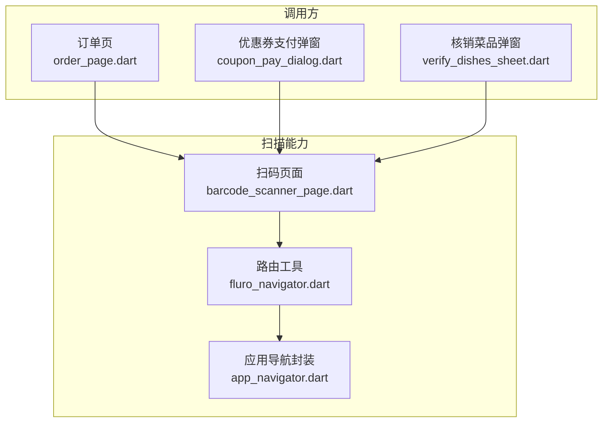
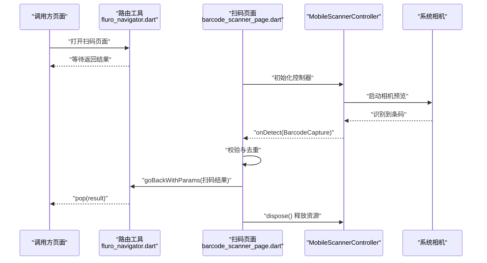
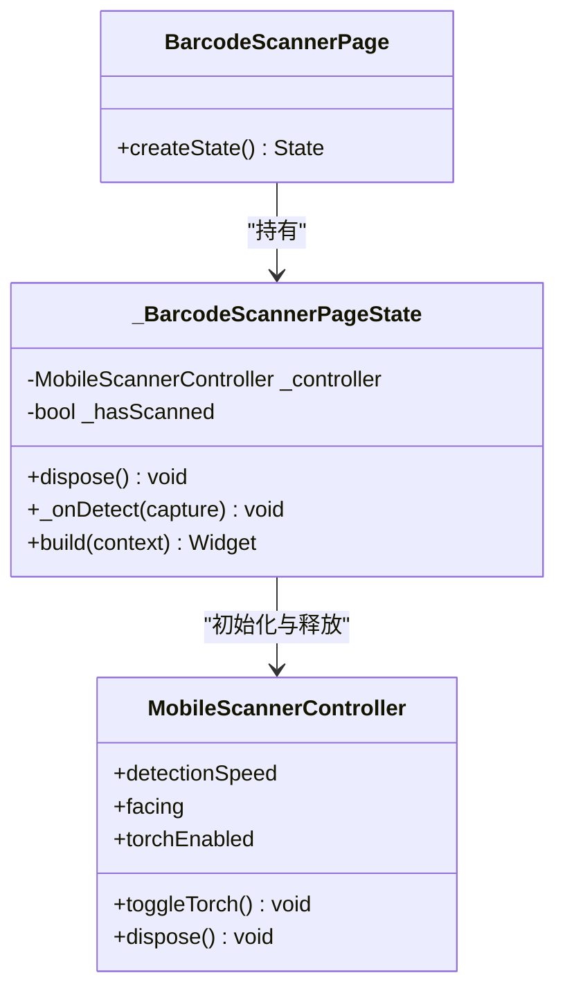
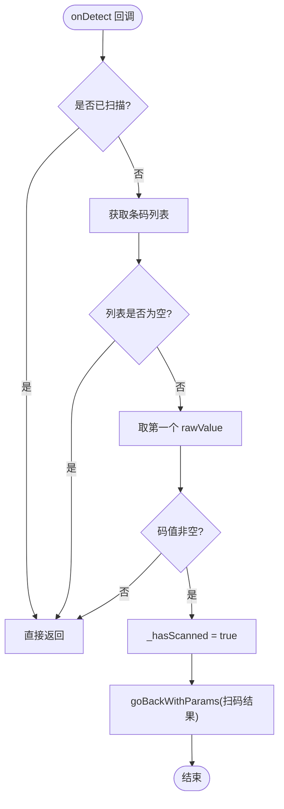
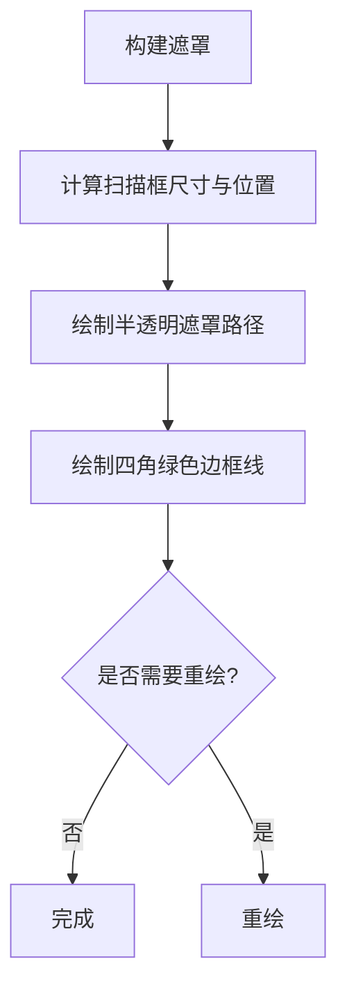
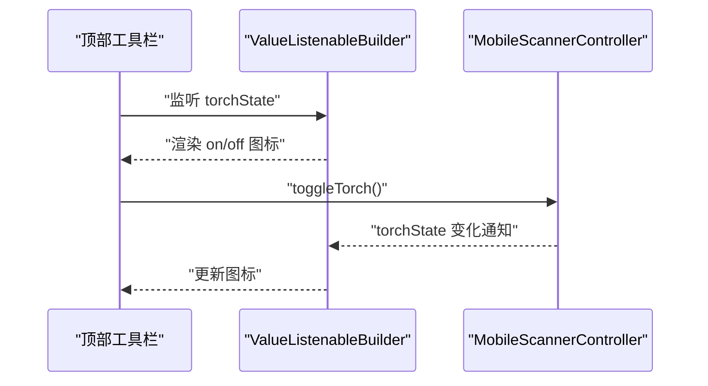
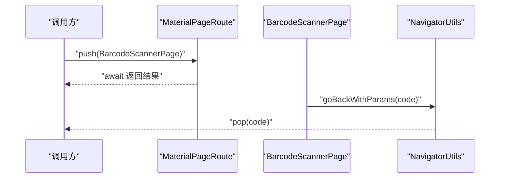
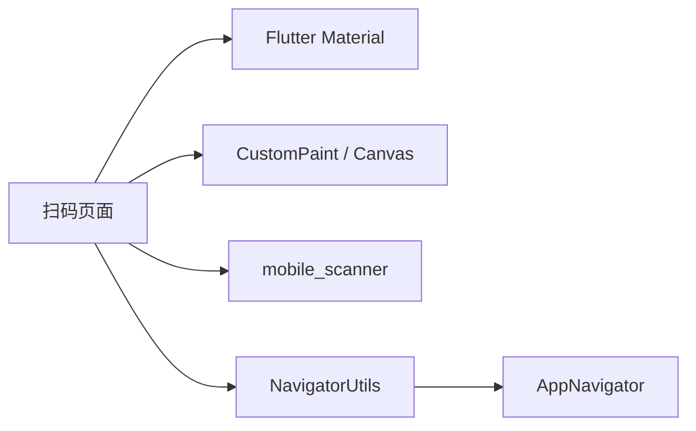

# 移动端条码扫描

<cite>
**本文引用的文件**   
- [lib/widgets/barcode_scanner_page.dart](file://lib/widgets/barcode_scanner_page.dart)
- [lib/routers/fluro_navigator.dart](file://lib/routers/fluro_navigator.dart)
- [lib/util/app_navigator.dart](file://lib/util/app_navigator.dart)
- [lib/components/verify_dishes_sheet.dart](file://lib/components/verify_dishes_sheet.dart)
- [lib/pages/order/widgets/coupon_pay_dialog.dart](file://lib/pages/order/widgets/coupon_pay_dialog.dart)
- [lib/pages/order/order_page.dart](file://lib/pages/order/order_page.dart)
</cite>

## 目录
1. [简介](#简介)
2. [项目结构中的扫描模块](#项目结构中的扫描模块)
3. [核心组件与职责](#核心组件与职责)
4. [架构总览](#架构总览)
5. [详细组件分析](#详细组件分析)
6. [依赖关系分析](#依赖关系分析)
7. [性能与资源管理](#性能与资源管理)
8. [错误处理与健壮性](#错误处理与健壮性)
9. [常见问题排查](#常见问题排查)
10. [结论](#结论)

## 简介
本文聚焦移动端条码与二维码扫描功能，围绕 `BarcodeScannerPage` 的实现进行系统化技术文档说明。内容涵盖：
- `MobileScannerController` 的初始化配置、相机权限与摄像头预览控制
- 扫描检测回调机制、条码数据提取与重复扫描防护
- 自定义扫描框遮罩绘制，包括半透明遮罩、绿色边框与响应式布局适配
- 闪光灯控制实现，包括 `TorchState` 状态监听与 `toggleTorch` 调用
- 页面导航集成方式、错误处理策略及性能优化建议

## 项目结构中的扫描模块
扫描相关代码位于 Flutter 项目的通用组件层与业务调用层：
- 扫描页面实现：`lib/widgets/barcode_scanner_page.dart`
- 路由返回工具：`lib/routers/fluro_navigator.dart`
- 应用级导航封装：`lib/util/app_navigator.dart`
- 典型调用方：订单页、优惠券支付弹窗、核销菜品弹窗等

**图示来源**
- [lib/widgets/barcode_scanner_page.dart:1-177](file://lib/widgets/barcode_scanner_page.dart#L1-L177)
- [lib/routers/fluro_navigator.dart:1-72](file://lib/routers/fluro_navigator.dart#L1-L72)
- [lib/util/app_navigator.dart:56-60](file://lib/util/app_navigator.dart#L56-L60)
- [lib/pages/order/order_page.dart:1763-1766](file://lib/pages/order/order_page.dart#L1763-L1766)
- [lib/pages/order/widgets/coupon_pay_dialog.dart:80-84](file://lib/pages/order/widgets/coupon_pay_dialog.dart#L80-L84)
- [lib/components/verify_dishes_sheet.dart:82-86](file://lib/components/verify_dishes_sheet.dart#L82-L86)

**章节来源**
- [lib/widgets/barcode_scanner_page.dart:1-177](file://lib/widgets/barcode_scanner_page.dart#L1-L177)
- [lib/routers/fluro_navigator.dart:1-72](file://lib/routers/fluro_navigator.dart#L1-L72)
- [lib/util/app_navigator.dart:56-60](file://lib/util/app_navigator.dart#L56-L60)
- [lib/pages/order/order_page.dart:1763-1766](file://lib/pages/order/order_page.dart#L1763-L1766)
- [lib/pages/order/widgets/coupon_pay_dialog.dart:80-84](file://lib/pages/order/widgets/coupon_pay_dialog.dart#L80-L84)
- [lib/components/verify_dishes_sheet.dart:82-86](file://lib/components/verify_dishes_sheet.dart#L82-L86)

## 核心组件与职责
- `BarcodeScannerPage`：提供扫码入口 UI，包含相机预览、扫描框遮罩、顶部导航栏与底部提示文字。
- `_BarcodeScannerPageState`：持有 `MobileScannerController`，负责扫描回调处理、重复扫描防护、导航返回结果。
- `_ScanOverlayPainter`：基于 `CustomPaint` 绘制半透明遮罩与绿色四角边框。
- `NavigatorUtils.goBackWithParams`：统一返回逻辑，触发页面关闭并回传扫码结果。

关键职责边界：
- 扫描生命周期由 `MobileScannerController` 管理，页面销毁时显式释放。
- 扫描结果仅取第一个非空原始值，避免多次触发业务逻辑。
- 遮罩绘制使用相对尺寸计算，适配不同屏幕宽高比。

**章节来源**
- [lib/widgets/barcode_scanner_page.dart:1-177](file://lib/widgets/barcode_scanner_page.dart#L1-L177)

## 架构总览
扫码页面的整体交互流程如下：

**图示来源**
- [lib/widgets/barcode_scanner_page.dart:15-40](file://lib/widgets/barcode_scanner_page.dart#L15-L40)
- [lib/routers/fluro_navigator.dart:48-52](file://lib/routers/fluro_navigator.dart#L48-L52)
- [lib/util/app_navigator.dart:56-60](file://lib/util/app_navigator.dart#L56-L60)

## 详细组件分析

### 扫码页面与控制器初始化
- 页面类型：`StatefulWidget`，创建对应的 `State`。
- 控制器初始化参数：
  - 检测速度：`DetectionSpeed.normal`
  - 摄像头方向：后置摄像头 `CameraFacing.back`
  - 闪光灯初始状态：关闭 `torchEnabled: false`
- 生命周期：
  - 在 `dispose` 中调用 `_controller.dispose()` 释放相机资源。
  - 使用 `_hasScanned` 防止一次有效扫描后继续触发回调。

**图示来源**
- [lib/widgets/barcode_scanner_page.dart:8-33](file://lib/widgets/barcode_scanner_page.dart#L8-L33)

**章节来源**
- [lib/widgets/barcode_scanner_page.dart:8-33](file://lib/widgets/barcode_scanner_page.dart#L8-L33)

### 扫描检测回调与重复扫描防护
- 回调入口：`MobileScanner.onDetect(_onDetect)`
- 数据处理步骤：
  1. 若已扫描成功，直接返回，避免重复处理。
  2. 从 `BarcodeCapture.barcodes` 中取出列表。
  3. 若列表为空，忽略本次回调。
  4. 取首个条码的 `rawValue`，若为空或空字符串则忽略。
  5. 设置 `_hasScanned = true`，并通过 `NavigatorUtils.goBackWithParams` 返回结果。

**图示来源**
- [lib/widgets/barcode_scanner_page.dart:23-40](file://lib/widgets/barcode_scanner_page.dart#L23-L40)

**章节来源**
- [lib/widgets/barcode_scanner_page.dart:23-40](file://lib/widgets/barcode_scanner_page.dart#L23-L40)

### 自定义扫描框遮罩绘制
- 容器：使用 `Stack` 叠加相机预览与遮罩。
- 遮罩绘制：
  - 通过 `CustomPaint` 覆盖全屏。
  - 计算扫描区域大小与位置：宽度为屏幕宽度的 0.65，高度按屏幕高度的比例放置。
  - 使用 `PathFillType.evenOdd` 实现“挖空”中间矩形区域的半透明黑色遮罩。
  - 四角绘制绿色边框线，线宽 4，圆头端点。
- 刷新策略：`shouldRepaint` 返回 `false`，避免频繁重绘。

**图示来源**
- [lib/widgets/barcode_scanner_page.dart:43-177](file://lib/widgets/barcode_scanner_page.dart#L43-L177)

**章节来源**
- [lib/widgets/barcode_scanner_page.dart:43-177](file://lib/widgets/barcode_scanner_page.dart#L43-L177)

### 闪光灯控制与状态监听
- 状态展示：通过 `ValueListenableBuilder<MobileScannerState>` 监听控制器状态，根据 `state.torchState == TorchState.on` 切换图标。
- 控制方法：点击按钮调用 `_controller.toggleTorch()` 切换闪光灯。
- 初始化：控制器初始化时设置 `torchEnabled: false`。

**图示来源**
- [lib/widgets/barcode_scanner_page.dart:15-22](file://lib/widgets/barcode_scanner_page.dart#L15-L22)
- [lib/widgets/barcode_scanner_page.dart:64-101](file://lib/widgets/barcode_scanner_page.dart#L64-L101)

**章节来源**
- [lib/widgets/barcode_scanner_page.dart:15-22](file://lib/widgets/barcode_scanner_page.dart#L15-L22)
- [lib/widgets/barcode_scanner_page.dart:64-101](file://lib/widgets/barcode_scanner_page.dart#L64-L101)

### 页面导航集成方式
- 调用方通过 `MaterialPageRoute` 打开 `BarcodeScannerPage`。
- 扫码成功后，页面通过 `NavigatorUtils.goBackWithParams(context, code)` 返回结果。
- 典型调用场景：
  - 订单页：用户点击扫码按钮后跳转并接收结果。
  - 优惠券支付弹窗：弹出扫码页并处理返回的券码。
  - 核销菜品弹窗：扫码后回填核销信息。

**图示来源**
- [lib/pages/order/order_page.dart:1763-1766](file://lib/pages/order/order_page.dart#L1763-L1766)
- [lib/pages/order/widgets/coupon_pay_dialog.dart:80-84](file://lib/pages/order/widgets/coupon_pay_dialog.dart#L80-L84)
- [lib/components/verify_dishes_sheet.dart:82-86](file://lib/components/verify_dishes_sheet.dart#L82-L86)
- [lib/routers/fluro_navigator.dart:48-52](file://lib/routers/fluro_navigator.dart#L48-L52)

**章节来源**
- [lib/pages/order/order_page.dart:1763-1766](file://lib/pages/order/order_page.dart#L1763-L1766)
- [lib/pages/order/widgets/coupon_pay_dialog.dart:80-84](file://lib/pages/order/widgets/coupon_pay_dialog.dart#L80-L84)
- [lib/components/verify_dishes_sheet.dart:82-86](file://lib/components/verify_dishes_sheet.dart#L82-L86)
- [lib/routers/fluro_navigator.dart:48-52](file://lib/routers/fluro_navigator.dart#L48-L52)

## 依赖关系分析
扫码模块对外依赖包括：
- Flutter 框架：`Scaffold`、`Stack`、`Positioned`、`SafeArea`、`IconButton`、`Text`、`CustomPaint`、`Canvas`、`Paint`、`Path`、`RRect`、`Radius`、`Offset`、`Size`、`Rect`。
- 第三方库：`mobile_scanner` 提供的 `MobileScanner`、`MobileScannerController`、`BarcodeCapture`、`Barcode`、`DetectionSpeed`、`CameraFacing`、`MobileScannerState`、`TorchState`。
- 内部工具：`NavigatorUtils.goBackWithParams` 与 `AppNavigator.goBackWithParams` 作为返回能力的统一入口。

**图示来源**
- [lib/widgets/barcode_scanner_page.dart:1-177](file://lib/widgets/barcode_scanner_page.dart#L1-L177)
- [lib/routers/fluro_navigator.dart:1-72](file://lib/routers/fluro_navigator.dart#L1-L72)
- [lib/util/app_navigator.dart:56-60](file://lib/util/app_navigator.dart#L56-L60)

**章节来源**
- [lib/widgets/barcode_scanner_page.dart:1-177](file://lib/widgets/barcode_scanner_page.dart#L1-L177)
- [lib/routers/fluro_navigator.dart:1-72](file://lib/routers/fluro_navigator.dart#L1-L72)
- [lib/util/app_navigator.dart:56-60](file://lib/util/app_navigator.dart#L56-L60)

## 性能与资源管理
- 相机资源释放：
  - 在页面 `dispose` 中调用 `_controller.dispose()`，确保相机流被正确关闭，避免内存泄漏与相机占用。
- 重复扫描防护：
  - 使用布尔标志位 `_hasScanned` 在一次有效扫描后阻止后续回调，减少无效计算与导航操作。
- 遮罩绘制优化：
  - `shouldRepaint` 返回 `false`，避免不必要的重绘开销。
  - 遮罩使用固定几何计算，不引入动画或复杂变换。
- 回调过滤：
  - 对空条码列表与空码值做早期返回，降低下游处理成本。
- 建议扩展：
  - 如需更高吞吐场景，可在 `_onDetect` 中加入时间戳节流（例如最近 N 毫秒内忽略重复码）。
  - 针对低端设备可考虑降低检测频率或关闭实时预览动画。

[本节为通用性能指导，未直接分析具体代码行]

## 错误处理与健壮性
- 空结果保护：
  - 条码列表为空或首个条码原始值为空时，忽略本次识别，避免崩溃与异常返回。
- 页面状态保护：
  - 建议在调用方使用 `mounted` 判断后再执行导航返回，以避免页面销毁后的异步回调引发异常（当前扫码页内部已保证一次性返回）。
- 相机权限与异常：
  - 当前实现未显式处理权限拒绝或相机启动失败；建议在控制器初始化前后增加权限检查与异常捕获，并向用户反馈。
- 导航返回安全：
  - 统一通过 `NavigatorUtils.goBackWithParams` 返回，便于集中处理焦点清理与日志记录。

**章节来源**
- [lib/widgets/barcode_scanner_page.dart:23-40](file://lib/widgets/barcode_scanner_page.dart#L23-L40)
- [lib/routers/fluro_navigator.dart:48-52](file://lib/routers/fluro_navigator.dart#L48-L52)

## 常见问题排查
- 扫描无结果：
  - 检查光线与对焦，确认条码位于扫描框内。
  - 检查条码格式是否受支持，必要时调整 `DetectionSpeed`。
- 重复扫码问题：
  - 确认 `_hasScanned` 是否被正确置位；如需连续扫描模式，应移除该限制并在业务侧自行去重。
- 闪光灯不生效：
  - 确认设备支持闪光灯且未被系统限制；检查 `toggleTorch` 调用是否被执行。
- 相机无法释放：
  - 确认 `dispose` 是否被调用；若在热重载或快速退出场景下仍占相机，需检查页面销毁链路。
- 导航返回异常：
  - 确认调用方是否正确 await 并处理返回结果；注意页面销毁时的 `mounted` 判断。

[本节为通用排错指导，未直接分析具体代码行]

## 结论
`BarcodeScannerPage` 以简洁清晰的架构实现了移动端条码/二维码扫描的核心能力：
- 通过 `MobileScannerController` 管理相机生命周期与预览
- 通过 `onDetect` 回调与去重标志保障扫描结果的稳定与高效
- 通过 `CustomPaint` 实现语义化扫描框遮罩与视觉引导
- 通过 `ValueListenableBuilder` 与 `toggleTorch` 实现直观的闪光灯控制
- 通过 `NavigatorUtils.goBackWithParams` 将扫码结果可靠地回传给调用方

在实际工程中，可根据业务需求进一步扩展权限检查、异常提示、连续扫描模式与性能节流策略，以获得更稳健的用户体验。