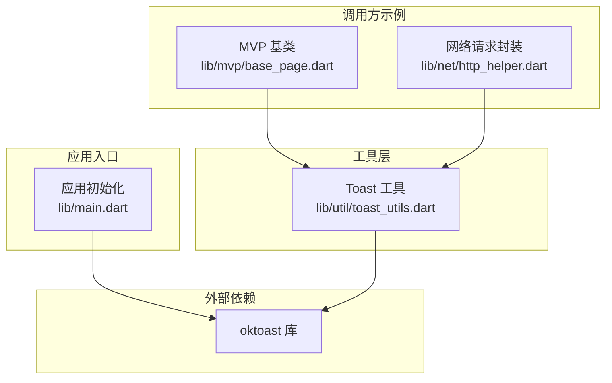
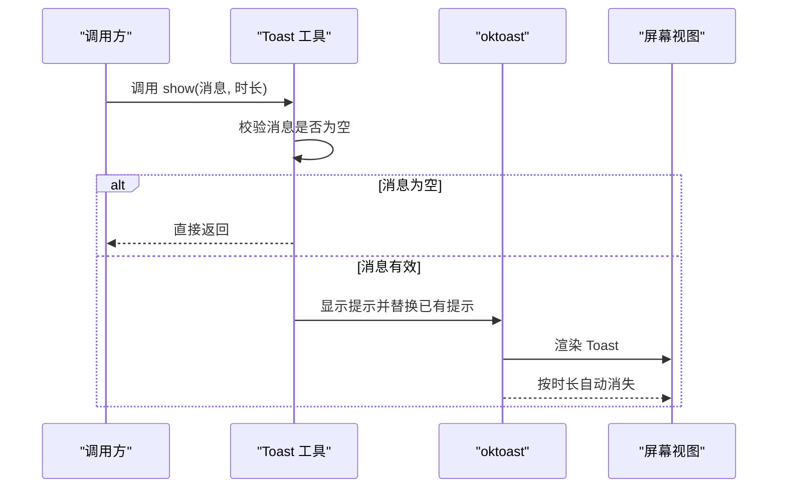
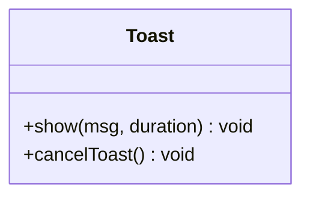
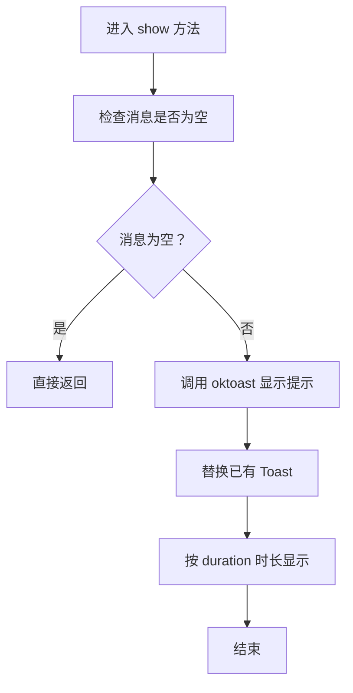
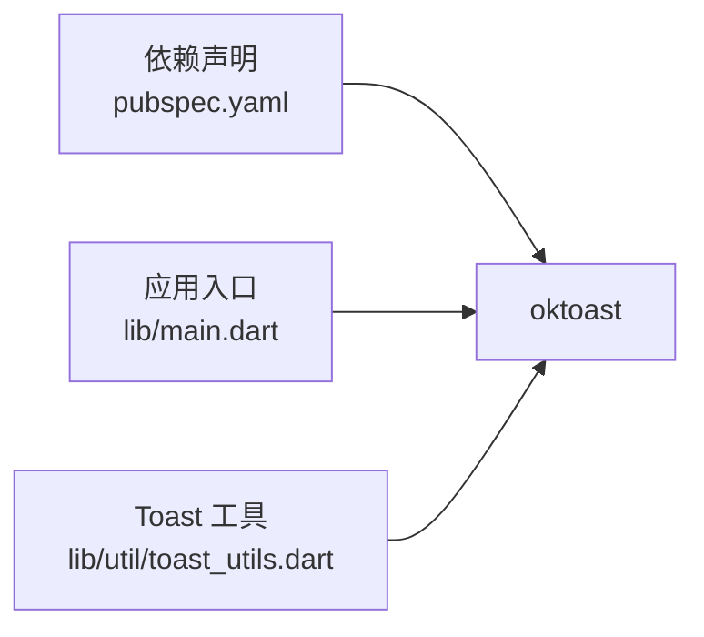
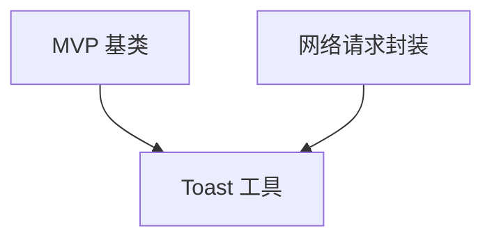

# Toast 提示工具

<cite>
**本文引用的文件**   
- [toast_utils.dart](file://lib/util/toast_utils.dart)
- [main.dart](file://lib/main.dart)
- [pubspec.yaml](file://pubspec.yaml)
- [base_page.dart](file://lib/mvp/base_page.dart)
- [http_helper.dart](file://lib/net/http_helper.dart)
</cite>

## 目录
1. [简介](#简介)
2. [项目结构中的定位](#项目结构中的定位)
3. [核心组件分析](#核心组件分析)
4. [架构总览](#架构总览)
5. [详细实现说明](#详细实现说明)
6. [依赖关系分析](#依赖关系分析)
7. [性能与体验建议](#性能与体验建议)
8. [故障排查指南](#故障排查指南)
9. [结论](#结论)

## 简介
Toast 提示工具为聚客美滋滋应用提供统一的轻量级消息反馈能力。当前实现基于第三方库 oktoast，对原生 showToast 进行最小化封装，屏蔽 null 消息、统一显示时长，并提供全局取消能力。该工具被业务页面、网络层和通用基类广泛调用，是用户交互反馈的关键基础设施。

需要特别说明的是：当前代码仓库中并未实现 showSuccess、showError、showWarning 等语义化方法；也没有内置颜色主题、位置管理或 Material Design 样式适配逻辑。所有高级能力均可在现有基础之上扩展。

## 项目结构中的定位
Toast 工具位于 lib/util 目录下，属于通用工具模块。它不直接依赖业务逻辑，而是通过上层 UI 和网络层间接影响用户体验。

**图示来源**
- [main.dart:17](file://lib/main.dart#L17)
- [toast_utils.dart:1-20](file://lib/util/toast_utils.dart#L1-L20)
- [base_page.dart:60](file://lib/mvp/base_page.dart#L60)
- [http_helper.dart:206-255](file://lib/net/http_helper.dart#L206-L255)

**章节来源**
- [toast_utils.dart:1-20](file://lib/util/toast_utils.dart#L1-L20)
- [main.dart:17](file://lib/main.dart#L17)

## 核心组件分析
当前 Toast 工具只暴露一个静态类，包含两个关键能力：

| 名称 | 类型 | 作用 | 默认行为 |
|---|---|---|---|
| `show` | 静态方法 | 展示一条非空消息，并自动替换前一条提示 | 显示时长 2000 毫秒，自动关闭其他 Toast |
| `cancelToast` | 静态方法 | 关闭所有正在显示的 Toast | 立即清屏 |

核心特性归纳如下：

- **跨平台适配机制**：通过 oktoast 实现 Flutter 多端一致体验，当前代码未针对 Android、iOS、Web 做差异化处理。
- **显示时长控制**：通过 duration 参数控制，单位为毫秒；默认 2000 毫秒。
- **重复消息去重与队列管理**：通过 `dismissOtherToast: true` 实现“后入先出”的覆盖式显示，不是传统队列排队。
- **用户交互中断处理**：可通过 `cancelToast` 主动清除已有提示，适合页面跳转、退出应用等场景。

**章节来源**
- [toast_utils.dart:1-20](file://lib/util/toast_utils.dart#L1-L20)

## 架构总览
Toast 的使用流程可以抽象为一次简单调用链：业务或网络层调用 Toast 工具，工具委托 oktoast 完成渲染与生命周期管理。

**图示来源**
- [toast_utils.dart:4-17](file://lib/util/toast_utils.dart#L4-L17)

## 详细实现说明

### Toast 工具类设计
Toast 类采用静态方法组织，避免实例化开销，便于全局使用。其职责非常单一：接收消息、执行非空判断、委托 oktoast 显示。

**图示来源**
- [toast_utils.dart:4-19](file://lib/util/toast_utils.dart#L4-L19)

**章节来源**
- [toast_utils.dart:4-19](file://lib/util/toast_utils.dart#L4-L19)

### 显示流程与时序
当调用 `show` 时，内部会依次完成以下操作：

**图示来源**
- [toast_utils.dart:6-17](file://lib/util/toast_utils.dart#L6-L17)

**章节来源**
- [toast_utils.dart:6-17](file://lib/util/toast_utils.dart#L6-L17)

### API 参考

#### 公共方法

| 方法 | 参数 | 返回值 | 行为说明 |
|---|---|---|---|
| `show` | `msg`：可选字符串 `duration`：可选整数，单位毫秒 | 无 | 如果 msg 为 null，则不显示任何内容；否则显示提示并自动关闭其他 Toast |
| `cancelToast` | 无 | 无 | 关闭所有已显示的 Toast |

#### 常用调用方式

| 场景 | 推荐用法 | 说明 |
|---|---|---|
| 普通提示 | `Toast.show("操作成功")` | 使用默认 2 秒显示时长 |
| 自定义时长 | `Toast.show("加载中", duration: 3000)` | 将提示延长至 3 秒 |
| 主动清屏 | `Toast.cancelToast()` | 适用于页面销毁、跳转或退出时 |

#### 不支持但可扩展的能力

当前仓库未实现以下能力，可在后续迭代中按需扩展：

| 能力 | 当前状态 | 扩展建议 |
|---|---|---|
| `showSuccess` | 未实现 | 复用 `show`，可配合 oktoast 的主题或图标能力扩展 |
| `showError` | 未实现 | 同上，结合错误语义统一错误提示 |
| `showWarning` | 未实现 | 同上，用于警告类提示 |
| 位置管理 | 未实现 | 通过 oktoast 的位置配置扩展 |
| 颜色主题 | 未实现 | 结合应用主题或 Material Design 主题扩展 |
| 国际化 | 未实现 | 在调用方传入本地化文本或使用 i18n 工具 |

**章节来源**
- [toast_utils.dart:4-19](file://lib/util/toast_utils.dart#L4-L19)

## 依赖关系分析

### 外部依赖
Toast 工具依赖 oktoast 库完成实际渲染。应用入口 main.dart 中也引入了 oktoast，说明 oktoast 是整个应用级别的提示基础设施。

**图示来源**
- [pubspec.yaml](file://pubspec.yaml)
- [main.dart:17](file://lib/main.dart#L17)
- [toast_utils.dart:1](file://lib/util/toast_utils.dart#L1)

**章节来源**
- [pubspec.yaml](file://pubspec.yaml)
- [main.dart:17](file://lib/main.dart#L17)
- [toast_utils.dart:1](file://lib/util/toast_utils.dart#L1)

### 调用方依赖
Toast 工具被多个模块间接依赖，典型调用方包括：

- **MVP 基类**：用于统一展示提示信息。
- **网络请求封装**：在网络异常或接口返回失败时弹出错误提示。

**图示来源**
- [base_page.dart:60](file://lib/mvp/base_page.dart#L60)
- [http_helper.dart:206-255](file://lib/net/http_helper.dart#L206-L255)
- [toast_utils.dart:4-19](file://lib/util/toast_utils.dart#L4-L19)

**章节来源**
- [base_page.dart:60](file://lib/mvp/base_page.dart#L60)
- [http_helper.dart:206-255](file://lib/net/http_helper.dart#L206-L255)
- [toast_utils.dart:4-19](file://lib/util/toast_utils.dart#L4-L19)

## 性能与体验建议

### 性能特性
- **低开销**：Toast 工具本身只做一次空值判断和一次函数转发，不会引入额外内存对象。
- **覆盖式显示**：`dismissOtherToast: true` 会让新提示直接替换旧提示，避免大量 Toast 堆积。
- **全局清理**：`cancelToast` 可一次性清屏，适合复杂交互流程结束时释放视觉资源。

### 体验建议
- **避免频繁刷新**：短时间内的连续操作不要反复调用 `show`，否则会导致提示频繁闪烁。
- **长任务使用加载提示**：耗时网络请求建议使用进度对话框，而不是用 Toast 表示长时间等待。
- **错误提示应明确**：当前 Toast 只有纯文本，建议在调用方补充更清晰的错误文案。
- **注意生命周期**：页面销毁前调用 `cancelToast`，避免残留提示干扰下一个界面。

[本节为通用建议，不直接分析具体代码文件]

## 故障排查指南

### 常见问题
| 问题 | 可能原因 | 处理建议 |
|---|---|---|
| 没有显示任何 Toast | 传入消息为 null | 检查调用处是否传入了空字符串或 null |
| Toast 一直不消失 | 自定义时长过长 | 调整 duration 或改用 cancelToast 主动关闭 |
| 提示被频繁覆盖 | 短时间内多次调用 show | 合并提示或增加防抖逻辑 |
| 页面切换后仍有残留提示 | 未在合适时机清屏 | 在页面 dispose 或跳转前调用 cancelToast |

### 相关调用位置参考
- **MVP 基类中的统一提示**：可用于排查某些页面为什么出现固定文案的提示。
- **网络层中的错误提示**：常用于排查接口失败时的提示来源。

**章节来源**
- [toast_utils.dart:6-17](file://lib/util/toast_utils.dart#L6-L17)
- [base_page.dart:60](file://lib/mvp/base_page.dart#L60)
- [http_helper.dart:206-255](file://lib/net/http_helper.dart#L206-L255)

## 结论
当前 Toast 提示工具是一个极简且稳定的提示封装：它以 null 安全为前提，统一了消息显示时长，并通过 oktoast 实现跨平台提示。虽然尚未提供 success、error、warning 等语义化方法和颜色主题，但其结构简单、耦合度低，非常适合在现有基础上扩展。

推荐的演进方向包括：
1. 增加语义化方法如 `showSuccess`、`showError`、`showWarning`。
2. 接入应用主题，支持浅色/深色模式下的可读性。
3. 增加位置配置，满足底部、顶部等不同布局需求。
4. 在调用方统一使用本地化文案，完善国际化支持。
5. 根据业务规范对齐 Material Design 的提示样式与交互节奏。

[本节为总结性内容，不直接分析具体代码文件]