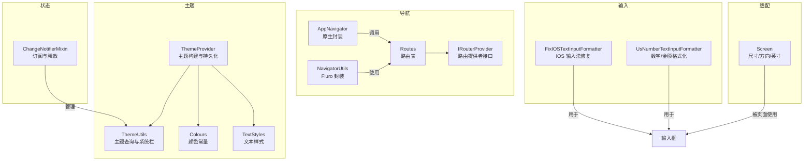
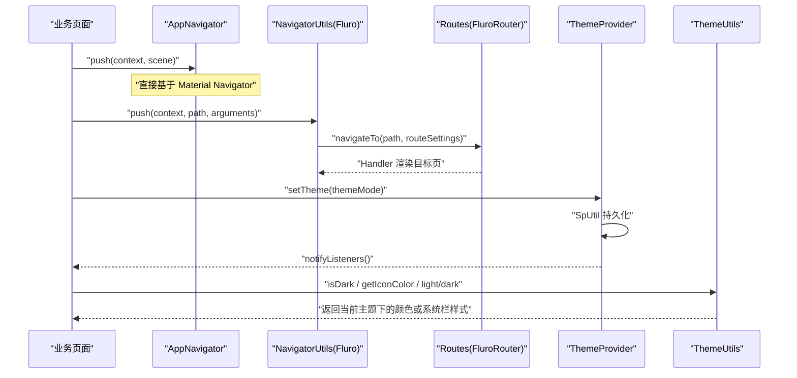
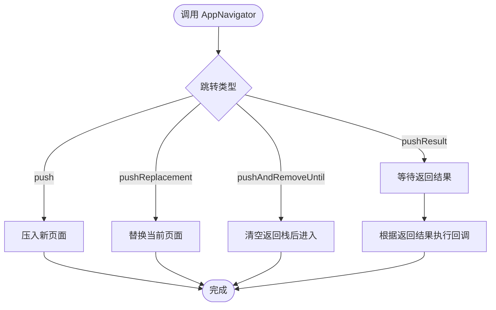
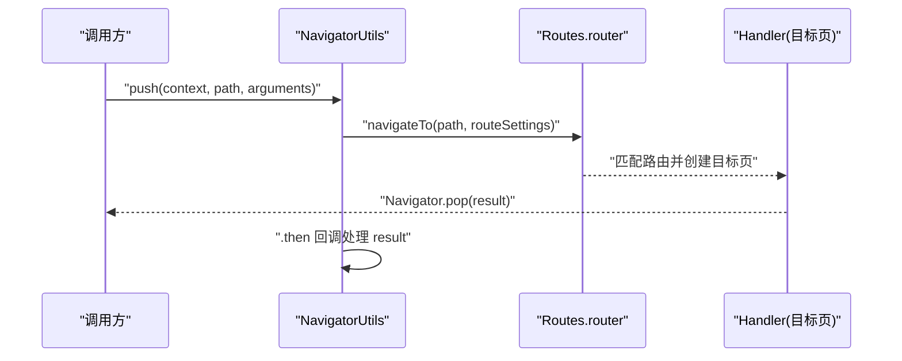
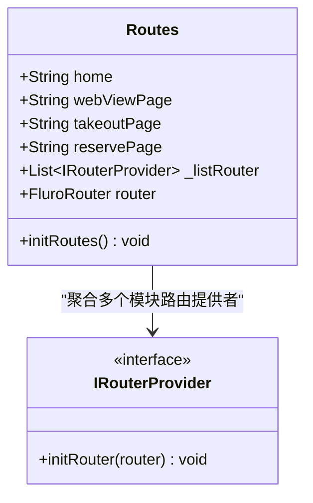
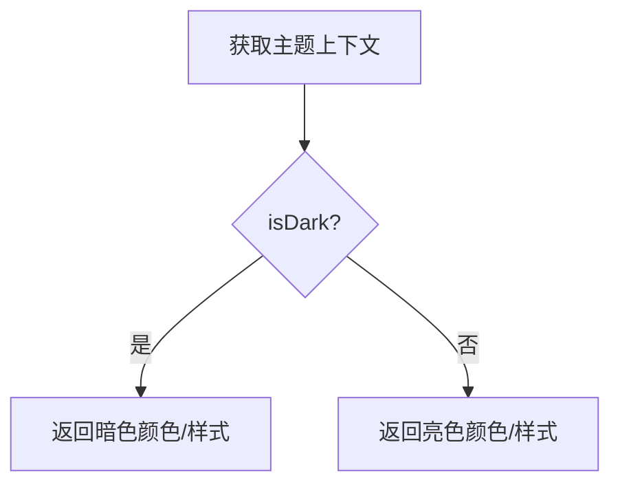
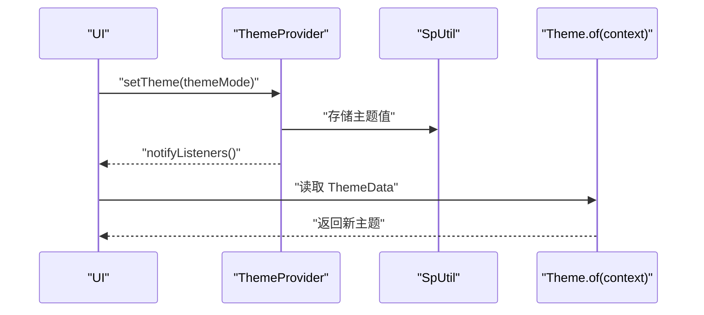
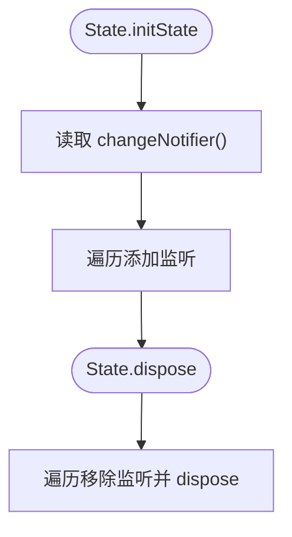
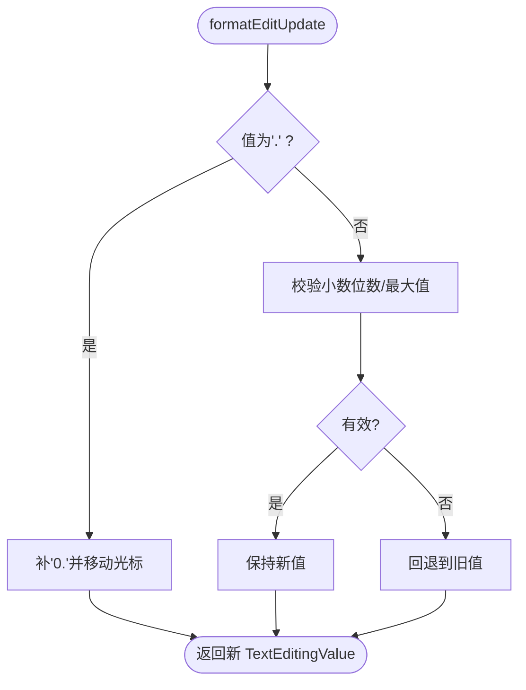
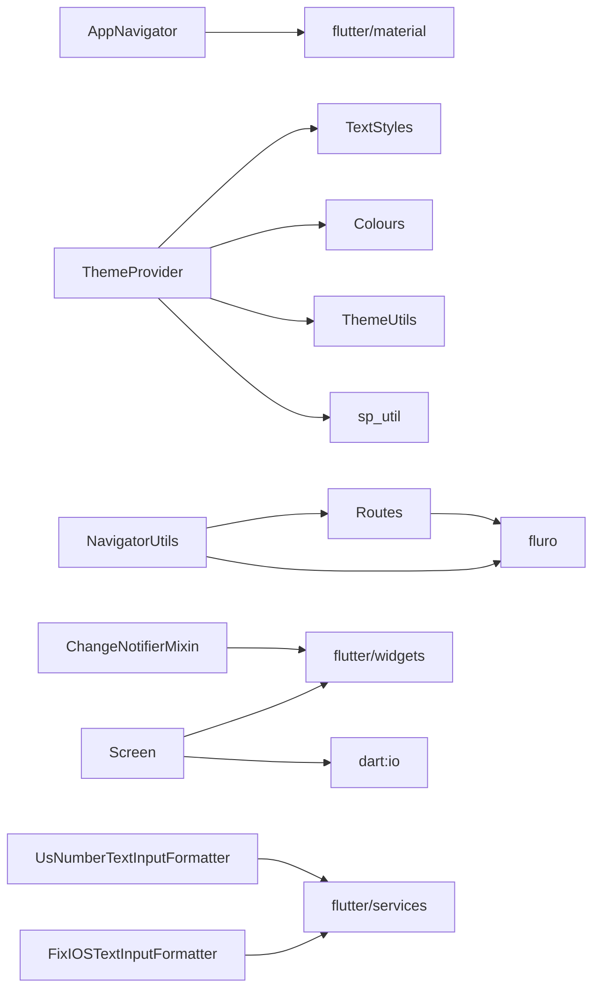

# UI 辅助工具

<cite>
**本文引用的文件**
- [lib/util/app_navigator.dart](file://lib/util/app_navigator.dart)
- [lib/routers/fluro_navigator.dart](file://lib/routers/fluro_navigator.dart)
- [lib/routers/i_router.dart](file://lib/routers/i_router.dart)
- [lib/routers/routers.dart](file://lib/routers/routers.dart)
- [lib/util/theme_utils.dart](file://lib/util/theme_utils.dart)
- [lib/setting/provider/theme_provider.dart](file://lib/setting/provider/theme_provider.dart)
- [lib/res/colors.dart](file://lib/res/colors.dart)
- [lib/res/styles.dart](file://lib/res/styles.dart)
- [lib/util/change_notifier_manage.dart](file://lib/util/change_notifier_manage.dart)
- [lib/util/input_formatter/fix_ios_input_formatter.dart](file://lib/util/input_formatter/fix_ios_input_formatter.dart)
- [lib/util/input_formatter/number_text_input_formatter.dart](file://lib/util/input_formatter/number_text_input_formatter.dart)
- [lib/util/screen_utils.dart](file://lib/util/screen_utils.dart)
</cite>

## 目录
1. [引言](#引言)
2. [项目结构](#项目结构)
3. [核心组件](#核心组件)
4. [架构总览](#架构总览)
5. [详细组件分析](#详细组件分析)
6. [依赖关系分析](#依赖关系分析)
7. [性能与优化](#性能与优化)
8. [疑难解答](#疑难解答)
9. [结论](#结论)
10. [附录：API 参考](#附录api-参考)

## 引言
本技术文档围绕聚客美滋滋应用的 UI 辅助工具展开，聚焦以下模块：
- AppNavigator 应用导航工具与基于 Fluro 的路由封装
- ThemeUtils 主题管理工具及 ThemeProvider 主题配置
- ChangeNotifierMixin 状态通知管理器
- InputFormatter 输入格式化器（iOS 修复、数字金额输入）
- Screen 屏幕适配与常用界面增强能力

目标是帮助开发者快速理解并正确使用这些工具，掌握其与 Flutter 框架及第三方库（Fluro、sp_util）的协作方式，同时提供可操作的 API 参考与排障建议。

## 项目结构
UI 辅助工具主要分布在 util、routers、setting/provider、res 等目录中，职责清晰、耦合度低：
- 导航层：AppNavigator（原生 Navigator 封装）、fluro_navigator（Fluro 路由封装）、routers（路由表集中注册）
- 主题层：ThemeUtils（主题读取与系统栏样式）、ThemeProvider（Material/Cupertino 主题构建与持久化）、colors/styles（颜色与文本样式常量）
- 状态层：ChangeNotifierMixin（统一管理 ChangeNotifier 生命周期）
- 输入层：FixIOSTextInputFormatter、UsNumberTextInputFormatter（输入框增强）
- 适配层：Screen（屏幕尺寸、方向与英寸换算）

图表来源
- [lib/util/app_navigator.dart:1-61](file://lib/util/app_navigator.dart#L1-L61)
- [lib/routers/fluro_navigator.dart:1-72](file://lib/routers/fluro_navigator.dart#L1-L72)
- [lib/routers/routers.dart:1-71](file://lib/routers/routers.dart#L1-L71)
- [lib/util/theme_utils.dart:1-52](file://lib/util/theme_utils.dart#L1-L52)
- [lib/setting/provider/theme_provider.dart:1-92](file://lib/setting/provider/theme_provider.dart#L1-L92)
- [lib/res/colors.dart:1-46](file://lib/res/colors.dart#L1-L46)
- [lib/res/styles.dart:1-76](file://lib/res/styles.dart#L1-L76)
- [lib/util/change_notifier_manage.dart:1-79](file://lib/util/change_notifier_manage.dart#L1-L79)
- [lib/util/input_formatter/fix_ios_input_formatter.dart:1-33](file://lib/util/input_formatter/fix_ios_input_formatter.dart#L1-L33)
- [lib/util/input_formatter/number_text_input_formatter.dart:1-53](file://lib/util/input_formatter/number_text_input_formatter.dart#L1-L53)
- [lib/util/screen_utils.dart:1-46](file://lib/util/screen_utils.dart#L1-L46)

章节来源
- [lib/util/app_navigator.dart:1-61](file://lib/util/app_navigator.dart#L1-L61)
- [lib/routers/fluro_navigator.dart:1-72](file://lib/routers/fluro_navigator.dart#L1-L72)
- [lib/routers/routers.dart:1-71](file://lib/routers/routers.dart#L1-L71)
- [lib/util/theme_utils.dart:1-52](file://lib/util/theme_utils.dart#L1-L52)
- [lib/setting/provider/theme_provider.dart:1-92](file://lib/setting/provider/theme_provider.dart#L1-L92)
- [lib/res/colors.dart:1-46](file://lib/res/colors.dart#L1-L46)
- [lib/res/styles.dart:1-76](file://lib/res/styles.dart#L1-L76)
- [lib/util/change_notifier_manage.dart:1-79](file://lib/util/change_notifier_manage.dart#L1-L79)
- [lib/util/input_formatter/fix_ios_input_formatter.dart:1-33](file://lib/util/input_formatter/fix_ios_input_formatter.dart#L1-L33)
- [lib/util/input_formatter/number_text_input_formatter.dart:1-53](file://lib/util/input_formatter/number_text_input_formatter.dart#L1-L53)
- [lib/util/screen_utils.dart:1-46](file://lib/util/screen_utils.dart#L1-L46)

## 核心组件
本节概述各工具的职责与协作关系。

- 导航相关
  - AppNavigator：对 Material Navigator 进行简化封装，提供 push、pushReplacement、pushAndRemoveUntil、pushResult、goBack、goBackWithParams 等方法。
  - NavigatorUtils：基于 Fluro 的路由跳转封装，统一处理参数传递、返回结果、WebView/本地 HTML 页面跳转、焦点清理等。
  - Routes：集中式路由表，定义全局路由字符串、FluroRouter 实例、未找到处理器，以及按模块注册的 IRouterProvider。

- 主题相关
  - ThemeUtils：判断暗色模式、获取不同场景的颜色、配置系统栏叠加样式，并提供 BuildContext 扩展以方便读取背景色。
  - ThemeProvider：基于 sp_util 持久化主题设置，构建 ThemeData/CupertinoThemeData，包含主色、错误色、选择色、分隔线、Cupertino 覆盖、Web 过渡策略等。

- 状态管理
  - ChangeNotifierMixin：在 StatefulWidget 的 initState/dispose 中自动为 ChangeNotifier 添加/移除监听并释放资源，减少样板代码。

- 输入格式化
  - FixIOSTextInputFormatter：针对 iOS 平台 TextInput maxLength + 中文输入法崩溃问题（已标记废弃，Flutter 1.22 起修复）。
  - UsNumberTextInputFormatter：数字与小数的格式化，支持限制小数位数、最大值，自动修正“.”起始输入。

- 屏幕适配
  - Screen：提供尺寸、方向、对角线、英寸换算，并提供 BuildContext 扩展以便捷访问宽高。

章节来源
- [lib/util/app_navigator.dart:1-61](file://lib/util/app_navigator.dart#L1-L61)
- [lib/routers/fluro_navigator.dart:1-72](file://lib/routers/fluro_navigator.dart#L1-L72)
- [lib/routers/routers.dart:1-71](file://lib/routers/routers.dart#L1-L71)
- [lib/util/theme_utils.dart:1-52](file://lib/util/theme_utils.dart#L1-L52)
- [lib/setting/provider/theme_provider.dart:1-92](file://lib/setting/provider/theme_provider.dart#L1-L92)
- [lib/util/change_notifier_manage.dart:1-79](file://lib/util/change_notifier_manage.dart#L1-L79)
- [lib/util/input_formatter/fix_ios_input_formatter.dart:1-33](file://lib/util/input_formatter/fix_ios_input_formatter.dart#L1-L33)
- [lib/util/input_formatter/number_text_input_formatter.dart:1-53](file://lib/util/input_formatter/number_text_input_formatter.dart#L1-L53)
- [lib/util/screen_utils.dart:1-46](file://lib/util/screen_utils.dart#L1-L46)

## 架构总览
导航与主题两大子系统通过统一的入口和约定进行协作，形成清晰的边界：

图表来源
- [lib/util/app_navigator.dart:1-61](file://lib/util/app_navigator.dart#L1-L61)
- [lib/routers/fluro_navigator.dart:1-72](file://lib/routers/fluro_navigator.dart#L1-L72)
- [lib/routers/routers.dart:1-71](file://lib/routers/routers.dart#L1-L71)
- [lib/setting/provider/theme_provider.dart:1-92](file://lib/setting/provider/theme_provider.dart#L1-L92)
- [lib/util/theme_utils.dart:1-52](file://lib/util/theme_utils.dart#L1-L52)

## 详细组件分析

### 导航组件：AppNavigator 与 NavigatorUtils

#### AppNavigator
- 职责
  - 封装 Material Navigator 的常见操作，避免在各页面重复编写 push/pop 模板。
- 关键方法
  - push：压入新页面。
  - pushReplacement：替换当前页面。
  - pushAndRemoveUntil：清空返回栈后进入指定页面。
  - pushResult：异步接收返回结果。
  - goBack / goBackWithParams：返回上一页，可选择携带返回值。
- 返回栈管理
  - pushAndRemoveUntil 通过回调始终返回 false 清空所有历史栈。
- 参数传递
  - 通过 Widget 构造参数传递数据；如需跨页返回数据，使用 pushResult/goBackWithParams。

图表来源
- [lib/util/app_navigator.dart:1-61](file://lib/util/app_navigator.dart#L1-L61)

章节来源
- [lib/util/app_navigator.dart:1-61](file://lib/util/app_navigator.dart#L1-L61)

#### NavigatorUtils（Fluro 封装）
- 职责
  - 统一 Fluro 路由跳转、参数编码、焦点清理、WebView/HTML 页面跳转。
- 关键方法
  - push：通过 RouteSettings.arguments 传递 Object 参数。
  - pushResult：异步处理返回结果。
  - goBack / goBackWithParams：统一关闭键盘后再 pop。
  - goWebViewPage / goAssetHtmlPage：URL 或本地 asset HTML 打开，参数经 Uri.encodeComponent 转义。
- 深度链接
  - 当前实现基于路径字符串，未体现 query 之外的动态段或命名参数解析；建议使用 query 传参并在 handler 内解析。
- 返回栈管理
  - 依赖 Fluro 的 replace/clearStack 控制是否替换或清空返回栈。

图表来源
- [lib/routers/fluro_navigator.dart:1-72](file://lib/routers/fluro_navigator.dart#L1-L72)
- [lib/routers/routers.dart:1-71](file://lib/routers/routers.dart#L1-L71)

章节来源
- [lib/routers/fluro_navigator.dart:1-72](file://lib/routers/fluro_navigator.dart#L1-L72)
- [lib/routers/routers.dart:1-71](file://lib/routers/routers.dart#L1-L71)

#### Routes（路由表与初始化）
- 职责
  - 维护全局路由常量、FluroRouter 实例、未找到处理器，以及模块化的 IRouterProvider 列表。
- 设计要点
  - initRoutes 中统一注册首页、WebView、外卖、预约等基础路由。
  - 将 LoginRouter、SettingRouter、OrderRouter 等模块路由提供者加入列表并统一初始化，便于模块解耦。
  - notFoundHandler 统一处理 404，返回 NotFoundPage。

图表来源
- [lib/routers/routers.dart:1-71](file://lib/routers/routers.dart#L1-L71)
- [lib/routers/i_router.dart:1-7](file://lib/routers/i_router.dart#L1-L7)

章节来源
- [lib/routers/routers.dart:1-71](file://lib/routers/routers.dart#L1-L71)
- [lib/routers/i_router.dart:1-7](file://lib/routers/i_router.dart#L1-L7)

### 主题组件：ThemeUtils 与 ThemeProvider

#### ThemeUtils
- 职责
  - 提供 isDark、getDarkColor、getIconColor、StickyHeader/DialogTextField/KeyboardActions 颜色选择，以及 light/dark 两套 SystemUiOverlayStyle。
  - 提供 BuildContext 扩展 isDark、backgroundColor、dialogBackgroundColor，简化页面侧读取。
- 暗色模式适配
  - 通过 Brightness 判定切换不同颜色集合，保证控件在不同主题下可读性。

图表来源
- [lib/util/theme_utils.dart:1-52](file://lib/util/theme_utils.dart#L1-L52)

章节来源
- [lib/util/theme_utils.dart:1-52](file://lib/util/theme_utils.dart#L1-L52)

#### ThemeProvider
- 职责
  - 基于 sp_util 持久化主题设置（Light/Dark/System），并通过 ChangeNotifier 通知 UI 重建。
  - 构建 ThemeData/CupertinoThemeData，统一主色、错误色、选择区、分隔线、AppBar 叠加样式、Cupertino 覆盖、Web 过渡策略等。
- 与 ThemeUtils 协作
  - AppBarTheme.systemOverlayStyle 直接复用 ThemeUtils.light/dark。
- 主题切换流程

图表来源
- [lib/setting/provider/theme_provider.dart:1-92](file://lib/setting/provider/theme_provider.dart#L1-L92)
- [lib/util/theme_utils.dart:1-52](file://lib/util/theme_utils.dart#L1-L52)

章节来源
- [lib/setting/provider/theme_provider.dart:1-92](file://lib/setting/provider/theme_provider.dart#L1-L92)

#### 颜色与文本样式
- Colours：集中定义亮/暗两套颜色常量，包括主色、背景、文字、线条、按钮禁用态等。
- TextStyles：集中定义字号、字重、颜色，并与 Dimens 对齐。

章节来源
- [lib/res/colors.dart:1-46](file://lib/res/colors.dart#L1-L46)
- [lib/res/styles.dart:1-76](file://lib/res/styles.dart#L1-L76)

### 状态通知管理：ChangeNotifierMixin
- 职责
  - 在 initState 中为 ChangeNotifier 批量添加监听，dispose 中批量移除并释放对象，避免内存泄漏。
- 使用方法
  - State 混入 ChangeNotifierMixin，重写 changeNotifier 返回 Map<ChangeNotifier?, List<VoidCallback>?>。
  - 当 callbacks 为空时，仅做 dispose，不添加监听。
- 复杂度
  - 初始化与销毁均为 O(n)，n 为需要管理的 ChangeNotifier 数量。

图表来源
- [lib/util/change_notifier_manage.dart:1-79](file://lib/util/change_notifier_manage.dart#L1-L79)

章节来源
- [lib/util/change_notifier_manage.dart:1-79](file://lib/util/change_notifier_manage.dart#L1-L79)

### 输入格式化器：FixIOSTextInputFormatter 与 UsNumberTextInputFormatter

#### FixIOSTextInputFormatter
- 用途
  - 解决 iOS 平台 TextInput maxLength + 中文输入法导致的崩溃问题。
- 行为
  - 在 iOS 且处于拼音组合阶段时返回空值，绕过长度限制逻辑；组合完成后正常格式化。
- 现状
  - 已标记 @Deprecated，因 Flutter 1.22 已修复该问题。

章节来源
- [lib/util/input_formatter/fix_ios_input_formatter.dart:1-33](file://lib/util/input_formatter/fix_ios_input_formatter.dart#L1-L33)

#### UsNumberTextInputFormatter
- 用途
  - 数字与小数输入格式化，默认两位小数，支持自定义 digit 与 max。
- 行为
  - 开头输入“.”时自动补“0.”。
  - 超过允许小数位或超出最大值时回退到旧值。
  - 提供内部 double 解析容错，防止异常导致格式化失败。

图表来源
- [lib/util/input_formatter/number_text_input_formatter.dart:1-53](file://lib/util/input_formatter/number_text_input_formatter.dart#L1-L53)

章节来源
- [lib/util/input_formatter/number_text_input_formatter.dart:1-53](file://lib/util/input_formatter/number_text_input_formatter.dart#L1-L53)

### 屏幕适配：Screen
- 职责
  - 提供屏幕方向、像素尺寸、对角线、英寸尺寸等工具方法。
  - 提供 BuildContext 扩展 size/width/height，便于页面内快捷访问。
- 像素到英寸换算
  - 基于固定 PPI（Android/iOS 150，其他 96）估算物理尺寸，适用于平板/手机粗略分类。

章节来源
- [lib/util/screen_utils.dart:1-46](file://lib/util/screen_utils.dart#L1-L46)

## 依赖关系分析

图表来源
- [lib/util/app_navigator.dart:1-61](file://lib/util/app_navigator.dart#L1-L61)
- [lib/routers/fluro_navigator.dart:1-72](file://lib/routers/fluro_navigator.dart#L1-L72)
- [lib/routers/routers.dart:1-71](file://lib/routers/routers.dart#L1-L71)
- [lib/setting/provider/theme_provider.dart:1-92](file://lib/setting/provider/theme_provider.dart#L1-L92)
- [lib/util/theme_utils.dart:1-52](file://lib/util/theme_utils.dart#L1-L52)
- [lib/util/change_notifier_manage.dart:1-79](file://lib/util/change_notifier_manage.dart#L1-L79)
- [lib/util/input_formatter/fix_ios_input_formatter.dart:1-33](file://lib/util/input_formatter/fix_ios_input_formatter.dart#L1-L33)
- [lib/util/input_formatter/number_text_input_formatter.dart:1-53](file://lib/util/input_formatter/number_text_input_formatter.dart#L1-L53)
- [lib/util/screen_utils.dart:1-46](file://lib/util/screen_utils.dart#L1-L46)

章节来源
- [lib/routers/fluro_navigator.dart:1-72](file://lib/routers/fluro_navigator.dart#L1-L72)
- [lib/routers/routers.dart:1-71](file://lib/routers/routers.dart#L1-L71)
- [lib/setting/provider/theme_provider.dart:1-92](file://lib/setting/provider/theme_provider.dart#L1-L92)
- [lib/util/theme_utils.dart:1-52](file://lib/util/theme_utils.dart#L1-L52)
- [lib/util/change_notifier_manage.dart:1-79](file://lib/util/change_notifier_manage.dart#L1-L79)
- [lib/util/input_formatter/fix_ios_input_formatter.dart:1-33](file://lib/util/input_formatter/fix_ios_input_formatter.dart#L1-L33)
- [lib/util/input_formatter/number_text_input_formatter.dart:1-53](file://lib/util/input_formatter/number_text_input_formatter.dart#L1-L53)
- [lib/util/screen_utils.dart:1-46](file://lib/util/screen_utils.dart#L1-L46)

## 性能与优化
- 导航
  - AppNavigator 直接使用 MaterialPageRoute，轻量高效；应避免频繁调用 pushAndRemoveUntil 造成不必要的重建。
  - NavigatorUtils 统一 unfocus 以减少不必要的 build，避免 FocusScope.of(context).unfocus() 带来的额外开销。
- 主题
  - ThemeProvider 使用 sp_util 持久化主题，避免每次启动重新计算；通过 notifyListeners 精准触发 UI 重建。
  - ThemeData 中统一设置 textSelectionTheme、cupertinoOverrideTheme、pageTransitionsTheme，减少页面级重复配置。
- 状态
  - ChangeNotifierMixin 批量 add/removeListener 与 dispose，降低遗漏释放的风险；建议在 changeNotifier 中仅声明需要监听的对象。
- 输入
  - UsNumberTextInputFormatter 在 formatEditUpdate 中进行简单数学比较与字符串处理，时间复杂度 O(1)，适合高频输入场景。
- 屏幕
  - Screen 提供轻量计算，避免在热路径中频繁调用；可在页面初始化时缓存所需值。

[本节为通用指导，不直接分析具体文件]

## 疑难解答
- Fluro 中文参数乱码
  - 现象：跳转 WebView 时标题或 URL 出现乱码。
  - 原因：Fluro 不支持直接传递中文参数。
  - 解决：使用 NavigatorUtils.goWebViewPage/goAssetHtmlPage，内部已做 Uri.encodeComponent 编码；或在自定义路由中手动编码/解码。
  - 参考
    - [lib/routers/fluro_navigator.dart:45-60](file://lib/routers/fluro_navigator.dart#L45-L60)

- iOS 输入法崩溃（maxLength + 中文）
  - 现象：TextField 设置 maxLength 后，在 iOS 使用中文输入法可能崩溃。
  - 现状：该问题已在 Flutter 1.22 修复，FixIOSTextInputFormatter 已废弃。
  - 建议：不再引入该 formatter；若仍遇到兼容性问题，升级 Flutter 版本。
  - 参考
    - [lib/util/input_formatter/fix_ios_input_formatter.dart:1-33](file://lib/util/input_formatter/fix_ios_input_formatter.dart#L1-L33)

- 主题切换无效
  - 现象：切换主题后 UI 未刷新。
  - 排查：确认是否在顶层使用 Provider/Builder 监听 ThemeProvider，或直接在 setState 中触发 rebuild。
  - 参考
    - [lib/setting/provider/theme_provider.dart:1-92](file://lib/setting/provider/theme_provider.dart#L1-L92)

- 输入数值格式异常
  - 现象：输入“.”后显示异常或超出范围。
  - 排查：检查 UsNumberTextInputFormatter 的 digit/max 配置；确保未在外部再次修改 TextEditingController 的值。
  - 参考
    - [lib/util/input_formatter/number_text_input_formatter.dart:1-53](file://lib/util/input_formatter/number_text_input_formatter.dart#L1-L53)

章节来源
- [lib/routers/fluro_navigator.dart:45-60](file://lib/routers/fluro_navigator.dart#L45-L60)
- [lib/util/input_formatter/fix_ios_input_formatter.dart:1-33](file://lib/util/input_formatter/fix_ios_input_formatter.dart#L1-L33)
- [lib/setting/provider/theme_provider.dart:1-92](file://lib/setting/provider/theme_provider.dart#L1-L92)
- [lib/util/input_formatter/number_text_input_formatter.dart:1-53](file://lib/util/input_formatter/number_text_input_formatter.dart#L1-L53)

## 结论
本项目 UI 辅助工具以清晰的分层与最小化依赖为原则：
- 导航方面，AppNavigator 与 NavigatorUtils 分别面向原生 Navigator 与 Fluro，满足轻量和复杂路由两种场景；Routes 作为集中式路由表，配合 IRouterProvider 实现模块化注册。
- 主题方面，ThemeProvider 负责主题持久化与 ThemeData 构建，ThemeUtils 提供便捷的主题查询与系统栏样式，二者配合 Colours/TextStyles 形成完整的视觉体系。
- 状态与输入方面，ChangeNotifierMixin 与 UsNumberTextInputFormatter/FixIOSTextInputFormatter 提供稳定可靠的开发体验。
- 屏幕适配方面，Screen 提供轻量工具方法，便于在不同设备形态下做出一致的交互。

以上工具共同构成聚客美滋滋应用 UI 层的坚实基础，有助于提升开发效率与用户体验一致性。

[本节为总结，不直接分析具体文件]

## 附录：API 参考

### 导航 API
- AppNavigator
  - push(context, scene)
  - pushReplacement(context, scene)
  - pushAndRemoveUntil(context, scene)
  - pushResult(context, scene, onResult)
  - goBack(context)
  - goBackWithParams(context, result)
- NavigatorUtils（Fluro）
  - push(context, path, {replace, clearStack, arguments})
  - pushResult(context, path, callback, {replace, clearStack, arguments})
  - goBack(context)
  - goBackWithParams(context, result)
  - goWebViewPage(context, title, url)
  - goAssetHtmlPage(context, title, assetPath)

章节来源
- [lib/util/app_navigator.dart:1-61](file://lib/util/app_navigator.dart#L1-L61)
- [lib/routers/fluro_navigator.dart:1-72](file://lib/routers/fluro_navigator.dart#L1-L72)

### 主题 API
- ThemeUtils
  - isDark(context)
  - getDarkColor(context, darkColor)
  - getIconColor(context)
  - getStickyHeaderColor(context)
  - getDialogTextFieldColor(context)
  - getKeyboardActionsColor(context)
  - light / dark（SystemUiOverlayStyle）
  - BuildContext 扩展：isDark、backgroundColor、dialogBackgroundColor
- ThemeProvider
  - syncTheme()
  - setTheme(themeMode)
  - getThemeMode()
  - getTheme({isDarkMode})

章节来源
- [lib/util/theme_utils.dart:1-52](file://lib/util/theme_utils.dart#L1-L52)
- [lib/setting/provider/theme_provider.dart:1-92](file://lib/setting/provider/theme_provider.dart#L1-L92)

### 状态管理 API
- ChangeNotifierMixin
  - 混入到 State<T extends StatefulWidget>
  - 重写 changeNotifier() 返回 Map<ChangeNotifier?, List<VoidCallback>?>

章节来源
- [lib/util/change_notifier_manage.dart:1-79](file://lib/util/change_notifier_manage.dart#L1-L79)

### 输入格式化 API
- FixIOSTextInputFormatter
  - 已废弃，不建议在新代码中使用
- UsNumberTextInputFormatter
  - 构造函数：UsNumberTextInputFormatter({digit, max})
  - 属性：digit（小数位数，-1 不限制）、max（最大值）

章节来源
- [lib/util/input_formatter/fix_ios_input_formatter.dart:1-33](file://lib/util/input_formatter/fix_ios_input_formatter.dart#L1-L33)
- [lib/util/input_formatter/number_text_input_formatter.dart:1-53](file://lib/util/input_formatter/number_text_input_formatter.dart#L1-L53)

### 屏幕适配 API
- Screen
  - isLandscape(context)
  - size(context)
  - width(context) / height(context)
  - diagonal(context)
  - inches(context)
  - widthInches(context) / heightInches(context) / diagonalInches(context)
- BuildContext 扩展
  - size / width / height

章节来源
- [lib/util/screen_utils.dart:1-46](file://lib/util/screen_utils.dart#L1-L46)