# 业务服务工具

<cite>
**本文引用的文件 **
- [cart_calc_service.dart](file://lib/util/cart_calc_service.dart)
- [promotion_service.dart](file://lib/util/promotion_service.dart)
- [member_coupon_service.dart](file://lib/util/member_coupon_service.dart)
- [aux_business_service.dart](file://lib/util/aux_business_service.dart)
- [promotion_helper.dart](file://lib/util/promotion_helper.dart)
- [amount_calc_utils.dart](file://lib/util/amount_calc_utils.dart)
- [nth_discount_manager.dart](file://lib/pages/order/nth_discount_manager.dart)
- [promotion_manager.dart](file://lib/pages/order/promotion_manager.dart)
</cite>

## 目录
1. [引言](#引言)
2. [项目结构](#项目结构)
3. [核心组件](#核心组件)
4. [架构总览](#架构总览)
5. [详细组件分析](#详细组件分析)
6. [依赖关系分析](#依赖关系分析)
7. [性能考虑](#性能考虑)
8. [故障排查指南](#故障排查指南)
9. [结论](#结论)
10. [附录：API 参考与扩展指南](#附录api-参考与扩展指南)

## 引言
本文面向聚客美滋滋应用中的“业务服务工具”模块，聚焦购物车计算、促销服务、会员优惠券、辅助业务四大类服务，以及第N份促销和基础促销管理器。目标是帮助读者快速理解：
- 购物车金额如何汇总、打折、处理赠送/改价/称重、低消与服务费；
- 促销活动从云端获取、折扣结果解析，以及本地基础促销与第N份促销的落地方式；
- 会员优惠券核销、撤销、挂账等能力；
- 押金、预订冲突、松鼠屋渠道等餐饮辅助业务的调用入口；
- 各服务在订单结算流程中的协作顺序、数据流转与可扩展点。

## 项目结构
本次文档涉及的核心代码集中在以下位置：
- lib/util：通用业务工具与服务（购物车、促销、会员券、辅助业务、金额计算）。
- lib/pages/order：订单页相关的促销管理逻辑（基础促销、第N份促销）。

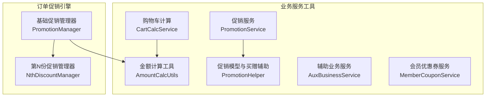

**图示来源**
- [cart_calc_service.dart:1-278](file://lib/util/cart_calc_service.dart#L1-L278)
- [promotion_service.dart:1-242](file://lib/util/promotion_service.dart#L1-L242)
- [promotion_helper.dart:1-200](file://lib/util/promotion_helper.dart#L1-L200)
- [amount_calc_utils.dart:1-371](file://lib/util/amount_calc_utils.dart#L1-L371)
- [aux_business_service.dart:1-188](file://lib/util/aux_business_service.dart#L1-L188)
- [member_coupon_service.dart:1-126](file://lib/util/member_coupon_service.dart#L1-L126)
- [promotion_manager.dart:1-455](file://lib/pages/order/promotion_manager.dart#L1-L455)
- [nth_discount_manager.dart:1-267](file://lib/pages/order/nth_discount_manager.dart#L1-L267)

**章节来源**
- [cart_calc_service.dart:1-278](file://lib/util/cart_calc_service.dart#L1-L278)
- [promotion_service.dart:1-242](file://lib/util/promotion_service.dart#L1-L242)
- [promotion_helper.dart:1-200](file://lib/util/promotion_helper.dart#L1-L200)
- [amount_calc_utils.dart:1-371](file://lib/util/amount_calc_utils.dart#L1-L371)
- [aux_business_service.dart:1-188](file://lib/util/aux_business_service.dart#L1-L188)
- [member_coupon_service.dart:1-126](file://lib/util/member_coupon_service.dart#L1-L126)
- [promotion_manager.dart:1-455](file://lib/pages/order/promotion_manager.dart#L1-L455)
- [nth_discount_manager.dart:1-267](file://lib/pages/order/nth_discount_manager.dart#L1-L267)

## 核心组件
- CartCalcService：购物车商品项与金额计算，覆盖单商品计价、购物车总额、数量统计、低消金额、会员价应用与整单折扣。
- PromotionService：对接服务器端促销接口，提供活动列表查询、折扣后明细计算、明细 JSON 构建及促销类型判断。
- PromotionHelper：本地促销模型与买赠/满赠活动的展示与选择辅助，含活动适用范围匹配与赠品模型。
- AmountCalcUtils：精确四则运算、抹零、低消差、服务费（按消费、按人数、按时段）等金额相关工具。
- AuxBusinessService：聚客一卡通、预订冲突检测、预订报表、松鼠屋渠道等辅助业务。
- MemberCouponService：优惠券撤销、团购券撤销、支付核销、会员挂账。
- PromotionManager：本地基础促销（分类折扣、菜品折扣、特价菜）加载与应用，以及第N份促销配置加载。
- NthDiscountManager：第N份促销的拆行、分组、优惠份选择与物理拆分。

**章节来源**
- [cart_calc_service.dart:1-278](file://lib/util/cart_calc_service.dart#L1-L278)
- [promotion_service.dart:1-242](file://lib/util/promotion_service.dart#L1-L242)
- [promotion_helper.dart:1-200](file://lib/util/promotion_helper.dart#L1-L200)
- [amount_calc_utils.dart:1-371](file://lib/util/amount_calc_utils.dart#L1-L371)
- [aux_business_service.dart:1-188](file://lib/util/aux_business_service.dart#L1-L188)
- [member_coupon_service.dart:1-126](file://lib/util/member_coupon_service.dart#L1-L126)
- [promotion_manager.dart:1-455](file://lib/pages/order/promotion_manager.dart#L1-L455)
- [nth_discount_manager.dart:1-267](file://lib/pages/order/nth_discount_manager.dart#L1-L267)

## 架构总览
整体架构采用“服务层 + 工具层 + 订单促销引擎”的分层设计：
- 服务层：对外暴露购物车计算、促销、会员券、辅助业务等能力。
- 工具层：金额计算、日志、网络封装等横切能力。
- 订单促销引擎：负责本地促销规则匹配与购物车行的拆分/标记，驱动价格变化。

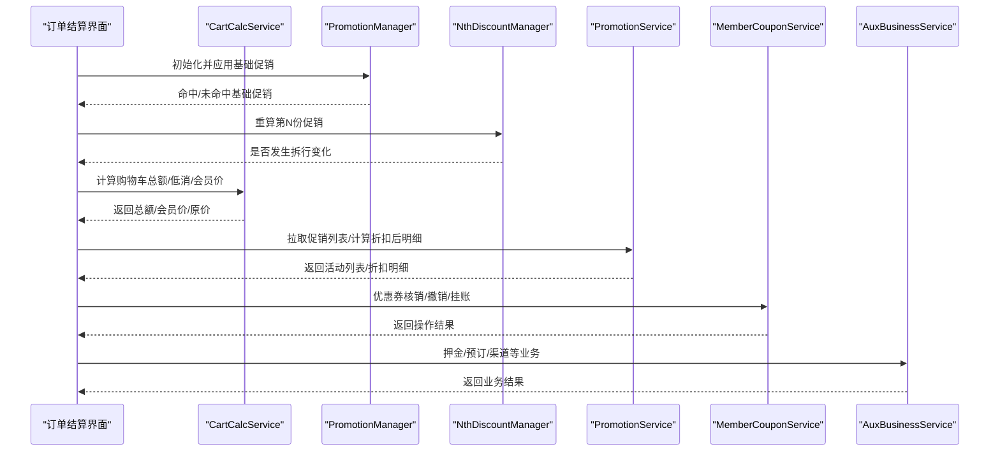

**图示来源**
- [promotion_manager.dart:1-455](file://lib/pages/order/promotion_manager.dart#L1-L455)
- [nth_discount_manager.dart:1-267](file://lib/pages/order/nth_discount_manager.dart#L1-L267)
- [cart_calc_service.dart:1-278](file://lib/util/cart_calc_service.dart#L1-L278)
- [promotion_service.dart:1-242](file://lib/util/promotion_service.dart#L1-L242)
- [member_coupon_service.dart:1-126](file://lib/util/member_coupon_service.dart#L1-L126)
- [aux_business_service.dart:1-188](file://lib/util/aux_business_service.dart#L1-L188)

## 详细组件分析

### CartCalcService：购物车计算服务
职责与边界
- 定义购物车商品项模型，统一 effectiveQty、isGive、presentflag、isChangePrice、weighflag 等字段语义。
- 提供单商品计价、购物车总额、数量统计、低消金额、会员价应用、整单折扣等方法。

关键行为
- 单商品计价：区分赠送、改价、称重与普通商品，叠加做法/规格/套餐加价，支持可打折标志与折扣率。
- 购物车总额：遍历累加售价、会员价、原价三类金额。
- 低消金额：排除赠送、数量为0、不计低消、套餐子商品等场景。
- 会员价应用：赠送/改价不应用会员价；会员价为0或不低于售价时不应用。
- 整单折扣：基于购物车总价进行折扣，并返回折后金额与折扣金额。

复杂度
- 单商品计价 O(1)。
- 购物车总额 O(n)，n 为购物车项数。
- 低消金额 O(n)。

错误与边界
- 赠送商品有效数量逻辑避免重复计入数量与金额。
- 折扣仅在 dscflag=1 且 0<discount<100 时生效。
- 会员价需小于售价才生效。

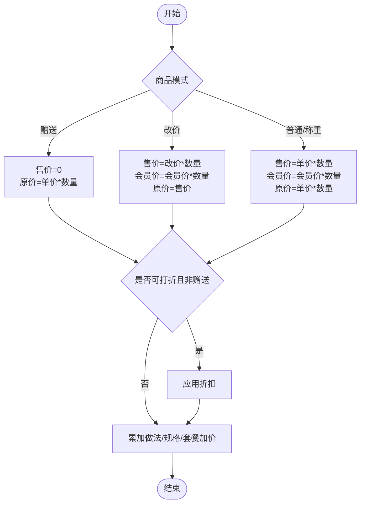

**图示来源**
- [cart_calc_service.dart:1-200](file://lib/util/cart_calc_service.dart#L1-L200)

**章节来源**
- [cart_calc_service.dart:1-278](file://lib/util/cart_calc_service.dart#L1-L278)

### PromotionService：促销服务
职责与边界
- 通过 HTTP 接口获取当前可用促销活动列表与折扣后明细。
- 提供活动类型判断（折扣类、赠送类、满减类）与订单明细 JSON 构建。

关键行为
- 获取活动列表：请求参数包含订单明细 JSON 与会员ID，兼容 data 为 List 或嵌套 Map 的结构。
- 计算折扣后明细：服务端完成规则匹配，客户端解析 discountamt 累加得到总折扣金额。
- 构建明细 JSON：供促销接口使用，要求每项包含 productid、typeid、qty、sellprice、rramt、specid 等字段。

异常处理
- 网络异常时返回空列表或空结果，并记录日志。

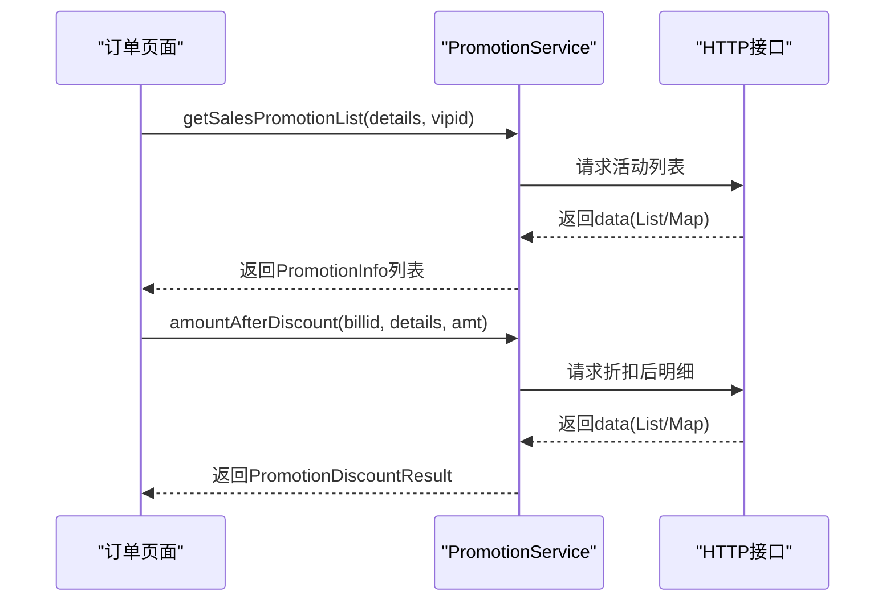

**图示来源**
- [promotion_service.dart:1-242](file://lib/util/promotion_service.dart#L1-L242)

**章节来源**
- [promotion_service.dart:1-242](file://lib/util/promotion_service.dart#L1-L242)

### PromotionHelper：促销模型与买赠辅助
职责与边界
- 本地促销模型，包含活动适用范围匹配、活动类型描述、买赠/满赠活动与赠品模型。
- 适用于本地展示与选择赠品时的辅助计算。

关键行为
- matchesDetails：根据活动类型与适用类型（全部/分类/商品）判断订单明细是否命中活动。
- PromotionGiftActivity：买赠/满赠活动聚合，维护已赠数量、剩余可赠数量与上限策略（买赠取 sumgiveqty，满赠取 giveqty）。

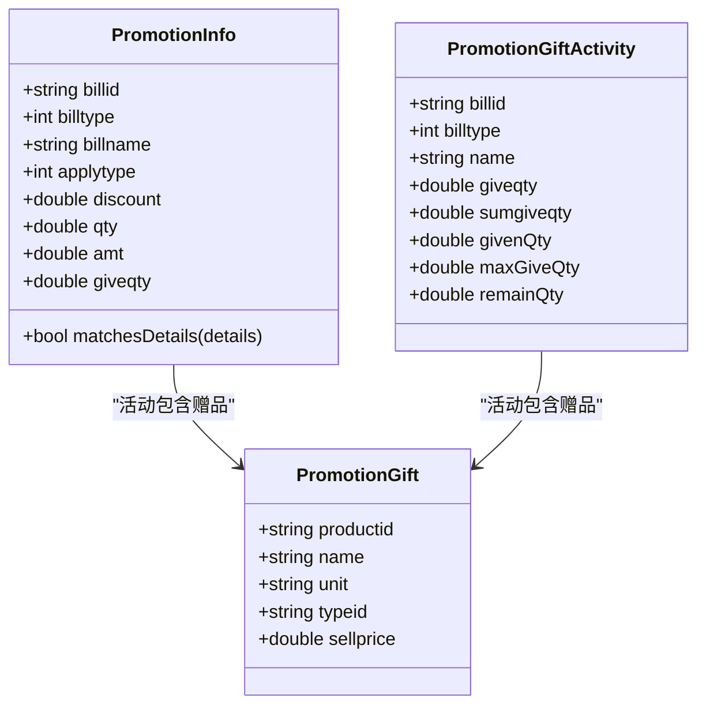

**图示来源**
- [promotion_helper.dart:1-200](file://lib/util/promotion_helper.dart#L1-L200)

**章节来源**
- [promotion_helper.dart:1-200](file://lib/util/promotion_helper.dart#L1-L200)

### AmountCalcUtils：金额计算工具
职责与边界
- 精确四则运算（保留两位小数）。
- 抹零计算（九种方式：四舍五入到角/元/十元、去分、去角、抹零到五角、四舍五入到五角、进角、进元）。
- 低消差计算（餐桌低消/人均低消，服务费是否计入低消）。
- 服务费计算（按消费百分比、指定金额、按时段、按人数），并支持台桌附加费配置。

关键行为
- calcTableServiceFee：正餐模式下根据 tabletypeid/additionid 获取服务费配置，按 servicetype 分支计算；时段区间与起步递增由服务端兜底。
- calcDiscountPrice/calcDiscountAmt：折扣价格与折扣金额计算。

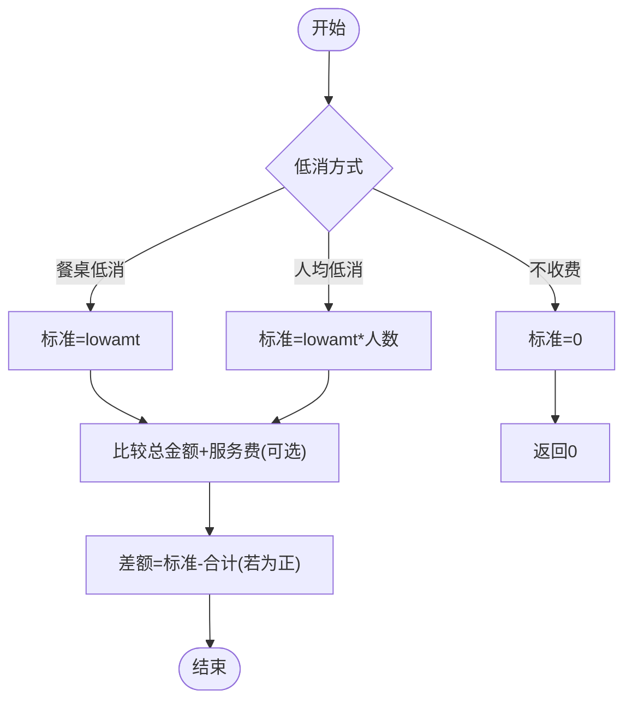

**图示来源**
- [amount_calc_utils.dart:1-200](file://lib/util/amount_calc_utils.dart#L1-L200)
- [amount_calc_utils.dart:201-371](file://lib/util/amount_calc_utils.dart#L201-L371)

**章节来源**
- [amount_calc_utils.dart:1-371](file://lib/util/amount_calc_utils.dart#L1-L371)

### AuxBusinessService：辅助业务服务
职责与边界
- 聚客一卡通：查询会员、支付。
- 预订报表与冲突检测：检查到店时间冲突、查询预订报表明细。
- 松鼠屋渠道：推单、获取订单页面 URL。

关键行为
- jkCardPay：聚客一卡通支付参数校验与返回布尔结果。
- checkReserveConflict：传入到店时间与桌台列表，返回冲突预订。
- sswOrderAdd/sswOrderUrl：松鼠屋渠道下单与链接获取。

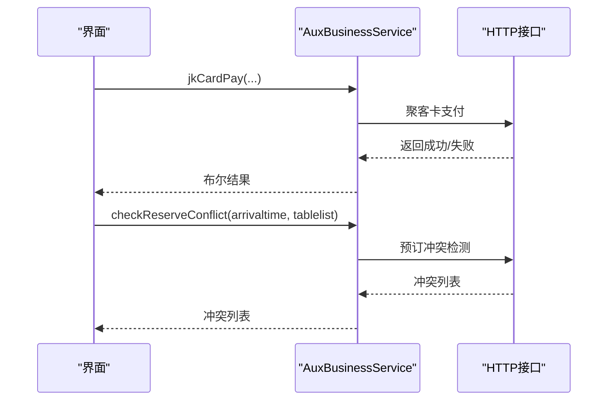

**图示来源**
- [aux_business_service.dart:1-188](file://lib/util/aux_business_service.dart#L1-L188)

**章节来源**
- [aux_business_service.dart:1-188](file://lib/util/aux_business_service.dart#L1-L188)

### MemberCouponService：会员优惠券服务
职责与边界
- 优惠券撤销、团购券撤销、支付核销、会员挂账。

关键行为
- unVerifyCoupon：根据会员ID与单号撤销已核销优惠券。
- cancelPrepare：撤销已验团购券，支持 signinfo 多张退指定。
- verifyCouponPay：提交主单与优惠券明细进行支付核销。
- vipOverPay：会员挂账，记录支付信息与金额。

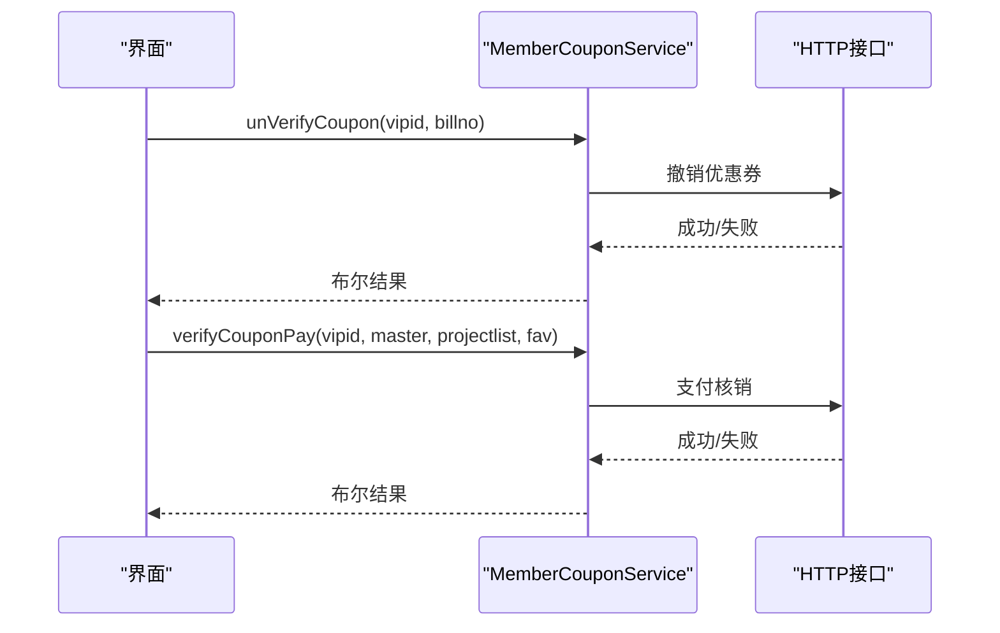

**图示来源**
- [member_coupon_service.dart:1-126](file://lib/util/member_coupon_service.dart#L1-L126)

**章节来源**
- [member_coupon_service.dart:1-126](file://lib/util/member_coupon_service.dart#L1-L126)

### PromotionManager：基础促销管理器
职责与边界
- 加载本地基础促销（分类折扣、菜品折扣、特价菜）与第N份促销配置。
- 将最优基础促销应用到购物车条目或已下单明细，写入 discount/specpriceflag/jcmbillid/promoprice 等字段。

关键行为
- init：从本地表查询促销主表、明细表与规则表，组装 BasicPromotion 与 NthPromotion。
- applyToCartItem：分类/商品匹配，选择最低价格促销；特价菜不受 dscflag 限制；不可打折商品跳过。
- applyToOrderedDetail：对已下单明细补套促销，避免覆盖已有手工折扣/会员价/套餐子行等。

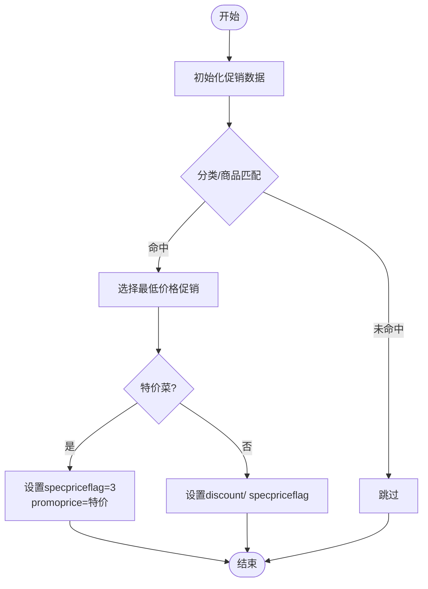

**图示来源**
- [promotion_manager.dart:1-455](file://lib/pages/order/promotion_manager.dart#L1-L455)

**章节来源**
- [promotion_manager.dart:1-455](file://lib/pages/order/promotion_manager.dart#L1-L455)

### NthDiscountManager：第N份促销管理器
职责与边界
- 对购物车整体重算所有第N份促销，执行合并还原、参与池过滤、整数份展开、优惠份选择、物理拆行。
- 支持相同商品与不同商品两种条件，支持 rule 控制最低价优惠策略。

关键行为
- applyToItems：历史拆行还原、活动轮询应用、changed 标记。
- _applyToMaster：合并促销行到父行、构造参与池、按 sellNum 选优、受 billmaxnum 限制、执行拆行或整行转促销行。
- _sameProduct/_differentProduct：同商品组内每 N 份最低价优惠；不同商品按 rule 选择最低价优惠。

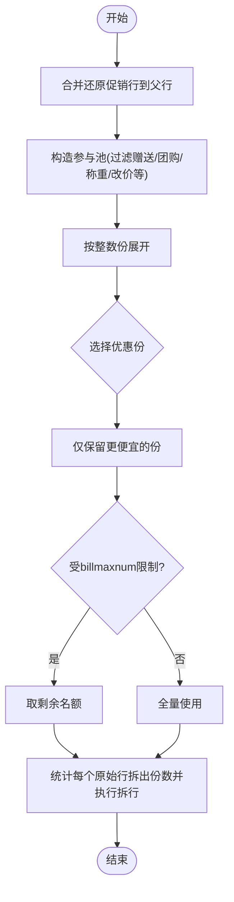

**图示来源**
- [nth_discount_manager.dart:1-267](file://lib/pages/order/nth_discount_manager.dart#L1-L267)

**章节来源**
- [nth_discount_manager.dart:1-267](file://lib/pages/order/nth_discount_manager.dart#L1-L267)

## 依赖关系分析
- CartCalcService 依赖 AmountCalcUtils 进行精确金额计算与折扣计算。
- PromotionManager 依赖本地数据库 DAO 与 TableDownloadManager 加载促销数据，并与 NthDiscountManager 协作。
- PromotionService 依赖 HTTP 接口进行促销活动查询与折扣计算。
- MemberCouponService 与 AuxBusinessService 均依赖 HTTP 接口实现会员券与辅助业务。

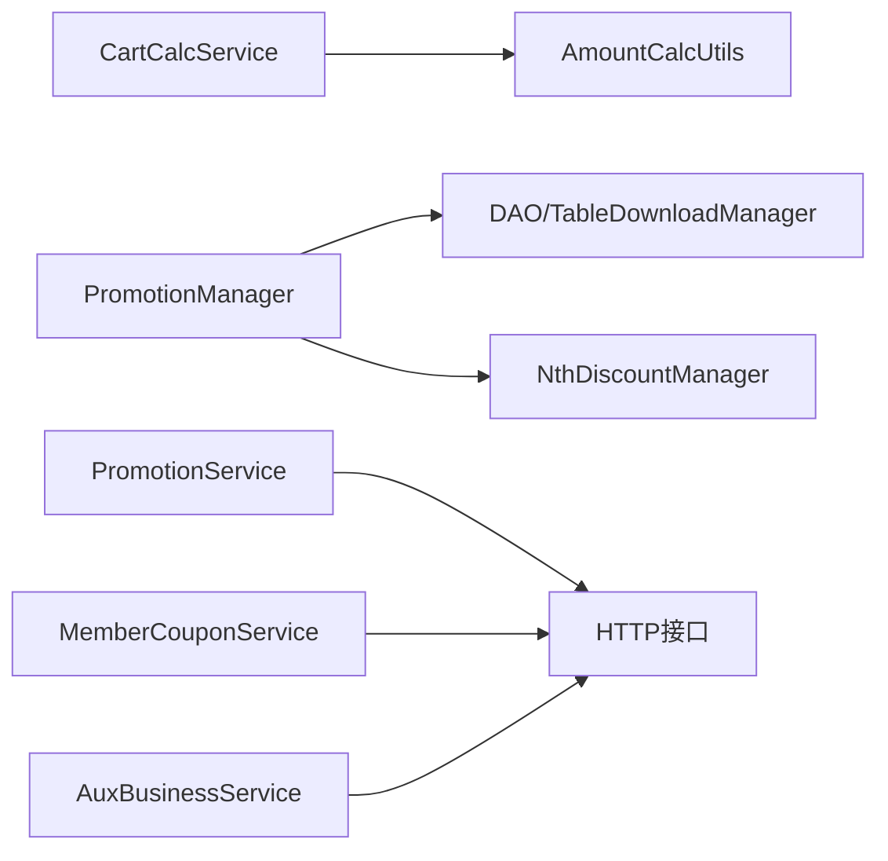

**图示来源**
- [cart_calc_service.dart:1-278](file://lib/util/cart_calc_service.dart#L1-L278)
- [promotion_manager.dart:1-455](file://lib/pages/order/promotion_manager.dart#L1-L455)
- [promotion_service.dart:1-242](file://lib/util/promotion_service.dart#L1-L242)
- [member_coupon_service.dart:1-126](file://lib/util/member_coupon_service.dart#L1-L126)
- [aux_business_service.dart:1-188](file://lib/util/aux_business_service.dart#L1-L188)

**章节来源**
- [cart_calc_service.dart:1-278](file://lib/util/cart_calc_service.dart#L1-L278)
- [promotion_manager.dart:1-455](file://lib/pages/order/promotion_manager.dart#L1-L455)
- [promotion_service.dart:1-242](file://lib/util/promotion_service.dart#L1-L242)
- [member_coupon_service.dart:1-126](file://lib/util/member_coupon_service.dart#L1-L126)
- [aux_business_service.dart:1-188](file://lib/util/aux_business_service.dart#L1-L188)

## 性能考虑
- 购物车计算：O(n) 线性遍历，适合实时刷新；避免在循环中做复杂对象创建。
- 促销初始化：本地表查询与 Web 端缓存同步，避免每次登录都重复下载；Web 首次为空时才触发全量同步。
- 第N份促销：先合并还原促销行再参与池过滤，减少无效计算；仅当存在更低价时才拆行，避免无意义变更。
- 金额计算：统一保留两位小数，避免浮点误差累积；服务费计算按配置分支快速返回。

[本节为通用性能建议，不涉及具体文件分析]

## 故障排查指南
常见问题与定位思路
- 促销活动未生效：
  - 检查 PromotionManager.init 是否成功加载促销主表与明细表；查看日志“促销初始化”。
  - 确认商品是否满足分类/商品匹配，是否被规格限制导致无法比对（specid 缺失）。
  - 对于不可打折商品（dscflag=0），分类/菜品折扣会被跳过。
- 第N份促销未拆行：
  - 检查参与池过滤条件：赠送、团购、称重、改价、手工价行不参与。
  - 确认 sellNum 与 billmaxnum 配置是否正确；同一笔订单已占用的份数会扣减。
  - 查看日志“第N份促销”，确认候选与实际应用份数。
- 会员券核销失败：
  - 检查 MemberCouponService.verifyCouponPay 参数是否完整（vipid、master、projectlist、fav）。
  - 网络异常时会返回 false 并记录日志。
- 辅助业务异常：
  - AuxBusinessService 多数方法返回空集合或空字符串作为降级结果，并记录日志。
  - 预订冲突检测与松鼠屋推单失败不影响主流程，但需在 UI 提示用户。

**章节来源**
- [promotion_manager.dart:1-455](file://lib/pages/order/promotion_manager.dart#L1-L455)
- [nth_discount_manager.dart:1-267](file://lib/pages/order/nth_discount_manager.dart#L1-L267)
- [member_coupon_service.dart:1-126](file://lib/util/member_coupon_service.dart#L1-L126)
- [aux_business_service.dart:1-188](file://lib/util/aux_business_service.dart#L1-L188)

## 结论
本项目的业务服务工具围绕购物车计算、促销、会员券与辅助业务四大主题，形成清晰的服务分层与职责边界：
- CartCalcService 保证金额计算的准确性与一致性；
- PromotionService 与 PromotionManager/NthDiscountManager 共同实现服务端与本地促销协同；
- MemberCouponService/AuxBusinessService 提供会员与辅助业务闭环；
- AmountCalcUtils 作为底层金额计算基座，贯穿全流程。

在实际订单结算流程中，建议遵循如下顺序：
1) 初始化并应用基础促销；2) 重算第N份促销；3) 计算购物车总额/会员价/低消/服务费；4) 拉取云端促销并计算折扣明细；5) 执行会员券核销与辅助业务；6) 最终输出结算金额与支付结果。

[本节为总结性内容，不涉及具体文件分析]

## 附录：API 参考与扩展指南

### CartCalcService API 参考
- calcProductPrice(item): 返回 [售价金额, 会员价金额, 原价金额]。
- calcItemAmt(item): 便捷返回单商品应收金额。
- calcCartTotal(items): 返回 [总售价, 总会员价, 总原价]。
- calcCartQty(items): 返回购物车总数量（赠送商品不计）。
- calcMinSaleAmt(items): 返回计入低消的商品总额。
- applyMemberPrice(item, memberPrice, memberPriceLevel): 应用会员价后的单价。
- resolveMemberPrice(prefetype, sellprice, discount, mprice1, mprice2, mprice3): 解析会员单价。
- applyDiscount(amt, discount): 计算折扣后金额。
- calcOrderDiscount(items, discount): 返回 [折后总额, 折扣金额]。

参数校验要点
- item.effectiveQty 决定实际计价数量；赠送商品 effectiveQty 来自 zsNum。
- 折扣仅在 dscflag=1 且 0<discount<100 时生效。
- 会员价需小于售价才生效；赠送/改价商品不应用会员价。

**章节来源**
- [cart_calc_service.dart:1-278](file://lib/util/cart_calc_service.dart#L1-L278)

### PromotionService API 参考
- getSalesPromotionList(details, vipid): 返回促销活动列表。
- amountAfterDiscount(billid, details, amt): 返回 PromotionDiscountResult（details 与 totalDiscountAmt）。
- buildDetailsJson(items): 构建订单明细 JSON。
- isDiscountType(billtype)/isGiveType(billtype)/isReductionType(billtype): 促销类型判断。

参数校验要点
- details 应为 JSON 数组字符串，每项包含 productid、typeid、qty、sellprice、rramt、specid。
- 活动列表与折扣结果兼容 data 为 List 或嵌套 Map 结构。

**章节来源**
- [promotion_service.dart:1-242](file://lib/util/promotion_service.dart#L1-L242)

### PromotionHelper API 参考
- PromotionInfo.matchesDetails(details): 判断活动是否命中订单明细。
- PromotionGiftActivity.maxGiveQty/remainQty/givenQty: 管理买赠/满赠活动赠品数量。

参数校验要点
- 买赠/满赠活动若无赠品列表则不可用。
- 活动适用类型（全部/分类/商品）匹配逻辑需与订单明细字段一致。

**章节来源**
- [promotion_helper.dart:1-200](file://lib/util/promotion_helper.dart#L1-L200)

### AmountCalcUtils API 参考
- add/sub/mul/div/formatAmount: 精确四则运算与格式化。
- eraseAmount(amount, flag): 九种抹零方式。
- getEraseAmt(amount, flag): 抹零金额。
- calcLowMoney(lowtype, lowamt, personnum): 低消标准金额。
- getMinSalemoneyDiff(lowtype, lowamt, personnum, totalmoney, servicemoney, minsalesamtflag): 低消差。
- calcServiceFee(...): 服务费计算（按时段/分钟/小时/人数/封顶）。
- calcTableServiceFee(tmp, tableTypeId, saleMoney): 台桌服务费。
- calcDiscountPrice/calcDiscountAmt: 折扣价格与折扣金额。

参数校验要点
- 服务费计算需确保 beginTime/endTime 合法；自动模式未开始计费时返回 0。
- 时段区间与起步递增的服务费由服务端兜底，本地返回 0。

**章节来源**
- [amount_calc_utils.dart:1-371](file://lib/util/amount_calc_utils.dart#L1-L371)

### AuxBusinessService API 参考
- getJkCardVipInfo(cond): 返回会员列表。
- jkCardPay(vipid, vipno, payid, payname, saleid, salename, billno, payamt): 返回布尔结果。
- checkReserveConflict(arrivaltime, tablelist, nobillid): 返回冲突预订列表。
- getPredetermineList(status, startdate, enddate, cond, page, pagesize): 返回预订报表数据。
- sswOrderAdd(saleid, opertype, source): 返回推单结果。
- sswOrderUrl(billno, module): 返回页面 URL。

参数校验要点
- 多数方法在异常时返回空集合/空字符串，并记录日志；调用方需做容错处理。

**章节来源**
- [aux_business_service.dart:1-188](file://lib/util/aux_business_service.dart#L1-L188)

### MemberCouponService API 参考
- unVerifyCoupon(vipid, billno): 返回布尔结果。
- cancelPrepare(saleid, businesstype, signinfo): 返回布尔结果。
- verifyCouponPay(vipid, master, projectlist, clienttype, fav): 返回布尔结果。
- vipOverPay(billno, billid, vipid, vipno, payid, payname, saleid, salename, amt): 返回布尔结果。

参数校验要点
- 必须传入正确的会员ID、单号与支付信息；网络异常时返回 false。

**章节来源**
- [member_coupon_service.dart:1-126](file://lib/util/member_coupon_service.dart#L1-L126)

### 扩展开发指南
- 新增促销类型：
  - 在 PromotionService 中添加类型判断方法与对应 UI 展示逻辑；
  - 在 PromotionHelper 中补充活动匹配与赠品逻辑；
  - 在服务端保持规则一致，客户端以解析为主。
- 新增会员价等级：
  - 在 CartCalcService.resolveMemberPrice 中扩展 prefetype 分支；
  - 确保会员价小于售价才生效。
- 新增服务费计费模式：
  - 在 AmountCalcUtils.calcTableServiceFee 中增加新 servicetype 分支；
  - 复杂模式（如区间阶梯）建议由服务端计算，本地兜底返回 0。
- 新增辅助业务：
  - 在 AuxBusinessService 中新增方法，复用 requestForm 封装；
  - 做好异常降级与日志记录。

[本节为概念性指导，不涉及具体文件分析]