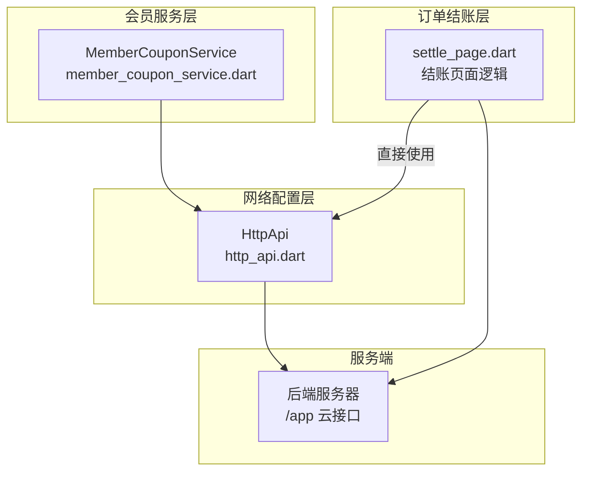
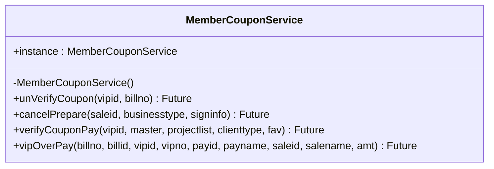
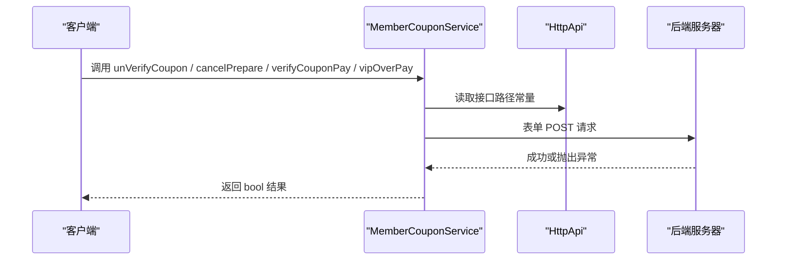
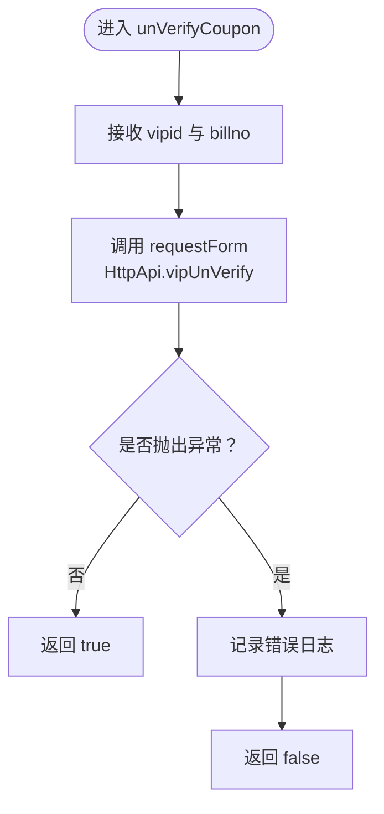
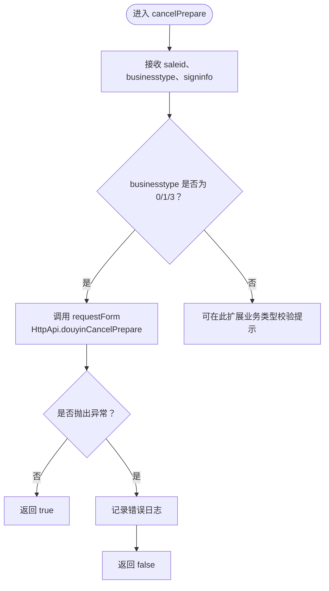
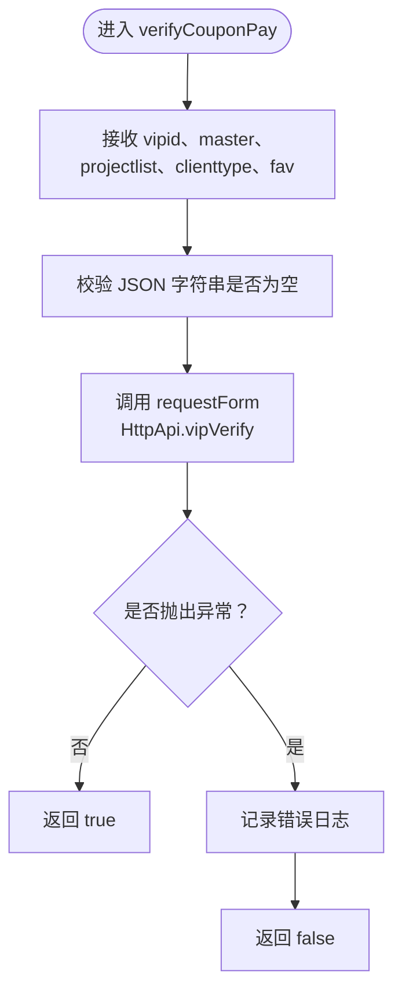
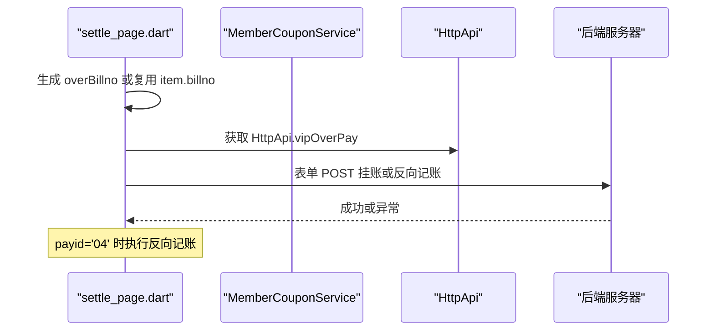
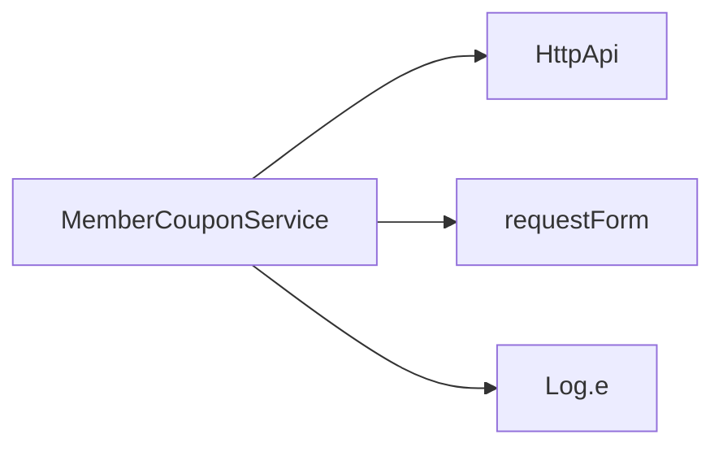
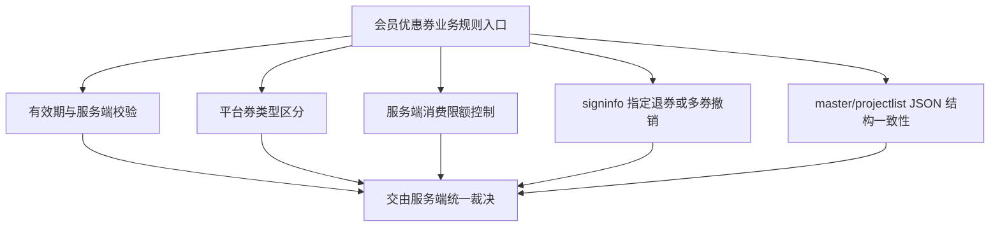

# 会员优惠券服务

<cite>
**本文引用的文件**   
- [member_coupon_service.dart](file://lib/util/member_coupon_service.dart)
- [http_api.dart](file://lib/net/http_api.dart)
- [settle_page.dart](file://lib/pages/order/settle_page.dart)
</cite>

## 目录
1. [简介](#简介)
2. [项目结构定位](#项目结构定位)
3. [核心组件总览](#核心组件总览)
4. [架构与接口映射](#架构与接口映射)
5. [详细方法分析](#详细方法分析)
6. [依赖关系分析](#依赖关系分析)
7. [业务规则与安全机制](#业务规则与安全机制)
8. [性能与可靠性考虑](#性能与可靠性考虑)
9. [故障排查指南](#故障排查指南)
10. [结论](#结论)

## 简介
本文面向聚客美滋滋应用中的会员优惠券能力，围绕 `MemberCouponService` 展开，系统梳理会员优惠券的撤销、团购券撤销、支付核销以及会员挂账等关键业务流程。文档重点说明：
- 优惠券撤销方法 `unVerifyCoupon` 的参数校验、网络调用与返回语义。
- 团购券撤销方法 `cancelPrepare` 中销售单ID、业务类型、指定退券参数 `signinfo` 的多券处理机制。
- 优惠券支付核销方法 `verifyCouponPay` 中主单 `master`、明细 `projectlist`、优惠券信息 `fav` 的数据传递规范。
- 会员挂账方法 `vipOverPay` 在结账页中的使用方式与反向记账场景。
- 各方法与 `HttpApi` 的接口映射关系、请求字段和响应语义。
- 有效期、使用限制、消费限额等会员优惠券相关安全机制的业务说明。

## 项目结构定位
`MemberCouponService` 位于应用工具层，封装了会员与优惠券相关的 HTTP 表单请求；HTTP 常量路径集中在 `HttpApi` 中；实际结账流程通过 `settle_page.dart` 直接调用部分服务端接口，体现会员挂账的反向记账实现。

**图表来源**
- [member_coupon_service.dart:1-126](file://lib/util/member_coupon_service.dart#L1-L126)
- [http_api.dart:337-370](file://lib/net/http_api.dart#L337-L370)
- [settle_page.dart:920-1024](file://lib/pages/order/settle_page.dart#L920-L1024)

**章节来源**
- [member_coupon_service.dart:1-126](file://lib/util/member_coupon_service.dart#L1-L126)
- [http_api.dart:337-370](file://lib/net/http_api.dart#L337-L370)
- [settle_page.dart:920-1024](file://lib/pages/order/settle_page.dart#L920-L1024)

## 核心组件总览
`MemberCouponService` 提供以下能力：
- 优惠券撤销：`unVerifyCoupon`
- 团购券撤销：`cancelPrepare`
- 优惠券支付核销：`verifyCouponPay`
- 会员挂账：`vipOverPay`

该类采用私有构造加静态实例的模式，对外暴露统一入口；所有方法均基于表单请求，失败抛异常时捕获并记录日志，成功则返回布尔值。

**图表来源**
- [member_coupon_service.dart:10-126](file://lib/util/member_coupon_service.dart#L10-L126)

**章节来源**
- [member_coupon_service.dart:10-126](file://lib/util/member_coupon_service.dart#L10-L126)

## 架构与接口映射
会员服务通过 `HttpApi` 定义的服务端路径发起请求，形成“页面→服务→HTTP常量→服务端”的清晰分层。

| 方法 | 对应 HTTP 接口常量 | 服务端路径 | 主要请求字段 | 返回值语义 |
|---|---|---|---|---|
| `unVerifyCoupon` | `HttpApi.vipUnVerify` | `/vip/unVerify` | `vipid`、`billno` | 成功返回 `true`，异常返回 `false` |
| `cancelPrepare` | `HttpApi.douyinCancelPrepare` | `/douyin/cancelPrepare` | `saleid`、`businesstype`、`signinfo` | 成功返回 `true`，异常返回 `false` |
| `verifyCouponPay` | `HttpApi.vipVerify` | `/vip/verify` | `vipid`、`master`、`projectlist`、`clienttype`、`fav` | 成功返回 `true`，异常返回 `false` |
| `vipOverPay` | `HttpApi.vipOverPay` | `/vip/overPay` | `billno`、`billid`、`vipid`、`vipno`、`payid`、`payname`、`saleid`、`salename`、`amt` | 成功返回 `true`，异常返回 `false` |

**图表来源**
- [member_coupon_service.dart:14-126](file://lib/util/member_coupon_service.dart#L14-L126)
- [http_api.dart:337-370](file://lib/net/http_api.dart#L337-L370)

**章节来源**
- [http_api.dart:337-370](file://lib/net/http_api.dart#L337-L370)
- [member_coupon_service.dart:14-126](file://lib/util/member_coupon_service.dart#L14-L126)

## 详细方法分析

### 优惠券撤销：unVerifyCoupon
该方法用于撤销已核销的优惠券，核心流程包括：
- 参数接收：`vipid` 为会员ID，`billno` 为单号。
- 网络请求：使用 `requestForm` 调用 `/vip/unVerify`。
- 成功判定：请求未抛异常即视为成功，返回 `true`。
- 失败处理：捕获异常并记录日志，返回 `false`。

**图表来源**
- [member_coupon_service.dart:18-42](file://lib/util/member_coupon_service.dart#L18-L42)
- [http_api.dart:337-338](file://lib/net/http_api.dart#L337-L338)

**章节来源**
- [member_coupon_service.dart:18-42](file://lib/util/member_coupon_service.dart#L18-L42)
- [http_api.dart:337-338](file://lib/net/http_api.dart#L337-L338)

### 团购券撤销：cancelPrepare
该方法用于撤销已验的团购券，支持多平台与多券撤销：
- 参数说明：
  - `saleid`：销售单ID，对应 `t_sale_master.saleid`。
  - `businesstype`：核销类型，取值含义为：
    - `0`：抖音
    - `1`：美团
    - `3`：快手
  - `signinfo`：可选参数，表示指定退的验券后返回的ID，多张券用逗号分隔；为空则全退。
- 网络请求：调用 `/douyin/cancelPrepare`。
- 返回语义：与 `unVerifyCoupon` 一致，成功返回 `true`，异常返回 `false`。

**图表来源**
- [member_coupon_service.dart:44-73](file://lib/util/member_coupon_service.dart#L44-L73)
- [http_api.dart:369-370](file://lib/net/http_api.dart#L369-L370)

**章节来源**
- [member_coupon_service.dart:44-73](file://lib/util/member_coupon_service.dart#L44-L73)
- [http_api.dart:369-370](file://lib/net/http_api.dart#L369-L370)

### 优惠券支付核销：verifyCouponPay
该方法用于优惠券支付阶段的核销，强调主单与明细的结构化传递：
- 参数说明：
  - `vipid`：会员ID。
  - `master`：主单JSON字符串，承载订单主体信息。
  - `projectlist`：优惠券明细JSON字符串，承载优惠项明细。
  - `clienttype`：客户端类型，默认值为 `2`。
  - `fav`：优惠券信息字符串，承载具体优惠数据。
- 网络请求：调用 `/vip/verify`。
- 返回语义：成功返回 `true`，异常返回 `false`。

**图表来源**
- [member_coupon_service.dart:75-106](file://lib/util/member_coupon_service.dart#L75-L106)
- [http_api.dart:340-342](file://lib/net/http_api.dart#L340-L342)

**章节来源**
- [member_coupon_service.dart:75-106](file://lib/util/member_coupon_service.dart#L75-L106)
- [http_api.dart:340-342](file://lib/net/http_api.dart#L340-L342)

### 会员挂账：vipOverPay
该方法用于会员挂账场景，并在结账页中有直接调用体现：
- 参数说明：
  - `billno`、`billid`：账单编号与ID。
  - `vipid`、`vipno`：会员ID与会员号。
  - `payid`、`payname`：支付方式ID与名称。
  - `saleid`、`salename`：销售单ID与销售单名。
  - `amt`：金额。
- 网络请求：调用 `/vip/overPay`。
- 结账页中的使用：
  - 正常挂账：生成新的账单号后调用挂账接口。
  - 反向记账：当支付方式为挂账（例如 `payid == '04'`）时，以负金额进行反向记账，抵消之前的挂账流水。

**图表来源**
- [member_coupon_service.dart:108-126](file://lib/util/member_coupon_service.dart#L108-L126)
- [http_api.dart:344-345](file://lib/net/http_api.dart#L344-L345)
- [settle_page.dart:920-935](file://lib/pages/order/settle_page.dart#L920-L935)
- [settle_page.dart:1014-1024](file://lib/pages/order/settle_page.dart#L1014-L1024)

**章节来源**
- [member_coupon_service.dart:108-126](file://lib/util/member_coupon_service.dart#L108-L126)
- [http_api.dart:344-345](file://lib/net/http_api.dart#L344-L345)
- [settle_page.dart:920-935](file://lib/pages/order/settle_page.dart#L920-L935)
- [settle_page.dart:1014-1024](file://lib/pages/order/settle_page.dart#L1014-L1024)

## 依赖关系分析
`MemberCouponService` 依赖以下外部元素：
- `HttpApi`：集中维护服务端路径常量，便于环境切换与接口统一管理。
- `requestForm`：统一的表单请求函数，负责网络通信与异常抛出。
- `Log.e`：统一日志输出，用于异常记录与问题追踪。

**图表来源**
- [member_coupon_service.dart:1-126](file://lib/util/member_coupon_service.dart#L1-L126)
- [http_api.dart:337-370](file://lib/net/http_api.dart#L337-L370)

**章节来源**
- [member_coupon_service.dart:1-126](file://lib/util/member_coupon_service.dart#L1-L126)
- [http_api.dart:337-370](file://lib/net/http_api.dart#L337-L370)

## 业务规则与安全机制
结合代码注释与调用上下文，会员优惠券相关业务规则如下：

- 有效期验证：
  - 当前代码未实现本地有效期判断；有效期与可用性应由服务端在 `/vip/unVerify`、`/vip/verify`、`/douyin/cancelPrepare` 等接口中进行校验并返回业务状态。
- 使用限制检查：
  - 团购券撤销通过 `businesstype` 区分平台（抖音、美团、快手），并由服务端根据券的规则限制撤销范围。
- 消费限额控制：
  - 会员挂账由服务端管理信用额度与累计挂账金额；客户端仅传递金额与上下文信息，不应在本地做额度判断。
- 指定退券机制：
  - `signinfo` 支持多券逗号分隔，允许精确退券；若为空则全退，适合批量撤销场景。
- 主单与明细传递：
  - `master` 与 `projectlist` 均为JSON字符串，要求调用方保证结构正确，避免服务端解析失败。

[本图为概念性流程图，不直接映射具体源码文件]

## 性能与可靠性考虑
- 异常转布尔：
  - 四个方法均采用 try-catch 将网络异常转换为 `false`，上层调用方可据此简化错误分支。
- 日志记录：
  - 每个方法失败时记录错误日志，便于定位服务端错误或网络异常。
- 调用方责任：
  - JSON 参数（`master`、`projectlist`、`fav`）由调用方构造，建议在上层做好序列化与校验，减少服务端解析失败的概率。
- 并发与幂等：
  - 当前方法未内置幂等保护；重复调用可能产生重复流水，调用方应在业务层保证去重。

**章节来源**
- [member_coupon_service.dart:18-126](file://lib/util/member_coupon_service.dart#L18-L126)

## 故障排查指南
常见问题与处理建议：

- 优惠券撤销失败：
  - 检查 `vipid`、`billno` 是否正确。
  - 查看日志中 `MemberCouponService.unVerifyCoupon error` 的输出，确认服务端返回异常原因。
- 团购券撤销失败：
  - 确认 `businesstype` 取值是否符合 0、1、3 的定义。
  - 若只退部分券，确保 `signinfo` 格式正确且券ID有效。
- 优惠券支付核销失败：
  - 检查 `master`、`projectlist`、`fav` 是否为合法JSON字符串。
  - 关注服务端对优惠券可用性的校验结果。
- 会员挂账失败：
  - 核对 `payid` 是否为挂账类型（例如 `04`）。
  - 反向记账时确认金额为负数，并与原挂账流水匹配。

**章节来源**
- [member_coupon_service.dart:18-126](file://lib/util/member_coupon_service.dart#L18-L126)
- [settle_page.dart:920-935](file://lib/pages/order/settle_page.dart#L920-L935)
- [settle_page.dart:1014-1024](file://lib/pages/order/settle_page.dart#L1014-L1024)

## 结论
`MemberCouponService` 以简洁的抽象封装了会员与优惠券的核心操作，并通过 `HttpApi` 将接口路径集中管理，便于环境与业务演进。对于优惠券撤销、团购券撤销、支付核销与会员挂账，其职责边界清晰：客户端负责参数构造与基础校验，服务端负责有效性、额度与规则裁决。在实际使用中，应重点关注 JSON 参数的正确性、平台业务类型的准确性以及异常日志的定位，以确保会员优惠券流程稳定可靠。