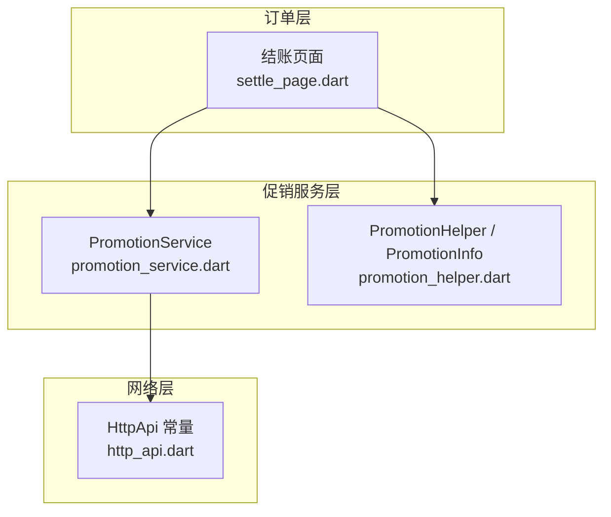
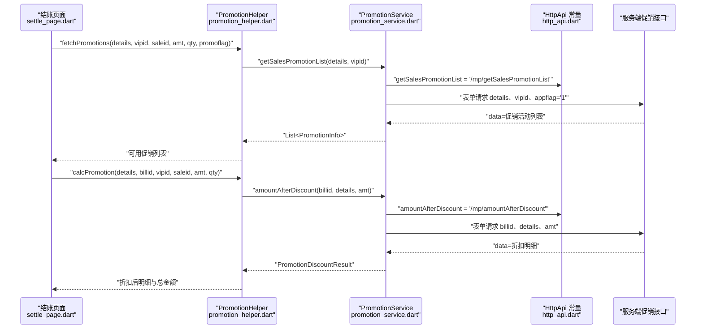
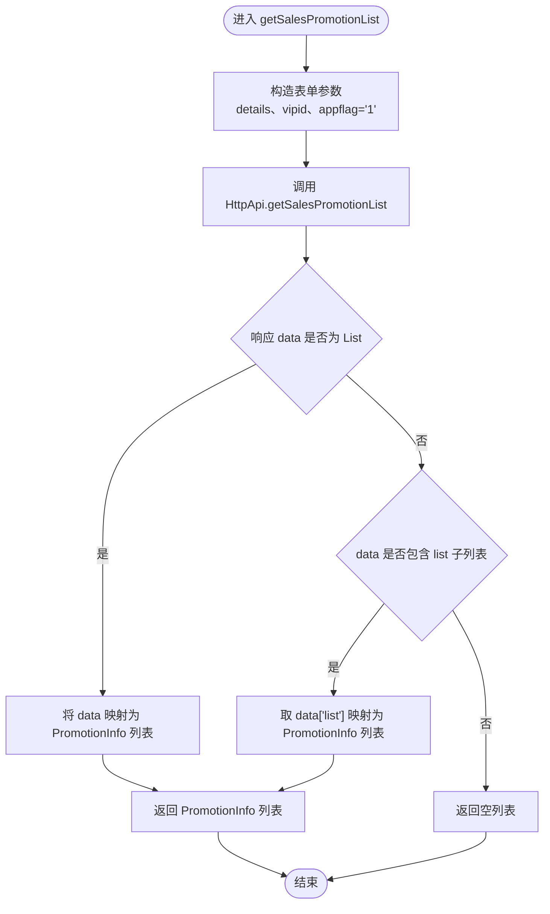
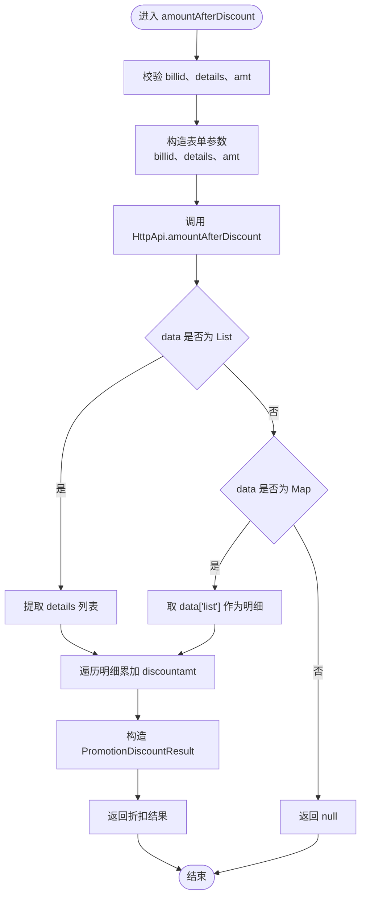
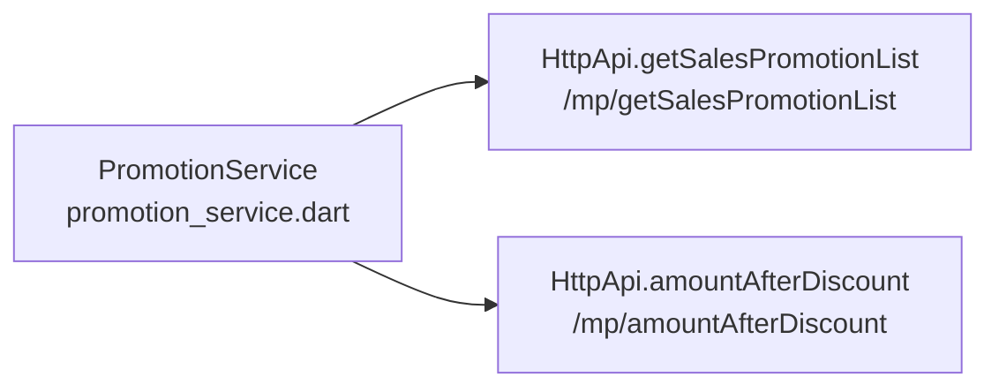

# 促销服务

<cite>
**本文引用的文件**   
- [lib/util/promotion_service.dart](file://lib/util/promotion_service.dart)
- [lib/util/promotion_helper.dart](file://lib/util/promotion_helper.dart)
- [lib/net/http_api.dart](file://lib/net/http_api.dart)
- [lib/pages/order/settle_page.dart](file://lib/pages/order/settle_page.dart)
</cite>

## 目录
1. [引言](#引言)
2. [项目结构](#项目结构)
3. [核心组件](#核心组件)
4. [架构总览](#架构总览)
5. [详细组件分析](#详细组件分析)
6. [依赖关系分析](#依赖关系分析)
7. [性能考虑](#性能考虑)
8. [故障排查指南](#故障排查指南)
9. [结论](#结论)

## 引言
本文聚焦“聚客美滋滋”应用中的促销服务能力，围绕 `PromotionService` 及其关联的促销数据模型、折扣计算流程、网络层集成与业务规则展开。文档面向需要理解促销模块实现、对接促销接口、调试结算页促销行为的开发者与维护者。

促销能力分为两条主线：
- 服务端促销：通过云服务接口获取促销活动列表并计算折扣明细，由 `PromotionService` 负责数据模型封装与网络调用。
- 本地促销：在点菜阶段对分类折扣、菜品折扣、特价菜等基础促销进行本地匹配与价格应用，由 `PromotionManager` 与 `PromotionHelper` 协同完成。

本文重点说明与服务端促销直接相关的 `PromotionInfo`、`PromotionDiscountResult`、`getSalesPromotionList`、`amountAfterDiscount` 等方法，以及它们在结账场景下的使用方式。

## 项目结构
促销相关代码主要分布在以下位置：
- 服务层：`lib/util/promotion_service.dart`
- 辅助模型与买赠/满赠逻辑：`lib/util/promotion_helper.dart`
- 网络接口常量：`lib/net/http_api.dart`
- 结账页调用入口：`lib/pages/order/settle_page.dart`

**图表来源**
- [lib/pages/order/settle_page.dart:330-380](file://lib/pages/order/settle_page.dart#L330-L380)
- [lib/util/promotion_service.dart:120-200](file://lib/util/promotion_service.dart#L120-L200)
- [lib/net/http_api.dart:222-226](file://lib/net/http_api.dart#L222-L226)

**章节来源**
- [lib/util/promotion_service.dart:1-242](file://lib/util/promotion_service.dart#L1-L242)
- [lib/util/promotion_helper.dart:1-200](file://lib/util/promotion_helper.dart#L1-L200)
- [lib/net/http_api.dart:220-230](file://lib/net/http_api.dart#L220-L230)
- [lib/pages/order/settle_page.dart:330-380](file://lib/pages/order/settle_page.dart#L330-L380)

## 核心组件
本节梳理与促销服务直接相关的核心数据结构与方法职责。

### 促销数据模型：PromotionInfo
`PromotionInfo` 表示一个促销活动的基本信息，用于展示、筛选和服务端折扣计算。关键字段如下：

| 字段 | 类型 | 含义与规则 |
|---|---|---|
| `billid` | `String` | 促销活动ID，用于后续选择活动并调用折扣计算接口 |
| `billtype` | `int` | 促销类型：1=分类折扣、2=菜品折扣、3=特价菜、4=买赠、5=满量折扣、6=满减、7=满赠、8=满折 |
| `billname` | `String` | 促销名称 |
| `applytype` | `int` | 适用类型：0=全部商品、1=按分类、2=按商品 |
| `vipflag` | `String` | 会员标志：1=全部、2=仅散客、3=仅会员 |
| `discount` | `double` | 折扣率；例如 85 表示 8.5 折 |
| `qty` | `double` | 满量条件数量 |
| `amt` | `double` | 满额条件金额 |
| `giveqty` | `double` | 赠送数量（常用于买赠、满赠） |
| `status` | `int` | 状态位 |
| `effectday` | `String` | 有效星期，7 位字符串，1=周一到 7=周日 |
| `startdate` | `String` | 开始日期 |
| `enddate` | `String` | 结束日期 |

该模型还提供 `billtypeDesc` 属性，将数字类型转换为可读中文描述，便于界面展示和日志诊断。

**章节来源**
- [lib/util/promotion_service.dart:12-118](file://lib/util/promotion_service.dart#L12-L118)

### 促销折扣计算结果模型：PromotionDiscountResult
`PromotionDiscountResult` 是服务端折扣计算的返回结构：

| 字段 | 类型 | 含义与规则 |
|---|---|---|
| `details` | `List<Map<String, dynamic>>` | 折扣后的订单明细列表；每项包含 `rrprice`、`discount`、`discountamt` 等字段 |
| `totalDiscountAmt` | `double` | 总折扣金额，由明细中 `discountamt` 求和得到 |

该结构不包含服务端原始响应对象，而是把关键折扣信息收敛为上层可直接使用的形式。

**章节来源**
- [lib/util/promotion_service.dart:120-150](file://lib/util/promotion_service.dart#L120-L150)

### 工具方法：促销类型判断与明细构建
`PromotionService` 提供几个静态工具方法：

- `buildDetailsJson(items)`：将购物车明细数组序列化为 JSON 字符串，作为促销接口的 `details` 参数。
- `isDiscountType(billtype)`：判断是否为折扣类促销，包括 1、2、3、5、8。
- `isGiveType(billtype)`：判断是否为赠送类促销，包括 4、7。
- `isReductionType(billtype)`：判断是否为满减类促销，即 6。

这些方法帮助调用方在 UI 或业务逻辑中对促销进行分类处理。

**章节来源**
- [lib/util/promotion_service.dart:201-242](file://lib/util/promotion_service.dart#L201-L242)

## 架构总览
促销服务的整体调用链如下：

**图表来源**
- [lib/pages/order/settle_page.dart:330-380](file://lib/pages/order/settle_page.dart#L330-L380)
- [lib/util/promotion_service.dart:120-200](file://lib/util/promotion_service.dart#L120-L200)
- [lib/net/http_api.dart:222-226](file://lib/net/http_api.dart#L222-L226)

## 详细组件分析

### PromotionService：促销服务核心
`PromotionService` 是客户端与服务端促销能力的桥梁，承担三项职责：
1. 获取促销活动列表。
2. 计算指定活动的折扣明细。
3. 提供促销类型判断和订单明细 JSON 构建工具。

#### getSalesPromotionList：获取促销活动列表
该方法的核心流程如下：

关键行为说明：
- `details`：当前订单明细的 JSON 数组字符串，用于服务端判断哪些活动可参与。
- `vipid`：会员ID；为空时代表散客。
- `appflag`：固定传 `'1'`，表示客户端标识。
- 成功时优先尝试 `data` 为列表；否则回退到 `data['list']` 为列表的结构。
- 异常情况下记录错误日志并返回空列表，保证上层不会因网络异常崩溃。

**章节来源**
- [lib/util/promotion_service.dart:120-180](file://lib/util/promotion_service.dart#L120-L180)
- [lib/net/http_api.dart:222-226](file://lib/net/http_api.dart#L222-L226)

#### amountAfterDiscount：促销折扣计算
该方法根据选定的促销活动计算折扣后明细：

关键行为说明：
- `billid`：从 `getSalesPromotionList` 返回的活动ID，用于锁定要计算的具体促销。
- `details`：订单明细 JSON 字符串，与服务端保持一致的字段口径。
- `amt`：订单总金额，格式化保留两位小数后传入。
- 返回 `details` 明细列表和 `totalDiscountAmt` 总折扣金额；若响应不符合预期则返回 `null`。
- 异常路径同样记录日志并返回 `null`，由上层决定如何提示用户。

**章节来源**
- [lib/util/promotion_service.dart:150-200](file://lib/util/promotion_service.dart#L150-L200)

#### 工具方法
- `buildDetailsJson(items)`：将购物车项转为 JSON 字符串。要求每项至少包含 `productid`、`typeid`、`qty`、`sellprice`、`rramt`，可选 `specid`。
- `isDiscountType`、`isGiveType`、`isReductionType`：按 `billtype` 分类促销，便于 UI 展示不同按钮或限制互斥规则。

**章节来源**
- [lib/util/promotion_service.dart:201-242](file://lib/util/promotion_service.dart#L201-L242)

### PromotionHelper 与 PromotionInfo：本地促销与买赠/满赠
`PromotionHelper` 文件中定义了另一个 `PromotionInfo`，主要用于本地促销和买赠/满赠活动展示。它与 `PromotionService.PromotionInfo` 的职责略有不同：
- `PromotionHelper.PromotionInfo` 更侧重本地活动匹配，包含 `ptList`（活动适用的商品或分类）。
- 提供 `matchesDetails(details)` 方法，根据 `billtype`、`applytype`、`ptList` 判断订单明细是否参与本地促销。
- 还定义 `PromotionGift` 和 `PromotionGiftActivity`，用于买赠、满赠活动的赠品展示、已选数量和上限控制。

注意：本文档聚焦服务端促销服务，因此 `PromotionHelper` 的内容作为补充背景，不替代 `PromotionService` 的服务端交互逻辑。

**章节来源**
- [lib/util/promotion_helper.dart:1-200](file://lib/util/promotion_helper.dart#L1-L200)

### 结账页集成：settle_page.dart
结账页是促销能力的主要使用方：
- `_loadPromotions()`：加载可用促销活动，调用 `PromotionHelper.fetchPromotions`，传入 `detailList`、会员ID、`saleid`、订单金额、商品数量、`promoflag=3`。
- `_applyPromotion(promo)`：应用某项促销，先恢复基准明细，再应用会员最优价，然后调用 `PromotionHelper.calcPromotion` 获取折扣结果，最后根据服务器返回的 `rrprice` 或 `discount` 更新订单明细价格。

这体现了服务端促销的计算分工：服务端负责规则匹配与折扣明细生成，客户端负责展示、用户选择和最终价格落盘。

**章节来源**
- [lib/pages/order/settle_page.dart:330-380](file://lib/pages/order/settle_page.dart#L330-L380)
- [lib/pages/order/settle_page.dart:380-520](file://lib/pages/order/settle_page.dart#L380-L520)

## 依赖关系分析
促销服务依赖的网络接口集中在 `HttpApi` 中：

| 接口常量 | 路径 | 用途 |
|---|---|---|
| `getSalesPromotionList` | `/mp/getSalesPromotionList` | 获取促销活动列表 |
| `amountAfterDiscount` | `/mp/amountAfterDiscount` | 计算指定活动的折扣明细 |

这两个常量由 `PromotionService` 直接引用，避免硬编码路径散落各处，便于统一维护环境切换与路径规范。

**图表来源**
- [lib/util/promotion_service.dart:120-200](file://lib/util/promotion_service.dart#L120-L200)
- [lib/net/http_api.dart:222-226](file://lib/net/http_api.dart#L222-L226)

**章节来源**
- [lib/net/http_api.dart:220-230](file://lib/net/http_api.dart#L220-L230)

## 性能考虑
- 促销列表接口在网络失败时返回空列表，避免阻塞结账流程。
- 折扣计算接口对响应结构做了兼容处理，减少因后端字段变化导致的解析失败。
- 订单明细 JSON 在服务端计算时使用，客户端应避免重复序列化开销；建议在购物车变动处统一构建一次 `details`。
- 结账页应用促销时会恢复基准明细，防止多次促销叠加造成价格漂移。

[本节为通用建议，不直接分析具体源码]

## 故障排查指南

### 常见问题与解决思路

| 现象 | 可能原因 | 排查步骤 |
|---|---|---|
| 结账页未显示任何促销活动 | `getSalesPromotionList` 返回空列表 | 检查 `details` 是否正确序列化；确认 `vipid` 是否与会员一致；查看服务端是否配置了可参与该订单的促销 |
| 选择了活动但提示“该活动未计算出优惠” | `amountAfterDiscount` 返回 `null` 或明细为空 | 检查 `billid` 是否正确；确认 `amt` 是否满足满减、满折门槛；查看服务端返回的 `discountamt` 是否为 0 |
| 促销价格没有生效 | 客户端未正确应用服务器返回的 `rrprice` 或 `discount` | 核对结账页 `_applyPromotion` 的价格更新逻辑；确认 `sellprice > 0` 且服务器返回值小于当前价格 |
| 满赠活动不可与其他整单优惠同时享受 | 业务规则限制 | 检查明细中是否存在标记为满赠的行；结算页已禁止再次享受整单优惠 |
| 会员促销与活动冲突 | 会员最优价与活动折扣存在优先级 | 结算页会先应用会员最优价，再应用活动折扣；确认会员价格确实优于原价 |

### 日志定位
- `PromotionService.getSalesPromotionList error`：网络或响应解析异常。
- `PromotionService.amountAfterDiscount error`：折扣计算接口异常。
- 结账页相关 Toast 提示如“该活动已应用”“该活动未计算出优惠”“已参加满赠活动，不能再享受整单优惠”，可用于快速定位用户操作问题。

**章节来源**
- [lib/util/promotion_service.dart:120-200](file://lib/util/promotion_service.dart#L120-L200)
- [lib/pages/order/settle_page.dart:330-520](file://lib/pages/order/settle_page.dart#L330-L520)

## 结论
`PromotionService` 将促销活动的获取与折扣计算封装为清晰的两个入口：
- `getSalesPromotionList`：以订单明细和会员信息为基础，拉取服务端可用的促销活动。
- `amountAfterDiscount`：以活动ID、订单明细和订单金额为输入，返回折扣后明细与总折扣金额。

结合 `PromotionHelper` 的本地促销与买赠/满赠能力，以及 `settle_page.dart` 的结账流程，促销服务实现了“服务端规则匹配 + 客户端展示与价格应用”的分层架构。对于扩展新的促销类型，推荐遵循现有 `billtype` 语义，并在 `PromotionService` 的工具方法和结算页展示逻辑中同步完善。

[本节为总结性内容，不直接分析具体源码]