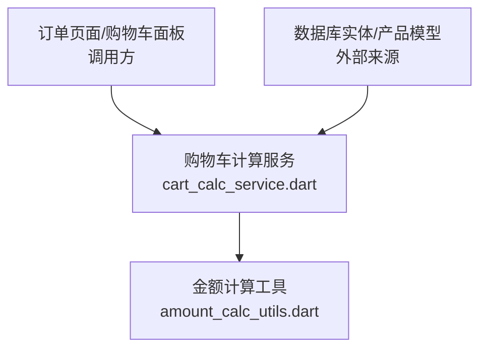
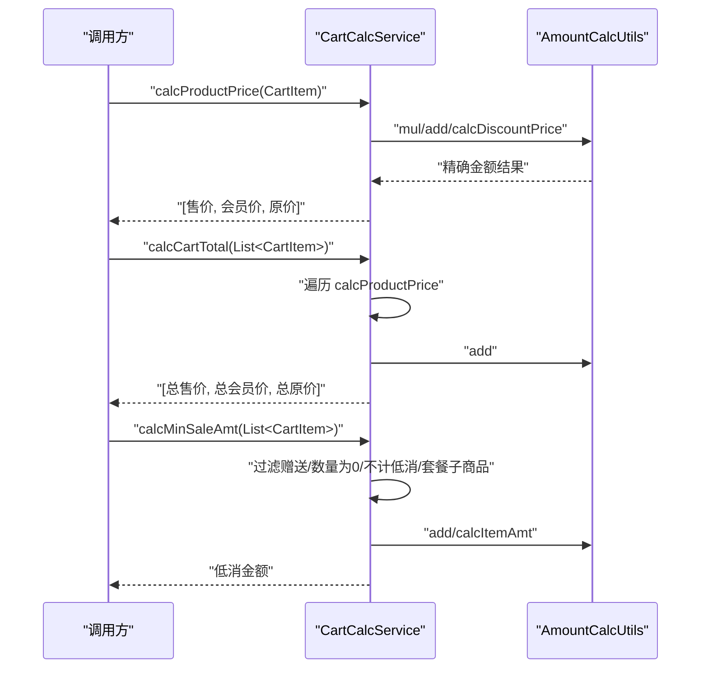
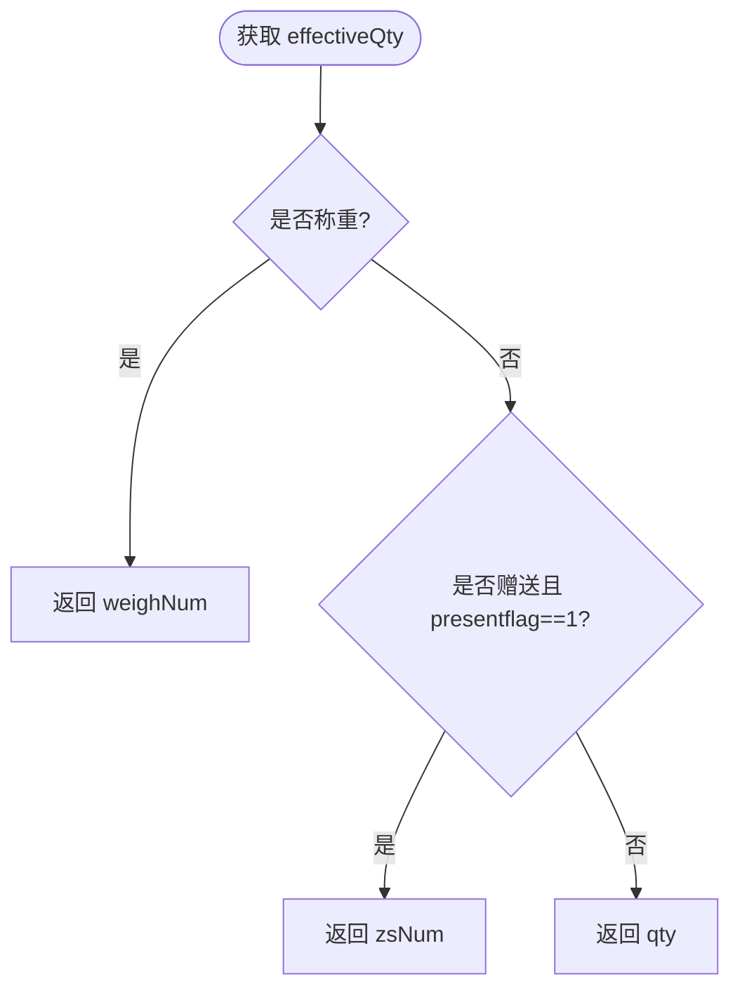
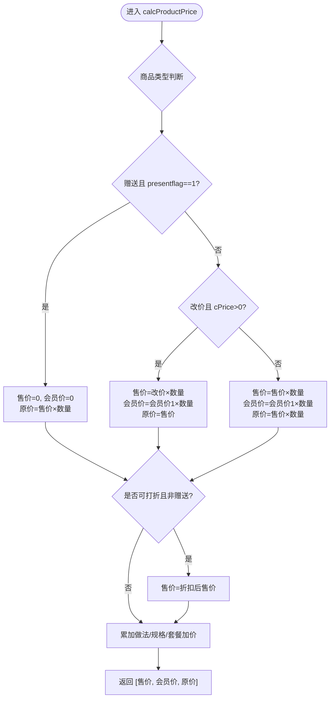
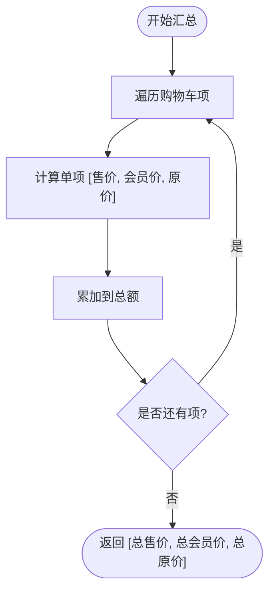
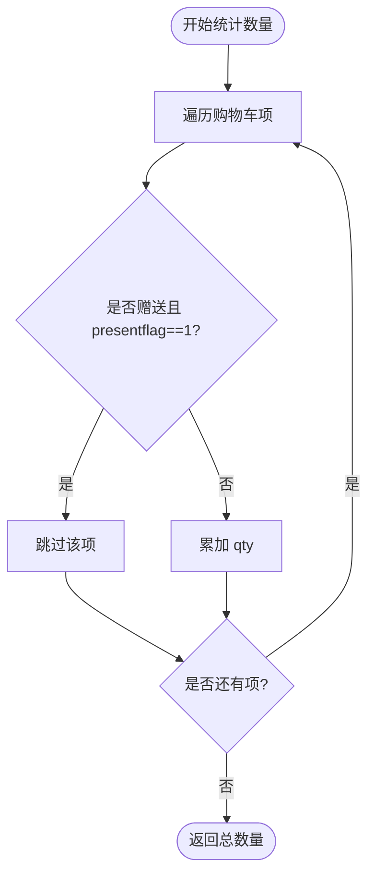
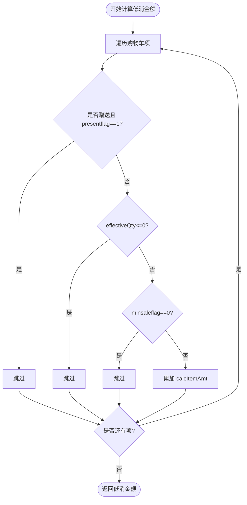
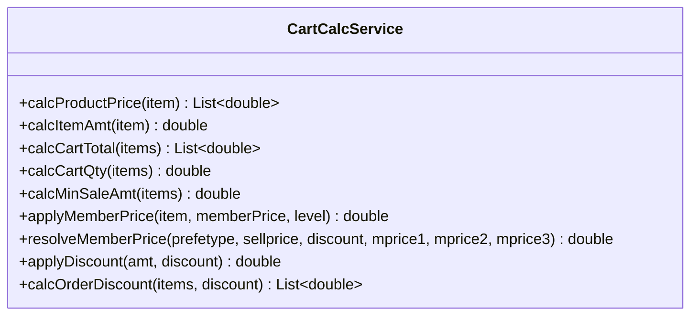

# 购物车计算服务

<cite>
**本文引用的文件**   
- [cart_calc_service.dart](file://lib/util/cart_calc_service.dart)
- [amount_calc_utils.dart](file://lib/util/amount_calc_utils.dart)
</cite>

## 目录
1. [引言](#引言)
2. [项目结构定位](#项目结构定位)
3. [核心数据模型 CartItem](#核心数据模型-cartitem)
4. [架构总览](#架构总览)
5. [详细方法分析](#详细方法分析)
6. [依赖关系分析](#依赖关系分析)
7. [性能与精度特性](#性能与精度特性)
8. [故障排查指南](#故障排查指南)
9. [结论](#结论)

## 引言
本文面向聚客美滋滋应用中的购物车金额计算能力，围绕 `CartCalcService` 与 `CartItem` 展开，说明单商品金额、购物车总额、数量统计、低消金额、会员价解析以及折扣计算的完整业务规则。文档同时结合 `AmountCalcUtils` 的精确金额工具，给出浮点数精度处理的最佳实践，帮助开发者在收银、点餐、结算等场景中正确实现购物车价格计算。

## 项目结构定位
购物车计算逻辑位于工具层，不直接耦合 UI 或网络层：
- `lib/util/cart_calc_service.dart`：购物车计算服务，提供单商品金额、购物车总额、数量、低消金额、会员价解析、折扣计算等方法。
- `lib/util/amount_calc_utils.dart`：金额计算工具类，提供四则运算、抹零、低消差、服务费、折扣计算等底层能力。

**图表来源**
- [cart_calc_service.dart:1-278](file://lib/util/cart_calc_service.dart#L1-L278)
- [amount_calc_utils.dart:1-371](file://lib/util/amount_calc_utils.dart#L1-L371)

**章节来源**
- [cart_calc_service.dart:1-278](file://lib/util/cart_calc_service.dart#L1-L278)
- [amount_calc_utils.dart:1-371](file://lib/util/amount_calc_utils.dart#L1-L371)

## 核心数据模型 CartItem
`CartItem` 是购物车中单个商品的计价载体，字段对齐后端产品模型，用于表达售价、会员价、称重、赠送、改价、做法加价、规格加价、套餐加价、折扣、低消标志等业务含义。

| 字段 | 类型 | 业务含义与计算规则 |
|---|---:|---|
| `productid` | String | 商品唯一标识 |
| `name` | String | 商品名称 |
| `sellprice` | double | 商品售价（单价） |
| `qty` | double | 普通商品购买数量 |
| `mprice1` | double | 会员价1；用于会员价金额统计和会员价解析 |
| `weighflag` | int | 称重标志：1 表示称重商品 |
| `weighNum` | double | 称重数量（重量），用于称重商品计价 |
| `isGive` | bool | 是否赠送商品 |
| `zsNum` | double | 赠送数量；当 `presentflag==1` 时作为有效数量参与原价统计 |
| `presentflag` | int | 可赠送标志：1 表示可赠送 |
| `isChangePrice` | bool | 是否改价商品 |
| `cPrice` | double | 改价后的单价；当 `isChangePrice` 且 `cPrice > 0` 时使用 |
| `cookaddamt` | double | 做法加价总额 |
| `specaddamt` | double | 规格加价总额 |
| `combflag` | int | 套餐标志：1 表示套餐 |
| `combaddamt` | double | 套餐子商品加价总额 |
| `dscflag` | int | 折扣标志：1 表示可打折 |
| `discount` | double | 折扣率：100 表示不打折，85 表示 8.5 折 |
| `minsaleflag` | int | 计入低消标志：1 表示计入低消 |
| `onlyid` | String | 唯一标识，便于去重与关联 |
| `effectiveQty` | double | 实际计价数量：称重取 `weighNum`，赠送取 `zsNum`，否则取 `qty` |

关键设计要点：
- 赠送商品通过 `isGive && presentflag == 1` 判定，影响售价、数量统计和低消统计。
- 称重商品通过 `weighflag == 1` 判定，使用 `weighNum` 替代 `qty` 进行计价。
- 改价商品优先使用 `cPrice`，覆盖默认售价。
- 做法、规格、套餐加价作为附加金额累加到售价与原价。
- 折扣仅对可打折且非赠送商品生效。

**章节来源**
- [cart_calc_service.dart:1-120](file://lib/util/cart_calc_service.dart#L1-L120)

## 架构总览
购物车计算由 `CartCalcService` 统一暴露静态方法，内部依赖 `AmountCalcUtils` 完成精确金额计算。典型调用路径如下：

**图表来源**
- [cart_calc_service.dart:121-278](file://lib/util/cart_calc_service.dart#L121-L278)
- [amount_calc_utils.dart:1-371](file://lib/util/amount_calc_utils.dart#L1-L371)

## 详细方法分析

### CartItem 设计解读
- `effectiveQty` 根据商品类型返回不同数量：
  - 称重商品：返回 `weighNum`
  - 赠送商品（`isGive && presentflag == 1`）：返回 `zsNum`
  - 其他商品：返回 `qty`
- 该字段贯穿金额计算与数量统计，避免分支逻辑重复。

**图表来源**
- [cart_calc_service.dart:1-120](file://lib/util/cart_calc_service.dart#L1-L120)

**章节来源**
- [cart_calc_service.dart:1-120](file://lib/util/cart_calc_service.dart#L1-L120)

### calcProductPrice：单商品金额计算
该方法返回 `[售价金额, 会员价金额, 原价金额]`，核心规则如下：

- 赠送商品（`isGive && presentflag == 1`）：
  - 售价金额为 0
  - 会员价金额为 0
  - 原价金额 = 售价 × 赠送数量
- 改价商品（`isChangePrice && cPrice > 0`）：
  - 售价金额 = 改价 × 数量
  - 会员价金额 = 会员价1 × 数量
  - 原价金额 = 售价金额
- 普通/称重商品：
  - 售价金额 = 售价 × 有效数量
  - 会员价金额 = 会员价1 × 有效数量
  - 原价金额 = 售价 × 有效数量
- 折扣应用：
  - 仅当 `dscflag == 1` 且 `0 < discount < 100` 且非赠送商品时，对售价金额应用折扣
- 加价累加：
  - 若非赠送商品，将做法加价、规格加价、套餐子商品加价累加至售价金额与原价金额

**图表来源**
- [cart_calc_service.dart:121-200](file://lib/util/cart_calc_service.dart#L121-L200)
- [amount_calc_utils.dart:332-371](file://lib/util/amount_calc_utils.dart#L332-L371)

API 参考：
- 参数：`CartItem item`
- 返回值：`List<double>`，长度为 3，分别表示售价金额、会员价金额、原价金额
- 边界情况：
  - 赠送商品售价为 0，但原价仍记录
  - 改价优先于默认售价
  - 称重商品使用 `weighNum` 计价
  - 折扣仅作用于售价金额，且不应用于赠送商品
  - 加价仅应用于非赠送商品

**章节来源**
- [cart_calc_service.dart:121-200](file://lib/util/cart_calc_service.dart#L121-L200)
- [amount_calc_utils.dart:332-371](file://lib/util/amount_calc_utils.dart#L332-L371)

### calcCartTotal：购物车总金额汇总
该方法遍历购物车项，逐项调用 `calcProductPrice`，然后按三类金额分类汇总：
- 总售价：所有商品售价金额之和
- 总会员价：所有商品会员价金额之和
- 总原价：所有商品原价金额之和

**图表来源**
- [cart_calc_service.dart:201-220](file://lib/util/cart_calc_service.dart#L201-L220)

API 参考：
- 参数：`List<CartItem> items`
- 返回值：`List<double>`，长度为 3，分别表示总售价、总会员价、总原价
- 异常处理：未显式抛出异常；空列表返回全 0

**章节来源**
- [cart_calc_service.dart:201-220](file://lib/util/cart_calc_service.dart#L201-L220)

### calcCartQty：购物车数量统计
数量统计规则：
- 跳过赠送商品（`isGive && presentflag == 1`）
- 其余商品累加 `qty`

注意：此处直接使用 `qty`，而非 `effectiveQty`；因此赠送商品即使有 `zsNum`，也不计入数量。

**图表来源**
- [cart_calc_service.dart:221-240](file://lib/util/cart_calc_service.dart#L221-L240)

API 参考：
- 参数：`List<CartItem> items`
- 返回值：`double`，购物车总数量
- 边界情况：赠送商品不计入数量；数量为 0 的商品正常累加 0

**章节来源**
- [cart_calc_service.dart:221-240](file://lib/util/cart_calc_service.dart#L221-L240)

### calcMinSaleAmt：低消金额计算
低消金额统计排除以下情况：
- 赠送商品（`isGive && presentflag == 1`）
- 数量为 0（`effectiveQty <= 0`）
- 不计低消标志（`minsaleflag == 0`）
- 套餐子商品（通常通过 `combflag == 1` 识别）

对于符合条件的商品，累计其应收金额（即 `calcItemAmt(item)`）。

**图表来源**
- [cart_calc_service.dart:241-278](file://lib/util/cart_calc_service.dart#L241-L278)

API 参考：
- 参数：`List<CartItem> items`
- 返回值：`double`，计入低消的商品总额
- 边界情况：
  - 赠送商品不参与低消
  - 数量为 0 不参与低消
  - 标记不计低消不参与
  - 套餐子商品需由上层确保过滤条件准确

**章节来源**
- [cart_calc_service.dart:241-278](file://lib/util/cart_calc_service.dart#L241-L278)

### 会员价与折扣辅助方法
- `applyMemberPrice`：根据会员等级返回会员价，赠送或改价商品不应用会员价；会员价为 0 或大于等于售价时不应用。
- `resolveMemberPrice`：根据会员优惠类型解析会员单价，支持零售价折扣与会员价1/2/3。
- `applyDiscount`：封装折扣计算。
- `calcOrderDiscount`：整单折扣，返回折扣后总额与折扣金额。

**图表来源**
- [cart_calc_service.dart:121-278](file://lib/util/cart_calc_service.dart#L121-L278)

**章节来源**
- [cart_calc_service.dart:121-278](file://lib/util/cart_calc_service.dart#L121-L278)

## 依赖关系分析
- `CartCalcService` 依赖 `AmountCalcUtils` 进行精确金额计算，避免浮点数误差。
- `AmountCalcUtils` 提供加减乘除、抹零、低消差、服务费、折扣等通用能力。

**图表来源**
- [cart_calc_service.dart:1-278](file://lib/util/cart_calc_service.dart#L1-L278)
- [amount_calc_utils.dart:1-371](file://lib/util/amount_calc_utils.dart#L1-L371)

**章节来源**
- [cart_calc_service.dart:1-278](file://lib/util/cart_calc_service.dart#L1-L278)
- [amount_calc_utils.dart:1-371](file://lib/util/amount_calc_utils.dart#L1-L371)

## 性能与精度特性
- 精度保障：所有金额运算均通过 `AmountCalcUtils` 的 `add/sub/mul/div/calcDiscountPrice` 等方法执行，保留两位小数并四舍五入，避免浮点累积误差。
- 时间复杂度：
  - `calcProductPrice`：O(1)
  - `calcCartTotal`：O(n)，n 为购物车项数
  - `calcCartQty`：O(n)
  - `calcMinSaleAmt`：O(n)
- 空间复杂度：均为 O(1) 额外空间（不含输入列表）。
- 优化建议：
  - 批量计算购物车总额时，避免多次重复解析会员价，可在外层缓存 `memberPriceLevel` 与会员价映射。
  - 对大量购物车项，可考虑并行归并汇总，但需注意线程安全与精度一致性。

[本节为通用性能讨论，不直接分析具体文件]

## 故障排查指南
常见问题与定位建议：

- 赠送商品售价不为 0
  - 检查 `isGive` 与 `presentflag` 是否为 1
  - 确认 `calcProductPrice` 分支逻辑未被覆盖
  - 参考：[cart_calc_service.dart:121-200](file://lib/util/cart_calc_service.dart#L121-L200)

- 称重商品数量错误
  - 检查 `weighflag` 是否为 1，`weighNum` 是否正确赋值
  - 确认 `effectiveQty` 取值是否符合预期
  - 参考：[cart_calc_service.dart:1-120](file://lib/util/cart_calc_service.dart#L1-L120)

- 改价未生效
  - 检查 `isChangePrice` 与 `cPrice > 0`
  - 确认改价优先级高于默认售价
  - 参考：[cart_calc_service.dart:121-200](file://lib/util/cart_calc_service.dart#L121-L200)

- 折扣未应用或错误
  - 检查 `dscflag` 是否为 1，`discount` 是否在 (0, 100) 区间
  - 确认非赠送商品才应用折扣
  - 参考：[cart_calc_service.dart:121-200](file://lib/util/cart_calc_service.dart#L121-L200)

- 低消金额偏小或偏大
  - 检查赠送商品、数量为 0、不计低消标志、套餐子商品过滤条件
  - 确认 `effectiveQty` 与 `minsaleflag` 设置正确
  - 参考：[cart_calc_service.dart:241-278](file://lib/util/cart_calc_service.dart#L241-L278)

- 金额出现分位误差
  - 确认所有金额运算通过 `AmountCalcUtils` 进行
  - 避免直接使用 `+ - * /` 操作 double
  - 参考：[amount_calc_utils.dart:1-120](file://lib/util/amount_calc_utils.dart#L1-L120), [amount_calc_utils.dart:332-371](file://lib/util/amount_calc_utils.dart#L332-L371)

**章节来源**
- [cart_calc_service.dart:1-278](file://lib/util/cart_calc_service.dart#L1-L278)
- [amount_calc_utils.dart:1-371](file://lib/util/amount_calc_utils.dart#L1-L371)

## 结论
`CartCalcService` 以清晰的职责划分实现了购物车计算的核心逻辑：单商品金额、购物车总额、数量统计、低消金额、会员价与折扣。其设计重点在于：
- 使用 `CartItem.effectiveQty` 统一数量语义
- 明确区分赠送、改价、称重与普通商品的计算路径
- 通过 `AmountCalcUtils` 保证金额精度
- 对低消金额进行严格的过滤与统计

在实际使用中，应严格遵循上述规则与 API 定义，确保收银与结算场景下的金额准确一致。