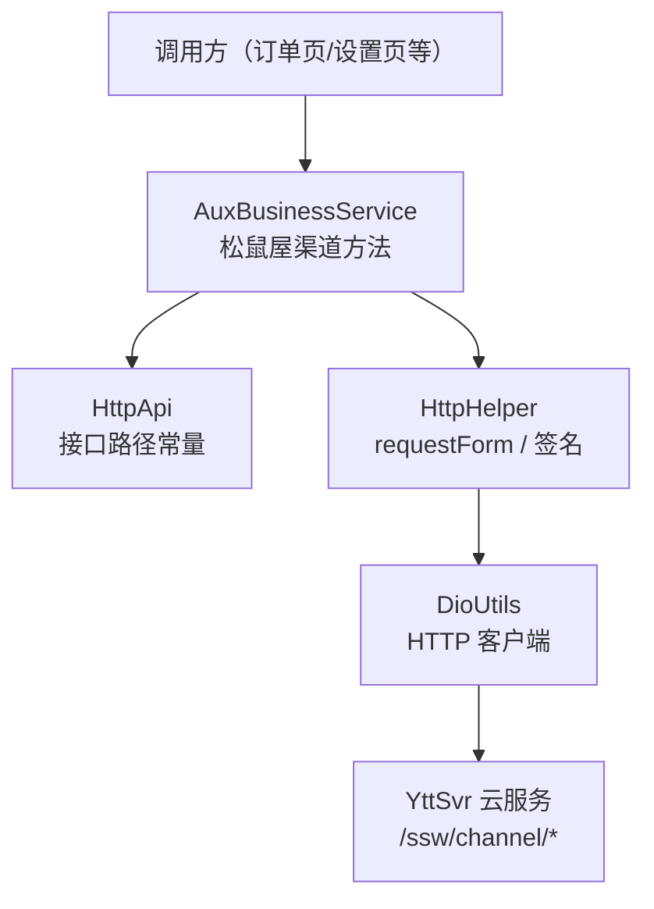
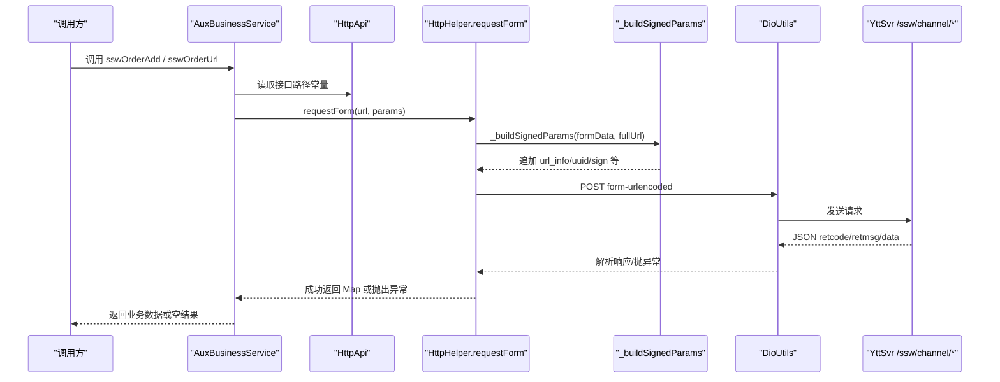
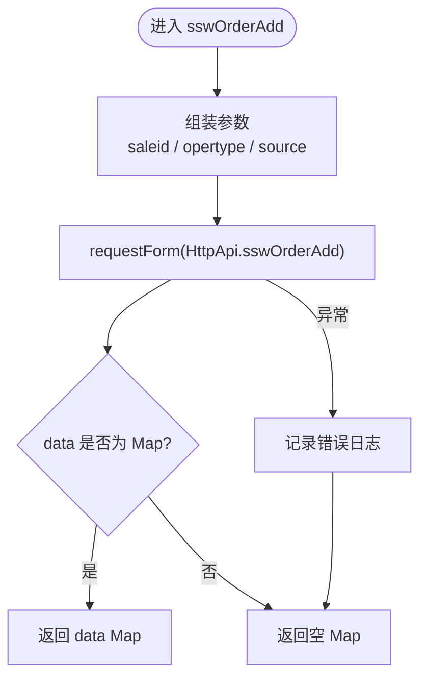
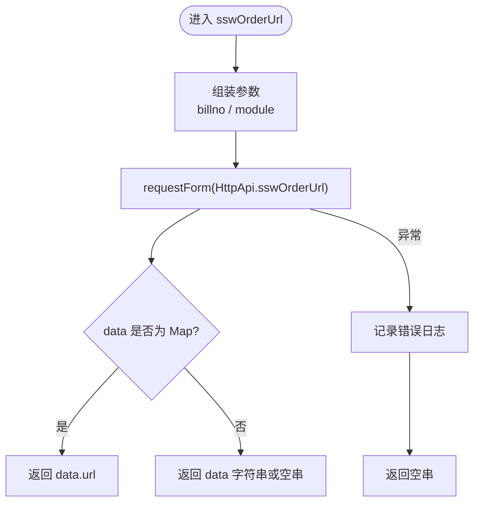
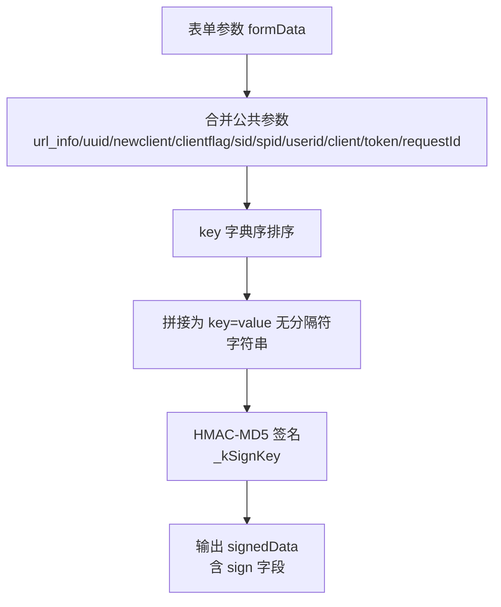
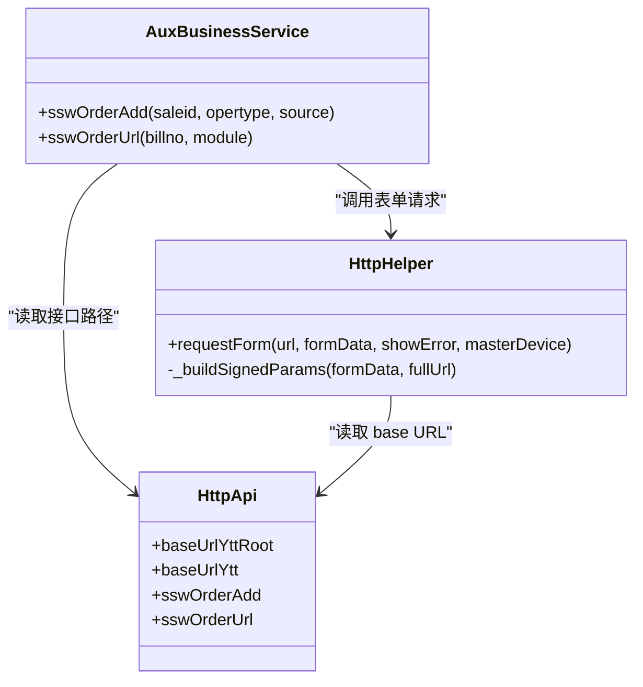
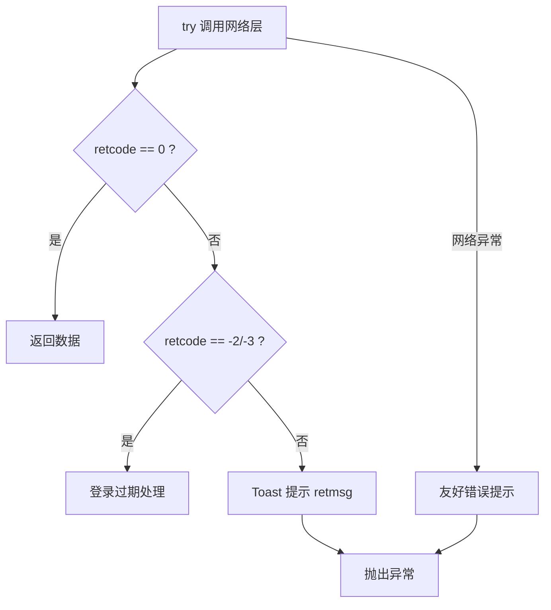

# 松鼠屋渠道服务

<cite>
**本文引用的文件**   
- [lib/net/http_api.dart](file://lib/net/http_api.dart)
- [lib/util/aux_business_service.dart](file://lib/util/aux_business_service.dart)
- [lib/net/http_helper.dart](file://lib/net/http_helper.dart)
</cite>

## 目录
1. [简介](#简介)
2. [项目结构](#项目结构)
3. [核心组件](#核心组件)
4. [架构总览](#架构总览)
5. [详细组件分析](#详细组件分析)
6. [依赖关系分析](#依赖关系分析)
7. [性能与日志](#性能与日志)
8. [错误处理与故障排查](#错误处理与故障排查)
9. [对接示例与最佳实践](#对接示例与最佳实践)
10. [结论](#结论)

## 简介
本文件面向聚客美滋滋应用中的“松鼠屋”渠道服务，重点说明：
- sswOrderAdd 推单接口的参数、操作类型与来源字段含义。
- sswOrderUrl 页面URL生成接口的模块区分与返回URL使用方式。
- 与 ChannelApi 的接口映射关系、请求签名机制、API密钥管理与版本兼容。
- 错误处理、日志记录以及与外部系统的集成模式。

本项目中，松鼠屋渠道能力由 HTTP API 常量与辅助业务服务共同实现，底层统一通过表单编码 POST 请求并附加 HMAC-MD5 签名，与 smdcapp 项目的 ChannelApi 保持一致。

## 项目结构
松鼠屋渠道相关代码集中在两个位置：
- HTTP 接口路径常量定义：lib/net/http_api.dart
- 业务封装调用：lib/util/aux_business_service.dart
- 通用网络层与签名逻辑：lib/net/http_helper.dart

图示来源
- [lib/util/aux_business_service.dart:135-187](file://lib/util/aux_business_service.dart#L135-L187)
- [lib/net/http_api.dart:421-429](file://lib/net/http_api.dart#L421-L429)
- [lib/net/http_helper.dart:481-600](file://lib/net/http_helper.dart#L481-L600)

章节来源
- [lib/net/http_api.dart:421-429](file://lib/net/http_api.dart#L421-L429)
- [lib/util/aux_business_service.dart:135-187](file://lib/util/aux_business_service.dart#L135-L187)
- [lib/net/http_helper.dart:481-600](file://lib/net/http_helper.dart#L481-L600)

## 核心组件
- HttpApi：集中声明所有接口路径，包括松鼠屋渠道的两个接口。
- AuxBusinessService：对外暴露 sswOrderAdd 与 sswOrderUrl 两个方法，封装请求与基础结果解析。
- HttpHelper：提供 requestForm 表单请求、HMAC-MD5 签名、公共参数注入、异常与登录失效处理、统一日志。

章节来源
- [lib/net/http_api.dart:421-429](file://lib/net/http_api.dart#L421-L429)
- [lib/util/aux_business_service.dart:135-187](file://lib/util/aux_business_service.dart#L135-L187)
- [lib/net/http_helper.dart:481-600](file://lib/net/http_helper.dart#L481-L600)

## 架构总览
松鼠屋渠道的调用链路如下：

图示来源
- [lib/util/aux_business_service.dart:141-187](file://lib/util/aux_business_service.dart#L141-L187)
- [lib/net/http_helper.dart:387-472](file://lib/net/http_helper.dart#L387-L472)
- [lib/net/http_helper.dart:481-600](file://lib/net/http_helper.dart#L481-L600)

## 详细组件分析

### sswOrderAdd 推单接口
- 接口路径：/ssw/channel/sswOrderAdd
- 调用入口：AuxBusinessService.sswOrderAdd
- 请求参数：
  - saleid：销售单ID，必填。
  - opertype：操作类型，必填。根据注释与常见渠道语义，取值为：
    - add：新增订单
    - update：修改订单
    - cancel：取消订单
  - source：来源标识，默认 other。用于标记订单来源渠道。
- 返回值：服务端 data 字段为 Map；失败时返回空 Map。

图示来源
- [lib/util/aux_business_service.dart:141-161](file://lib/util/aux_business_service.dart#L141-L161)
- [lib/net/http_api.dart:423-425](file://lib/net/http_api.dart#L423-L425)

章节来源
- [lib/util/aux_business_service.dart:141-161](file://lib/util/aux_business_service.dart#L141-L161)
- [lib/net/http_api.dart:423-425](file://lib/net/http_api.dart#L423-L425)

#### opertype 操作类型枚举
- add：新增订单。适用于首次将订单推送到松鼠屋渠道。
- update：修改订单。适用于订单明细、金额或状态变更后的同步。
- cancel：取消订单。适用于用户取消或系统取消场景。

注意：当前代码未对 opertype 做本地校验，建议调用方保证取值规范，避免服务端拒绝或行为不一致。

章节来源
- [lib/util/aux_business_service.dart:141-161](file://lib/util/aux_business_service.dart#L141-L161)

#### source 来源标识
- 默认值：other
- 作用：标注订单来源，便于渠道统计与分流。
- 取值规范：建议沿用渠道约定的枚举值；若未明确，保持默认 other 即可。

章节来源
- [lib/util/aux_business_service.dart:141-161](file://lib/util/aux_business_service.dart#L141-L161)

### sswOrderUrl 页面URL生成接口
- 接口路径：/ssw/channel/sswOrderUrl
- 调用入口：AuxBusinessService.sswOrderUrl
- 请求参数：
  - billno：单号，必填。
  - module：模块，必填。取值：
    - orderDetail：订单详情页面
    - setting：我的页面设置
- 返回值：
  - 当 data 为 Map 时，返回 data.url；
  - 否则返回 data 字符串或空串。

图示来源
- [lib/util/aux_business_service.dart:168-187](file://lib/util/aux_business_service.dart#L168-L187)
- [lib/net/http_api.dart:427-429](file://lib/net/http_api.dart#L427-L429)

章节来源
- [lib/util/aux_business_service.dart:168-187](file://lib/util/aux_business_service.dart#L168-L187)
- [lib/net/http_api.dart:427-429](file://lib/net/http_api.dart#L427-L429)

### 与 ChannelApi 的接口映射关系
- 代码注释明确指出，上述两个接口对齐 smdcapp 项目的 ChannelApi。
- 路径映射：
  - ChannelApi.sswOrderAdd → /ssw/channel/sswOrderAdd
  - ChannelApi.sswOrderUrl → /ssw/channel/sswOrderUrl
- 基地址：
  - 云服务 base URL 为 HttpApi.baseUrlYtt，即包含 /YttSvr/app 前缀。
  - 具体根域名可在 HttpApi.baseUrlYttRoot 处切换环境。

章节来源
- [lib/net/http_api.dart:421-429](file://lib/net/http_api.dart#L421-L429)

### 请求签名机制与 API 密钥管理
- 请求方式：
  - sswOrderAdd 与 sswOrderUrl 均通过 requestForm 发送表单编码 POST 请求。
- 公共参数与签名：
  - 所有表单请求都会经过 _buildSignedParams，追加 url_info、uuid 等公共字段，并按 key 字典序拼接后计算 HMAC-MD5 签名，写入 sign。
  - 签名密钥固定为 _kSignKey，与 smdcapp 项目保持一致。
- 兼容性：
  - 支持主设备与云服务两种 base URL 解析。
  - 支持不同后端响应格式（PCRootDataBean、retcode/retmsg/data、code/message），统一异常包装与提示。

图示来源
- [lib/net/http_helper.dart:387-472](file://lib/net/http_helper.dart#L387-L472)

章节来源
- [lib/net/http_helper.dart:387-472](file://lib/net/http_helper.dart#L387-L472)

### 版本兼容与连接模式
- baseUrl 选择：
  - requestForm 使用 ConnectionManager.resolveBaseUrl(masterDevice) 决定走云服务还是主设备。
  - 松鼠屋渠道当前接口常量以相对路径形式存在，最终会拼接到对应 base URL。
- 多商户与用户上下文：
  - 上层 request 会注入 clientflag、sid、spid、userid、client、token 等上下文信息。
  - 对于表单请求，sign 计算依赖统一的签名流程，确保与 smdcapp 一致。

章节来源
- [lib/net/http_helper.dart:481-500](file://lib/net/http_helper.dart#L481-L500)
- [lib/net/http_helper.dart:100-174](file://lib/net/http_helper.dart#L100-L174)

## 依赖关系分析

图示来源
- [lib/net/http_api.dart:421-429](file://lib/net/http_api.dart#L421-L429)
- [lib/util/aux_business_service.dart:135-187](file://lib/util/aux_business_service.dart#L135-L187)
- [lib/net/http_helper.dart:387-472](file://lib/net/http_helper.dart#L387-L472)
- [lib/net/http_helper.dart:481-600](file://lib/net/http_helper.dart#L481-L600)

章节来源
- [lib/net/http_api.dart:421-429](file://lib/net/http_api.dart#L421-L429)
- [lib/util/aux_business_service.dart:135-187](file://lib/util/aux_business_service.dart#L135-L187)
- [lib/net/http_helper.dart:387-600](file://lib/net/http_helper.dart#L387-L600)

## 性能与日志
- 日志记录：
  - 所有 HTTP 请求都会记录 api_log，包含 method、path、success、elapsedMs、params、response。
  - 失败时额外写 crash_log，便于定位问题时刻。
  - 部分高频或大响应接口在成功时不逐条记录，避免日志膨胀。
- 性能考虑：
  - 松鼠屋接口属于轻量表单请求，通常影响较小。
  - 建议在批量推送时控制并发与重试间隔，避免频繁触发网络层限流或超时。

章节来源
- [lib/net/http_helper.dart:40-80](file://lib/net/http_helper.dart#L40-L80)
- [lib/net/http_helper.dart:500-600](file://lib/net/http_helper.dart#L500-L600)

## 错误处理与故障排查
- 网络异常：
  - 连接超时、发送超时、接收超时、连接错误等会被统一转换为友好中文提示，并记录异常日志。
- 业务异常：
  - 云端响应 retcode != 0 时会弹出 retmsg 并抛异常；retcode 为 -2/-3 时触发登录过期处理。
- 主设备异常：
  - 主设备网络层失败且无响应体时，会标记主设备丢失，便于前端切换连接模式。
- 松鼠屋接口异常：
  - sswOrderAdd 与 sswOrderUrl 在 catch 中记录错误日志，并返回空 Map 或空串，避免上层崩溃。

图示来源
- [lib/net/http_helper.dart:532-599](file://lib/net/http_helper.dart#L532-L599)

章节来源
- [lib/net/http_helper.dart:532-599](file://lib/net/http_helper.dart#L532-L599)
- [lib/util/aux_business_service.dart:147-187](file://lib/util/aux_business_service.dart#L147-L187)

## 对接示例与最佳实践

### 订单推送（sswOrderAdd）
- 新增订单：
  - 传入 opertype=add、source=other（或其他约定来源）。
  - 成功后检查返回 data 是否为 Map，再根据服务端约定判断是否真正成功。
- 修改订单：
  - 传入 opertype=update，并在业务侧保证 saleid 唯一且可识别。
- 取消订单：
  - 传入 opertype=cancel，并建议在 UI 层给出确认提示。

章节来源
- [lib/util/aux_business_service.dart:141-161](file://lib/util/aux_business_service.dart#L141-L161)
- [lib/net/http_api.dart:423-425](file://lib/net/http_api.dart#L423-L425)

### 状态同步
- 若松鼠屋渠道需要订单状态同步，可在订单关键状态变化时再次调用 sswOrderAdd，opertype=update。
- 建议在本地增加幂等键（如基于 saleid 与时间戳），避免重复推送导致状态抖动。

章节来源
- [lib/util/aux_business_service.dart:141-161](file://lib/util/aux_business_service.dart#L141-L161)

### 页面跳转（sswOrderUrl）
- 打开订单详情：
  - 传入 module=orderDetail，获取 URL 后在 WebView 或浏览器中打开。
- 打开我的页面设置：
  - 传入 module=setting，获取 URL 后按同样方式打开。

章节来源
- [lib/util/aux_business_service.dart:168-187](file://lib/util/aux_business_service.dart#L168-L187)
- [lib/net/http_api.dart:427-429](file://lib/net/http_api.dart#L427-L429)

### 消息队列与外部系统集成
- 当前代码未发现松鼠屋渠道相关的消息队列实现。
- 若需引入 MQ，建议在业务层封装异步任务，将推单与状态同步转为事件驱动，并结合重试与死信队列保障可靠性。

章节来源
- [lib/util/aux_business_service.dart:135-187](file://lib/util/aux_business_service.dart#L135-L187)

## 结论
松鼠屋渠道服务在当前项目中通过 HttpApi 常量与 AuxBusinessService 封装实现，底层统一采用表单编码 POST 与 HMAC-MD5 签名，与 smdcapp 的 ChannelApi 保持一致。sswOrderAdd 负责订单推送，sswOrderUrl 负责页面 URL 生成。错误处理与日志记录在网络层统一完成，调用方只需关注业务参数与返回结果。

在实际对接中，建议：
- 严格限定 opertype 与 source 取值，避免歧义。
- 对 sswOrderUrl 返回的 URL 进行安全校验后再打开。
- 在批量场景中使用限流与重试策略，结合日志快速定位问题。
- 如需扩展更多渠道能力，可参考现有模式继续扩展 HttpApi 与 AuxBusinessService。