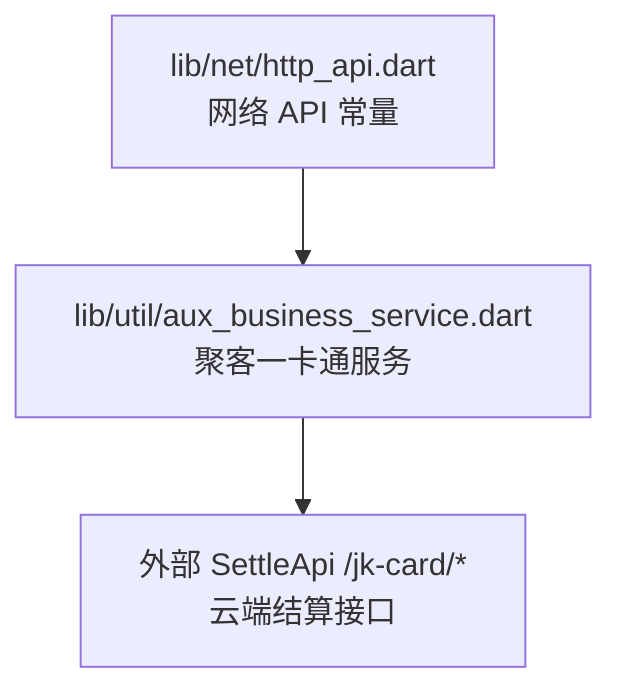
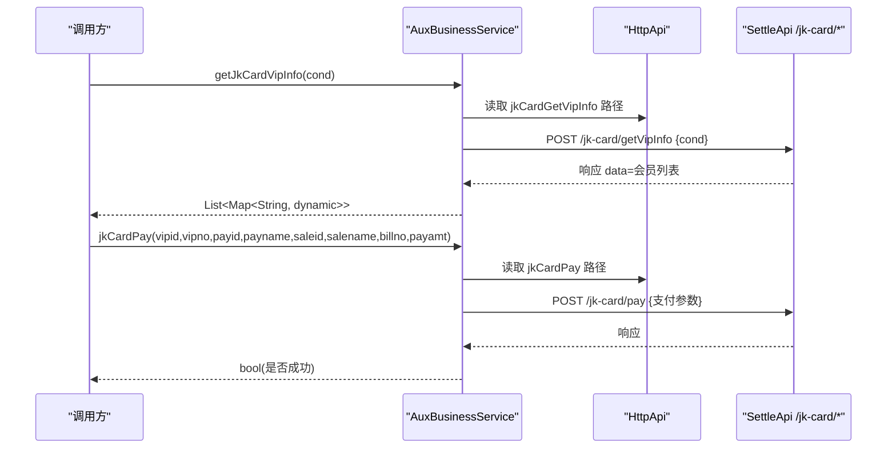
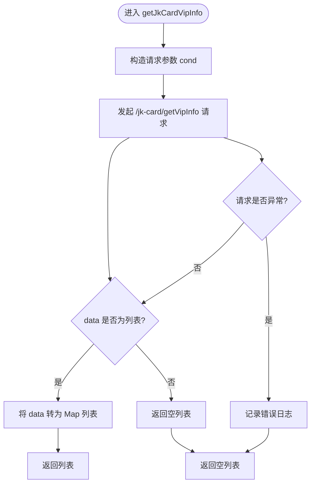
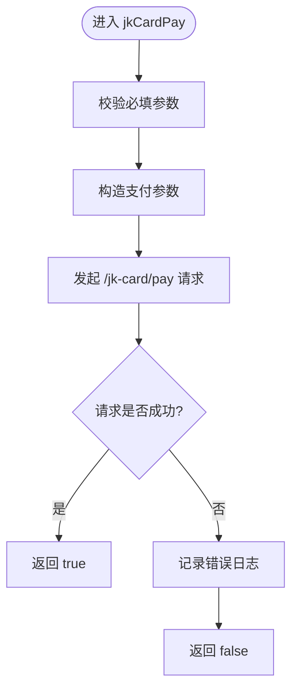
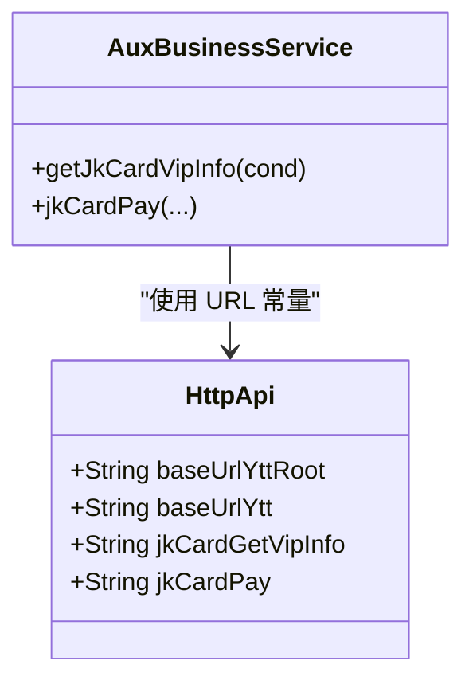

# 聚客一卡通服务

<cite>
**本文引用的文件**   
- [http_api.dart](file://lib/net/http_api.dart)
- [aux_business_service.dart](file://lib/util/aux_business_service.dart)
</cite>

## 目录
1. [引言](#引言)
2. [项目结构定位](#项目结构定位)
3. [核心组件](#核心组件)
4. [架构总览](#架构总览)
5. [详细组件分析](#详细组件分析)
6. [依赖关系分析](#依赖关系分析)
7. [性能与缓存策略](#性能与缓存策略)
8. [调用示例与最佳实践](#调用示例与最佳实践)
9. [故障排查指南](#故障排查指南)
10. [结论](#结论)

## 引言
本技术文档聚焦于聚客美滋滋应用中的“聚客一卡通”能力，围绕两个关键接口展开：
- getJkCardVipInfo：会员查询接口，支持按卡号精确、姓名和手机号模糊匹配。
- jkCardPay：一卡通支付接口，完成会员ID校验、支付方式映射、销售单关联与支付结果处理。

该功能由 HTTP 常量定义层与服务封装层共同实现：HTTP 常量集中在网络 API 定义文件中，业务方法封装在辅助业务服务中。当前代码仓库中，这两个接口尚未被页面直接引用，但已具备完整的服务契约与错误处理骨架，可直接集成到收银结账流程中。

## 项目结构定位
聚客一卡通相关代码位于以下位置：
- 网络 URL 路径与基础域名：lib/net/http_api.dart
- 聚客一卡通业务封装：lib/util/aux_business_service.dart

图表来源
- [http_api.dart:340-365](file://lib/net/http_api.dart#L340-L365)
- [aux_business_service.dart:1-65](file://lib/util/aux_business_service.dart#L1-L65)

章节来源
- [http_api.dart:1-50](file://lib/net/http_api.dart#L1-L50)
- [http_api.dart:340-365](file://lib/net/http_api.dart#L340-L365)
- [aux_business_service.dart:1-65](file://lib/util/aux_business_service.dart#L1-L65)

## 核心组件
- HttpApi（网络 API 常量）
  - 定义聚客一卡通的 URL 路径：/jk-card/getVipInfo 与 /jk-card/pay。
  - 提供云服务基础域名 baseUrlYttRoot 与 baseUrlYtt，供其他接口统一使用。
- AuxBusinessService（聚客一卡通服务）
  - getJkCardVipInfo(cond)：调用 /jk-card/getVipInfo，返回会员列表。
  - jkCardPay(...)：调用 /jk-card/pay，返回是否成功。

章节来源
- [http_api.dart:340-365](file://lib/net/http_api.dart#L340-L365)
- [aux_business_service.dart:1-65](file://lib/util/aux_business_service.dart#L1-L65)

## 架构总览
聚客一卡通服务采用“常量 + 服务”的分层模式：
- 常量层集中管理 URL 路径与环境基础域名，避免硬编码分散在各处。
- 服务层负责参数构造、请求发送、结果解析与异常日志记录。
- 实际远程端点为 SettleApi 的 /jk-card/* 接口。

图表来源
- [aux_business_service.dart:18-65](file://lib/util/aux_business_service.dart#L18-L65)
- [http_api.dart:340-365](file://lib/net/http_api.dart#L340-L365)

## 详细组件分析

### 会员查询接口 getJkCardVipInfo
职责
- 通过 cond 条件搜索会员信息，返回会员列表。
- 对网络失败或数据格式异常进行兜底处理，保证上层调用稳定。

请求参数
- cond：字符串条件，用于服务端侧进行卡号、姓名、手机号的筛选。

响应处理
- 若响应 data 字段为数组，则将其转换为 Map 列表返回；否则返回空列表。
- 异常时打印错误日志并返回空列表。

条件搜索规则说明
- 当前服务层仅透传 cond 字符串，不对其内部构造做强制约束。
- 根据注释语义，“卡号精确匹配、姓名和手机号模糊匹配”通常由服务端依据 cond 的格式判断。前端应遵循如下约定：
  - 卡号精确匹配：传入完整卡号数字串。
  - 姓名模糊匹配：传入部分姓名文本。
  - 手机号模糊匹配：传入部分手机号数字串。
- 若需在前端统一构造 cond，建议在调用前对输入进行 trim 与长度限制，避免无效请求。

复杂度与健壮性
- 时间复杂度 O(n)，n 为会员列表项数量。
- 空间复杂度 O(n)，用于承载返回的 Map 列表。
- 对非 List 类型的 data 进行防御式处理，防止崩溃。

图表来源
- [aux_business_service.dart:18-35](file://lib/util/aux_business_service.dart#L18-L35)

章节来源
- [aux_business_service.dart:18-35](file://lib/util/aux_business_service.dart#L18-L35)
- [http_api.dart:340-365](file://lib/net/http_api.dart#L340-L365)

### 一卡通支付接口 jkCardPay
职责
- 提交一卡通支付请求，包含会员 ID、会员卡号、支付方式、销售单信息与金额等。
- 返回布尔值表示支付是否成功；异常时返回 false 并记录日志。

参数说明
- vipid：会员 ID，用于唯一标识会员。
- vipno：会员卡号，便于展示与核对。
- payid：支付方式编码，对应微信、支付宝、现金等。
- payname：支付方式名称，便于 UI 显示。
- saleid：销售单 ID，用于关联订单与支付流水。
- salename：销售单名称或描述。
- billno：单据编号，通常为订单号或收银流水号。
- payamt：支付金额，以字符串形式传递。

vipid 验证建议
- 当前服务层未对 vipid 做本地校验，仅在失败时记录日志。
- 建议在调用前确保 vipid 非空且符合服务端规范，例如：
  - 非空且长度合理。
  - 与所选会员信息一致。
  - 在会员查询成功后再调用支付，避免孤儿支付。

payid 映射建议
- 建议维护一个支付方式枚举或映射表，将 UI 选择的支付方式映射为后端 payid。
- 常见映射参考：
  - 微信支付 → 对应服务端定义的微信 payid。
  - 支付宝 → 对应服务端定义的支付宝 payid。
  - 现金 → 对应服务端定义的现金 payid。
- 若支付方式来自 getPayInfoList，则应以服务端返回的 payid/payname 为准，避免硬编码。

saleid 关联关系
- saleid 必须与待结账订单一致，确保支付流水可追溯到具体订单。
- 建议在下单成功后生成 saleid，并在支付时携带。

回调处理
- 当前 jkCardPay 直接返回 bool，没有异步回调结构。
- 若需要支付状态回调，可在上层封装一个 Future<bool> 包装器，结合本地状态机与重试逻辑。

图表来源
- [aux_business_service.dart:39-65](file://lib/util/aux_business_service.dart#L39-L65)

章节来源
- [aux_business_service.dart:39-65](file://lib/util/aux_business_service.dart#L39-L65)
- [http_api.dart:340-365](file://lib/net/http_api.dart#L340-L365)

### 与 SettleApi 的接口映射
URL 路径
- 会员查询：/jk-card/getVipInfo
- 一卡通支付：/jk-card/pay

基础域名
- baseUrlYttRoot：云服务根路径，如 dev/test/prod 环境。
- baseUrlYtt：baseUrlYttRoot + “/app”，多数业务接口使用该前缀。
- 聚客一卡通接口路径不以 /app 开头，而是直接使用 /jk-card/*，与注释中对齐 smdcapp SettleApi 的描述一致。

请求头与鉴权
- 当前文件未定义聚客一卡通专用的请求头或鉴权参数。
- 鉴权机制通常由底层网络库或拦截器统一处理，例如登录态 token、商户号、设备号等。
- 若后续需要新增鉴权头，应在 HttpApi 或网络工具层统一扩展，避免在业务服务内散落。

章节来源
- [http_api.dart:1-50](file://lib/net/http_api.dart#L1-L50)
- [http_api.dart:340-365](file://lib/net/http_api.dart#L340-L365)

## 依赖关系分析
- AuxBusinessService 依赖 HttpApi 提供的静态常量，从而解耦 URL 路径与业务逻辑。
- 当前代码中 AuxBusinessService 未被页面或其他模块引用，属于可复用服务，便于后续接入收银结账流程。

图表来源
- [http_api.dart:340-365](file://lib/net/http_api.dart#L340-L365)
- [aux_business_service.dart:1-65](file://lib/util/aux_business_service.dart#L1-L65)

章节来源
- [http_api.dart:340-365](file://lib/net/http_api.dart#L340-L365)
- [aux_business_service.dart:1-65](file://lib/util/aux_business_service.dart#L1-L65)

## 性能与缓存策略
当前实现特点
- getJkCardVipInfo 每次都会发起网络请求，无本地缓存。
- jkCardPay 直接返回布尔结果，无幂等性与重试策略。
- 错误处理以 try/catch 包裹，记录日志后返回空结果或 false。

优化建议
- 会员查询缓存
  - 基于 cond 构建缓存键，例如：card_exact、name_fuzzy、phone_fuzzy。
  - 设置短期过期策略，如 1~5 分钟，兼顾实时性与性能。
  - 对频繁查询的常用会员（如常来顾客）可适当延长缓存时间。
- 支付方式缓存
  - 支付方式列表可通过 getPayInfoList 获取并缓存，减少重复请求。
- 支付重试与幂等
  - 在网络不稳定时增加有限次重试，配合指数退避。
  - 对同一 saleid 与 payamt 的请求去重，避免重复扣款。
- 本地存储
  - 可使用 Flutter 本地存储方案（如 SharedPreferences、SQLite）保存最近一次会员查询结果与支付方式列表。
  - 注意敏感信息（如会员卡号、金额）不应明文长期保存。

[本节为通用性能指导，不直接分析具体文件]

## 调用示例与最佳实践
由于本仓库未包含对外暴露的示例入口，以下为面向集成者的调用范式说明，不包含具体源码片段。

参数构建
- 会员查询
  - 卡号精确：cond = 完整卡号。
  - 姓名模糊：cond = 部分姓名。
  - 手机号模糊：cond = 部分手机号。
- 一卡通支付
  - vipid：从会员查询结果中选择。
  - vipno：同步会员卡号。
  - payid/payname：从支付方式列表选择或按映射表转换。
  - saleid：与当前订单一致。
  - salename/billno/payamt：订单名称、单号与金额。

异常处理
- 捕获网络异常与数据解析异常。
- 对于会员查询失败，返回空列表并提示用户重新输入。
- 对于支付失败，提示用户检查网络连接或支付方式，并提供重试按钮。

重试策略
- 会员查询：最多重试 1 次，间隔 1~2 秒。
- 支付请求：最多重试 2~3 次，采用指数退避（如 1s、2s、4s）。
- 对超时与连接失败的错误优先重试，对业务错误码（如会员不存在）不重试。

错误码解析
- 当前服务层未对响应码做细化解析，建议在 HttpHelper 或拦截器层统一处理 retcode/retmsg。
- 若 SettleApi 返回特定错误码（如会员不存在、余额不足），应在上层给出明确提示。

章节来源
- [aux_business_service.dart:18-65](file://lib/util/aux_business_service.dart#L18-L65)
- [http_api.dart:340-365](file://lib/net/http_api.dart#L340-L365)

## 故障排查指南
常见问题
- 会员查询返回空列表
  - 检查 cond 是否符合预期：卡号是否完整、姓名/手机号是否足够区分。
  - 检查网络连通性与基础域名是否正确。
  - 查看日志中 AuxBusinessService.getJkCardVipInfo error 输出。
- 一卡通支付返回失败
  - 检查 vipid/vipno/payid/saleid 是否与业务上下文一致。
  - 检查 payamt 是否为合法金额字符串。
  - 查看日志中 AuxBusinessService.jkCardPay error 输出。
- 支付重复或漏单
  - 检查上层是否对同一 saleid 发起多次支付。
  - 引入本地幂等键，避免重复提交。
  - 结合服务器支付流水对账。

章节来源
- [aux_business_service.dart:18-65](file://lib/util/aux_business_service.dart#L18-L65)

## 结论
聚客一卡通服务在当前代码库中以简洁清晰的方式实现了会员查询与支付两大核心能力：
- HttpApi 集中管理 URL 路径与环境基础域名。
- AuxBusinessService 提供稳定的服务封装，负责参数构造、请求发送与错误日志记录。
- 当前尚未被页面直接调用，便于后续无缝接入收银结账流程。

建议后续完善的方向包括：
- 在前端统一构造 cond 的规则与校验。
- 建立支付方式映射表与缓存。
- 增强会员查询与支付的重试、幂等与错误码解析。
- 按需实现会员信息缓存与本地存储策略。