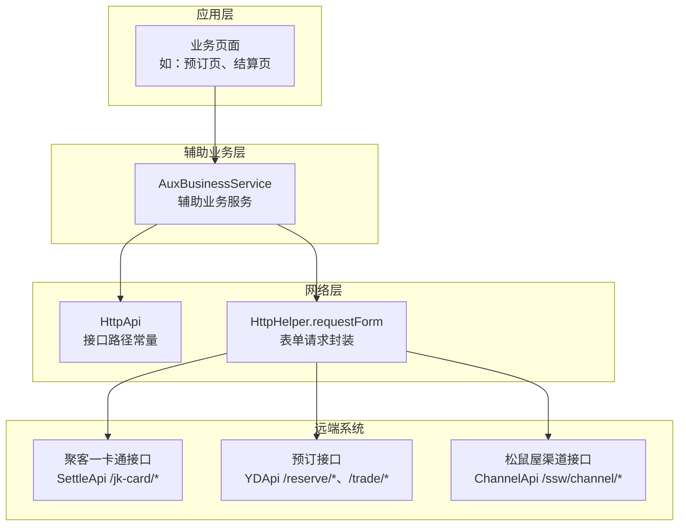
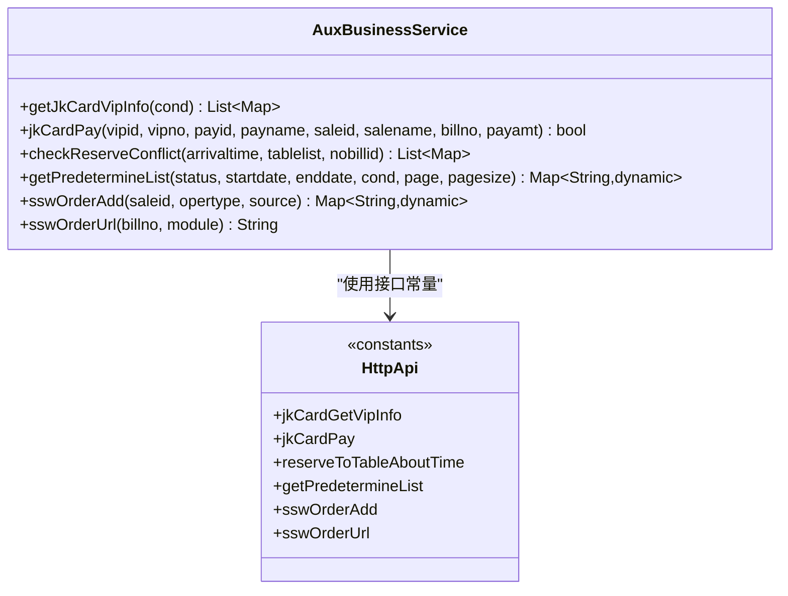
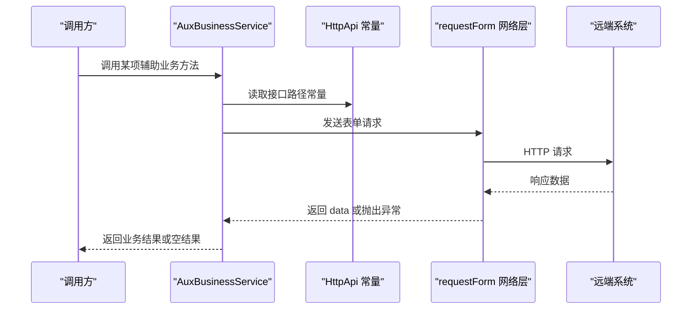
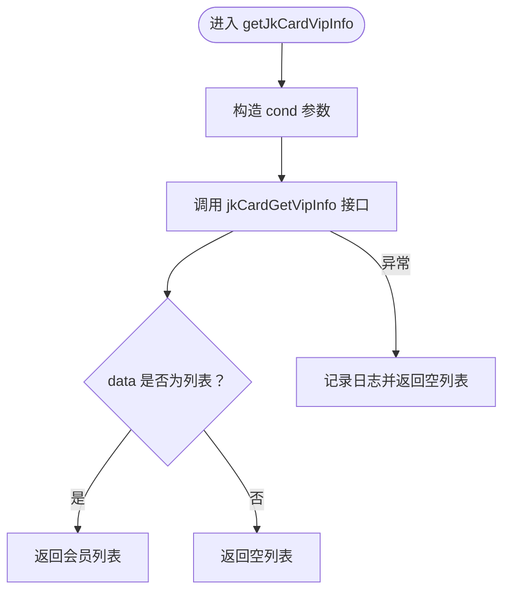
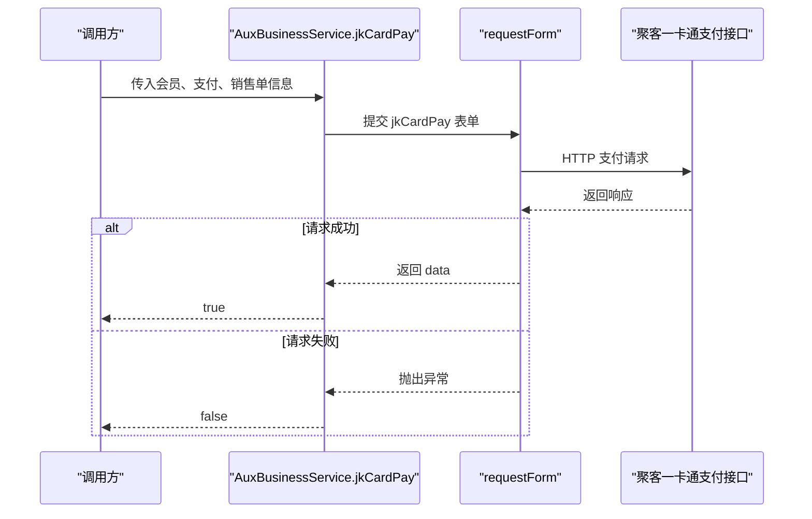
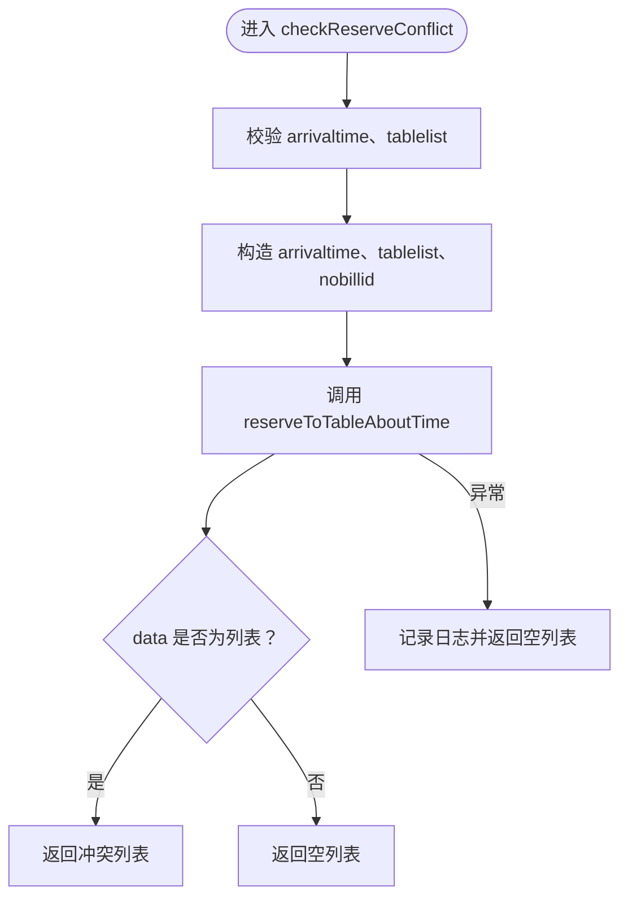
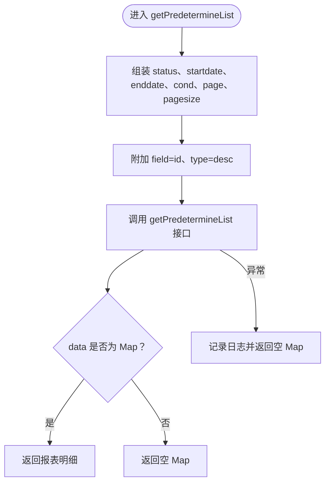
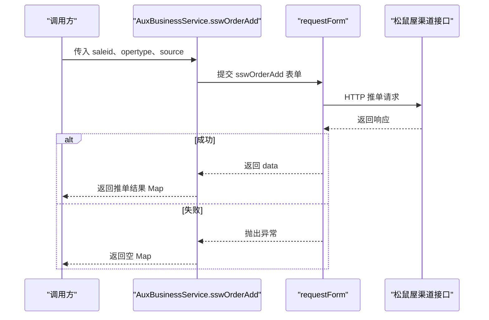
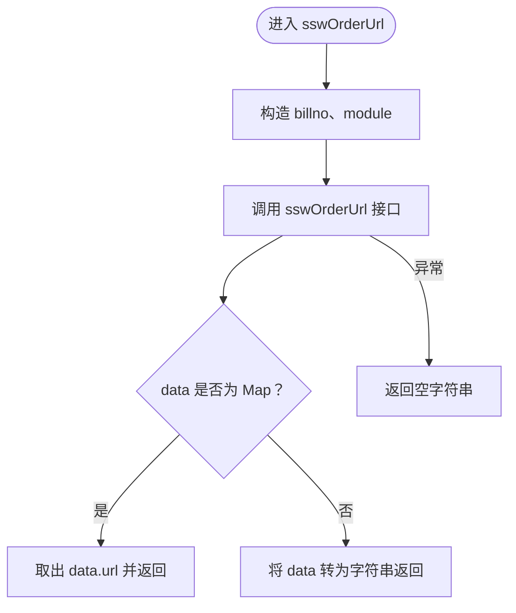
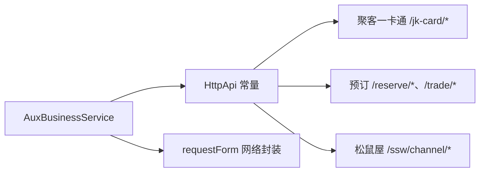

# 辅助业务服务

<cite>
**本文引用的文件**   
- [aux_business_service.dart](file://lib/util/aux_business_service.dart)
- [http_api.dart](file://lib/net/http_api.dart)
</cite>

## 目录
1. [引言](#引言)
2. [项目结构定位](#项目结构定位)
3. [核心组件总览](#核心组件总览)
4. [架构总览](#架构总览)
5. [详细组件分析](#详细组件分析)
6. [依赖关系分析](#依赖关系分析)
7. [性能与健壮性](#性能与健壮性)
8. [故障排查指南](#故障排查指南)
9. [结论](#结论)

## 引言
AuxBusinessService 是聚客美滋滋应用中的“辅助业务服务”，统一封装三类外部或跨系统业务能力：
- 聚客一卡通：会员查询、一卡通支付。
- 预订报表：预订冲突检测、预订报表明细查询。
- 松鼠屋渠道：订单推送、页面 URL 生成。

该服务不直接承载界面逻辑，而是作为业务层对外的稳定 API 入口，内部通过统一的 HTTP 请求工具访问云服务接口。其设计目标是降低上层调用方对网络细节、参数构造、异常处理的感知复杂度，同时保持与 smdcapp 侧 SettleApi、YDApi、ChannelApi 的语义对齐。

## 项目结构定位
AuxBusinessService 位于应用的 `lib/util` 工具模块中，属于辅助能力层；HTTP 接口常量集中在 `lib/net/http_api.dart` 中，由 AuxBusinessService 按需引用。

**图示来源**
- [aux_business_service.dart:1-188](file://lib/util/aux_business_service.dart#L1-L188)
- [http_api.dart:340-356](file://lib/net/http_api.dart#L340-L356)
- [http_api.dart:420-430](file://lib/net/http_api.dart#L420-L430)
- [http_api.dart:460-470](file://lib/net/http_api.dart#L460-L470)

**章节来源**
- [aux_business_service.dart:1-188](file://lib/util/aux_business_service.dart#L1-L188)
- [http_api.dart:340-356](file://lib/net/http_api.dart#L340-L356)
- [http_api.dart:420-430](file://lib/net/http_api.dart#L420-L430)
- [http_api.dart:460-470](file://lib/net/http_api.dart#L460-L470)

## 核心组件总览
AuxBusinessService 以单例形式提供六项关键方法：
- 聚客一卡通
  - getJkCardVipInfo：按条件查询会员列表。
  - jkCardPay：完成一卡通支付并返回成功与否。
- 预订报表
  - checkReserveConflict：校验到店时间与桌台占用冲突。
  - getPredetermineList：分页查询预订报表明细。
- 松鼠屋渠道
  - sswOrderAdd：向松鼠屋渠道推单。
  - sswOrderUrl：根据单号与模块生成松鼠屋页面 URL。

**图示来源**
- [aux_business_service.dart:1-188](file://lib/util/aux_business_service.dart#L1-L188)
- [http_api.dart:340-356](file://lib/net/http_api.dart#L340-L356)
- [http_api.dart:420-430](file://lib/net/http_api.dart#L420-L430)
- [http_api.dart:460-470](file://lib/net/http_api.dart#L460-L470)

## 架构总览
AuxBusinessService 的职责边界清晰：它不解析业务状态码的具体含义，也不承担 UI 展示；它负责把业务参数组装成表单字段，调用 requestForm，并对常见异常做兜底处理。真正的外部系统集成点由 HttpApi 常量定义。

**图示来源**
- [aux_business_service.dart:1-188](file://lib/util/aux_business_service.dart#L1-L188)
- [http_api.dart:340-356](file://lib/net/http_api.dart#L340-L356)
- [http_api.dart:420-430](file://lib/net/http_api.dart#L420-L430)
- [http_api.dart:460-470](file://lib/net/http_api.dart#L460-L470)

## 详细组件分析

### 聚客一卡通：会员查询接口 getJkCardVipInfo
该方法用于聚客一卡通会员查询，核心输入为 cond，支持卡号、姓名、手机号等模糊匹配条件。服务端返回 data 为列表时，会被转换为 `List<Map<String, dynamic>>`；否则返回空列表。

- 输入参数
  - cond：卡号、姓名或手机号等搜索条件。
- 返回值
  - 成功且 data 为列表：返回会员记录集合。
  - data 非列表、网络异常、JSON 解析失败：返回空列表。
- 错误处理
  - 所有异常被捕获并记录日志，对外表现为空列表，避免上层因异常中断业务流程。

**图示来源**
- [aux_business_service.dart:14-35](file://lib/util/aux_business_service.dart#L14-L35)
- [http_api.dart:349-352](file://lib/net/http_api.dart#L349-L352)

**章节来源**
- [aux_business_service.dart:14-35](file://lib/util/aux_business_service.dart#L14-L35)
- [http_api.dart:349-352](file://lib/net/http_api.dart#L349-L352)

### 聚客一卡通：支付接口 jkCardPay
该方法封装一卡通支付流程，关键字段包括：
- vipid：会员 ID。
- vipno：会员卡号。
- payid：支付方式 ID。
- payname：支付方式名称。
- saleid：销售单 ID。
- salename：销售单名称。
- billno：单据编号。
- payamt：支付金额。

该方法期望服务器正常返回即视为成功；若请求抛出异常，则返回 false。

- 输入参数
  - vipid、vipno、payid、payname、saleid、salename、billno、payamt。
- 返回值
  - true：表示支付请求成功到达服务端并被接受。
  - false：表示网络异常、参数错误或响应不符合预期。
- 注意事项
  - 当前实现没有解析服务端 data 的业务状态码，成功判断基于是否抛出异常。
  - 如需更严格的成功判定，应在上层或服务扩展中对 data 字段进行校验。

**图示来源**
- [aux_business_service.dart:36-67](file://lib/util/aux_business_service.dart#L36-L67)
- [http_api.dart:353-356](file://lib/net/http_api.dart#L353-L356)

**章节来源**
- [aux_business_service.dart:36-67](file://lib/util/aux_business_service.dart#L36-L67)
- [http_api.dart:353-356](file://lib/net/http_api.dart#L353-L356)

### 预订报表：预订冲突检测接口 checkReserveConflict
该方法用于在创建或编辑预订时检测到店时间与桌台占用是否存在冲突。

- 输入参数
  - arrivaltime：到店时间。
  - tablelist：预订桌台列表 JSON 字符串。
  - nobillid：编辑时需要排除自身预订单 ID，避免误判自身为冲突。
- 返回值
  - data 为列表时返回冲突预订记录集合。
  - data 非列表、网络异常、JSON 解析失败时返回空列表。
- 典型场景
  - 新增预订：nobillid 为空。
  - 编辑预订：nobillid 填写当前预订单 ID，防止自身与自身冲突。

**图示来源**
- [aux_business_service.dart:68-99](file://lib/util/aux_business_service.dart#L68-L99)
- [http_api.dart:462-465](file://lib/net/http_api.dart#L462-L465)

**章节来源**
- [aux_business_service.dart:68-99](file://lib/util/aux_business_service.dart#L68-L99)
- [http_api.dart:462-465](file://lib/net/http_api.dart#L462-L465)

### 预订报表：明细查询接口 getPredetermineList
该方法用于查询预订报表明细，支持状态筛选、日期范围、模糊条件与分页。

- 输入参数
  - status：状态筛选。
  - startdate、enddate：日期范围。
  - cond：模糊查询条件。
  - page：页码，默认 1。
  - pagesize：每页数量，默认 50。
- 固定参数
  - field：id。
  - type：desc，表示按 id 降序。
- 返回值
  - data 为 Map 时返回报表明细对象。
  - data 非 Map、网络异常、JSON 解析失败时返回空 Map。

**图示来源**
- [aux_business_service.dart:100-132](file://lib/util/aux_business_service.dart#L100-L132)
- [http_api.dart:466-470](file://lib/net/http_api.dart#L466-L470)

**章节来源**
- [aux_business_service.dart:100-132](file://lib/util/aux_business_service.dart#L100-L132)
- [http_api.dart:466-470](file://lib/net/http_api.dart#L466-L470)

### 松鼠屋渠道：推单接口 sswOrderAdd
该方法用于将订单信息推送至松鼠屋渠道。

- 输入参数
  - saleid：销售单 ID。
  - opertype：操作类型，对应新增、修改、取消等语义。
  - source：来源标识，默认 other。
- 返回值
  - data 为 Map 时返回推单结果。
  - data 非 Map、网络异常、JSON 解析失败时返回空 Map。

**图示来源**
- [aux_business_service.dart:133-162](file://lib/util/aux_business_service.dart#L133-L162)
- [http_api.dart:423-426](file://lib/net/http_api.dart#L423-L426)

**章节来源**
- [aux_business_service.dart:133-162](file://lib/util/aux_business_service.dart#L133-L162)
- [http_api.dart:423-426](file://lib/net/http_api.dart#L423-L426)

### 松鼠屋渠道：页面 URL 生成接口 sswOrderUrl
该方法根据单号和模块生成松鼠屋相关页面 URL。

- 输入参数
  - billno：订单编号。
  - module：模块区分，orderDetail 表示订单详情，setting 表示我的页面设置。
- 返回值
  - 优先从 data.url 获取 URL 字符串。
  - 如果 data 不是 Map，则尝试将 data 转为字符串。
  - 异常时返回空字符串。

**图示来源**
- [aux_business_service.dart:163-187](file://lib/util/aux_business_service.dart#L163-L187)
- [http_api.dart:427-429](file://lib/net/http_api.dart#L427-L429)

**章节来源**
- [aux_business_service.dart:163-187](file://lib/util/aux_business_service.dart#L163-L187)
- [http_api.dart:427-429](file://lib/net/http_api.dart#L427-L429)

## 依赖关系分析
AuxBusinessService 只依赖两个底层设施：
- HttpApi：集中声明各子系统接口路径，保证接口名与远端系统语义一致。
- HttpHelper.requestForm：统一表单请求封装，负责网络层调用与基础异常传播。

**图示来源**
- [aux_business_service.dart:1-188](file://lib/util/aux_business_service.dart#L1-L188)
- [http_api.dart:340-356](file://lib/net/http_api.dart#L340-L356)
- [http_api.dart:420-430](file://lib/net/http_api.dart#L420-L430)
- [http_api.dart:460-470](file://lib/net/http_api.dart#L460-L470)

**章节来源**
- [aux_business_service.dart:1-188](file://lib/util/aux_business_service.dart#L1-L188)
- [http_api.dart:340-356](file://lib/net/http_api.dart#L340-L356)
- [http_api.dart:420-430](file://lib/net/http_api.dart#L420-L430)
- [http_api.dart:460-470](file://lib/net/http_api.dart#L460-L470)

## 性能与健壮性
- 空结果兜底：多数查询方法在网络异常或 data 类型不符时返回空集合或空对象，避免上层因异常崩溃。
- 日志记录：每个方法 catch 块均记录错误日志，便于问题定位。
- 请求模式：统一使用表单请求，适合后端传统 REST 接口。
- 可扩展点：
  - 当前部分方法未对服务端 data 的业务状态码做显式校验，可在未来增强统一的状态码解析器。
  - 对于需要重试的场景（如网络抖动），可在上层引入重试策略，或在 AuxBusinessService 中增加可选重试参数。

[本节为通用指导，不直接分析具体代码行]

## 故障排查指南
- 会员查询无结果
  - 检查 cond 是否包含有效关键词。
  - 确认远端会员库是否存在匹配记录。
  - 查看日志中 getJkCardVipInfo 的错误输出。
- 一卡通支付失败
  - 检查 vipid、vipno、payid、saleid、payamt 等必填字段是否完整。
  - 注意当前实现以是否抛出异常判断成功；若后端返回业务失败但未抛异常，需补充 data 状态码校验。
- 预订冲突检测异常
  - 检查 arrivaltime 格式是否符合后端要求。
  - 检查 tablelist JSON 是否合法。
  - 编辑时确保 nobillid 不为空，避免自身冲突误判。
- 预订报表查询异常
  - 检查 startdate、enddate 是否闭合。
  - 检查 page、pagesize 是否超出后端限制。
- 松鼠屋推单失败
  - 检查 saleid、opertype、source 是否与松鼠屋约定一致。
  - 查看 sswOrderAdd 返回的 data 内容，确认远端业务状态。
- 松鼠屋 URL 为空
  - 检查 billno 是否正确。
  - 检查 module 是否取 orderDetail 或 setting。
  - 若 data 不是 Map，URL 可能退化为原始 data 字符串，需检查远端响应结构变化。

**章节来源**
- [aux_business_service.dart:14-187](file://lib/util/aux_business_service.dart#L14-L187)

## 结论
AuxBusinessService 将聚客一卡通、预订报表、松鼠屋渠道三类辅助业务收敛为简洁稳定的 Dart 方法。它通过 HttpApi 常量与远端系统解耦，并通过 requestForm 统一网络调用方式。当前实现以“异常即失败”和“空结果兜底”为主要健壮性策略；若未来需要更强的业务语义控制，建议在服务层增加统一状态码解析、参数校验与重试机制，使上层调用方获得更明确的成功/失败语义。

[本节为总结性内容，不直接分析具体代码行]