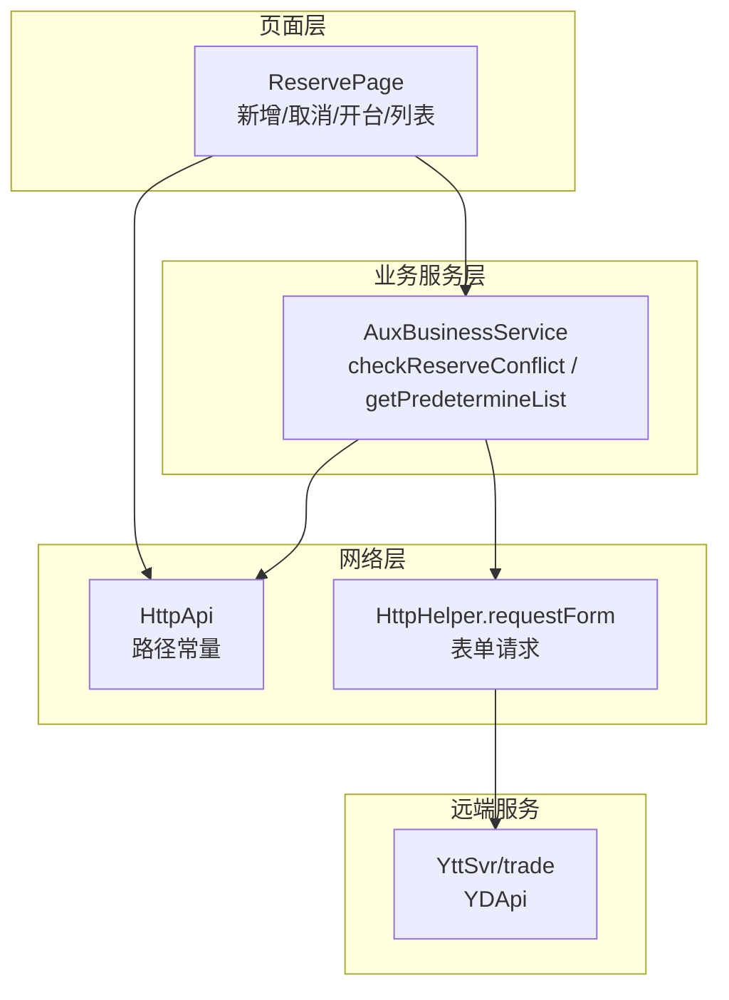
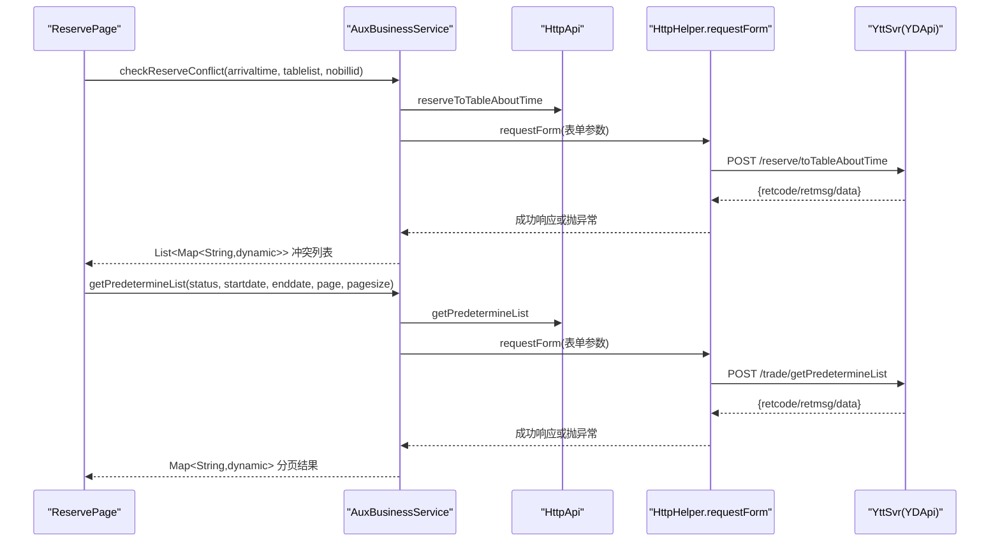
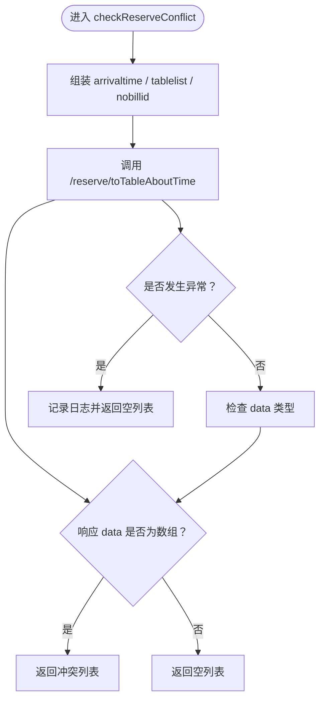
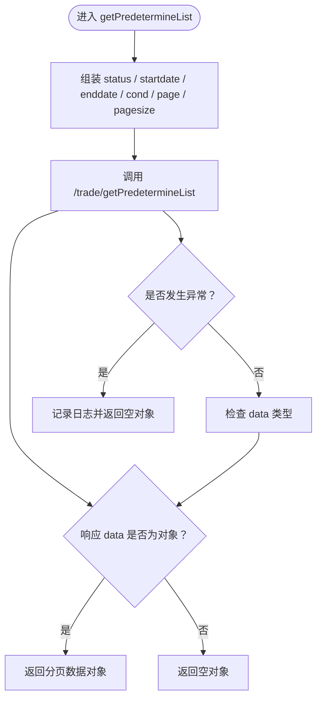
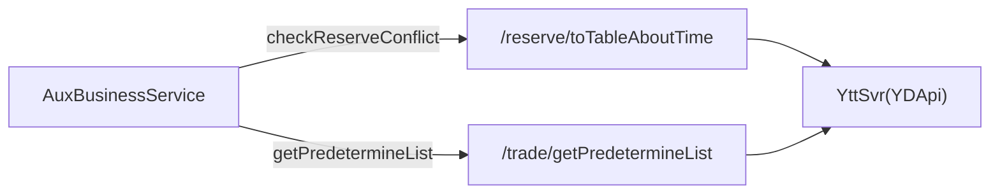
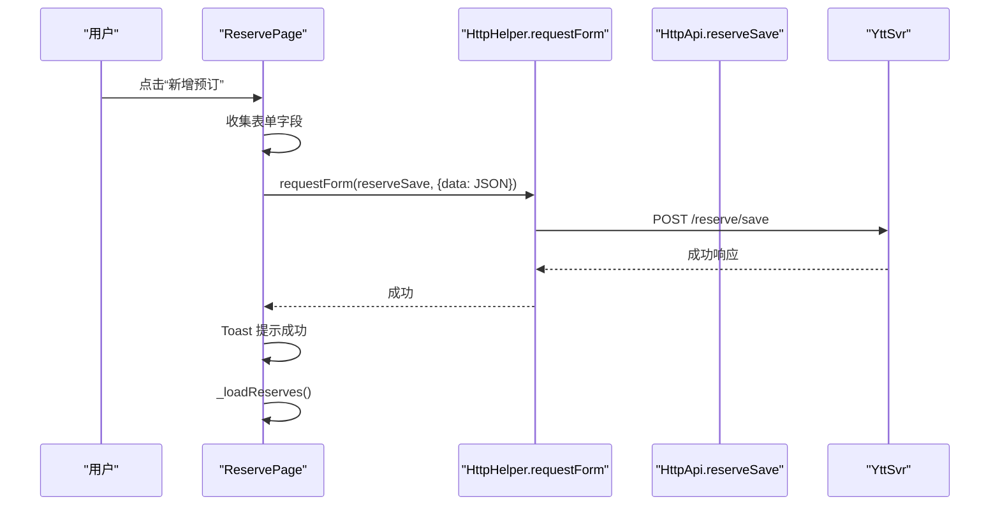
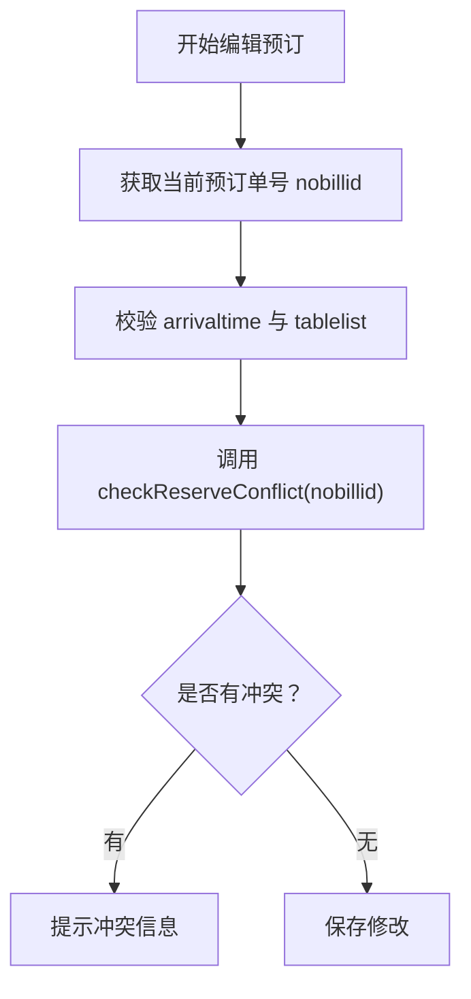
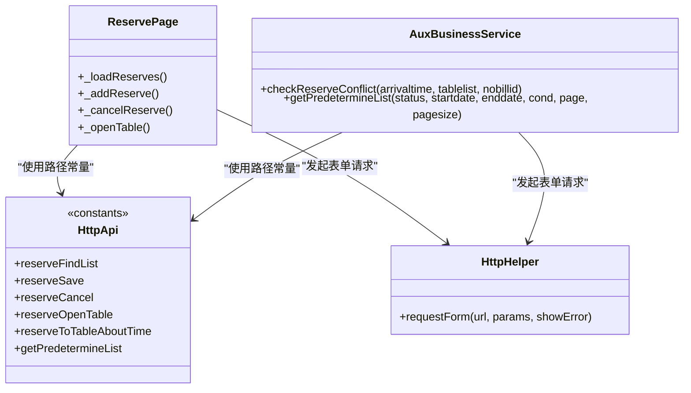

# 预订报表服务

<cite>
**本文引用的文件**   
- [reserve_page.dart](file://lib/pages/home/reserve/reserve_page.dart)
- [http_api.dart](file://lib/net/http_api.dart)
- [aux_business_service.dart](file://lib/util/aux_business_service.dart)
</cite>

## 目录
1. [简介](#简介)
2. [项目结构](#项目结构)
3. [核心组件](#核心组件)
4. [架构总览](#架构总览)
5. [详细组件分析](#详细组件分析)
6. [依赖关系分析](#依赖关系分析)
7. [性能与一致性考虑](#性能与一致性考虑)
8. [故障排查指南](#故障排查指南)
9. [结论](#结论)
10. [附录：接口与参数约定](#附录接口与参数约定)

## 简介
本文面向聚客美滋滋应用中的“预订报表服务”，聚焦以下能力：
- 预订冲突检测接口 `checkReserveConflict`：校验到店时间、桌台列表，并在编辑时排除自身单号。
- 预订报表明细查询接口 `getPredetermineList`：支持分页、状态筛选与日期范围查询。
- 与 YDApi（YttSvr/trade）的映射关系：请求参数封装、响应数据解构、错误处理机制。
- 典型业务场景：新增预订、修改预订、冲突检测、报表导出。
- 数据同步策略与缓存更新机制说明。

本说明以仓库中实际代码为依据，避免臆测；对于未在代码中实现的逻辑（如前端严格的时间格式校验、按页码滚动加载等），将以“建议实现”的形式给出。

## 项目结构
与预订报表服务直接相关的源码主要位于三个文件：
- 页面层：`lib/pages/home/reserve/reserve_page.dart`
- 网络接口常量：`lib/net/http_api.dart`
- 辅助业务服务：`lib/util/aux_business_service.dart`

**图示来源**
- [reserve_page.dart:1-200](file://lib/pages/home/reserve/reserve_page.dart#L1-L200)
- [aux_business_service.dart:1-188](file://lib/util/aux_business_service.dart#L1-L188)
- [http_api.dart:445-468](file://lib/net/http_api.dart#L445-L468)

**章节来源**
- [reserve_page.dart:1-200](file://lib/pages/home/reserve/reserve_page.dart#L1-L200)
- [aux_business_service.dart:1-188](file://lib/util/aux_business_service.dart#L1-L188)
- [http_api.dart:445-468](file://lib/net/http_api.dart#L445-L468)

## 核心组件
- `ReservePage`：展示预订列表，提供新增、取消、开台等交互；其新增预订使用 `HttpApi.reserveSave`。
- `AuxBusinessService`：封装与 YDApi 对齐的业务方法，包括：
  - `checkReserveConflict`：调用 `/reserve/toTableAboutTime`，返回冲突预订列表。
  - `getPredetermineList`：调用 `/trade/getPredetermineList`，返回报表明细的分页数据。
- `HttpApi`：集中声明所有 HTTP 路径常量，包括预订相关路径和 YDApi 路径。

**章节来源**
- [reserve_page.dart:1-200](file://lib/pages/home/reserve/reserve_page.dart#L1-L200)
- [aux_business_service.dart:1-188](file://lib/util/aux_business_service.dart#L1-L188)
- [http_api.dart:445-468](file://lib/net/http_api.dart#L445-L468)

## 架构总览
从调用方到远端的整体流程如下：

**图示来源**
- [aux_business_service.dart:43-120](file://lib/util/aux_business_service.dart#L43-L120)
- [http_api.dart:464-468](file://lib/net/http_api.dart#L464-L468)

## 详细组件分析

### 预订冲突检测接口 `checkReserveConflict`
该接口用于在用户选择到店时间和桌台后，判断是否存在预订冲突。

#### 调用入口与职责
- 暴露方法：`checkReserveConflict({arrivaltime, tablelist, nobillid})`
- 内部行为：
  - 通过 `HttpApi.reserveToTableAboutTime` 指向 `/reserve/toTableAboutTime`。
  - 使用 `requestForm` 发送表单参数 `arrivaltime`、`tablelist`、`nobillid`。
  - 若响应 `data` 为数组，则返回数组元素；否则返回空数组。
  - 异常捕获后记录日志并返回空数组。

#### 参数定义与约束
- `arrivaltime`：到店时间字符串。当前服务层未对格式做强制校验，建议在调用前统一校验为 `yyyy-MM-dd HH:mm:ss`。
- `tablelist`：桌台列表 JSON 字符串。根据业务语义应包含：
  - `tableid`：桌台ID。
  - `count`：人数。
  - 示例结构（示意）：`[{"tableid": "...", "count": 4}]`。
- `nobillid`：需要排除的单号，通常用于“编辑预订”时排除自身，避免把自身判定为冲突。

#### 返回结构与复杂度
- 返回类型：`Future<List<Map<String, dynamic>>>`
- 时间复杂度：O(n)，n 为服务端返回的冲突列表长度。
- 空间复杂度：O(n)，用于构建返回数组。

#### 错误处理
- 网络或服务异常：捕获异常，打印日志，返回空列表，不向上抛出。
- 非预期响应：当 `data` 不是数组时，返回空列表。

**图示来源**
- [aux_business_service.dart:43-86](file://lib/util/aux_business_service.dart#L43-L86)

**章节来源**
- [aux_business_service.dart:43-86](file://lib/util/aux_business_service.dart#L43-L86)
- [http_api.dart:464-464](file://lib/net/http_api.dart#L464-L464)

### 预订报表明细查询接口 `getPredetermineList`
该接口用于拉取预订报表明细，支持分页、状态筛选与日期范围。

#### 调用入口与职责
- 暴露方法：`getPredetermineList({status, startdate, enddate, cond, page, pagesize})`
- 内部行为：
  - 通过 `HttpApi.getPredetermineList` 指向 `/trade/getPredetermineList`。
  - 使用 `requestForm` 发送表单参数，包括状态、起止日期、搜索条件、分页、排序字段与方向。
  - 若响应 `data` 为对象，则返回该对象；否则返回空对象。
  - 异常捕获后记录日志并返回空对象。

#### 参数定义与约束
- `status`：状态筛选，例如已预约、已确认、已完成、已取消。具体枚举值由服务端定义。
- `startdate`、`enddate`：日期范围查询的开始与结束日期。
- `cond`：通用搜索条件，可用于模糊匹配客户姓名、电话等。
- `page`：页码，默认 `1`。
- `pagesize`：每页数量，默认 `50`。
- 固定附加参数：
  - `field: 'id'`
  - `type: 'desc'`

#### 返回结构与复杂度
- 返回类型：`Future<Map<String, dynamic>>`
- 时间复杂度：O(1) 调用 + O(k) 解析，k 为响应数据规模。
- 空间复杂度：O(k)。

#### 错误处理
- 网络或服务异常：捕获异常，打印日志，返回空对象。
- 非预期响应：当 `data` 不是对象时，返回空对象。

**图示来源**
- [aux_business_service.dart:88-120](file://lib/util/aux_business_service.dart#L88-L120)

**章节来源**
- [aux_business_service.dart:88-120](file://lib/util/aux_business_service.dart#L88-L120)
- [http_api.dart:466-468](file://lib/net/http_api.dart#L466-L468)

### 与 YDApi 的接口映射关系
- 冲突检测：
  - 本地常量：`HttpApi.reserveToTableAboutTime = '/reserve/toTableAboutTime'`
  - 对应 YDApi 路径：`/reserve/toTableAboutTime`
- 报表明细：
  - 本地常量：`HttpApi.getPredetermineList = '/trade/getPredetermineList'`
  - 对应 YDApi 路径：`/trade/getPredetermineList`

**图示来源**
- [aux_business_service.dart:43-120](file://lib/util/aux_business_service.dart#L43-L120)
- [http_api.dart:464-468](file://lib/net/http_api.dart#L464-L468)

**章节来源**
- [aux_business_service.dart:43-120](file://lib/util/aux_business_service.dart#L43-L120)
- [http_api.dart:464-468](file://lib/net/http_api.dart#L464-L468)

### 新增预订流程
当前 `ReservePage` 的新增预订流程如下：
- 用户在弹窗填写联系人、电话、人数、预订时间。
- 点击确认后，将表单序列化为 JSON，并通过 `HttpApi.reserveSave` 提交。
- 成功后刷新列表。

**图示来源**
- [reserve_page.dart:60-120](file://lib/pages/home/reserve/reserve_page.dart#L60-L120)
- [http_api.dart:451-451](file://lib/net/http_api.dart#L451-L451)

**章节来源**
- [reserve_page.dart:60-120](file://lib/pages/home/reserve/reserve_page.dart#L60-L120)
- [http_api.dart:451-451](file://lib/net/http_api.dart#L451-L451)

### 编辑预订时的自身排除逻辑
- 在编辑场景中，调用 `checkReserveConflict` 时应传入 `nobillid` 为当前编辑订单的 ID，以避免将自身与其他预订判为冲突。
- 当前代码库中未发现专门的“编辑预订”界面，但 `AuxBusinessService.checkReserveConflict` 已预留 `nobillid` 参数，供上层在编辑时传入。

**图示来源**
- [aux_business_service.dart:43-86](file://lib/util/aux_business_service.dart#L43-L86)

**章节来源**
- [aux_business_service.dart:43-86](file://lib/util/aux_business_service.dart#L43-L86)

## 依赖关系分析
- `ReservePage` 依赖 `HttpApi` 中的路径常量，并通过 `HttpHelper.requestForm` 发起网络请求。
- `AuxBusinessService` 同样依赖 `HttpApi` 与 `HttpHelper.requestForm`，并对响应进行解构与容错处理。
- 两个组件均不直接耦合网络底层细节，仅通过 `requestForm` 抽象出表单请求。

**图示来源**
- [reserve_page.dart:1-200](file://lib/pages/home/reserve/reserve_page.dart#L1-L200)
- [aux_business_service.dart:1-188](file://lib/util/aux_business_service.dart#L1-L188)
- [http_api.dart:445-468](file://lib/net/http_api.dart#L445-L468)

**章节来源**
- [reserve_page.dart:1-200](file://lib/pages/home/reserve/reserve_page.dart#L1-L200)
- [aux_business_service.dart:1-188](file://lib/util/aux_business_service.dart#L1-L188)
- [http_api.dart:445-468](file://lib/net/http_api.dart#L445-L468)

## 性能与一致性考虑
- 列表加载：`ReservePage._loadReserves` 使用一次性拉取全部数据并过滤渲染，适合小数据集；若未来数据量增长，建议引入分页或后端筛选。
- 冲突检测：调用频率应与用户输入绑定，建议加防抖，避免频繁触发远程校验。
- 报表明细：分页查询默认每次 50 条，可按需调整 `pagesize`；建议在 UI 层实现下拉加载更多，而非一次性加载全部历史数据。
- 响应解构：两处服务方法对 `data` 类型做了防御性判断，失败回退为空集合/对象，有利于提升鲁棒性。

## 故障排查指南
- 冲突检测返回空列表：
  - 检查 `arrivaltime` 是否为期望格式。
  - 检查 `tablelist` 是否为合法的 JSON 字符串且包含 `tableid`、`count`。
  - 检查 `nobillid` 是否在编辑时正确传入。
- 报表明细为空对象：
  - 检查 `status`、`startdate`、`enddate`、`cond` 是否符合服务端要求。
  - 检查 `page`、`pagesize` 是否为正数。
  - 查看日志输出，确认网络层是否抛出异常。
- 新增预订失败：
  - 检查必填字段：联系人、电话、人数、预订时间。
  - 确认 `HttpApi.reserveSave` 路径可用。

**章节来源**
- [aux_business_service.dart:43-120](file://lib/util/aux_business_service.dart#L43-L120)
- [reserve_page.dart:60-120](file://lib/pages/home/reserve/reserve_page.dart#L60-L120)

## 结论
- `checkReserveConflict` 提供了基于到店时间与桌台的冲突检测能力，并在编辑场景中通过 `nobillid` 排除自身。
- `getPredetermineList` 提供了报表明细的分页查询能力，支持状态与日期范围筛选。
- 两个接口均通过 `HttpApi` 与 `HttpHelper.requestForm` 对接远端 YDApi，具备统一的错误处理与响应解构。
- 当前页面层尚未实现严格的前端时间格式校验与完整的分页滚动加载；建议后续补充这些体验与性能优化点。

## 附录：接口与参数约定

### 冲突检测接口
- 路径：`/reserve/toTableAboutTime`
- 入参：
  - `arrivaltime`：到店时间，建议使用 `yyyy-MM-dd HH:mm:ss`。
  - `tablelist`：桌台列表 JSON 字符串，元素包含 `tableid`、`count`。
  - `nobillid`：排除单号（编辑时传当前单号）。
- 出参：
  - `data`：数组，元素为冲突预订详情。

**章节来源**
- [aux_business_service.dart:43-86](file://lib/util/aux_business_service.dart#L43-L86)
- [http_api.dart:464-464](file://lib/net/http_api.dart#L464-L464)

### 报表明细接口
- 路径：`/trade/getPredetermineList`
- 入参：
  - `status`：状态筛选（已预约/已确认/已完成/已取消）。
  - `startdate`、`enddate`：日期范围。
  - `cond`：通用搜索条件。
  - `page`：页码。
  - `pagesize`：每页数量。
  - 固定参数：`field='id'`、`type='desc'`。
- 出参：
  - `data`：对象，包含报表明细分页数据。

**章节来源**
- [aux_business_service.dart:88-120](file://lib/util/aux_business_service.dart#L88-L120)
- [http_api.dart:466-468](file://lib/net/http_api.dart#L466-L468)