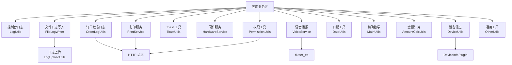
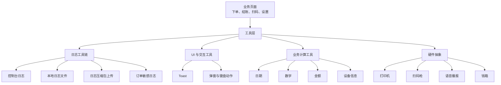
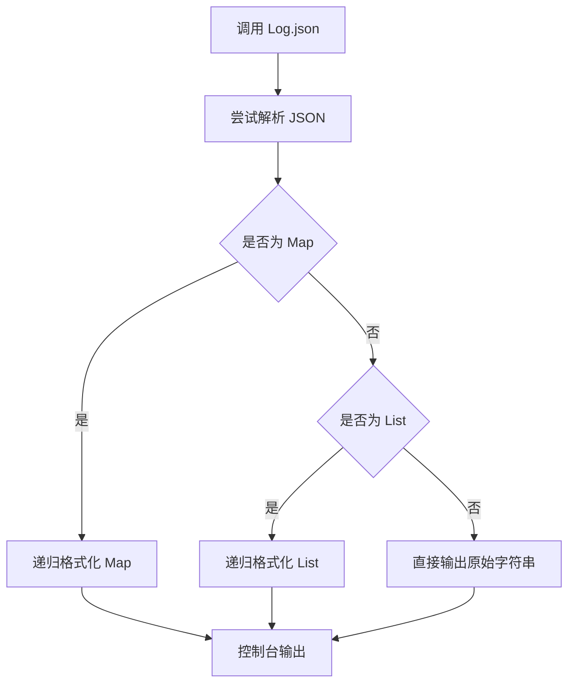
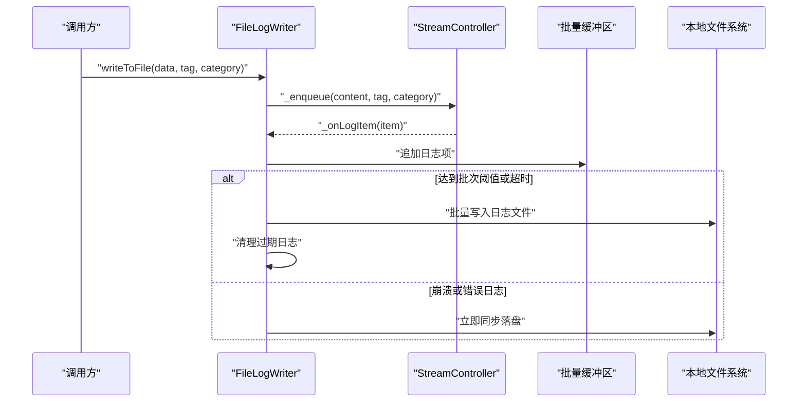
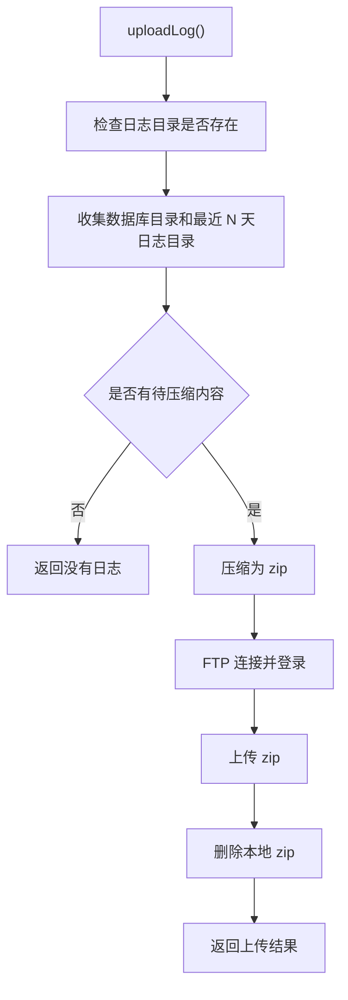
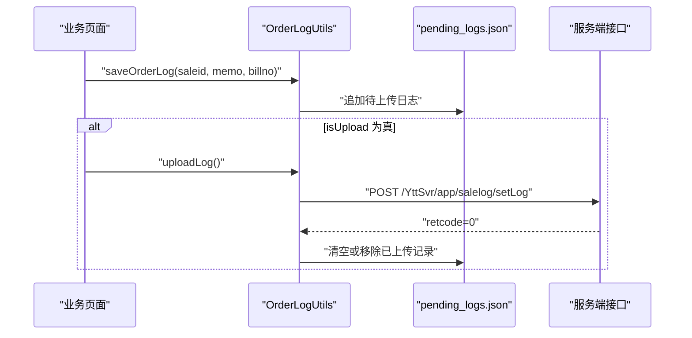
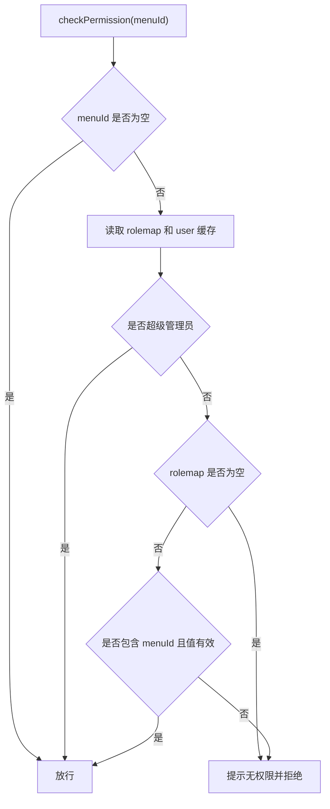
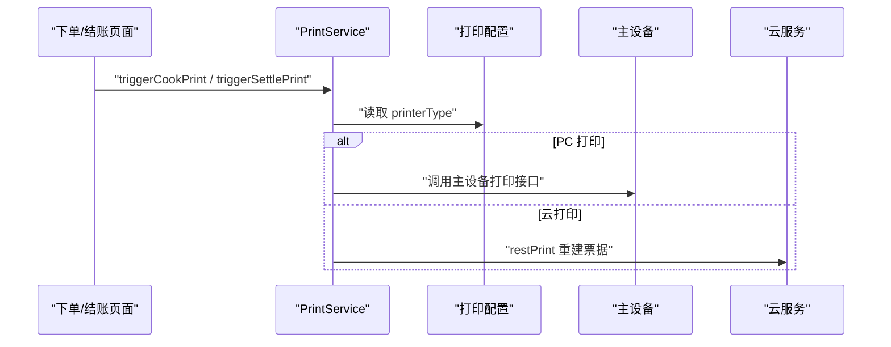
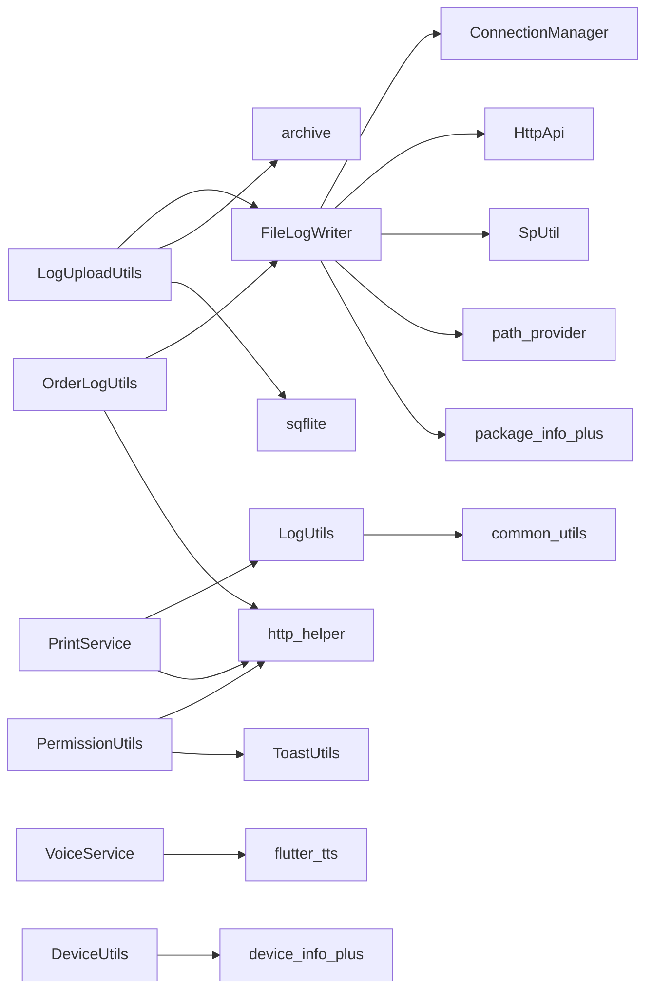

# 工具类库

<cite>
**本文引用的文件**
- [lib/util/log_utils.dart](file://lib/util/log_utils.dart)
- [lib/util/file_log_writer.dart](file://lib/util/file_log_writer.dart)
- [lib/util/log_upload_utils.dart](file://lib/util/log_upload_utils.dart)
- [lib/util/order_log_utils.dart](file://lib/util/order_log_utils.dart)
- [lib/util/toast_utils.dart](file://lib/util/toast_utils.dart)
- [lib/util/permission_utils.dart](file://lib/util/permission_utils.dart)
- [lib/util/hardware_service.dart](file://lib/util/hardware_service.dart)
- [lib/util/print_service.dart](file://lib/util/print_service.dart)
- [lib/util/voice_service.dart](file://lib/util/voice_service.dart)
- [lib/util/date_utils.dart](file://lib/util/date_utils.dart)
- [lib/util/math_utils.dart](file://lib/util/math_utils.dart)
- [lib/util/amount_calc_utils.dart](file://lib/util/amount_calc_utils.dart)
- [lib/util/device_utils.dart](file://lib/util/device_utils.dart)
- [lib/util/other_utils.dart](file://lib/util/other_utils.dart)
</cite>

## 目录

1. [引言](#引言)
2. [项目结构与工具类定位](#项目结构与工具类定位)
3. [核心工具能力总览](#核心工具能力总览)
4. [架构概览](#架构概览)
5. [详细组件分析](#详细组件分析)
6. [依赖关系分析](#依赖关系分析)
7. [性能与容量特性](#性能与容量特性)
8. [API 参考与使用示例](#api-参考与使用示例)
9. [常见问题与排错指南](#常见问题与排错指南)
10. [结论](#结论)

## 引言

聚客美滋滋应用的工具类库位于 `lib/util` 目录下，主要承担以下职责：

- 统一日志记录、文件落盘、日志压缩上传和敏感操作日志上报。
- 统一 Toast 提示、权限校验、设备信息获取。
- 统一硬件抽象（打印机、扫码枪、语音播报等）。
- 提供日期时间、数学运算、金额计算、价格格式化等常用业务工具。

这些工具类共同支撑点餐、下单、结账、打印、语音播报等业务场景，同时尽量对齐内部旧项目 `smdcapp` 的权限、日志、打印和金额计算逻辑。

## 项目结构与工具类定位

工具类库按功能划分为如下层次：

| 类别 | 主要文件 | 职责 |
|---|---|---|
| 日志系统 | `log_utils.dart`、`file_log_writer.dart`、`log_upload_utils.dart`、`order_log_utils.dart` | 控制台日志、文件日志、分类日志、错误日志、接口流水、订单敏感日志、日志压缩上传 |
| 交互提示 | `toast_utils.dart`、`other_utils.dart` | 统一 Toast、弹窗动画、链接跳转、拨号、键盘动作配置 |
| 权限管理 | `permission_utils.dart` | 菜单权限、APP 端权限、角色权限刷新、节流防抖 |
| 硬件服务 | `hardware_service.dart`、`print_service.dart`、`voice_service.dart` | NFC、扫码枪、电子秤、钱箱、云打印、PC 打印、语音播报 |
| 通用工具 | `date_utils.dart`、`math_utils.dart`、`amount_calc_utils.dart`、`device_utils.dart`、`other_utils.dart` | 日期格式、精确数学、金额抹零低消服务费、设备标识、通用辅助方法 |

**图表来源**
- [lib/util/log_utils.dart:1-106](file://lib/util/log_utils.dart#L1-L106)
- [lib/util/file_log_writer.dart:1-200](file://lib/util/file_log_writer.dart#L1-L200)
- [lib/util/log_upload_utils.dart:1-200](file://lib/util/log_upload_utils.dart#L1-L200)
- [lib/util/order_log_utils.dart:1-199](file://lib/util/order_log_utils.dart#L1-L199)
- [lib/util/permission_utils.dart:1-200](file://lib/util/permission_utils.dart#L1-L200)
- [lib/util/hardware_service.dart:1-79](file://lib/util/hardware_service.dart#L1-L79)
- [lib/util/print_service.dart:1-200](file://lib/util/print_service.dart#L1-L200)
- [lib/util/voice_service.dart:1-134](file://lib/util/voice_service.dart#L1-L134)
- [lib/util/date_utils.dart:1-200](file://lib/util/date_utils.dart#L1-L200)
- [lib/util/math_utils.dart:1-163](file://lib/util/math_utils.dart#L1-L163)
- [lib/util/amount_calc_utils.dart:1-200](file://lib/util/amount_calc_utils.dart#L1-L200)
- [lib/util/device_utils.dart:1-118](file://lib/util/device_utils.dart#L1-L118)
- [lib/util/other_utils.dart:1-104](file://lib/util/other_utils.dart#L1-L104)

**章节来源**
- [lib/util/log_utils.dart:1-106](file://lib/util/log_utils.dart#L1-L106)
- [lib/util/file_log_writer.dart:1-200](file://lib/util/file_log_writer.dart#L1-L200)
- [lib/util/log_upload_utils.dart:1-200](file://lib/util/log_upload_utils.dart#L1-L200)
- [lib/util/order_log_utils.dart:1-199](file://lib/util/order_log_utils.dart#L1-L199)
- [lib/util/toast_utils.dart:1-20](file://lib/util/toast_utils.dart#L1-L20)
- [lib/util/permission_utils.dart:1-200](file://lib/util/permission_utils.dart#L1-L200)
- [lib/util/hardware_service.dart:1-79](file://lib/util/hardware_service.dart#L1-L79)
- [lib/util/print_service.dart:1-200](file://lib/util/print_service.dart#L1-L200)
- [lib/util/voice_service.dart:1-134](file://lib/util/voice_service.dart#L1-L134)
- [lib/util/date_utils.dart:1-200](file://lib/util/date_utils.dart#L1-L200)
- [lib/util/math_utils.dart:1-163](file://lib/util/math_utils.dart#L1-L163)
- [lib/util/amount_calc_utils.dart:1-200](file://lib/util/amount_calc_utils.dart#L1-L200)
- [lib/util/device_utils.dart:1-118](file://lib/util/device_utils.dart#L1-L118)
- [lib/util/other_utils.dart:1-104](file://lib/util/other_utils.dart#L1-L104)

## 核心工具能力总览

### 日志系统

日志系统由四个模块组成：

| 模块 | 关键能力 |
|---|---|
| `LogUtils` | 控制台调试日志、JSON 美化输出、生产环境自动关闭 |
| `FileLogWriter` | 异步批量写入本地日志、按日期和分类分目录、截断保护、过期清理 |
| `LogUploadUtils` | 收集最近 N 天日志、打包 zip、FTP 上传、删除本地压缩包 |
| `OrderLogUtils` | 记录开台、退菜等敏感操作、持久化待上传列表、调用服务端接口上传 |

### Toast 提示工具

`Toast` 基于 `oktoast` 封装，支持：

- 统一显示消息。
- 控制显示时长。
- 自动取消其他 Toast。
- 全局取消所有 Toast。

### 权限管理工具

`PermissionUtils` 基于本地缓存的权限映射和用户角色进行判断，支持：

- 菜单级权限检查。
- APP 端整体权限判断。
- 超级管理员放行。
- 权限刷新接口节流。
- UI 快速判断是否隐藏或禁用按钮。

### 硬件服务集成

`HardwareService` 是硬件设备的统一抽象入口，当前包含：

- NFC 读卡接口占位。
- 扫码枪说明：扫码功能已由第三方插件提供。
- 电子秤重量读取接口占位。
- 钱箱打开接口占位，后续通过打印通道发送 ESC/POS 指令。

`PrintService` 负责实际打印流程：

- PC 打印：通过主设备接口触发。
- 云打印：通过服务端接口重建票据。
- 支持出品单、结账单、催菜单、起菜单、预打单、客单补打等。

`VoiceService` 负责语音播报：

- 新订单、扫码点餐、退单、催单、收款播报。
- 金额转中文大写。
- 基于 `flutter_tts` 实现。

### 常用工具

| 工具类 | 用途 |
|---|---|
| `DateUtils` | 月份、星期、日期范围、周起始结束、API 日期格式 |
| `MathUtils` | 避免浮点精度误差的加减乘除、求和、四舍五入 |
| `AmountCalcUtils` | 金额四则运算、抹零、低消差、服务费计算 |
| `DeviceUtils` | 平台判断、设备序列号、设备名称、Web 设备标识 |
| `OtherUtils` | 打开网页、拨号、价格格式化、键盘动作、弹性弹窗 |

**章节来源**
- [lib/util/log_utils.dart:1-106](file://lib/util/log_utils.dart#L1-L106)
- [lib/util/file_log_writer.dart:1-200](file://lib/util/file_log_writer.dart#L1-L200)
- [lib/util/log_upload_utils.dart:1-200](file://lib/util/log_upload_utils.dart#L1-L200)
- [lib/util/order_log_utils.dart:1-199](file://lib/util/order_log_utils.dart#L1-L199)
- [lib/util/toast_utils.dart:1-20](file://lib/util/toast_utils.dart#L1-L20)
- [lib/util/permission_utils.dart:1-200](file://lib/util/permission_utils.dart#L1-L200)
- [lib/util/hardware_service.dart:1-79](file://lib/util/hardware_service.dart#L1-L79)
- [lib/util/print_service.dart:1-200](file://lib/util/print_service.dart#L1-L200)
- [lib/util/voice_service.dart:1-134](file://lib/util/voice_service.dart#L1-L134)
- [lib/util/date_utils.dart:1-200](file://lib/util/date_utils.dart#L1-L200)
- [lib/util/math_utils.dart:1-163](file://lib/util/math_utils.dart#L1-L163)
- [lib/util/amount_calc_utils.dart:1-200](file://lib/util/amount_calc_utils.dart#L1-L200)
- [lib/util/device_utils.dart:1-118](file://lib/util/device_utils.dart#L1-L118)
- [lib/util/other_utils.dart:1-104](file://lib/util/other_utils.dart#L1-L104)

## 架构概览

工具类库不是单一进程内的完整框架，而是围绕“业务层 → 工具层 → 系统/网络/存储”的分层结构。

**图表来源**
- [lib/util/log_utils.dart:1-106](file://lib/util/log_utils.dart#L1-L106)
- [lib/util/file_log_writer.dart:1-200](file://lib/util/file_log_writer.dart#L1-L200)
- [lib/util/log_upload_utils.dart:1-200](file://lib/util/log_upload_utils.dart#L1-L200)
- [lib/util/order_log_utils.dart:1-199](file://lib/util/order_log_utils.dart#L1-L199)
- [lib/util/toast_utils.dart:1-20](file://lib/util/toast_utils.dart#L1-L20)
- [lib/util/permission_utils.dart:1-200](file://lib/util/permission_utils.dart#L1-L200)
- [lib/util/hardware_service.dart:1-79](file://lib/util/hardware_service.dart#L1-L79)
- [lib/util/print_service.dart:1-200](file://lib/util/print_service.dart#L1-L200)
- [lib/util/voice_service.dart:1-134](file://lib/util/voice_service.dart#L1-L134)
- [lib/util/date_utils.dart:1-200](file://lib/util/date_utils.dart#L1-L200)
- [lib/util/math_utils.dart:1-163](file://lib/util/math_utils.dart#L1-L163)
- [lib/util/amount_calc_utils.dart:1-200](file://lib/util/amount_calc_utils.dart#L1-L200)
- [lib/util/device_utils.dart:1-118](file://lib/util/device_utils.dart#L1-L118)
- [lib/util/other_utils.dart:1-104](file://lib/util/other_utils.dart#L1-L104)

## 详细组件分析

### 日志系统

#### 控制台日志：`LogUtils`

`LogUtils` 是对第三方日志工具的轻量封装，主要特点：

- 开发环境启用日志，生产环境默认关闭。
- 提供普通日志、错误日志、JSON 美化日志。
- JSON 日志会尝试将字符串解析为 Map 或 List，再递归格式化输出。
- 对超大列表做扁平化处理，避免一秒内过多日志行被系统限制。

典型调用方式：

- 初始化日志。
- 输出调试日志。
- 输出错误日志。
- 输出结构化 JSON 日志。

**图表来源**
- [lib/util/log_utils.dart:1-106](file://lib/util/log_utils.dart#L1-L106)

**章节来源**
- [lib/util/log_utils.dart:1-106](file://lib/util/log_utils.dart#L1-L106)

#### 文件日志写入：`FileLogWriter`

`FileLogWriter` 是本地运行日志的核心写入器，职责包括：

- 初始化时创建日志根目录。
- 通过广播流控制器接收日志条目。
- 批量缓冲写入，避免高频 IO。
- 按日期分目录、按分类分目录。
- 单条日志最大长度截断保护。
- 自动清理过期日志。
- 记录设备基础信息。
- 记录接口流水、崩溃日志、错误日志、MQ 日志、SQL 日志等。

关键行为：

| 行为 | 说明 |
|---|---|
| 初始化 | Web 平台跳过文件系统初始化；非 Web 平台创建 `{应用文档目录}/log` |
| 批量写入 | 最多 10 条或 500ms 触发一次落盘 |
| 分类日志 | `json_writer`、`api_log`、`crash_log`、`mq_log`、`sql_log`、`print_log`、`wm_log`、`pool_log` |
| 保留天数 | 1-2 月保留 20 天，其他月份保留 10 天 |
| 接口流水 | 首行包含 HTTP 方法、路径、成功失败结论、耗时、参数、响应 |
| 崩溃日志 | 立即同步落盘，因为崩溃后可能无法继续执行批处理 |

**图表来源**
- [lib/util/file_log_writer.dart:1-200](file://lib/util/file_log_writer.dart#L1-L200)

**章节来源**
- [lib/util/file_log_writer.dart:1-200](file://lib/util/file_log_writer.dart#L1-L200)

#### 日志上传：`LogUploadUtils`

`LogUploadUtils` 负责把本地日志和数据库目录打包并上传到 FTP 服务器。

主要流程：

1. 获取日志根目录。
2. 构造压缩包文件名，包含时间、客户端标识、商户号、门店号、机号。
3. 收集数据库目录和最近 N 天的日志目录。
4. 使用归档库压缩为 zip。
5. 通过 Socket 手动实现 FTP 被动模式上传。
6. 上传成功后删除本地 zip。
7. 返回上传结果或错误信息。

**图表来源**
- [lib/util/log_upload_utils.dart:1-200](file://lib/util/log_upload_utils.dart#L1-L200)

**章节来源**
- [lib/util/log_upload_utils.dart:1-200](file://lib/util/log_upload_utils.dart#L1-L200)

#### 订单敏感日志：`OrderLogUtils`

`OrderLogUtils` 用于记录桌台敏感操作，例如开台、退菜、打折等，并持久化待上传列表。

关键点：

- 本地路径：`{应用文档目录}/order_logs/pending_logs.json`。
- 每条日志包含商户、门店、操作员、单据号、操作描述、时间等信息。
- 同时写入运行日志和本地待上传文件。
- 支持全部上传或按单据 ID 上传。
- 上传成功后清除已上传记录。

**图表来源**
- [lib/util/order_log_utils.dart:1-199](file://lib/util/order_log_utils.dart#L1-L199)

**章节来源**
- [lib/util/order_log_utils.dart:1-199](file://lib/util/order_log_utils.dart#L1-L199)

### Toast 提示工具

`Toast` 是一个薄封装：

- `show(msg, duration)`：显示 Toast，默认 2000 毫秒，自动取消其他 Toast。
- `cancelToast()`：取消所有 Toast。

注意事项：

- 空消息不会显示。
- 不建议在极短时间内频繁弹出大量 Toast。
- 如需自定义位置或样式，应扩展该工具类或直接在业务层使用底层 Toast API。

**章节来源**
- [lib/util/toast_utils.dart:1-20](file://lib/util/toast_utils.dart#L1-L20)

### 权限管理工具

`PermissionUtils` 的核心规则：

1. 如果权限映射和用户信息都不存在，兼容无权限管控场景，通常放行。
2. 用户角色为超级管理员时放行。
3. 权限映射中存在对应菜单 ID，且值不是显式 falsy 值时放行。
4. 其他情况拦截并提示。

权限码覆盖点菜、开台、清台、改价、退菜、结账、撤单等常见操作。

权限刷新机制：

- 调用 `/role/getInfoRetMap` 接口刷新权限。
- 内置 10 秒节流，防止频繁请求。
- 未登录时不发起请求。
- 支持强制刷新。

**图表来源**
- [lib/util/permission_utils.dart:1-200](file://lib/util/permission_utils.dart#L1-L200)

**章节来源**
- [lib/util/permission_utils.dart:1-200](file://lib/util/permission_utils.dart#L1-L200)

### 硬件服务集成

#### 统一硬件抽象：`HardwareService`

`HardwareService` 目前以接口定义和占位为主，目标是对齐旧项目的 NFC、扫码、称重、钱箱能力。

| 能力 | 当前状态 | 说明 |
|---|---|---|
| NFC 读卡 | 占位 | 计划接入 `nfc_manager` 或类似插件 |
| 扫码枪 | 说明性接口 | 扫码功能已由第三方插件实现 |
| 电子秤 | 占位 | 需要串口或蓝牙协议插件 |
| 钱箱 | 占位 | 后续通过打印通道发送 ESC/POS 指令 |

#### 打印服务：`PrintService`

`PrintService` 是实际打印能力的集中入口：

- 从配置中读取打印类型：PC 打印、云打印、蓝牙打印、接口打印。
- 读取打印纸规格、票尾走纸行数、各类打印份数。
- 下单后触发出品单。
- 结账后触发结账单。
- 重打客单。
- 支持预打单。
- PC 打印走主设备接口，云打印走服务端接口重建票据。

**图表来源**
- [lib/util/print_service.dart:1-200](file://lib/util/print_service.dart#L1-L200)

**章节来源**
- [lib/util/print_service.dart:1-200](file://lib/util/print_service.dart#L1-L200)

#### 语音播报服务：`VoiceService`

`VoiceService` 基于 `flutter_tts` 提供语音播报：

- 初始化时设置语言、语速、音量、音调。
- 支持开关控制。
- 提供外卖新订单、扫码点餐新订单、退单、催单、收款等模板。
- 提供金额转中文大写的方法。

注意：

- Web 平台跳过 TTS 初始化。
- 如果 TTS 初始化失败，仍可继续业务，但不会播报。
- 播报失败会记录调试日志，不影响主流程。

**章节来源**
- [lib/util/voice_service.dart:1-134](file://lib/util/voice_service.dart#L1-L134)

### 常用工具

#### 日期时间处理：`DateUtils`

`DateUtils` 提供：

- 月份、日期、完整日期、API 日期格式。
- 一周起始和结束日期。
- 当月所有日期。
- 日期范围遍历。
- 同一天、同一周判断。
- 上一个月、下一个月、上一周、下一周。
- 周内日期集合。

适用场景：

- 日历选择。
- 报表查询。
- 订单筛选。
- 数据导出。

**章节来源**
- [lib/util/date_utils.dart:1-200](file://lib/util/date_utils.dart#L1-L200)

#### 数学计算：`MathUtils`

`MathUtils` 解决浮点数精度问题，提供：

- 获取小数位数。
- 科学计数法转普通数字。
- 精确加法、减法、乘法、除法。
- 列表求和。
- 指定小数位四舍五入。

推荐在涉及金额、数量、折扣等数值计算时使用，而不是直接使用 Dart 原生浮点运算。

**章节来源**
- [lib/util/math_utils.dart:1-163](file://lib/util/math_utils.dart#L1-L163)

#### 金额计算：`AmountCalcUtils`

`AmountCalcUtils` 对齐旧项目的金额工具，提供：

- 保留两位小数的加减乘除。
- 九种抹零方式：四舍五入到角、到元、到十元，去分、去角，抹零到五角、四舍五入到五角，进角、进元。
- 计算抹零差额。
- 低消标准金额计算。
- 低消差额计算。
- 服务费计费逻辑入口。

这是收银结算中最核心的工具之一，必须谨慎维护。

**章节来源**
- [lib/util/amount_calc_utils.dart:1-200](file://lib/util/amount_calc_utils.dart#L1-L200)

#### 设备信息：`DeviceUtils`

`DeviceUtils` 提供：

- 平台判断：Android、iOS、Web。
- Android SDK 版本。
- 设备唯一标识：
  - Android：优先 `serialNumber`，降级用 `id`。
  - iOS：`identifierForVendor`。
  - Web：本地持久化的随机 20 位标识。
- 设备名称：品牌型号或浏览器名称。

注意：

- Web 设备标识使用本地存储，可能随清除缓存变化。
- Android 某些设备可能返回未知序列号。
- Driver Test 模式下返回固定值。

**章节来源**
- [lib/util/device_utils.dart:1-118](file://lib/util/device_utils.dart#L1-L118)

#### 通用工具：`OtherUtils`

`OtherUtils` 提供：

- 打开网页链接。
- 调起系统拨号。
- 价格格式化。
- 键盘动作配置。
- 当前区域代码。
- 弹性弹窗动画。
- 字符串空安全扩展。

适合 UI 层快速复用，减少重复样板代码。

**章节来源**
- [lib/util/other_utils.dart:1-104](file://lib/util/other_utils.dart#L1-L104)

## 依赖关系分析

工具类之间的耦合关系如下：

**图表来源**
- [lib/util/log_utils.dart:1-106](file://lib/util/log_utils.dart#L1-L106)
- [lib/util/file_log_writer.dart:1-200](file://lib/util/file_log_writer.dart#L1-L200)
- [lib/util/log_upload_utils.dart:1-200](file://lib/util/log_upload_utils.dart#L1-L200)
- [lib/util/order_log_utils.dart:1-199](file://lib/util/order_log_utils.dart#L1-L199)
- [lib/util/permission_utils.dart:1-200](file://lib/util/permission_utils.dart#L1-L200)
- [lib/util/print_service.dart:1-200](file://lib/util/print_service.dart#L1-L200)
- [lib/util/voice_service.dart:1-134](file://lib/util/voice_service.dart#L1-L134)
- [lib/util/device_utils.dart:1-118](file://lib/util/device_utils.dart#L1-L118)

**章节来源**
- [lib/util/log_utils.dart:1-106](file://lib/util/log_utils.dart#L1-L106)
- [lib/util/file_log_writer.dart:1-200](file://lib/util/file_log_writer.dart#L1-L200)
- [lib/util/log_upload_utils.dart:1-200](file://lib/util/log_upload_utils.dart#L1-L200)
- [lib/util/order_log_utils.dart:1-199](file://lib/util/order_log_utils.dart#L1-L199)
- [lib/util/permission_utils.dart:1-200](file://lib/util/permission_utils.dart#L1-L200)
- [lib/util/print_service.dart:1-200](file://lib/util/print_service.dart#L1-L200)
- [lib/util/voice_service.dart:1-134](file://lib/util/voice_service.dart#L1-L134)
- [lib/util/device_utils.dart:1-118](file://lib/util/device_utils.dart#L1-L118)

## 性能与容量特性

### 日志写入性能

- `FileLogWriter` 使用批量缓冲，最多 10 条或 500ms 落盘一次，避免高频 IO。
- 崩溃日志和错误日志采用立即落盘，保证关键线索不丢失。
- JSON 日志对超大 Map/List 做扁平化处理，降低控制台输出压力。
- 日志保留天数按月份调整，避免长期积累占用过多磁盘。

### 上传性能

- 日志上传先压缩再上传，减少网络传输量。
- 仅压缩最近 N 天日志，避免一次性打包过大目录。
- FTP 连接使用 Socket 手动实现，注意 DNS 解析、IPv4 优先、超时控制和被动模式。

### 权限刷新性能

- 权限接口有 10 秒节流，避免频繁请求。
- 并发请求使用 pending 标记，避免重复请求。
- UI 快速判断权限时使用无提示版本，不阻塞界面。

### 金额计算性能

- `MathUtils` 通过字符串和小数位数计算避免浮点误差，但会产生额外字符串和正则开销。
- 高频结算场景建议缓存中间结果，不要对每个商品都反复构造高精度对象。
- `AmountCalcUtils` 的抹零和低消计算是纯数值运算，性能开销较低。

### 硬件相关性能

- TTS 初始化只进行一次，播报本身是异步操作。
- 打印请求通常是低频操作，但要注意云打印和主设备打印的网络延迟。
- 硬件能力目前部分为占位实现，真正接入硬件插件前不应假设其可用。

**章节来源**
- [lib/util/file_log_writer.dart:1-200](file://lib/util/file_log_writer.dart#L1-L200)
- [lib/util/log_upload_utils.dart:1-200](file://lib/util/log_upload_utils.dart#L1-L200)
- [lib/util/permission_utils.dart:1-200](file://lib/util/permission_utils.dart#L1-L200)
- [lib/util/math_utils.dart:1-163](file://lib/util/math_utils.dart#L1-L163)
- [lib/util/amount_calc_utils.dart:1-200](file://lib/util/amount_calc_utils.dart#L1-L200)
- [lib/util/voice_service.dart:1-134](file://lib/util/voice_service.dart#L1-L134)

## API 参考与使用示例

### 日志 API

| 工具 | 方法 | 输入 | 返回值 | 说明 |
|---|---|---|---|---|
| `Log` | `init()` | 无 | 无 | 初始化控制台日志 |
| `Log` | `d(msg, tag)` | 消息、标签 | 无 | 输出调试日志 |
| `Log` | `e(msg, tag)` | 消息、标签 | 无 | 输出错误日志 |
| `Log` | `json(msg, tag)` | JSON 字符串、标签 | 无 | 输出结构化日志 |
| `FileLogWriter` | `init()` | 无 | Future<void> | 初始化本地日志 |
| `FileLogWriter` | `writeToFile(data, tag, category)` | 任意可序列化数据、标签、分类 | 无 | 写入普通日志 |
| `FileLogWriter` | `writeApiLog(...)` | 方法、路径、结果、成功标志、耗时、参数、响应 | 无 | 写入接口流水 |
| `FileLogWriter` | `writeCrashLog(error, stackTrace, context)` | 异常、堆栈、上下文 | 无 | 写入崩溃日志 |
| `FileLogWriter` | `writeErrorLog(error, url, params, errorTips)` | 异常、URL、参数、提示 | 无 | 写入错误日志 |
| `FileLogWriter` | `writeMqLog(...)` | 异常、URL、参数、提示 | 无 | 写入 MQ 日志 |
| `FileLogWriter` | `writeSqlLog(...)` | 异常、URL、参数、提示 | 无 | 写入 SQL 日志 |
| `LogUploadUtils` | `uploadLog()` | 无 | Future<String> | 压缩并上传日志 |
| `OrderLogUtils` | `init()` | 无 | Future<void> | 初始化订单敏感日志 |
| `OrderLogUtils` | `saveOrderLog(saleid, memo, billno, isUpload)` | 单据ID、描述、订单号、是否立即上传 | Future<void> | 保存敏感操作日志 |
| `OrderLogUtils` | `uploadLog(saleid)` | 可选单据ID | Future<void> | 上传待提交日志 |

**章节来源**
- [lib/util/log_utils.dart:1-106](file://lib/util/log_utils.dart#L1-L106)
- [lib/util/file_log_writer.dart:1-200](file://lib/util/file_log_writer.dart#L1-L200)
- [lib/util/log_upload_utils.dart:1-200](file://lib/util/log_upload_utils.dart#L1-L200)
- [lib/util/order_log_utils.dart:1-199](file://lib/util/order_log_utils.dart#L1-L199)

### Toast API

| 工具 | 方法 | 输入 | 返回值 | 说明 |
|---|---|---|---|---|
| `Toast` | `show(msg, duration)` | 消息、时长毫秒 | 无 | 显示统一 Toast |
| `Toast` | `cancelToast()` | 无 | 无 | 取消所有 Toast |

**章节来源**
- [lib/util/toast_utils.dart:1-20](file://lib/util/toast_utils.dart#L1-L20)

### 权限 API

| 工具 | 方法 | 输入 | 返回值 | 说明 |
|---|---|---|---|---|
| `PermissionUtils` | `checkPermission(menuId, showTip, tip)` | 菜单ID、是否提示、自定义提示 | bool | 检查菜单权限 |
| `PermissionUtils` | `check(menuId, actionName)` | 菜单ID、操作名称 | bool | 带操作名称的权限检查 |
| `PermissionUtils` | `hasAppPermission()` | 无 | bool | 判断是否有 APP 端权限 |
| `PermissionUtils` | `hasPermission(menuId)` | 菜单ID | bool | 快速判断权限，不弹提示 |
| `PermissionUtils` | `fetchRoleInfoRetMap(force)` | 是否强制刷新 | Future<Map?> | 刷新权限映射 |

**章节来源**
- [lib/util/permission_utils.dart:1-200](file://lib/util/permission_utils.dart#L1-L200)

### 硬件与打印 API

| 工具 | 方法 | 输入 | 返回值 | 说明 |
|---|---|---|---|---|
| `HardwareService` | `isNfcAvailable` | 属性 | bool | NFC 是否可用 |
| `HardwareService` | `readNfcCard()` | 无 | Future<String?> | 读取 NFC 卡号 |
| `HardwareService` | `stopNfc()` | 无 | Future<void> | 停止 NFC 监听 |
| `HardwareService` | `isScaleAvailable` | 属性 | bool | 电子秤是否可用 |
| `HardwareService` | `readScaleWeight()` | 无 | Future<double?> | 读取电子秤重量 |
| `HardwareService` | `openCashDrawer()` | 无 | Future<void> | 打开钱箱 |
| `PrintService` | `triggerCookPrint(...)` | saleid、billno、是否含客单、杯贴等 | Future<bool> | 触发出品单 |
| `PrintService` | `triggerSettlePrint(...)` | saleid、billno、数据 | Future<bool> | 触发结账单 |
| `PrintService` | `reprintCustomerTicket(...)` | billno、opertype、jobcontent | Future<bool> | 重打客单 |
| `VoiceService` | `init()` | 无 | Future<void> | 初始化 TTS |
| `VoiceService` | `speak(text)` | 文本 | Future<void> | 播报文本 |
| `VoiceService` | `stop()` | 无 | Future<void> | 停止播报 |
| `VoiceService` | `playNewTakeoutOrder(...)` | 平台、金额 | Future<void> | 新订单播报 |
| `VoiceService` | `playPaymentReceived(amount)` | 金额 | Future<void> | 收款播报 |
| `VoiceService` | `amountToChinese(amount)` | 金额 | String | 金额转中文大写 |

**章节来源**
- [lib/util/hardware_service.dart:1-79](file://lib/util/hardware_service.dart#L1-L79)
- [lib/util/print_service.dart:1-200](file://lib/util/print_service.dart#L1-L200)
- [lib/util/voice_service.dart:1-134](file://lib/util/voice_service.dart#L1-L134)

### 通用工具 API

| 工具 | 方法 | 输入 | 返回值 | 说明 |
|---|---|---|---|---|
| `DateUtils` | `formatMonth`, `formatDay`, `fullDayFormat`, `apiDayFormat`, `apiDayFormat2` | DateTime | String | 多种日期格式化 |
| `DateUtils` | `daysInMonth`, `daysInWeek`, `daysInRange` | DateTime | Iterable/List | 日期范围 |
| `DateUtils` | `firstDayOfMonth`, `lastDayOfMonth`, `previousMonth`, `nextMonth` | DateTime | DateTime | 月份边界 |
| `DateUtils` | `isSameDay`, `isSameWeek` | DateTime, DateTime | bool | 日期比较 |
| `MathUtils` | `getPrecision`, `transferToNumber` | num | int/num | 精度处理 |
| `MathUtils` | `add`, `subtract`, `multiply`, `mul`, `divide` | num, num | double | 精确运算 |
| `MathUtils` | `sum`, `roundTo` | Iterable<num>/num, decimals | double | 汇总与四舍五入 |
| `AmountCalcUtils` | `add`, `sub`, `mul`, `div` | double, double | double | 两位小数运算 |
| `AmountCalcUtils` | `eraseAmount`, `getEraseAmt` | amount, flag | double | 抹零 |
| `AmountCalcUtils` | `calcLowMoney`, `getMinSalemoneyDiff` | lowtype, lowamt, personnum, totalmoney, servicemoney, minsalesamtflag | double | 低消计算 |
| `Device` | `isMobile`, `isWeb`, `isAndroid`, `isIOS` | 属性 | bool | 平台判断 |
| `Device` | `getDeviceSerial`, `getDeviceName` | 无 | String | 设备标识和名称 |
| `Utils` | `launchWebURL`, `launchTelURL` | URL/电话 | Future<void> | 打开链接/拨号 |
| `Utils` | `formatPrice` | 价格字符串、格式 | String | 价格格式化 |
| `Utils` | `getKeyboardActionsConfig` | BuildContext, FocusNode 列表 | KeyboardActionsConfig | 键盘动作配置 |

**章节来源**
- [lib/util/date_utils.dart:1-200](file://lib/util/date_utils.dart#L1-L200)
- [lib/util/math_utils.dart:1-163](file://lib/util/math_utils.dart#L1-L163)
- [lib/util/amount_calc_utils.dart:1-200](file://lib/util/amount_calc_utils.dart#L1-L200)
- [lib/util/device_utils.dart:1-118](file://lib/util/device_utils.dart#L1-L118)
- [lib/util/other_utils.dart:1-104](file://lib/util/other_utils.dart#L1-L104)

## 常见问题与排错指南

### 日志相关问题

| 现象 | 可能原因 | 处理建议 |
|---|---|---|
| 控制台没有日志 | 生产环境默认关闭日志 | 检查是否在开发环境运行，或确认调用的是开发日志方法 |
| JSON 日志显示乱序或很长 | Map/List 过大 | 使用 `Log.json` 时确保数据合理，必要时只输出关键字段 |
| 本地日志没有生成 | Web 平台或日志目录未初始化 | 检查是否运行在 Web，以及是否调用过日志初始化 |
| 日志文件过多 | 未清理或保留策略不符合预期 | 检查保留天数逻辑和磁盘空间 |
| 日志上传失败 | FTP 地址、账号、网络不可达 | 查看日志上传分类日志中的 FTP 连接和登录结果 |
| 订单敏感日志未上传 | 接口失败或本地数据损坏 | 检查 `pending_logs.json` 和服务端接口返回值 |

**章节来源**
- [lib/util/log_utils.dart:1-106](file://lib/util/log_utils.dart#L1-L106)
- [lib/util/file_log_writer.dart:1-200](file://lib/util/file_log_writer.dart#L1-L200)
- [lib/util/log_upload_utils.dart:1-200](file://lib/util/log_upload_utils.dart#L1-L200)
- [lib/util/order_log_utils.dart:1-199](file://lib/util/order_log_utils.dart#L1-L199)

### 权限相关问题

| 现象 | 可能原因 | 处理建议 |
|---|---|---|
| 登录后仍提示无权限 | 权限映射未刷新或为空 | 调用权限刷新接口，或检查后台角色配置 |
| 超级管理员仍被拦截 | 用户信息缺失或字段不正确 | 检查本地用户信息是否包含正确的角色标识 |
| 按钮频繁请求权限接口 | 缺少节流或重复触发 | 使用现有 `fetchRoleInfoRetMap`，避免自行重复请求 |
| UI 显示异常 | 使用了带提示的权限检查 | UI 状态判断应使用无提示版本 |

**章节来源**
- [lib/util/permission_utils.dart:1-200](file://lib/util/permission_utils.dart#L1-L200)

### 打印与硬件问题

| 现象 | 可能原因 | 处理建议 |
|---|---|---|
| 打印无响应 | 主设备未连接或云打印未配置 | 检查连接状态和打印类型配置 |
| 云打印不出单 | 服务端票据重建失败 | 检查 saleid、billno、opertype 是否正确 |
| 语音不播报 | TTS 未初始化或被禁用 | 检查 `enabled` 和初始化结果 |
| NFC/电子秤/钱箱无效 | 当前为占位实现 | 接入对应硬件插件后再验证 |

**章节来源**
- [lib/util/print_service.dart:1-200](file://lib/util/print_service.dart#L1-L200)
- [lib/util/voice_service.dart:1-134](file://lib/util/voice_service.dart#L1-L134)
- [lib/util/hardware_service.dart:1-79](file://lib/util/hardware_service.dart#L1-L79)

### 金额计算问题

| 现象 | 可能原因 | 处理建议 |
|---|---|---|
| 金额出现 0.30000000000000004 | 使用原生浮点运算 | 改用 `MathUtils` 或 `AmountCalcUtils` |
| 抹零金额不对 | 抹零策略配置错误 | 检查小额抹零标志和业务配置 |
| 低消差额为负数 | 服务费参与低消的逻辑理解不一致 | 核对 `minsalesamtflag` 和业务规则 |

**章节来源**
- [lib/util/math_utils.dart:1-163](file://lib/util/math_utils.dart#L1-L163)
- [lib/util/amount_calc_utils.dart:1-200](file://lib/util/amount_calc_utils.dart#L1-L200)

## 结论

聚客美滋滋应用的工具类库围绕日志、交互、权限、硬件、计算和设备信息六个维度构建，既满足日常业务需求，也尽量对齐内部旧项目的设计思路。

在实际使用中，建议遵循以下原则：

1. 日志优先使用 `LogUtils` 和 `FileLogWriter`，关键路径使用分类日志。
2. 所有金额计算优先使用 `MathUtils` 和 `AmountCalcUtils`，避免浮点误差。
3. 权限判断统一走 `PermissionUtils`，UI 展示用快速判断，业务拦截用带提示判断。
4. 打印和硬件能力通过统一服务调用，不要在各页面散落实现。
5. 对不稳定能力（NFC、电子秤、钱箱）保持占位接口，便于后续接入真实硬件插件。
6. 上传日志前确认网络连接、FTP 配置和本地磁盘空间，避免影响正常业务。