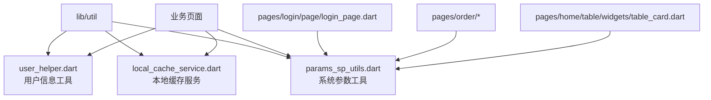
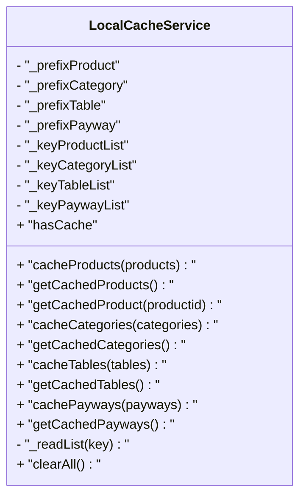
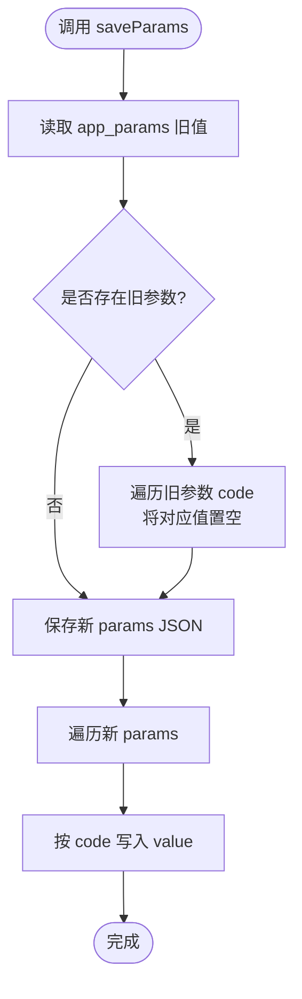
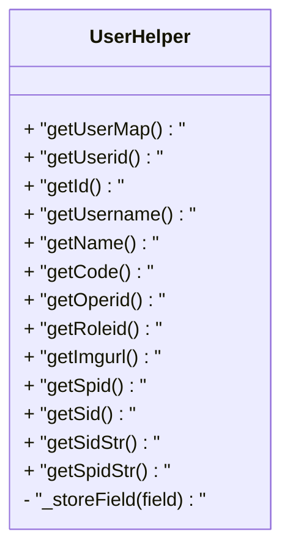
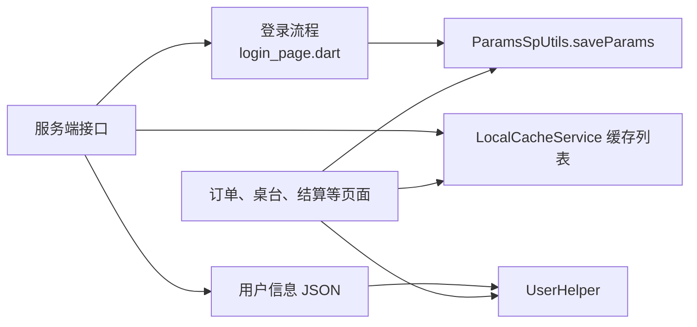
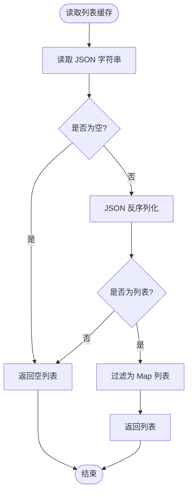
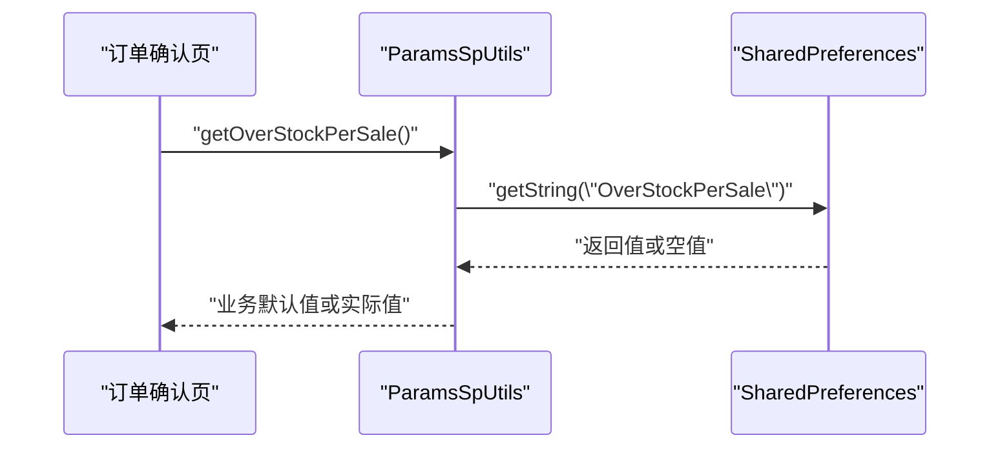
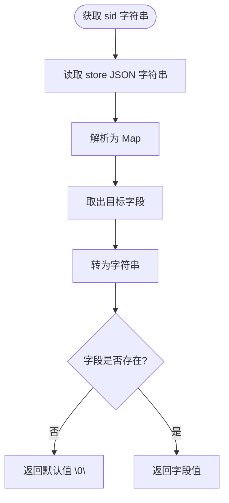
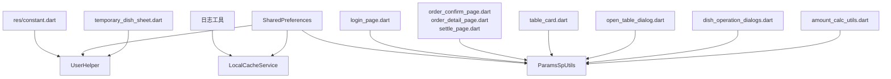
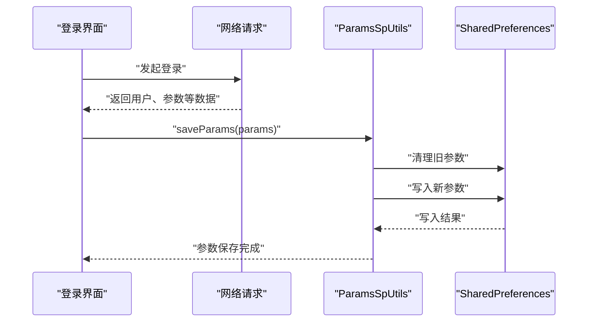

# 数据存储与缓存

<cite>
**本文引用的文件**   
- [local_cache_service.dart](file://lib/util/local_cache_service.dart)
- [params_sp_utils.dart](file://lib/util/params_sp_utils.dart)
- [user_helper.dart](file://lib/util/user_helper.dart)
- [constant.dart](file://lib/res/constant.dart)
- [login_page.dart](file://lib/pages/login/page/login_page.dart)
- [order_confirm_page.dart](file://lib/pages/order/order_confirm_page.dart)
- [order_detail_page.dart](file://lib/pages/order/order_detail_page.dart)
- [settle_page.dart](file://lib/pages/order/settle_page.dart)
- [table_card.dart](file://lib/pages/home/table/widgets/table_card.dart)
- [open_table_dialog.dart](file://lib/pages/home/table/widgets/open_table_dialog.dart)
- [dish_operation_dialogs.dart](file://lib/components/dish_operation_dialogs.dart)
- [temporary_dish_sheet.dart](file://lib/components/temporary_dish_sheet.dart)
- [amount_calc_utils.dart](file://lib/util/amount_calc_utils.dart)
</cite>

## 目录

1. [引言](#引言)
2. [项目结构](#项目结构)
3. [核心组件](#核心组件)
4. [架构总览](#架构总览)
5. [详细组件分析](#详细组件分析)
6. [依赖关系分析](#依赖关系分析)
7. [性能与一致性](#性能与一致性)
8. [API 参考](#api-参考)
9. [故障排查](#故障排查)
10. [结论](#结论)

## 引言

本文面向聚客美滋滋应用的数据存储与缓存层，围绕三个关键工具类展开：

- **LocalCacheService**：本地数据缓存服务，用于在弱网或离线场景下快速读取商品、分类、桌台、支付方式等基础数据。
- **ParamsSpUtils**：系统参数工具类，基于 SharedPreferences 管理登录接口返回的业务参数键值对，并提供大量业务语义化的便捷读取方法。
- **UserHelper**：用户信息管理器，封装当前登录用户的 JSON 信息读取、常用字段访问以及门店标识的字符串化读取。

这些组件共同承担以下职责：

- 提供稳定的本地读写入口，避免业务页面直接操作 SharedPreferences。
- 将服务端返回的结构化数据转换为可复用的本地格式。
- 为订单、点菜、结算、桌台等业务模块提供一致的参数和用户上下文。
- 在不引入重型数据库的前提下，实现轻量级缓存与配置持久化。

## 项目结构

本项目的数据存储相关代码集中在 `lib/util` 目录下，并与登录、订单、桌台等页面形成引用关系。下图展示与本文相关的文件组织：

**图表来源**   
- [local_cache_service.dart:1-137](file://lib/util/local_cache_service.dart#L1-L137)
- [params_sp_utils.dart:1-137](file://lib/util/params_sp_utils.dart#L1-L137)
- [user_helper.dart:1-81](file://lib/util/user_helper.dart#L1-L81)
- [login_page.dart:241-241](file://lib/pages/login/page/login_page.dart#L241-L241)
- [order_confirm_page.dart:802-802](file://lib/pages/order/order_confirm_page.dart#L802-L802)
- [table_card.dart:105-105](file://lib/pages/home/table/widgets/table_card.dart#L105-L105)

**章节来源**   
- [local_cache_service.dart:1-137](file://lib/util/local_cache_service.dart#L1-L137)
- [params_sp_utils.dart:1-137](file://lib/util/params_sp_utils.dart#L1-L137)
- [user_helper.dart:1-81](file://lib/util/user_helper.dart#L1-L81)

## 核心组件

### LocalCacheService：本地缓存服务

LocalCacheService 是应用的基础数据缓存入口，当前以 SharedPreferences 作为底层存储，负责缓存四类数据：

| 数据类型 | 对应本地 Key | 对齐服务端表 | 主要用途 |
|---|---|---|---|
| 商品列表 | 商品列表 Key | t_bi_product | 商品选择、购物车、下单 |
| 分类列表 | 分类列表 Key | t_bi_type | 商品分类展示 |
| 桌台列表 | 桌台列表 Key | t_table_info | 桌台状态、开台、点菜 |
| 支付方式列表 | 支付方式列表 Key | t_bi_payway | 结账支付 |

该类的核心设计要点包括：

- 使用单例模式暴露静态实例，便于全局访问。
- 每个列表统一通过 JSON 字符串序列化后写入 SharedPreferences。
- 读取时先取字符串，再反序列化为 Map 列表，失败时回退为空列表。
- 提供按 ID 查询单个商品的方法，适合需要快速定位商品的场景。
- 提供清空全部缓存和判断是否存在有效缓存的能力，配合登录退出流程使用。

需要注意，当前实现没有内置过期时间、内存缓存或多级缓存机制；它更接近“持久化列表缓存”。若后续需要更强的离线能力，文档建议在注释中考虑的 SQLite 或 Drift 方案中进行迁移。

**图表来源**   
- [local_cache_service.dart:18-137](file://lib/util/local_cache_service.dart#L18-L137)

**章节来源**   
- [local_cache_service.dart:18-137](file://lib/util/local_cache_service.dart#L18-L137)

### ParamsSpUtils：系统参数工具

ParamsSpUtils 是对登录接口返回参数列表的统一封装。其保存逻辑与 smdcapp 的参数处理保持一致：

1. 先读取上次保存的完整参数 JSON。
2. 遍历旧参数中的 code，并将对应值置空，防止旧参数残留。
3. 保存新的 params 完整 JSON。
4. 逐项将 code 映射到 value，存入 SharedPreferences。

这种双写策略有两个好处：

- 保留完整的参数快照，方便整体查看或调试。
- 提供按 code 直接读取的高效路径，避免每次解析完整 JSON。

该类还暴露了大量业务语义化的读取方法，例如负库存销售策略、抹零规则、挂起文案、称重确认开关、叫号开关、支持订单类型等。这些方法把原始 code 与默认值封装成可直接调用的布尔值或字符串常量。

**图表来源**   
- [params_sp_utils.dart:24-63](file://lib/util/params_sp_utils.dart#L24-L63)

**章节来源**   
- [params_sp_utils.dart:1-137](file://lib/util/params_sp_utils.dart#L1-L137)

### UserHelper：用户信息工具

UserHelper 负责从 SharedPreferences 中读取当前登录用户的 JSON 数据，并提供常用的用户字段访问方法。其核心行为如下：

- 从固定 key 读取用户 JSON 字符串。
- 将字符串解析为 Map。
- 如果未登录或解析失败，返回空 Map。
- 对 userid、username、name、code、operid、roleid、imgurl 等字段提供安全取值方法。
- 单独读取门店 spid 和 sid 整型值。
- 提供从 store JSON 中解析 sid 和 spid 字符串形式的方法，避免类型转换异常。

这个类是业务页面构造订单请求、显示操作员信息、获取门店标识的重要依赖。

**图表来源**   
- [user_helper.dart:11-81](file://lib/util/user_helper.dart#L11-L81)

**章节来源**   
- [user_helper.dart:1-81](file://lib/util/user_helper.dart#L1-L81)

## 架构总览

从数据流向看，这三个组件分别承担不同层次的数据职责：

- **ParamsSpUtils**：业务参数层。登录后由登录流程写入，被订单、桌台、结算等页面广泛读取。
- **UserHelper**：用户上下文层。提供当前操作员、门店标识等身份相关数据。
- **LocalCacheService**：基础数据缓存层。缓存商品、分类、桌台、支付方式等相对静态的数据。

**图表来源**   
- [login_page.dart:241-241](file://lib/pages/login/page/login_page.dart#L241-L241)
- [params_sp_utils.dart:24-63](file://lib/util/params_sp_utils.dart#L24-L63)
- [user_helper.dart:11-81](file://lib/util/user_helper.dart#L11-L81)
- [local_cache_service.dart:18-137](file://lib/util/local_cache_service.dart#L18-L137)

## 详细组件分析

### LocalCacheService 深度分析

#### 数据结构与复杂度

- 每个列表类型只维护一个 JSON 字符串键。
- 写入复杂度近似 O(n)，n 为列表元素数量，因为需要进行 JSON 序列化。
- 读取复杂度近似 O(n)，因为 `_readList` 会反序列化整个列表。
- 按 ID 查找单个商品是 O(n) 线性扫描。

这意味着该缓存适合中小规模的基础数据。如果商品或桌台数据量增长较大，应考虑分页加载、增量更新或引入索引结构。

#### 生命周期

| 阶段 | 行为 | 说明 |
|---|---|---|
| 初始化 | 单例创建 | 不主动初始化任何外部资源 |
| 写入 | 序列化并写入 SharedPreferences | 失败时记录日志并忽略异常 |
| 读取 | 反序列化 JSON | 失败或空值返回空列表 |
| 清理 | 清空四个列表 Key | 通常在退出登录或数据同步失败时使用 |
| 存在性检查 | 检查商品或桌台缓存是否非空 | 用于弱网降级判断 |

#### 过期与清理

当前实现没有自动过期策略。`clearAll` 仅支持手动清空所有列表缓存。对于生产环境，建议补充：

- 按数据类型的 TTL（生存时间）。
- 按版本号或更新时间戳判断缓存是否失效。
- 在数据拉取成功后覆盖旧缓存。
- 在应用启动或切换门店时强制刷新。

#### 错误处理

写入和读取均包裹 try-catch，并调用日志工具输出异常。列表读取失败时不会抛出异常，而是返回空列表，从而保证 UI 渲染稳定。

**图表来源**   
- [local_cache_service.dart:112-127](file://lib/util/local_cache_service.dart#L112-L127)

**章节来源**   
- [local_cache_service.dart:18-137](file://lib/util/local_cache_service.dart#L18-L137)

### ParamsSpUtils 深度分析

#### 参数保存流程

保存参数是一个三步流程：

1. 读取旧的 `app_params` JSON。
2. 遍历旧条目，将每个 code 对应的值置空。
3. 写入新的 `app_params` JSON，并逐个写入 code → value。

这一步很重要，因为它能避免旧门店或旧账号留下的参数污染当前会话。

#### 参数读取模型

通用读取方法允许传入默认值，并对空值和 null 做统一处理。业务语义化方法则进一步将字符串值转换为布尔值或带默认值的字符串。

| 方法类别 | 示例 | 含义 |
|---|---|---|
| 通用读取 | getParam | 按 code 读取字符串值 |
| 业务开关 | isReweigh | 是否二次称重确认 |
| 金额规则 | getSmallChangeType | 抹零策略 |
| 打印行为 | isMergePrint | 是否合并打印 |
| 文案配置 | getHangUpName | 挂起或等叫按钮文案 |
| 必填校验 | isRemarkMust | 指定原因是否必填 |

#### 典型调用链

**图表来源**   
- [order_confirm_page.dart:802-802](file://lib/pages/order/order_confirm_page.dart#L802-L802)
- [params_sp_utils.dart:65-70](file://lib/util/params_sp_utils.dart#L65-L70)

**章节来源**   
- [params_sp_utils.dart:1-137](file://lib/util/params_sp_utils.dart#L1-L137)
- [order_confirm_page.dart:802-802](file://lib/pages/order/order_confirm_page.dart#L802-L802)

### UserHelper 深度分析

#### 用户数据模型

UserHelper 读取的是登录接口返回的用户对象 JSON，常见字段包括：

| 字段 | 方法 | 用途 |
|---|---|---|
| userid | getUserid | 收银员编号 |
| username | getUsername | 用户名 |
| name | getName | 姓名，优先 name，回退 username |
| code | getCode | 工号 |
| operid | getOperid | 操作员编号 |
| roleid | getRoleid | 角色编号 |
| imgurl | getImgurl | 头像地址 |
| spid | getSpid | 门店编号整型 |
| sid | getSid | 门店会话编号整型 |
| id/spid | getSidStr / getSpidStr | 从 store JSON 取字符串形式 |

#### 门店标识读取注意事项

spid 和 sid 在 SharedPreferences 中以整型存储，但某些业务需要字符串形式。UserHelper 提供了 `_storeField` 辅助方法，从 store JSON 中解析对应字段，避免直接 getString 导致类型强转异常。

**图表来源**   
- [user_helper.dart:59-81](file://lib/util/user_helper.dart#L59-L81)

**章节来源**   
- [user_helper.dart:11-81](file://lib/util/user_helper.dart#L11-L81)

## 依赖关系分析

### 组件间依赖

- LocalCacheService 依赖日志工具和 SharedPreferences。
- ParamsSpUtils 依赖 SharedPreferences 和 JSON 编解码。
- UserHelper 依赖 SharedPreferences、JSON 编解码和业务常量。
- 业务页面同时依赖 ParamsSpUtils 和 UserHelper，部分页面也依赖 LocalCacheService。

**图表来源**   
- [user_helper.dart:1-81](file://lib/util/user_helper.dart#L1-L81)
- [local_cache_service.dart:1-137](file://lib/util/local_cache_service.dart#L1-L137)
- [params_sp_utils.dart:1-137](file://lib/util/params_sp_utils.dart#L1-L137)
- [login_page.dart:241-241](file://lib/pages/login/page/login_page.dart#L241-L241)
- [order_confirm_page.dart:802-802](file://lib/pages/order/order_confirm_page.dart#L802-L802)
- [order_detail_page.dart:1272-1273](file://lib/pages/order/order_detail_page.dart#L1272-L1273)
- [settle_page.dart:329-329](file://lib/pages/order/settle_page.dart#L329-L329)
- [table_card.dart:105-105](file://lib/pages/home/table/widgets/table_card.dart#L105-L105)
- [open_table_dialog.dart:69-69](file://lib/pages/home/table/widgets/open_table_dialog.dart#L69-L69)
- [dish_operation_dialogs.dart:104-105](file://lib/components/dish_operation_dialogs.dart#L104-L105)
- [temporary_dish_sheet.dart:158-159](file://lib/components/temporary_dish_sheet.dart#L158-L159)
- [amount_calc_utils.dart:55-55](file://lib/util/amount_calc_utils.dart#L55-L55)

### 耦合度评估

- LocalCacheService 与业务页面的耦合较弱，只提供缓存读写能力。
- ParamsSpUtils 与业务页面耦合较强，因为大量业务逻辑依赖具体参数 code。
- UserHelper 与业务页面耦合中等，主要用于身份和门店标识传递。
- 三者之间没有直接相互依赖，耦合方向单向指向 SharedPreferences，符合工具类职责。

**章节来源**   
- [local_cache_service.dart:1-137](file://lib/util/local_cache_service.dart#L1-L137)
- [params_sp_utils.dart:1-137](file://lib/util/params_sp_utils.dart#L1-L137)
- [user_helper.dart:1-81](file://lib/util/user_helper.dart#L1-L81)

## 性能与一致性

### 性能特征

| 组件 | 主要开销 | 优化建议 |
|---|---|---|
| LocalCacheService | JSON 序列化与反序列化 | 控制缓存列表大小，避免频繁全量刷新 |
| ParamsSpUtils | 登录时遍历旧参数并逐项写入 | 仅在登录成功且参数变化时执行 |
| UserHelper | JSON 解析一次，多次字段访问 | 可在更高层缓存已解析的 Map，减少重复解析 |

### 数据一致性

- ParamsSpUtils 通过“旧参数置空 + 新参数写入”的方式降低脏数据风险。
- LocalCacheService 的列表缓存没有版本控制，容易与后端数据产生不一致。
- UserHelper 的 JSON 解析失败会返回空 Map，业务侧应做空判断。

### 存储空间优化

- 只缓存必要的基础数据，避免缓存大体积响应体。
- 使用整型存储门店编号，字符串形式通过解析 store JSON 获取，避免重复冗余存储。
- 在退出登录或切换门店时调用清理方法，释放不再使用的缓存。

### 最佳实践建议

1. 将 LocalCacheService 的缓存更新与网络拉取流程绑定，确保缓存与后端一致。
2. 为缓存增加版本或时间戳字段，避免陈旧数据被误用。
3. 将 ParamsSpUtils 中的 code 常量集中管理，减少硬编码字符串。
4. 对 UserHelper 返回的空 Map 进行防御式编程，避免空指针。
5. 在高频读取路径上避免重复解析 JSON，必要时在调用方缓存结果。

[本节为通用性能建议，不直接分析特定文件]

## API 参考

### LocalCacheService API

| 方法 | 输入 | 输出 | 说明 |
|---|---|---|---|
| cacheProducts | 商品列表 | void | 缓存商品列表 |
| getCachedProducts | 无 | 商品列表 | 读取缓存商品列表 |
| getCachedProduct | 商品 ID | 商品 Map 或空 | 按 ID 查找缓存商品 |
| cacheCategories | 分类列表 | void | 缓存分类列表 |
| getCachedCategories | 无 | 分类列表 | 读取缓存分类列表 |
| cacheTables | 桌台列表 | void | 缓存桌台列表 |
| getCachedTables | 无 | 桌台列表 | 读取缓存桌台列表 |
| cachePayways | 支付方式列表 | void | 缓存支付方式列表 |
| getCachedPayways | 无 | 支付方式列表 | 读取缓存支付方式列表 |
| clearAll | 无 | void | 清空所有列表缓存 |
| hasCache | 无 | bool | 判断是否存在有效缓存 |

**章节来源**   
- [local_cache_service.dart:18-137](file://lib/util/local_cache_service.dart#L18-L137)

### ParamsSpUtils API

| 方法 | 输入 | 输出 | 说明 |
|---|---|---|---|
| saveParams | 参数数组 | void | 保存登录返回的参数列表 |
| getParam | code、默认值 | String | 通用参数读取 |
| getOverStockPerSale | 无 | String | 负库存销售策略 |
| getVipPayAuthType | 无 | String | 会员扣款校验方式 |
| notCookSelectCook | 无 | bool | 未关联私有做法时是否弹出做法选择 |
| getSmallChangeType | 无 | String | 抹零设置 |
| getSmallChangeFlag | 无 | String | 抹零方式 |
| isReweigh | 无 | bool | 是否二次称重确认 |
| getOpenTableAmtFlag | 无 | String | 开台费标志 |
| isShowReturnProduct | 无 | bool | 是否显示已退完菜 |
| isPendingProSaleFlag | 无 | String | 挂单是否允许销售 |
| getMarkServerFlag | 无 | String | 服务员标记方式 |
| isMergePrint | 无 | bool | 是否合并打印 |
| getPickupCallSwitch | 无 | bool | 叫号取餐开关 |
| getSupportOrderTypes | 无 | String | 支持的订单类型 |
| getRemarkMustTypes | 无 | String | 备注或原因必填类型 |
| isRemarkMust | 类型 ID | bool | 指定类型的原因是否必填 |
| getSuspendedNameDefinition | 无 | String | 挂起名称定义 |
| getHangUpName | 无 | String | 挂起或等叫按钮文案 |
| getHangUpLabelName | 无 | String | 标签文案 |
| getHangUpTicketName | 无 | String | 单据名称 |
| getHangUpActionName | 无 | String | 动作名称 |

**章节来源**   
- [params_sp_utils.dart:12-137](file://lib/util/params_sp_utils.dart#L12-L137)

### UserHelper API

| 方法 | 输入 | 输出 | 说明 |
|---|---|---|---|
| getUserMap | 无 | Map | 获取当前登录用户完整信息 |
| getUserid | 无 | String | 用户 ID |
| getId | 无 | String | 用户 ID 别名 |
| getUsername | 无 | String | 用户名 |
| getName | 无 | String | 姓名 |
| getCode | 无 | String | 工号 |
| getOperid | 无 | String | 操作员 ID |
| getRoleid | 无 | String | 角色 ID |
| getImgurl | 无 | String | 头像 URL |
| getSpid | 无 | int | 门店编号 |
| getSid | 无 | int | 门店会话编号 |
| getSidStr | 无 | String | 门店会话编号字符串 |
| getSpidStr | 无 | String | 门店编号字符串 |

**章节来源**   
- [user_helper.dart:11-81](file://lib/util/user_helper.dart#L11-L81)

## 故障排查

### 常见问题

| 现象 | 可能原因 | 处理方式 |
|---|---|---|
| 商品或桌台列表为空 | 未缓存、缓存已清空、JSON 损坏 | 重新拉取数据并调用缓存写入方法 |
| 业务参数读取不符合预期 | 登录参数未保存、旧参数残留、code 写错 | 检查登录流程是否调用参数保存方法 |
| 门店 sid 或 spid 读取异常 | 直接使用 getString 读取整型字段 | 使用 UserHelper 提供的字符串化方法 |
| 用户信息显示为空 | 未登录或用户 JSON 损坏 | 检查登录态和用户信息存储 |
| 抹零或称重逻辑异常 | 参数未正确配置或默认值不符合门店要求 | 核对 ParamsSpUtils 对应方法 |

### 登录参数写入验证

登录流程中会调用参数保存方法。若发现参数缺失，应重点检查：

- 登录接口是否返回 params。
- 是否成功调用参数保存方法。
- 旧参数是否被错误清空。
- SharedPreferences 是否可用。

**图表来源**   
- [login_page.dart:241-241](file://lib/pages/login/page/login_page.dart#L241-L241)
- [params_sp_utils.dart:24-63](file://lib/util/params_sp_utils.dart#L24-L63)

### 用户信息读取验证

若用户信息为空，建议按以下顺序排查：

1. 检查用户 JSON 是否已写入 SharedPreferences。
2. 检查 JSON 格式是否正确。
3. 检查业务页面是否对空 Map 做了兜底处理。
4. 检查是否需要从 store JSON 中读取门店标识。

**章节来源**   
- [login_page.dart:241-241](file://lib/pages/login/page/login_page.dart#L241-L241)
- [user_helper.dart:11-81](file://lib/util/user_helper.dart#L11-L81)

## 结论

LocalCacheService、ParamsSpUtils 和 UserHelper 构成了聚客美滋滋应用轻量级的本地数据层。它们以 SharedPreferences 为基础，分别承担基础数据缓存、业务参数管理和用户信息管理职责。

当前实现的优点是结构简单、易于理解、对业务侵入性低；缺点是缺少自动过期、版本控制和强类型约束。若未来数据规模增长或离线需求增强，建议：

- 为 LocalCacheService 增加版本、时间戳和多级缓存。
- 将 ParamsSpUtils 中的 code 统一管理，并增加参数校验。
- 为 UserHelper 提供更强的用户会话生命周期管理。
- 在数据变更时统一触发缓存刷新和清理。

通过这些改进，可以在保持现有简洁性的同时，提升数据一致性、可维护性和可扩展性。