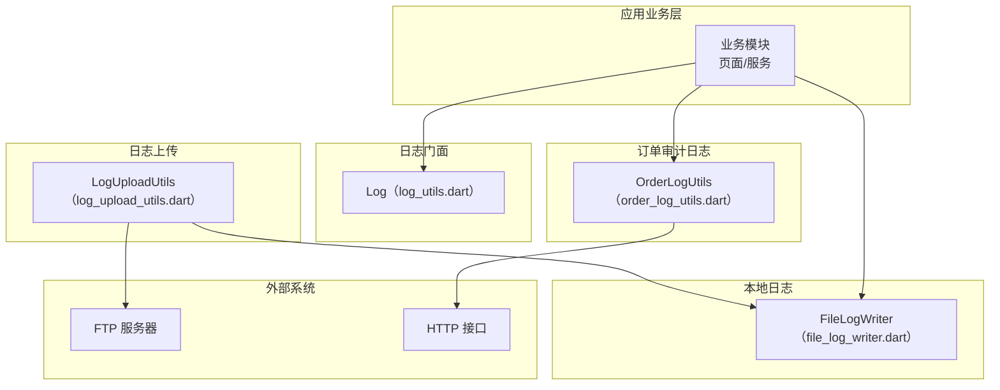
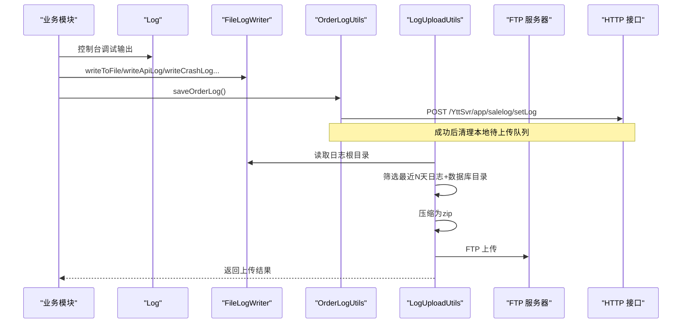
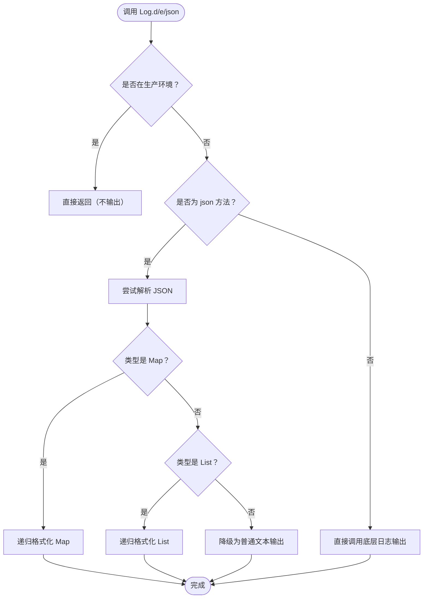
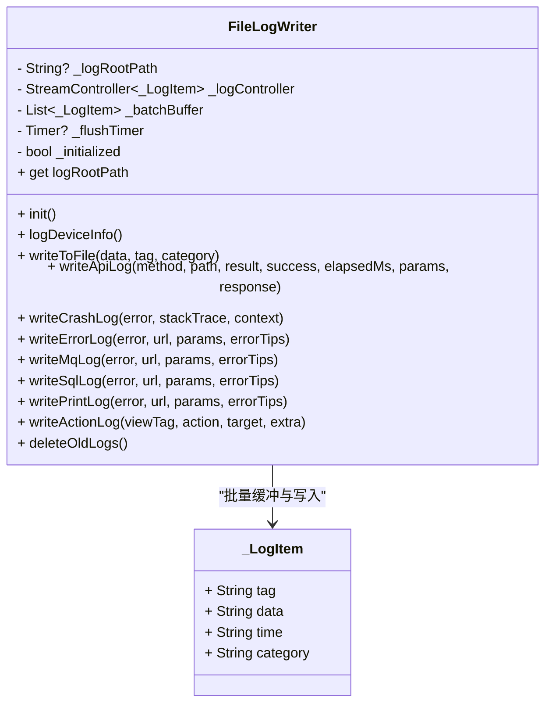
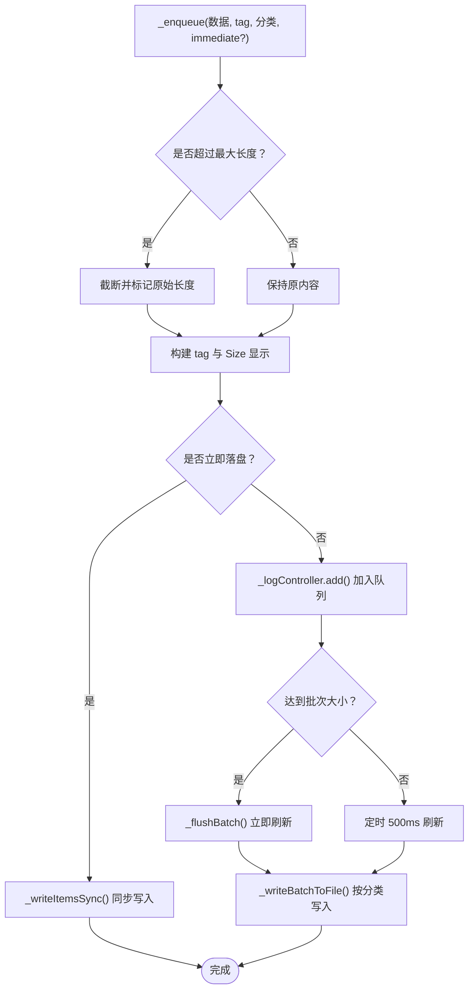
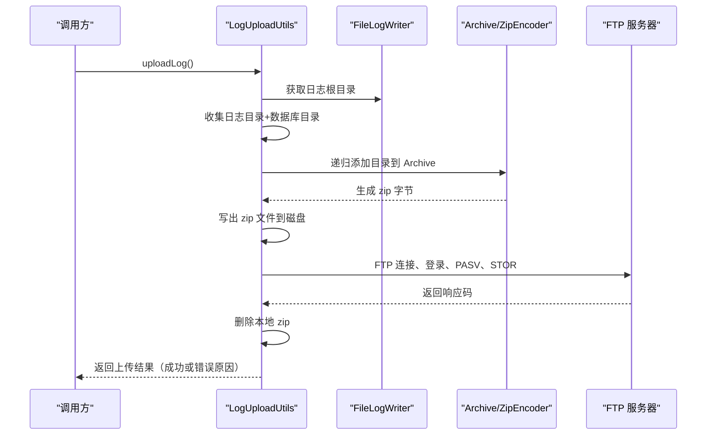
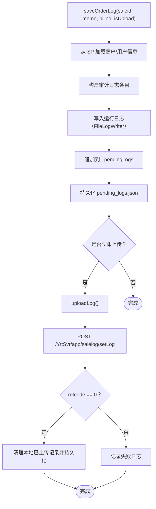
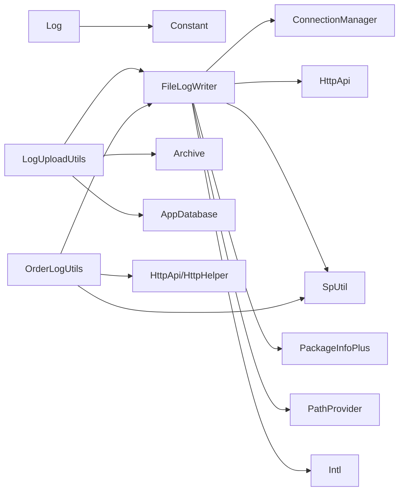

# 日志系统

<cite>
**本文引用的文件**   
- [lib/util/log_utils.dart](file://lib/util/log_utils.dart)
- [lib/util/file_log_writer.dart](file://lib/util/file_log_writer.dart)
- [lib/util/log_upload_utils.dart](file://lib/util/log_upload_utils.dart)
- [lib/util/order_log_utils.dart](file://lib/util/order_log_utils.dart)
</cite>

## 目录
1. [简介](#简介)
2. [项目结构](#项目结构)
3. [核心组件](#核心组件)
4. [架构总览](#架构总览)
5. [详细组件分析](#详细组件分析)
6. [依赖关系分析](#依赖关系分析)
7. [性能与容量特性](#性能与容量特性)
8. [API 参考](#api-参考)
9. [调试与生产行为](#调试与生产行为)
10. [常见问题排查](#常见问题排查)
11. [结论](#结论)

## 简介
本技术文档围绕聚客美滋滋应用的日志子系统，系统性梳理以下能力：
- LogUtils：面向业务方的统一日志门面，提供 debug、info、warn、error 等输出入口，并支持 JSON 美化打印。
- FileLogWriter：本地运行日志写入器，负责按日期与分类分目录落盘、批量异步写入、设备信息记录、过期日志清理。
- LogUploadUtils：日志压缩与 FTP 上传工具，将最近若干天的日志打包后上传至远端服务器。
- OrderLogUtils：订单敏感操作审计日志，持久化本地待上传队列，并通过 HTTP 接口上报。

该文档从代码级实现出发，结合流程图与时序图解释关键路径，同时给出 API 使用建议、环境差异说明与排错指南。

## 项目结构
日志相关代码集中在 lib/util 目录下，职责清晰、边界明确：
- log_utils.dart：控制台日志门面与 JSON 美化打印。
- file_log_writer.dart：本地日志写入、批处理、分类存储、清理。
- log_upload_utils.dart：日志压缩与 FTP 上传。
- order_log_utils.dart：订单敏感操作日志的本地持久化与网络上报。

图表来源
- [lib/util/log_utils.dart:1-106](file://lib/util/log_utils.dart#L1-L106)
- [lib/util/file_log_writer.dart:1-450](file://lib/util/file_log_writer.dart#L1-L450)
- [lib/util/log_upload_utils.dart:1-341](file://lib/util/log_upload_utils.dart#L1-L341)
- [lib/util/order_log_utils.dart:1-199](file://lib/util/order_log_utils.dart#L1-L199)

章节来源
- [lib/util/log_utils.dart:1-106](file://lib/util/log_utils.dart#L1-L106)
- [lib/util/file_log_writer.dart:1-450](file://lib/util/file_log_writer.dart#L1-L450)
- [lib/util/log_upload_utils.dart:1-341](file://lib/util/log_upload_utils.dart#L1-L341)
- [lib/util/order_log_utils.dart:1-199](file://lib/util/order_log_utils.dart#L1-L199)

## 核心组件
- Log：统一日志门面，封装底层日志库，控制调试开关与 JSON 美化输出。
- FileLogWriter：本地日志写入器，负责异步批量写入、分类目录、文件名规则、设备信息、过期清理。
- LogUploadUtils：日志收集、压缩、FTP 上传、错误码返回与资源清理。
- OrderLogUtils：订单敏感操作审计日志，本地持久化 + HTTP 上报 + 成功清理。

章节来源
- [lib/util/log_utils.dart:1-106](file://lib/util/log_utils.dart#L1-L106)
- [lib/util/file_log_writer.dart:1-450](file://lib/util/file_log_writer.dart#L1-L450)
- [lib/util/log_upload_utils.dart:1-341](file://lib/util/log_upload_utils.dart#L1-L341)
- [lib/util/order_log_utils.dart:1-199](file://lib/util/order_log_utils.dart#L1-L199)

## 架构总览
日志系统的整体数据流如下：
- 业务调用 Log 进行控制台调试输出。
- 业务或拦截器通过 FileLogWriter 写入运行日志、接口流水、崩溃日志、MQ/SQL/打印日志等。
- LogUploadUtils 定时或手动触发，打包最近 N 天日志并上传到 FTP。
- OrderLogUtils 将订单敏感操作先写本地 JSON 待上传队列，再经 HTTP 接口上报，成功后清理本地缓存。

图表来源
- [lib/util/log_utils.dart:1-106](file://lib/util/log_utils.dart#L1-L106)
- [lib/util/file_log_writer.dart:1-450](file://lib/util/file_log_writer.dart#L1-L450)
- [lib/util/log_upload_utils.dart:1-341](file://lib/util/log_upload_utils.dart#L1-L341)
- [lib/util/order_log_utils.dart:1-199](file://lib/util/order_log_utils.dart#L1-L199)

## 详细组件分析

### Log：控制台日志门面
职责与特性
- 统一入口：d/e/json 等方法对外暴露。
- 调试开关：根据 Constant.inProduction 控制是否输出。
- JSON 美化：解析字符串为 Map/List 后进行缩进打印，避免单行过长导致日志被限制。
- 限流保护：当嵌套对象过多时自动扁平化，防止短时间内输出行数过多被系统限制。

图表来源
- [lib/util/log_utils.dart:1-106](file://lib/util/log_utils.dart#L1-L106)

章节来源
- [lib/util/log_utils.dart:1-106](file://lib/util/log_utils.dart#L1-L106)

### FileLogWriter：本地运行日志写入器
职责与特性
- 初始化：获取应用文档目录下的 log 根目录，启动批量写入监听，执行过期清理。
- 分类目录：按日期和分类创建子目录，如 api_log、crash_log、mq_log、sql_log、print_log 等。
- 命名规则：{appDocDir}/log/{yyyy-MM-dd}/{category}/{yyyy-MM-dd}.log。
- 格式规范：每条记录形如“时间_{时间}_{主设备连接状态}_{tag [Size: x]}:{正文}”，其中 tag 会附加 Size 显示 KB/MB。
- 长度保护：单条日志超过阈值会截断，保留原始长度提示。
- 批量策略：最多 10 条或 500ms 刷盘一次；immediate=true 时立即同步落盘。
- 设备信息：登录成功后记录连接模式、软件版本、云服务地址、主设备地址、商户号、门店编码、机号、平台信息等。
- 过期清理：1-2月保留 20 天，其他月份保留 10 天；同时清理残留 zip 文件。

图表来源
- [lib/util/file_log_writer.dart:1-450](file://lib/util/file_log_writer.dart#L1-L450)

图表来源
- [lib/util/file_log_writer.dart:1-450](file://lib/util/file_log_writer.dart#L1-L450)

章节来源
- [lib/util/file_log_writer.dart:1-450](file://lib/util/file_log_writer.dart#L1-L450)

### LogUploadUtils：日志压缩与 FTP 上传
职责与特性
- 收集范围：应用文档目录下的 log 根目录，以及数据库目录（非 Web）。
- 日期筛选：仅压缩最近 N 天的日志目录（1-2月 20 天，其他 10 天）。
- 压缩包命名：{yyyyMMdd_HHmmss}_SMDC_APP_{businessNumber}_{storeCode}_{machNo}_logs.zip。
- 压缩流程：递归遍历目录，保持相对路径结构，生成 zip 字节并写出到磁盘。
- FTP 传输：手动 Socket 实现 PASV 被动模式，二进制传输，包含 DNS 解析、IPv4 优先、超时控制、私有 IP NAT 回退。
- 失败处理：捕获异常并记录日志，返回错误原因字符串。
- 资源清理：上传完成后删除本地 zip 文件。

图表来源
- [lib/util/log_upload_utils.dart:1-341](file://lib/util/log_upload_utils.dart#L1-L341)
- [lib/util/file_log_writer.dart:1-450](file://lib/util/file_log_writer.dart#L1-L450)

章节来源
- [lib/util/log_upload_utils.dart:1-341](file://lib/util/log_upload_utils.dart#L1-L341)

### OrderLogUtils：订单敏感操作审计日志
职责与特性
- 本地持久化：在应用文档目录下的 order_logs/pending_logs.json 中保存待上传列表。
- 字段组装：spid、sid、saleid、billno、memo、operid、opername、client、machno、opertime、createtime。
- 同步运行日志：每次 saveOrderLog 都会通过 FileLogWriter 写入一条运行日志。
- 网络上报：POST /YttSvr/app/salelog/setLog，data 为 JSON 数组字符串。
- 成功清理：retcode=0 时清除已上传的本地记录并持久化。
- 失败处理：捕获异常并记录失败日志；debug 模式下打印堆栈。

图表来源
- [lib/util/order_log_utils.dart:1-199](file://lib/util/order_log_utils.dart#L1-L199)
- [lib/util/file_log_writer.dart:1-450](file://lib/util/file_log_writer.dart#L1-L450)

章节来源
- [lib/util/order_log_utils.dart:1-199](file://lib/util/order_log_utils.dart#L1-L199)

## 依赖关系分析
- Log 依赖 CommonUtils 的日志库与 Flutter Deer 的 Constant 控制生产环境开关。
- FileLogWriter 依赖 PathProvider、Intl、PackageInfoPlus、SpUtil、ConnectionManager、HttpApi。
- LogUploadUtils 依赖 Archive、Path、SpUtil、AppDatabase、FileLogWriter。
- OrderLogUtils 依赖 HttpHelper、HttpApi、SpUtil、FileLogWriter。

图表来源
- [lib/util/log_utils.dart:1-106](file://lib/util/log_utils.dart#L1-L106)
- [lib/util/file_log_writer.dart:1-450](file://lib/util/file_log_writer.dart#L1-L450)
- [lib/util/log_upload_utils.dart:1-341](file://lib/util/log_upload_utils.dart#L1-L341)
- [lib/util/order_log_utils.dart:1-199](file://lib/util/order_log_utils.dart#L1-L199)

章节来源
- [lib/util/log_utils.dart:1-106](file://lib/util/log_utils.dart#L1-L106)
- [lib/util/file_log_writer.dart:1-450](file://lib/util/file_log_writer.dart#L1-L450)
- [lib/util/log_upload_utils.dart:1-341](file://lib/util/log_upload_utils.dart#L1-L341)
- [lib/util/order_log_utils.dart:1-199](file://lib/util/order_log_utils.dart#L1-L199)

## 性能与容量特性
- 批量写入：FileLogWriter 使用广播流控制器与定时器，最多 10 条或 500ms 刷盘一次，减少频繁 IO。
- 即时落盘：崩溃、错误日志等场景使用 immediate=true 同步落盘，保证进程退出前关键线索可用。
- 长度保护：单条日志超过 650KB 会被截断，避免单行过大影响文件解析与展示。
- 尺寸标签：每条日志 tag 附带 Size 显示，便于定位大日志。
- 日期滚动：按日期分目录，配合保留天数清理，避免无限增长。
- 压缩上传：LogUploadUtils 仅打包最近 N 天日志，降低网络传输体积。

[本节为通用性能讨论，未直接分析具体代码片段]

## API 参考

### Log（控制台日志门面）
- 初始化
  - Log.init：根据 Constant.inProduction 决定是否开启调试日志。
- 输出方法
  - Log.d(msg, tag)：调试日志。
  - Log.e(msg, tag)：错误日志。
  - Log.json(msg, tag)：JSON 美化输出，自动识别 Map/List 并缩进打印。
- 内部优化
  - _canFlattenMap：避免短时间输出过多行数被系统限制。
  - _printMap/_printList：递归格式化嵌套结构，空 Map/List 或超长 List 直接原样输出。

章节来源
- [lib/util/log_utils.dart:1-106](file://lib/util/log_utils.dart#L1-L106)

### FileLogWriter（本地运行日志写入器）
- 初始化
  - init：获取日志根目录、启动批量写入、清理过期日志。
  - logDeviceInfo：登录成功后记录设备与连接信息。
- 写入方法
  - writeToFile(data, tag, category)：通用写入，自动序列化非 String 数据。
  - writeApiLog(method, path, result, success, elapsedMs, params, response)：接口流水。
  - writeCrashLog(error, stackTrace, context)：崩溃日志，立即落盘。
  - writeErrorLog(error, url, params, errorTips)：错误日志，立即落盘。
  - writeMqLog(error, url, params, errorTips)：MQ 日志。
  - writeSqlLog(error, url, params, errorTips)：SQL 日志。
  - writePrintLog(error, url, params, errorTips)：打印日志。
  - writeActionLog(viewTag, action, target, extra)：埋点日志。
- 管理方法
  - deleteOldLogs：按月份策略清理过期日志与残留 zip。
  - logRootPath：供上传模块读取日志根目录。

章节来源
- [lib/util/file_log_writer.dart:1-450](file://lib/util/file_log_writer.dart#L1-L450)

### LogUploadUtils（日志压缩与 FTP 上传）
- 入口
  - uploadLog：收集日志与数据库、压缩为 zip、FTP 上传、删除本地 zip，返回结果字符串。
- 内部逻辑
  - _zipDirectories：递归添加目录到 Archive。
  - _ftpUpload：手动 Socket 实现 FTP PASV 传输，含超时、IPv4 优先、私有 IP NAT 回退。
  - _readFtpResponse：多行响应解析，10 秒超时。
  - _isPrivateAddress：判断私有/环回/链路本地地址。
  - _isCompleteFtpResponse：判断完整 FTP 响应。

章节来源
- [lib/util/log_upload_utils.dart:1-341](file://lib/util/log_upload_utils.dart#L1-L341)

### OrderLogUtils（订单敏感操作审计日志）
- 初始化
  - init：创建 order_logs 目录与 pending_logs.json，加载本地未上传记录。
- 写入方法
  - saveOrderLog(saleid, memo, billno, isUpload)：构造审计日志，写入运行日志，持久化待上传队列，可立即上传。
- 上传方法
  - uploadLog(saleid)：可选指定 saleid 过滤，POST /YttSvr/app/salelog/setLog，成功后清理本地记录。
- 本地持久化
  - _loadFromDisk/_saveToDisk：JSON 数组读写。

章节来源
- [lib/util/order_log_utils.dart:1-199](file://lib/util/order_log_utils.dart#L1-L199)

## 调试与生产行为
- 控制台输出：Log 默认在生产环境关闭 d/e/json 输出，仅在非生产环境下生效。
- 文件日志：FileLogWriter 在非 Web 平台启用，Web 平台跳过文件初始化。
- 设备信息：logDeviceInfo 需在登录后调用，确保商户号、门店编码、机号等信息有效。
- 日志级别：当前实现未提供运行时动态切换级别的功能，主要通过 Constant.inProduction 与分类写入控制输出范围。
- 隐私数据：OrderLogUtils 会将操作人信息与订单标识写入本地与网络，但不会明文上传敏感字段（如密码），需由上层保证 memo 等字段的脱敏。

章节来源
- [lib/util/log_utils.dart:1-106](file://lib/util/log_utils.dart#L1-L106)
- [lib/util/file_log_writer.dart:1-450](file://lib/util/file_log_writer.dart#L1-L450)
- [lib/util/order_log_utils.dart:1-199](file://lib/util/order_log_utils.dart#L1-L199)

## 常见问题排查
- 日志未写入文件
  - 检查是否已在 main 或登录后调用 FileLogWriter.init 与 logDeviceInfo。
  - Web 平台不支持文件系统，文件日志初始化会被跳过。
- 日志缺失关键信息
  - 确认 logDeviceInfo 在登录成功后调用，确保商户号、门店编码、机号等 SP 数据存在。
- 接口流水不完整
  - 检查 writeApiLog 的参数是否传全，params/response 内部换行会被折叠为空格。
- 崩溃日志丢失
  - 崩溃日志使用 immediate=true 同步落盘，若仍丢失，检查是否出现进程早期崩溃且 FileLogWriter 尚未初始化。
- 日志文件过大
  - 单条日志超过 650KB 会被截断，查看 tag 中的 Size 与 Truncated 提示定位大日志。
- 过期日志未清理
  - 1-2月保留 20 天，其他月份保留 10 天；确认 deleteOldLogs 已被调用。
- FTP 上传失败
  - 检查网络连接、DNS 解析与 IPv4 可达性；查看日志中 FTP 控制/数据连接步骤的错误码。
  - 若服务器返回内网 IP，会自动回退到控制连接的公网地址；检查防火墙与端口开放。
- 订单日志未上报
  - 检查 OrderLogUtils.init 是否调用，pending_logs.json 是否存在；查看 uploadLog 的 retcode 与失败日志。
  - 注意 isUpload=false 时不会立即上传，需手动调用 uploadLog。

章节来源
- [lib/util/file_log_writer.dart:1-450](file://lib/util/file_log_writer.dart#L1-L450)
- [lib/util/log_upload_utils.dart:1-341](file://lib/util/log_upload_utils.dart#L1-L341)
- [lib/util/order_log_utils.dart:1-199](file://lib/util/order_log_utils.dart#L1-L199)

## 结论
本日志系统以 Log 作为统一门面，结合 FileLogWriter 的本地异步批量写入、LogUploadUtils 的日志压缩与 FTP 上传、OrderLogUtils 的订单审计日志，形成了覆盖控制台、本地文件、远程上传与业务审计的完整闭环。其设计强调：
- 低耦合：各组件职责单一，依赖清晰。
- 高可靠：崩溃与错误日志立即落盘，过期日志定期清理。
- 可观测：接口流水、埋点日志、设备信息便于问题定位。
- 可扩展：新增分类与埋点可通过 FileLogWriter 的 writeActionLog 与自定义 category 扩展。

建议在接入时：
- 在应用启动与登录后分别调用 Log.init、FileLogWriter.init 与 logDeviceInfo。
- 在关键业务流程中补充 writeApiLog 与 writeActionLog。
- 对订单敏感操作使用 OrderLogUtils.saveOrderLog，并按需设置 isUpload。
- 在需要时触发 LogUploadUtils.uploadLog，或在后台任务中周期性执行。

[本节为总结性内容，未直接分析具体代码片段]