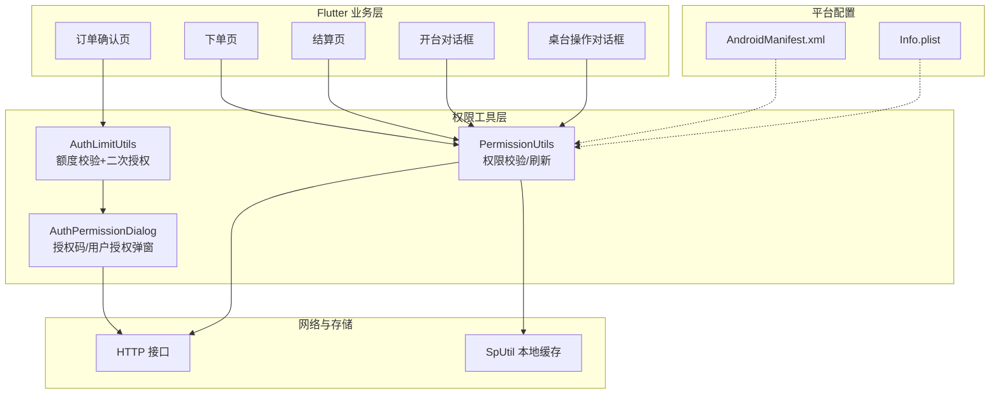
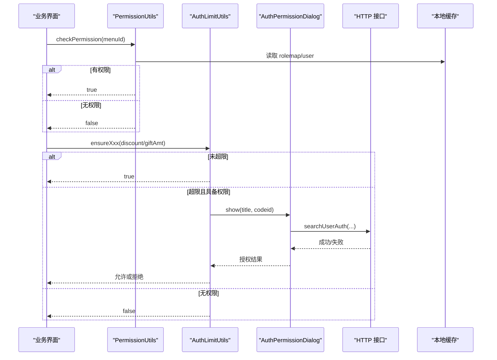
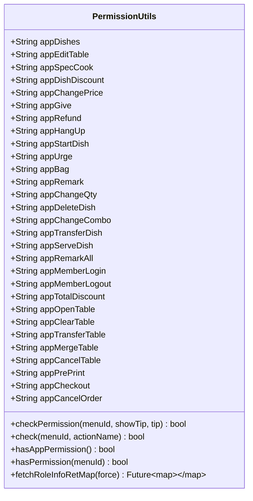
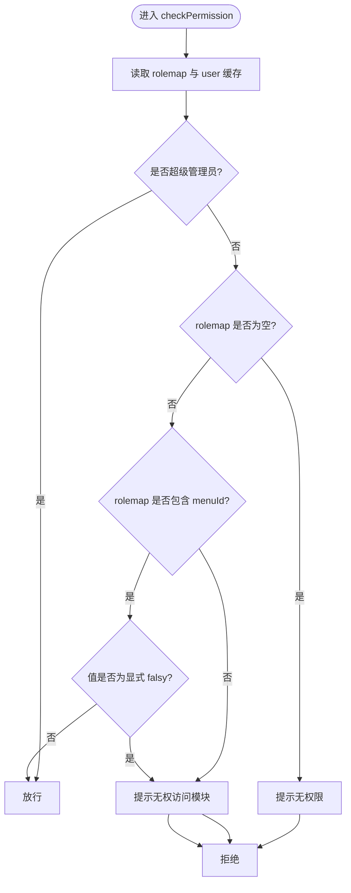
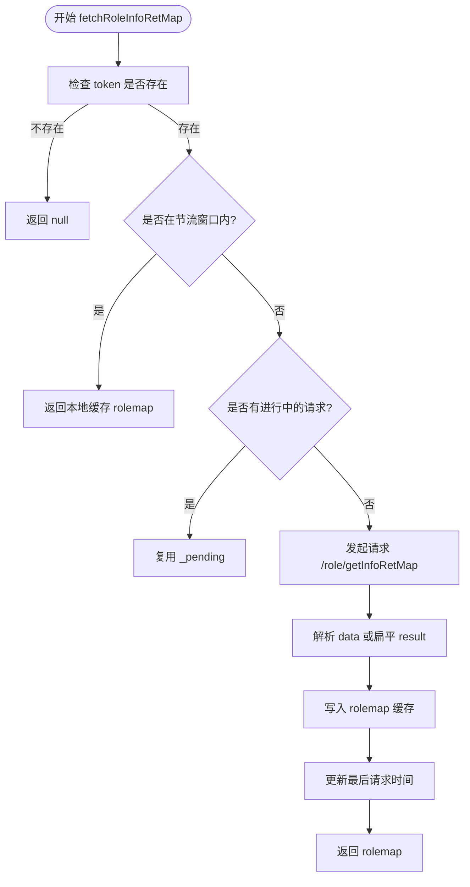
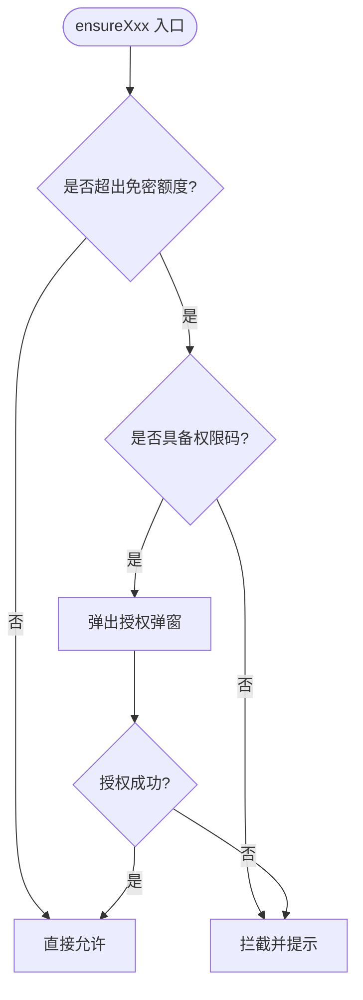
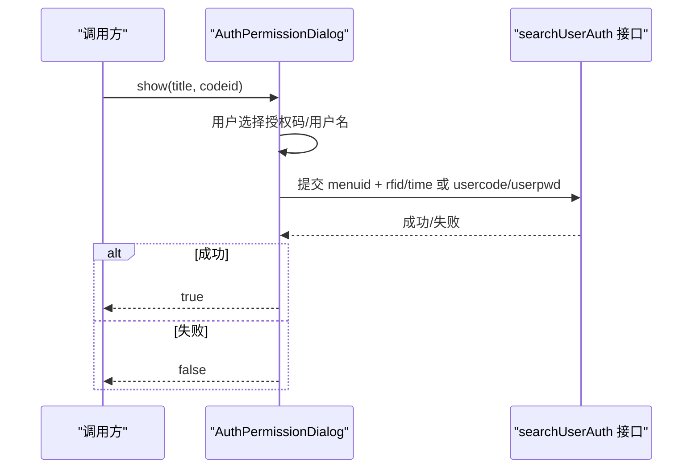
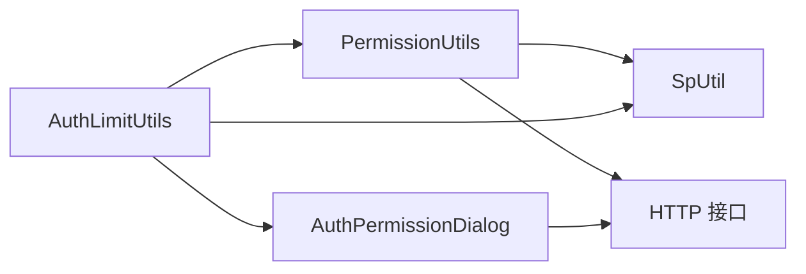

# 权限管理工具

<cite>
**本文引用的文件**   
- [permission_utils.dart](file://lib/util/permission_utils.dart)
- [auth_limit_utils.dart](file://lib/util/auth_limit_utils.dart)
- [auth_permission_dialog.dart](file://lib/components/auth_permission_dialog.dart)
- [order_confirm_page.dart](file://lib/pages/order/order_confirm_page.dart)
- [order_page.dart](file://lib/pages/order/order_page.dart)
- [settle_page.dart](file://lib/pages/order/settle_page.dart)
- [login_page.dart](file://lib/pages/login/page/login_page.dart)
- [order_detail_page.dart](file://lib/pages/order/order_detail_page.dart)
- [open_table_dialog.dart](file://lib/pages/home/table/widgets/open_table_dialog.dart)
- [table_operation_dialog.dart](file://lib/pages/home/table/widgets/table_operation_dialog.dart)
- [AndroidManifest.xml](file://android/app/src/main/AndroidManifest.xml)
- [Info.plist](file://ios/Runner/Info.plist)
</cite>

## 目录
1. [引言](#引言)
2. [项目结构](#项目结构)
3. [核心组件](#核心组件)
4. [架构总览](#架构总览)
5. [详细组件分析](#详细组件分析)
6. [依赖关系分析](#依赖关系分析)
7. [性能与可靠性](#性能与可靠性)
8. [使用示例与 API 参考](#使用示例与-api-参考)
9. [平台集成与权限声明](#平台集成与权限声明)
10. [用户体验设计指南](#用户体验设计指南)
11. [故障排查](#故障排查)
12. [结论](#结论)

## 引言
本技术文档围绕聚客美滋滋应用中的权限管理工具展开，重点覆盖以下方面：
- PermissionUtils：基于服务端角色权限 map 的菜单级权限校验、缓存刷新与节流策略。
- AuthLimitUtils：针对打折、赠送等敏感操作的额度限制与二次授权流程。
- AuthPermissionDialog：授权码或用户身份验证弹窗，作为业务权限控制的交互入口。
- Android/iOS 平台权限声明与运行时权限在餐饮 POS 场景下的落地方式。
- 权限状态持久化（本地缓存）、拒绝处理与降级策略。
- 面向开发者的 API 参考与最佳实践。

该权限体系的目标是在保证收银、点菜、结账等核心业务流程顺畅的同时，实现细粒度的角色权限控制与敏感操作二次授权，从而满足门店多角色协作的管理需求。

## 项目结构
权限相关代码主要分布在如下位置：
- lib/util/permission_utils.dart：权限常量、权限校验、权限数据刷新。
- lib/util/auth_limit_utils.dart：折扣与赠送额度校验及二次授权入口。
- lib/components/auth_permission_dialog.dart：授权弹窗 UI 与后端授权接口调用。
- 业务页面与对话框：订单确认、下单、结算、开台、桌台操作等页面中嵌入权限判断。
- 平台配置：AndroidManifest.xml、iOS Info.plist 中声明系统权限。

图表来源
- [permission_utils.dart:1-266](file://lib/util/permission_utils.dart#L1-L266)
- [auth_limit_utils.dart:1-98](file://lib/util/auth_limit_utils.dart#L1-L98)
- [auth_permission_dialog.dart:1-275](file://lib/components/auth_permission_dialog.dart#L1-L275)
- [AndroidManifest.xml:1-89](file://android/app/src/main/AndroidManifest.xml#L1-L89)
- [Info.plist:1-76](file://ios/Runner/Info.plist#L1-L76)

章节来源
- [permission_utils.dart:1-266](file://lib/util/permission_utils.dart#L1-L266)
- [auth_limit_utils.dart:1-98](file://lib/util/auth_limit_utils.dart#L1-L98)
- [auth_permission_dialog.dart:1-275](file://lib/components/auth_permission_dialog.dart#L1-L275)

## 核心组件
- PermissionUtils：集中定义业务权限码，提供权限检查、快速判断、APP 端权限判断、权限数据拉取与缓存刷新。
- AuthLimitUtils：封装单品打折、整单打折、赠送金额的额度校验逻辑，并在超限时触发二次授权。
- AuthPermissionDialog：支持“授权码”和“用户名+密码”两种授权模式，统一对接后端授权接口。

这些组件共同构成“业务权限 + 额度限制 + 二次授权”的完整链路，既可用于菜单级不可见/不可用，也可用于高风险操作的强制授权。

章节来源
- [permission_utils.dart:1-266](file://lib/util/permission_utils.dart#L1-L266)
- [auth_limit_utils.dart:1-98](file://lib/util/auth_limit_utils.dart#L1-L98)
- [auth_permission_dialog.dart:1-275](file://lib/components/auth_permission_dialog.dart#L1-L275)

## 架构总览
权限管理的整体流程分为三层：
1. 前端静态权限控制：通过 PermissionUtils 读取本地 rolemap/user 缓存，决定按钮是否可见/可点击。
2. 动态权限校验：在关键操作前再次校验，必要时调用 /role/getInfoRetMap 刷新权限。
3. 二次授权：对超出额度的敏感操作弹出 AuthPermissionDialog，通过后继续执行。

图表来源
- [permission_utils.dart:1-266](file://lib/util/permission_utils.dart#L1-L266)
- [auth_limit_utils.dart:1-98](file://lib/util/auth_limit_utils.dart#L1-L98)
- [auth_permission_dialog.dart:1-275](file://lib/components/auth_permission_dialog.dart#L1-L275)

## 详细组件分析

### PermissionUtils 权限工具类
PermissionUtils 是权限体系的中心，承担以下职责：
- 权限码定义：将菜品操作、订单操作、个人中心等能力映射为固定字符串码。
- 权限校验：根据 rolemap 与 user 缓存判断是否放行。
- APP 端权限判断：确保当前账号至少拥有某类 APP 端权限。
- 权限数据刷新：调用 /role/getInfoRetMap 获取最新权限 map，并写入本地缓存。
- 节流与防并发：避免频繁请求与重复拉取。

图表来源
- [permission_utils.dart:1-266](file://lib/util/permission_utils.dart#L1-L266)

#### 权限校验规则
- 超级管理员放行：当 user.roleid 或 user.code 为特定值时直接放行。
- rolemap 为空时的处理：视为无操作权限；若用于 APP 端整体权限判断，则返回无权限。
- rolemap 存在且包含 menuId：只要对应值不是显式的 falsy 值即放行。
- 其他情况拦截，并可选择弹出提示。

图表来源
- [permission_utils.dart:1-266](file://lib/util/permission_utils.dart#L1-L266)

#### 权限数据刷新流程
- 未登录不请求。
- 10 秒内不重复请求，除非 force=true。
- 避免并发重复请求，使用 pending 标记。
- 从 user 缓存注入 roleid/operid 参数。
- 成功时写入 rolemap 缓存并更新时间戳。
- 失败静默记录日志，不弹错误提示。

图表来源
- [permission_utils.dart:1-266](file://lib/util/permission_utils.dart#L1-L266)

章节来源
- [permission_utils.dart:1-266](file://lib/util/permission_utils.dart#L1-L266)

### AuthLimitUtils 额度与二次授权
AuthLimitUtils 聚焦于“免密额度”相关的业务权限控制：
- 单品打折限额：低于阈值即需要经理授权。
- 整单打折限额：低于阈值即需要经理授权。
- 赠送金额限额：超过阈值即需要经理授权。
- 若用户不具备对应权限码，直接拦截并提示。
- 若具备权限但超限额，则弹出 AuthPermissionDialog 完成二次授权。

图表来源
- [auth_limit_utils.dart:1-98](file://lib/util/auth_limit_utils.dart#L1-L98)

章节来源
- [auth_limit_utils.dart:1-98](file://lib/util/auth_limit_utils.dart#L1-L98)

### AuthPermissionDialog 授权弹窗
AuthPermissionDialog 提供两种授权方式：
- 授权码模式：输入授权码，支持普通 rfid 与带时间的 rfid-time 格式。
- 用户授权模式：输入用户名和密码，调用统一授权接口。
- 所有授权均通过 HTTP 接口完成，成功则关闭弹窗并返回授权成功，失败则提示“授权失败”。

图表来源
- [auth_permission_dialog.dart:1-275](file://lib/components/auth_permission_dialog.dart#L1-L275)

章节来源
- [auth_permission_dialog.dart:1-275](file://lib/components/auth_permission_dialog.dart#L1-L275)

## 依赖关系分析
- PermissionUtils 依赖：
  - 本地缓存：SpUtil（读取/写入 rolemap、user、token）。
  - 网络层：HTTP 接口（/role/getInfoRetMap）。
  - UI 反馈：Toast（权限不足提示）。
- AuthLimitUtils 依赖：
  - PermissionUtils：权限码与权限判断。
  - AuthPermissionDialog：二次授权交互。
  - 本地缓存：SpUtil（读取限额配置）。
- AuthPermissionDialog 依赖：
  - 网络层：searchUserAuth 授权接口。
  - UI 反馈：Toast、Log。

图表来源
- [permission_utils.dart:1-266](file://lib/util/permission_utils.dart#L1-L266)
- [auth_limit_utils.dart:1-98](file://lib/util/auth_limit_utils.dart#L1-L98)
- [auth_permission_dialog.dart:1-275](file://lib/components/auth_permission_dialog.dart#L1-L275)

章节来源
- [permission_utils.dart:1-266](file://lib/util/permission_utils.dart#L1-L266)
- [auth_limit_utils.dart:1-98](file://lib/util/auth_limit_utils.dart#L1-L98)
- [auth_permission_dialog.dart:1-275](file://lib/components/auth_permission_dialog.dart#L1-L275)

## 性能与可靠性
- 权限刷新节流：10 秒内不重复请求，降低服务端压力。
- 并发保护：pending 标记避免同时发起多个权限拉取请求。
- 静默失败：权限接口失败不弹错误提示，避免干扰主流程。
- 本地缓存优先：优先使用 rolemap/user 缓存，减少网络开销。
- 幂等性：权限校验函数纯判断，无副作用，适合在 UI 渲染与事件回调中多次调用。

[本节为通用性能建议，无需具体文件引用]

## 使用示例与 API 参考

### PermissionUtils API
- checkPermission(menuId, {showTip, tip})
  - 作用：检查当前用户是否拥有指定 menuId 的权限。
  - 参数：
    - menuId：权限码，如菜品打折、退菜、结账等。
    - showTip：是否显示无权限提示。
    - tip：自定义提示文案。
  - 返回值：true 表示有权限，false 表示无权限。
  - 适用场景：按钮启用/禁用、路由跳转前校验、结算页操作校验。
- hasPermission(menuId)
  - 作用：快速判断权限，不弹提示。
  - 返回值：bool。
  - 适用场景：UI 隐藏/显示菜单项或功能入口。
- hasAppPermission()
  - 作用：判断当前账号是否拥有任意 APP 端权限。
  - 返回值：bool。
  - 适用场景：门店未启用权限管控时保持兼容，但 rolemap 非空却无任何 APP 端权限时视为无权限。
- fetchRoleInfoRetMap({force})
  - 作用：拉取并刷新权限 map，写入本地缓存。
  - 参数：
    - force：是否强制刷新（绕过节流）。
  - 返回值：Future<Map<String, dynamic>?>。
  - 适用场景：登录后、切换 tabbar 时刷新权限。

章节来源
- [permission_utils.dart:1-266](file://lib/util/permission_utils.dart#L1-L266)

### AuthLimitUtils API
- exceedSingleDiscount(discount)
  - 作用：判断单品打折是否超出免密额度。
  - 返回值：bool。
- exceedOrderDiscount(discount)
  - 作用：判断整单打折是否超出免密额度。
  - 返回值：bool。
- exceedGiftAmt(amt)
  - 作用：判断赠送金额是否超出免密额度。
  - 返回值：bool。
- ensureSingleDiscount(context, dishName, discount)
  - 作用：单品打折二次授权。
  - 返回值：Future<bool>。
- ensureOrderDiscount(context, discount)
  - 作用：整单打折二次授权。
  - 返回值：Future<bool>。
- ensureGiftAmt(context, dishName, amt)
  - 作用：赠送金额二次授权。
  - 返回值：Future<bool>。

章节来源
- [auth_limit_utils.dart:1-98](file://lib/util/auth_limit_utils.dart#L1-L98)

### AuthPermissionDialog API
- show(context, title, codeid)
  - 作用：展示授权弹窗。
  - 参数：
    - context：BuildContext。
    - title：授权标题，如“打折”、“退菜”。
    - codeid：权限码。
  - 返回值：Future<bool>，授权成功返回 true。

章节来源
- [auth_permission_dialog.dart:1-275](file://lib/components/auth_permission_dialog.dart#L1-L275)

### 典型调用路径
- 订单确认页：可能调用 AuthLimitUtils.ensureOrderDiscount 或 ensureSingleDiscount，结合 PermissionUtils 判断基础权限。
- 下单页：使用 PermissionUtils.hasPermission 控制菜单可见性。
- 结算页：调用 PermissionUtils.checkPermission 校验结账、撤单等操作。
- 开台/桌台操作：使用 PermissionUtils.checkPermission 控制开台、清台、转台等能力。

章节来源
- [order_confirm_page.dart](file://lib/pages/order/order_confirm_page.dart)
- [order_page.dart](file://lib/pages/order/order_page.dart)
- [settle_page.dart](file://lib/pages/order/settle_page.dart)
- [open_table_dialog.dart](file://lib/pages/home/table/widgets/open_table_dialog.dart)
- [table_operation_dialog.dart](file://lib/pages/home/table/widgets/table_operation_dialog.dart)

## 平台集成与权限声明

### Android 平台
AndroidManifest.xml 中声明了以下权限：
- 安装应用包请求权限。
- 网络权限。
- 录音权限。
- queries 声明用于浏览器、拨号等外部动作探测。
- Provider 与网络白名单配置。

注意：该清单并未声明相机、存储等运行时权限；如需拍照、相册选择等功能，需在清单中添加对应权限并在运行时申请。

章节来源
- [AndroidManifest.xml:1-89](file://android/app/src/main/AndroidManifest.xml#L1-L89)

### iOS 平台
Info.plist 中已声明以下权限描述键：
- NSCameraUsageDescription：相机权限说明。
- NSLocationWhenInUseUsageDescription：定位权限说明。
- NSPhotoLibraryUsageDescription：相册权限说明。
- NSMicrophoneUsageDescription：麦克风权限说明。
- NSAllowsArbitraryLoads：允许 http 明文请求（便于局域网设备通信）。

注意：上述为 UsageDescription 键，实际权限需要在调用相应功能时由原生侧或插件发起请求；当前清单仅包含用途说明。

章节来源
- [Info.plist:1-76](file://ios/Runner/Info.plist#L1-L76)

## 用户体验设计指南

### 权限说明弹窗
- 建议在首次使用相机、定位、相册、麦克风等系统权限前，先展示权限用途说明，再发起系统权限申请。
- 对于扫码、语音录入等高频功能，应在引导流程中解释为什么需要这些权限，以减少用户拒绝概率。

### 引导式授权
- 在账单打折、赠送等高价值操作中，使用 AuthPermissionDialog 提供清晰的授权入口，避免让用户误以为系统异常。
- 授权码和用户授权两种方式应易于切换，默认聚焦输入框，提升效率。

### 权限被拒绝后的降级处理
- 若系统权限被拒绝，应提示用户前往系统设置开启，并提供一键跳转链接（平台侧实现）。
- 若业务权限被拒绝，应给出明确原因与联系管理员的指引，避免阻塞主流程。
- 对非关键功能，可提供降级方案：例如无法拍照时改用相册选择，无法联网时展示离线缓存。

[本节为通用体验建议，无需具体文件引用]

## 故障排查

### 常见问题
- 权限无效或始终拒绝：
  - 检查 rolemap 是否成功写入本地缓存。
  - 检查 token 是否存在，未登录时不会刷新权限。
  - 检查 rolemap 的值是否为显式 falsy。
- 权限刷新频繁：
  - 检查是否多次调用 fetchRoleInfoRetMap 且未正确使用 force。
  - 确认节流机制未被绕过。
- 授权弹窗一直失败：
  - 检查授权码格式是否正确，是否包含时间字段。
  - 检查用户名/密码是否正确。
  - 查看 Log 输出，确认 searchUserAuth 接口返回异常。

章节来源
- [permission_utils.dart:1-266](file://lib/util/permission_utils.dart#L1-L266)
- [auth_permission_dialog.dart:1-275](file://lib/components/auth_permission_dialog.dart#L1-L275)

### 调试建议
- 在权限刷新失败时，观察日志输出，确认接口参数 roleid/operid 是否正确。
- 在授权弹窗失败时，检查 Toast 与 Log 输出，区分“授权失败”与“网络异常”。
- 在权限校验拦截时，打开 showTip 以获取更明确的提示文案，帮助定位问题。

章节来源
- [permission_utils.dart:1-266](file://lib/util/permission_utils.dart#L1-L266)
- [auth_permission_dialog.dart:1-275](file://lib/components/auth_permission_dialog.dart#L1-L275)

## 结论
PermissionUtils、AuthLimitUtils 与 AuthPermissionDialog 共同构成了一个兼顾“菜单级权限控制”和“敏感操作二次授权”的权限管理体系。它既能在 UI 层提前过滤无权限操作，也能在关键流程中进行强校验与二次授权，有效保障餐厅 POS 场景下的业务安全与操作合规。配合 AndroidManifest.xml 与 Info.plist 的平台权限声明，以及本地缓存与网络接口的协同，该系统具备良好的可扩展性与稳定性。

在实际使用中，建议：
- 所有涉及权限的功能入口均以 PermissionUtils.hasPermission 控制可见性。
- 高风险操作一律走 AuthLimitUtils 的额度校验与二次授权。
- 权限刷新放在登录成功与必要时机（如切换 tab）处，避免频繁请求。
- 对系统权限的使用要遵循“先说明后申请”的原则，提升用户体验。

[本节为总结性内容，无需具体文件引用]