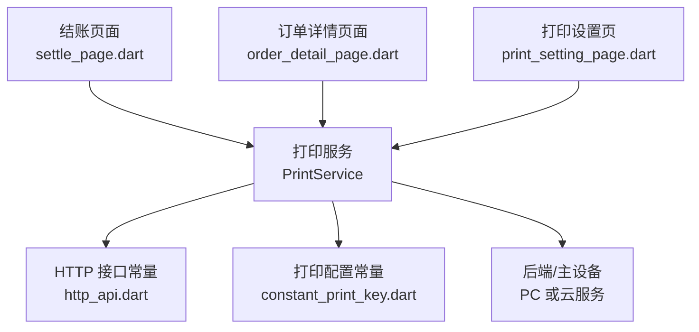
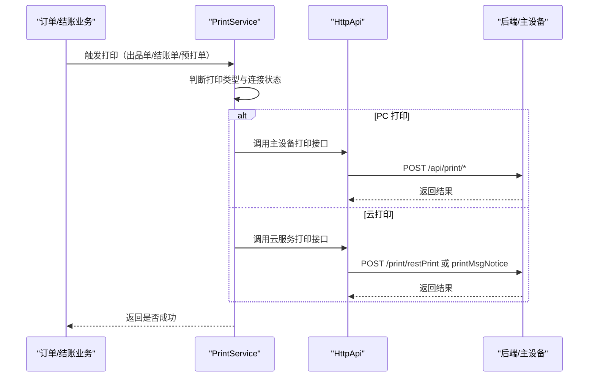
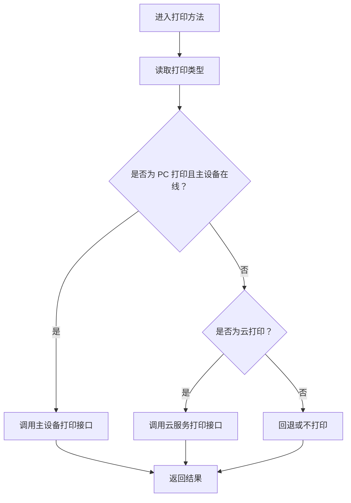
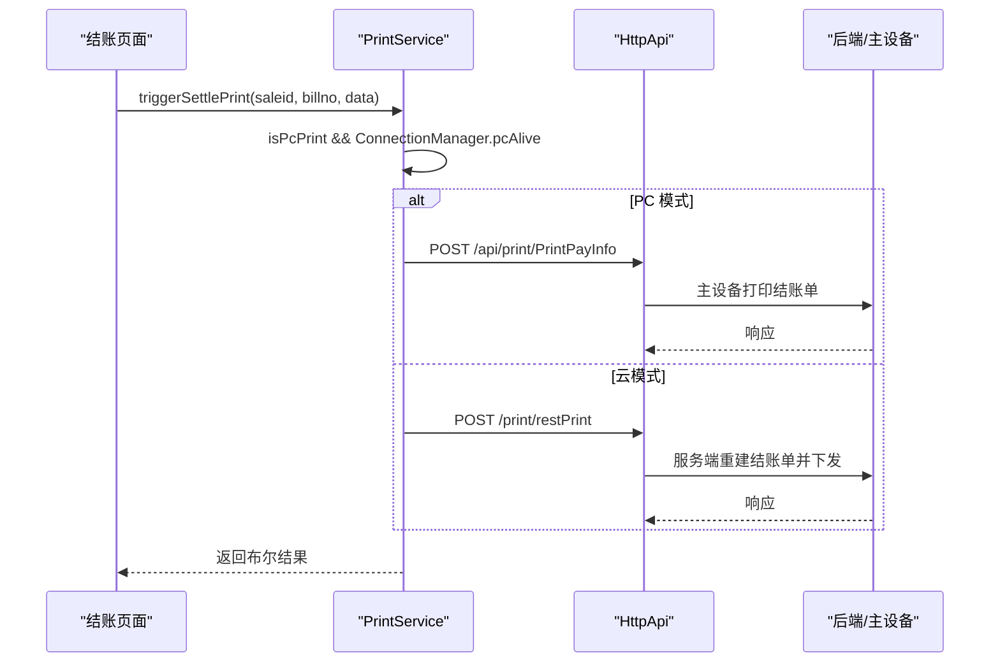
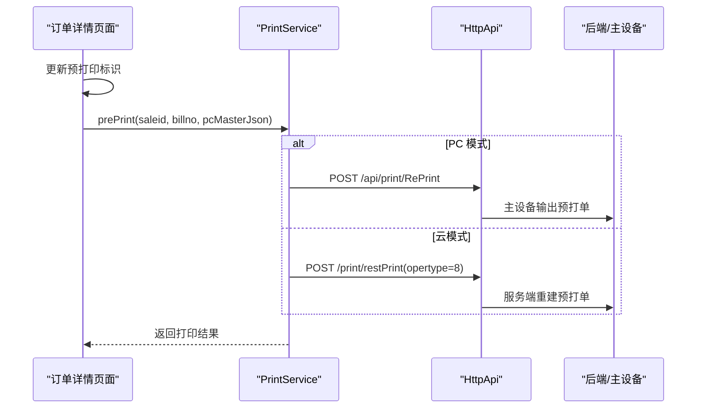
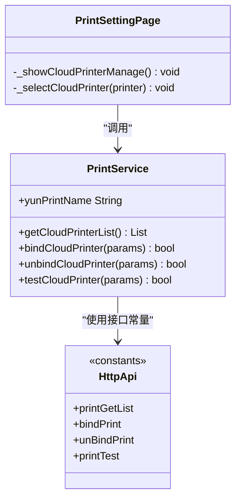
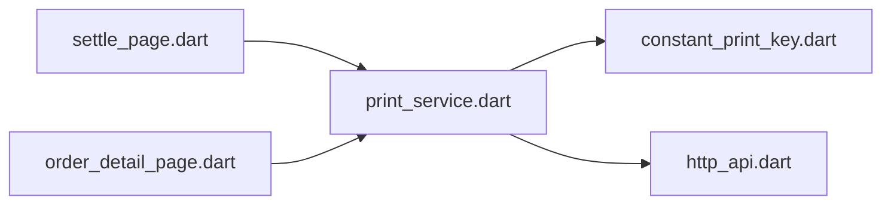

# 打印服务

<cite>
**本文引用的文件**   
- [print_service.dart](file://lib/util/print_service.dart)
- [constant_print_key.dart](file://lib/res/constant_print_key.dart)
- [print_setting_page.dart](file://lib/setting/page/print_setting_page.dart)
- [http_api.dart](file://lib/net/http_api.dart)
- [settle_page.dart](file://lib/pages/order/settle_page.dart)
- [order_detail_page.dart](file://lib/pages/order/order_detail_page.dart)
</cite>

## 目录
1. [引言](#引言)
2. [项目结构](#项目结构)
3. [核心组件](#核心组件)
4. [架构总览](#架构总览)
5. [详细组件分析](#详细组件分析)
6. [依赖关系分析](#依赖关系分析)
7. [性能与可靠性](#性能与可靠性)
8. [故障排查指南](#故障排查指南)
9. [结论](#结论)
10. [附录：API 参考](#附录api-参考)

## 引言
本文面向聚客美滋滋应用的“打印服务”子系统，聚焦 PrintService 的 POS 小票打印实现。当前代码库中，PrintService 承担的是“业务侧打印调度中心”的职责：它根据当前配置选择 PC 主设备打印或云服务打印，封装订单相关的小票触发逻辑（出品单、结账单、预打单、押金单、交班单、客单补打等），并统一通过 HTTP 接口把打印任务交给后端或主设备完成。

需要特别说明的是：
- 本仓库未直接包含 ESC/POS 指令集编码、蓝牙网络直连打印机驱动、本地任务队列和重试调度器。
- 云打印模式由服务端负责票据重建与下发；PC 模式下，由主设备负责最终出票。
- 本文在能力范围内说明现有实现的职责边界，并在“概念性章节”给出生产环境建议的扩展方案。

## 项目结构
打印功能主要分布在以下位置：
- 打印服务核心：`lib/util/print_service.dart`
- 打印配置常量：`lib/res/constant_print_key.dart`
- 打印设置界面：`lib/setting/page/print_setting_page.dart`
- 打印相关接口地址：`lib/net/http_api.dart`
- 结账流程调用点：`lib/pages/order/settle_page.dart`
- 预打单与客单补打调用点：`lib/pages/order/order_detail_page.dart`

**图示来源**
- [print_service.dart:1-416](file://lib/util/print_service.dart#L1-L416)
- [http_api.dart:480-520](file://lib/net/http_api.dart#L480-L520)
- [constant_print_key.dart:1-147](file://lib/res/constant_print_key.dart#L1-L147)
- [print_setting_page.dart:1-319](file://lib/setting/page/print_setting_page.dart#L1-L319)
- [settle_page.dart:1390-1430](file://lib/pages/order/settle_page.dart#L1390-L1430)
- [order_detail_page.dart:3060-3175](file://lib/pages/order/order_detail_page.dart#L3060-L3175)

**分节来源**
- [print_service.dart:1-416](file://lib/util/print_service.dart#L1-L416)
- [constant_print_key.dart:1-147](file://lib/res/constant_print_key.dart#L1-L147)
- [print_setting_page.dart:1-319](file://lib/setting/page/print_setting_page.dart#L1-L319)
- [http_api.dart:480-520](file://lib/net/http_api.dart#L480-L520)
- [settle_page.dart:1390-1430](file://lib/pages/order/settle_page.dart#L1390-L1430)
- [order_detail_page.dart:3060-3175](file://lib/pages/order/order_detail_page.dart#L3060-L3175)

## 核心组件
### PrintService：POS 打印调度中心
PrintService 是单例类，提供以下关键能力：
- 配置读取：当前打印类型、纸张规格、自动打印开关、份数、云打印机信息等。
- 业务触发：出品单、结账单、预打单、押金单、交班单、客单补打。
- 云打印管理：获取云打印机列表、绑定、解绑、测试。
- 内部转发：将请求分发到 PC 主设备接口或云服务接口。

#### 配置读取
- 打印类型：支持 PC 打印、云打印、蓝牙打印、接口打印，默认值为 PC 打印。
- 纸张规格：支持 58mm、80mm。
- 自动打印：结账、客单、厨打分别有独立开关。
- 云打印机信息：以 JSON 持久化保存选中的云打印机对象。

这些配置来自 `ConstantPrintKey` 与本地存储，PrintService 提供 getter/setter 进行统一访问。

**分节来源**
- [print_service.dart:24-112](file://lib/util/print_service.dart#L24-L112)
- [constant_print_key.dart:1-147](file://lib/res/constant_print_key.dart#L1-L147)

#### 业务打印触发
| 方法 | 场景 | PC 模式行为 | 云模式行为 |
|---|---|---|---|
| `triggerCookPrint` | 下单后触发出品单/厨打 | 不主动发送，交由主设备处理 | 按 saleid + opertype 调用 restPrint 重建票据 |
| `triggerSettlePrint` | 结账后打印结账单 | 调用 `/api/print/PrintPayInfo` | 调用 restPrint，opertype=2 |
| `reprintCustomerTicket` | 补打客单 | 调用 `/api/print/PrintKDInfo` | 调用 restPrint，opertype=15 |
| `prePrint` | 预打单 | 调用 `/api/print/RePrint`，传入 tablemaster | 调用 restPrint，opertype=8 |
| `printDeposit` | 押金单 | 优先走 PC 接口 `/api/print/PrintDepositInfo`，失败回退云 | 解析 saleid/billno 后调用 restPrint，opertype=13 |
| `printHandOver` | 交班单 | 调用 `/api/print/PrintHandOver` | 当前未实现云模式分支 |

**分节来源**
- [print_service.dart:114-291](file://lib/util/print_service.dart#L114-L291)

#### 云打印管理
- `getCloudPrinterList`：拉取云打印机列表。
- `bindCloudPrinter`：绑定云打印机。
- `unbindCloudPrinter`：解绑云打印机。
- `testCloudPrinter`：测试云打印机连通性。

所有云打印管理方法都通过 `requestForm` 调用对应接口，失败时记录日志并返回 false 或空列表。

**分节来源**
- [print_service.dart:295-339](file://lib/util/print_service.dart#L295-L339)
- [http_api.dart:480-520](file://lib/net/http_api.dart#L480-L520)

### ConstantPrintKey：打印配置键与枚举
该类集中定义：
- 打印机类型选项与默认值。
- 蓝牙、网口、远程、云打印相关配置键。
- 结账、客单、厨打、标签打印的配置键。
- 打印单据类型枚举，如暂结单、结账单、出品单、退菜单、催菜单、起菜单、预打单、交班单、客单、杯贴等。
- 票尾走纸行数、打印指令类型等通用参数。

该文件为整个打印模块提供稳定的键名和枚举语义，便于与原生 smdcapp 对齐。

**分节来源**
- [constant_print_key.dart:1-147](file://lib/res/constant_print_key.dart#L1-L147)

### 打印设置界面：PrintSettingPage
UI 层负责：
- 选择打印方式。
- 切换打印纸规格。
- 调整票尾走纸行数。
- 打开云打印机管理入口。
- 切换打印类型时清理旧蓝牙配置。

该页面与 PrintService 配合，使用户可感知地修改打印行为。

**分节来源**
- [print_setting_page.dart:1-319](file://lib/setting/page/print_setting_page.dart#L1-L319)

## 架构总览
PrintService 处于“业务页面”和“底层传输层”之间。业务页面只关心“什么时候打印什么单”，而具体走哪个通道、调哪个接口，由 PrintService 根据配置决定。

**图示来源**
- [print_service.dart:114-291](file://lib/util/print_service.dart#L114-L291)
- [http_api.dart:480-520](file://lib/net/http_api.dart#L480-L520)
- [settle_page.dart:1390-1430](file://lib/pages/order/settle_page.dart#L1390-L1430)
- [order_detail_page.dart:3060-3175](file://lib/pages/order/order_detail_page.dart#L3060-L3175)

## 详细组件分析

### PrintService 的打印路由逻辑
PrintService 的核心设计是按“打印类型 + 连接状态”做路由：
- 如果检测到 PC 主设备在线，则优先走 `/api/print/*` 系列接口。
- 否则走云服务 `/print/*` 系列接口。
- 部分方法会先尝试 PC，再回退到云服务。
- 所有外部异常都被捕获并记录日志，避免上层业务被中断。

**图示来源**
- [print_service.dart:114-291](file://lib/util/print_service.dart#L114-L291)

**分节来源**
- [print_service.dart:114-291](file://lib/util/print_service.dart#L114-L291)

### 结账打印流程
结账成功后，`settle_page` 调用 `PrintService.triggerSettlePrint`，传入 saleid、billno 和结算数据。PrintService 根据模式选择：
- PC 模式：调用 `/api/print/PrintPayInfo`。
- 云模式：调用 restPrint，opertype=2。

**图示来源**
- [settle_page.dart:1390-1430](file://lib/pages/order/settle_page.dart#L1390-L1430)
- [print_service.dart:154-171](file://lib/util/print_service.dart#L154-L171)
- [http_api.dart:480-520](file://lib/net/http_api.dart#L480-L520)

**分节来源**
- [settle_page.dart:1390-1430](file://lib/pages/order/settle_page.dart#L1390-L1430)
- [print_service.dart:154-171](file://lib/util/print_service.dart#L154-L171)

### 预打单与客单补打流程
预打单流程在 `order_detail_page` 中触发：
1. 更新预打印标识。
2. 组装订单主表和明细。
3. 调用 `PrintService.prePrint`。
4. PC 模式传 tablemaster，云模式通过 restPrint opertype=8 重建票据。

客单补打也在此页面：
- PC 模式直接调用 `/api/print/PrintKDInfo`。
- 云模式调用 `reprintCustomerTicket`，opertype=15。

**图示来源**
- [order_detail_page.dart:3060-3175](file://lib/pages/order/order_detail_page.dart#L3060-L3175)
- [print_service.dart:207-227](file://lib/util/print_service.dart#L207-L227)
- [http_api.dart:480-520](file://lib/net/http_api.dart#L480-L520)

**分节来源**
- [order_detail_page.dart:3060-3175](file://lib/pages/order/order_detail_page.dart#L3060-L3175)
- [print_service.dart:207-227](file://lib/util/print_service.dart#L207-L227)

### 云打印机管理
云打印机管理包括：
- 获取列表。
- 选择并保存云打印机信息。
- 绑定、解绑、测试。

UI 层在 `print_setting_page.dart` 中加载列表，用户选中后保存到本地存储；PrintService 提供统一的 API 调用。

**图示来源**
- [print_service.dart:295-339](file://lib/util/print_service.dart#L295-L339)
- [print_setting_page.dart:253-319](file://lib/setting/page/print_setting_page.dart#L253-L319)
- [http_api.dart:480-520](file://lib/net/http_api.dart#L480-L520)

**分节来源**
- [print_service.dart:295-339](file://lib/util/print_service.dart#L295-L339)
- [print_setting_page.dart:253-319](file://lib/setting/page/print_setting_page.dart#L253-L319)

## 依赖关系分析
PrintService 的依赖链比较清晰：
- 对外暴露业务打印方法。
- 对内依赖 `ConstantPrintKey` 读取配置。
- 通过 `HttpApi` 确定接口地址。
- 由上层业务页面决定是否调用。

**图示来源**
- [print_service.dart:1-416](file://lib/util/print_service.dart#L1-L416)
- [http_api.dart:480-520](file://lib/net/http_api.dart#L480-L520)
- [constant_print_key.dart:1-147](file://lib/res/constant_print_key.dart#L1-L147)
- [settle_page.dart:1390-1430](file://lib/pages/order/settle_page.dart#L1390-L1430)
- [order_detail_page.dart:3060-3175](file://lib/pages/order/order_detail_page.dart#L3060-L3175)

**分节来源**
- [print_service.dart:1-416](file://lib/util/print_service.dart#L1-L416)
- [http_api.dart:480-520](file://lib/net/http_api.dart#L480-L520)
- [constant_print_key.dart:1-147](file://lib/res/constant_print_key.dart#L1-L147)

## 性能与可靠性
### 当前实现的性能特征
- 打印调用是同步 await 的异步方法，每次打印都会发起一次网络请求。
- 没有内置批量打印合并、任务队列、进度回调或失败重试。
- 错误处理集中在每个方法内部的 try/catch，并记录日志。
- 云打印列表获取失败时返回空列表，不影响主流程。

### 内存与资源
- PrintService 使用单例，避免重复实例化。
- 云打印机信息以 JSON 字符串持久化，避免运行时大对象持有。
- 未看到打印缓冲、图片压缩、指令流控等优化。

### 建议的生产环境增强
由于当前实现未包含以下机制，建议在后续迭代中补充：
- 任务队列：串行化打印任务，避免并发导致主设备或云端排队混乱。
- 批量优化：对同一订单的多张票据（出品单、客单、杯贴）合并请求或复用上下文。
- 重试策略：对网络超时、设备离线等错误做有限次重试，带指数退避。
- 进度反馈：向 UI 暴露开始、进行中、完成、失败等阶段事件。
- 缓存与降级：在网络不可用时缓存待打印任务，恢复后重放。
- 指令层优化：若未来引入 ESC/POS 直连，应增加分包发送、流控、断线重连。

[本节为通用建议，不直接分析特定源码文件]

## 故障排查指南
### 常见问题定位
| 现象 | 可能原因 | 排查步骤 |
|---|---|---|
| 结账不出单 | PC 模式主设备不在线 | 检查 `ConnectionManager.pcAlive`，确认 `/api/print/PrintPayInfo` 是否可达 |
| 云打印无反应 | 云打印机未绑定或未选中 | 查看 `yunPrintInfo`，调用 `getCloudPrinterList` 验证列表 |
| 预打单失败 | 预打印标识未更新或 tablemaster 为空 | 检查 `_postOrderUpdate` 与 `pcMasterJson` 构造逻辑 |
| 客单补打出错 | 云模式 opertype 或 jobcontent 不正确 | 确认 `reprintCustomerTicket` 参数 |
| 云打印机列表为空 | 接口失败或无权限 | 查看 `getCloudPrinterList` 日志，确认 `/print/getList` |
| 切换打印方式后仍用旧设备 | 蓝牙或云打印机配置未清理 | 检查切换逻辑是否清除 `bluetoothAddr`、`bluetoothName` |

### 日志与调试建议
- 关注 PrintService 各方法的 `Log.e` 输出。
- 在打印设置页观察“打印方式”“打印设备”描述是否符合预期。
- 对于云打印，先执行“云打印机测试”，再执行实际业务打印。
- 对于 PC 打印，优先确认主设备连接状态，再确认接口路径。

**分节来源**
- [print_service.dart:173-195](file://lib/util/print_service.dart#L173-L195)
- [print_service.dart:207-227](file://lib/util/print_service.dart#L207-L227)
- [print_service.dart:295-339](file://lib/util/print_service.dart#L295-L339)
- [print_setting_page.dart:201-319](file://lib/setting/page/print_setting_page.dart#L201-L319)

## 结论
当前 PrintService 是一个清晰的“打印业务编排层”。它不负责生成 ESC/POS 指令，也不直接管理蓝牙或 TCP 打印机连接；真正的票据渲染和硬件输出由主设备或云服务承担。这种设计的优点是职责清晰、易于对接不同后端；缺点是前端缺乏打印任务控制面，无法直接实现队列、重试、进度等高级特性。

若需要更完整的生产级打印能力，应在现有 PrintService 之上扩展：
- 任务管理器：负责队列、优先级、去重、重试、取消。
- 设备适配器：抽象热敏、网络、蓝牙、USB 等不同设备。
- 模板引擎：封装订单、商品、促销、二维码等内容组装。
- 指令编码器：按需实现 ESC/POS、TSC 等协议。
- 状态机：跟踪准备、发送、完成、失败等状态。

[本节为总结性内容，不直接分析特定源码文件]

## 附录：API 参考

### 配置与状态
| 方法或属性 | 返回值 | 说明 |
|---|---|---|
| `printerType` | `String` | 当前打印类型 |
| `setPrinterType(type)` | `void` | 设置打印类型 |
| `isPcPrint` | `bool` | 是否 PC 打印 |
| `isCloudPrint` | `bool` | 是否云打印 |
| `printSize` | `String` | 打印纸规格 |
| `feedLineCount` | `int` | 票尾走纸行数 |
| `settlePrintCopies` | `int` | 结账打印份数 |
| `kdPrintCopies` | `int` | 客单打印份数 |
| `cookPrintCopies` | `int` | 厨打打印份数 |
| `isSettleAutoPrint` | `bool` | 结账是否自动打印 |
| `isKdAutoPrint` | `bool` | 客单是否自动打印 |
| `isCookAutoPrint` | `bool` | 厨打是否自动打印 |
| `yunPrintInfo` | `Map<String, dynamic>?` | 选中的云打印机信息 |
| `yunPrintName` | `String` | 云打印机名称 |

**分节来源**
- [print_service.dart:24-112](file://lib/util/print_service.dart#L24-L112)

### 业务打印方法
| 方法 | 主要参数 | 行为 |
|---|---|---|
| `triggerCookPrint` | saleid、billno、withKd、withCpd、withCpdBranch、withLabel | 下单后触发出品单、客单、杯贴等 |
| `triggerSettlePrint` | saleid、billno、data | 结账后打印结账单 |
| `reprintCustomerTicket` | billno、opertype、jobcontent | 补打客单 |
| `prePrint` | saleid、billno、pcMasterJson | 预打单 |
| `printTempPayInfo` | data | 暂结打印 |
| `printDeposit` | data | 押金单打印或补打 |
| `printHandOver` | data | 交班打印 |

**分节来源**
- [print_service.dart:114-291](file://lib/util/print_service.dart#L114-L291)

### 云打印管理方法
| 方法 | 参数 | 返回值 | 说明 |
|---|---|---|---|
| `getCloudPrinterList` | 无 | `Future<List<dynamic>>` | 获取云打印机列表 |
| `bindCloudPrinter` | params | `Future<bool>` | 绑定云打印机 |
| `unbindCloudPrinter` | params | `Future<bool>` | 解绑云打印机 |
| `testCloudPrinter` | params | `Future<bool>` | 测试云打印机 |

**分节来源**
- [print_service.dart:295-339](file://lib/util/print_service.dart#L295-L339)
- [http_api.dart:480-520](file://lib/net/http_api.dart#L480-L520)

### 打印单据类型枚举
| 常量 | 值 | 含义 |
|---|---|---|
| `printTypeNone` | -1 | 不打印 |
| `printTypeZanJie` | 1 | 暂结单 |
| `printTypeJieZhang` | 2 | 结账单 |
| `printTypeChuPin` | 3 | 出品单 |
| `printTypeTuiCai` | 4 | 退菜单 |
| `printTypeCuiCai` | 5 | 催菜单 |
| `printTypeGuaQi` | 6 | 挂起单 |
| `printTypeQiCai` | 7 | 起菜单 |
| `printTypeYuDa` | 8 | 预打单 |
| `printTypeChongZhi` | 9 | 充值单 |
| `printTypeJiaoBan` | 10 | 交班单 |
| `printTypeYuDing` | 11 | 预订单 |
| `printTypeJiCun` | 12 | 寄存单 |
| `printTypeYaJin` | 13 | 押金单 |
| `printTypeBeiTie` | 14 | 杯贴 |
| `printTypeKeDan` | 15 | 客单 |
| `printTypeZhuanTai` | 18 | 转台单 |

**分节来源**
- [constant_print_key.dart:100-147](file://lib/res/constant_print_key.dart#L100-L147)