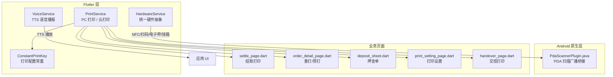
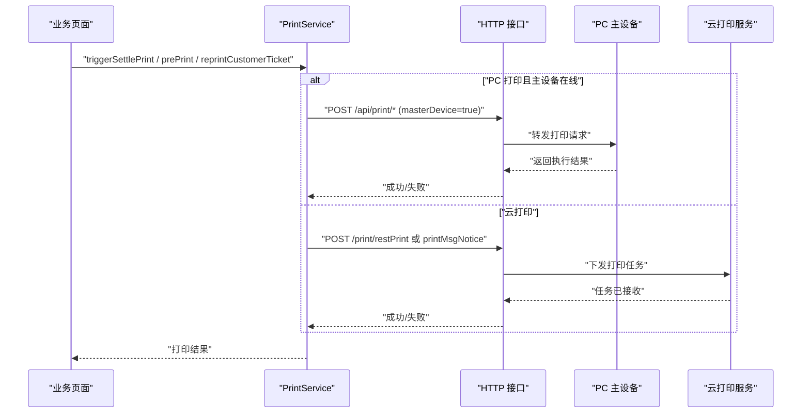
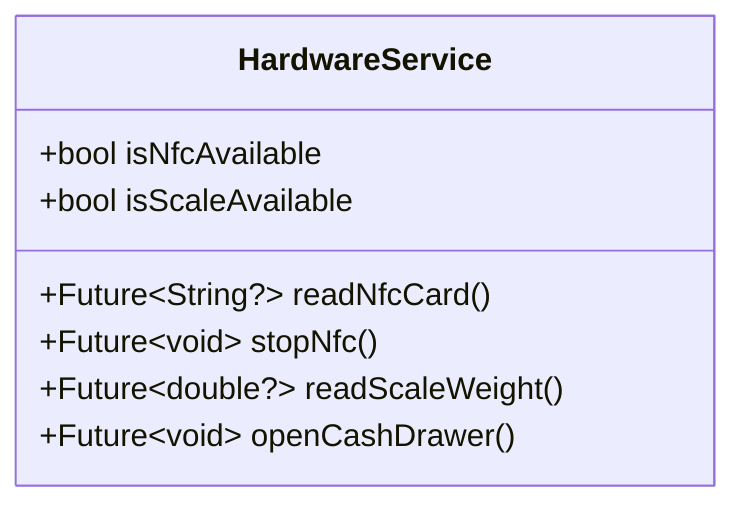
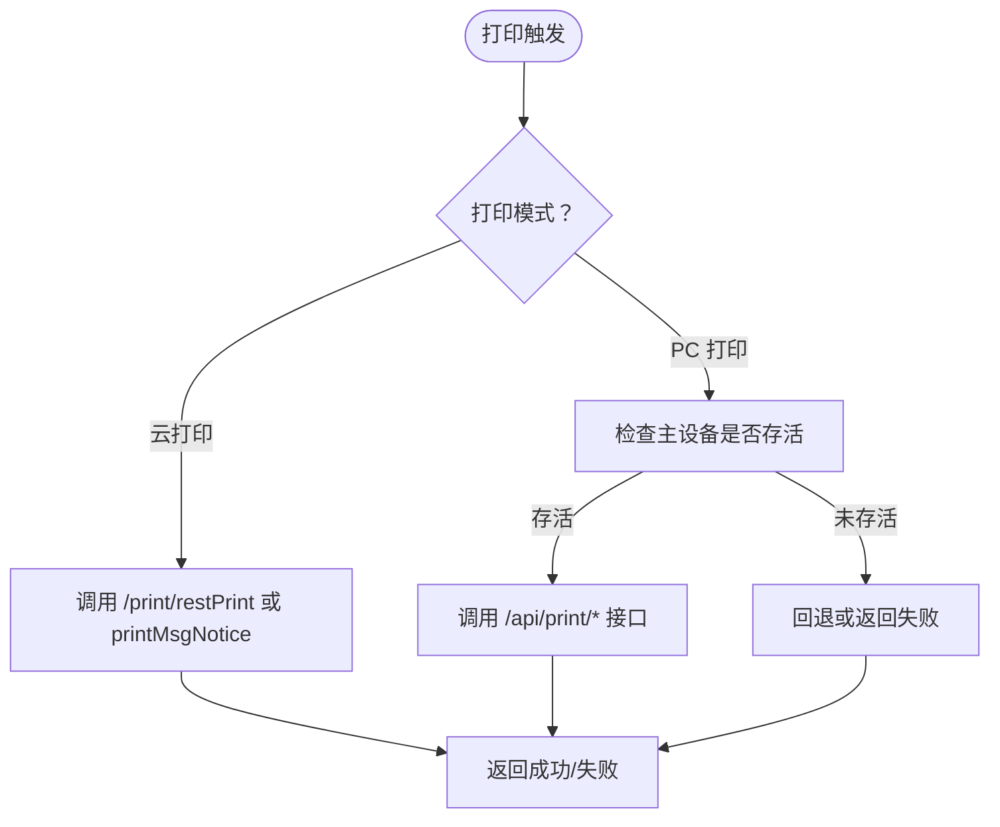
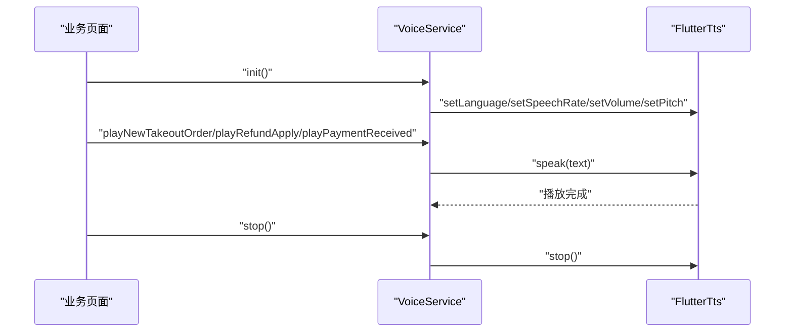
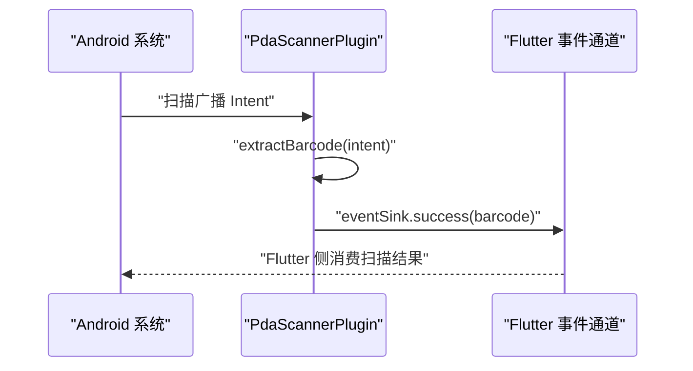
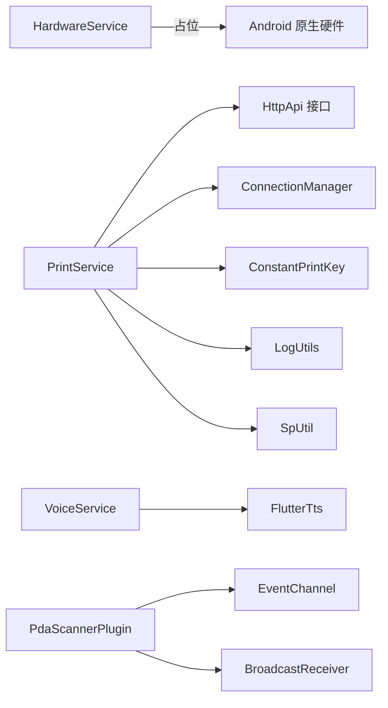

# 硬件服务

<cite>
**本文引用的文件**   
- [hardware_service.dart](file://lib/util/hardware_service.dart)
- [print_service.dart](file://lib/util/print_service.dart)
- [constant_print_key.dart](file://lib/res/constant_print_key.dart)
- [voice_service.dart](file://lib/util/voice_service.dart)
- [PdaScannerPlugin.java（bycloud/smdc）](file://android/app/src/main/java/com/bycloud/smdc/PdaScannerPlugin.java)
- [PdaScannerPlugin.java（weilu/deer）](file://android/app/src/main/java/com/weilu/deer/PdaScannerPlugin.java)
- [pubspec.yaml](file://pubspec.yaml)
- [settle_page.dart](file://lib/pages/order/settle_page.dart)
- [order_detail_page.dart](file://lib/pages/order/order_detail_page.dart)
- [deposit_sheet.dart](file://lib/components/deposit_sheet.dart)
- [print_setting_page.dart](file://lib/setting/page/print_setting_page.dart)
- [handover_page.dart](file://lib/setting/page/handover_page.dart)
</cite>

## 目录
1. [引言](#引言)
2. [项目结构](#项目结构)
3. [核心组件](#核心组件)
4. [架构总览](#架构总览)
5. [详细组件分析](#详细组件分析)
6. [依赖关系分析](#依赖关系分析)
7. [性能与可靠性](#性能与可靠性)
8. [故障诊断指南](#故障诊断指南)
9. [结论](#结论)
10. [附录：API 参考](#附录api-参考)

## 引言
本文面向聚客美滋滋应用中的“硬件服务”能力，围绕三个核心服务展开：

- HardwareService：统一抽象层，负责 NFC、扫码枪、电子秤、钱箱等硬件的统一接入接口定义与占位实现。
- PrintService：POS 场景下的打印服务，支持 PC 打印、云打印、预打单、结账单补打、押金单、交班单等，并对接 Android/iOS 原生设备或云端打印通道。
- VoiceService：语音播报服务，基于 TTS 引擎提供新订单、退单、催单、收款等语音提示。

此外，文档还说明与 Android 原生 PDA 扫描广播的桥接实现，覆盖设备发现、连接管理、状态监控、错误处理、生命周期管理、兼容性方案与性能优化建议。

## 项目结构
硬件相关代码主要分布在以下位置：

- Flutter 层服务：
  - lib/util/hardware_service.dart：HardwareService 统一抽象。
  - lib/util/print_service.dart：PrintService 打印服务。
  - lib/util/voice_service.dart：VoiceService 语音播报服务。
  - lib/res/constant_print_key.dart：打印配置常量。
- Android 原生插件：
  - android/app/src/main/java/com/bycloud/smdc/PdaScannerPlugin.java
  - android/app/src/main/java/com/weilu/deer/PdaScannerPlugin.java
- 业务调用方：
  - lib/pages/order/settle_page.dart：结账触发打印。
  - lib/pages/order/order_detail_page.dart：重打、预打等打印操作。
  - lib/components/deposit_sheet.dart：押金单打印。
  - lib/setting/page/print_setting_page.dart：打印设置页面。
  - lib/setting/page/handover_page.dart：交班打印。

图示来源
- [hardware_service.dart:1-79](file://lib/util/hardware_service.dart#L1-L79)
- [print_service.dart:1-416](file://lib/util/print_service.dart#L1-L416)
- [constant_print_key.dart:1-147](file://lib/res/constant_print_key.dart#L1-L147)
- [voice_service.dart:1-134](file://lib/util/voice_service.dart#L1-L134)
- [PdaScannerPlugin.java（bycloud/smdc）:1-165](file://android/app/src/main/java/com/bycloud/smdc/PdaScannerPlugin.java#L1-L165)
- [PdaScannerPlugin.java（weilu/deer）:1-165](file://android/app/src/main/java/com/weilu/deer/PdaScannerPlugin.java#L1-L165)

章节来源
- [pubspec.yaml:1-111](file://pubspec.yaml#L1-L111)

## 核心组件
本节从职责、关键方法、数据流和扩展点角度梳理三大服务。

- HardwareService
  - 职责：为 NFC、扫码枪、电子秤、钱箱等硬件提供统一抽象；当前以接口定义与占位实现为主，预留后续引入对应插件的空间。
  - 关键点：
    - isNfcAvailable/readNfcCard/stopNfc：NFC 读卡入口，待接入 nfc_manager/flutter_nfc_kit。
    - readScaleWeight/isScaleAvailable：电子秤称重入口，待接入串口/蓝牙协议插件。
    - openCashDrawer：通过 ESC/POS p 指令打开钱箱，需复用打印通道。
    - 扫码枪能力由 mobile_scanner 提供，此处不重复实现。
  - 设计模式：单例 + 静态工具类风格，便于全局访问。

- PrintService
  - 职责：封装 POS 全链路打印逻辑，包括配置读取、PC 打印、云打印、预打单、结账单、押金单、交班单、补打客单等。
  - 关键点：
    - 配置：printerType、printSize、feedLineCount、各单据份数与自动打印开关。
    - 触发：triggerCookPrint、triggerSettlePrint、prePrint、reprintCustomerTicket、printDeposit、printHandOver。
    - 云打印：getCloudPrinterList、bindCloudPrinter、unbindCloudPrinter、testCloudPrinter、cloudReprint、cloudPrintNotice。
    - 内部：_pcPrintPayInfo、_pcPrintTempPayInfo 等私有打印方法。
  - 数据流：业务页 → PrintService → HTTP 接口（PC 打印或云服务），必要时结合 ConnectionManager 判断主设备是否存活。

- VoiceService
  - 职责：基于 flutter_tts 实现中文语音播报，提供新订单、退单、催单、收款等模板。
  - 关键点：
    - init：初始化 TTS，设置语言、语速、音量、音调。
    - speak/stop：播放与停止。
    - 业务模板：playNewTakeoutOrder、playNewScanOrder、playRefundApply、playUrgeOrder、playPaymentReceived。
    - 金额转中文大写：amountToChinese。

章节来源
- [hardware_service.dart:1-79](file://lib/util/hardware_service.dart#L1-L79)
- [print_service.dart:1-416](file://lib/util/print_service.dart#L1-L416)
- [voice_service.dart:1-134](file://lib/util/voice_service.dart#L1-L134)

## 架构总览
硬件服务的整体架构采用“Flutter 服务层 + Android 原生桥接 + 业务调用”的分层模式：

- Flutter 服务层：
  - HardwareService：统一抽象，避免业务直接耦合具体硬件。
  - PrintService：聚合打印配置与多通道打印逻辑。
  - VoiceService：封装 TTS 播放能力。
- Android 原生桥接：
  - PdaScannerPlugin：监听 PDA 扫描广播，将条码结果通过 EventChannel 推送至 Flutter。
- 业务调用：
  - 结账、预打、重打、押金单、交班等页面直接调用 PrintService。
  - 语音在订单事件发生时调用 VoiceService。

图示来源
- [print_service.dart:120-200](file://lib/util/print_service.dart#L120-L200)
- [print_service.dart:201-416](file://lib/util/print_service.dart#L201-L416)
- [settle_page.dart:1408-1415](file://lib/pages/order/settle_page.dart#L1408-L1415)

章节来源
- [print_service.dart:1-416](file://lib/util/print_service.dart#L1-L416)
- [settle_page.dart:1408-1415](file://lib/pages/order/settle_page.dart#L1408-L1415)

## 详细组件分析

### HardwareService：统一硬件抽象层
HardwareService 是硬件能力的门面类，当前主要承担“接口定义与占位实现”，以便后续逐步接入真实硬件插件。其设计目标是：

- 统一 NFC、扫码枪、电子秤、钱箱的访问方式。
- 与 smdcapp 中的 NfcUtils、MipcaActivityCapture 等工具对齐。
- 对业务层屏蔽底层差异，降低耦合度。

图示来源
- [hardware_service.dart:1-79](file://lib/util/hardware_service.dart#L1-L79)

关键行为说明：
- NFC：isNfcAvailable 返回 false，readNfcCard 返回 null，stopNfc 为空实现，待接入 nfc_manager/flutter_nfc_kit。
- 扫码枪：已由 mobile_scanner 提供，本类不再重复实现。
- 电子秤：isScaleAvailable 返回 false，readScaleWeight 返回 null，待接入串口/蓝牙插件。
- 钱箱：openCashDrawer 通过 ESC/POS p 指令触发，需复用打印通道。

生命周期与错误处理：
- 当前无主动生命周期管理，所有方法均为幂等调用。
- 错误处理以 debugPrint 日志为主，未来可升级为结构化错误码。

扩展点：
- 引入 nfc_manager/flutter_nfc_kit 后替换 NFC 实现。
- 引入串口/蓝牙库后实现电子秤重量读取。
- 集成打印机通道后实现开钱箱指令发送。

章节来源
- [hardware_service.dart:1-79](file://lib/util/hardware_service.dart#L1-L79)

### PrintService：POS 打印服务
PrintService 是 POS 打印的核心服务，承担打印配置、打印触发、云打印管理与内部私有方法四类职责。

#### 打印配置
- printerType：PC 打印/云打印/蓝牙打印/接口打印。
- printSize：58mm/80mm。
- feedLineCount：票尾走纸行数。
- settlePrintCopies/kdPrintCopies/cookPrintCopies：各单据打印份数。
- isSettleAutoPrint/isKdAutoPrint/isCookAutoPrint：是否自动打印。
- yunPrintInfo/yunPrintName：选中的云打印机信息。

这些配置来自 ConstantPrintKey，并通过 SpUtil 持久化。

#### 打印触发
- triggerCookPrint：下单触发出品单/厨打，支持杯贴通知。
- triggerSettlePrint：结账触发出结账单。
- reprintCustomerTicket：补打客单。
- prePrint：预打单。
- printDeposit：押金单打印/补打。
- printHandOver：交班打印。

#### 云打印管理
- getCloudPrinterList：获取云打印机列表。
- bindCloudPrinter：绑定云打印机。
- unbindCloudPrinter：解绑云打印机。
- testCloudPrinter：测试云打印机。
- cloudReprint：按 saleid+opertype 重建票据并重打。
- cloudPrintNotice：云打印通知。

图示来源
- [print_service.dart:120-200](file://lib/util/print_service.dart#L120-L200)
- [print_service.dart:201-416](file://lib/util/print_service.dart#L201-L416)

#### 错误处理与日志
- 所有外部调用均包裹 try/catch，异常通过 Log.e 记录。
- 云打印与 PC 打印失败时返回 false，便于上层重试或提示。

#### 与业务页面的协作
- settle_page.dart：结账成功后调用 triggerSettlePrint 与 printTempPayInfo。
- order_detail_page.dart：重打与预打。
- deposit_sheet.dart：押金单打印。
- print_setting_page.dart：打印类型与云打印机选择。
- handover_page.dart：交班打印。

章节来源
- [print_service.dart:1-416](file://lib/util/print_service.dart#L1-L416)
- [constant_print_key.dart:1-147](file://lib/res/constant_print_key.dart#L1-L147)
- [settle_page.dart:1408-1415](file://lib/pages/order/settle_page.dart#L1408-L1415)
- [order_detail_page.dart:1227-1230](file://lib/pages/order/order_detail_page.dart#L1227-L1230)
- [order_detail_page.dart:3119-3170](file://lib/pages/order/order_detail_page.dart#L3119-L3170)
- [deposit_sheet.dart:477-480](file://lib/components/deposit_sheet.dart#L477-L480)
- [deposit_sheet.dart:874-876](file://lib/components/deposit_sheet.dart#L874-L876)
- [print_setting_page.dart:34-35](file://lib/setting/page/print_setting_page.dart#L34-L35)
- [print_setting_page.dart:207-207](file://lib/setting/page/print_setting_page.dart#L207-L207)
- [print_setting_page.dart:253-275](file://lib/setting/page/print_setting_page.dart#L253-L275)
- [handover_page.dart:226-237](file://lib/setting/page/handover_page.dart#L226-L237)

### VoiceService：语音播报服务
VoiceService 使用 flutter_tts 实现中文语音播报，适用于外卖新单、扫码点餐新单、退单、催单、收款等场景。

图示来源
- [voice_service.dart:1-134](file://lib/util/voice_service.dart#L1-L134)

关键行为说明：
- init：初始化 TTS，设置语言为 zh-CN，语速 0.5，音量 1.0，音调 1.0。
- speak：根据 enabled 标志决定是否播报。
- stop：安全停止播放。
- 业务模板：新订单、扫码点餐、退单、催单、收款。
- amountToChinese：金额转中文大写，用于更自然的语音播报。

生命周期与错误处理：
- 初始化失败仅记录 debugPrint，不影响应用启动。
- speak/stop 捕获异常并忽略，保证 UI 不受影响。

章节来源
- [voice_service.dart:1-134](file://lib/util/voice_service.dart#L1-L134)

### Android 原生 PDA 扫描桥接：PdaScannerPlugin
PdaScannerPlugin 是 Android 原生插件，负责监听主流 PDA 手持机的扫描广播，并通过 EventChannel 将条码结果推送至 Flutter 层。

图示来源
- [PdaScannerPlugin.java（bycloud/smdc）:1-165](file://android/app/src/main/java/com/bycloud/smdc/PdaScannerPlugin.java#L1-L165)
- [PdaScannerPlugin.java（weilu/deer）:1-165](file://android/app/src/main/java/com/weilu/deer/PdaScannerPlugin.java#L1-L165)

关键行为说明：
- 广播 Action 列表：兼容商米、优博音、新大陆、iData、东大集成、霍尼韦尔等主流 PDA。
- Extra Key 列表：兼容 barcode、data、scan_result、BARCODE、scanData、value 等多种字段名。
- extractBarcode：优先尝试常见 key，兜底遍历 Bundle 中所有 String 值。
- EventChannel：注册名为 com.bycloud.smdc/pda_scanner 或 com.weilu.deer/pda_scanner 的流通道。
- 生命周期：onAttachedToEngine 注册 EventChannel；onDetachedFromEngine 注销 Receiver；onListen/onCancel 控制订阅与取消。

注意：
- 两个包名路径不同但实现相同，分别适配 bycloud/smdc 与 weilu/deer 两套工程命名。
- SDK 版本大于等于 TIRAMISU 时使用 RECEIVER_EXPORTED 注册 Receiver。

章节来源
- [PdaScannerPlugin.java（bycloud/smdc）:1-165](file://android/app/src/main/java/com/bycloud/smdc/PdaScannerPlugin.java#L1-L165)
- [PdaScannerPlugin.java（weilu/deer）:1-165](file://android/app/src/main/java/com/weilu/deer/PdaScannerPlugin.java#L1-L165)

## 依赖关系分析
硬件服务之间的依赖关系如下：

- HardwareService 当前无运行时依赖，主要为接口占位。
- PrintService 依赖：
  - http_api.dart：定义 PC 打印与云打印接口地址。
  - connection_manager.dart：判断主设备是否存活。
  - constant_print_key.dart：打印配置键值。
  - log_utils.dart：错误日志输出。
  - sp_util.dart：本地持久化存储。
- VoiceService 依赖：
  - flutter_tts：文字转语音引擎。
- PdaScannerPlugin 依赖：
  - FlutterPlugin/EventChannel：与 Flutter 通信。
  - BroadcastReceiver：监听 PDA 扫描广播。

图示来源
- [print_service.dart:1-416](file://lib/util/print_service.dart#L1-L416)
- [hardware_service.dart:1-79](file://lib/util/hardware_service.dart#L1-L79)
- [voice_service.dart:1-134](file://lib/util/voice_service.dart#L1-L134)
- [PdaScannerPlugin.java（bycloud/smdc）:1-165](file://android/app/src/main/java/com/bycloud/smdc/PdaScannerPlugin.java#L1-L165)

章节来源
- [pubspec.yaml:1-111](file://pubspec.yaml#L1-L111)
- [print_service.dart:1-416](file://lib/util/print_service.dart#L1-L416)
- [hardware_service.dart:1-79](file://lib/util/hardware_service.dart#L1-L79)
- [voice_service.dart:1-134](file://lib/util/voice_service.dart#L1-L134)

## 性能与可靠性
- 打印服务
  - 建议在高频打印场景中对云打印进行批量合并，减少网络往返。
  - PC 打印应优先判断 ConnectionManager.pcAlive，避免无效请求。
  - 云打印重试策略建议采用指数退避，防止雪崩。
  - 打印队列建议使用内存队列或 SQLite 持久化队列，确保断网后可恢复。
- 语音服务
  - TTS 初始化应在应用启动时完成，避免首次播报延迟。
  - 避免同时播报多条语音，可通过队列串行播放。
  - 音量与语速应允许用户自定义，并提供默认值。
- 硬件抽象
  - 对于 NFC/电子秤/钱箱等尚未实现的硬件，建议引入异步任务与超时机制，避免阻塞 UI。
  - 对硬件错误进行分类：设备不可用、权限不足、连接失败、协议不匹配等，便于上层提示与重试。

[本节为通用指导，不涉及具体文件分析]

## 故障诊断指南
常见问题与排查建议：

- NFC 无法读卡
  - 现象：isNfcAvailable 始终为 false，readNfcCard 返回 null。
  - 原因：尚未接入 nfc_manager/flutter_nfc_kit。
  - 解决：引入 NFC 插件并实现 readNfcCard/stopNfc。

- 电子秤无法读取重量
  - 现象：isScaleAvailable 返回 false，readScaleWeight 返回 null。
  - 原因：尚未接入串口/蓝牙插件。
  - 解决：实现电子秤协议插件，并在 readScaleWeight 中解析重量。

- 钱箱无法打开
  - 现象：openCashDrawer 无实际动作。
  - 原因：尚未通过打印通道发送 ESC/POS p 指令。
  - 解决：集成打印通道并发送开钱箱指令。

- 打印失败
  - 现象：triggerSettlePrint/prePrint/reprintCustomerTicket 返回 false。
  - 原因：PC 打印主设备离线、云打印接口异常、参数缺失。
  - 解决：检查 ConnectionManager.pcAlive、查看 Log.e 日志、确认 opertype/billno/jobcontent 是否正确。

- 云打印机不可用
  - 现象：getCloudPrinterList 返回空列表，testCloudPrinter 失败。
  - 原因：未绑定打印机、网络异常、服务器无响应。
  - 解决：先调用 bindCloudPrinter，再 testCloudPrinter，最后使用 cloudReprint。

- 语音播报无声
  - 现象：speak 无声音或抛出异常。
  - 原因：TTS 初始化失败、enabled=false、系统 TTS 未安装。
  - 解决：确保 init 成功，检查 enabled 标志，确认系统 TTS 可用。

- PDA 扫描无结果
  - 现象：EventChannel 未收到条码。
  - 原因：广播 Action 或 Extra Key 不匹配、Receiver 未注册。
  - 解决：核对 SCAN_ACTIONS 与 EXTRA_KEYS，确认 EventChannel 名称一致，检查 SDK 版本与 RECEIVER_EXPORTED。

章节来源
- [hardware_service.dart:1-79](file://lib/util/hardware_service.dart#L1-L79)
- [print_service.dart:195-416](file://lib/util/print_service.dart#L195-L416)
- [voice_service.dart:1-134](file://lib/util/voice_service.dart#L1-L134)
- [PdaScannerPlugin.java（bycloud/smdc）:1-165](file://android/app/src/main/java/com/bycloud/smdc/PdaScannerPlugin.java#L1-L165)
- [PdaScannerPlugin.java（weilu/deer）:1-165](file://android/app/src/main/java/com/weilu/deer/PdaScannerPlugin.java#L1-L165)

## 结论
聚客美滋滋应用的硬件服务采用分层架构：Flutter 层提供统一抽象与业务聚合，Android 原生层提供 PDA 扫描桥接，业务页面按需调用。当前阶段，HardwareService 仍以接口占位为主，PrintService 与 VoiceService 已具备完整功能，能够支撑 POS 场景下的打印与语音需求。未来应优先补齐 NFC、电子秤、钱箱等硬件能力，并完善打印队列、重试策略与错误分类，以提升系统的稳定性与用户体验。

[本节为总结性内容，不涉及具体文件分析]

## 附录：API 参考

### HardwareService
- isNfcAvailable：查询 NFC 是否可用。
- readNfcCard：读取 NFC 卡号，返回字符串或 null。
- stopNfc：停止 NFC 监听。
- isScaleAvailable：查询电子秤是否可用。
- readScaleWeight：读取电子秤重量，返回千克数值或 null。
- openCashDrawer：打开钱箱，通过 ESC/POS p 指令触发。

章节来源
- [hardware_service.dart:1-79](file://lib/util/hardware_service.dart#L1-L79)

### PrintService
- 配置读取
  - printerType/setPrinterType：获取/设置打印类型。
  - printSize：获取打印纸规格。
  - feedLineCount：获取票尾走纸行数。
  - settlePrintCopies/kdPrintCopies/cookPrintCopies：获取各单据打印份数。
  - isSettleAutoPrint/isKdAutoPrint/isCookAutoPrint：获取是否自动打印。
  - yunPrintInfo/yunPrintName：获取选中云打印机信息与名称。

- 打印触发
  - triggerCookPrint：下单触发出品单/厨打。
  - triggerSettlePrint：结账触发出结账单。
  - reprintCustomerTicket：补打客单。
  - prePrint：预打单。
  - printDeposit：押金单打印/补打。
  - printHandOver：交班打印。

- 云打印管理
  - getCloudPrinterList：获取云打印机列表。
  - bindCloudPrinter：绑定云打印机。
  - unbindCloudPrinter：解绑云打印机。
  - testCloudPrinter：测试云打印机。
  - cloudReprint：按 saleid+opertype 重建票据并重打。
  - cloudPrintNotice：云打印通知。

章节来源
- [print_service.dart:1-416](file://lib/util/print_service.dart#L1-L416)
- [constant_print_key.dart:1-147](file://lib/res/constant_print_key.dart#L1-L147)

### VoiceService
- init：初始化 TTS 引擎。
- speak：播报文本。
- stop：停止播报。
- playNewTakeoutOrder：新订单播报。
- playNewScanOrder：扫码点餐新订单播报。
- playRefundApply：退单申请播报。
- playUrgeOrder：催单播报。
- playPaymentReceived：收款播报。
- amountToChinese：金额转中文大写。

章节来源
- [voice_service.dart:1-134](file://lib/util/voice_service.dart#L1-L134)

### Android 原生 PdaScannerPlugin
- EventChannel：com.bycloud.smdc/pda_scanner 或 com.weilu.deer/pda_scanner。
- 广播 Action：SCAN_RESULT、SCAN、DATA_AVAILABLE、DECODE、BARCODE_RESULT 等。
- Extra Key：barcode、barcode_string、data、SCAN_BARCODE、scan_result、result、BARCODE、scanData、DECODE_DATA_MODE、KEY_SCAN_DATA、scan_barcode_data、scannerdata、SCAN_BARCODE1、value、EXTRA_SCAN_DATA、android.intent.extra.SCAN_BROADCAST_DATA 等。
- 生命周期：onAttachedToEngine/onDetachedFromEngine/onListen/onCancel。

章节来源
- [PdaScannerPlugin.java（bycloud/smdc）:1-165](file://android/app/src/main/java/com/bycloud/smdc/PdaScannerPlugin.java#L1-L165)
- [PdaScannerPlugin.java（weilu/deer）:1-165](file://android/app/src/main/java/com/weilu/deer/PdaScannerPlugin.java#L1-L165)