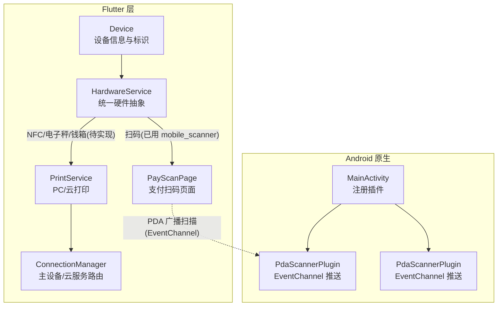
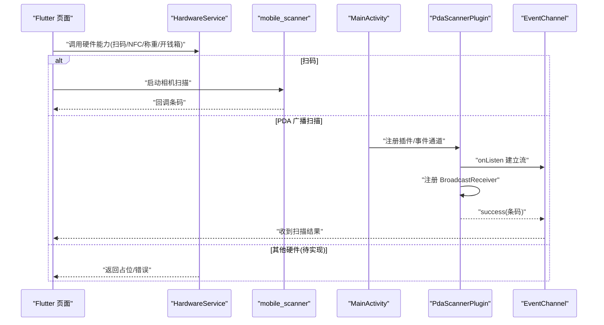
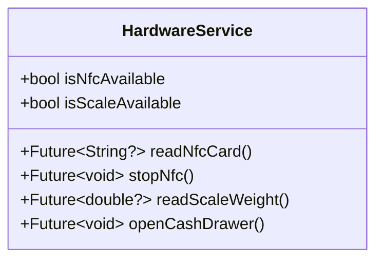
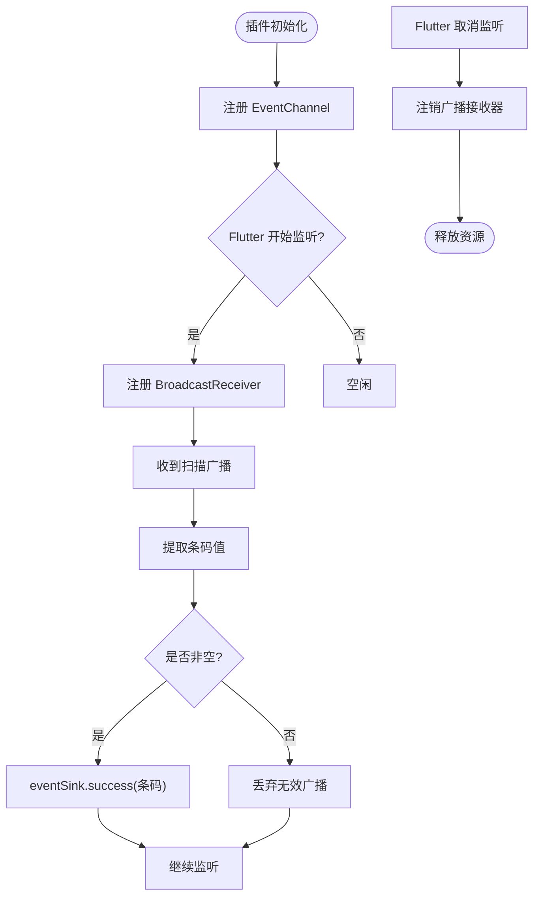
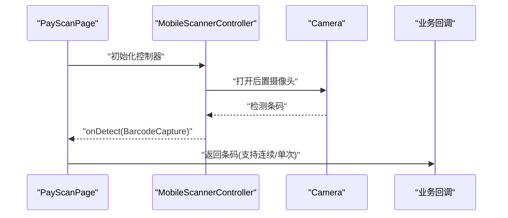
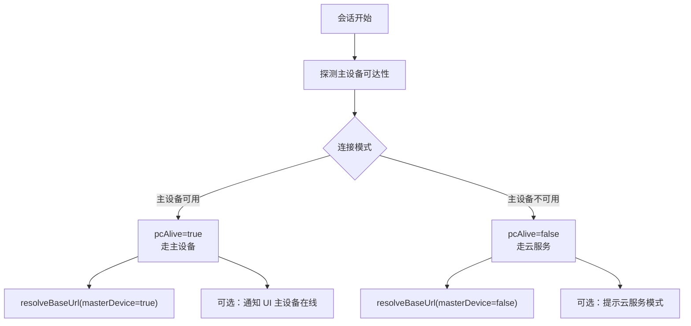
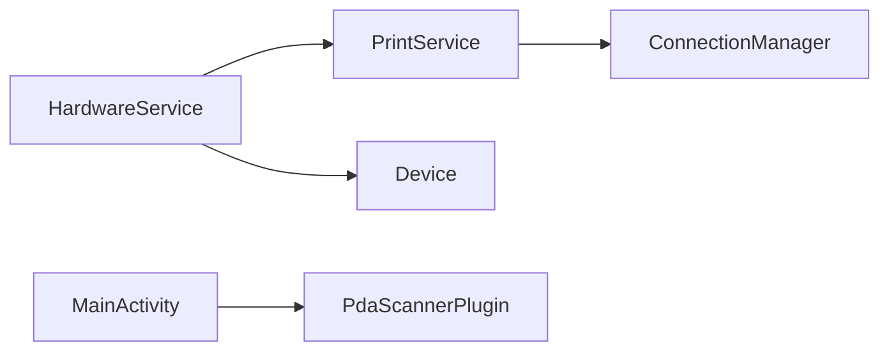

# 硬件服务架构

<cite>
**本文引用的文件**   
- [lib/util/hardware_service.dart](file://lib/util/hardware_service.dart)
- [android/app/src/main/java/com/bycloud/smdc/PdaScannerPlugin.java](file://android/app/src/main/java/com/bycloud/smdc/PdaScannerPlugin.java)
- [android/app/src/main/java/com/weilu/deer/PdaScannerPlugin.java](file://android/app/src/main/java/com/weilu/deer/PdaScannerPlugin.java)
- [android/app/src/main/java/com/bycloud/smdc/MainActivity.java](file://android/app/src/main/java/com/bycloud/smdc/MainActivity.java)
- [lib/pages/order/pay_scan_page.dart](file://lib/pages/order/pay_scan_page.dart)
- [lib/util/device_utils.dart](file://lib/util/device_utils.dart)
- [lib/net/connection_manager.dart](file://lib/net/connection_manager.dart)
- [lib/util/print_service.dart](file://lib/util/print_service.dart)
- [pubspec.yaml](file://pubspec.yaml)
</cite>

## 目录
1. [引言](#引言)
2. [项目结构](#项目结构)
3. [核心组件](#核心组件)
4. [架构总览](#架构总览)
5. [关键组件详解](#关键组件详解)
6. [依赖关系分析](#依赖关系分析)
7. [性能与并发特性](#性能与并发特性)
8. [故障排查指南](#故障排查指南)
9. [结论](#结论)
10. [附录：扩展与接入规范](#附录扩展与接入规范)

## 引言
本文件面向“聚客美滋滋”应用的硬件服务架构，聚焦 Flutter 层的统一抽象层 HardwareService，以及 Android/iOS 原生桥接、扫码能力、打印通道、网络连接模式等关键子系统。当前代码仓库中，HardwareService 是硬件能力的统一入口，但 NFC、电子秤、钱箱仍为占位实现；扫码通过 mobile_scanner 插件完成，PDA 广播扫描通过 Android 原生插件以 EventChannel 推送结果；打印服务支持 PC 直连和云打印两种模式；网络连接模式由 ConnectionManager 管理主设备与云服务路由。本文围绕这些真实实现展开说明，并给出可扩展的设计建议。

## 项目结构
本项目为 Flutter 应用，Android 侧包含两套同构的包名实现（com.bycloud.smdc 与 com.weilu.deer），分别注册 PdaScannerPlugin 并通过 EventChannel 向 Flutter 推送扫描数据；Flutter 层通过 hardware_service.dart 暴露统一的硬件抽象，同时使用 device_info_plus、mobile_scanner、sqflite、dart_amqp 等第三方库支撑设备信息、扫码、本地存储与 MQ 能力。

图示来源
- [lib/util/hardware_service.dart:1-79](file://lib/util/hardware_service.dart#L1-L79)
- [lib/util/print_service.dart:1-200](file://lib/util/print_service.dart#L1-L200)
- [lib/net/connection_manager.dart:1-114](file://lib/net/connection_manager.dart#L1-L114)
- [lib/util/device_utils.dart:1-118](file://lib/util/device_utils.dart#L1-L118)
- [lib/pages/order/pay_scan_page.dart:1-200](file://lib/pages/order/pay_scan_page.dart#L1-L200)
- [android/app/src/main/java/com/bycloud/smdc/MainActivity.java:1-38](file://android/app/src/main/java/com/bycloud/smdc/MainActivity.java#L1-L38)
- [android/app/src/main/java/com/bycloud/smdc/PdaScannerPlugin.java:1-165](file://android/app/src/main/java/com/bycloud/smdc/PdaScannerPlugin.java#L1-L165)
- [android/app/src/main/java/com/weilu/deer/PdaScannerPlugin.java:1-165](file://android/app/src/main/java/com/weilu/deer/PdaScannerPlugin.java#L1-L165)

章节来源
- [lib/util/hardware_service.dart:1-79](file://lib/util/hardware_service.dart#L1-L79)
- [pubspec.yaml:1-111](file://pubspec.yaml#L1-L111)

## 核心组件
- HardwareService：统一硬件抽象，提供 NFC、扫码枪、电子秤、钱箱的统一接口，当前 NFC/电子秤/钱箱为占位实现，扫码由 mobile_scanner 承担。
- PdaScannerPlugin（Android）：监听主流 PDA 扫描广播，通过 EventChannel 将条码推送到 Flutter 层，兼容多厂商 Action 与 Extra Key。
- MainActivity（Android）：在 FlutterEngine 启动时注册 PdaScannerPlugin，使 Flutter 可订阅扫描事件。
- PrintService：统一打印入口，支持 PC 直连与云打印两种模式，并在结账/下单等时机触发不同票据。
- ConnectionManager：统一管理“主设备直连/云服务”两种网络模式，维护主设备可达性状态并提供路由解析。
- Device：封装设备平台判断、SDK 版本、设备唯一标识与设备名称获取。

章节来源
- [lib/util/hardware_service.dart:1-79](file://lib/util/hardware_service.dart#L1-L79)
- [android/app/src/main/java/com/bycloud/smdc/PdaScannerPlugin.java:1-165](file://android/app/src/main/java/com/bycloud/smdc/PdaScannerPlugin.java#L1-L165)
- [android/app/src/main/java/com/bycloud/smdc/MainActivity.java:1-38](file://android/app/src/main/java/com/bycloud/smdc/MainActivity.java#L1-L38)
- [lib/util/print_service.dart:1-200](file://lib/util/print_service.dart#L1-L200)
- [lib/net/connection_manager.dart:1-114](file://lib/net/connection_manager.dart#L1-L114)
- [lib/util/device_utils.dart:1-118](file://lib/util/device_utils.dart#L1-L118)

## 架构总览
整体采用“Flutter 层统一抽象 + 原生桥接 + 业务服务组合”的分层设计：
- 抽象层：HardwareService 对上层屏蔽具体硬件差异，提供一致 API。
- 平台桥接：Android 端通过 PdaScannerPlugin 订阅系统 PDA 扫描广播，经 EventChannel 推送至 Flutter。
- 业务服务：PrintService 根据配置选择 PC 或云打印；ConnectionManager 决定请求走主设备还是云服务。
- 外设能力：扫码由 mobile_scanner 提供；NFC、电子秤、钱箱预留扩展点。

图示来源
- [lib/pages/order/pay_scan_page.dart:1-200](file://lib/pages/order/pay_scan_page.dart#L1-L200)
- [android/app/src/main/java/com/bycloud/smdc/MainActivity.java:1-38](file://android/app/src/main/java/com/bycloud/smdc/MainActivity.java#L1-L38)
- [android/app/src/main/java/com/bycloud/smdc/PdaScannerPlugin.java:1-165](file://android/app/src/main/java/com/bycloud/smdc/PdaScannerPlugin.java#L1-L165)

## 关键组件详解

### HardwareService 统一抽象层
- 设计目标：对齐 smdcapp 的 NfcUtils、MipcaActivityCapture、电子秤与钱箱能力，对外提供统一方法。
- 当前实现：
  - NFC：isNfcAvailable、readNfcCard、stopNfc 均为占位，注释指明需引入 nfc_manager 或 flutter_nfc_kit。
  - 扫码枪：注释指出已由 mobile_scanner 提供，业务在支付扫码页直接使用该插件。
  - 电子秤：isScaleAvailable、readScaleWeight 为占位，需串口/蓝牙定制插件。
  - 钱箱：openCashDrawer 为占位，注释指出应通过打印通道发送 ESC/POS p 指令。
- 生命周期：类为单例，未持有外部资源，无需显式释放。
- 错误处理：当前占位实现不抛异常，调用方需自行校验返回值。

图示来源
- [lib/util/hardware_service.dart:1-79](file://lib/util/hardware_service.dart#L1-L79)

章节来源
- [lib/util/hardware_service.dart:1-79](file://lib/util/hardware_service.dart#L1-L79)

### Android PdaScannerPlugin 与 EventChannel
- 职责：监听主流 PDA 手持机的扫描广播，提取条码字符串并通过 EventChannel 推送给 Flutter。
- 兼容性：
  - 支持大量厂商 Action（商米、优博音、新大陆、iData、东大集成、霍尼韦尔等）。
  - 支持多种 Extra Key（barcode、data、BARCODE、scanData、EXTRA_SCAN_DATA 等），优先匹配常见 key，兜底遍历 Bundle。
- 生命周期：
  - onAttachedToEngine：创建 EventChannel 并设置 StreamHandler。
  - onListen：保存 EventSink，注册 BroadcastReceiver。
  - onCancel：清理 EventSink，注销广播接收器。
  - onDetachedFromEngine：确保释放接收器和 EventChannel。
- 权限与稳定性：针对 TIRAMISU 使用 RECEIVER_EXPORTED 注册；捕获异常保证健壮性。

图示来源
- [android/app/src/main/java/com/bycloud/smdc/PdaScannerPlugin.java:1-165](file://android/app/src/main/java/com/bycloud/smdc/PdaScannerPlugin.java#L1-L165)
- [android/app/src/main/java/com/weilu/deer/PdaScannerPlugin.java:1-165](file://android/app/src/main/java/com/weilu/deer/PdaScannerPlugin.java#L1-L165)

章节来源
- [android/app/src/main/java/com/bycloud/smdc/PdaScannerPlugin.java:1-165](file://android/app/src/main/java/com/bycloud/smdc/PdaScannerPlugin.java#L1-L165)
- [android/app/src/main/java/com/weilu/deer/PdaScannerPlugin.java:1-165](file://android/app/src/main/java/com/weilu/deer/PdaScannerPlugin.java#L1-L165)

### MainActivity 插件注册
- 在 configureFlutterEngine 中注册 InstallAPKPlugin 与 PdaScannerPlugin，使 Flutter 可访问原生扫描能力。
- 该 Activity 继承自 FlutterActivity，负责 FlutterEngine 的初始化与插件装配。

章节来源
- [android/app/src/main/java/com/bycloud/smdc/MainActivity.java:1-38](file://android/app/src/main/java/com/bycloud/smdc/MainActivity.java#L1-L38)

### 支付扫码流程（mobile_scanner）
- PayScanPage 使用 MobileScannerController 控制相机预览、闪光灯、扫描框动画。
- 支持连续扫描模式与非连续扫描模式；扫码成功后返回条码值。
- 与 HardwareService 的关系：HardwareService 注释明确指出扫码已由 mobile_scanner 提供，因此业务直接使用该插件，而非走 HardwareService。

图示来源
- [lib/pages/order/pay_scan_page.dart:1-200](file://lib/pages/order/pay_scan_page.dart#L1-L200)

章节来源
- [lib/pages/order/pay_scan_page.dart:1-200](file://lib/pages/order/pay_scan_page.dart#L1-L200)

### 打印服务与钱箱扩展点
- PrintService 提供 PC 打印与云打印两种模式，按业务场景触发出品单、结账单、退菜单、催菜单、起菜、预打单、客单补打等。
- HardwareService.openCashDrawer 为占位实现，注释说明应通过打印通道发送 ESC/POS p 指令。结合 PrintService 的配置与触发逻辑，未来可将开钱箱作为打印后的附加动作。
- 当前仓库未包含 ESC/POS 指令下发实现，需在后续引入打印底层通道后补齐。

章节来源
- [lib/util/hardware_service.dart:1-79](file://lib/util/hardware_service.dart#L1-L79)
- [lib/util/print_service.dart:1-200](file://lib/util/print_service.dart#L1-L200)

### 网络连接模式与主设备可达性
- ConnectionManager 管理“主设备直连/云服务”双模式：
  - pcAlive 表示是否走主设备，综合策略与服务端探活状态。
  - 当主设备不可达且非仅云服务时，pcAlive 为 false，业务降级到云服务。
  - 提供 onMasterDeviceLost 流通知桌台页弹出连接失败提示。
  - resolveBaseUrl 根据 masterDevice 参数与模式配置返回对应地址，非法情况抛出 StateError。
- 与硬件服务的关联：打印服务在 PC 模式下依赖 ConnectionManager.pcAlive 判断是否通过主设备打印。

图示来源
- [lib/net/connection_manager.dart:1-114](file://lib/net/connection_manager.dart#L1-L114)

章节来源
- [lib/net/connection_manager.dart:1-114](file://lib/net/connection_manager.dart#L1-L114)

### 设备信息与标识
- Device 提供跨平台设备信息查询：
  - 平台判断：isMobile、isWeb、isAndroid、isIOS。
  - SDK 版本：getAndroidSdkInt。
  - 设备唯一标识：Android 优先 serialNumber，否则回退 id；iOS 使用 identifierForVendor；Web 使用持久化随机 ID。
  - 设备名称：Android brand+model，iOS name，Web 从 UA 解析浏览器名。
- 用途：用于设备上报、日志追踪、服务端识别客户端类型。

章节来源
- [lib/util/device_utils.dart:1-118](file://lib/util/device_utils.dart#L1-L118)

## 依赖关系分析
- Flutter 依赖：
  - mobile_scanner：扫码能力。
  - device_info_plus：设备信息。
  - sp_util：本地配置（如打印类型、连接模式）。
  - dio、dart_amqp：网络与消息队列。
- Android 依赖：
  - FlutterPlugin/EventChannel：插件通信。
  - BroadcastReceiver：系统广播扫描。
- 组件耦合：
  - HardwareService 与 PrintService：钱箱功能通过打印通道扩展。
  - PrintService 与 ConnectionManager：PC 打印依赖主设备可达性。
  - PdaScannerPlugin 与 MainActivity：插件需注册才能生效。

图示来源
- [lib/util/hardware_service.dart:1-79](file://lib/util/hardware_service.dart#L1-L79)
- [lib/util/print_service.dart:1-200](file://lib/util/print_service.dart#L1-L200)
- [lib/net/connection_manager.dart:1-114](file://lib/net/connection_manager.dart#L1-L114)
- [android/app/src/main/java/com/bycloud/smdc/MainActivity.java:1-38](file://android/app/src/main/java/com/bycloud/smdc/MainActivity.java#L1-L38)
- [android/app/src/main/java/com/bycloud/smdc/PdaScannerPlugin.java:1-165](file://android/app/src/main/java/com/bycloud/smdc/PdaScannerPlugin.java#L1-L165)

章节来源
- [pubspec.yaml:1-111](file://pubspec.yaml#L1-L111)
- [lib/util/hardware_service.dart:1-79](file://lib/util/hardware_service.dart#L1-L79)
- [lib/util/print_service.dart:1-200](file://lib/util/print_service.dart#L1-L200)
- [lib/net/connection_manager.dart:1-114](file://lib/net/connection_manager.dart#L1-L114)
- [android/app/src/main/java/com/bycloud/smdc/MainActivity.java:1-38](file://android/app/src/main/java/com/bycloud/smdc/MainActivity.java#L1-L38)
- [android/app/src/main/java/com/bycloud/smdc/PdaScannerPlugin.java:1-165](file://android/app/src/main/java/com/bycloud/smdc/PdaScannerPlugin.java#L1-L165)

## 性能与并发特性
- 扫码性能：
  - mobile_scanner 使用相机硬件解码，性能良好；连续扫描模式需避免重复回调，代码已通过 _hasScanned 控制。
- 广播扫描：
  - PdaScannerPlugin 一次性注册多个 Action，过滤无效广播，减少无用回调。
  - 在 onListen/onCancel 中精确注册/注销 Receiver，避免内存泄漏。
- 网络模式切换：
  - ConnectionManager 通过静态状态与广播流通知 UI，避免频繁查询。
  - resolveBaseUrl 提前校验地址合法性，尽早失败。
- 打印：
  - PrintService 在 PC 模式下复用 ConnectionManager.pcAlive 判定，减少无效请求。

[本节为通用性能讨论，不涉及具体文件分析]

## 故障排查指南
- 扫码无响应：
  - 检查 mobile_scanner 相机权限与摄像头可用性。
  - 若使用 PDA 广播扫描，确认机型 Action/Extra Key 是否在插件支持列表中。
- 主设备断线：
  - 观察 ConnectionManager.onMasterDeviceLost 是否触发，确认 pcAlive 状态。
  - 检查 resolveBaseUrl 是否抛出 StateError，确认主设备 IP 是否有效。
- 打印失败：
  - 确认 PrintService.printerType 配置是否正确（PC 打印/云打印）。
  - PC 模式下确保 ConnectionManager.pcAlive 为 true。
- NFC/电子秤/钱箱未实现：
  - HardwareService 当前为占位，需引入相应插件或底层通道后再启用。

章节来源
- [lib/pages/order/pay_scan_page.dart:1-200](file://lib/pages/order/pay_scan_page.dart#L1-L200)
- [android/app/src/main/java/com/bycloud/smdc/PdaScannerPlugin.java:1-165](file://android/app/src/main/java/com/bycloud/smdc/PdaScannerPlugin.java#L1-L165)
- [lib/net/connection_manager.dart:1-114](file://lib/net/connection_manager.dart#L1-L114)
- [lib/util/print_service.dart:1-200](file://lib/util/print_service.dart#L1-L200)
- [lib/util/hardware_service.dart:1-79](file://lib/util/hardware_service.dart#L1-L79)

## 结论
当前项目的硬件服务架构以 HardwareService 为统一抽象，实际能力分层实现：扫码由 mobile_scanner 承担，PDA 广播扫描通过 Android 原生插件推送；打印服务支持 PC/云双模式；网络模式由 ConnectionManager 管理。NFC、电子秤、钱箱仍为占位，需按扩展指南接入。整体设计清晰、解耦良好，便于后续扩展新的硬件设备与协议。

[本节为总结，不涉及具体文件分析]

## 附录：扩展与接入规范

### 新设备类型接入规范
- 在 HardwareService 中新增统一接口（例如 isXxxAvailable、readXxxData 等），保持与其他硬件一致的命名风格。
- 实现具体平台逻辑：
  - Android：编写 FlutterPlugin，使用 MethodChannel/EventChannel 与 Dart 交互。
  - iOS：编写 Swift/ObjC 插件，遵循 FlutterPlugin 协议。
- 在 MainActivity（Android）注册新插件，确保 Flutter 层可访问。
- 在业务层通过 HardwareService 调用新接口，避免直接依赖具体实现。

章节来源
- [lib/util/hardware_service.dart:1-79](file://lib/util/hardware_service.dart#L1-L79)
- [android/app/src/main/java/com/bycloud/smdc/MainActivity.java:1-38](file://android/app/src/main/java/com/bycloud/smdc/MainActivity.java#L1-L38)

### 自定义协议实现
- 定义协议帧结构（头、命令字、数据体、校验、尾）。
- 在插件层实现协议编解码，向上层暴露语义化 API。
- 添加异常映射：将底层 IO/协议错误映射为统一业务错误码。
- 增加重试与超时机制，保证弱网环境下的稳定性。

[本节为通用指导，不涉及具体文件分析]

### 插件开发模式最佳实践
- 生命周期管理：
  - 在 onAttachedToEngine 初始化通道与资源。
  - 在 onDetachedFromEngine 释放资源，防止内存泄漏。
- 异步与背压：
  - 使用 EventChannel.StreamHandler 进行数据推送，注意 onListen/onCancel 成对管理。
- 调试与日志：
  - 记录关键步骤日志，便于定位问题。
  - 提供测试用例验证协议与边界条件。

[本节为通用指导，不涉及具体文件分析]