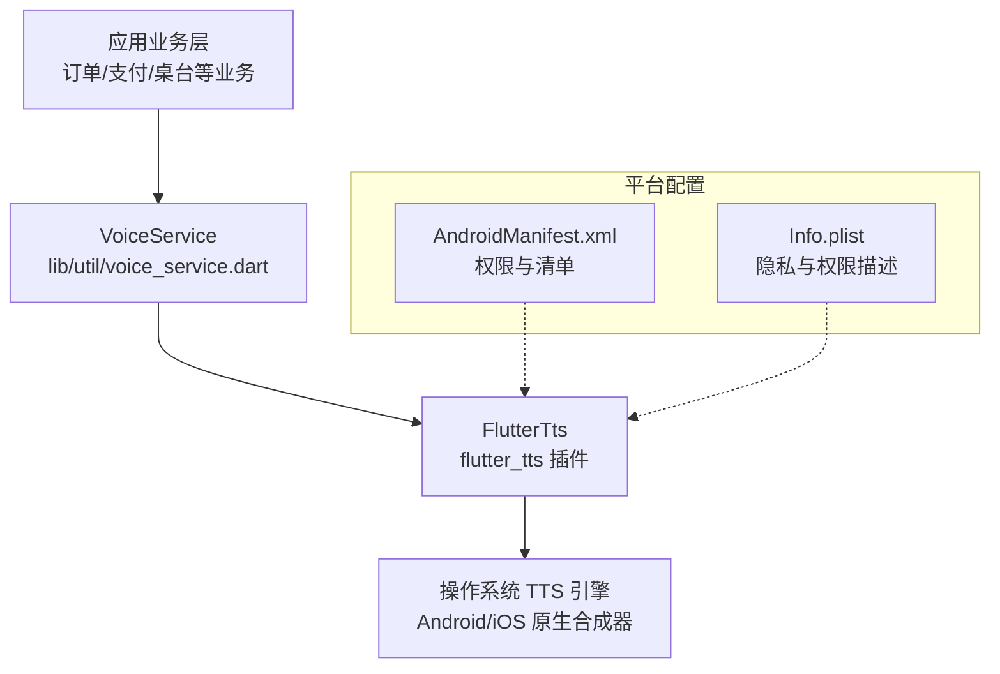
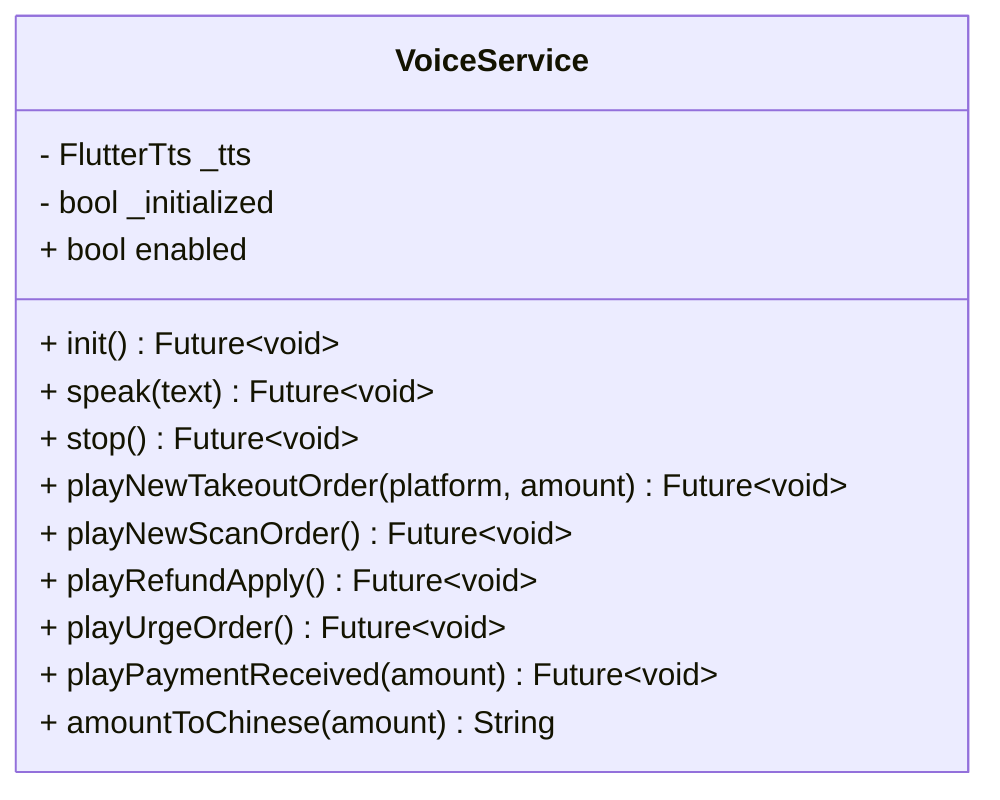
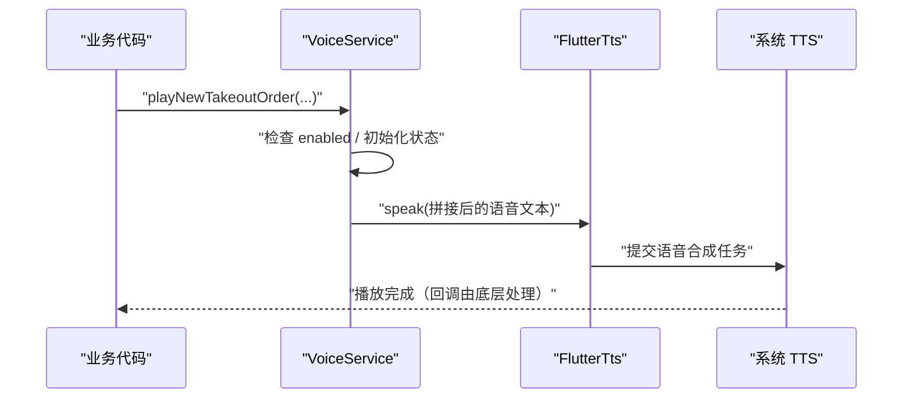
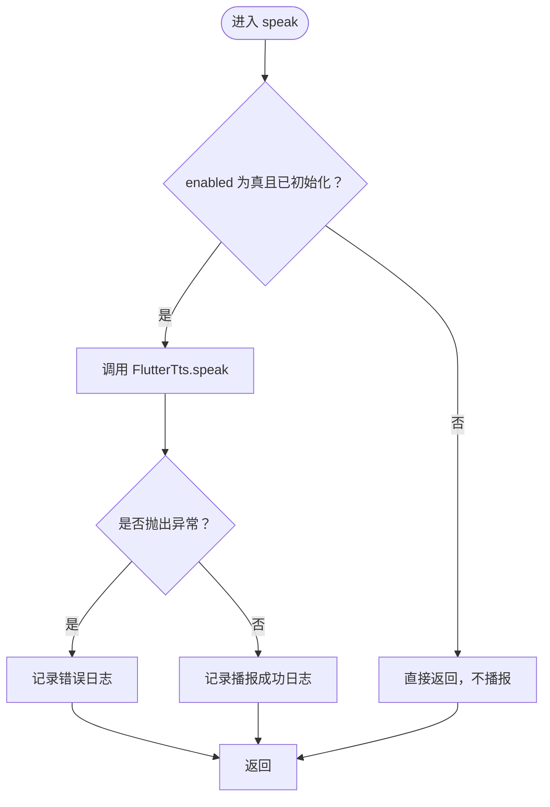
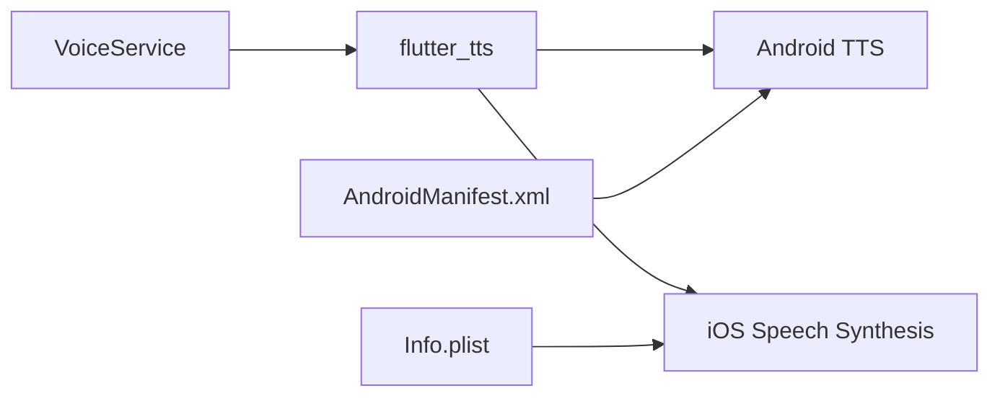

# 语音播报服务

<cite>
**本文引用的文件**   
- [lib/util/voice_service.dart](file://lib/util/voice_service.dart)
- [pubspec.yaml](file://pubspec.yaml)
- [android/app/src/main/AndroidManifest.xml](file://android/app/src/main/AndroidManifest.xml)
- [ios/Runner/Info.plist](file://ios/Runner/Info.plist)
</cite>

## 目录
1. [引言](#引言)
2. [项目结构中的语音能力定位](#项目结构中的语音能力定位)
3. [核心组件 VoiceService](#核心组件-voiceservice)
4. [架构总览](#架构总览)
5. [详细组件分析](#详细组件分析)
6. [依赖关系分析](#依赖关系分析)
7. [性能与系统兼容性](#性能与系统兼容性)
8. [业务场景与语音提示规范](#业务场景与语音提示规范)
9. [动态语音内容生成方案](#动态语音内容生成方案)
10. [配置项与调优参数](#配置项与调优参数)
11. [故障排查指南](#故障排查指南)
12. [结论](#结论)

## 引言
本技术文档围绕聚客美滋滋应用中的语音播报服务展开，重点说明基于 `flutter_tts` 的 `VoiceService` 实现。文档覆盖 TTS 引擎选择、语音参数配置、多语言支持、播放控制、队列策略、音量与语速控制、中断处理、POS 业务通知、跨平台兼容、动态语音内容生成、配置优化以及故障排查方法，帮助开发者在点餐、外卖、扫码点餐等场景中稳定、可维护地使用语音播报能力。

## 项目结构中的语音能力定位
语音播报能力集中在工具层：
- 入口与实现：`lib/util/voice_service.dart`
- 第三方依赖声明：`pubspec.yaml` 中引入 `flutter_tts`
- Android 平台权限与清单：`android/app/src/main/AndroidManifest.xml`
- iOS 平台权限与描述：`ios/Runner/Info.plist`

**图表来源**
- [lib/util/voice_service.dart:1-134](file://lib/util/voice_service.dart#L1-L134)
- [pubspec.yaml:1-111](file://pubspec.yaml#L1-L111)
- [android/app/src/main/AndroidManifest.xml:1-89](file://android/app/src/main/AndroidManifest.xml#L1-L89)
- [ios/Runner/Info.plist](file://ios/Runner/Info.plist)

**章节来源**
- [lib/util/voice_service.dart:1-134](file://lib/util/voice_service.dart#L1-L134)
- [pubspec.yaml:1-111](file://pubspec.yaml#L1-L111)
- [android/app/src/main/AndroidManifest.xml:1-89](file://android/app/src/main/AndroidManifest.xml#L1-L89)
- [ios/Runner/Info.plist](file://ios/Runner/Info.plist)

## 核心组件 VoiceService
`VoiceService` 是一个单例形式的语音播报服务，封装了 `flutter_tts` 的初始化、播报、停止及若干业务模板方法。它面向上层业务提供简洁的 API，屏蔽底层 TTS 差异。

关键职责：
- 单例管理：避免重复创建实例与资源竞争。
- TTS 初始化：设置语言、语速、音量、音调。
- 文本播报：对外暴露统一的 `speak` 方法。
- 播放控制：提供 `stop` 停止当前播报。
- 业务模板：为外卖新单、扫码点餐、退单、催单、收款等场景提供语义化方法。
- 中文金额转换：提供金额转中文大写的静态方法，便于中文播报。

**图表来源**
- [lib/util/voice_service.dart:14-134](file://lib/util/voice_service.dart#L14-L134)

**章节来源**
- [lib/util/voice_service.dart:14-134](file://lib/util/voice_service.dart#L14-L134)

## 架构总览
语音播报的整体流程如下：
- 业务层调用 `VoiceService.instance.playXxx()` 或 `speak()`。
- `VoiceService` 根据配置决定是否播报。
- 若已初始化，则调用 `FlutterTts.speak()` 进行合成与播放。
- 系统级 TTS 引擎完成实际音频输出。

**图表来源**
- [lib/util/voice_service.dart:28-50](file://lib/util/voice_service.dart#L28-L50)
- [lib/util/voice_service.dart:61-84](file://lib/util/voice_service.dart#L61-L84)

## 详细组件分析

### 初始化与引擎选择
- 初始化时机：首次调用 `init()` 时创建 `FlutterTts` 实例并配置语言、语速、音量、音调。
- 引擎选择：通过 `flutter_tts` 使用系统默认 TTS 引擎；当前未显式切换引擎类型。
- Web 兼容：在 Web 环境跳过初始化，避免无效调用。
- 语言配置：默认设置为简体中文 `zh-CN`。
- 默认参数：
  - 语速：中等偏慢，保证可读性。
  - 音量：最大。
  - 音调：中性。

建议：
- 如需切换引擎（如指定 Android 上某厂商 TTS），可在 `FlutterTts` 初始化后增加引擎选择逻辑。
- 如需多语言，可在运行时根据用户语言或订单来源切换 `setLanguage`。

**章节来源**
- [lib/util/voice_service.dart:28-43](file://lib/util/voice_service.dart#L28-L43)

### 播放控制机制
- 统一播报入口：`speak(text)` 负责最终调用 `FlutterTts.speak()`。
- 播放开关：通过 `enabled` 字段控制是否启用语音播报。
- 停止机制：`stop()` 调用底层 `stop()`，用于主动中断当前播报。
- 错误处理：播报与停止均包裹 try/catch，失败时记录日志，不向上抛出异常，保证业务稳定性。

注意：
- 当前未实现播放队列，多次快速 `speak()` 可能产生重叠或覆盖行为，取决于底层 TTS 行为。
- 如需严格队列，应在 `VoiceService` 内维护异步队列，串行执行 `speak`，并在每次 `speak` 前判断是否有更早任务未完成。

**图表来源**
- [lib/util/voice_service.dart:45-50](file://lib/util/voice_service.dart#L45-L50)
- [lib/util/voice_service.dart:52-57](file://lib/util/voice_service.dart#L52-L57)

**章节来源**
- [lib/util/voice_service.dart:45-57](file://lib/util/voice_service.dart#L45-L57)

### 业务语音模板
`VoiceService` 提供了贴合 POS 场景的业务方法：
- 外卖新订单：`playNewTakeoutOrder(platform, amount)`，包含可选金额播报。
- 扫码点餐新订单：`playNewScanOrder()`。
- 退单申请：`playRefundApply()`。
- 催单提醒：`playUrgeOrder()`。
- 收款播报：`playPaymentReceived(amount)`。

这些方法内部会拼接中文文本并调用 `speak`。建议在业务层优先调用这些方法，而不是直接构造语音文本，以保证文案一致性与后续维护成本可控。

**章节来源**
- [lib/util/voice_service.dart:61-84](file://lib/util/voice_service.dart#L61-L84)

### 中文金额转换
`amountToChinese` 将数值金额转换为中文大写金额字符串，包括元、角、分，并处理“零”和整数结尾的“整”。该方法适合需要播报“收款人民币壹佰贰拾叁元肆角伍分整”等正式场景。

复杂度分析：
- 时间复杂度：O(n)，n 为整数部分位数。
- 空间复杂度：O(n)，用于构建结果字符串。

适用性：
- 适用于固定精度两位小数的金额输入。
- 对于负数、超大金额、科学计数法等边界情况，应结合业务校验后再调用。

**章节来源**
- [lib/util/voice_service.dart:87-134](file://lib/util/voice_service.dart#L87-L134)

## 依赖关系分析
- 直接依赖：`flutter_tts`，用于文字转语音。
- 间接依赖：Android/iOS 系统 TTS 引擎、音频输出子系统。
- 清单与权限：
  - Android：网络权限、安装权限、录音权限；未声明前台服务或后台音频相关权限。
  - iOS：麦克风权限描述；未声明后台音频会话配置。

**图表来源**
- [pubspec.yaml:1-111](file://pubspec.yaml#L1-L111)
- [android/app/src/main/AndroidManifest.xml:1-89](file://android/app/src/main/AndroidManifest.xml#L1-L89)
- [ios/Runner/Info.plist](file://ios/Runner/Info.plist)

**章节来源**
- [pubspec.yaml:1-111](file://pubspec.yaml#L1-L111)
- [android/app/src/main/AndroidManifest.xml:1-89](file://android/app/src/main/AndroidManifest.xml#L1-L89)
- [ios/Runner/Info.plist](file://ios/Runner/Info.plist)

## 性能与系统兼容性

### Android 平台
- 权限现状：已声明 `INTERNET`、`REQUEST_INSTALL_PACKAGES`、`RECORD_AUDIO`。
- 后台播放：未声明前台服务或后台音频权限，长时间后台播报可能受系统限制。
- 电池优化：若应用在后台被系统休眠，TTS 可能延迟或中断。建议在重要播报时保持前台活动或使用前台服务（需扩展实现）。
- 建议增强：
  - 如需稳定后台播报，可考虑添加前台服务与音频焦点管理。
  - 对低端设备，可适当降低语速或减少高频播报频率。

### iOS 平台
- 权限现状：已声明麦克风权限描述。
- 后台播放：未配置 `AVAudioSession` 类别以支持后台播放，App 切后台可能导致声音中断。
- 建议增强：
  - 在原生层配置 `AVAudioSession` 类别，允许后台音频输出。
  - 针对锁屏与控制中心交互，按需配置媒体会话。

### 通用建议
- 初始化一次：应用启动时调用 `VoiceService.instance.init()`，避免重复初始化。
- 关闭多余播报：在非必要场景关闭 `enabled`，节省电量与 CPU。
- 合理控制播报频率：避免短时间内连续播报造成体验拥挤。

**章节来源**
- [android/app/src/main/AndroidManifest.xml:1-89](file://android/app/src/main/AndroidManifest.xml#L1-L89)
- [ios/Runner/Info.plist](file://ios/Runner/Info.plist)

## 业务场景与语音提示规范

### 开台成功
- 推荐方式：在开台成功后调用 `playNewTakeoutOrder` 或自定义 `speak` 播报“开台成功”类文案。
- 文案建议：简洁明确，例如“开台成功，桌号 XXX”。

### 下单确认
- 推荐方式：调用 `playNewTakeoutOrder` 或 `playNewScanOrder`，区分外卖与扫码点餐。
- 金额播报：当订单金额有意义时，传入 `amount`，以便自动拼接金额播报。

### 结账完成
- 推荐方式：调用 `playPaymentReceived` 播报收款金额。
- 中文大写播报：如需更正式播报，可先调用 `amountToChinese` 再 `speak`。

### 支付结果
- 成功：使用 `playPaymentReceived` 或自定义“支付成功”文案。
- 失败：建议统一失败提示文案，并通过日志记录具体错误原因。

### 其他 POS 通知
- 退单申请：调用 `playRefundApply()`。
- 催单提醒：调用 `playUrgeOrder()`。
- 建议所有业务通知统一走 `VoiceService`，避免散落多处导致体验不一致。

**章节来源**
- [lib/util/voice_service.dart:61-84](file://lib/util/voice_service.dart#L61-L84)
- [lib/util/voice_service.dart:87-134](file://lib/util/voice_service.dart#L87-L134)

## 动态语音内容生成方案

### 订单号播报
- 建议策略：按位播报数字，避免长串数字连读不清。
- 示例思路：将订单号转为字符串，逐字符映射到“零一二三……”或直接播报数字读音（依赖 TTS 引擎表现）。

### 金额读取
- 小额精确播报：直接使用 `playPaymentReceived`。
- 正式场合播报：使用 `amountToChinese` 生成中文大写金额后再播报。
- 格式化建议：确保金额保留两位小数，避免四舍五入歧义。

### 菜品名称发音
- 中文菜品名：直接使用中文文本，交由 `flutter_tts` 合成。
- 英文或混合文本：尽量统一为中文播报，或分段播报，提升可读性。
- 特殊符号与单位：避免在语音文本中使用无法朗读的符号，必要时替换为中文单位。

### 中文语音优化技巧
- 使用 `zh-CN` 语言，确保中文发音准确。
- 适当调整语速：POS 嘈杂环境下建议略慢，保证清晰。
- 控制音量：默认最大音量，可根据设备环境调节。
- 避免过长句子：拆分为短句，提高理解度与打断灵活性。

**章节来源**
- [lib/util/voice_service.dart:28-43](file://lib/util/voice_service.dart#L28-L43)
- [lib/util/voice_service.dart:61-84](file://lib/util/voice_service.dart#L61-L84)
- [lib/util/voice_service.dart:87-134](file://lib/util/voice_service.dart#L87-L134)

## 配置项与调优参数

### 可用配置项
- `enabled`：是否启用语音播报。
- 初始化参数：
  - 语言：`zh-CN`
  - 语速：中等偏慢
  - 音量：最大
  - 音调：中性

### 调优建议
- 语速：根据门店环境噪音水平调整，建议 0.4～0.6 范围。
- 音量：根据设备扬声器质量调整，避免过响或过小。
- 音调：一般无需调整，保持中性即可。
- 多语言：如需支持粤语或其他方言，可在运行时切换语言并缓存对应 TTS 引擎配置。

### 性能调优
- 单次播报短文本，避免超长语句。
- 批量播报时使用简单队列，串行执行。
- 在应用生命周期结束时或不需要语音时，释放资源或停止播报。

**章节来源**
- [lib/util/voice_service.dart:28-57](file://lib/util/voice_service.dart#L28-L57)

## 故障排查指南

### 常见问题
- 无声音：
  - 检查 `enabled` 是否为真。
  - 检查是否已调用 `init()`。
  - 检查设备静音模式或媒体音量。
- 初始化失败：
  - 查看日志中 `[VoiceService] TTS 初始化失败`。
  - 检查系统是否安装 TTS 引擎或语言包。
- 播报失败：
  - 查看日志中 `[VoiceService] 播报失败`。
  - 检查文本是否过长或包含不支持字符。
- 后台播放中断：
  - Android：检查是否因系统省电策略限制后台任务。
  - iOS：检查是否缺少后台音频会话配置。

### 排查步骤
1. 确认依赖已正确引入 `flutter_tts`。
2. 确认应用启动时调用 `VoiceService.instance.init()`。
3. 打开调试日志，观察初始化与播报日志。
4. 在 Android/iOS 设备上分别验证行为差异。
5. 如涉及后台播报，检查平台权限与系统设置。

**章节来源**
- [lib/util/voice_service.dart:28-57](file://lib/util/voice_service.dart#L28-L57)
- [android/app/src/main/AndroidManifest.xml:1-89](file://android/app/src/main/AndroidManifest.xml#L1-L89)
- [ios/Runner/Info.plist](file://ios/Runner/Info.plist)

## 结论
`VoiceService` 以简洁的单例形式封装了 `flutter_tts`，为聚客美滋滋应用提供了稳定的语音播报能力。当前实现覆盖了初始化、基础播报、停止、常用业务模板与中文金额转换，满足大多数 POS 场景需求。未来可在此基础上扩展播放队列、多语言动态切换、前台服务后台播报、音频焦点管理等高级特性，进一步提升用户体验与系统兼容性。