# 通用工具助手

<cite>
**本文引用的文件**   
- [lib/util/date_utils.dart](file://lib/util/date_utils.dart)
- [lib/util/math_utils.dart](file://lib/util/math_utils.dart)
- [lib/util/amount_calc_utils.dart](file://lib/util/amount_calc_utils.dart)
- [lib/util/device_utils.dart](file://lib/util/device_utils.dart)
- [lib/util/screen_utils.dart](file://lib/util/screen_utils.dart)
- [lib/util/image_utils.dart](file://lib/util/image_utils.dart)
- [lib/util/other_utils.dart](file://lib/util/other_utils.dart)
</cite>

## 目录
1. [简介](#简介)
2. [项目结构](#项目结构)
3. [核心组件总览](#核心组件总览)
4. [架构总览](#架构总览)
5. [详细组件分析](#详细组件分析)
6. [依赖关系分析](#依赖关系分析)
7. [性能与精度注意事项](#性能与精度注意事项)
8. [常见问题与排错](#常见问题与排错)
9. [结论](#结论)
10. [附录：API 参考速查](#附录api-参考速查)

## 简介
本文件为聚客美滋滋应用的“通用工具助手”技术文档，聚焦以下工具类：
- DateUtils：日期时间格式化、周月范围、时区与工作日相关辅助。
- MathUtils：高精度数学运算，解决浮点数精度问题。
- AmountCalcUtils：金额计算工具，覆盖抹零、低消差、服务费、折扣等财务场景。
- DeviceUtils（Device）：设备信息获取、平台判断、唯一标识与浏览器解析。
- ScreenUtils（Screen）：屏幕尺寸、对角线、英寸换算与横竖屏检测。
- ImageUtils：图片资源路径构造、网络图缓存 Provider 获取。
- OtherUtils（Utils）：通用方法，包括链接打开、拨号、价格格式化、键盘动作配置、弹性对话框等。

目标读者包括业务开发者、测试人员以及需要理解工具层行为的技术维护者。文档以“从概念到实现”的方式展开，并给出流程图、时序图和依赖图，帮助不同背景读者快速上手。

## 项目结构
工具类集中在 lib/util 下，按职责划分：
- 时间与日期：date_utils.dart
- 数学与数值：math_utils.dart
- 金额与财务：amount_calc_utils.dart
- 设备与环境：device_utils.dart
- 屏幕与适配：screen_utils.dart
- 图片处理：image_utils.dart
- 其他通用：other_utils.dart

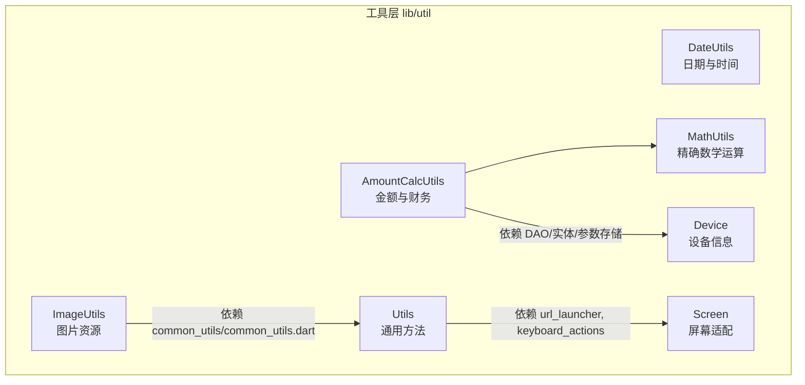

**图表来源**
- [lib/util/date_utils.dart:1-219](file://lib/util/date_utils.dart#L1-L219)
- [lib/util/math_utils.dart:1-163](file://lib/util/math_utils.dart#L1-L163)
- [lib/util/amount_calc_utils.dart:1-371](file://lib/util/amount_calc_utils.dart#L1-L371)
- [lib/util/device_utils.dart:1-118](file://lib/util/device_utils.dart#L1-L118)
- [lib/util/screen_utils.dart:1-46](file://lib/util/screen_utils.dart#L1-L46)
- [lib/util/image_utils.dart:1-34](file://lib/util/image_utils.dart#L1-L34)
- [lib/util/other_utils.dart:1-104](file://lib/util/other_utils.dart#L1-L104)

**章节来源**
- [lib/util/date_utils.dart:1-219](file://lib/util/date_utils.dart#L1-L219)
- [lib/util/math_utils.dart:1-163](file://lib/util/math_utils.dart#L1-L163)
- [lib/util/amount_calc_utils.dart:1-371](file://lib/util/amount_calc_utils.dart#L1-L371)
- [lib/util/device_utils.dart:1-118](file://lib/util/device_utils.dart#L1-L118)
- [lib/util/screen_utils.dart:1-46](file://lib/util/screen_utils.dart#L1-L46)
- [lib/util/image_utils.dart:1-34](file://lib/util/image_utils.dart#L1-L34)
- [lib/util/other_utils.dart:1-104](file://lib/util/other_utils.dart#L1-L104)

## 核心组件总览
- DateUtils：提供月份/日期/星期格式化、周起止、日区间遍历、跨时区安全迭代、同周/同日判断、前后月/周移动等能力。
- MathUtils：通过“放大整数运算 + 科学计数法转换”保证加减乘除、求和、四舍五入的精度一致性。
- AmountCalcUtils：封装抹零策略、低消差额、服务费（含按小时/分钟起步、封顶、免费时长）、台桌服务费（按消费额百分比、固定金额、按小时、按人）、折扣价与金额格式化。
- Device（DeviceUtils）：判断平台、初始化设备信息、获取 Android/iOS/Web 的设备序列号、设备名称（Web 解析浏览器）。
- Screen（ScreenUtils）：基于 MediaQuery 获取宽高、对角线、英寸尺寸，并提供 BuildContext 扩展。
- ImageUtils：统一图片资源路径生成、Asset 与网络图 Provider 获取。
- Utils（OtherUtils）：URL 跳转、拨号、货币格式化、键盘动作配置、弹性弹出对话框、字符串空安全扩展。

**章节来源**
- [lib/util/date_utils.dart:1-219](file://lib/util/date_utils.dart#L1-L219)
- [lib/util/math_utils.dart:1-163](file://lib/util/math_utils.dart#L1-L163)
- [lib/util/amount_calc_utils.dart:1-371](file://lib/util/amount_calc_utils.dart#L1-L371)
- [lib/util/device_utils.dart:1-118](file://lib/util/device_utils.dart#L1-L118)
- [lib/util/screen_utils.dart:1-46](file://lib/util/screen_utils.dart#L1-L46)
- [lib/util/image_utils.dart:1-34](file://lib/util/image_utils.dart#L1-L34)
- [lib/util/other_utils.dart:1-104](file://lib/util/other_utils.dart#L1-L104)

## 架构总览
工具层整体为无状态静态 API，面向上层业务模块提供稳定接口；金额计算依赖 DAO/实体/参数存储完成服务端策略对齐；设备信息与屏幕信息依赖 Flutter 基础库与系统 API。

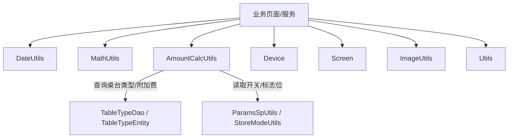

**图表来源**
- [lib/util/amount_calc_utils.dart:1-371](file://lib/util/amount_calc_utils.dart#L1-L371)
- [lib/util/device_utils.dart:1-118](file://lib/util/device_utils.dart#L1-L118)
- [lib/util/screen_utils.dart:1-46](file://lib/util/screen_utils.dart#L1-L46)
- [lib/util/image_utils.dart:1-34](file://lib/util/image_utils.dart#L1-L34)
- [lib/util/other_utils.dart:1-104](file://lib/util/other_utils.dart#L1-L104)

## 详细组件分析

### DateUtils 日期时间工具
职责与能力：
- 格式化：月、日、首尾日、完整日期、两种 API 日期格式。
- 日历构建：周一开始的月份天数数组、周起止、周天数列表。
- 区间与比较：同一天/同一周判定、前后月/周移动、跨时区安全的 daysInRange。
- 边界处理：对 23:xx/01:xx 等特殊小时做修正，避免 DST/时区偏移导致的一天误差。

关键流程（周起始/结束与区间遍历）：

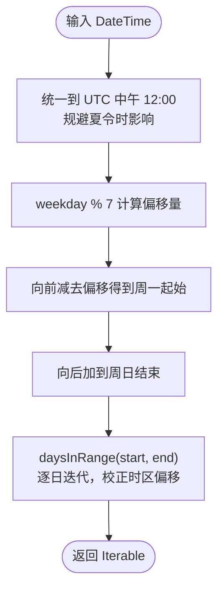

**图表来源**
- [lib/util/date_utils.dart:60-120](file://lib/util/date_utils.dart#L60-L120)
- [lib/util/date_utils.dart:121-160](file://lib/util/date_utils.dart#L121-L160)

使用建议：
- 展示 UI 时使用 formatMonth/fullDayFormat/apiDayFormat 等格式化方法，避免在业务逻辑中拼接日期字符串。
- 涉及跨天迭代（如渲染整月日历）优先使用 daysInRange，确保时区变化不破坏日期边界。
- 比较日期时优先用 isSameDay/isSameWeek，避免仅比较时分秒导致的误判。

**章节来源**
- [lib/util/date_utils.dart:1-219](file://lib/util/date_utils.dart#L1-L219)

### MathUtils 精确数学工具
设计要点：
- 通过 getPrecision 统计小数位数，将操作数乘以 10^n 转为整数进行运算，再缩小回原精度。
- transferToNumber 消除科学计数法带来的显示误差，保证结果一致。
- 提供 add/subtract/multiply/divide/sum/roundTo 等常用方法。

复杂度与性能：
- 单次算术操作时间复杂度 O(1)，空间复杂度 O(1)。
- sum 对 n 个数累加为 O(n)，内部采用精确加法逐步累积，避免误差放大。

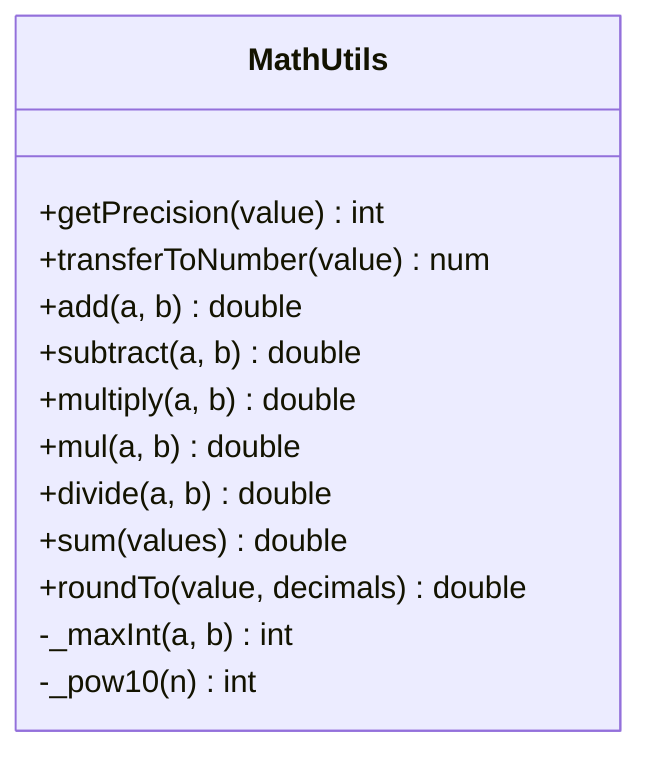

**图表来源**
- [lib/util/math_utils.dart:1-163](file://lib/util/math_utils.dart#L1-L163)

使用建议：
- 所有涉及金额或计费的地方优先使用 AmountCalcUtils 或 MathUtils，避免直接使用原生浮点运算。
- roundTo 默认保留两位小数，适用于金额展示；若需更多精度可传入 decimals。

**章节来源**
- [lib/util/math_utils.dart:1-163](file://lib/util/math_utils.dart#L1-L163)

### AmountCalcUtils 金额计算工具
核心能力：
- 精确四则运算：add/sub/mul/div/_round2，统一保留两位小数。
- 抹零计算：支持多种 SmallChangeFlag（四舍五入到角/元/十元、去分/去角、抹零到五角、进角/进元），并通过 eraseAmount/getEraseAmt 暴露。
- 低消差额：calcLowMoney 与 getMinSalemoneyDiff 支持餐桌低消/人均低消，并可选择是否包含服务费。
- 服务费：calcServiceFee 支持小时/分钟起步、超时单价、封顶时长、免费时长；calcTableServiceFee 根据桌台类型与服务模式（百分比/固定/按小时/按人）计算。
- 折扣：calcDiscountPrice/calcDiscountAmt/formatAmount。

典型流程（服务费计算）：

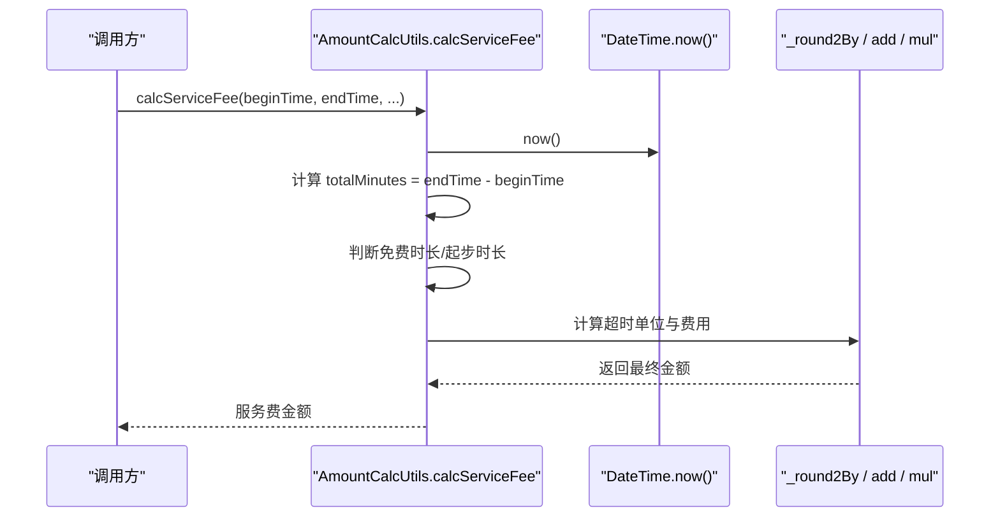

**图表来源**
- [lib/util/amount_calc_utils.dart:201-371](file://lib/util/amount_calc_utils.dart#L201-L371)

台桌服务费分支逻辑：

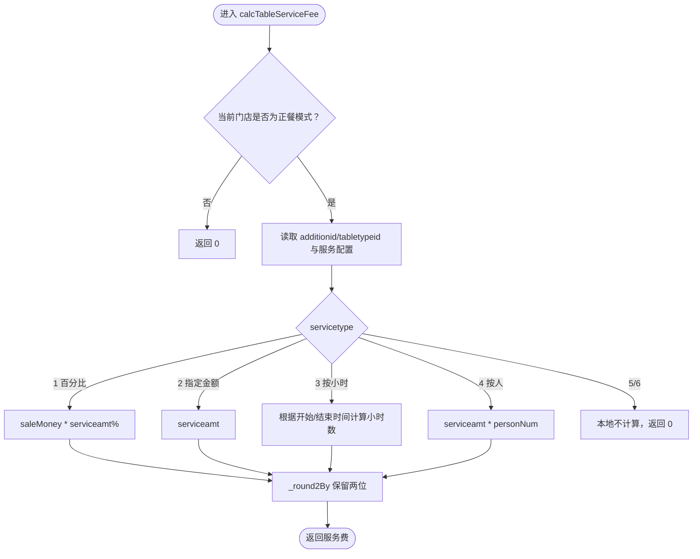

**图表来源**
- [lib/util/amount_calc_utils.dart:201-371](file://lib/util/amount_calc_utils.dart#L201-L371)

使用建议：
- 所有涉及“钱”的计算统一走 AmountCalcUtils，确保与后端 smdcapp 逻辑一致。
- 对于服务端兜底的复杂服务费策略（如时段区间/起步递增），本地应返回 0，交由服务端结算。
- 格式化输出使用 formatAmount 保证两位小数的一致性。

**章节来源**
- [lib/util/amount_calc_utils.dart:1-371](file://lib/util/amount_calc_utils.dart#L1-L371)

### Device（DeviceUtils）设备信息工具
职责：
- 平台判断：isMobile/isWeb/isAndroid/isIOS。
- 初始化：initDeviceInfo 异步加载 Android/iOS/Web 设备信息。
- 设备标识：getDeviceSerial（Android serial/id、iOS identifierForVendor、Web 持久化随机 ID）。
- 设备名称：getDeviceName（Android brand+model、iOS name、Web 浏览器名解析）。

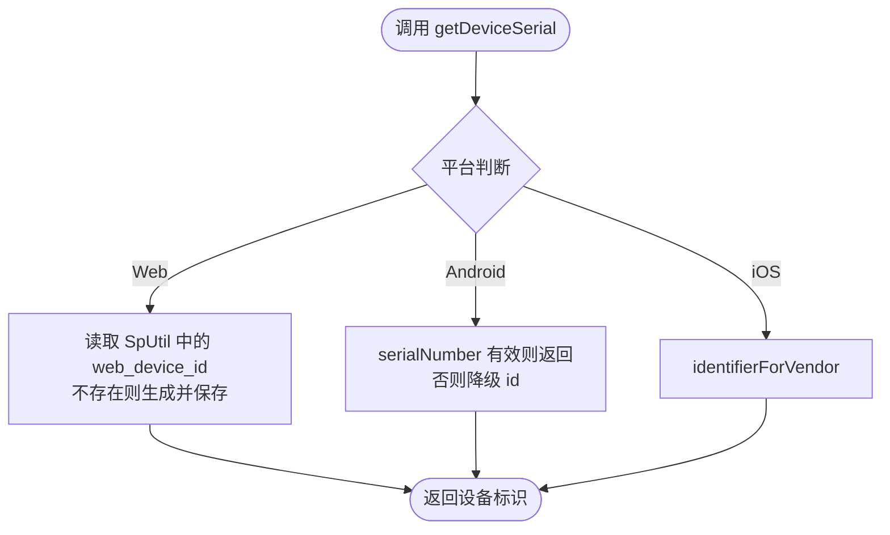

**图表来源**
- [lib/util/device_utils.dart:1-118](file://lib/util/device_utils.dart#L1-L118)

使用建议：
- 在应用启动时调用 initDeviceInfo，后续再访问设备属性。
- Web 端设备标识由本地持久化生成，避免 UA 过长或特殊字符导致的服务端校验失败。

**章节来源**
- [lib/util/device_utils.dart:1-118](file://lib/util/device_utils.dart#L1-L118)

### Screen（ScreenUtils）屏幕适配工具
职责：
- 横竖屏检测：isLandscape。
- 像素尺寸：size/width/height/diagonal。
- 英寸尺寸：inches/widthInches/heightInches/diagonalInches。
- BuildContext 扩展：便捷获取 size/width/height。

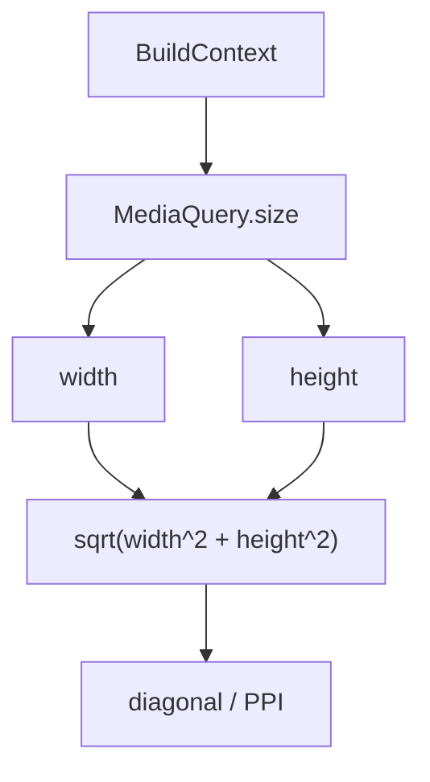

**图表来源**
- [lib/util/screen_utils.dart:1-46](file://lib/util/screen_utils.dart#L1-L46)

使用建议：
- 响应式布局优先使用 inches 系列进行大屏/平板/窄屏判断。
- 横竖屏切换可通过 isLandscape 控制 UI 排版。

**章节来源**
- [lib/util/screen_utils.dart:1-46](file://lib/util/screen_utils.dart#L1-L46)

### ImageUtils 图片处理工具
职责：
- 资源路径：getImgPath(name, format) 统一 assets/images 前缀与后缀。
- Asset 图片：getAssetImage(name, format) 返回 AssetImage。
- 网络图 Provider：getImageProvider(imageUrl, holderImg) 空图回退到占位图，非空使用 CachedNetworkImageProvider。

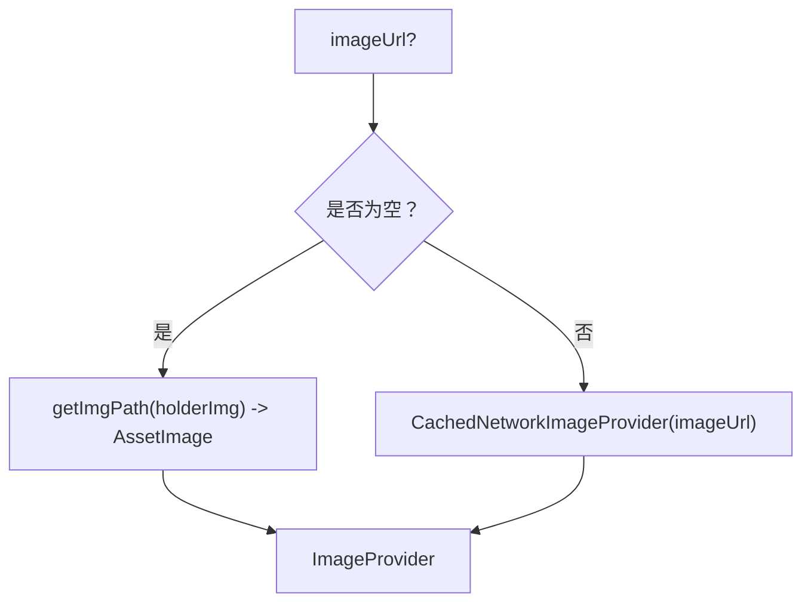

**图表来源**
- [lib/util/image_utils.dart:1-34](file://lib/util/image_utils.dart#L1-L34)

使用建议：
- 所有图片资源路径统一通过 getImgPath 生成，避免硬编码。
- 网络图必须使用 getImageProvider，以获得缓存能力与占位图回退。

**章节来源**
- [lib/util/image_utils.dart:1-34](file://lib/util/image_utils.dart#L1-L34)

### Utils（OtherUtils）其他实用工具
职责：
- 链接与拨号：launchWebURL/launchTelURL，失败时 Toast 提示。
- 价格格式化：formatPrice 使用 MoneyUtil 与 NumUtil 格式化人民币。
- 键盘动作：getKeyboardActionsConfig 构建 KeyboardActionsConfig，集成关闭按钮。
- 弹性对话框：showElasticDialog 带淡入滑出动画的弹窗。
- 字符串空安全：StringExtension.nullSafe。

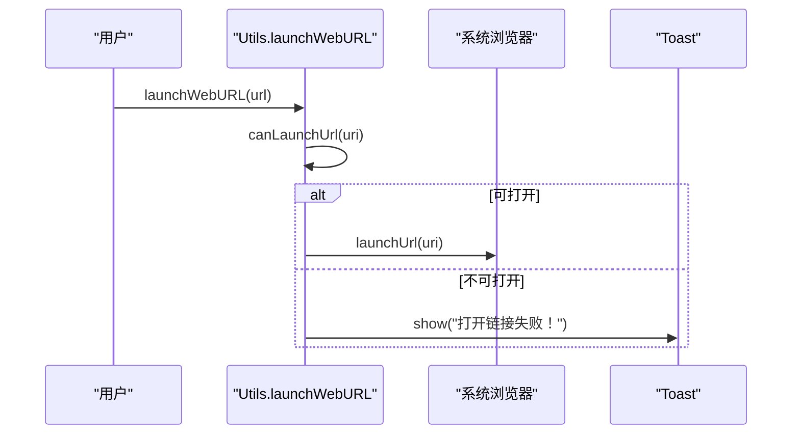

**图表来源**
- [lib/util/other_utils.dart:1-104](file://lib/util/other_utils.dart#L1-L104)

使用建议：
- 所有外部 URL/拨号操作均使用 Utils 封装，统一错误提示。
- 表单页使用 getKeyboardActionsConfig 提升输入体验。
- 自定义弹窗使用 showElasticDialog 获得一致的过渡动画。

**章节来源**
- [lib/util/other_utils.dart:1-104](file://lib/util/other_utils.dart#L1-L104)

## 依赖关系分析
- AmountCalcUtils 依赖 DAO/实体/参数存储以对齐服务端策略：
  - TableTypeDao/TableTypeEntity：查询桌台类型与服务费配置。
  - ParamsSpUtils/StoreModeUtils：读取开关标志与门店模式。
- ImageUtils 依赖 common_utils 的图片路径工具与 cached_network_image 的网络缓存。
- Utils 依赖 url_launcher、keyboard_actions、common_utils 的货币与数字工具。
- Device 依赖 device_info_plus、sp_util、flutter/foundation、dart:io。

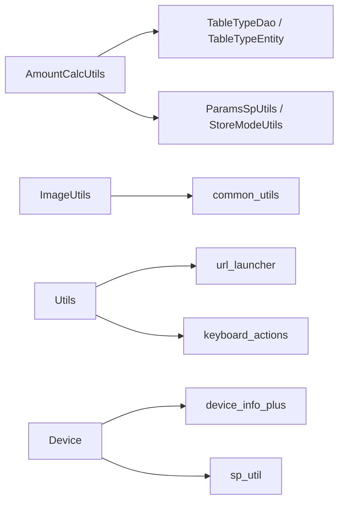

**图表来源**
- [lib/util/amount_calc_utils.dart:1-371](file://lib/util/amount_calc_utils.dart#L1-L371)
- [lib/util/image_utils.dart:1-34](file://lib/util/image_utils.dart#L1-L34)
- [lib/util/other_utils.dart:1-104](file://lib/util/other_utils.dart#L1-L104)
- [lib/util/device_utils.dart:1-118](file://lib/util/device_utils.dart#L1-L118)

**章节来源**
- [lib/util/amount_calc_utils.dart:1-371](file://lib/util/amount_calc_utils.dart#L1-L371)
- [lib/util/image_utils.dart:1-34](file://lib/util/image_utils.dart#L1-L34)
- [lib/util/other_utils.dart:1-104](file://lib/util/other_utils.dart#L1-L104)
- [lib/util/device_utils.dart:1-118](file://lib/util/device_utils.dart#L1-L118)

## 性能与精度注意事项
- 日期时间
  - daysInRange 会逐个推进并校正时区偏移，适合日历渲染但不要在高频循环中频繁创建大量 DateTime。
  - 比较日期请使用 isSameDay/isSameWeek，避免直接比较对象或时分秒。
- 数学计算
  - MathUtils 的精度算法在小数位数较多时会增加乘法开销，但通常可忽略；批量求和建议使用 sum 以减少误差。
  - roundTo 默认两位小数，若用于展示可配合 formatAmount。
- 金额计算
  - AmountCalcUtils 的所有方法都会执行 _round2/_round2By，确保与业务一致；避免在业务层再次取整造成双重舍入。
  - 复杂服务费（5/6 类型）由服务端兜底，本地返回 0，避免重复计算。
- 设备与屏幕
  - Device.initDeviceInfo 为异步初始化，应在应用启动阶段调用，避免首次访问卡顿。
  - Screen 使用固定 PPI（Android/iOS 150，Web 96），仅作粗略英寸估算，不应作为精确物理尺寸依据。
- 图片
  - 网络图务必使用 CachedNetworkImageProvider，利用缓存减少请求。
  - 资源路径统一通过 getImgPath，便于后续格式切换与维护。

[本节为通用指导，不直接分析具体代码文件]

## 常见问题与排错
- 日期边界异常
  - 现象：跨月/跨周渲染出现多余或缺失一天。
  - 排查：检查是否使用 daysInRange；确认 firstDayOfMonth/lastDayOfMonth 是否正确；注意 23:xx/01:xx 的小时修正逻辑。
- 金额计算不一致
  - 现象：前端与后端金额差异 0.01。
  - 排查：确认是否使用 AmountCalcUtils/MathUtils；避免原生浮点运算；检查 roundTo/formatAmount 的使用位置。
- 设备标识为空
  - 现象：getDeviceSerial 返回空串。
  - 排查：确认已调用 initDeviceInfo；Android 权限限制可能导致 serialNumber 为 unknown，将降级到 id；Web 端检查 SpUtil 持久化是否成功。
- 屏幕尺寸异常
  - 现象：英寸换算不合理。
  - 排查：PPI 为近似值，不要将其视为真实物理分辨率；优先使用像素尺寸进行布局适配。
- 图片加载失败
  - 现象：网络图不显示。
  - 排查：确认 imageUrl 非空；使用 getImageProvider；检查网络连接与缓存；占位图路径是否正确。

**章节来源**
- [lib/util/date_utils.dart:1-219](file://lib/util/date_utils.dart#L1-L219)
- [lib/util/amount_calc_utils.dart:1-371](file://lib/util/amount_calc_utils.dart#L1-L371)
- [lib/util/device_utils.dart:1-118](file://lib/util/device_utils.dart#L1-L118)
- [lib/util/screen_utils.dart:1-46](file://lib/util/screen_utils.dart#L1-L46)
- [lib/util/image_utils.dart:1-34](file://lib/util/image_utils.dart#L1-L34)

## 结论
通用工具助手围绕“日期时间、数学精度、金额计算、设备信息、屏幕适配、图片与通用方法”六大维度提供稳定 API。通过集中封装，业务层无需关心底层实现细节，即可在跨平台、多端环境中保持一致的行为与精度。建议在业务中全面替换原生浮点运算与硬编码路径，统一使用工具类提供的接口，以降低出错率并提升可维护性。

[本节为总结性内容，不直接分析具体代码文件]

## 附录：API 参考速查

- DateUtils
  - 格式化：formatMonth、formatDay、formatFirstDay、fullDayFormat、apiDayFormat、apiDayFormat2
  - 日历：daysInMonth、daysInWeek、firstDayOfWeek、lastDayOfWeek、previousWeek/nextWeek、previousMonth/nextMonth
  - 比较：isSameDay、isSameWeek、isExtraDay
  - 区间：daysInRange、firstDayOfMonth、lastDayOfMonth
  - 示例：使用 apiDayFormat 输出 yyyy-MM-dd；使用 daysInRange 渲染整月日历。

- MathUtils
  - 精度：getPrecision、transferToNumber
  - 四则：add、subtract、multiply/mul、divide
  - 汇总：sum、roundTo(decimals=2)
  - 示例：对订单明细使用 sum 求和，再用 roundTo 保留两位小数。

- AmountCalcUtils
  - 四则：add/sub/mul/div（保留两位）
  - 抹零：eraseAmount(flag)、getEraseAmt(amount, flag)
  - 低消：calcLowMoney(lowtype, lowamt, personnum)、getMinSalemoneyDiff(...)
  - 服务费：calcServiceFee(...), calcTableServiceFee(tmp, tableTypeId, saleMoney)
  - 折扣：calcDiscountPrice(price, discount)、calcDiscountAmt(price, discount)、formatAmount(amount)
  - 示例：结账时先 calcDiscountPrice，再叠加服务费与抹零，最后 formatAmount 展示。

- Device（DeviceUtils）
  - 平台：isMobile/isWeb/isAndroid/isIOS
  - 初始化：initDeviceInfo()
  - 标识：getDeviceSerial()
  - 名称：getDeviceName()
  - 示例：应用启动调用 initDeviceInfo，随后获取 getDeviceSerial 上报日志。

- Screen（ScreenUtils）
  - 横竖屏：isLandscape(context)
  - 像素：size(context)/width(context)/height(context)/diagonal(context)
  - 英寸：inches(context)/widthInches(context)/heightInches(context)/diagonalInches(context)
  - 扩展：context.size/context.width/context.height
  - 示例：根据 widthInches < 3.5 判定窄屏，调整两列布局为一列。

- ImageUtils
  - 路径：getImgPath(name, format)
  - Asset：getAssetImage(name, format)
  - Provider：getImageProvider(imageUrl, holderImg)
  - 示例：头像使用 getImageProvider(userAvatarUrl, holderImg='default')。

- Utils（OtherUtils）
  - 链接：launchWebURL(url)
  - 拨号：launchTelURL(phone)
  - 价格：formatPrice(priceStr, format)
  - 键盘：getKeyboardActionsConfig(context, list)
  - 对话框：showElasticDialog(context, builder)
  - 扩展：('' as String?).nullSafe
  - 示例：表单页使用 getKeyboardActionsConfig 添加“关闭”按钮。

**章节来源**
- [lib/util/date_utils.dart:1-219](file://lib/util/date_utils.dart#L1-L219)
- [lib/util/math_utils.dart:1-163](file://lib/util/math_utils.dart#L1-L163)
- [lib/util/amount_calc_utils.dart:1-371](file://lib/util/amount_calc_utils.dart#L1-L371)
- [lib/util/device_utils.dart:1-118](file://lib/util/device_utils.dart#L1-L118)
- [lib/util/screen_utils.dart:1-46](file://lib/util/screen_utils.dart#L1-L46)
- [lib/util/image_utils.dart:1-34](file://lib/util/image_utils.dart#L1-L34)
- [lib/util/other_utils.dart:1-104](file://lib/util/other_utils.dart#L1-L104)