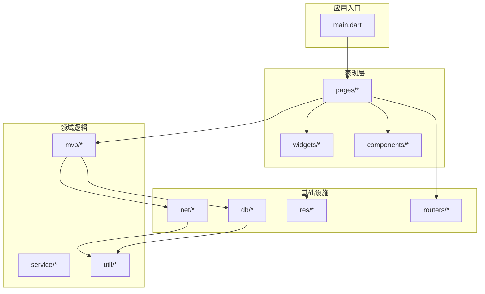
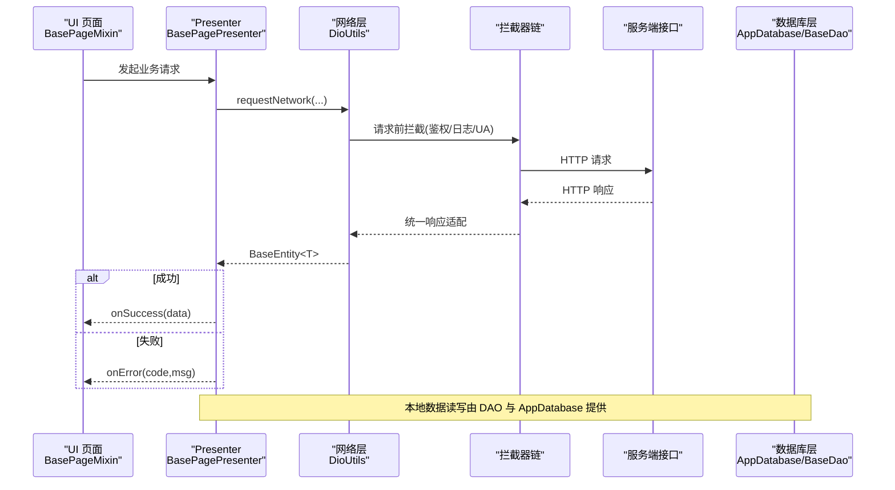
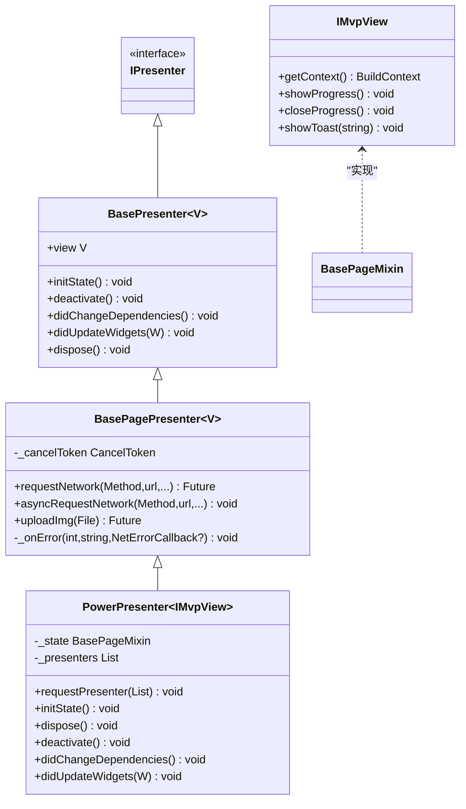
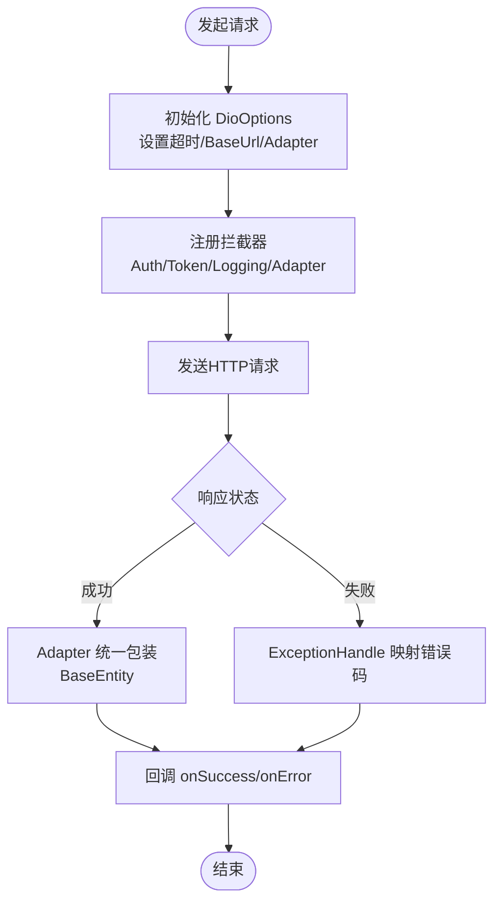
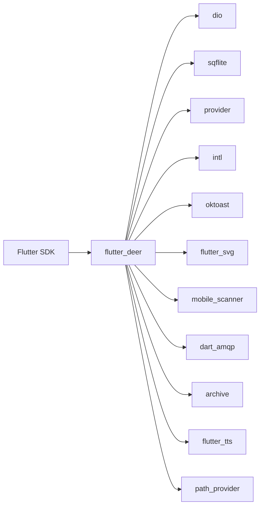

# 代码规范与最佳实践

<cite>
**本文引用的文件**   
- [analysis_options.yaml](file://analysis_options.yaml)
- [pubspec.yaml](file://pubspec.yaml)
- [lib/mvp/base_page.dart](file://lib/mvp/base_page.dart)
- [lib/mvp/base_presenter.dart](file://lib/mvp/base_presenter.dart)
- [lib/mvp/base_page_presenter.dart](file://lib/mvp/base_page_presenter.dart)
- [lib/mvp/power_presenter.dart](file://lib/mvp/power_presenter.dart)
- [lib/mvp/mvps.dart](file://lib/mvp/mvps.dart)
- [lib/net/dio_utils.dart](file://lib/net/dio_utils.dart)
- [lib/net/intercept.dart](file://lib/net/intercept.dart)
- [lib/net/error_handle.dart](file://lib/net/error_handle.dart)
- [lib/net/base_entity.dart](file://lib/net/base_entity.dart)
- [lib/db/app_database.dart](file://lib/db/app_database.dart)
- [lib/db/dao/base_dao.dart](file://lib/db/dao/base_dao.dart)
- [lib/db/entity/product_bean_entity.dart](file://lib/db/entity/product_bean_entity.dart)
</cite>

## 目录
1. [引言](#引言)
2. [项目结构](#项目结构)
3. [核心组件](#核心组件)
4. [架构总览](#架构总览)
5. [详细组件分析](#详细组件分析)
6. [依赖关系分析](#依赖关系分析)
7. [性能优化与最佳实践](#性能优化与最佳实践)
8. [静态分析与代码风格规范](#静态分析与代码风格规范)
9. [MVP 架构实现规范](#mvp-架构实现规范)
10. [网络层使用规范](#网络层使用规范)
11. [数据库操作规范](#数据库操作规范)
12. [注释与文档规范](#注释与文档规范)
13. [故障排查指南](#故障排查指南)
14. [结论](#结论)

## 引言
本文件为“聚客美滋滋”Flutter 点餐应用提供统一的代码规范与最佳实践。内容覆盖 Dart 语言编码约定、Flutter Widget 组织方式、静态分析规则、MVP 架构职责边界、网络层封装、数据库操作、注释规范，以及性能优化建议。目标是让不同角色（前端开发、测试、运维）都能以一致的方式参与开发和维护。

## 项目结构
项目采用 Flutter 工程结构，业务代码位于 lib 目录下，按功能域划分：
- lib/mvp：MVP 基础框架
- lib/net：网络请求、拦截器、错误处理、统一响应模型
- lib/db：SQLite 数据库封装、实体类、DAO
- lib/components：可复用业务组件
- lib/pages：页面路由与页面实现
- lib/widgets：通用 UI 组件
- lib/util：工具类
- lib/res：常量、颜色、尺寸等公共资源
- lib/routers：路由封装
- lib/service：跨模块服务
- android / ios：平台侧原生代码与配置
- assets：图片、字体、协议等资源
- test / integration_test：单元测试与集成测试
- docs：问题汇总文档



图表来源
- [lib/main.dart](file://lib/main.dart)
- [lib/pages/home/home_page.dart](file://lib/pages/home/home_page.dart)
- [lib/mvp/base_page.dart](file://lib/mvp/base_page.dart)
- [lib/net/dio_utils.dart](file://lib/net/dio_utils.dart)
- [lib/db/app_database.dart](file://lib/db/app_database.dart)

章节来源
- [pubspec.yaml:1-111](file://pubspec.yaml#L1-L111)

## 核心组件
- MVP 框架：BasePageMixin、BasePresenter、BasePagePresenter、PowerPresenter、IMvpView、IPresenter。
- 网络层：DioUtils、统一响应 BaseEntity、拦截器链、错误码与异常映射。
- 数据层：AppDatabase 单例、BaseDao 抽象 DAO、Entity 实体类。
- 资源与工具：常量、日志、Toast、用户信息等。

章节来源
- [lib/mvp/base_page.dart:1-103](file://lib/mvp/base_page.dart#L1-L103)
- [lib/mvp/base_presenter.dart:1-21](file://lib/mvp/base_presenter.dart#L1-L21)
- [lib/mvp/base_page_presenter.dart:1-120](file://lib/mvp/base_page_presenter.dart#L1-L120)
- [lib/mvp/power_presenter.dart:1-69](file://lib/mvp/power_presenter.dart#L1-L69)
- [lib/net/dio_utils.dart:1-222](file://lib/net/dio_utils.dart#L1-L222)
- [lib/net/base_entity.dart:1-33](file://lib/net/base_entity.dart#L1-L33)
- [lib/db/app_database.dart:1-853](file://lib/db/app_database.dart#L1-L853)
- [lib/db/dao/base_dao.dart:1-71](file://lib/db/dao/base_dao.dart#L1-L71)
- [lib/db/entity/product_bean_entity.dart:1-472](file://lib/db/entity/product_bean_entity.dart#L1-L472)

## 架构总览
应用采用 Flutter + MVP + Dio + SQFlite 的分层架构。UI 层通过 BasePageMixin 管理生命周期，并委托给 Presenter 进行业务编排；Presenter 调用网络层或数据库层完成数据获取与持久化；网络层基于 Dio 的拦截器链处理鉴权、日志、适配；数据库层通过 AppDatabase 与 BaseDao 提供统一 CRUD 能力。



图表来源
- [lib/mvp/base_page.dart:1-103](file://lib/mvp/base_page.dart#L1-L103)
- [lib/mvp/base_page_presenter.dart:1-120](file://lib/mvp/base_page_presenter.dart#L1-L120)
- [lib/net/dio_utils.dart:1-222](file://lib/net/dio_utils.dart#L1-L222)
- [lib/net/intercept.dart:1-219](file://lib/net/intercept.dart#L1-L219)
- [lib/db/app_database.dart:1-853](file://lib/db/app_database.dart#L1-L853)
- [lib/db/dao/base_dao.dart:1-71](file://lib/db/dao/base_dao.dart#L1-L71)

## 详细组件分析

### MVP 架构组件
MVP 将 UI 状态与业务逻辑解耦。BasePageMixin 负责 View 的生命周期桥接，BasePresenter 提供默认空实现，BasePagePresenter 封装网络请求和上传能力，PowerPresenter 聚合多个子 Presenter。



图表来源
- [lib/mvp/mvps.dart:1-19](file://lib/mvp/mvps.dart#L1-L19)
- [lib/mvp/base_presenter.dart:1-21](file://lib/mvp/base_presenter.dart#L1-L21)
- [lib/mvp/base_page_presenter.dart:1-120](file://lib/mvp/base_page_presenter.dart#L1-L120)
- [lib/mvp/power_presenter.dart:1-69](file://lib/mvp/power_presenter.dart#L1-L69)

职责边界
- BasePageMixin：绑定生命周期、显示/关闭进度、Toast、创建并持有 Presenter。
- BasePresenter：定义 Presenter 最小契约，避免 View 直接访问网络或数据库。
- BasePagePresenter：封装网络请求、取消令牌、进度控制、错误提示与图片上传。
- PowerPresenter：统一管理多个子 Presenter，保证生命周期同步。

章节来源
- [lib/mvp/base_page.dart:1-103](file://lib/mvp/base_page.dart#L1-L103)
- [lib/mvp/base_presenter.dart:1-21](file://lib/mvp/base_presenter.dart#L1-L21)
- [lib/mvp/base_page_presenter.dart:1-120](file://lib/mvp/base_page_presenter.dart#L1-L120)
- [lib/mvp/power_presenter.dart:1-69](file://lib/mvp/power_presenter.dart#L1-L69)
- [lib/mvp/mvps.dart:1-19](file://lib/mvp/mvps.dart#L1-L19)

### 网络层封装
DioUtils 提供统一网络请求入口，内部通过拦截器链完成鉴权、日志、响应适配与错误映射。BaseEntity 统一返回结构，ExceptionHandle 将底层异常映射为业务错误码。



图表来源
- [lib/net/dio_utils.dart:1-222](file://lib/net/dio_utils.dart#L1-L222)
- [lib/net/intercept.dart:1-219](file://lib/net/intercept.dart#L1-L219)
- [lib/net/base_entity.dart:1-33](file://lib/net/base_entity.dart#L1-L33)
- [lib/net/error_handle.dart:1-82](file://lib/net/error_handle.dart#L1-L82)

关键要点
- 全局 configDio 可配置超时、BaseUrl、拦截器列表。
- validateStatus 返回 true，交由 AdapterInterceptor 统一处理业务状态。
- 大响应体使用 compute 在 isolate 中解析，减少主线程阻塞。
- 非 Web 环境支持代理抓包（调试开关）。
- Token 过期自动刷新并重试一次失败请求。
- 所有网络错误统一映射为 NetError，包含 code 与 msg。

章节来源
- [lib/net/dio_utils.dart:1-222](file://lib/net/dio_utils.dart#L1-L222)
- [lib/net/intercept.dart:1-219](file://lib/net/intercept.dart#L1-L219)
- [lib/net/base_entity.dart:1-33](file://lib/net/base_entity.dart#L1-L33)
- [lib/net/error_handle.dart:1-82](file://lib/net/error_handle.dart#L1-L82)

### 数据库操作
AppDatabase 提供单例连接、建表、版本升级、批量插入、清空表等操作；BaseDao 为每个实体提供统一 CRUD 方法；Entity 定义持久化字段与内存计算字段。

```mermaid
erDiagram
  PRODUCT_BEAN_ENTITY {
    int id PK
    string productid UK
    string name
    double sellprice
    int status
    string createtime
    string updatetime
  }

  APP_DATABASE {
    string dbName
    int dbVersion
  }

  BASE_DAO {
    string table
    T fromMap(Map)
    Future<List<T>> queryAll()
    Future<T?> queryById(int)
    Future<void> batchInsert(List<Map>)
    Future<void> deleteAll()
    Future<void> saveToDb(List<Map>, bool)
  }

  APP_DATABASE ||--o{ BASE_DAO : "被使用"
  BASE_DAO ||--|| PRODUCT_BEAN_ENTITY : "fromMap/批量写入"
```

图表来源
- [lib/db/app_database.dart:1-853](file://lib/db/app_database.dart#L1-L853)
- [lib/db/dao/base_dao.dart:1-71](file://lib/db/dao/base_dao.dart#L1-L71)
- [lib/db/entity/product_bean_entity.dart:1-472](file://lib/db/entity/product_bean_entity.dart#L1-L472)

关键要点
- 库名 catering.db，版本号递增，onUpgrade 中增量 ALTER TABLE 补列。
- insert/batchInsert 动态读取 PRAGMA table_info 列信息，自动补齐默认值与数值类型规整。
- clearAll/clearTable 用于退出登录与全量重写场景。
- WAL checkpoint 在日志上传前刷盘，确保拷贝完整性。
- BaseDao 提供 queryAll/queryById/queryByColumn/batchInsert/deleteAll/saveToDb。
- Entity 区分持久化字段与 @Ignore 内存字段，便于 UI 与计算。

章节来源
- [lib/db/app_database.dart:1-853](file://lib/db/app_database.dart#L1-L853)
- [lib/db/dao/base_dao.dart:1-71](file://lib/db/dao/base_dao.dart#L1-L71)
- [lib/db/entity/product_bean_entity.dart:1-472](file://lib/db/entity/product_bean_entity.dart#L1-L472)

## 依赖关系分析
项目主要依赖包括 Dio、sqflite、provider、intl、oktoast、flutter_svg、mobile_scanner、dart_amqp、archive、flutter_tts、path_provider 等。这些依赖在 pubspec.yaml 中集中声明，便于统一升级与管理。



图表来源
- [pubspec.yaml:1-111](file://pubspec.yaml#L1-L111)

章节来源
- [pubspec.yaml:1-111](file://pubspec.yaml#L1-L111)

## 性能优化与最佳实践
- Widget 优化
  - 优先使用 const 构造与 prefer_const_constructors 规则。
  - 拆分复杂 Widget 为小组件，降低 rebuild 范围。
  - 避免在 build 中进行耗时计算，使用 compute 或异步策略。
  - 合理使用 ValueListenableBuilder/ListenableBuilder，精准订阅变化。
- 内存管理
  - Presenter.dispose 中主动取消网络请求（CancelToken），避免泄漏。
  - 及时移除监听器与事件总线订阅，防止内存泄漏。
  - 大数据对象避免长时间引用，必要时释放或置空。
- 异步操作
  - 使用 await/future 组合，避免嵌套回调地狱。
  - 对长耗时 I/O 使用 isolate（compute）执行 JSON 解析。
  - 合理设置 connect/receive/send 超时，避免挂起。
- 渲染与 IO
  - 使用 cached_network_image 缓存图片，减少重复下载。
  - 使用 flutter_svg 时注意大图 SVG 的性能影响，必要时转换为位图。
  - 避免频繁重建大型列表，使用分页加载与虚拟滚动。
- 数据库
  - 批量写入使用 batchInsert，分批提交，避免 SQLite 参数上限。
  - 使用 WAL 模式并通过 checkpoint 保证数据落盘。
  - 查询尽量加索引，避免全表扫描。

[本节为通用指导，不直接分析具体文件]

## 静态分析与代码风格规范
本项目使用 analysis_options.yaml 配置静态分析与 Lint 规则，核心要点如下：
- 严格模式
  - strict-casts: true
  - strict-inference: true
  - strict-raw-types: true
- 错误级别
  - deprecated_member_use 与 deprecated_member_use_from_same_package 设置为 ignore，兼容历史代码。
- 排除路径
  - lib/generated/json/**
  - lib/widgets/bezier_chart/**
- 格式化
  - page_width: 100
- Lint 规则
  - 启用常用规则如 always_declare_return_types、camel_case_types、non_constant_identifier_names、prefer_final_fields、prefer_single_quotes、slash_for_doc_comments、await_only_futures、prefer_const_constructors、sort_child_properties_last 等。
  - 未启用的规则通常因误报或团队风格选择而暂时禁用。

章节来源
- [analysis_options.yaml:1-252](file://analysis_options.yaml#L1-L252)

## MVP 架构实现规范
- View 层（BasePageMixin）
  - 必须实现 createPresenter 返回具体 Presenter。
  - 通过 showProgress/closeProgress 控制加载态。
  - 生命周期方法中委托给 presenter，保持 UI 与逻辑分离。
- Presenter 层
  - BasePresenter 提供生命周期钩子默认空实现。
  - BasePagePresenter 封装网络请求与进度控制，对外暴露 requestNetwork/asyncRequestNetwork/uploadImg。
  - PowerPresenter 管理多个子 Presenter，统一生命周期调度。
- 交互流程
  - UI 触发业务动作 -> Presenter 发起网络/DB 操作 -> 成功回调更新 UI -> 失败回调提示错误。
  - 所有展示性交互（Toast/Progress）通过 IMvpView 接口，避免 Presenter 直接依赖 Material。

章节来源
- [lib/mvp/base_page.dart:1-103](file://lib/mvp/base_page.dart#L1-L103)
- [lib/mvp/base_presenter.dart:1-21](file://lib/mvp/base_presenter.dart#L1-L21)
- [lib/mvp/base_page_presenter.dart:1-120](file://lib/mvp/base_page_presenter.dart#L1-L120)
- [lib/mvp/power_presenter.dart:1-69](file://lib/mvp/power_presenter.dart#L1-L69)
- [lib/mvp/mvps.dart:1-19](file://lib/mvp/mvps.dart#L1-L19)

## 网络层使用规范
- 初始化
  - 在应用启动处调用 configDio 设置 baseUrl、超时、拦截器。
- 请求方法
  - 使用 BasePagePresenter.requestNetwork 或 asyncRequestNetwork。
  - 参数 params 对应 POST body，queryParameters 对应 URL 查询串。
  - 可使用 cancelToken 手动取消请求。
- 拦截器
  - AuthInterceptor：自动注入 Authorization 头，仅云请求添加。
  - TokenInterceptor：401 自动刷新 token 并重试失败请求。
  - LoggingInterceptor：打印请求/响应日志与耗时。
  - AdapterInterceptor：统一包装响应为 BaseEntity，兼容多种后端格式。
- 错误处理
  - ExceptionHandle.handleException 将 DioException/SocketException/HttpException/FormatException 映射为标准错误码。
  - Presenter 层根据 code/msg 决定提示策略，避免重复提示取消错误。

章节来源
- [lib/net/dio_utils.dart:1-222](file://lib/net/dio_utils.dart#L1-L222)
- [lib/net/intercept.dart:1-219](file://lib/net/intercept.dart#L1-L219)
- [lib/net/error_handle.dart:1-82](file://lib/net/error_handle.dart#L1-L82)
- [lib/net/base_entity.dart:1-33](file://lib/net/base_entity.dart#L1-L33)

## 数据库操作规范
- 实体定义
  - 使用 Entity 类描述表结构，区分持久化字段与 @Ignore 内存字段。
  - 命名遵循驼峰，与业务语义一致。
- DAO 设计
  - 继承 BaseDao，实现 table 与 fromMap。
  - 使用 queryAll/queryById/queryByColumn/batchInsert/deleteAll/saveToDb。
- 事务管理
  - saveToDb(isFull=true) 先清空再写入，适合全量数据同步。
  - 大批量写入分片（BaseDao 内部分批 900 条），避免 SQLite 变量限制。
- 版本升级
  - 在 AppDatabase._onUpgrade 中按需 ALTER TABLE 新增列或补建表。
- 清理与维护
  - clearAll 用于退出登录时清空全部业务表。
  - checkpoint 在日志上传前刷盘，保证数据一致性。

章节来源
- [lib/db/app_database.dart:1-853](file://lib/db/app_database.dart#L1-L853)
- [lib/db/dao/base_dao.dart:1-71](file://lib/db/dao/base_dao.dart#L1-L71)
- [lib/db/entity/product_bean_entity.dart:1-472](file://lib/db/entity/product_bean_entity.dart#L1-L472)

## 注释与文档规范
- 类注释
  - 使用 /// 开头，说明类的职责、数据来源、是否跨平台。
- 方法注释
  - 说明参数含义、返回值、异常行为、副作用。
- 复杂逻辑注释
  - 解释算法步骤、边界条件、性能考虑。
- 公共 API
  - 对外暴露的类与方法需补充文档注释，便于 IDE 提示与自动生成文档。
- TODO/FIXME
  - 使用 flutter_style_todos 规则标记待办事项。

示例参考
- AppDatabase 类注释说明了库名、版本、Web 隔离策略与通用执行器对齐说明。
- ProductBeanEntity 类注释区分了持久化字段与 @Ignore 字段用途。
- BaseDao 类注释描述了子类需要实现的 table 与 fromMap，以及通用 CRUD 能力。

章节来源
- [lib/db/app_database.dart:1-853](file://lib/db/app_database.dart#L1-L853)
- [lib/db/entity/product_bean_entity.dart:1-472](file://lib/db/entity/product_bean_entity.dart#L1-L472)
- [lib/db/dao/base_dao.dart:1-71](file://lib/db/dao/base_dao.dart#L1-L71)

## 故障排查指南
- 网络请求异常
  - 检查 ExceptionHandle 映射的错误码与消息。
  - 确认拦截器链是否生效（Authorization、User-Agent）。
  - 查看 LoggingInterceptor 输出的请求与响应日志。
- Token 失效
  - 观察 TokenInterceptor 是否触发自动刷新与重试。
  - 确认 SpUtil 中 refresh_token 与 access_token 是否正确保存。
- 数据解析错误
  - 检查 BaseEntity.fromJson 与 JsonConvert 的使用。
  - 确认后端返回结构是否符合预期。
- 数据库写入失败
  - 检查 PRAGMA table_info 是否能正确读取列信息。
  - 关注数值类型规整与默认值填充逻辑。
  - 使用 clearAll/clearTable 排查脏数据。
- 页面卡顿或崩溃
  - 检查是否在 build 中执行耗时任务。
  - 确认是否存在未释放的监听器或 CancelToken。
  - 使用 devtools 分析渲染帧与内存占用。

章节来源
- [lib/net/error_handle.dart:1-82](file://lib/net/error_handle.dart#L1-L82)
- [lib/net/intercept.dart:1-219](file://lib/net/intercept.dart#L1-L219)
- [lib/net/base_entity.dart:1-33](file://lib/net/base_entity.dart#L1-L33)
- [lib/db/app_database.dart:1-853](file://lib/db/app_database.dart#L1-L853)

## 结论
本规范围绕 Flutter + MVP + Dio + SQFlite 的技术栈，明确了编码风格、静态分析、MVP 职责边界、网络层与数据库层的封装与使用方式，并提供了性能优化与故障排查建议。遵循本规范有助于提升代码可读性、可维护性与稳定性，降低团队协作成本。