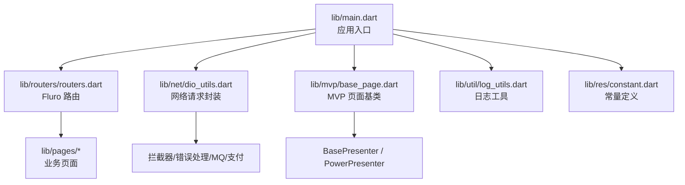
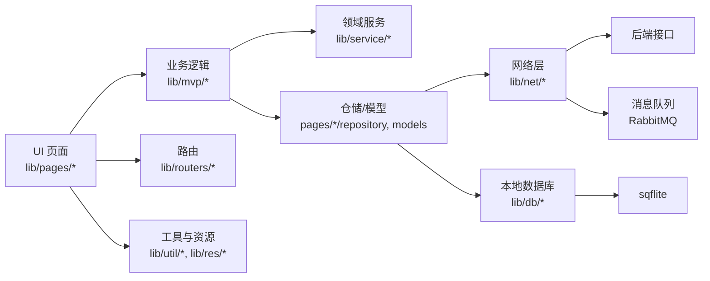
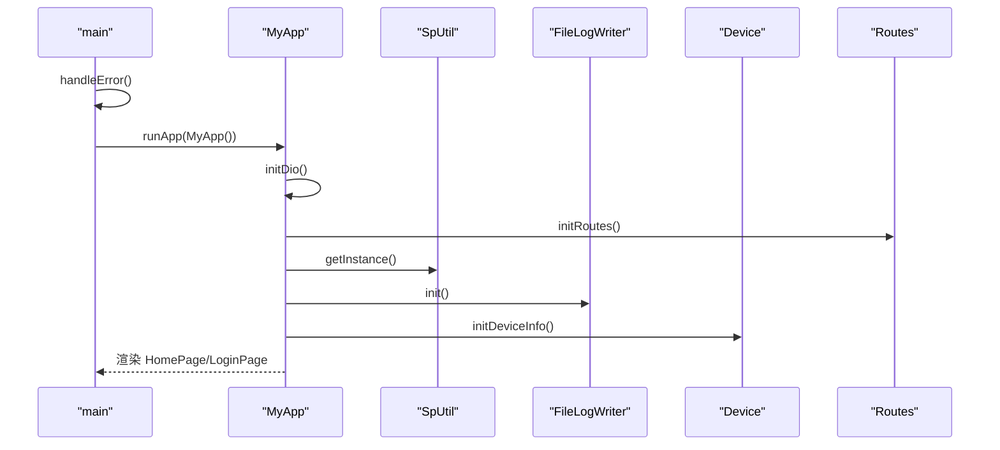
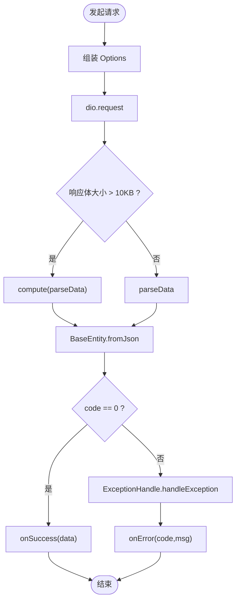
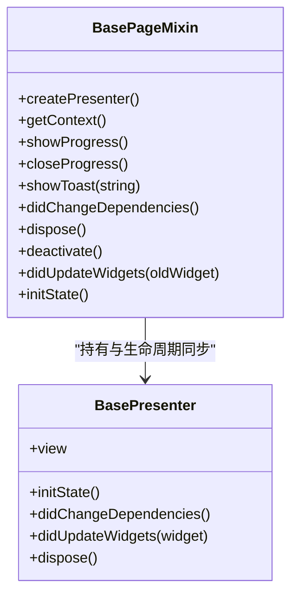
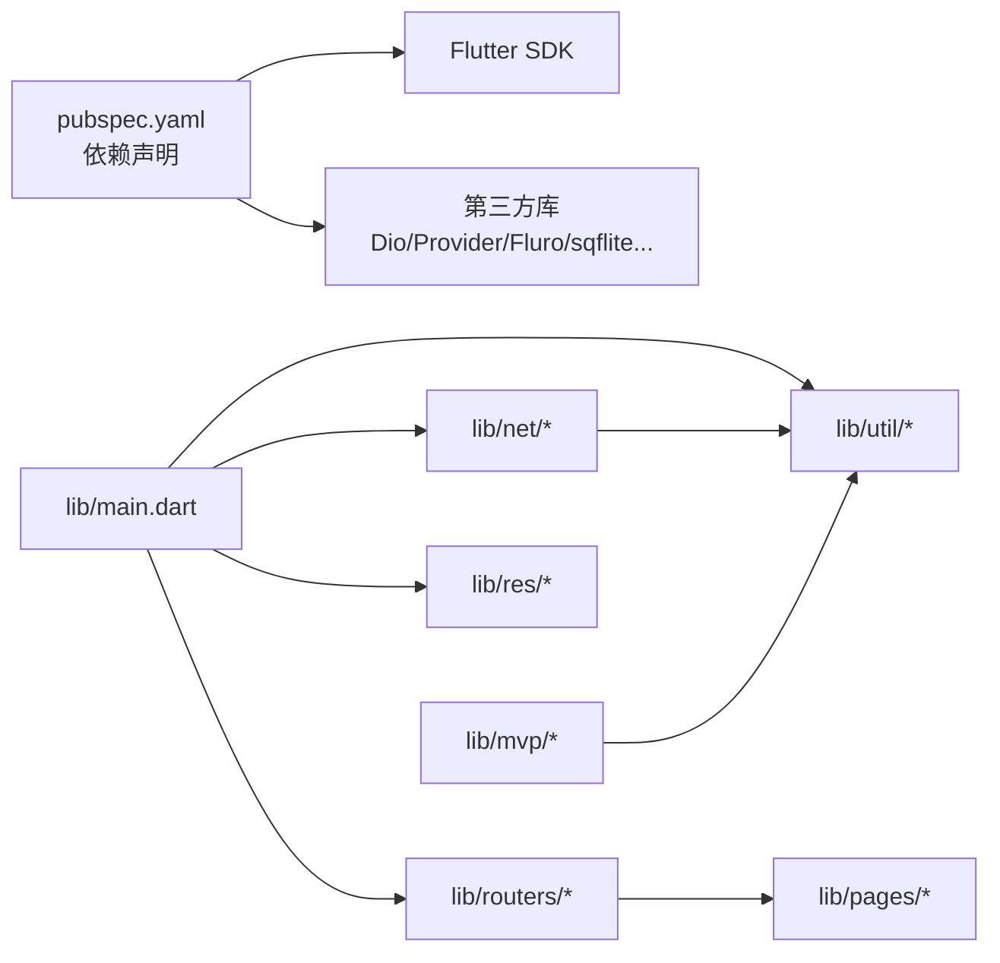
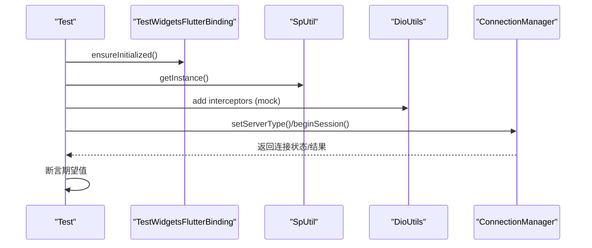
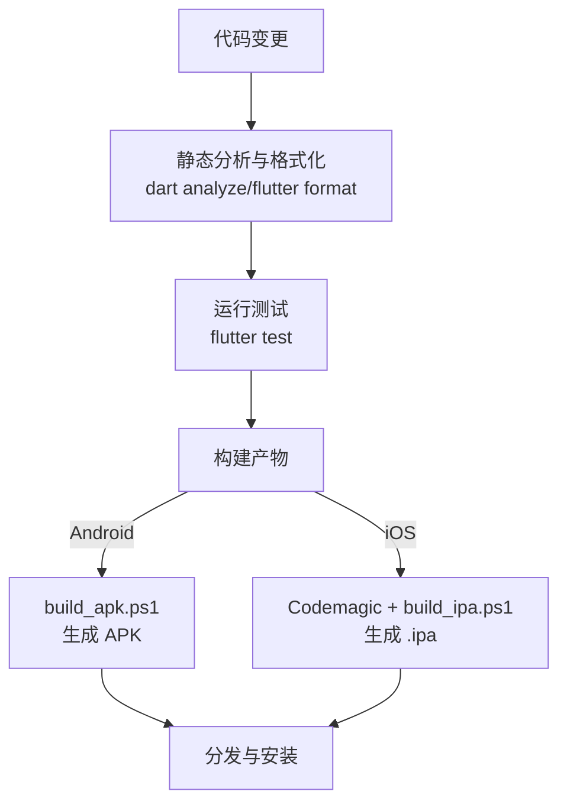

# 开发指南

<cite>
**本文引用的文件**
- [README.md](file://README.md)
- [pubspec.yaml](file://pubspec.yaml)
- [analysis_options.yaml](file://analysis_options.yaml)
- [codemagic.yaml](file://codemagic.yaml)
- [lib/main.dart](file://lib/main.dart)
- [lib/res/constant.dart](file://lib/res/constant.dart)
- [lib/net/dio_utils.dart](file://lib/net/dio_utils.dart)
- [lib/routers/routers.dart](file://lib/routers/routers.dart)
- [lib/mvp/base_page.dart](file://lib/mvp/base_page.dart)
- [lib/util/log_utils.dart](file://lib/util/log_utils.dart)
- [test/connection_mode_test.dart](file://test/connection_mode_test.dart)
- [build_apk.ps1](file://build_apk.ps1)
- [build_ipa.ps1](file://build_ipa.ps1)
</cite>

## 目录
1. [简介](#简介)
2. [项目结构](#项目结构)
3. [核心组件](#核心组件)
4. [架构总览](#架构总览)
5. [详细组件分析](#详细组件分析)
6. [依赖关系分析](#依赖关系分析)
7. [性能与调试](#性能与调试)
8. [测试策略与实践](#测试策略与实践)
9. [代码规范与审查](#代码规范与审查)
10. [常见问题与排错](#常见问题与排错)
11. [新功能模板与脚手架](#新功能模板与脚手架)
12. [团队协作、版本与发布流程](#团队协作版本与发布流程)
13. [结论](#结论)

## 简介
本指南面向聚客美滋滋 Flutter 点餐应用的新老开发者，聚焦 Dart/Flutter 工程化实践：从语言与代码规范、项目结构与模块划分，到网络层、路由、MVP 架构、日志与调试、测试、静态分析与持续集成，再到 Android/iOS 平台问题排查和发布流程。文档所有实现细节均基于仓库现有源码，帮助你快速上手并稳定扩展功能。

## 项目结构
仓库采用“业务域 + 基础设施”的分层组织方式：
- lib/main.dart：应用启动入口，负责全局初始化、主题与 Toast、Dio 初始化与拦截器装配、初始页面选择。
- lib/pages：按业务域组织页面（home/login/order/setting），每个域内可再分 page/widgets/models/repository 等子目录。
- lib/components：跨页面复用的 UI 组件（弹窗、表单、表格卡片等）。
- lib/routers：Fluro 路由注册与统一入口。
- lib/net：Dio 封装、拦截器、错误处理、MQ 服务、支付网关等。
- lib/mvp：MVP 基类与生命周期管理。
- lib/db：sqflite 实体与 DAO，用于本地数据持久化。
- lib/res：颜色、样式、尺寸、常量集中管理。
- lib/util：工具类（设备、权限、打印、语音、缓存、金额计算、日期、Toast、日志等）。
- lib/widgets：通用基础控件（按钮、卡片、进度框、状态布局等）。
- android/、ios/：原生平台配置与插件桥接。
- test/、integration_test/：单元测试与集成测试。
- assets/、shader/、web/：资源与 Web 构建产物。
- .github/、docs/：协作与问题汇总文档。

图示来源
- [lib/main.dart:1-159](file://lib/main.dart#L1-L159)
- [lib/routers/routers.dart:1-71](file://lib/routers/routers.dart#L1-L71)
- [lib/net/dio_utils.dart:1-200](file://lib/net/dio_utils.dart#L1-L200)
- [lib/mvp/base_page.dart:1-103](file://lib/mvp/base_page.dart#L1-L103)
- [lib/util/log_utils.dart:1-106](file://lib/util/log_utils.dart#L1-L106)
- [lib/res/constant.dart:1-93](file://lib/res/constant.dart#L1-L93)

章节来源
- [README.md:1-50](file://README.md#L1-L50)
- [pubspec.yaml:1-111](file://pubspec.yaml#L1-L111)

## 核心组件
- 应用入口 MyApp：统一初始化 SpUtil、FileLogWriter、OrderLogUtils、Device 信息；设置路径式 URL（Web）；根据 token 决定首页或登录页；注入 Provider 主题；配置 OKToast；使用 Fluro 路由。
- 网络层 DioUtils：集中配置连接/收发超时、BaseUrl、拦截器；统一解析 JSON（大数据走 isolate compute）；封装 requestNetwork/asyncRequestNetwork；统一错误处理与取消请求日志。
- 路由系统 Routes：集中定义路由常量，模块化注册 LoginRouter、SettingRouter、OrderRouter，未匹配路由跳转到 NotFoundPage。
- MVP 基类 BasePageMixin：统一管理 Presenter 生命周期、showProgress/closeProgress/showToast、页面生命周期透传。
- 日志 Log：在 debug 环境输出结构化 JSON，避免刷屏限制，提供 d/e/json 方法。
- 常量 Constant：环境判断、存储 key、商业模式、连接模式、RabbitMQ 参数等。

章节来源
- [lib/main.dart:1-159](file://lib/main.dart#L1-L159)
- [lib/net/dio_utils.dart:1-200](file://lib/net/dio_utils.dart#L1-L200)
- [lib/routers/routers.dart:1-71](file://lib/routers/routers.dart#L1-L71)
- [lib/mvp/base_page.dart:1-103](file://lib/mvp/base_page.dart#L1-L103)
- [lib/util/log_utils.dart:1-106](file://lib/util/log_utils.dart#L1-L106)
- [lib/res/constant.dart:1-93](file://lib/res/constant.dart#L1-L93)

## 架构总览
应用采用 Flutter + Provider + Fluro + Dio + sqflite 的混合架构：
- 表现层：以 Page 为主，结合 Widgets 与 Components 复用。
- 逻辑层：通过 Presenter（MVP）承载业务逻辑，调用 Repository/Service/DAO。
- 数据层：net 层负责 HTTP/MQ，db 层负责本地 SQLite，util 提供工具能力。
- 基础设施：main.dart 统一装配拦截器、路由、主题、日志与 Toast。

图示来源
- [lib/main.dart:1-159](file://lib/main.dart#L1-L159)
- [lib/routers/routers.dart:1-71](file://lib/routers/routers.dart#L1-L71)
- [lib/net/dio_utils.dart:1-200](file://lib/net/dio_utils.dart#L1-L200)
- [lib/mvp/base_page.dart:1-103](file://lib/mvp/base_page.dart#L1-L103)

## 详细组件分析

### 应用入口与全局初始化
- 异常处理包裹 main，确保 WidgetsFlutterBinding 初始化。
- Web 下启用 setPathUrlStrategy。
- 顺序初始化：SpUtil -> FileLogWriter -> OrderLogUtils -> Device。
- 动态主题与 Toast 包装 MaterialApp。
- 根据 token 决定初始路由。

图示来源
- [lib/main.dart:1-159](file://lib/main.dart#L1-L159)
- [lib/routers/routers.dart:1-71](file://lib/routers/routers.dart#L1-L71)

章节来源
- [lib/main.dart:1-159](file://lib/main.dart#L1-L159)

### 网络层与请求封装
- DioUtils 暴露单例 instance 与 dio 实例，支持自定义超时、BaseUrl、拦截器。
- 非 Web 环境下可配置代理抓包（条件：debug 且特定 spid）。
- 大响应体使用 compute 进行隔离解析，避免阻塞主线程。
- 统一返回 BaseEntity，成功回调 onSuccess，失败回调 onError。
- 对 CancelToken 取消请求进行日志记录。

图示来源
- [lib/net/dio_utils.dart:1-200](file://lib/net/dio_utils.dart#L1-L200)

章节来源
- [lib/net/dio_utils.dart:1-200](file://lib/net/dio_utils.dart#L1-L200)

### 路由系统
- Routes 集中维护路由常量与默认页面。
- 通过 IRouterProvider 将各模块路由注册合并，便于扩展。
- 未找到路由时跳转到 NotFoundPage。

章节来源
- [lib/routers/routers.dart:1-71](file://lib/routers/routers.dart#L1-L71)

### MVP 页面基类
- BasePageMixin 管理 Presenter 生命周期，屏蔽重复弹出 Progress、统一 Toast。
- 页面通过 createPresenter 注入具体 Presenter，并在 initState 中绑定 view。
- didChangeDependencies/dispose/deactivate/didUpdateWidgets 均透传给 Presenter。

图示来源
- [lib/mvp/base_page.dart:1-103](file://lib/mvp/base_page.dart#L1-L103)

章节来源
- [lib/mvp/base_page.dart:1-103](file://lib/mvp/base_page.dart#L1-L103)

### 日志系统
- Log.init 根据 Constant.inProduction 控制是否开启日志。
- Log.json 对 Map/List 做缩进格式化，避免每秒过多行被限制。
- d/e/json 三个入口分别对应常规日志、错误日志、结构化 JSON。

章节来源
- [lib/util/log_utils.dart:1-106](file://lib/util/log_utils.dart#L1-L106)
- [lib/res/constant.dart:1-93](file://lib/res/constant.dart#L1-L93)

## 依赖关系分析
- 外部依赖由 pubspec.yaml 声明，包括 Dio、Provider、Fluro、sqflite、device_info_plus、mobile_scanner、flutter_tts、archive、dart_amqp 等。
- 内部模块耦合：
  - main.dart 依赖 net、routers、res、util、setting/provider。
  - net 依赖 util（Log、UserHelper）、res（Constant）。
  - mvp 依赖 routers、util、widgets。
  - routers 聚合 login/order/setting 模块的路由提供者。

图示来源
- [pubspec.yaml:1-111](file://pubspec.yaml#L1-L111)
- [lib/main.dart:1-159](file://lib/main.dart#L1-L159)
- [lib/net/dio_utils.dart:1-200](file://lib/net/dio_utils.dart#L1-L200)
- [lib/routers/routers.dart:1-71](file://lib/routers/routers.dart#L1-L71)

章节来源
- [pubspec.yaml:1-111](file://pubspec.yaml#L1-L111)

## 性能与调试

### 断点调试
- 在关键业务流程（登录、下单、结算、支付）打断点，观察 Presenter 生命周期与网络回调。
- 利用 base_page.dart 中的 showProgress/closeProgress 判断 UI 交互是否被正确阻断。

### 日志分析
- 使用 Log.d/e/json 输出结构化日志，关注接口请求与响应体。
- 生产环境日志自动关闭，如需排查可在 Constant.inProduction 为 false 的环境复现。

### 性能分析
- 大响应体走 isolate 解析，避免卡顿；可通过增大阈值或优化 DTO 降低解析压力。
- 打开 Flutter DevTools 的 Performance、Memory、Timeline 面板，定位掉帧与内存峰值。

### 内存泄漏检测
- 检查 Presenter 是否在 dispose 中释放订阅、定时器、监听器。
- 使用 DevTools Memory 查看对象图，确认 Widget/Presenter/Stream 是否正确释放。

### 代理抓包
- DioUtils 在非 Web 平台支持代理抓包，需满足 debug 模式与特定 spid，便于 Fiddler 抓包。

章节来源
- [lib/net/dio_utils.dart:1-200](file://lib/net/dio_utils.dart#L1-L200)
- [lib/util/log_utils.dart:1-106](file://lib/util/log_utils.dart#L1-L106)
- [lib/mvp/base_page.dart:1-103](file://lib/mvp/base_page.dart#L1-L103)
- [lib/res/constant.dart:1-93](file://lib/res/constant.dart#L1-L93)

## 测试策略与实践

### 测试框架与环境
- 使用 flutter_test 与 test 框架。
- integration_test 目录可用于端到端场景（当前为空，可扩展）。

### 单元测试示例与要点
- connection_mode_test.dart 展示了：
  - 使用 TestWidgetsFlutterBinding.ensureInitialized。
  - Mock MethodChannel shared_preferences。
  - 通过 DioUtils.instance.dio.interceptors 拦截请求与响应。
  - 验证 ConnectionManager 在不同连接模式下的行为。
  - 使用 expect/throwsA/expectLater 等断言。

图示来源
- [test/connection_mode_test.dart:1-200](file://test/connection_mode_test.dart#L1-L200)

### 覆盖率统计
- 使用 flutter test --coverage 生成覆盖率，配合 genhtml 或 IDE 插件查看。
- 建议为核心逻辑（订单、促销、连接模式、支付网关）编写用例，逐步提升覆盖率。

### Mock 数据
- 在单元测试中使用 Dio InterceptorsWrapper 模拟网络响应。
- 对 Platform Channel 使用 defaultBinaryMessenger.setMockMethodCallHandler。

章节来源
- [test/connection_mode_test.dart:1-200](file://test/connection_mode_test.dart#L1-L200)

## 代码规范与审查

### Dart 语言与风格
- 启用严格模式：strict-casts、strict-inference、strict-raw-types。
- Linter 规则包含命名、空安全、类型推断、集合字面量、异步函数、字符串插值、尾逗号、文件命名等。
- 格式化：page_width=100。

### 命名约定
- 文件与小驼峰：file_names 规则生效。
- 类型与大驼峰：camel_case_types。
- 变量/方法与小驼峰：non_constant_identifier_names。
- 常量全大写：constant_identifier_names（注意该规则被显式注释，可按团队共识启用）。

### 注释与文档
- 公共 API 建议使用 /// 注释（slash_for_doc_comments）。
- TODO/FIXME 遵循 flutter_style_todos。

### 代码审查流程
- 提交前运行 dart analyze 与 flutter format --set-exit-if-changed。
- PR 要求至少一名 reviewer，重点审查：
  - 业务逻辑正确性与边界处理。
  - 网络与异常处理是否完善。
  - 是否存在内存泄漏（未释放订阅、监听器）。
  - UI 交互是否符合 MVP 职责分离。

章节来源
- [analysis_options.yaml:1-200](file://analysis_options.yaml#L1-L200)

## 常见问题与排错

### Android 平台
- 权限与文件访问：AndroidManifest.xml、file_paths.xml、network_security_config.xml。
- 安装 APK 插件：InstallAPKPlugin.java、DeerPickerProvider/FileProvider7。
- 扫码插件：PdaScannerPlugin.java。

### iOS 平台
- AppDelegate.swift、Info.plist、Runner-Bridging-Header.h。
- Pods 与 CocoaPods 配置。

### 网络与代理
- 代理抓包仅非 Web 平台生效，需在 debug 模式且特定 spid。
- 若出现 TypeError 强转 IOHttpClientAdapter，说明在 Web 平台误用，需加 kIsWeb 判断。

### 性能问题
- 大响应体解析已走 isolate，但仍需控制 DTO 体积。
- 避免在 build 中进行重计算，使用 useMemo 等价策略（如 Provider 拆分 State）。

### 用户体验
- 使用 OKToast 统一提示。
- 防止重复弹出 Progress，BasePageMixin 已有防抖逻辑。
- 字体缩放：MaterialApp builder 中禁用 textScaler，保证字号稳定。

章节来源
- [lib/net/dio_utils.dart:1-200](file://lib/net/dio_utils.dart#L1-L200)
- [lib/mvp/base_page.dart:1-103](file://lib/mvp/base_page.dart#L1-L103)
- [lib/main.dart:1-159](file://lib/main.dart#L1-L159)

## 新功能模板与脚手架

### 新增页面模板
- 在 lib/pages/<feature>/ 下创建 page 与 widgets 目录。
- 使用 BasePageMixin 作为 State 基类，实现 createPresenter 并绑定 Presenter。
- 在 feature_router.dart 实现 IRouterProvider，并在 lib/routers/routers.dart 中注册。

### 组件模板
- 在 lib/components/ 下创建可复用组件，遵循单一职责与可组合原则。
- 对外暴露必要的属性与方法，保持无副作用。

### API 调用模板
- 在 lib/net/http_api.dart 定义接口路径常量。
- 在页面/Presenter 中通过 DioUtils.instance.requestNetwork/asyncRequestNetwork 调用。
- 统一处理成功与失败回调，使用 Log 记录关键步骤。

章节来源
- [lib/routers/routers.dart:1-71](file://lib/routers/routers.dart#L1-L71)
- [lib/mvp/base_page.dart:1-103](file://lib/mvp/base_page.dart#L1-L103)
- [lib/net/dio_utils.dart:1-200](file://lib/net/dio_utils.dart#L1-L200)

## 团队协作、版本与发布流程

### 版本管理
- 版本号定义于 pubspec.yaml 的 version 字段（例如 1.0.0+1）。
- 构建脚本会解析 version 与 buildNumber，生成带完整版本号的产物名。

### 持续集成与云构建
- codemagic.yaml 配置 iOS 测试包构建（无签名），产出 .ipa 供 Sideloadly 安装测试。
- 建议在 GitHub Actions/GitLab CI 中添加 lint、analyze、test 任务。

### 构建与打包
- Windows 下构建 APK：使用 build_apk.ps1，自动清理旧产物、按 ABI 拆分、重命名为 ytt_smdc_flutter_<version>.apk。
- iOS 测试辅助：使用 build_ipa.ps1 查找云构建产出的 .ipa，重命名并提供 Sideloadly 安装指引。

图示来源
- [build_apk.ps1:1-53](file://build_apk.ps1#L1-L53)
- [build_ipa.ps1:1-69](file://build_ipa.ps1#L1-L69)
- [codemagic.yaml:1-34](file://codemagic.yaml#L1-L34)
- [pubspec.yaml:1-111](file://pubspec.yaml#L1-L111)

章节来源
- [build_apk.ps1:1-53](file://build_apk.ps1#L1-L53)
- [build_ipa.ps1:1-69](file://build_ipa.ps1#L1-L69)
- [codemagic.yaml:1-34](file://codemagic.yaml#L1-L34)
- [pubspec.yaml:1-111](file://pubspec.yaml#L1-L111)

## 结论
本指南围绕聚客美滋滋应用的工程化实践，梳理了代码规范、架构设计、调试与测试、质量保障与发布流程。建议团队在日常开发中严格执行静态分析与测试覆盖，逐步沉淀可复用组件与模板，持续优化网络与本地数据层性能，并通过 CI/CD 提升交付效率与稳定性。