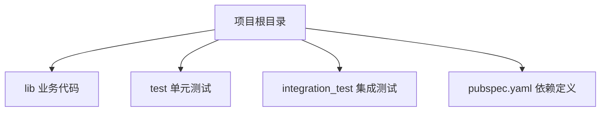
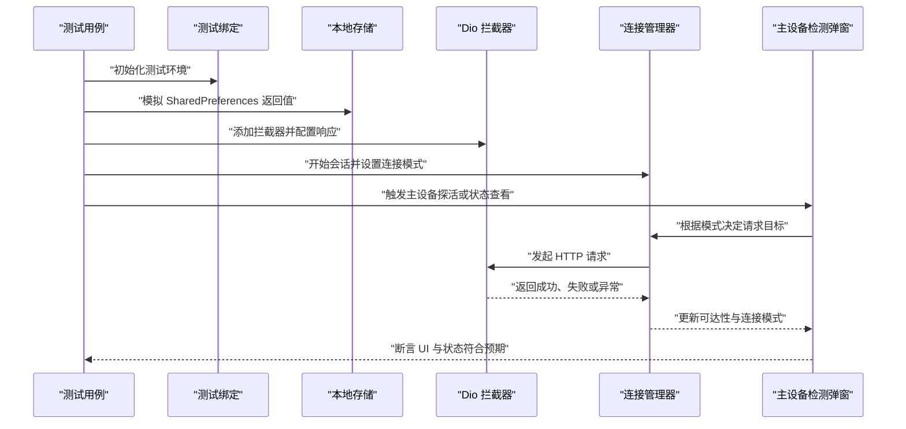

# 测试策略与实践

<cite>
**本文引用的文件**   
- [pubspec.yaml](file://pubspec.yaml)
- [connection_mode_test.dart](file://test/connection_mode_test.dart)
- [connection_manager.dart](file://lib/net/connection_manager.dart)
- [dio_utils.dart](file://lib/net/dio_utils.dart)
- [http_api.dart](file://lib/net/http_api.dart)
- [http_helper.dart](file://lib/net/http_helper.dart)
- [master_device_check_dialog.dart](file://lib/pages/home/table/widgets/master_device_check_dialog.dart)
- [constant.dart](file://lib/res/constant.dart)
- [param_setting_page.dart](file://lib/setting/page/param_setting_page.dart)
</cite>

## 目录
1. [引言](#引言)
2. [项目结构中的测试位置](#项目结构中的测试位置)
3. [核心测试目标与范围](#核心测试目标与范围)
4. [单元测试规范](#单元测试规范)
5. [集成测试规范](#集成测试规范)
6. [Mock 数据与外部依赖模拟策略](#mock-数据与外部依赖模拟策略)
7. [测试环境配置](#测试环境配置)
8. [自动化测试流程建议](#自动化测试流程建议)
9. [关键组件测试分析：连接模式与网络选择](#关键组件测试分析连接模式与网络选择)
10. [性能与稳定性考虑](#性能与稳定性考虑)
11. [常见问题排查](#常见问题排查)
12. [结论](#结论)

## 引言
本测试策略面向聚客美滋滋 Flutter 应用，目标是建立覆盖单元测试、集成测试、UI 流程测试、网络请求测试、数据库操作测试和第三方服务模拟的完整测试体系。文档基于当前仓库中的依赖声明与已有测试样例，给出可落地的编写规范、最佳实践和扩展指引，帮助团队在现有代码基础上快速补齐高质量测试。

## 项目结构中的测试位置
当前仓库中：
- 单元测试位于 `test` 目录。
- 集成测试目录 `integration_test` 已预留但尚未包含用例。
- 测试相关依赖集中在 `pubspec.yaml` 中。

**图表来源**
- [pubspec.yaml:1-111](file://pubspec.yaml#L1-L111)

**章节来源**
- [pubspec.yaml:1-111](file://pubspec.yaml#L1-L111)

## 核心测试目标与范围
结合业务特性，测试应覆盖以下维度：
- 单元测试
  - Widget 测试：页面、弹窗、底部弹窗、卡片等 UI 组件交互。
  - 业务逻辑测试：订单促销、购物车计算、会员优惠券、桌台状态切换等。
  - 工具类测试：金额计算、日期处理、路由跳转、权限判断、日志上传等。
- 集成测试
  - UI 流程测试：登录、开台、下单、结账、支付扫码等主流程。
  - 网络请求测试：HTTP 接口、MQ 消息、参数同步、连接模式切换。
  - 数据库操作测试：SQLite 基础数据读写、DAO 层查询、本地缓存一致性。
- Mock 策略
  - API 响应模拟：成功、失败、超时、异常、数据不完整。
  - 本地数据模拟：SharedPreferences、路径、设备信息、系统能力。
  - 第三方服务模拟：MQ、打印、语音播报、扫描、Webview、系统权限。

**章节来源**
- [pubspec.yaml:1-111](file://pubspec.yaml#L1-L111)

## 单元测试规范
### 编写原则
- 每个被测单元职责单一，避免在一个用例中同时验证多个不相关功能。
- 断言明确且自描述，优先使用语义化断言，如“连接模式为仅限云服务”“门店参数缺失时拒绝探测”。
- 异步测试必须显式等待或捕获异常，禁止隐式依赖时序。
- 测试数据与生产数据分离，使用最小可用数据集。

### Widget 测试
- 使用 `TestWidgetsFlutterBinding.ensureInitialized()` 初始化绑定。
- 使用 `tester.pumpWidget` 渲染组件，`tester.tap` 触发交互，`tester.pump` 推进帧。
- 对需要平台能力的组件，提前 mock 平台通道或 SDK 返回。
- 针对弹窗、底部弹窗、状态布局等，重点验证显示条件、按钮点击、关闭行为和数据更新。

### 业务逻辑测试
- 以纯函数或无外部副作用的服务为中心，输入固定数据，输出预期结果。
- 对涉及时间、随机数、并发、外部 IO 的逻辑，提供注入点或使用隔离版本。
- 对订单促销、优惠券结算、购物车合计等复杂规则，采用边界值、等价类、异常分支组合覆盖。

### 工具类测试
- 工具类应保持幂等与确定性；对非确定性输出（如当前时间），通过参数或夹具控制。
- 对格式化、编码、加密、数值运算等工具，构造典型与异常输入集合进行验证。

**章节来源**
- [pubspec.yaml:72-80](file://pubspec.yaml#L72-L80)

## 集成测试规范
### UI 流程测试
- 使用 `flutter_driver` 或 `integration_test` 框架驱动真实设备或模拟器执行端到端流程。
- 覆盖登录、参数同步、连接模式设置、桌台列表刷新、下单结算等关键用户路径。
- 对易变 UI 文本和布局差异，谨慎使用黄金截图；优先使用稳定语义查找器。

### 网络请求测试
- 通过 Dio 拦截器统一拦截请求，按用例配置成功、失败、超时、数据格式错误等场景。
- 验证请求 URL、方法、头、参数、重试策略、错误提示是否正确。
- 对多端连接模式，分别验证仅云服务、仅主设备、不限三种模式的请求路由。

### 数据库操作测试
- 使用内存数据库或临时 SQLite 文件运行 DAO 测试。
- 准备实体对象、关联关系、空值、重复键、分页等数据。
- 验证增删改查、事务、并发写入、迁移兼容性与脏读防护。

**章节来源**
- [pubspec.yaml:72-80](file://pubspec.yaml#L72-L80)

## Mock 数据与外部依赖模拟策略
### API 响应模拟
- 使用 Dio 拦截器收集并校验 `RequestOptions`，并按用例返回结构化响应或抛出异常。
- 模拟字段缺失、类型错误、部分成功、延迟返回等边缘情况。
- 将网络基地址、接口路径、参数 key 集中管理，便于复用与变更。

### 本地数据模拟
- 对 SharedPreferences，使用二进制通道 mock 或专用测试封装，保证用例间数据隔离。
- 对包信息、路径、设备信息，使用对应 SDK 提供的 mock 接口。
- 每次测试前清理本地状态，测试后恢复默认值，避免用例互相污染。

### 第三方服务模拟
- MQ 服务：根据平台实现 stub，测试消息收发、重连、解析错误。
- 打印、语音、扫描、权限：通过 platform channel 或抽象接口返回可控结果。
- Webview：使用轻量 stub 验证导航、事件回调、加载状态。

**章节来源**
- [pubspec.yaml:1-111](file://pubspec.yaml#L1-L111)

## 测试环境配置
### 测试依赖管理
- 单元测试依赖 `flutter_test` 与 `test`。
- 黄金测试依赖 `flutter_goldens`（当前被注释，可按需启用）。
- 集成测试建议使用官方 `integration_test` 框架，并与 CI 集成。

### 测试数据准备
- 将公共测试夹具放在 `test/fixtures` 或独立 fixture 文件中。
- 对 JSON、SQL、图片等资源放入 `test/assets`，并在测试中正确加载。
- 对敏感配置，使用环境变量或测试专用配置文件。

### 测试用例组织
- 按模块划分目录：`test/unit`、`test/integration`、`test/widget`、`test/fixtures`。
- 文件名以 `_test.dart` 结尾，类名与方法名表达意图。
- 使用 `setUpAll`、`setUp`、`tearDown`、`tearDownAll` 管理生命周期。

**章节来源**
- [pubspec.yaml:72-80](file://pubspec.yaml#L72-L80)

## 自动化测试流程建议
### 持续集成
- 在 PR 合并前执行单元测试、Widget 测试、静态检查。
- 可选阶段执行集成测试与覆盖率统计。
- 失败时阻断合并，成功时生成测试报告。

### 测试报告与覆盖率
- 使用 Dart/Flutter 内置覆盖率工具生成 HTML 报告。
- 对关键模块设定最低覆盖率阈值，逐步提升。
- 将报告归档到 CI 产物，便于回溯。

### 质量门禁
- 新增代码必须补充相应测试。
- 修改公共接口、网络协议、数据库 schema 时需同步更新测试。
- 对回归问题优先补充单测或集成用例。

[本节为通用流程建议，不直接分析具体源码文件]

## 关键组件测试分析：连接模式与网络选择
当前仓库中已有连接模式相关测试，展示了如何模拟 Dio 请求、SharedPreferences、PackageInfo 以及验证不同连接模式下的行为。该样例可作为其他模块测试的参考模板。

**图表来源**
- [connection_mode_test.dart:1-200](file://test/connection_mode_test.dart#L1-L200)
- [connection_manager.dart](file://lib/net/connection_manager.dart)
- [dio_utils.dart](file://lib/net/dio_utils.dart)
- [http_api.dart](file://lib/net/http_api.dart)
- [http_helper.dart](file://lib/net/http_helper.dart)
- [master_device_check_dialog.dart](file://lib/pages/home/table/widgets/master_device_check_dialog.dart)

### 测试要点总结
- 使用测试绑定初始化 Flutter 测试环境。
- 通过二进制通道 mock SharedPreferences，避免真实持久化。
- 通过 PackageInfo mock 初始值，防止运行时依赖真实包信息。
- 通过 Dio 拦截器统一接管所有 HTTP 请求，按用例返回成功或连接错误。
- 验证不同连接模式下是否走云服务、主设备地址或拒绝非法请求。
- 验证探活成功后是否更新门店信息与连接状态，探活失败时是否保持降级或拒绝。
- 验证 UI 页面在不同屏幕宽度下仍可选择三种连接模式且不立即生效。

**章节来源**
- [connection_mode_test.dart:1-200](file://test/connection_mode_test.dart#L1-L200)

## 性能与稳定性考虑
- 单元测试应避免启动完整应用，只挂载必要 widget。
- 网络测试使用内存拦截，不发起真实请求，减少 CI 耗时。
- 数据库测试使用内存或临时文件，避免跨用例干扰。
- 对 UI 动画、长任务、异步回调，使用 `tester.pumpAndSettle` 或超时保护。
- 对高并发场景，使用锁、队列或隔离执行，避免竞态导致不稳定。

[本节为通用指导，不直接分析具体源码文件]

## 常见问题排查
- 测试无法访问资源：确认 `flutter_test` 正确加载 assets，或在测试中手动注册。
- SharedPreferences 读取为空：确保二进制通道 mock 返回空 map 而非 null。
- Dio 请求未触发：检查拦截器是否添加、URL 与路径是否与 `HttpApi` 一致。
- UI 找不到文本：避免硬编码中文文案，改为语义化标识或使用稳定控件 key。
- 异步断言失败：确保 await 完成或捕获异常，不要假设时机。
- 用例互相污染：在每个 `setUp` 中清理本地数据与全局状态。

**章节来源**
- [connection_mode_test.dart:1-200](file://test/connection_mode_test.dart#L1-L200)

## 结论
本测试策略以当前仓库的依赖与已有测试为基础，明确了单元测试、集成测试、Mock 策略与环境配置的落地方式。建议团队优先补齐业务逻辑与工具类的单测，再逐步扩展 UI 流程与网络、数据库集成测试；同时将测试纳入持续集成流程，形成稳定的质量保障闭环。

[本节为总结性内容，不直接分析具体源码文件]