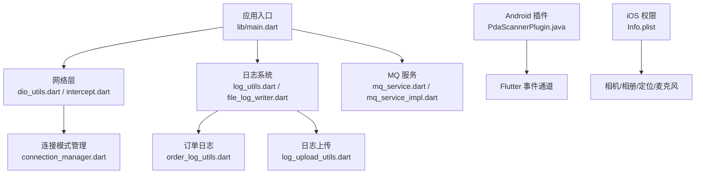
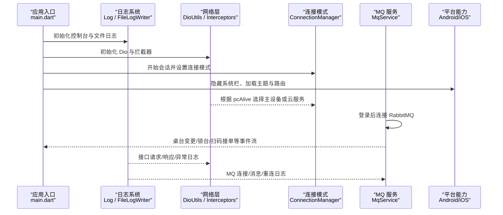
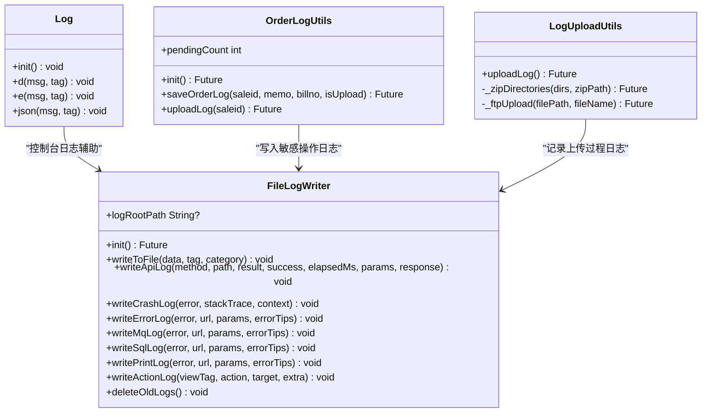
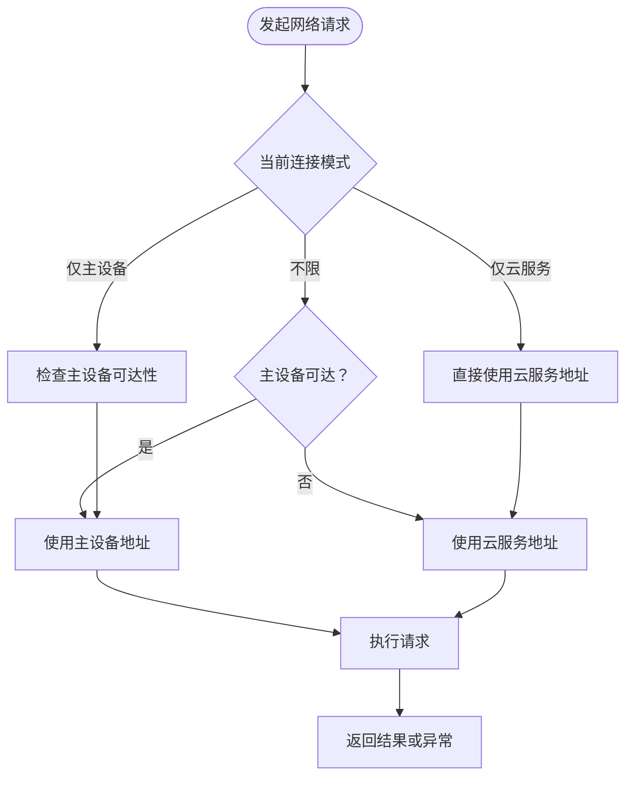
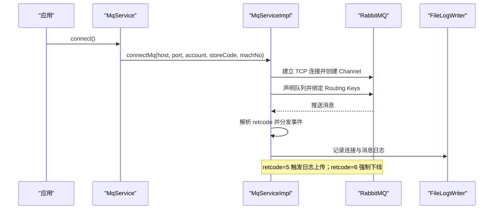
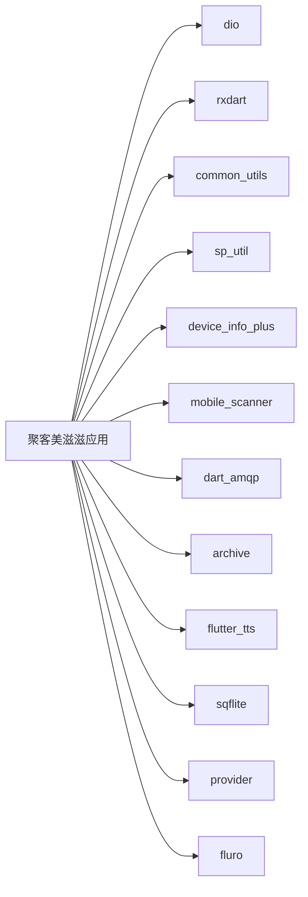

# 调试技巧与问题排查

<cite>
**本文引用的文件**   
- [README.md](file://README.md)
- [pubspec.yaml](file://pubspec.yaml)
- [lib/main.dart](file://lib/main.dart)
- [lib/util/log_utils.dart](file://lib/util/log_utils.dart)
- [lib/util/file_log_writer.dart](file://lib/util/file_log_writer.dart)
- [lib/util/order_log_utils.dart](file://lib/util/order_log_utils.dart)
- [lib/util/log_upload_utils.dart](file://lib/util/log_upload_utils.dart)
- [lib/net/dio_utils.dart](file://lib/net/dio_utils.dart)
- [lib/net/intercept.dart](file://lib/net/intercept.dart)
- [lib/net/connection_manager.dart](file://lib/net/connection_manager.dart)
- [lib/net/mq_service.dart](file://lib/net/mq_service.dart)
- [lib/net/mq_service_impl.dart](file://lib/net/mq_service_impl.dart)
- [android/app/src/main/java/com/bycloud/smdc/PdaScannerPlugin.java](file://android/app/src/main/java/com/bycloud/smdc/PdaScannerPlugin.java)
- [ios/Runner/Info.plist](file://ios/Runner/Info.plist)
- [docs/Android问题汇总.md](file://docs/Android问题汇总.md)
- [docs/iOS问题汇总.md](file://docs/iOS问题汇总.md)
</cite>

## 目录
1. [简介](#简介)
2. [项目结构](#项目结构)
3. [核心组件](#核心组件)
4. [架构总览](#架构总览)
5. [详细组件分析](#详细组件分析)
6. [依赖关系分析](#依赖关系分析)
7. [性能调优](#性能调优)
8. [常见问题排查](#常见问题排查)
9. [平台特定问题](#平台特定问题)
10. [硬件设备集成调试](#硬件设备集成调试)
11. [结论](#结论)

## 简介
本指南面向聚客美滋滋应用的开发者与维护者，目标是提供一套从开发环境到生产环境的完整调试方法。文档覆盖 Flutter 调试工具、日志系统、网络与消息队列连接、常见业务异常、Android 与 iOS 平台问题、性能优化以及 PDA 扫描枪等硬件集成调试要点。

## 项目结构
应用采用 Flutter 工程结构，主要模块包括：
- 入口与应用初始化：`lib/main.dart`
- 网络层：Dio 封装、拦截器、错误处理、连接模式管理
- 日志系统：控制台日志、文件日志、订单敏感操作日志、日志压缩上传
- MQ 推送服务：RabbitMQ 连接、消息分发、重连机制
- Android 原生插件：PDA 扫码广播接收
- iOS 权限配置：相机、相册、定位、麦克风与 HTTP 明文访问
- 依赖声明：`pubspec.yaml`

**图表来源**
- [lib/main.dart:1-159](file://lib/main.dart#L1-L159)
- [lib/net/dio_utils.dart:1-222](file://lib/net/dio_utils.dart#L1-L222)
- [lib/net/intercept.dart:1-219](file://lib/net/intercept.dart#L1-L219)
- [lib/util/log_utils.dart:1-106](file://lib/util/log_utils.dart#L1-L106)
- [lib/util/file_log_writer.dart:1-450](file://lib/util/file_log_writer.dart#L1-L450)
- [lib/util/order_log_utils.dart:1-199](file://lib/util/order_log_utils.dart#L1-L199)
- [lib/util/log_upload_utils.dart:1-341](file://lib/util/log_upload_utils.dart#L1-L341)
- [lib/net/connection_manager.dart:1-114](file://lib/net/connection_manager.dart#L1-L114)
- [lib/net/mq_service.dart:1-112](file://lib/net/mq_service.dart#L1-L112)
- [lib/net/mq_service_impl.dart:1-315](file://lib/net/mq_service_impl.dart#L1-L315)
- [android/app/src/main/java/com/bycloud/smdc/PdaScannerPlugin.java:1-165](file://android/app/src/main/java/com/bycloud/smdc/PdaScannerPlugin.java#L1-L165)
- [ios/Runner/Info.plist:1-76](file://ios/Runner/Info.plist#L1-L76)

**章节来源**
- [README.md:1-50](file://README.md#L1-L50)
- [pubspec.yaml:1-111](file://pubspec.yaml#L1-L111)

## 核心组件
本节聚焦调试相关的关键实现：日志系统、网络请求、连接模式、MQ 推送与平台配置。

- 日志系统
  - 控制台分类输出：`Log.init()` 在应用启动时调用，依据 `Constant.inProduction` 控制是否打印；提供 debug、error、json 格式化输出。
  - 文件日志写入：`FileLogWriter` 异步批量写入按日期和分类组织的日志文件，支持接口流水、崩溃日志、MQ 日志、SQL 日志、打印日志、埋点日志等。
  - 订单敏感操作日志：`OrderLogUtils` 记录开台、退菜等敏感操作，持久化待上传列表，并支持批量上传至服务端。
  - 日志压缩上传：`LogUploadUtils` 收集最近 N 天日志与数据库，打包为 zip 并通过 FTP 上传，上传完成后清理本地压缩包。

- 网络层
  - Dio 单例配置：统一超时、基础地址、拦截器链；非 Web 平台可配置抓包代理。
  - 拦截器链：鉴权头注入、Token 刷新、请求响应日志、数据适配。
  - 连接模式管理：主设备直连与云服务两种模式，根据策略与探活结果选择路由。

- MQ 推送服务
  - RabbitMQ 连接：登录后建立连接、声明队列、绑定 routing key、消费消息并分发到不同事件流。
  - 重连机制：连接失败自动重试，同时通过文件日志记录连接状态与消息类型。
  - 特殊指令：心跳、强制下线、桌台变更、扫码接单、打印通知、叫号刷新、日志上传指令。

- 平台配置
  - Android：PDA 扫码插件监听多种厂商广播，将条码通过 EventChannel 推送到 Flutter。
  - iOS：Info.plist 包含相机、相册、定位、麦克风权限说明，以及允许 HTTP 明文访问的 ATS 配置。

**章节来源**
- [lib/main.dart:1-159](file://lib/main.dart#L1-L159)
- [lib/util/log_utils.dart:1-106](file://lib/util/log_utils.dart#L1-L106)
- [lib/util/file_log_writer.dart:1-450](file://lib/util/file_log_writer.dart#L1-L450)
- [lib/util/order_log_utils.dart:1-199](file://lib/util/order_log_utils.dart#L1-L199)
- [lib/util/log_upload_utils.dart:1-341](file://lib/util/log_upload_utils.dart#L1-L341)
- [lib/net/dio_utils.dart:1-222](file://lib/net/dio_utils.dart#L1-L222)
- [lib/net/intercept.dart:1-219](file://lib/net/intercept.dart#L1-L219)
- [lib/net/connection_manager.dart:1-114](file://lib/net/connection_manager.dart#L1-L114)
- [lib/net/mq_service.dart:1-112](file://lib/net/mq_service.dart#L1-L112)
- [lib/net/mq_service_impl.dart:1-315](file://lib/net/mq_service_impl.dart#L1-L315)
- [android/app/src/main/java/com/bycloud/smdc/PdaScannerPlugin.java:1-165](file://android/app/src/main/java/com/bycloud/smdc/PdaScannerPlugin.java#L1-L165)
- [ios/Runner/Info.plist:1-76](file://ios/Runner/Info.plist#L1-L76)

## 架构总览
下图展示应用启动后，日志、网络、MQ 与平台能力的交互关系。

**图表来源**
- [lib/main.dart:1-159](file://lib/main.dart#L1-L159)
- [lib/util/log_utils.dart:1-106](file://lib/util/log_utils.dart#L1-L106)
- [lib/util/file_log_writer.dart:1-450](file://lib/util/file_log_writer.dart#L1-L450)
- [lib/net/dio_utils.dart:1-222](file://lib/net/dio_utils.dart#L1-L222)
- [lib/net/intercept.dart:1-219](file://lib/net/intercept.dart#L1-L219)
- [lib/net/connection_manager.dart:1-114](file://lib/net/connection_manager.dart#L1-L114)
- [lib/net/mq_service.dart:1-112](file://lib/net/mq_service.dart#L1-L112)
- [lib/net/mq_service_impl.dart:1-315](file://lib/net/mq_service_impl.dart#L1-L315)

## 详细组件分析

### 日志系统组件
日志系统分为控制台输出与文件落盘两类：

- 控制台日志
  - `Log.init()` 使用 `common_utils` 的 `LogUtil`，在发布模式下禁用 debugPrint。
  - 提供 `d`、`e`、`json` 三类输出；JSON 输出会尝试解析 Map/List 并美化缩进。

- 文件日志
  - `FileLogWriter` 使用 StreamController 做批量缓冲，按日期与分类写入 `{appDocDir}/log/{yyyy-MM-dd}/{category}/{yyyy-MM-dd}.log`。
  - 支持接口流水、崩溃日志、错误日志、MQ 日志、SQL 日志、打印日志、埋点日志。
  - 对长日志进行截断保护，避免单条超过 650KB。
  - 自动清理过期日志（1-2月保留 20 天，其他月份 10 天）。
  - 崩溃与错误类日志采用同步落盘，防止进程退出导致关键线索丢失。

- 订单敏感操作日志
  - `OrderLogUtils` 保存桌台敏感操作到本地 JSON 文件，并支持立即或批量上传至 `/YttSvr/app/salelog/setLog`。
  - 上传成功后删除已上传条目，失败则继续保留等待下次重试。

- 日志压缩上传
  - `LogUploadUtils` 收集最近 N 天日志与 SQLite 数据库目录，压缩为 zip 并通过 FTP 上传。
  - FTP 实现使用 Socket 手动命令交互，优先 IPv4，被动模式传输，上传成功删除本地压缩包。

**图表来源**
- [lib/util/log_utils.dart:1-106](file://lib/util/log_utils.dart#L1-L106)
- [lib/util/file_log_writer.dart:1-450](file://lib/util/file_log_writer.dart#L1-L450)
- [lib/util/order_log_utils.dart:1-199](file://lib/util/order_log_utils.dart#L1-L199)
- [lib/util/log_upload_utils.dart:1-341](file://lib/util/log_upload_utils.dart#L1-L341)

**章节来源**
- [lib/util/log_utils.dart:1-106](file://lib/util/log_utils.dart#L1-L106)
- [lib/util/file_log_writer.dart:1-450](file://lib/util/file_log_writer.dart#L1-L450)
- [lib/util/order_log_utils.dart:1-199](file://lib/util/order_log_utils.dart#L1-L199)
- [lib/util/log_upload_utils.dart:1-341](file://lib/util/log_upload_utils.dart#L1-L341)

### 网络层与连接模式
网络层基于 Dio，结合拦截器完成鉴权、日志与数据适配。连接模式由 `ConnectionManager` 统一管理，支持主设备直连与云服务两种路径。

**图表来源**
- [lib/net/connection_manager.dart:1-114](file://lib/net/connection_manager.dart#L1-L114)
- [lib/net/dio_utils.dart:1-222](file://lib/net/dio_utils.dart#L1-L222)
- [lib/net/intercept.dart:1-219](file://lib/net/intercept.dart#L1-L219)

**章节来源**
- [lib/net/dio_utils.dart:1-222](file://lib/net/dio_utils.dart#L1-L222)
- [lib/net/intercept.dart:1-219](file://lib/net/intercept.dart#L1-L219)
- [lib/net/connection_manager.dart:1-114](file://lib/net/connection_manager.dart#L1-L114)

### MQ 推送服务
MQ 服务负责登录后的 RabbitMQ 连接、消息消费与事件分发。Web 平台跳过连接，依赖轮询兜底。

**图表来源**
- [lib/net/mq_service.dart:1-112](file://lib/net/mq_service.dart#L1-L112)
- [lib/net/mq_service_impl.dart:1-315](file://lib/net/mq_service_impl.dart#L1-L315)
- [lib/util/file_log_writer.dart:1-450](file://lib/util/file_log_writer.dart#L1-L450)

**章节来源**
- [lib/net/mq_service.dart:1-112](file://lib/net/mq_service.dart#L1-L112)
- [lib/net/mq_service_impl.dart:1-315](file://lib/net/mq_service_impl.dart#L1-L315)

## 依赖关系分析
应用依赖的主要外部库包括：
- Dio：HTTP 客户端
- rxdart：响应式扩展
- common_utils：通用工具类
- sp_util：SharedPreferences 封装
- device_info_plus：设备信息
- mobile_scanner：二维码/条形码扫描
- dart_amqp：RabbitMQ 客户端
- archive：Zip 压缩
- flutter_tts：语音播报
- sqflite：SQLite 数据库
- provider：状态管理
- fluro：路由框架

**图表来源**
- [pubspec.yaml:1-111](file://pubspec.yaml#L1-L111)

**章节来源**
- [pubspec.yaml:1-111](file://pubspec.yaml#L1-L111)

## 性能调优
结合代码实现，可从以下方面进行性能分析与优化：

- 渲染性能
  - 应用入口中保留了 Flutter 调试开关注释项，如 `debugPaintLayerBordersEnabled`、`debugRepaintRainbowEnabled`、`showPerformanceOverlay`、`checkerboardOffscreenLayers`。可在需要时启用以观察绘制与离屏渲染情况。
  - 建议结合 Flutter DevTools 的 Performance 面板与 Inspector 分析 Widget 树与重建频率。

- 内存与大数据解析
  - 网络响应大于 10KB 时使用 isolate 的 `compute` 进行 JSON 解析，减少主线程压力。
  - 建议关注大对象生命周期，避免长时间持有图片与缓存数据；可使用 DevTools Memory 面板检测内存泄漏。

- 网络请求优化
  - 合理配置连接、发送、接收超时时间，避免长连接阻塞。
  - 利用拦截器的日志输出定位慢请求与异常分支。
  - 抓包代理仅在 debug 模式且特定商户下生效，避免影响正常用户。

- 日志与磁盘 IO
  - 文件日志采用批量缓冲与定时刷盘，降低高频 IO 开销。
  - 崩溃与错误日志同步落盘，确保关键线索不丢失。
  - 定期清理过期日志，避免占用过多存储空间。

[本节为通用指导，不直接分析具体源码片段]

## 常见问题排查

### 网络连接问题
- 现象：请求超时、无法连接主设备或服务端。
- 排查步骤：
  - 检查 `ConnectionManager.pcAlive` 与连接模式配置，确认是否误入仅云服务或仅主设备模式。
  - 查看 Dio 拦截器日志，确认请求 URL、Headers、Body 与响应码。
  - 在非 Web 平台下，若需要抓包，确认代理条件满足（debug 模式与指定商户）。
  - 检查服务器地址是否正确，云服务地址为主域名，主设备地址为局域网 IP。

**章节来源**
- [lib/net/connection_manager.dart:1-114](file://lib/net/connection_manager.dart#L1-L114)
- [lib/net/dio_utils.dart:1-222](file://lib/net/dio_utils.dart#L1-L222)
- [lib/net/intercept.dart:1-219](file://lib/net/intercept.dart#L1-L219)

### MQ 连接问题
- 现象：桌台状态不更新、扫码接单无响应、打印通知未触发。
- 排查步骤：
  - 确认登录后是否调用 `MqService.connect()`，并在 Web 平台跳过连接。
  - 检查 host、port、account、storeCode、machNo 参数是否正确。
  - 查看 MQ 文件日志，定位连接失败、channel 关闭、消息解析异常。
  - 确认 RabbitMQ 服务器存在 exchange “ytt”，且队列名匹配。
  - 针对 retcode=6 强制下线场景，检查前端是否处理了数据清空逻辑。

**章节来源**
- [lib/net/mq_service.dart:1-112](file://lib/net/mq_service.dart#L1-L112)
- [lib/net/mq_service_impl.dart:1-315](file://lib/net/mq_service_impl.dart#L1-L315)
- [lib/util/file_log_writer.dart:1-450](file://lib/util/file_log_writer.dart#L1-L450)

### 打印服务异常
- 现象：打印通知未收到、打印任务失败。
- 排查步骤：
  - 检查 MQ 消息中 retcode=66 的打印通知是否到达。
  - 查看打印日志分类文件，确认打印参数与服务端返回。
  - 结合 `FileLogWriter.writePrintLog` 输出，核对 URL、Params 与错误提示。
  - 若涉及第三方打印 SDK，需检查原生桥接是否正常注册与回调。

**章节来源**
- [lib/net/mq_service_impl.dart:1-315](file://lib/net/mq_service_impl.dart#L1-L315)
- [lib/util/file_log_writer.dart:1-450](file://lib/util/file_log_writer.dart#L1-L450)

### 扫码枪集成问题
- 现象：PDA 扫码无输入、重复扫码、扫码内容缺失。
- 排查步骤：
  - 确认 Android 侧 `PdaScannerPlugin` 已注册并监听对应广播 Action。
  - 检查 Intent Extra Key 是否与设备厂商匹配，必要时添加新 key。
  - 在 Flutter 侧订阅 EventChannel，确认事件 Sink 正常接收。
  - 对不同厂商设备进行测试，验证广播兼容性。

**章节来源**
- [android/app/src/main/java/com/bycloud/smdc/PdaScannerPlugin.java:1-165](file://android/app/src/main/java/com/bycloud/smdc/PdaScannerPlugin.java#L1-L165)

## 平台特定问题

### Android 平台
- 权限申请
  - 相机权限用于扫码功能；需在运行时申请并处理拒绝情况。
  - 存储权限用于文件日志与订单日志写入；高版本 Android 建议使用分区存储。
- 文件访问
  - 日志与订单日志写入应用文档目录；注意跨进程共享使用 `FileProvider`。
  - 若需要安装 APK，需检查 `InstallAPKPlugin` 与 `DeerPickerProvider` 的配置。
- 原生插件调用
  - PDA 扫码插件通过 EventChannel 推送扫描结果；确保 Flutter 侧正确订阅与取消订阅。
  - 其他原生插件（如 WebView、图片选择）需检查平台差异与版本兼容。

**章节来源**
- [android/app/src/main/java/com/bycloud/smdc/PdaScannerPlugin.java:1-165](file://android/app/src/main/java/com/bycloud/smdc/PdaScannerPlugin.java#L1-L165)
- [docs/Android问题汇总.md:1-56](file://docs/Android问题汇总.md#L1-L56)

### iOS 平台
- 权限配置
  - Info.plist 中已声明相机、相册、定位、麦克风使用说明。
  - 如需限制仅在使用期间获取位置，请调整对应的 UsageDescription。
- 沙盒文件访问
  - 应用文档目录用于日志与订单日志；避免直接访问系统目录。
  - 图片选择与 WebView 需注意资源路径与 MIME 类型。
- 原生桥接
  - 如需新增原生能力，建议在 `AppDelegate.swift` 或 Swift 文件中实现桥接方法。
  - 注意 iOS 网络 ATS 配置，当前允许任意 HTTPS/HTTP，上架前建议收紧。

**章节来源**
- [ios/Runner/Info.plist:1-76](file://ios/Runner/Info.plist#L1-L76)
- [docs/iOS问题汇总.md:1-55](file://docs/iOS问题汇总.md#L1-L55)

## 硬件设备集成调试
本节总结 PDA 扫描枪、打印机、蓝牙设备等常见硬件集成的调试要点。

- PDA 扫描枪
  - Android 侧通过广播监听多厂商扫码动作；Flutter 侧通过 EventChannel 接收条码。
  - 建议为每种设备单独测试，记录其广播 Action 与 Extra Key。
  - 若出现重复扫码，需在 Flutter 侧做去重与防抖处理。

- 打印机
  - 打印通知通常通过 MQ 的 retcode=66 下发。
  - 若使用原生打印 SDK，需检查插件注册、权限与设备发现流程。
  - 打印失败应记录详细日志，包括设备型号、驱动版本、打印内容长度。

- 蓝牙设备
  - 蓝牙权限与扫描需在运行时申请；iOS 需添加 Bluetooth Always 或使用场景描述。
  - 蓝牙连接状态变化应通过事件通知 UI，并提供断开重连机制。
  - 数据传输建议采用稳定协议，并对分包与校验进行处理。

[本节为通用指导，不直接分析具体源码片段]

## 结论
聚客美滋滋应用的调试体系围绕日志系统、网络层、连接模式与 MQ 推送展开。通过控制台与文件日志的组合，配合 Flutter DevTools 与平台工具，可以高效定位渲染、内存、网络与消息连接问题。Android 与 iOS 平台分别需要注意权限、文件访问与原生桥接差异。硬件设备集成则需要针对不同厂商进行专项适配与测试。建议在日常开发中保持日志分级清晰、网络与 MQ 连接可观测，并结合性能分析工具持续优化用户体验。