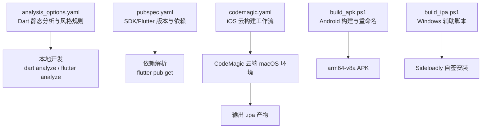
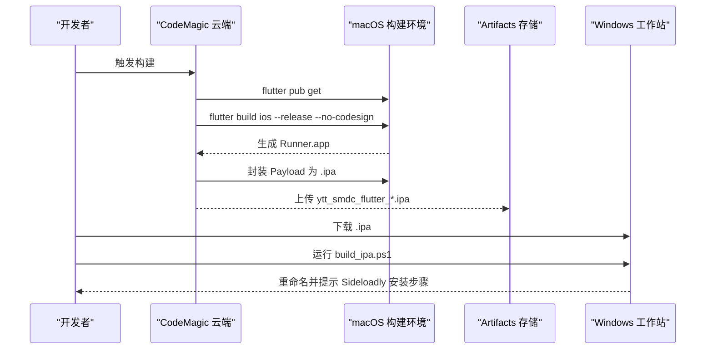
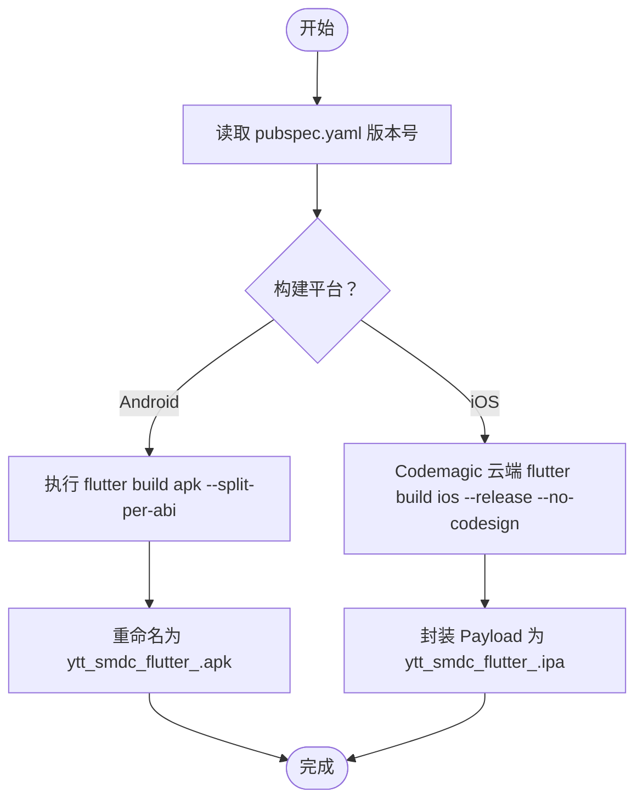
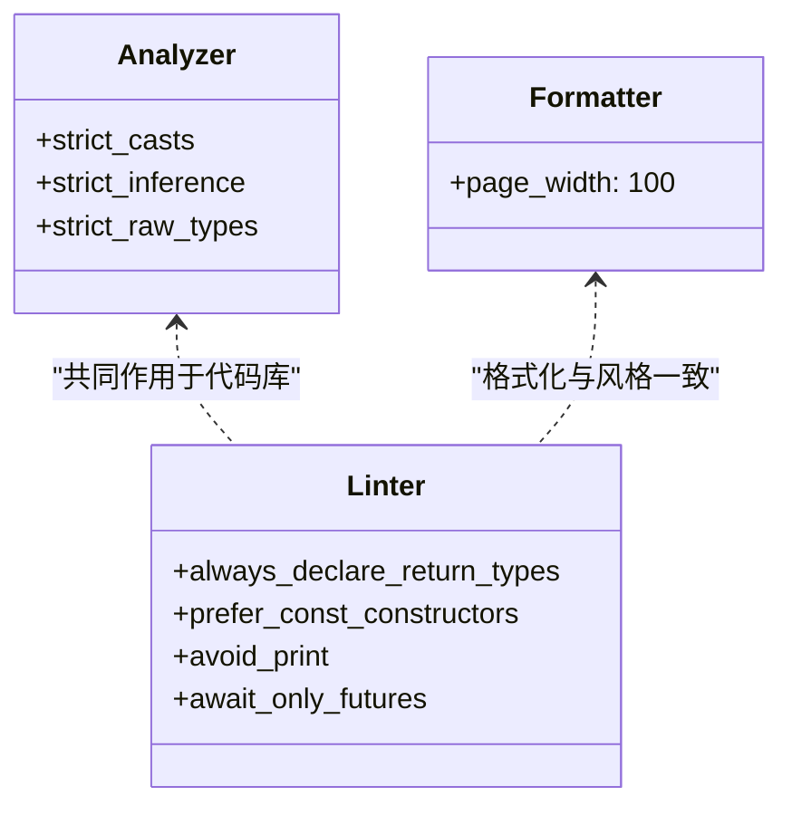
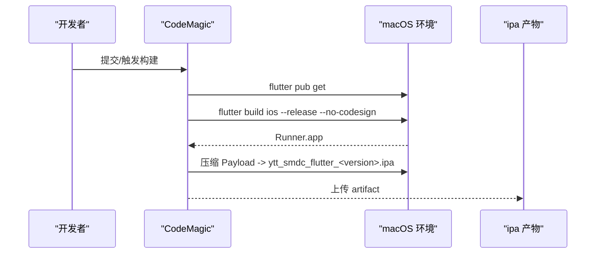
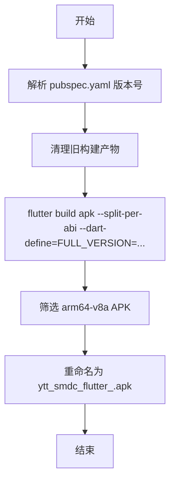
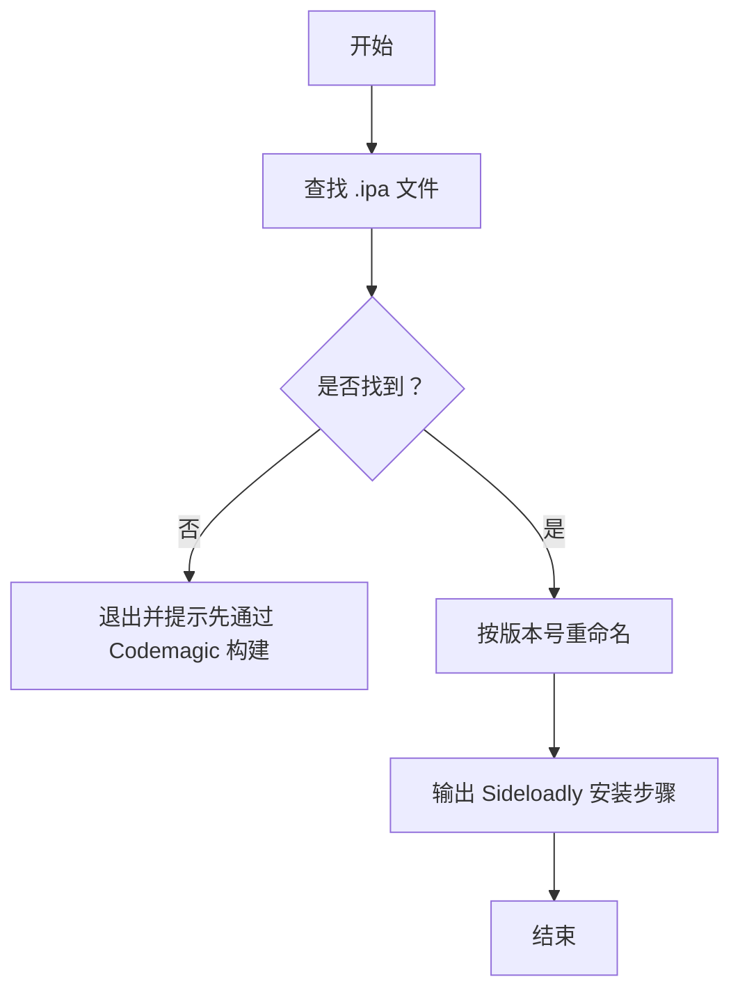
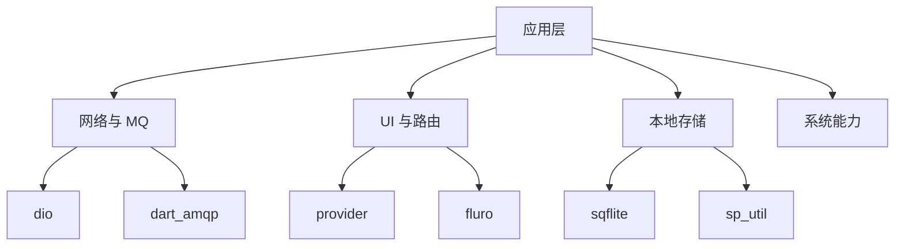

# 质量保证与持续集成

<cite>
**本文引用的文件**   
- [analysis_options.yaml](file://analysis_options.yaml)
- [pubspec.yaml](file://pubspec.yaml)
- [codemagic.yaml](file://codemagic.yaml)
- [build_apk.ps1](file://build_apk.ps1)
- [build_ipa.ps1](file://build_ipa.ps1)
- [devtools_options.yaml](file://devtools_options.yaml)
- [README.md](file://README.md)
</cite>

## 目录
1. [引言](#引言)
2. [项目结构](#项目结构)
3. [核心质量组件](#核心质量组件)
4. [架构总览](#架构总览)
5. [详细组件分析](#详细组件分析)
6. [依赖关系分析](#依赖关系分析)
7. [性能与稳定性考量](#性能与稳定性考量)
8. [故障排查指南](#故障排查指南)
9. [结论](#结论)
10. [附录：最佳实践与模板](#附录最佳实践与模板)

## 引言
本文件为聚客美滋滋 Flutter 点餐应用的质量保证与持续集成文档。目标包括：
- 明确 Dart 静态分析与代码风格规范，给出本地与 CI 的调用方式。
- 梳理 CodeMagic iOS 构建工作流与 Windows 辅助脚本。
- 定义 Pull Request、版本管理、发布流程与测试策略。
- 提供可落地的配置示例与自动化脚本建议。

本项目基于 Flutter 3.19+ / Dart 3.4+，采用 Provider + Dio + Fluro 的技术栈，面向 Android/iOS 双端部署。

**章节来源**
- [README.md:1-50](file://README.md#L1-L50)

## 项目结构
仓库中与质量保障直接相关的根级配置文件如下：
- analysis_options.yaml：Dart 静态分析与 Lint 规则。
- pubspec.yaml：Flutter/Dart 版本约束与依赖声明。
- codemagic.yaml：CodeMagic iOS 构建工作流。
- build_apk.ps1：Android APK 构建与重命名脚本。
- build_ipa.ps1：Windows 下对 Codemagic 产出的 .ipa 进行重命名与安装指引。
- devtools_options.yaml：DevTools 扩展开关配置（当前为空）。

**图表来源**
- [analysis_options.yaml:1-252](file://analysis_options.yaml#L1-L252)
- [pubspec.yaml:1-111](file://pubspec.yaml#L1-L111)
- [codemagic.yaml:1-34](file://codemagic.yaml#L1-L34)
- [build_apk.ps1:1-53](file://build_apk.ps1#L1-L53)
- [build_ipa.ps1:1-69](file://build_ipa.ps1#L1-L69)

**章节来源**
- [analysis_options.yaml:1-252](file://analysis_options.yaml#L1-L252)
- [pubspec.yaml:1-111](file://pubspec.yaml#L1-L111)
- [codemagic.yaml:1-34](file://codemagic.yaml#L1-L34)
- [build_apk.ps1:1-53](file://build_apk.ps1#L1-L53)
- [build_ipa.ps1:1-69](file://build_ipa.ps1#L1-L69)

## 核心质量组件
本节从“代码质量检查”“CI/CD 流水线”“测试与调试”“版本与发布”四个维度展开。

### 代码质量检查
- 静态分析与 Lint
  - 使用 analysis_options.yaml 启用严格类型检查与大量 Lint 规则，如 always_declare_return_types、prefer_const_*、avoid_print、await_only_futures、use_function_type_syntax_for_parameters 等。
  - analyzer 语言选项开启 strict-casts、strict-inference、strict-raw-types。
  - formatter.page_width=100，统一行宽。
  - 排除 lib/generated/json/** 等自动生成代码，避免干扰。
- 本地执行命令
  - dart analyze
  - flutter analyze
  - dart format --set-exit-if-changed
- 复杂度分析建议
  - 引入 dart_code_metrics 或自定义规则，限制圈复杂度、函数长度、类大小等阈值，并在 CI 中作为门禁。

**章节来源**
- [analysis_options.yaml:1-252](file://analysis_options.yaml#L1-L252)

### 持续集成与自动化构建
- CodeMagic iOS 工作流
  - 在 macOS 云端执行 flutter pub get、flutter build ios --release --no-codesign，并打包为 .ipa 产物。
  - 通过 artifacts 暴露 ytt_smdc_flutter_*.ipa，供下载后使用 Sideloadly 自签安装。
- Windows 辅助脚本
  - build_apk.ps1：读取 pubspec.yaml 版本号，清理旧产物，构建 arm64-v8a APK，并按 ytt_smdc_flutter_<version>.apk 重命名。
  - build_ipa.ps1：定位最近 .ipa 或指定路径，按版本号重命名，并打印 Sideloadly 安装步骤。

**图表来源**
- [codemagic.yaml:1-34](file://codemagic.yaml#L1-L34)
- [build_ipa.ps1:1-69](file://build_ipa.ps1#L1-L69)

**章节来源**
- [codemagic.yaml:1-34](file://codemagic.yaml#L1-L34)
- [build_apk.ps1:1-53](file://build_apk.ps1#L1-L53)
- [build_ipa.ps1:1-69](file://build_ipa.ps1#L1-L69)

### 测试与调试
- 测试框架
  - pubspec.yaml 包含 flutter_test 与 test 依赖，可用于单元测试与 Widget 测试。
  - integration_test 目录存在但为空，可按需补充端到端测试。
- 调试工具
  - devtools_options.yaml 用于配置 DevTools 扩展开关；当前未启用任何扩展。

**章节来源**
- [pubspec.yaml:1-111](file://pubspec.yaml#L1-L111)
- [devtools_options.yaml:1-3](file://devtools_options.yaml#L1-L3)

### 版本与发布
- 版本语义
  - pubspec.yaml 中 version: 1.0.0+1，遵循主版本.次版本.修订号+构建号的语义化版本控制。
- Android 构建
  - build_apk.ps1 解析 version 与 buildNumber，拼接 FULL_VERSION 并通过 dart-define 注入；最终产出 ytt_smdc_flutter_<version>.apk。
- iOS 构建
  - codemagic.yaml 根据 pubspec.yaml 中的 version 生成 ytt_smdc_flutter_*.ipa。
  - build_ipa.ps1 在 Windows 侧完成重命名与安装指引。

**图表来源**
- [pubspec.yaml:1-111](file://pubspec.yaml#L1-L111)
- [build_apk.ps1:1-53](file://build_apk.ps1#L1-L53)
- [codemagic.yaml:1-34](file://codemagic.yaml#L1-L34)

**章节来源**
- [pubspec.yaml:1-111](file://pubspec.yaml#L1-L111)
- [build_apk.ps1:1-53](file://build_apk.ps1#L1-L53)
- [codemagic.yaml:1-34](file://codemagic.yaml#L1-L34)
- [build_ipa.ps1:1-69](file://build_ipa.ps1#L1-L69)

## 架构总览
下图展示质量保障相关模块之间的依赖与协作关系。

```mermaid
graph LR
    AO["analysis_options.yaml"] --> QA["代码质量门禁<br/>lint / analyze / format"]
    PS["pubspec.yaml"] --> DEP["依赖与环境约束"]
    CM["codemagic.yaml"] --> CI["CodeMagic 云端构建"]
    BA["build_apk.ps1"] --> AND["Android 构建产物"]
    BI["build_ipa.ps1"] --> IOS["iOS 测试包与安装指引"]
    QA --> PR["Pull Request 合并门禁"]
    CI --> ART["Artifacts 归档"]
    AND --> REL["发布渠道"]
    ART --> REL
```

**图表来源**
- [analysis_options.yaml:1-252](file://analysis_options.yaml#L1-L252)
- [pubspec.yaml:1-111](file://pubspec.yaml#L1-L111)
- [codemagic.yaml:1-34](file://codemagic.yaml#L1-L34)
- [build_apk.ps1:1-53](file://build_apk.ps1#L1-L53)
- [build_ipa.ps1:1-69](file://build_ipa.ps1#L1-L69)

## 详细组件分析

### Dart 静态分析与代码风格
- 类型安全
  - analyzer.language.strict-casts/inference/raw-types 全部启用，强化空安全与类型推断。
- Lint 规则要点
  - 强制返回类型、常量构造、final 字段/局部变量、命名规范、避免动态调用、禁止 print 等。
  - 强调字符串插值、集合字面量、三元表达式可读性。
- 格式化
  - page_width=100，配合 CI 的 dart format --set-exit-if-changed 保证一致性。
- 建议增强项
  - 引入 dart_code_metrics 增加复杂度、重复度、废弃 API 扫描。
  - 将 rules 拆分为 base.yaml 与 project.yaml，便于团队继承。

**图表来源**
- [analysis_options.yaml:1-252](file://analysis_options.yaml#L1-L252)

**章节来源**
- [analysis_options.yaml:1-252](file://analysis_options.yaml#L1-L252)

### CodeMagic iOS 构建工作流
- 工作流名称：ios-test-build
- 关键步骤：
  - 安装依赖：flutter pub get
  - 构建 iOS Release（不签名）：flutter build ios --release --no-codesign
  - 封装 ipa：复制 Runner.app 到 Payload，zip 为 ytt_smdc_flutter_<version>.ipa
- 产物：ytt_smdc_flutter_*.ipa
- 说明：
  - 无需 Apple 开发者账号；安装阶段由 Sideloadly 用免费 Apple ID 重新签名，有效期 7 天。

**图表来源**
- [codemagic.yaml:1-34](file://codemagic.yaml#L1-L34)

**章节来源**
- [codemagic.yaml:1-34](file://codemagic.yaml#L1-L34)

### Android 构建脚本
- 功能：
  - 解析 pubspec.yaml 的 version 与 buildNumber，拼接 FULL_VERSION。
  - 清理 build/app/outputs/flutter-apk 下的旧 APK。
  - 执行 flutter build apk --release --split-per-abi --dart-define=FULL_VERSION=$fullVersion。
  - 仅保留 arm64-v8a APK，删除其他架构产物与 .sha1。
  - 重命名为 ytt_smdc_flutter_$fullVersion.apk 并输出路径。

**图表来源**
- [build_apk.ps1:1-53](file://build_apk.ps1#L1-L53)

**章节来源**
- [build_apk.ps1:1-53](file://build_apk.ps1#L1-L53)

### iOS 辅助脚本（Windows）
- 功能：
  - 自动搜索当前目录、build\ios、Downloads 中的最新 .ipa，或接受参数指定路径。
  - 按版本号重命名为 ytt_smdc_flutter_$fullVersion.ipa。
  - 输出 Sideloadly 安装步骤，包括开发者模式、信任 Apple ID、7 天过期重装提示。

**图表来源**
- [build_ipa.ps1:1-69](file://build_ipa.ps1#L1-L69)

**章节来源**
- [build_ipa.ps1:1-69](file://build_ipa.ps1#L1-L69)

## 依赖关系分析
- 运行时依赖
  - network：dio、dart_amqp（RabbitMQ）、webview_flutter、url_launcher 等。
  - UI/状态：provider、fluro、flutter_svg、cached_network_image 等。
  - 数据：sqflite、path_provider、sp_util、intl 等。
  - 系统能力：device_info_plus、mobile_scanner、flutter_tts 等。
- 开发依赖
  - flutter_test、test。
- 版本约束
  - SDK >=3.4.0 <4.0.0，Flutter >=3.19.0。

**图表来源**
- [pubspec.yaml:1-111](file://pubspec.yaml#L1-L111)

**章节来源**
- [pubspec.yaml:1-111](file://pubspec.yaml#L1-L111)

## 性能与稳定性考量
- 静态分析前置
  - 在 PR 合并前必须通过 dart analyze 与 dart format 检查。
- 构建优化
  - Android 使用 split-per-abi 减少安装包体积；iOS 云端构建避免本地 Xcode 环境差异。
- 日志与可观测性
  - 建议在 release 构建中关闭 verbose 日志，仅保留必要错误信息；结合远程日志上报服务。
- 内存与卡顿
  - 通过 DevTools Performance/Profiler 分析帧率与内存峰值；避免在 UI 线程执行 IO。

[本节为通用指导，不涉及具体源码]

## 故障排查指南
- 构建失败常见原因
  - Android：JDK/Gradle 版本不匹配、NDK 缺失、签名配置错误。
  - iOS：CocoaPods 依赖未安装、Xcode 命令行工具未选择、证书/描述文件缺失。
- 脚本问题
  - PowerShell 执行策略受限：以管理员权限执行 Set-ExecutionPolicy RemoteSigned。
  - 找不到 .ipa：确认已通过 Codemagic 构建并下载；或传入 -IpaPath 指定路径。
- 静态分析失败
  - 新增文件未遵循 Lint 规则：优先修复，而非禁用规则。
  - 自动生成代码被误检：确保 analysis_options.yaml 正确 exclude。

**章节来源**
- [analysis_options.yaml:1-252](file://analysis_options.yaml#L1-L252)
- [build_ipa.ps1:1-69](file://build_ipa.ps1#L1-L69)

## 结论
本项目已具备较完善的质量与构建基础：
- 严格的 Dart 静态分析与 Lint 规则，适合纳入 CI 门禁。
- CodeMagic iOS 无签名构建 + Sideloadly 自签安装，降低个人开发者门槛。
- Windows 侧 APK/IPA 脚本提升交付效率。
后续可在以下方面持续增强：
- 引入更细粒度的复杂度度量与覆盖率统计。
- 完善 GitHub Actions 工作流，统一 PR 门禁与发布流程。
- 制定分支模型与语义化版本发布规范，配合自动化标签与变更日志。

[本节为总结性内容，不涉及具体源码]

## 附录：最佳实践与模板

### 代码审查流程
- Pull Request 规范
  - 小步提交、清晰 commit message；PR 描述包含改动范围、影响面、测试情况。
  - 至少一名 Reviewer 批准；阻塞条件：analyze/format 失败、单测未通过。
- 审查清单
  - 是否存在空指针风险、未 await Future、魔法数字/字符串。
  - 是否有可复用的方法/常量未提取。
  - UI 是否可访问、键盘避让、暗黑模式兼容。
- 合并策略
  - 推荐 Squash Merge；主干保持线性历史；热修复走 hotfix 分支快速回滚。

[本节为流程建议，不涉及具体源码]

### 版本管理策略
- 分支模型
  - main：稳定分支；develop：集成分支；feature/*：功能分支；hotfix/*：紧急修复。
- 语义化版本
  - MAJOR.MINOR.PATCH+BUILD；Android 与 iOS 共享同一版本号来源。
- 标签管理
  - 每次正式发版打 tag vMAJOR.MINOR.PATCH；附带发布说明与变更日志。

[本节为流程建议，不涉及具体源码]

### 发布流程
- 预发布检查
  - 全量 lint/analyze/format；单元/Widget 测试通过；关键路径冒烟测试通过。
- 签名打包
  - Android：配置 keystore、签署并校验签名。
  - iOS：企业分发或 App Store Connect；测试分发可用 Sideloadly。
- 多渠道发布
  - 内部测试渠道（蒲公英/fir 等）、生产渠道（应用商店/企业包）。

[本节为流程建议，不涉及具体源码]

### 技术债务与重构策略
- 识别债务
  - 通过 Lint 告警、复杂度报告、废弃 API 扫描发现热点。
- 分批治理
  - 按模块拆分重构任务，逐个 PR 推进；避免一次性大改。
- 依赖更新
  - 定期升级 flutter/dart 与第三方库；关注 breaking changes 与兼容性矩阵。

[本节为流程建议，不涉及具体源码]