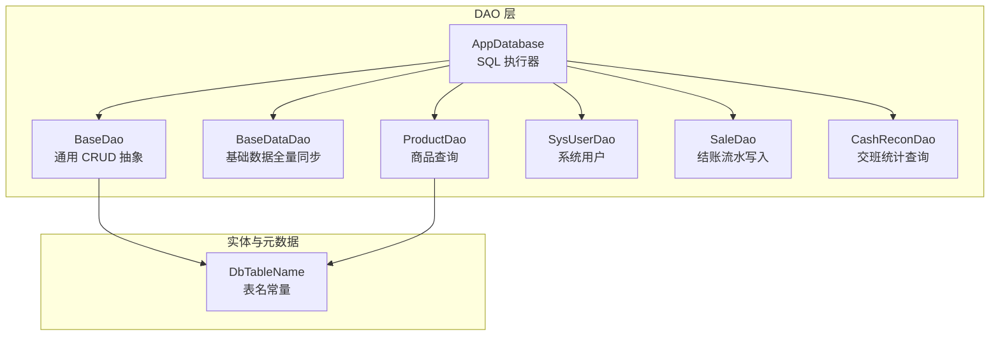
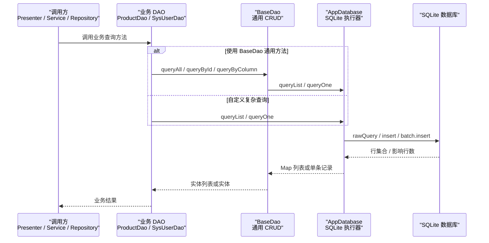
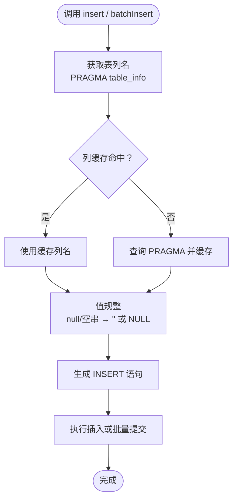
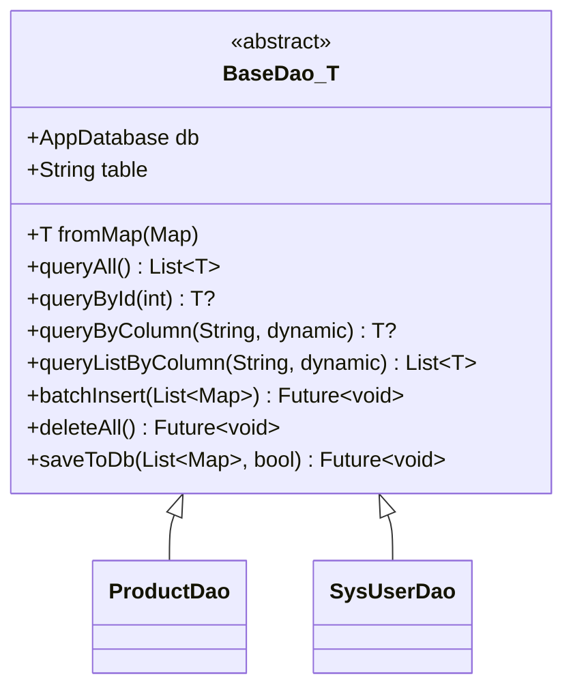
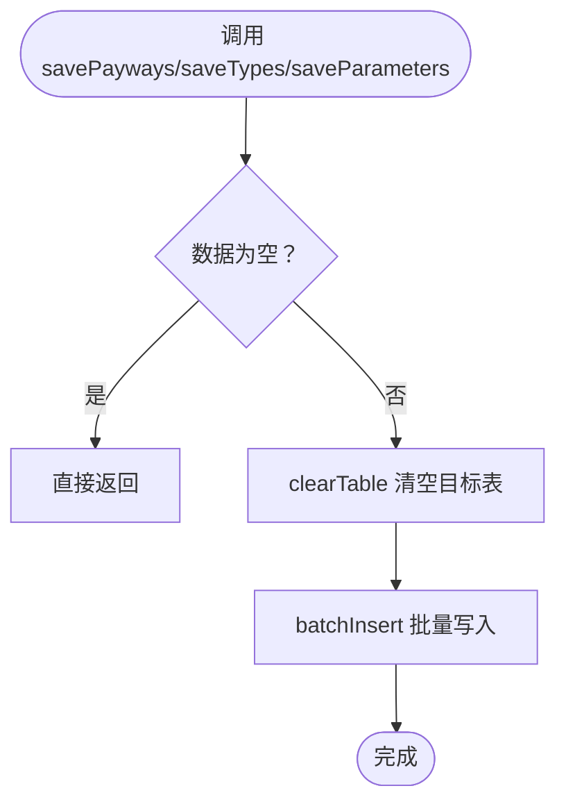
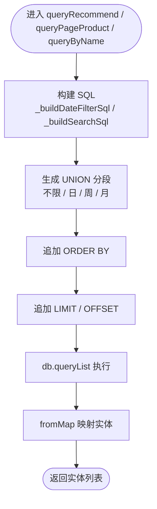
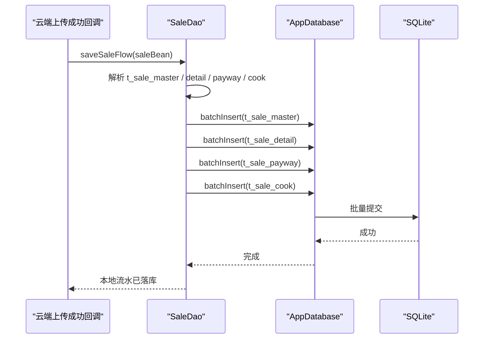
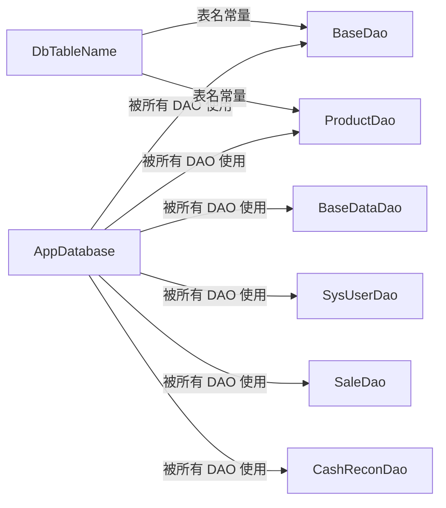
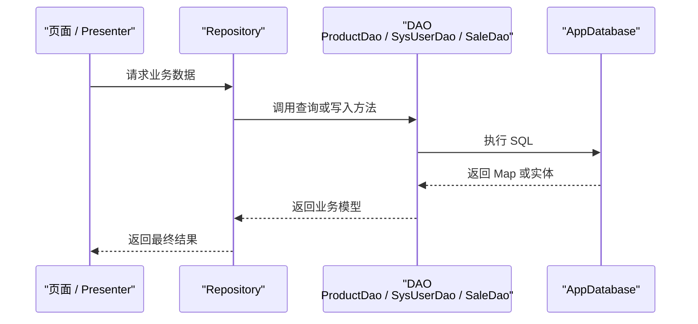

# DAO 数据访问层

<cite>
**本文引用的文件**   
- [base_data_dao.dart](file://lib/db/base_data_dao.dart)
- [app_database.dart](file://lib/db/app_database.dart)
- [base_dao.dart](file://lib/db/dao/base_dao.dart)
- [product_dao.dart](file://lib/db/dao/product_dao.dart)
- [sys_user_dao.dart](file://lib/db/dao/sys_user_dao.dart)
- [sale_dao.dart](file://lib/db/sale_dao.dart)
- [cash_recon_dao.dart](file://lib/db/cash_recon_dao.dart)
- [db_table_name.dart](file://lib/db/entity/db_table_name.dart)
</cite>

## 目录

1. [简介](#简介)
2. [项目结构](#项目结构)
3. [核心组件](#核心组件)
4. [架构总览](#架构总览)
5. [详细组件分析](#详细组件分析)
6. [依赖关系分析](#依赖关系分析)
7. [性能与优化](#性能与优化)
8. [错误处理与健壮性](#错误处理与健壮性)
9. [DAO 层使用示例与最佳实践](#dao-层使用示例与最佳实践)
10. [DAO 层与 Repository 层的协作模式](#dao-层与-repository-层的协作模式)
11. [故障排查指南](#故障排查指南)
12. [结论](#结论)

## 简介

本文件聚焦于聚客美滋滋应用中的 DAO（数据访问对象）层，围绕 SQLite 本地数据库访问能力，系统性说明：

- BaseDao 抽象基类提供的通用 CRUD、批量写入和全量同步模式。
- BaseDataDao 作为“基础数据”专用 DAO，负责支付方式、商品分类、参数等基础表的全量重写与空表检测。
- ProductDao、SysUserDao 等业务 DAO 的复杂查询设计，包括多表 JOIN、条件动态拼接、售卖日期过滤与分页。
- SaleDao、CashReconDao 面向业务流水与交班统计的数据访问实现。
- AppDatabase 作为底层 SQL 执行器，提供通用 queryList/queryOne/insert/batchInsert、表列缓存、WAL 检查点等能力。
- 错误处理、事务边界、批量操作、性能优化策略及与上层 Repository 的协作方式。

需要特别说明的是：当前仓库中不存在名为 `BaseDataDao` 的抽象基类；与之对应的是两个不同职责的抽象或基础类型：

- `BaseDao<T>`：面向实体表的通用 CRUD 抽象基类。
- `BaseDataDao`：面向基础数据表（支付方式、分类、参数）的全量同步 DAO。

因此下文对“BaseDataDao 抽象基类”的理解应拆分为这两者分别说明。

## 项目结构

DAO 层主要位于 `lib/db` 及其子目录 `lib/db/dao`、`lib/db/entity`：

**图示来源**
- [app_database.dart:1-80](file://lib/db/app_database.dart#L1-L80)
- [base_dao.dart:1-71](file://lib/db/dao/base_dao.dart#L1-L71)
- [base_data_dao.dart:1-56](file://lib/db/base_data_dao.dart#L1-L56)
- [product_dao.dart:1-40](file://lib/db/dao/product_dao.dart#L1-L40)
- [sys_user_dao.dart:1-29](file://lib/db/dao/sys_user_dao.dart#L1-L29)
- [sale_dao.dart:1-49](file://lib/db/sale_dao.dart#L1-L49)
- [cash_recon_dao.dart:1-60](file://lib/db/cash_recon_dao.dart#L1-L60)
- [db_table_name.dart:1-108](file://lib/db/entity/db_table_name.dart#L1-L108)

**章节来源**
- [app_database.dart:1-80](file://lib/db/app_database.dart#L1-L80)
- [base_dao.dart:1-71](file://lib/db/dao/base_dao.dart#L1-L71)
- [base_data_dao.dart:1-56](file://lib/db/base_data_dao.dart#L1-L56)
- [db_table_name.dart:1-108](file://lib/db/entity/db_table_name.dart#L1-L108)

## 核心组件

DAO 层的核心由以下五类组件构成：

| 组件 | 职责 | 关键能力 |
|---|---|---|
| AppDatabase | SQLite 连接、建表、版本升级、通用 SQL 执行器 | queryList、queryOne、insert、batchInsert、clearAll、checkpoint、表列缓存 |
| BaseDao\<T\> | 实体表通用 CRUD 抽象 | queryAll、queryById、queryByColumn、batchInsert、deleteAll、saveToDb |
| BaseDataDao | 基础数据表全量同步 | savePayways、saveTypes、saveParameters、isPaywayEmpty |
| ProductDao | 商品主表查询 | 推荐菜、分类商品、搜索、按 productid 查询、复杂日期过滤与 UNION |
| SysUserDao | 系统用户查询 | getByUserid、updateAll |
| SaleDao / CashReconDao | 结账流水写入与交班统计查询 | 多表批量写入、交班 UNION 汇总、时间范围聚合 |

**章节来源**
- [app_database.dart:1-80](file://lib/db/app_database.dart#L1-L80)
- [base_dao.dart:1-71](file://lib/db/dao/base_dao.dart#L1-L71)
- [base_data_dao.dart:1-56](file://lib/db/base_data_dao.dart#L1-L56)
- [product_dao.dart:1-40](file://lib/db/dao/product_dao.dart#L1-L40)
- [sys_user_dao.dart:1-29](file://lib/db/dao/sys_user_dao.dart#L1-L29)
- [sale_dao.dart:1-49](file://lib/db/sale_dao.dart#L1-L49)
- [cash_recon_dao.dart:1-60](file://lib/db/cash_recon_dao.dart#L1-L60)

## 架构总览

DAO 层整体采用“薄 DAO + 强 SQL”的设计：上层业务不直接关心 SQLite 细节，而是通过 DAO 方法获取结构化结果；复杂查询以 SQL 为主，DAO 负责参数化拼接、结果映射和分页控制。

**图示来源**
- [base_dao.dart:1-71](file://lib/db/dao/base_dao.dart#L1-L71)
- [product_dao.dart:1-40](file://lib/db/dao/product_dao.dart#L1-L40)
- [sys_user_dao.dart:1-29](file://lib/db/dao/sys_user_dao.dart#L1-L29)
- [app_database.dart:1-80](file://lib/db/app_database.dart#L1-L80)

## 详细组件分析

### AppDatabase：底层 SQL 执行器

AppDatabase 是 DAO 层的基础设施，封装了 SQLite 生命周期管理、建表、版本升级和通用 SQL 操作。它不是传统 ORM，而是一个参数化的 SQL 执行器，同时承担数据规整职责。

#### 关键职责

- **数据库实例管理**：懒加载 Database 实例，Web 平台抛出不支持异常。
- **建表与升级**：onCreate 执行全部建表 SQL；onUpgrade 处理 v1→v2、v2→v3 增量变更。
- **通用查询**：queryList 返回 List<Map>，queryOne 取第一条或 null。
- **通用写入**：insert 自动按 PRAGMA table_info 提取列名并规整字段值；batchInsert 使用 Batch 批量插入。
- **清理与检查点**：clearAll 清空业务表；clearTable 清空单表；checkpoint 强制 WAL 刷盘。

#### 表结构与缓存

AppDatabase 维护本地业务表清单和后台下载表清单，并通过 `_columnCache`、`_numericColumnCache` 缓存列名和数值列集合，避免每次 insert/batchInsert 都重复查询 PRAGMA。

**图示来源**
- [app_database.dart:120-200](file://lib/db/app_database.dart#L120-L200)
- [app_database.dart:201-260](file://lib/db/app_database.dart#L201-L260)

**章节来源**
- [app_database.dart:1-80](file://lib/db/app_database.dart#L1-L80)
- [app_database.dart:120-200](file://lib/db/app_database.dart#L120-L200)
- [app_database.dart:201-260](file://lib/db/app_database.dart#L201-L260)
- [app_database.dart:260-497](file://lib/db/app_database.dart#L260-L497)

### BaseDao\<T\>：通用 CRUD 抽象基类

BaseDao\<T\> 是所有实体型 DAO 的抽象基类。子类只需声明 `table` 和 `fromMap`，即可获得通用能力：

- `queryAll`：查询全表。
- `queryById`：按 id 查询单条。
- `queryByColumn`：按任意列等值查询。
- `queryListByColumn`：按列返回列表。
- `batchInsert`：每批最多 900 条，规避 SQLite 变量上限。
- `deleteAll`：清空表。
- `saveToDb`：支持全量同步模式，先清空再批量写入。

**图示来源**
- [base_dao.dart:1-71](file://lib/db/dao/base_dao.dart#L1-L71)
- [product_dao.dart:1-40](file://lib/db/dao/product_dao.dart#L1-L40)
- [sys_user_dao.dart:1-29](file://lib/db/dao/sys_user_dao.dart#L1-L29)

#### 批量写入与全量同步

`batchInsert` 使用 `i += 900` 分片，避免 SQLite 单个语句参数过多导致失败。`saveToDb` 支持 `isFull=true` 场景，典型用法是登录成功后“先清空后全量写”，与 BaseDataDao 的全量同步语义一致。

**章节来源**
- [base_dao.dart:1-71](file://lib/db/dao/base_dao.dart#L1-L71)

### BaseDataDao：基础数据全量同步 DAO

BaseDataDao 并非抽象基类，而是一个单例 DAO，负责三类基础数据的全量重写：

| 方法 | 目标表 | 行为 |
|---|---|---|
| savePayways | t_bi_payway、t_bi_payway_store | 清空两表后批量写入 |
| saveTypes | t_bi_type | 清空后批量写入 |
| saveParameters | t_bi_parameter | 清空后批量写入 |
| isPaywayEmpty | t_bi_payway | 查询 count(1)，用于交班前重试同步 |

该 DAO 强调“全量覆盖”而非增量更新，适合后台接口返回完整字典数据的场景。

**图示来源**
- [base_data_dao.dart:1-56](file://lib/db/base_data_dao.dart#L1-L56)
- [app_database.dart:160-180](file://lib/db/app_database.dart#L160-L180)

**章节来源**
- [base_data_dao.dart:1-56](file://lib/db/base_data_dao.dart#L1-L56)
- [app_database.dart:160-180](file://lib/db/app_database.dart#L160-L180)

### ProductDao：商品复杂查询 DAO

ProductDao 继承 BaseDao\<ProductBeanEntity\>，重点不在通用 CRUD，而在大量复杂 SQL：

- 按状态、终端展示标志、门店、分类、检索码、条码、productid 查询。
- 推荐菜、分类商品、模糊搜索均支持分页。
- 引入售卖日期过滤逻辑，包含不限日期、日、周、月三段 UNION。
- 分类关联查询使用 t_bi_type JOIN。
- 搜索 SQL 支持 name、helpcode、barcode、code 多字段模糊匹配。

#### 复杂查询设计要点

1. **日期过滤三段 UNION**  
   通过 `_buildDateFilterSql` 构建四段 UNION：一段不限日期，三段分别对应 cycletype=1/2/3。

2. **分类 JOIN 过滤**  
   `_buildDateFilterWithTypeJoinSql` 将商品表与分类表关联，并按分类 code 前缀匹配。

3. **搜索多字段模糊**  
   `_buildSearchSql` 同时匹配名称、检索码、条码、编码，并与分类过滤组合。

4. **分页参数**  
   limit 与 offset 由调用方传入，默认值体现不同入口的页大小差异。

**图示来源**
- [product_dao.dart:1-40](file://lib/db/dao/product_dao.dart#L1-L40)
- [product_dao.dart:201-357](file://lib/db/dao/product_dao.dart#L201-L357)
- [db_table_name.dart:1-108](file://lib/db/entity/db_table_name.dart#L1-L108)

**章节来源**
- [product_dao.dart:1-40](file://lib/db/dao/product_dao.dart#L1-L40)
- [product_dao.dart:201-357](file://lib/db/dao/product_dao.dart#L201-L357)
- [db_table_name.dart:1-108](file://lib/db/entity/db_table_name.dart#L1-L108)

### SysUserDao：系统用户 DAO

SysUserDao 是最简单的实体 DAO 之一，仅提供：

- getByUserid：按 userid 查询用户。
- updateAll：将所有记录的 stopflag 重置为 0。

它体现了 BaseDao 的典型用法：声明表名、定义 fromMap，并在需要时扩展业务查询。

**章节来源**
- [sys_user_dao.dart:1-29](file://lib/db/dao/sys_user_dao.dart#L1-L29)
- [base_dao.dart:1-71](file://lib/db/dao/base_dao.dart#L1-L71)

### SaleDao：结账流水写入 DAO

SaleDao 不是实体 DAO，而是面向业务流水的多表写入 DAO。它将云端 saleflow 响应中的 t_sale_master、t_sale_detail、t_sale_payway、t_sale_cook 四个表批量写入本地，供交班统计使用。

关键点：

- 输入是 Map<String, dynamic>，模拟 saleflow 结构。
- 对每个子表做容错转换，仅保留 List<Map<String, dynamic>>。
- 使用 AppDatabase.batchInsert 批量写入。
- 如果某个子表为空，跳过写入。

**图示来源**
- [sale_dao.dart:1-49](file://lib/db/sale_dao.dart#L1-L49)
- [app_database.dart:140-170](file://lib/db/app_database.dart#L140-L170)

**章节来源**
- [sale_dao.dart:1-49](file://lib/db/sale_dao.dart#L1-L49)
- [app_database.dart:140-170](file://lib/db/app_database.dart#L140-L170)

### CashReconDao：交班统计查询 DAO

CashReconDao 提供交班相关查询，包括：

- 最后一次交班时间。
- 最早结账时间、会员储值时间、押金流水时间。
- 销售汇总。
- 交班销售流水列表。
- 4 段 UNION 汇总，涉及 t_sale_master、t_sale_payway、t_bi_payway、t_bi_payway_store、t_vip_money_detail、t_vip_flow、t_reserve_master。

这类 DAO 更偏向“报表式查询”，SQL 复杂但返回值多为 Map，供服务层直接使用。

**章节来源**
- [cash_recon_dao.dart:1-60](file://lib/db/cash_recon_dao.dart#L1-L60)
- [cash_recon_dao.dart:60-526](file://lib/db/cash_recon_dao.dart#L60-L526)

## 依赖关系分析

DAO 层内部依赖关系如下：

**图示来源**
- [app_database.dart:1-80](file://lib/db/app_database.dart#L1-L80)
- [base_dao.dart:1-71](file://lib/db/dao/base_dao.dart#L1-L71)
- [base_data_dao.dart:1-56](file://lib/db/base_data_dao.dart#L1-L56)
- [product_dao.dart:1-40](file://lib/db/dao/product_dao.dart#L1-L40)
- [sys_user_dao.dart:1-29](file://lib/db/dao/sys_user_dao.dart#L1-L29)
- [sale_dao.dart:1-49](file://lib/db/sale_dao.dart#L1-L49)
- [cash_recon_dao.dart:1-60](file://lib/db/cash_recon_dao.dart#L1-L60)
- [db_table_name.dart:1-108](file://lib/db/entity/db_table_name.dart#L1-L108)

### 耦合性与内聚性

- **低耦合**：DAO 只依赖 AppDatabase 和实体/表名常量，不直接持有 sqflite.Database 实例。
- **高内聚**：每个 DAO 聚焦一个领域，如商品、用户、结账、交班。
- **潜在风险**：ProductDao 内部 SQL 较长且 UNION 较多，若未来要调整日期过滤逻辑，容易集中在几个私有方法中，需要注意测试覆盖。

**章节来源**
- [product_dao.dart:201-357](file://lib/db/dao/product_dao.dart#L201-L357)
- [app_database.dart:1-80](file://lib/db/app_database.dart#L1-L80)

## 性能与优化

### 批量写入优化

- BaseDao.batchInsert 按 900 条一批切分，避免 SQLite 参数上限问题。
- AppDatabase.batchInsert 使用 SQLite Batch 提交，减少多次 commit 开销。
- BaseDataDao 全量同步前先 clearTable，再 batchInsert，避免逐条 UPDATE 造成的锁竞争。

### 列信息缓存

AppDatabase 缓存表列名和数值列集合，避免每次 insert 都查 PRAGMA。这能显著降低频繁写入时的元数据查询成本。

### 查询分页

ProductDao 的所有复杂查询都显式支持 limit 和 offset，便于前端分页加载。

### WAL 检查点

AppDatabase.checkpoint 在日志上传前执行 PRAGMA wal_checkpoint(FULL)，确保 WAL 数据刷回主数据库文件，提高拷贝完整性。

### 数值列空值规整

AppDatabase._normalize 对数值列允许写入 null，避免因云端下发 null 而被统一转成空串，导致 SQLite 以 TEXT 存储，进而引发实体 fromMap 强转异常。

**章节来源**
- [base_dao.dart:40-71](file://lib/db/dao/base_dao.dart#L40-L71)
- [app_database.dart:120-200](file://lib/db/app_database.dart#L120-L200)
- [app_database.dart:201-260](file://lib/db/app_database.dart#L201-L260)
- [base_data_dao.dart:1-56](file://lib/db/base_data_dao.dart#L1-L56)
- [product_dao.dart:40-200](file://lib/db/dao/product_dao.dart#L40-L200)

## 错误处理与健壮性

DAO 层没有统一的 try/catch 包装层，错误处理分散在各组件的职责边界：

| 组件 | 错误处理策略 |
|---|---|
| AppDatabase.clearAll | 逐表 try/catch，忽略 no such table 等异常，继续清空其他表 |
| AppDatabase.checkpoint | catch 捕获异常，保证日志上传流程不被数据库检查点中断 |
| BaseDataDao.isPaywayEmpty | 对 count 结果做空值和解析容错，返回布尔值 |
| SaleDao.saveSaleFlow | 对 saleBean 子表做 toRows 容错，仅保留 Map 元素 |
| CashReconDao | 查询结果可能为 null，调用方需判断 |

### 注意事项

- DAO 方法大多直接向上抛出异步异常，调用方应结合业务层进行 try/catch。
- 对于幂等性要求高的全量同步，BaseDataDao 通过 clearTable + batchInsert 实现。
- 对于非关键路径的辅助操作（如 checkpoint），使用 catch 吞掉异常以保证主流程稳定。

**章节来源**
- [app_database.dart:160-180](file://lib/db/app_database.dart#L160-L180)
- [app_database.dart:180-200](file://lib/db/app_database.dart#L180-L200)
- [base_data_dao.dart:40-56](file://lib/db/base_data_dao.dart#L40-L56)
- [sale_dao.dart:20-49](file://lib/db/sale_dao.dart#L20-L49)

## DAO 层使用示例与最佳实践

### 依赖注入建议

当前 DAO 多为静态单例：

- BaseDataDao.instance
- ProductDao.instance
- SysUserDao.instance
- SaleDao.instance
- CashReconDao.instance
- AppDatabase.instance

这种设计适合 Flutter 应用中简单初始化场景，但如果需要单元测试替换数据库实现，可考虑改为构造函数注入 AppDatabase，或将 DAO 放入 Provider/GetIt 等依赖容器中。

### 全量同步最佳实践

适合后台返回完整字典的场景：

1. 调用方确认数据有效。
2. 使用 BaseDao.saveToDb(list, true) 或 BaseDataDao 对应方法。
3. 全量写入完成后，由业务层触发后续流程，例如交班统计刷新。

### 分页查询最佳实践

ProductDao 的复杂查询已经暴露 limit/offset，调用方应：

- 根据页面大小设置合理 limit。
- 首次加载 offset=0。
- 下一页递增 offset。
- 注意 UNION SQL 的排序字段必须保持稳定。

### 单元测试建议

- 使用内存数据库或测试用 AppDatabase 实例替换真实数据库。
- 对 BaseDao.saveToDb(true) 验证“先清后写”。
- 对 ProductDao 的日期过滤 SQL 构造方法单独验证 UNION 片段。
- 对 SaleDao.saveSaleFlow 验证四个表是否都被写入。
- 对 BaseDataDao.isPaywayEmpty 验证空表与非空表分支。

### 性能监控建议

- 在关键查询外层埋点耗时，重点关注 ProductDao 的 UNION 查询。
- 对 batchInsert 批次大小可配置，当前 BaseDao 固定 900，AppDatabase 无默认分片。
- 对 WAL 检查点前后增加日志，评估磁盘 IO 影响。

[本节为使用建议，不直接分析具体代码片段]

## DAO 层与 Repository 层的协作模式

虽然本仓库未在本文件中出现 Repository 实现，但从 DAO 职责可以推断出典型协作模式：

DAO 层应遵循：

- 不直接返回 UI 模型，而是返回实体或 Map。
- 不处理网络请求，网络与本地数据协调由 Repository 或服务层完成。
- 对复杂 SQL 集中封装，避免业务层拼接字符串。
- 对写入操作保持幂等性，必要时配合业务层重试。

[本节为概念性协作说明，不涉及具体文件]

## 故障排查指南

### 常见问题与定位方向

| 现象 | 可能原因 | 排查位置 |
|---|---|---|
| 商品分类或推荐菜为空 | 基础数据未同步或 t_bi_type 为空 | BaseDataDao.saveTypes、DbTableName.tBiType |
| 开台附加费选项为空 | t_table_type 表缺失或数据未补全 | AppDatabase.onUpgrade、_tTableTypeSql |
| 促销表读取失败 | 数值列被写成空串导致 fromMap 强转异常 | AppDatabase._normalize |
| 交班统计金额异常 | UNION 汇总 SQL 或 rate 换算逻辑 | CashReconDao.reportOnShiftByMachno |
| 批量写入失败 | 数据格式不是 List<Map> 或字段类型不匹配 | SaleDao._toRows、AppDatabase.batchInsert |
| 查询缓慢 | UNION 过长、缺少索引、分页不合理 | ProductDao 复杂 SQL、数据库索引设计 |

### 调试建议

1. 使用 AppDatabase.queryList 打印原始 SQL 和参数。
2. 对 BaseDataDao.isPaywayEmpty 输出 count 结果。
3. 对 ProductDao 的 SQL 构造方法单独打印最终 SQL。
4. 对 SaleDao.saveSaleFlow 打印各子表条目数量。
5. 对 CashReconDao 的关键查询限制行数，观察中间结果。

**章节来源**
- [base_data_dao.dart:40-56](file://lib/db/base_data_dao.dart#L40-L56)
- [app_database.dart:80-120](file://lib/db/app_database.dart#L80-L120)
- [app_database.dart:201-260](file://lib/db/app_database.dart#L201-L260)
- [sale_dao.dart:20-49](file://lib/db/sale_dao.dart#L20-L49)
- [cash_recon_dao.dart:60-526](file://lib/db/cash_recon_dao.dart#L60-L526)

## 结论

DAO 层以 AppDatabase 为底座，通过 BaseDao 提供通用 CRUD，通过 BaseDataDao 提供基础数据全量同步，通过 ProductDao、SysUserDao、SaleDao、CashReconDao 覆盖商品查询、用户查询、结账写入和交班统计等核心业务。其设计特点如下：

- 以 SQLite 原生 SQL 为主，DAO 负责参数化和结果映射。
- 批量写入兼顾性能和 SQLite 限制。
- 复杂查询集中在 ProductDao 和 CashReconDao，SQL 移植自 Java/Kotlin 端。
- 错误处理偏局部、务实，适合移动终端环境下的稳健运行。
- 当前以静态单例为主，如需更好可测试性，可逐步引入依赖注入。

未来可优化的方向包括：

- 将 BaseDao 的批次大小配置化。
- 对复杂 UNION SQL 添加执行耗时监控。
- 为关键查询补充数据库索引。
- 将 DAO 从静态单例迁移到可注入形式，提升单元测试覆盖率。