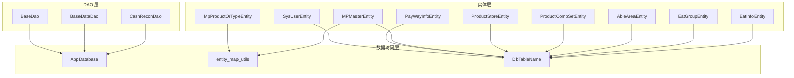
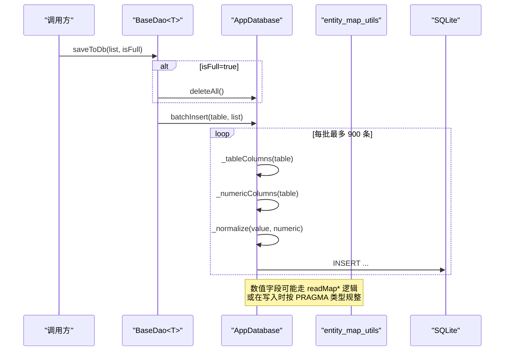
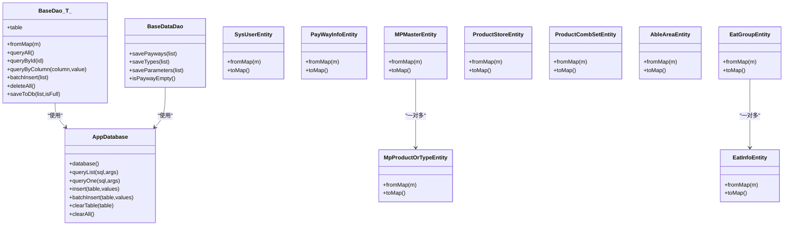

# 实体映射

<cite>
**本文引用的文件**   
- [entity_map_utils.dart](file://lib/db/entity/entity_map_utils.dart)
- [db_table_name.dart](file://lib/db/entity/db_table_name.dart)
- [sys_user_entity.dart](file://lib/db/entity/sys_user_entity.dart)
- [pay_way_info_entity.dart](file://lib/db/entity/pay_way_info_entity.dart)
- [mp_master_entity.dart](file://lib/db/entity/mp_master_entity.dart)
- [mp_product_or_type_entity.dart](file://lib/db/entity/mp_product_or_type_entity.dart)
- [product_store_entity.dart](file://lib/db/entity/product_store_entity.dart)
- [product_comb_set_entity.dart](file://lib/db/entity/product_comb_set_entity.dart)
- [able_area_entity.dart](file://lib/db/entity/able_area_entity.dart)
- [eat_group_entity.dart](file://lib/db/entity/eat_group_entity.dart)
- [eat_info_entity.dart](file://lib/db/entity/eat_info_entity.dart)
- [app_database.dart](file://lib/db/app_database.dart)
- [base_dao.dart](file://lib/db/dao/base_dao.dart)
- [base_data_dao.dart](file://lib/db/base_data_dao.dart)
</cite>

## 目录
1. [引言](#引言)
2. [项目结构](#项目结构)
3. [核心组件](#核心组件)
4. [架构总览](#架构总览)
5. [详细组件分析](#详细组件分析)
6. [依赖关系分析](#依赖关系分析)
7. [性能与一致性](#性能与一致性)
8. [故障排查](#故障排查)
9. [结论](#结论)
10. [附录：实体清单与映射规则](#附录实体清单与映射规则)

## 引言
本文面向聚客美滋滋应用的本地数据层，聚焦 Entity 实体映射体系。该应用使用 SQLite 作为本地数据库，并通过通用 DAO、数据库访问器以及实体类完成业务数据的持久化。实体设计采用“字段即列”的轻量 ORM 风格：每个实体对应一张数据库表，提供 fromMap/toMap 实现 Map 与对象之间的双向转换；数值型字段通过宽松读取工具处理云端下发 null/空串/字符串等历史兼容问题。

本项目没有统一的 BaseModel 基类，也没有注解处理器生成代码。实体继承与注解机制体现在以下方面：
- 无统一基类：实体类直接声明字段并提供构造函数、fromMap、toMap。
- “伪注解”语义：实体注释中标注 @Ignore 的字段仅用于业务展示或临时状态，不会进入 toMap，也不会写入数据库。
- 宽类型兼容：数值字段优先使用 readMapInt/readMapDouble 工具方法，避免 String 强转异常。

## 项目结构
实体映射相关代码集中在 lib/db 目录：
- lib/db/entity：实体定义与表名常量、字段映射工具。
- lib/db/dao：基础 DAO 抽象，提供通用 CRUD、批量插入与全量覆盖写入。
- lib/db：数据库连接、建表、动态列校验与数据规范化。
- lib/db/base_data_dao：基础数据（支付方式、分类、参数）的全量同步 DAO。

**图表来源**
- [db_table_name.dart:1-108](file://lib/db/entity/db_table_name.dart#L1-L108)
- [entity_map_utils.dart:1-24](file://lib/db/entity/entity_map_utils.dart#L1-L24)
- [base_dao.dart:1-71](file://lib/db/dao/base_dao.dart#L1-L71)
- [base_data_dao.dart:1-56](file://lib/db/base_data_dao.dart#L1-L56)
- [app_database.dart:1-200](file://lib/db/app_database.dart#L1-L200)

**章节来源**
- [db_table_name.dart:1-108](file://lib/db/entity/db_table_name.dart#L1-L108)
- [entity_map_utils.dart:1-24](file://lib/db/entity/entity_map_utils.dart#L1-L24)

## 核心组件
- AppDatabase：SQLite 单例，负责数据库生命周期、建表、升级、通用查询与插入、WAL 检查点、列缓存与数值列识别。
- BaseDao<T>：泛型基础 DAO，定义 table 与 fromMap，提供 queryAll/queryById/queryByColumn/batchInsert/deleteAll/saveToDb。
- BaseDataDao：针对 t_bi_payway/t_bi_payway_store/t_bi_type/t_bi_parameter 的基础数据全量同步 DAO。
- 实体类：每个实体包含持久化字段、可选 @Ignore 字段、fromMap/toMap。
- entity_map_utils：readMapInt/readMapDouble，统一处理 null/空串/String/num 到 int/double 的安全转换。
- DbTableName：集中管理后台下载表的表名常量，并维护 backendTables 列表。

**章节来源**
- [app_database.dart:1-200](file://lib/db/app_database.dart#L1-L200)
- [base_dao.dart:1-71](file://lib/db/dao/base_dao.dart#L1-L71)
- [base_data_dao.dart:1-56](file://lib/db/base_data_dao.dart#L1-L56)
- [entity_map_utils.dart:1-24](file://lib/db/entity/entity_map_utils.dart#L1-L24)
- [db_table_name.dart:1-108](file://lib/db/entity/db_table_name.dart#L1-L108)

## 架构总览
实体映射层的职责边界如下：
- 实体类：描述业务对象结构与默认值，定义 with/without 持久化的字段集合。
- DAO 层：封装 SQL 与实体转换，屏蔽底层 SQLite API。
- AppDatabase：承担所有 SQL 执行、列发现、数值列判断与数据规整。
- 工具与常量：为实体与 DAO 提供稳定的表名与字段类型转换能力。

**图表来源**
- [base_dao.dart:34-71](file://lib/db/dao/base_dao.dart#L34-L71)
- [app_database.dart:90-180](file://lib/db/app_database.dart#L90-L180)
- [entity_map_utils.dart:1-24](file://lib/db/entity/entity_map_utils.dart#L1-L24)

## 详细组件分析

### AppDatabase：数据库入口与通用写操作
- 数据库版本与表清单：维护 dbName、dbVersion、tables/localTables，onCreate 批量建表，onUpgrade 进行增量迁移。
- 通用查询：queryList/queryOne 返回 Map<String,dynamic> 行集。
- 通用写入：insert/batchInsert 基于 PRAGMA table_info 动态获取列名与数值列集合，对缺失列补默认值，多余键忽略，id 为空时由 SQLite 自动生成。
- 清理与检查点：clearAll/clearTable 清空业务表；checkpoint 在日志上传前 WAL 刷盘。
- 列缓存：_columnCache/_numericColumnCache 缓存表列与数值列，减少重复 PRAGMA 开销。

关键行为：
- 数值列识别：根据 PRAGMA 的类型字段判断 INTEGER/REAL 等，用于写入时把空值规整为 0 或空串。
- Web 平台隔离：Web 端不执行 sqflite 操作，抛出 UnsupportedError。

**章节来源**
- [app_database.dart:1-200](file://lib/db/app_database.dart#L1-L200)

### BaseDao<T>：泛型实体 DAO
- 抽象契约：子类必须提供 table 与 fromMap。
- 查询方法：queryAll/queryById/queryByColumn/queryListByColumn 均委托给 AppDatabase。
- 批量写入：batchInsert 以 900 条一批切分，避免 SQLite 变量上限。
- 全量覆盖：saveToDb 支持 isFull=true 先清空再写入，对齐服务端全量刷新语义。

适用场景：
- 后台数据表（商品、分类、促销、会员等）通常通过 BaseDao 子类 + TableDownloadManager 实现下载落库。
- 需要严格约束主键与字段映射的业务表也可复用该模式。

**章节来源**
- [base_dao.dart:1-71](file://lib/db/dao/base_dao.dart#L1-L71)

### BaseDataDao：基础数据全量同步
- 目标表：t_bi_payway、t_bi_payway_store、t_bi_type、t_bi_parameter。
- 同步策略：先 clearTable，再 batchInsert，保证与服务端一致。
- 辅助查询：isPaywayEmpty 用于交班查询失败时自动重试一次同步。

**章节来源**
- [base_data_dao.dart:1-56](file://lib/db/base_data_dao.dart#L1-L56)

### 实体类设计与字段映射规则

#### 实体通用模式
- 字段命名与数据库列名保持一致。
- 从数据库读取时使用 fromMap，将 dynamic 转换为 Dart 类型，并为字符串提供 .toString() 兜底，为整数/浮点数提供安全转换。
- 写入数据库时使用 toMap，仅包含持久化字段。
- @Ignore 字段：仅存在于内存中，不参与 toMap，也不入库，常用于 UI 选择态、临时计算值或跨表聚合展示字段。

#### SysUserEntity：系统用户
- 表：sys_user。
- 主要字段：id/sid/spid/userid/code/name/roleid/mobile/pwd/stopflag/wxopenid/lastlogin/lastip/logincount/createtime/status/updatetime/operid/opername/emall/rfid/rechargeflag/imgurl/openid。
- 默认值：多数字符串默认空串，整数默认 0，适合直接从 Map 构造且容错。

**章节来源**
- [sys_user_entity.dart:1-93](file://lib/db/entity/sys_user_entity.dart#L1-L93)

#### PayWayInfoEntity：支付方式
- 表：t_bi_payway。
- 持久化字段：支付标识、开关标志、费率、排序、状态、金额字段（实付/虚付/面额）等。
- @Ignore 字段：isSelect/depositflag，用于前端勾选与押金标记。

**章节来源**
- [pay_way_info_entity.dart:1-94](file://lib/db/entity/pay_way_info_entity.dart#L1-L94)

#### MPMasterEntity：促销主表
- 表：t_mp_pt_master。
- 关联实体：mpProOrType（MpProductOrTypeEntity）、mpPtRules（MpRuleEntity），属于一对多关系，@Ignore 后不参与入库。
- 数值字段：大量使用 readMapInt/readMapDouble，兼容云端空字段、空串与历史 TEXT 存储。

**章节来源**
- [mp_master_entity.dart:1-133](file://lib/db/entity/mp_master_entity.dart#L1-L133)
- [entity_map_utils.dart:1-24](file://lib/db/entity/entity_map_utils.dart#L1-L24)

#### MpProductOrTypeEntity：促销商品或分类
- 表：t_mp_pt_product_or_type。
- 用途：记录促销规则适用的商品或分类，含折扣/特价价格与售卖类型。
- 数值字段：discount/price 使用 readMapDouble。

**章节来源**
- [mp_product_or_type_entity.dart:1-54](file://lib/db/entity/mp_product_or_type_entity.dart#L1-L54)
- [entity_map_utils.dart:1-24](file://lib/db/entity/entity_map_utils.dart#L1-L24)

#### ProductStoreEntity：商品门店价格
- 表：t_bi_product_store。
- 字段：商品 id、门店 id、进价/售价/会员价等。
- 数值字段：inprice/sellprice/mprice1~3 使用 num?.toDouble() 安全转换。

**章节来源**
- [product_store_entity.dart:1-75](file://lib/db/entity/product_store_entity.dart#L1-L75)

#### ProductCombSetEntity：套餐明细
- 表：t_bi_comb_set。
- 复杂字段：选择数量、加价/减价、规格、条码、单位、大小、排序、状态等。
- @Ignore 字段：大量前端展示字段（名称、图片、库存、选中态、价格区间等）。

**章节来源**
- [product_comb_set_entity.dart:1-134](file://lib/db/entity/product_comb_set_entity.dart#L1-L134)

#### AbleAreaEntity：桌台区域
- 表：t_table_area（结合 DbTableName 中的 t_table_area）。
- 字段：区域 id、名称、状态、启用标记、排序、是否全选菜品分类。

**章节来源**
- [able_area_entity.dart:1-54](file://lib/db/entity/able_area_entity.dart#L1-L54)
- [db_table_name.dart:1-108](file://lib/db/entity/db_table_name.dart#L1-L108)

#### EatGroupEntity/EatInfoEntity：吃法分组与信息
- 表：t_eat_group / t_eat_info。
- 关系：EatInfo.groupid 指向 EatGroup.groupid，形成一对多。
- @Ignore 字段：EatInfo 中包含 saleid/onlyid/groupname/eatonlyid/qty 等临时字段。

**章节来源**
- [eat_group_entity.dart:1-44](file://lib/db/entity/eat_group_entity.dart#L1-L44)
- [eat_info_entity.dart:1-70](file://lib/db/entity/eat_info_entity.dart#L1-L70)

### 实体对象生命周期管理
- 创建：通过 fromMap 从数据库行 Map 构造实体；或由业务层构建对象后调用 toMap 写入。
- 更新：BaseDao.saveToDb 支持全量覆盖（isFull=true）或增量追加（isFull=false 配合去重策略由上层控制）。
- 删除：BaseDao.deleteAll 清空整表；AppDatabase.clearTable 直接 DELETE。
- 状态字段：实体普遍包含 status/stopflag 等枚举式字段，表示逻辑删除、启用停用等状态，业务层据此过滤。

注意：当前实体层未实现软删除触发器或自动时间戳填充，更新时的 updatetime/operid/opername 需由上层服务或 DAO 填充。

**章节来源**
- [base_dao.dart:34-71](file://lib/db/dao/base_dao.dart#L34-L71)
- [app_database.dart:120-180](file://lib/db/app_database.dart#L120-L180)

### 复杂实体关系处理
- 一对多：MPMasterEntity.mpProOrType/MpProductOrTypeEntity、EatGroupEntity/EatInfoEntity。
  - 子实体独立成表，父实体通过 @Ignore 字段持有 List 子对象，便于业务组装展示。
  - 写入时需分别插入主表与子表，由上层事务或服务保证一致性。
- 多对多：促销规则与商品/分类的关系通过中间表 t_mp_pt_product_or_type 表达，规则与商品/分类之间通过 ruleid/productid/typeid 关联。
- 外键语义：代码中未发现显式 foreign key 约束，关系由业务层和 SQL 查询保证。

建议：
- 对于一对多关系，建议在上层 DAO 提供组合查询方法，一次性加载主表与子表数据，并在内存中组装实体树。
- 对多对多关系，建议在 DAO 层封装 JOIN 查询，返回扁平结果后按父键分组。

**章节来源**
- [mp_master_entity.dart:1-133](file://lib/db/entity/mp_master_entity.dart#L1-L133)
- [mp_product_or_type_entity.dart:1-54](file://lib/db/entity/mp_product_or_type_entity.dart#L1-L54)
- [eat_group_entity.dart:1-44](file://lib/db/entity/eat_group_entity.dart#L1-L44)
- [eat_info_entity.dart:1-70](file://lib/db/entity/eat_info_entity.dart#L1-L70)

### 最佳实践指导
- 命名规范
  - 实体类名使用大驼峰，表名使用小写下划线前缀（如 t_bi_*、sys_*）。
  - 字段名与数据库列名保持一一对应，避免隐式转换导致的数据不一致。
- 字段验证
  - 在 fromMap 中对关键字段做非空校验与范围校验，必要时抛出自定义异常。
  - 对金额、数量等数值字段统一使用 readMapInt/readMapDouble 或 num?.toDouble() 防止强转异常。
- 序列化配置
  - toMap 只输出持久化字段，UI 展示字段放在 @Ignore 字段中。
  - 对外暴露 JSON 序列化的 DTO 应与实体分离，避免泄漏内部状态。
- 生命周期
  - 全量同步使用 BaseDao.saveToDb(list, true)，增量更新由上层保证幂等（如按唯一键去重）。
  - 删除采用逻辑删除（status/stopflag）优先，物理删除仅在数据迁移或清理时使用。

[本节为通用指导，不直接分析具体文件]

## 依赖关系分析
实体与 DAO、数据库之间的依赖如下：

**图表来源**
- [app_database.dart:1-200](file://lib/db/app_database.dart#L1-L200)
- [base_dao.dart:1-71](file://lib/db/dao/base_dao.dart#L1-L71)
- [base_data_dao.dart:1-56](file://lib/db/base_data_dao.dart#L1-L56)
- [mp_master_entity.dart:1-133](file://lib/db/entity/mp_master_entity.dart#L1-L133)
- [mp_product_or_type_entity.dart:1-54](file://lib/db/entity/mp_product_or_type_entity.dart#L1-L54)
- [eat_group_entity.dart:1-44](file://lib/db/entity/eat_group_entity.dart#L1-L44)
- [eat_info_entity.dart:1-70](file://lib/db/entity/eat_info_entity.dart#L1-L70)

**章节来源**
- [app_database.dart:1-200](file://lib/db/app_database.dart#L1-L200)
- [base_dao.dart:1-71](file://lib/db/dao/base_dao.dart#L1-L71)
- [base_data_dao.dart:1-56](file://lib/db/base_data_dao.dart#L1-L56)
- [mp_master_entity.dart:1-133](file://lib/db/entity/mp_master_entity.dart#L1-L133)
- [mp_product_or_type_entity.dart:1-54](file://lib/db/entity/mp_product_or_type_entity.dart#L1-L54)
- [eat_group_entity.dart:1-44](file://lib/db/entity/eat_group_entity.dart#L1-L44)
- [eat_info_entity.dart:1-70](file://lib/db/entity/eat_info_entity.dart#L1-L70)

## 性能与一致性
- 批量写入：BaseDao.batchInsert 以 900 条一批提交，AppDatabase.batchInsert 使用 Batch 提交，降低往返次数。
- 列元信息缓存：AppDatabase 缓存表列与数值列，避免频繁 PRAGMA 查询。
- 数值字段规整：写入时对空值按 PRAGMA 类型规整为 0 或空串，避免 SQLite 类型错误。
- WAL 检查点：在日志上传前执行 FULL 检查点，确保 WAL 数据回写主库，提升拷贝完整性。
- 全量同步：BaseDataDao 与 BaseDao.saveToDb(isFull=true) 先清空再写入，保证与服务端一致。

优化建议：
- 对高频查询可引入索引（例如 spid/sid、code、billid 等常见过滤列）。
- 对大型结果集分页查询，避免一次性拉取全部数据。
- 对复杂报表（如交班汇总）可在 DAO 层封装视图或物化视图以减少计算压力。

[本节为通用性能讨论，不直接分析具体文件]

## 故障排查
- 数值字段强转异常
  - 现象：fromMap 中直接 as int?/as double? 遇到 String 或空串时报类型异常。
  - 原因：云端 tabledown 对空字段下发 null，历史数据可能存为空串或文本数字。
  - 解决：使用 readMapInt/readMapDouble，或 (m['field'] as num?)?.toDouble() 安全转换。
- 写入列缺失或多余键
  - 现象：INSERT 报列不存在或键过多。
  - 原因：Map 与表列不一致。
  - 解决：使用 AppDatabase.insert/batchInsert，其会按 PRAGMA 列名过滤并补默认值。
- 表不存在或升级失败
  - 现象：运行时报 no such table。
  - 原因：旧版本数据库未完成 onUpgrade 迁移。
  - 解决：检查 AppDatabase.onUpgrade 与 dbVersion，必要时重建数据库。
- 清空表失败中断后续流程
  - 现象：clearAll 中某张表不存在导致异常中断。
  - 现状：AppDatabase.clearAll 已对每张表 try/catch，单表失败不影响其余表。
  - 建议：关注 debugPrint 日志定位失败表。

**章节来源**
- [entity_map_utils.dart:1-24](file://lib/db/entity/entity_map_utils.dart#L1-L24)
- [app_database.dart:120-180](file://lib/db/app_database.dart#L120-L180)

## 结论
本项目的实体映射层以轻量 ORM 风格实现，核心在于：
- 实体类通过 fromMap/toMap 完成 Map 与对象的稳定转换。
- 数值字段通过宽松读取工具规避历史数据兼容问题。
- BaseDao/AppDatabase 提供通用 CRUD 与批量写入能力，支撑后台数据与基础数据的全量同步。
- 复杂关系通过独立表与内存 List 组合表达，由上层 DAO/Service 组装。

在实际业务中，应遵循字段命名规范、在 fromMap 中做好类型与空值保护、区分持久化字段与 @Ignore 字段，并使用 BaseDao.saveToDb 控制全量/增量同步策略。

[本节为总结性内容，不直接分析具体文件]

## 附录：实体清单与映射规则
- 表名常量：DbTableName.backendTables 集中管理后台表清单，实体类通过注释标明对应表名。
- 实体与表对照（示例）：
  - sys_user → SysUserEntity
  - t_bi_payway → PayWayInfoEntity
  - t_mp_pt_master → MPMasterEntity
  - t_mp_pt_product_or_type → MpProductOrTypeEntity
  - t_bi_product_store → ProductStoreEntity
  - t_bi_comb_set → ProductCombSetEntity
  - t_table_area → AbleAreaEntity
  - t_eat_group → EatGroupEntity
  - t_eat_info → EatInfoEntity

字段映射规则：
- 字符串字段：fromMap 中使用 ?.toString() ?? '' 兜底。
- 整数字段：优先使用 readMapInt，其次 m['field'] as int? ?? 默认值。
- 浮点字段：优先使用 readMapDouble，其次 (m['field'] as num?)?.toDouble() ?? 默认值。
- @Ignore 字段：不出现在 toMap，不参与数据库写入。

**章节来源**
- [db_table_name.dart:1-108](file://lib/db/entity/db_table_name.dart#L1-L108)
- [sys_user_entity.dart:1-93](file://lib/db/entity/sys_user_entity.dart#L1-L93)
- [pay_way_info_entity.dart:1-94](file://lib/db/entity/pay_way_info_entity.dart#L1-L94)
- [mp_master_entity.dart:1-133](file://lib/db/entity/mp_master_entity.dart#L1-L133)
- [mp_product_or_type_entity.dart:1-54](file://lib/db/entity/mp_product_or_type_entity.dart#L1-L54)
- [product_store_entity.dart:1-75](file://lib/db/entity/product_store_entity.dart#L1-L75)
- [product_comb_set_entity.dart:1-134](file://lib/db/entity/product_comb_set_entity.dart#L1-L134)
- [able_area_entity.dart:1-54](file://lib/db/entity/able_area_entity.dart#L1-L54)
- [eat_group_entity.dart:1-44](file://lib/db/entity/eat_group_entity.dart#L1-L44)
- [eat_info_entity.dart:1-70](file://lib/db/entity/eat_info_entity.dart#L1-L70)