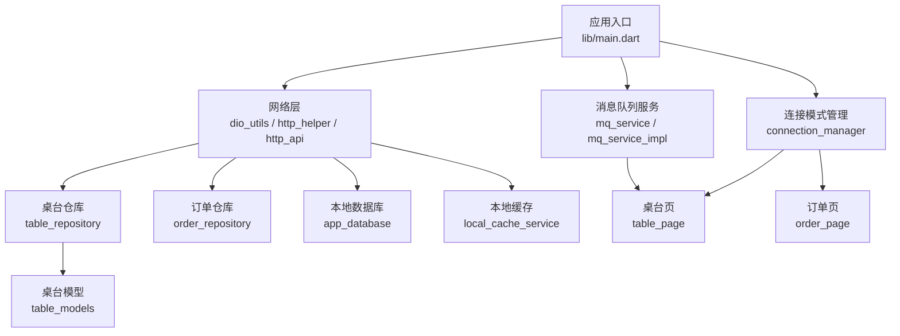
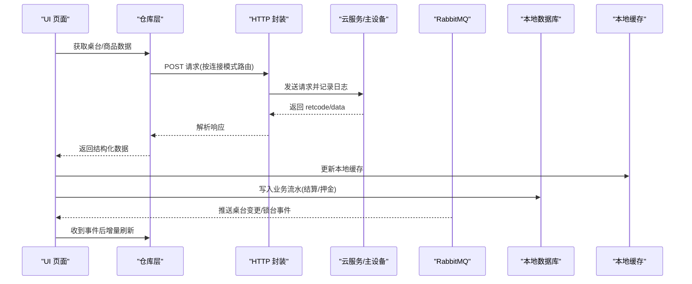
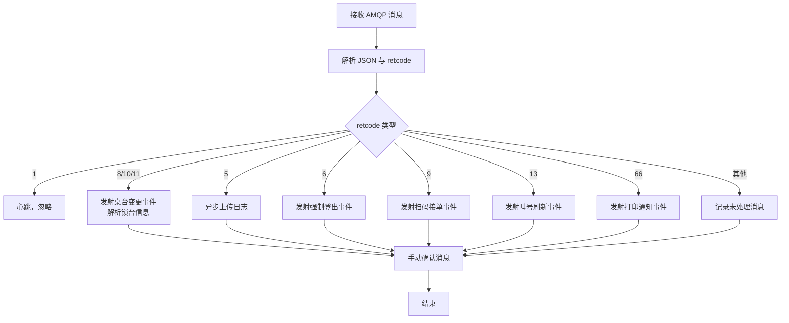
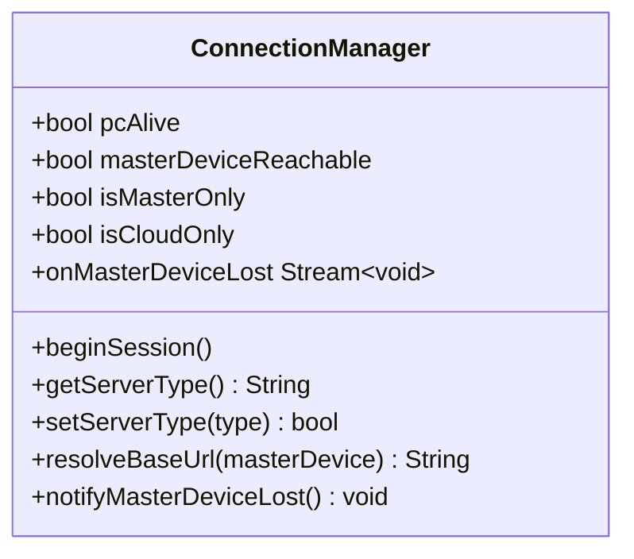
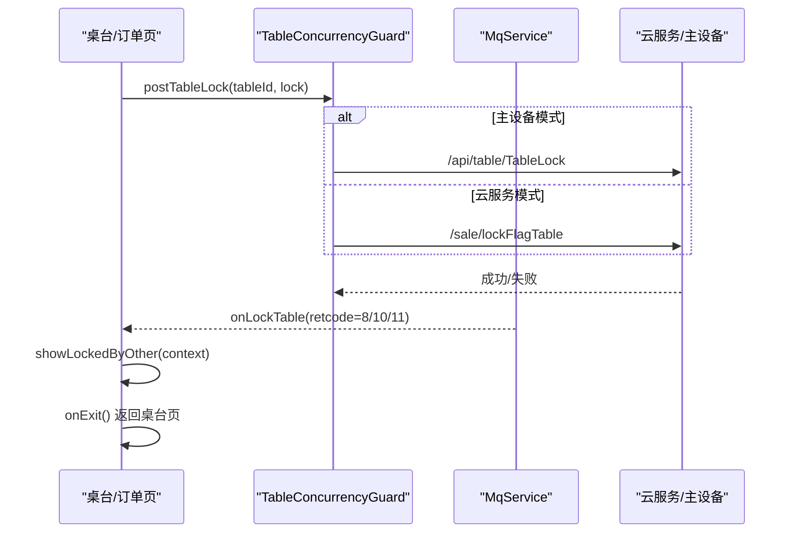
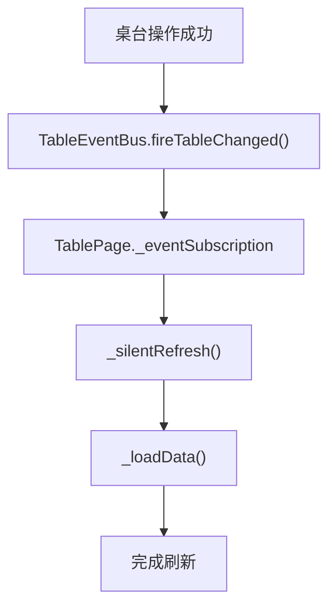
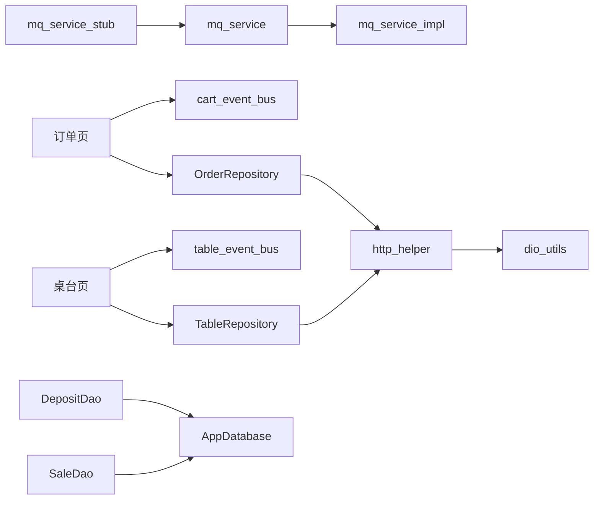

# 数据同步策略

<cite>
**本文引用的文件**   
- [lib/main.dart](file://lib/main.dart)
- [pubspec.yaml](file://pubspec.yaml)
- [lib/net/mq_service.dart](file://lib/net/mq_service.dart)
- [lib/net/mq_service_impl.dart](file://lib/net/mq_service_impl.dart)
- [lib/net/mq_service_stub.dart](file://lib/net/mq_service_stub.dart)
- [lib/util/table_concurrency_guard.dart](file://lib/util/table_concurrency_guard.dart)
- [lib/net/connection_manager.dart](file://lib/net/connection_manager.dart)
- [lib/net/table_event_bus.dart](file://lib/net/table_event_bus.dart)
- [lib/net/cart_event_bus.dart](file://lib/net/cart_event_bus.dart)
- [lib/pages/home/table/table_repository.dart](file://lib/pages/home/table/table_repository.dart)
- [lib/pages/home/table/table_models.dart](file://lib/pages/home/table/table_models.dart)
- [lib/pages/home/table/table_page.dart](file://lib/pages/home/table/table_page.dart)
- [lib/pages/order/order_page.dart](file://lib/pages/order/order_page.dart)
- [lib/pages/order/order_repository.dart](file://lib/pages/order/order_repository.dart)
- [lib/db/base_data_dao.dart](file://lib/db/base_data_dao.dart)
- [lib/db/app_database.dart](file://lib/db/app_database.dart)
- [lib/db/sale_dao.dart](file://lib/db/sale_dao.dart)
- [lib/db/deposit_dao.dart](file://lib/db/deposit_dao.dart)
- [lib/service/cash_recon_service.dart](file://lib/service/cash_recon_service.dart)
- [lib/net/http_api.dart](file://lib/net/http_api.dart)
- [lib/net/http_helper.dart](file://lib/net/http_helper.dart)
- [lib/net/dio_utils.dart](file://lib/net/dio_utils.dart)
- [lib/util/local_cache_service.dart](file://lib/util/local_cache_service.dart)
- [lib/res/constant.dart](file://lib/res/constant.dart)
</cite>

## 目录
1. [引言](#引言)
2. [项目结构](#项目结构)
3. [核心组件](#核心组件)
4. [架构总览](#架构总览)
5. [详细组件分析](#详细组件分析)
6. [依赖关系分析](#依赖关系分析)
7. [性能与一致性](#性能与一致性)
8. [离线处理与故障恢复](#离线处理与故障恢复)
9. [排错指南](#排错指南)
10. [结论](#结论)

## 引言
本文面向聚客美滋滋应用的数据同步策略，围绕本地缓存与云端数据的同步机制、RabbitMQ 实时推送、并发控制、离线数据处理、性能优化及故障恢复展开。系统采用“云服务 + 主设备直连”双模式：正常时根据连接模式选择云接口或主设备接口；当主设备不可达且未强制仅云服务时，通过事件通知前端提示网络异常，但不降级到云端，保证主设备场景下业务路径一致。

## 项目结构
该项目为 Flutter 点餐应用，核心与数据同步相关代码分布在以下层次：
- 入口与网络基础设施：`lib/main.dart`、`lib/net/*`
- 业务页面与仓库：`lib/pages/home/table/*`、`lib/pages/order/*`
- 本地数据库与 DAO：`lib/db/*`
- 工具与缓存：`lib/util/*`
- 配置与常量：`lib/res/constant.dart`、`pubspec.yaml`

**图示来源**
- [lib/main.dart:30-159](file://lib/main.dart#L30-L159)
- [lib/net/http_api.dart:1-120](file://lib/net/http_api.dart#L1-L120)
- [lib/net/mq_service.dart:1-112](file://lib/net/mq_service.dart#L1-L112)
- [lib/net/connection_manager.dart:1-114](file://lib/net/connection_manager.dart#L1-L114)
- [lib/pages/home/table/table_repository.dart:1-137](file://lib/pages/home/table/table_repository.dart#L1-L137)
- [lib/pages/order/order_repository.dart:1-200](file://lib/pages/order/order_repository.dart#L1-L200)
- [lib/db/app_database.dart:1-120](file://lib/db/app_database.dart#L1-L120)
- [lib/util/local_cache_service.dart:1-137](file://lib/util/local_cache_service.dart#L1-L137)

**章节来源**
- [lib/main.dart:30-159](file://lib/main.dart#L30-L159)
- [pubspec.yaml:1-111](file://pubspec.yaml#L1-L111)

## 核心组件
- RabbitMQ 消息服务：提供桌台变更、锁台、扫码接单、叫号刷新、打印通知等事件流，支持 Web 端桩实现与移动端真实 AMQP 连接。
- 连接模式管理：统一判定是否走主设备或云服务，维护主设备可达状态并广播断线事件。
- 桌台并发守卫：封装拉取最新桌台状态、锁台/解锁、订阅其他设备锁台事件的逻辑，避免并发冲突。
- 本地缓存服务：基于 SharedPreferences 的轻量级缓存，缓存商品、分类、桌台、支付方式列表。
- 本地数据库：基于 sqflite 的业务表持久化，用于交班统计、押金流水、结账流水等。
- HTTP 请求封装：统一表单/JSON 请求、签名、日志记录、错误处理与登录失效跳转。

**章节来源**
- [lib/net/mq_service.dart:1-112](file://lib/net/mq_service.dart#L1-L112)
- [lib/net/connection_manager.dart:1-114](file://lib/net/connection_manager.dart#L1-L114)
- [lib/util/table_concurrency_guard.dart:1-200](file://lib/util/table_concurrency_guard.dart#L1-L200)
- [lib/util/local_cache_service.dart:1-137](file://lib/util/local_cache_service.dart#L1-L137)
- [lib/db/app_database.dart:1-200](file://lib/db/app_database.dart#L1-L200)
- [lib/net/http_helper.dart:1-200](file://lib/net/http_helper.dart#L1-L200)

## 架构总览
整体同步架构由三层构成：
- 客户端 UI 层：桌台页、订单页等页面订阅事件总线与 MQ 事件流，触发界面刷新。
- 中间层服务：MQ 服务、连接模式管理、仓库层（TableRepository、OrderRepository）、DAO。
- 后端与存储：云服务 API、主设备接口、RabbitMQ、SQLite 本地数据库、SharedPreferences 轻量缓存。

**图示来源**
- [lib/pages/home/table/table_page.dart:1-200](file://lib/pages/home/table/table_page.dart#L1-L200)
- [lib/pages/order/order_page.dart:1-200](file://lib/pages/order/order_page.dart#L1-L200)
- [lib/pages/home/table/table_repository.dart:1-137](file://lib/pages/home/table/table_repository.dart#L1-L137)
- [lib/net/http_helper.dart:1-200](file://lib/net/http_helper.dart#L1-L200)
- [lib/net/mq_service.dart:1-112](file://lib/net/mq_service.dart#L1-L112)
- [lib/db/sale_dao.dart:1-49](file://lib/db/sale_dao.dart#L1-L49)
- [lib/db/deposit_dao.dart:1-40](file://lib/db/deposit_dao.dart#L1-L40)
- [lib/util/local_cache_service.dart:1-137](file://lib/util/local_cache_service.dart#L1-L137)

## 详细组件分析

### RabbitMQ 消息服务与实时同步
RabbitMQ 服务在移动端使用 `dart_amqp` 建立 AMQP 0-9-1 连接，声明 topic exchange `ytt`，绑定三级 routing key：商户、门店、设备。消费消息后按 `retcode` 分发：
- 1：心跳，忽略
- 5：上传日志指令，异步执行日志压缩上传
- 6：强制下线，发射强制登出事件流
- 8/10/11：桌台变更，发射桌台变更事件流，并解析锁台信息
- 9：扫码点餐接单，发射扫码接单事件流
- 13：刷新叫号列表，发射叫号刷新事件流
- 66：打印通知，发射打印通知事件流

Web 平台由于不支持 `dart:io`，使用桩实现空流与空连接方法，桌台状态更新依赖定时轮询兜底。

**图示来源**
- [lib/net/mq_service_impl.dart:1-200](file://lib/net/mq_service_impl.dart#L1-L200)
- [lib/net/mq_service_impl.dart:201-315](file://lib/net/mq_service_impl.dart#L201-L315)
- [lib/net/mq_service_stub.dart:1-65](file://lib/net/mq_service_stub.dart#L1-L65)

**章节来源**
- [lib/net/mq_service.dart:1-112](file://lib/net/mq_service.dart#L1-L112)
- [lib/net/mq_service_impl.dart:1-315](file://lib/net/mq_service_impl.dart#L1-L315)
- [lib/net/mq_service_stub.dart:1-65](file://lib/net/mq_service_stub.dart#L1-L65)

### 连接模式管理与主设备探测
连接模式管理器负责：
- 根据配置判定当前模式：不限、仅主设备、仅云服务。
- 维护主设备可达状态，并在主设备断线时广播事件。
- 提供基础 URL 解析，强制云服务模式下禁止连接主设备。
- 支持调试覆盖主设备地址。

桌台页初始化时先探活确定连接模式，再加载数据；若主设备不可达且非仅云服务模式，则弹出连接失败提示。

**图示来源**
- [lib/net/connection_manager.dart:1-114](file://lib/net/connection_manager.dart#L1-L114)

**章节来源**
- [lib/net/connection_manager.dart:1-114](file://lib/net/connection_manager.dart#L1-L114)
- [lib/pages/home/table/table_page.dart:1-200](file://lib/pages/home/table/table_page.dart#L1-L200)

### 桌台并发守卫与锁台策略
`TableConcurrencyGuard` 提供：
- 点击桌台前拉取最新状态，避免使用旧缓存。
- 锁台/解锁统一接口，分别调用云服务 `/sale/lockFlagTable` 与主设备 `/api/table/TableLock`。
- 订阅其他设备的锁台事件，对当前前台页面弹窗提示并自动返回桌台页。

锁台事件由 MQ 服务解析并分发，守卫仅在启用锁台开关时生效，且过滤自身设备与当前非前台页面。

**图示来源**
- [lib/util/table_concurrency_guard.dart:1-200](file://lib/util/table_concurrency_guard.dart#L1-L200)
- [lib/net/mq_service_impl.dart:201-315](file://lib/net/mq_service_impl.dart#L201-L315)
- [lib/net/http_api.dart:60-120](file://lib/net/http_api.dart#L60-L120)

**章节来源**
- [lib/util/table_concurrency_guard.dart:1-235](file://lib/util/table_concurrency_guard.dart#L1-L235)

### 本地事件总线与增量刷新
本地事件总线包括：
- 桌台事件总线：操作成功后立即广播，触发桌台页静默刷新。
- 购物车事件总线：购物车变更后立即广播，触发点菜页角标与合计金额刷新。

桌台页同时订阅 MQ 推送和本地事件总线，采用防抖与 pendingRefresh 标记确保事件合并与最终刷新。

**图示来源**
- [lib/net/table_event_bus.dart:1-23](file://lib/net/table_event_bus.dart#L1-L23)
- [lib/pages/home/table/table_page.dart:1-200](file://lib/pages/home/table/table_page.dart#L1-L200)

**章节来源**
- [lib/net/table_event_bus.dart:1-23](file://lib/net/table_event_bus.dart#L1-L23)
- [lib/net/cart_event_bus.dart:1-22](file://lib/net/cart_event_bus.dart#L1-L22)
- [lib/pages/home/table/table_page.dart:1-200](file://lib/pages/home/table/table_page.dart#L1-L200)

### 数据仓库与双模式路由
`TableRepository` 根据 `masterDevice` 参数决定调用云服务或主设备接口，并适配不同响应结构：
- 云服务：`{retcode, retmsg, data:{list:[]}}`
- 主设备：`{Success, Message, Data}`，区域列表与桌台列表字段不同

订单仓库与菜品模型位于订单模块，菜品分类与商品信息从云服务获取，主设备无对应端点。

**章节来源**
- [lib/pages/home/table/table_repository.dart:1-137](file://lib/pages/home/table/table_repository.dart#L1-L137)
- [lib/pages/order/order_repository.dart:1-200](file://lib/pages/order/order_repository.dart#L1-L200)
- [lib/net/http_api.dart:1-200](file://lib/net/http_api.dart#L1-L200)

### 本地缓存与数据库
本地缓存服务使用 SharedPreferences 缓存商品、分类、桌台、支付方式列表，提供读取与清空能力。本地数据库基于 sqflite，支持批量插入、清空、检查点等操作，用于交班统计、押金流水、结账流水等业务场景。

基础数据 DAO 在登录成功后全量重写支付方式、分类、参数表，供交班 SQL 关联使用。结账流水与服务端 saleflow 成功回写本地 4 张表，押金流水云端成功后双写本地表。

**章节来源**
- [lib/util/local_cache_service.dart:1-137](file://lib/util/local_cache_service.dart#L1-L137)
- [lib/db/app_database.dart:1-200](file://lib/db/app_database.dart#L1-L200)
- [lib/db/base_data_dao.dart:1-56](file://lib/db/base_data_dao.dart#L1-L56)
- [lib/db/sale_dao.dart:1-49](file://lib/db/sale_dao.dart#L1-L49)
- [lib/db/deposit_dao.dart:1-40](file://lib/db/deposit_dao.dart#L1-L40)

## 依赖关系分析
主要依赖关系如下：
- 页面层依赖仓库层进行数据获取与业务编排。
- 仓库层依赖 HTTP 封装进行网络请求，并根据连接模式选择云服务或主设备接口。
- MQ 服务独立于 UI，通过事件流驱动页面刷新。
- 本地缓存与数据库作为持久化与离线能力支撑。
- 常量与配置集中管理，避免硬编码。

**图示来源**
- [lib/pages/home/table/table_page.dart:1-200](file://lib/pages/home/table/table_page.dart#L1-L200)
- [lib/pages/order/order_page.dart:1-200](file://lib/pages/order/order_page.dart#L1-L200)
- [lib/pages/home/table/table_repository.dart:1-137](file://lib/pages/home/table/table_repository.dart#L1-L137)
- [lib/pages/order/order_repository.dart:1-200](file://lib/pages/order/order_repository.dart#L1-L200)
- [lib/net/http_helper.dart:1-200](file://lib/net/http_helper.dart#L1-L200)
- [lib/net/dio_utils.dart:1-200](file://lib/net/dio_utils.dart#L1-L200)
- [lib/net/mq_service.dart:1-112](file://lib/net/mq_service.dart#L1-L112)
- [lib/net/mq_service_impl.dart:1-200](file://lib/net/mq_service_impl.dart#L1-L200)
- [lib/net/mq_service_stub.dart:1-65](file://lib/net/mq_service_stub.dart#L1-L65)
- [lib/net/table_event_bus.dart:1-23](file://lib/net/table_event_bus.dart#L1-L23)
- [lib/net/cart_event_bus.dart:1-22](file://lib/net/cart_event_bus.dart#L1-L22)
- [lib/db/sale_dao.dart:1-49](file://lib/db/sale_dao.dart#L1-L49)
- [lib/db/deposit_dao.dart:1-40](file://lib/db/deposit_dao.dart#L1-L40)
- [lib/db/app_database.dart:1-200](file://lib/db/app_database.dart#L1-L200)

## 性能与一致性

### 增量同步算法
- 增量刷新以事件驱动为主：MQ 推送桌台变更事件、本地事件总线广播操作结果，页面调用静默刷新方法，避免全量重复请求。
- 服务端查询使用分页与筛选参数，仓库层按连接模式选择合适字段与排序参数，减少无效数据传输。
- 购物车与分类数量使用 Map 反查与缓存，降低 O(n) 遍历开销。

**章节来源**
- [lib/pages/home/table/table_page.dart:1-200](file://lib/pages/home/table/table_page.dart#L1-L200)
- [lib/pages/order/order_page.dart:1-200](file://lib/pages/order/order_page.dart#L1-L200)
- [lib/pages/home/table/table_repository.dart:1-137](file://lib/pages/home/table/table_repository.dart#L1-L137)

### 冲突检测与解决策略
- 锁台冲突通过 MQ 推送 retcode 8/10/11 中的锁台信息检测，守卫层比较设备号与当前会话，仅对前台页面弹窗提示并自动返回。
- 并发点击防护：桌台点击前设置 `_checkingTableTap` 防止重复请求；静默刷新期间使用 `_silentRefreshing` 与 `_pendingRefresh` 合并事件。
- 主设备断线不降级：`ConnectionManager.pcAlive` 综合连接策略与探活结果，断线时广播事件但不切换到云服务，保持主设备业务路径一致性。

**章节来源**
- [lib/util/table_concurrency_guard.dart:1-200](file://lib/util/table_concurrency_guard.dart#L1-L200)
- [lib/net/mq_service_impl.dart:201-315](file://lib/net/mq_service_impl.dart#L201-L315)
- [lib/pages/home/table/table_page.dart:1-200](file://lib/pages/home/table/table_page.dart#L1-L200)
- [lib/net/connection_manager.dart:1-114](file://lib/net/connection_manager.dart#L1-L114)

### 数据一致性保证
- MQ 消息手动确认：消费后调用 `message.ack()` 确保消息可靠投递。
- 本地数据库事务：批量插入使用 `db.batch()` 提交，保证多表写入原子性。
- 基础数据全量重写：登录成功后清空并重写支付方式、分类、参数表，避免脏数据累积。
- 结算流水双写：云端 saleflow 成功后写入本地 4 张表，供交班统计使用。

**章节来源**
- [lib/net/mq_service_impl.dart:1-200](file://lib/net/mq_service_impl.dart#L1-L200)
- [lib/db/app_database.dart:1-200](file://lib/db/app_database.dart#L1-L200)
- [lib/db/base_data_dao.dart:1-56](file://lib/db/base_data_dao.dart#L1-L56)
- [lib/db/sale_dao.dart:1-49](file://lib/db/sale_dao.dart#L1-L49)

### 并发控制机制
- 锁台守卫：`postTableLock` 封装锁台/解锁，区分主设备与云服务接口。
- 乐观锁思路：通过服务端锁标志 `lockflag` 与设备号判断冲突，客户端不做版本字段比对。
- 事务隔离：SQLite 批量插入使用事务批次提交；MQ 消费使用单线程监听与手动确认。
- 注意：代码中未发现显式的事务隔离级别配置，依赖 SQLite 默认行为与批处理提交。

**章节来源**
- [lib/util/table_concurrency_guard.dart:1-200](file://lib/util/table_concurrency_guard.dart#L1-L200)
- [lib/db/app_database.dart:1-200](file://lib/db/app_database.dart#L1-L200)
- [lib/net/mq_service_impl.dart:1-200](file://lib/net/mq_service_impl.dart#L1-L200)

### 缓存策略
- 轻量缓存：商品、分类、桌台、支付方式列表通过 SharedPreferences 缓存，提供快速读取与清空。
- 图片缓存：引入 `cached_network_image` 减少网络压力。
- 实时快照：点菜页对商品状态与价格做短时缓存，避免频繁刷新。

**章节来源**
- [lib/util/local_cache_service.dart:1-137](file://lib/util/local_cache_service.dart#L1-L137)
- [pubspec.yaml:1-111](file://pubspec.yaml#L1-L111)
- [lib/pages/order/order_page.dart:1-200](file://lib/pages/order/order_page.dart#L1-L200)

## 离线处理与故障恢复

### 待同步队列与断线重连
- MQ 重连：连接失败后调度定时器，每 10 秒尝试重连，断开连接时取消定时器。
- 主设备断线：`notifyMasterDeviceLost` 将可达状态置为 false 并广播事件，桌台页弹出连接失败提示。
- Web 端 MQ 桩：不提供真实连接，依赖定时轮询兜底。

**章节来源**
- [lib/net/mq_service_impl.dart:201-315](file://lib/net/mq_service_impl.dart#L201-L315)
- [lib/net/connection_manager.dart:1-114](file://lib/net/connection_manager.dart#L1-L114)
- [lib/net/mq_service_stub.dart:1-65](file://lib/net/mq_service_stub.dart#L1-L65)

### 数据合并算法
- 基础数据全量重写：`BaseDataDao.savePayways/saveTypes/saveParameters` 清空后批量插入，保证数据一致性。
- 结算与押金流水：云端成功后双写本地，使用唯一标识（如 `onlyid`）进行更新，避免重复。
- 交班数据优先云端：`CashReconService.loadHandoverData` 在主设备模式下优先本地汇总，否则云端报表，为空时回退本地。

**章节来源**
- [lib/db/base_data_dao.dart:1-56](file://lib/db/base_data_dao.dart#L1-L56)
- [lib/db/deposit_dao.dart:1-40](file://lib/db/deposit_dao.dart#L1-L40)
- [lib/service/cash_recon_service.dart:1-200](file://lib/service/cash_recon_service.dart#L1-L200)

### 监控与告警
- 接口日志：`http_helper` 记录所有请求的参数、响应、耗时与成功/失败状态，失败额外写入错误日志。
- MQ 日志：`mq_service_impl` 记录连接、消息解析、重连等关键步骤，Release 环境依赖文件日志回溯。
- 全局异常处理：`main.dart` 初始化阶段统一捕获异常，避免冷启动崩溃。

**章节来源**
- [lib/net/http_helper.dart:1-200](file://lib/net/http_helper.dart#L1-L200)
- [lib/net/mq_service_impl.dart:1-200](file://lib/net/mq_service_impl.dart#L1-L200)
- [lib/main.dart:30-159](file://lib/main.dart#L30-L159)

## 排错指南
常见问题与排查建议：
- MQ 无法连接：检查登录返回的 `rabbitaddress`、`business_number`、`store_code`、`mach_no` 是否正确；查看 MQ 日志文件；Web 端需依赖轮询。
- 锁台冲突未提示：确认锁台开关已启用；检查 MQ 推送是否到达；确认当前页面为前台且会话匹配。
- 主设备不可达：检查 `localhost` 配置与网络连通性；关注 `onMasterDeviceLost` 事件是否触发；确认未强制仅云服务。
- 数据不一致：检查基础数据是否全量重写；核对本地缓存与数据库写入是否成功；查看接口日志与 MQ 日志。
- 交班数据为空：主设备模式下优先本地汇总，若本地为空则云端报表；云端为空时回退本地；必要时重试基础数据同步。

**章节来源**
- [lib/net/mq_service.dart:1-112](file://lib/net/mq_service.dart#L1-L112)
- [lib/net/mq_service_impl.dart:1-315](file://lib/net/mq_service_impl.dart#L1-L315)
- [lib/util/table_concurrency_guard.dart:1-200](file://lib/util/table_concurrency_guard.dart#L1-L200)
- [lib/net/connection_manager.dart:1-114](file://lib/net/connection_manager.dart#L1-L114)
- [lib/net/http_helper.dart:1-200](file://lib/net/http_helper.dart#L1-L200)
- [lib/service/cash_recon_service.dart:1-200](file://lib/service/cash_recon_service.dart#L1-L200)

## 结论
聚客美滋滋应用的数据同步策略以事件驱动为核心，结合 RabbitMQ 实时推送与本地事件总线，实现桌台状态、订单变更、库存更新的低延迟同步。连接模式管理保证主设备与云服务的路由一致性，锁台守卫与冲突检测避免并发操作导致的状态不一致。本地缓存与数据库提供离线能力与持久化保障，MQ 重连与主设备断线事件提升鲁棒性。未来可考虑引入更完善的增量同步协议与乐观锁版本号，进一步减少冲突与带宽消耗。