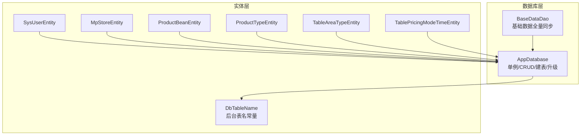
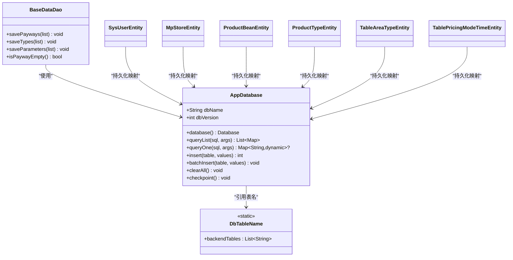
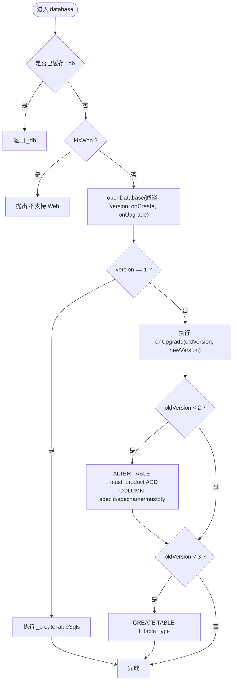
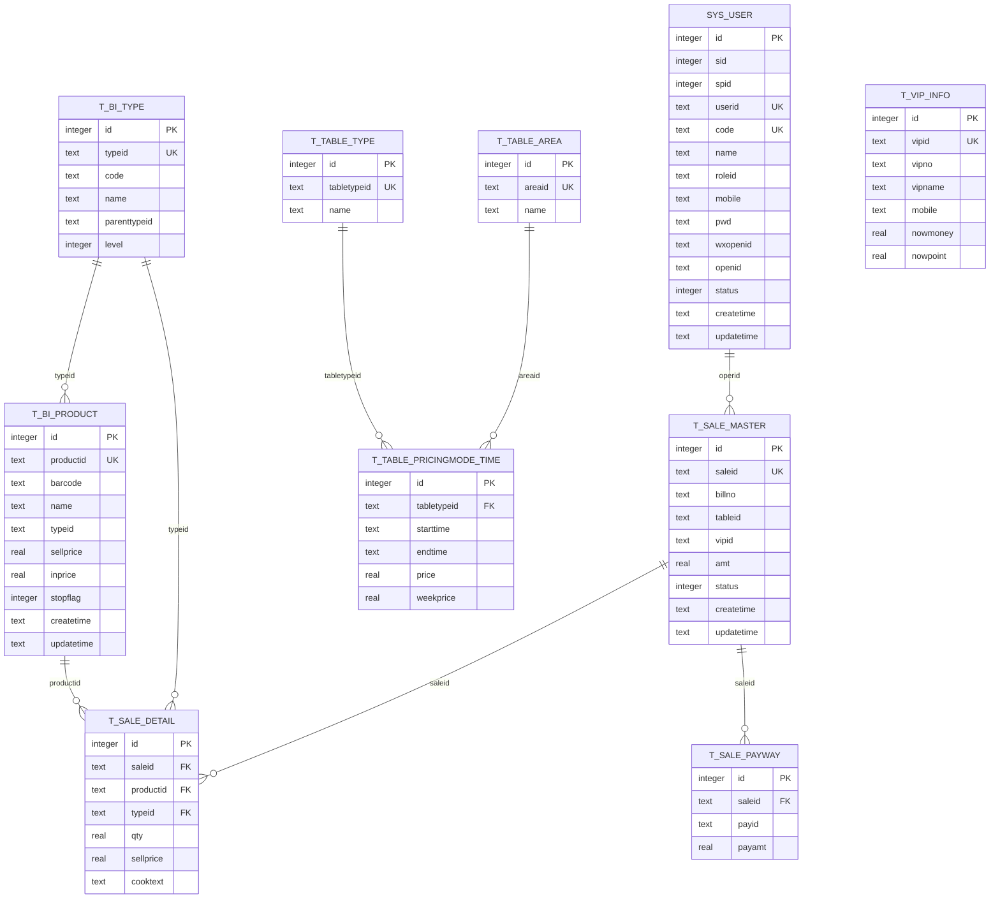
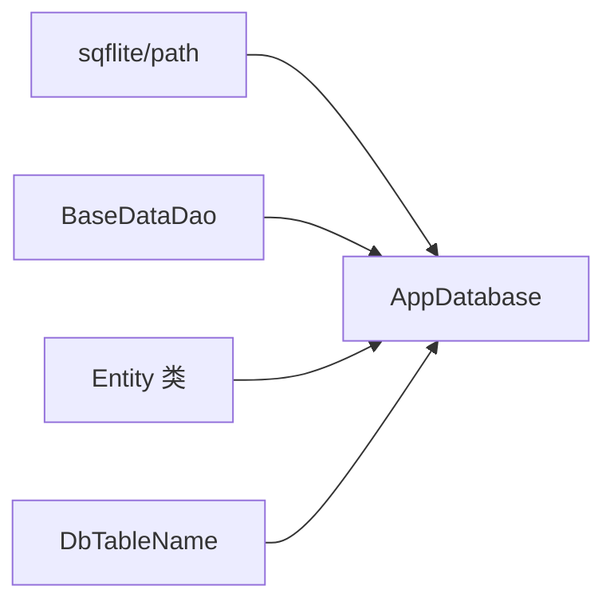

# 数据库设计

<cite>
**本文引用的文件**   
- [lib/db/app_database.dart](file://lib/db/app_database.dart)
- [lib/db/entity/db_table_name.dart](file://lib/db/entity/db_table_name.dart)
- [lib/db/base_data_dao.dart](file://lib/db/base_data_dao.dart)
- [lib/db/entity/sys_user_entity.dart](file://lib/db/entity/sys_user_entity.dart)
- [lib/db/entity/mp_store_entity.dart](file://lib/db/entity/mp_store_entity.dart)
- [lib/db/entity/product_bean_entity.dart](file://lib/db/entity/product_bean_entity.dart)
- [lib/db/entity/product_type_entity.dart](file://lib/db/entity/product_type_entity.dart)
- [lib/db/entity/table_area_type_entity.dart](file://lib/db/entity/table_area_type_entity.dart)
- [lib/db/entity/table_pricing_mode_time_entity.dart](file://lib/db/entity/table_pricing_mode_time_entity.dart)
</cite>

## 目录
1. [引言](#引言)
2. [项目结构](#项目结构)
3. [核心组件](#核心组件)
4. [架构总览](#架构总览)
5. [详细组件分析](#详细组件分析)
6. [依赖关系分析](#依赖关系分析)
7. [性能与优化策略](#性能与优化策略)
8. [故障排查指南](#故障排查指南)
9. [结论](#结论)

## 引言
本文件面向聚客美滋滋应用（Flutter）的本地 SQLite 数据库设计，围绕 AppDatabase 单例、版本管理、表结构与索引策略、业务实体模型及 DAO 层进行系统性说明。文档重点覆盖以下方面：
- AppDatabase 单例的初始化流程、数据库文件名与版本号、建表 SQL 清单与升级逻辑。
- 后台数据表与本地业务表的划分、命名规范与设计原则。
- 用户信息表 sys_user、商户信息表 mp_store、商品表 product_* 系列、桌台表 table_*、订单表 sale_master 等实体的字段含义与关联关系。
- 数据一致性约束、事务边界与 WAL 检查点机制。
- 查询与写入的性能优化策略，包括通用动态插入、批量写入、列类型规整与缓存。

## 项目结构
数据库相关代码集中在 lib/db 目录下，按职责分为三层：
- 数据库引擎与通用操作：AppDatabase 负责数据库生命周期、建表、升级、通用 CRUD 和列元数据缓存。
- 数据访问对象：BaseDataDao 等 DAO 提供基础数据的全量重写、支付方式同步等业务能力。
- 实体定义：entity 目录下的各类 Entity 描述持久化字段、fromMap/toMap 转换及 UI 扩展字段。

**图表来源**
- [lib/db/app_database.dart:1-80](file://lib/db/app_database.dart#L1-L80)
- [lib/db/base_data_dao.dart:1-56](file://lib/db/base_data_dao.dart#L1-L56)
- [lib/db/entity/db_table_name.dart:1-108](file://lib/db/entity/db_table_name.dart#L1-L108)

**章节来源**
- [lib/db/app_database.dart:1-80](file://lib/db/app_database.dart#L1-L80)
- [lib/db/base_data_dao.dart:1-56](file://lib/db/base_data_dao.dart#L1-L56)
- [lib/db/entity/db_table_name.dart:1-108](file://lib/db/entity/db_table_name.dart#L1-L108)

## 核心组件
### AppDatabase 单例
AppDatabase 是应用的 SQLite 入口，承担以下职责：
- 单例模式：通过私有构造器和静态 instance 暴露全局实例。
- 数据库连接池：懒加载 database 属性，首次访问时打开数据库并缓存。
- 数据库配置：库名为 catering.db，当前版本为 3；onCreate 执行全部建表 SQL，onUpgrade 处理历史版本增量变更。
- 通用 CRUD：queryList、queryOne、insert、batchInsert 对齐后端 SqlActuatorUtils 的行为，支持按 PRAGMA table_info 动态取列并做值规整。
- 清理与备份：clearAll 清空所有业务表，checkpoint 触发 WAL FULL 检查点保证拷贝完整。
- 列元数据缓存：_columnCache 与 _numericColumnCache 缓存表列名与数值列集合，减少 PRAGMA 调用开销。

关键行为要点：
- Web 平台直接抛出“不支持”异常，调用方需按 kIsWeb 分支隔离。
- insert/batchInsert 会读取表的所有列，缺失列补默认值，多余键自动忽略；对数值列空值写 NULL，非数值列空值写空串。
- clearAll 对每张表 try/catch，避免因个别未建表导致整体失败。

**章节来源**
- [lib/db/app_database.dart:1-80](file://lib/db/app_database.dart#L1-L80)
- [lib/db/app_database.dart:80-160](file://lib/db/app_database.dart#L80-L160)
- [lib/db/app_database.dart:160-220](file://lib/db/app_database.dart#L160-L220)
- [lib/db/app_database.dart:201-240](file://lib/db/app_database.dart#L201-L240)

### BaseDataDao 基础数据 DAO
BaseDataDao 提供基础数据的“先清后写”全量同步能力，用于交班统计、分类与支付方式等基础字典数据：
- savePayways：清空 t_bi_payway 与 t_bi_payway_store，再批量写入同一份支付数据。
- saveTypes：清空 t_bi_type 并批量写入商品分类。
- saveParameters：清空 t_bi_parameter 并批量写入参数开关。
- isPaywayEmpty：判断支付方式表是否为空，为空则触发重试同步。

该 DAO 与 AppDatabase 解耦，通过 AppDatabase 实例完成底层读写。

**章节来源**
- [lib/db/base_data_dao.dart:1-56](file://lib/db/base_data_dao.dart#L1-L56)

### DbTableName 后台表名常量
DbTableName 集中维护从云端下载的后台数据表名，并与 TableDownloadManager.tableRemarkMap 的 key 保持一致。它不包含本地业务表，如销售单、交班明细等。

表分组包括：
- 商品相关：t_bi_product、t_bi_type、t_bi_spec、t_bi_product_spec、t_bi_product_date、t_bi_unit、t_bi_comb_set、t_bi_product_store、t_product_cook、t_cook_info、t_cook_group、t_recommended_product。
- 桌台相关：t_table_area_type、t_table_area、t_table_pricingmode_time、t_table_type。
- 会员相关：t_vip_type、t_vip_info、t_vip_flow。
- 促销相关：t_mp_pt_vip_type、t_mp_pt_time、t_mp_pt_rule、t_mp_pt_product_or_type、t_mp_pt_nodate、t_mp_pt_master、t_mp_store_type、t_mp_store。
- 必点菜：t_must_master、t_must_product、t_must_tablearea。
- 一菜多吃：t_eat_group、t_eat_info、t_product_eat。
- 系统/门店：sys_store、sys_machine、sys_auth、sys_user。
- 其他：t_bi_payway、t_bi_parameter、t_bi_reason_info、t_reserve_master。

**章节来源**
- [lib/db/entity/db_table_name.dart:1-108](file://lib/db/entity/db_table_name.dart#L1-L108)

## 架构总览
下图展示 AppDatabase 在应用中的角色以及它与 DAO、实体、后台表名的关系。

**图表来源**
- [lib/db/app_database.dart:1-80](file://lib/db/app_database.dart#L1-L80)
- [lib/db/base_data_dao.dart:1-56](file://lib/db/base_data_dao.dart#L1-L56)
- [lib/db/entity/db_table_name.dart:1-108](file://lib/db/entity/db_table_name.dart#L1-L108)
- [lib/db/entity/sys_user_entity.dart:1-93](file://lib/db/entity/sys_user_entity.dart#L1-L93)
- [lib/db/entity/mp_store_entity.dart:1-28](file://lib/db/entity/mp_store_entity.dart#L1-L28)
- [lib/db/entity/product_bean_entity.dart:1-200](file://lib/db/entity/product_bean_entity.dart#L1-L200)
- [lib/db/entity/product_type_entity.dart:1-93](file://lib/db/entity/product_type_entity.dart#L1-L93)
- [lib/db/entity/table_area_type_entity.dart:1-38](file://lib/db/entity/table_area_type_entity.dart#L1-L38)
- [lib/db/entity/table_pricing_mode_time_entity.dart:1-55](file://lib/db/entity/table_pricing_mode_time_entity.dart#L1-L55)

## 详细组件分析

### AppDatabase 初始化与版本管理
- 数据库文件名：catering.db。
- 版本：当前为 3。
- onCreate：遍历 _createTableSqls 列表依次执行 CREATE TABLE IF NOT EXISTS。
- onUpgrade：
  - v1→v2：为 t_must_product 新增 specid、specname、mustqty 三列（兼容旧数据）。
  - v2→v3：补建 t_table_type 表，修复附加费选项查询失败问题。

**图表来源**
- [lib/db/app_database.dart:20-60](file://lib/db/app_database.dart#L20-L60)
- [lib/db/app_database.dart:60-120](file://lib/db/app_database.dart#L60-L120)

**章节来源**
- [lib/db/app_database.dart:20-60](file://lib/db/app_database.dart#L20-L60)
- [lib/db/app_database.dart:60-120](file://lib/db/app_database.dart#L60-L120)

### 表结构定义与命名规范
- 命名前缀：
  - 后台数据表：以 t_ 或 sys_ 开头，对应 DbTableName.backendTables。
  - 本地业务表：以 t_sale_*、t_bi_*、t_vip_*、t_deposit_* 等表示业务域。
- 主键策略：
  - 多数表使用 id INTEGER PRIMARY KEY AUTOINCREMENT。
  - 部分基础数据表（如 t_bi_product、t_bi_product_store、t_bi_reason_info、sys_user、t_vip_info）使用 id INTEGER PRIMARY KEY，避免重复自增冲突。
- 通用字段：
  - spid、sid：总部与分店标识，便于多门店数据隔离。
  - status、stopflag：启用/停用状态标记。
  - createtime、updatetime、operid、opername：审计与溯源字段。
- 外键约束：
  - 代码中未显式声明 FOREIGN KEY 约束，关联关系通过业务层校验与 SQL JOIN 实现，例如 t_sale_detail.productid 关联 t_bi_product.productid，t_sale_detail.typeid 关联 t_bi_type.typeid。

表清单概览（节选）：
- 销售域：t_sale_master、t_sale_payway、t_sale_detail、t_sale_cook、t_sale_jkd、t_sale_jkd_detail。
- 基础字典：t_bi_payway、t_bi_payway_store、t_bi_type、t_bi_parameter、t_bi_reason_info。
- 商品域：t_bi_product、t_bi_spec、t_bi_product_spec、t_bi_product_date、t_bi_unit、t_bi_comb_set、t_bi_product_store。
- 桌台域：t_table_area_type、t_table_area、t_table_type、t_table_pricingmode_time。
- 会员域：t_vip_type、t_vip_info、t_vip_flow、t_vip_money_detail。
- 促销域：t_mp_pt_* 系列、t_mp_store_type、t_mp_store。
- 必点菜：t_must_master、t_must_product、t_must_tablearea。
- 一菜多吃：t_eat_group、t_eat_info、t_product_eat。
- 系统/门店：sys_store、sys_machine、sys_auth、sys_user。
- 预订：t_reserve_master。

**章节来源**
- [lib/db/app_database.dart:240-779](file://lib/db/app_database.dart#L240-L779)
- [lib/db/entity/db_table_name.dart:1-108](file://lib/db/entity/db_table_name.dart#L1-L108)

### 业务表字段与关联关系

#### 用户信息表 sys_user
- 用途：存储系统用户/员工基本信息、登录信息与权限标识。
- 关键字段：
  - id：主键。
  - sid、spid：分店与总部标识。
  - userid、code、name、roleid：用户编码、姓名、角色。
  - mobile、pwd、wxopenid、openid：联系方式、密码、微信标识。
  - lastlogin、lastip、logincount：登录追踪。
  - status、stopflag：账号状态。
  - emall、rfid、rechargeflag、imgurl：扩展字段。
- 关联关系：通常作为操作员 operid 的来源，与销售记录、交班记录关联。

**章节来源**
- [lib/db/entity/sys_user_entity.dart:1-93](file://lib/db/entity/sys_user_entity.dart#L1-L93)
- [lib/db/app_database.dart:780-853](file://lib/db/app_database.dart#L780-L853)

#### 商户信息表 mp_store（促销活动门店）
- 用途：记录促销活动适用的门店范围。
- 关键字段：
  - id：自增主键。
  - spid、sid：总部与活动门店。
  - setflag、billflag、sbillid：活动单据标识与业务标志。
- 关联关系：与 t_mp_pt_master.billid/sbillid 关联，限定促销活动生效门店。

**章节来源**
- [lib/db/entity/mp_store_entity.dart:1-28](file://lib/db/entity/mp_store_entity.dart#L1-L28)
- [lib/db/app_database.dart:560-640](file://lib/db/app_database.dart#L560-L640)

#### 商品表 product_* 系列
- t_bi_product：商品主数据，包含条码、名称、分类、价格、库存、售卖规则等。
- t_bi_spec：规格项（如尺寸、口味），供 t_bi_product_spec 引用。
- t_bi_product_spec：商品与规格的关联，含规格价格与库存。
- t_bi_product_date：商品售卖日期与周期限制。
- t_bi_unit：计量单位。
- t_bi_comb_set：套餐组成项与选择规则。
- t_bi_product_store：门店级商品价格与成本价。
- t_product_cook：做法项（如少盐、加辣）。
- t_cook_info、t_cook_group：做法分组与做法基础信息。
- t_product_eat：吃法项（如煎、炸、烤）。

关联关系：
- t_bi_product.typeid → t_bi_type.typeid。
- t_bi_product_spec.specid → t_bi_spec.specid。
- t_product_cook.productid → t_bi_product.productid。
- t_product_eat.productid → t_bi_product.productid。
- t_bi_comb_set.productid → t_bi_product.productid。

**章节来源**
- [lib/db/app_database.dart:450-620](file://lib/db/app_database.dart#L450-L620)
- [lib/db/entity/product_bean_entity.dart:1-200](file://lib/db/entity/product_bean_entity.dart#L1-L200)
- [lib/db/entity/product_type_entity.dart:1-93](file://lib/db/entity/product_type_entity.dart#L1-L93)

#### 桌台表 table_*
- t_table_area_type：桌台区域与分类绑定。
- t_table_area：桌台区域基础信息。
- t_table_type：桌台类型与附加费规则。
- t_table_pricingmode_time：按时间区间计算的附加费标准。

关联关系：
- t_table_area_type.areaid → t_table_area.areaid。
- t_table_pricingmode_time.tabletypeid → t_table_type.tabletypeid。

**章节来源**
- [lib/db/entity/table_area_type_entity.dart:1-38](file://lib/db/entity/table_area_type_entity.dart#L1-L38)
- [lib/db/entity/table_pricing_mode_time_entity.dart:1-55](file://lib/db/entity/table_pricing_mode_time_entity.dart#L1-L55)
- [lib/db/app_database.dart:520-600](file://lib/db/app_database.dart#L520-L600)

#### 订单表 sale_master 及其子表
- t_sale_master：销售主单，包含门店、桌台、会员、金额、支付方式、状态、备注等。
- t_sale_payway：销售支付明细，按支付方式拆分支付金额与手续费等。
- t_sale_detail：销售明细，包含商品、数量、单价、折扣、做法、规格等。
- t_sale_cook：销售单品做法明细。

关联关系：
- t_sale_payway.saleid → t_sale_master.saleid。
- t_sale_detail.saleid → t_sale_master.saleid。
- t_sale_cook.saleid → t_sale_master.saleid。
- t_sale_detail.productid → t_bi_product.productid。
- t_sale_detail.typeid → t_bi_type.typeid。

**章节来源**
- [lib/db/app_database.dart:260-360](file://lib/db/app_database.dart#L260-L360)

### ER 图（概念模型）
以下为概念性 ER 图，展示主要实体间的关联方向。注意：SQLite 表未在 DDL 中声明外键约束，关联由业务层与 SQL JOIN 保障。

[本图为概念模型，不直接映射具体 DDL 的外键约束]

### 数据一致性与事务边界
- 一致性约束：
  - 代码未使用 SQLite 外键约束，依赖业务层在写入与查询时保持引用完整性。
  - 数值列空值规整：AppDatabase._normalize 对数值列空值写 NULL，避免 TEXT 存储导致实体强转异常。
- 事务边界：
  - batchInsert 使用 Batch API 分批提交，调用方控制批次大小（约 80 条/批）。
  - BaseDataDao.savePayways 先 clearTable 再 batchInsert，确保基础数据“先清后写”的一致性。
  - checkpoint 使用 PRAGMA wal_checkpoint(FULL) 在日志上传前将 WAL 刷回主库，保证数据一致性。

**章节来源**
- [lib/db/app_database.dart:160-220](file://lib/db/app_database.dart#L160-L220)
- [lib/db/base_data_dao.dart:1-56](file://lib/db/base_data_dao.dart#L1-L56)

## 依赖关系分析
- AppDatabase 依赖 sqflite 与 path 包，提供 openDatabase、getDatabasesPath 与 join 能力。
- BaseDataDao 依赖 AppDatabase，封装基础数据同步逻辑。
- 实体类通过 fromMap/toMap 与 AppDatabase 的 Map 型 CRUD 交互，无直接 SQL 耦合。
- DbTableName 为纯常量类，被 AppDatabase.tables 与下载器使用，避免硬编码表名散落各处。

**图表来源**
- [lib/db/app_database.dart:1-20](file://lib/db/app_database.dart#L1-L20)
- [lib/db/base_data_dao.dart:1-10](file://lib/db/base_data_dao.dart#L1-L10)
- [lib/db/entity/db_table_name.dart:1-20](file://lib/db/entity/db_table_name.dart#L1-L20)

**章节来源**
- [lib/db/app_database.dart:1-20](file://lib/db/app_database.dart#L1-L20)
- [lib/db/base_data_dao.dart:1-10](file://lib/db/base_data_dao.dart#L1-L10)
- [lib/db/entity/db_table_name.dart:1-20](file://lib/db/entity/db_table_name.dart#L1-L20)

## 性能与优化策略
- 列元数据缓存：
  - _columnCache 与 _numericColumnCache 缓存表列名与数值列集合，避免频繁 PRAGMA table_info 调用。
- 动态插入与值规整：
  - insert/batchInsert 按表 PRAGMA 列名动态取值，缺失列补默认值，多余键忽略；数值列空值写 NULL，防止类型异常。
- 批量写入：
  - 使用 Batch API 批量插入，减少事务切换开销；调用方控制批次大小（约 80 条）。
- WAL 模式与检查点：
  - 默认开启 WAL；在日志上传前执行 PRAGMA wal_checkpoint(FULL)，确保 WAL 数据落盘，提升拷贝与备份可靠性。
- 查询优化建议：
  - 针对高频查询字段（如 t_sale_master.saleid、t_sale_detail.saleid、t_bi_product.productid、t_bi_type.typeid、t_table_type.tabletypeid）创建索引，可显著提升 JOIN 与过滤性能。
  - 建议在 AppDatabase.queryList 上层封装常用查询语句，复用 Prepared Statement。
- 存储引擎配置：
  - SQLite 默认使用 B-Tree 索引结构；WAL 模式适合高并发读场景。
  - 对于大规模基础数据表（如 t_bi_product、t_bi_type），可考虑分表或分区策略（业务层面），避免单表过大影响 IO。

[本节为通用性能指导，不直接分析具体源码行]

## 故障排查指南
- “no such table: t_table_type”：
  - 原因：v2 之前漏建 t_table_type，导致附加费选项查询失败。
  - 解决：升级到 v3 后补建该表；数据交换会补充必要数据。
- 促销表整表读取失败：
  - 原因：云端下发的 null 字段被统一写成空串，存入数值列导致实体强转异常。
  - 解决：AppDatabase._normalize 对数值列空值写 NULL，避免类型异常。
- 清空业务表失败：
  - 现象：个别未建表（如 sys_machine/sys_auth）导致清空中断。
  - 解决：clearAll 逐表 try/catch，跳过异常表继续清空其余表。
- WAL 数据未落盘：
  - 现象：日志上传或备份不完整。
  - 解决：在上传前调用 checkpoint 执行 PRAGMA wal_checkpoint(FULL)。

**章节来源**
- [lib/db/app_database.dart:100-140](file://lib/db/app_database.dart#L100-L140)
- [lib/db/app_database.dart:160-220](file://lib/db/app_database.dart#L160-L220)
- [lib/db/app_database.dart:201-240](file://lib/db/app_database.dart#L201-L240)

## 结论
本项目的 SQLite 数据库设计围绕 AppDatabase 单例构建，采用清晰的表分层与命名规范，涵盖用户、商户、商品、桌台、订单、会员、促销等多个业务域。通过列元数据缓存、批量写入、值规整与 WAL 检查点等机制，兼顾了数据一致性与运行性能。尽管未使用 SQLite 外键约束，但通过业务层校验与标准化 SQL 查询保障了数据完整性。未来可在高频查询字段上增加索引，并在必要时引入分表策略，以进一步提升大数据量下的查询效率与稳定性。