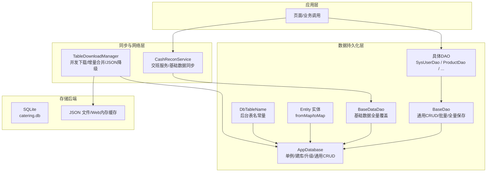
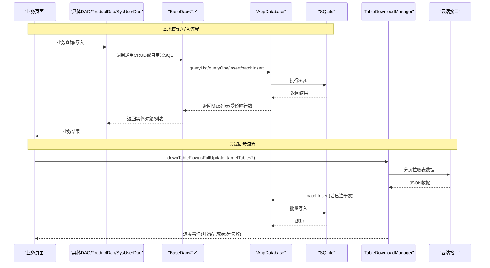
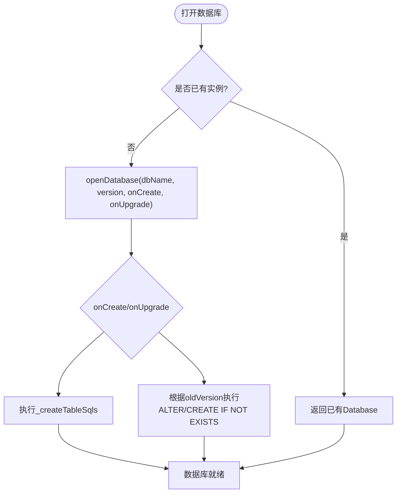
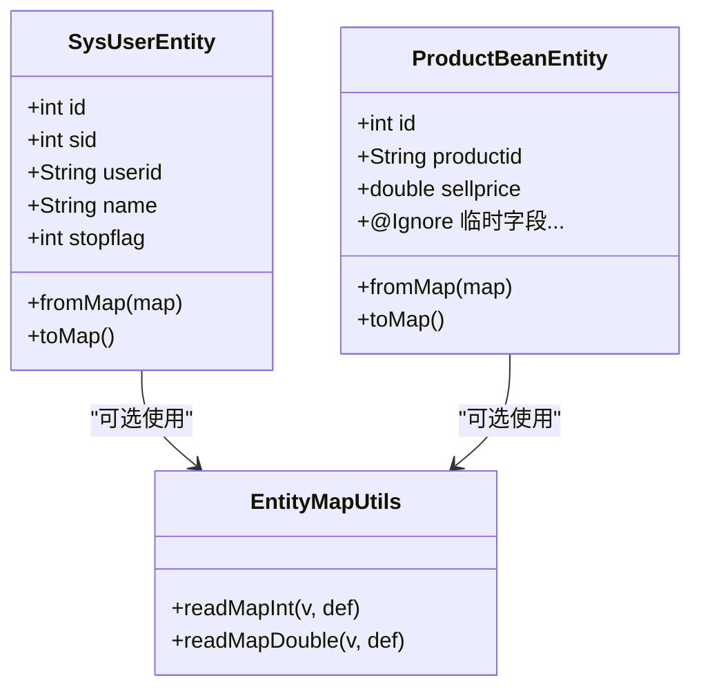
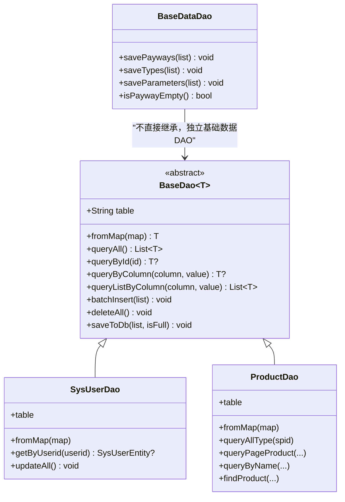
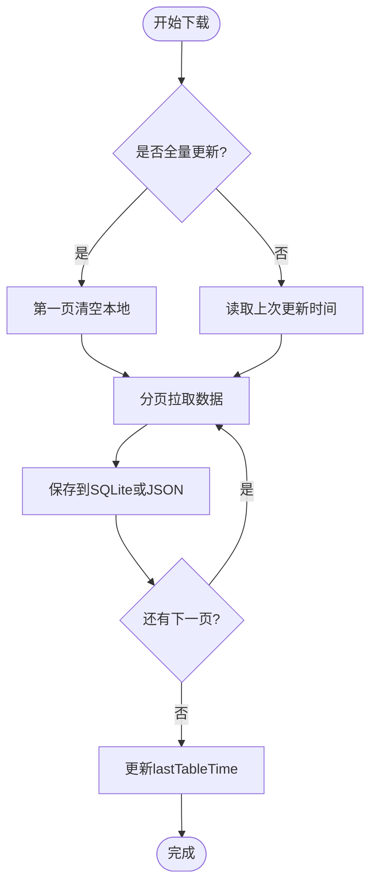
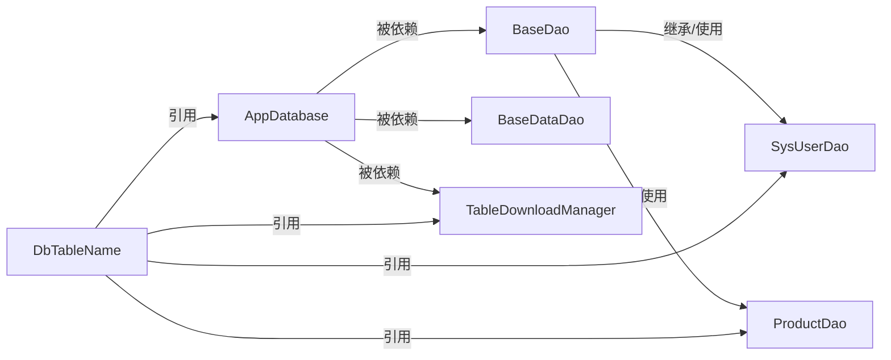

# 数据持久化

<cite>
**本文引用的文件**
- [lib/db/app_database.dart](file://lib/db/app_database.dart)
- [lib/db/base_data_dao.dart](file://lib/db/base_data_dao.dart)
- [lib/db/dao/base_dao.dart](file://lib/db/dao/base_dao.dart)
- [lib/db/dao/sys_user_dao.dart](file://lib/db/dao/sys_user_dao.dart)
- [lib/db/dao/product_dao.dart](file://lib/db/dao/product_dao.dart)
- [lib/db/entity/entity_map_utils.dart](file://lib/db/entity/entity_map_utils.dart)
- [lib/db/entity/db_table_name.dart](file://lib/db/entity/db_table_name.dart)
- [lib/db/entity/sys_user_entity.dart](file://lib/db/entity/sys_user_entity.dart)
- [lib/db/entity/product_bean_entity.dart](file://lib/db/entity/product_bean_entity.dart)
- [lib/net/table_download_manager.dart](file://lib/net/table_download_manager.dart)
- [lib/service/cash_recon_service.dart](file://lib/service/cash_recon_service.dart)
</cite>

## 目录
1. [引言](#引言)
2. [项目结构](#项目结构)
3. [核心组件](#核心组件)
4. [架构总览](#架构总览)
5. [详细组件分析](#详细组件分析)
6. [依赖关系分析](#依赖关系分析)
7. [性能与并发特性](#性能与并发特性)
8. [迁移与版本管理](#迁移与版本管理)
9. [故障恢复与排错指南](#故障恢复与排错指南)
10. [最佳实践与 SQL 操作示例](#最佳实践与-sql-操作示例)
11. [结论](#结论)

## 引言
本文件面向聚客美滋滋应用的 SQLite 数据持久化层，系统性说明数据库设计、实体映射、DAO 访问模式、云端同步策略、迁移机制、性能优化和故障恢复。该实现基于 Flutter + sqflite，采用“表级 SQL 建库 + 通用动态插入 + 抽象 DAO 基类”的方式，既保留原有 Android/iOS 项目的 SQL 逻辑一致性，又通过统一入口 AppDatabase 提供单例化的数据库连接、批量写入与 WAL 检查点能力。

## 项目结构
数据持久化相关代码集中在 lib/db 下，按三层组织：
- 数据库入口：AppDatabase（单例、建库、升级、通用读写）
- DAO 层：BaseDao 抽象基类 + 具体业务 DAO（如 SysUserDao、ProductDao）+ BaseDataDao（基础数据全量覆盖）
- Entity 层：实体模型 + 表名常量 + 字段宽松读取工具
- 同步层：TableDownloadManager（云端表下载 + 本地缓存）
- 业务门面：CashReconService（交班服务，触发基础数据同步与本地汇总）

图表来源
- [lib/db/app_database.dart:25-110](file://lib/db/app_database.dart#L25-L110)
- [lib/db/dao/base_dao.dart:1-71](file://lib/db/dao/base_dao.dart#L1-L71)
- [lib/db/base_data_dao.dart:1-56](file://lib/db/base_data_dao.dart#L1-L56)
- [lib/net/table_download_manager.dart:1-200](file://lib/net/table_download_manager.dart#L1-L200)
- [lib/service/cash_recon_service.dart:1-120](file://lib/service/cash_recon_service.dart#L1-L120)

章节来源
- [lib/db/app_database.dart:25-110](file://lib/db/app_database.dart#L25-L110)
- [lib/db/dao/base_dao.dart:1-71](file://lib/db/dao/base_dao.dart#L1-L71)
- [lib/db/base_data_dao.dart:1-56](file://lib/db/base_data_dao.dart#L1-L56)
- [lib/db/entity/db_table_name.dart:1-108](file://lib/db/entity/db_table_name.dart#L1-L108)
- [lib/net/table_download_manager.dart:1-200](file://lib/net/table_download_manager.dart#L1-L200)
- [lib/service/cash_recon_service.dart:1-120](file://lib/service/cash_recon_service.dart#L1-L120)

## 核心组件
- AppDatabase：数据库单例，负责连接池、onCreate/onUpgrade、通用 queryList/queryOne/insert/batchInsert、列类型推断与空值规整、WAL 检查点、清空全部业务表。
- BaseDao<T>：抽象 DAO，定义 table 与 fromMap，提供 queryAll/queryById/queryByColumn/queryListByColumn/batchInsert/deleteAll/saveToDb。
- BaseDataDao：基础数据 DAO，针对 t_bi_payway/t_bi_type/t_bi_parameter 做“先清空再全量重写”。
- 具体 DAO：以 SysUserDao、ProductDao 为代表，继承 BaseDao，扩展复杂查询（多表 JOIN、日期过滤、分页）。
- Entity：实体类提供 fromMap/toMap；数值型字段通过 readMapInt/readMapDouble 或 toMap 中显式转换保证稳健性。
- DbTableName：集中声明后台表名常量，并维护 backendTables 清单，用于 TableDownloadManager 注册与 AppDatabase 表集合构建。
- TableDownloadManager：云端表数据下载器，支持并发下载、增量更新、失败重试、JSON 降级与 Web 内存缓存。
- CashReconService：交班服务门面，在移动端优先从本地 t_sale_* 汇总，必要时回退云端；登录成功后自动触发基础数据同步。

章节来源
- [lib/db/app_database.dart:25-110](file://lib/db/app_database.dart#L25-L110)
- [lib/db/dao/base_dao.dart:1-71](file://lib/db/dao/base_dao.dart#L1-L71)
- [lib/db/base_data_dao.dart:1-56](file://lib/db/base_data_dao.dart#L1-L56)
- [lib/db/entity/entity_map_utils.dart:1-24](file://lib/db/entity/entity_map_utils.dart#L1-L24)
- [lib/db/entity/db_table_name.dart:1-108](file://lib/db/entity/db_table_name.dart#L1-L108)
- [lib/net/table_download_manager.dart:200-522](file://lib/net/table_download_manager.dart#L200-L522)
- [lib/service/cash_recon_service.dart:1-200](file://lib/service/cash_recon_service.dart#L1-L200)

## 架构总览
整体数据流分为两条主线：
- 离线/主设备交易与统计：页面 → 具体 DAO → BaseDao → AppDatabase → SQLite
- 云端数据同步：页面/登录流程 → TableDownloadManager → HTTP 接口 → 本地 SQLite 或 JSON 降级

图表来源
- [lib/db/dao/base_dao.dart:1-71](file://lib/db/dao/base_dao.dart#L1-L71)
- [lib/db/app_database.dart:25-110](file://lib/db/app_database.dart#L25-L110)
- [lib/net/table_download_manager.dart:200-522](file://lib/net/table_download_manager.dart#L200-L522)

## 详细组件分析

### AppDatabase 单例与数据库初始化
- 单例模式：私有构造 + static instance，确保全局唯一数据库实例。
- 文件名与版本：数据库名为 catering.db，当前版本 dbVersion=3。
- onCreate：顺序执行 _createTableSqls 中的全部建表 SQL，包含销售、支付、分类、参数、会员、促销、桌台、系统用户等 15+ 张表。
- onUpgrade：v1→v2 为 t_must_product 补齐 MustProduct 相关字段；v2→v3 补建 t_table_type，修复附加费选项缺失问题。
- 通用读写：
  - queryList/queryOne：原始 SQL 查询，返回 Map 列表或首条记录。
  - insert：按 PRAGMA table_info 动态获取列名，多余键忽略；对数值列将 null/空串转为 NULL，其他列空值写 ''。
  - batchInsert：使用 Batch API 分批写入，避免多次事务开销。
  - clearAll/clearTable：退出登录时清空全部业务表，基础表重写前清空单表。
  - checkpoint：日志上传前执行 PRAGMA wal_checkpoint(FULL)，确保 WAL 落盘，便于拷贝完整数据库。
- 列类型缓存：_columnCache 与 _numericColumnCache 缓存每表列名及数值列集合，减少重复 PRAGMA 查询。

图表来源
- [lib/db/app_database.dart:25-110](file://lib/db/app_database.dart#L25-L110)
- [lib/db/app_database.dart:241-259](file://lib/db/app_database.dart#L241-L259)

章节来源
- [lib/db/app_database.dart:25-110](file://lib/db/app_database.dart#L25-L110)
- [lib/db/app_database.dart:201-259](file://lib/db/app_database.dart#L201-L259)
- [lib/db/app_database.dart:498-848](file://lib/db/app_database.dart#L498-L848)

### 实体映射机制
本项目未使用 ORM 注解框架，而是通过以下约定实现实体映射：
- 每个实体类提供 fromMap(Map) 与 toMap() 方法，完成 Map↔Entity 的转换。
- 数值字段在 fromMap 中使用 num? 安全转换并设置默认值；字符串字段用 toString() 兜底空值。
- 对于可能由云端下发为 null 的数值字段，统一通过 entity_map_utils 中的 readMapInt/readMapDouble 进行宽容解析，避免 String 强转异常。
- 非持久化字段通过注释标记 @Ignore（如 ProductBeanEntity 中的购物车临时字段），不参与 toMap 输出。

图表来源
- [lib/db/entity/sys_user_entity.dart:1-93](file://lib/db/entity/sys_user_entity.dart#L1-L93)
- [lib/db/entity/product_bean_entity.dart:1-200](file://lib/db/entity/product_bean_entity.dart#L1-L200)
- [lib/db/entity/product_bean_entity.dart:200-472](file://lib/db/entity/product_bean_entity.dart#L200-L472)
- [lib/db/entity/entity_map_utils.dart:1-24](file://lib/db/entity/entity_map_utils.dart#L1-L24)

章节来源
- [lib/db/entity/sys_user_entity.dart:1-93](file://lib/db/entity/sys_user_entity.dart#L1-L93)
- [lib/db/entity/product_bean_entity.dart:1-472](file://lib/db/entity/product_bean_entity.dart#L1-L472)
- [lib/db/entity/entity_map_utils.dart:1-24](file://lib/db/entity/entity_map_utils.dart#L1-L24)

### DAO 数据访问层设计
- BaseDao<T>：
  - 定义抽象成员 table 与 fromMap。
  - 提供通用 CRUD：queryAll/queryById/queryByColumn/queryListByColumn。
  - 批量插入：batchInsert 按 900 条分片，规避 SQLite 变量上限。
  - 全量保存：saveToDb 支持 isFull=true 先清空再写入，模拟 @Transaction 语义。
- BaseDataDao：
  - 针对基础数据（支付方式、商品分类、参数）提供 savePayways/saveTypes/saveParameters，内部先 clearTable 再 batchInsert。
  - 提供 isPaywayEmpty 判断，供交班服务在本地为空时自动重试同步。
- 具体 DAO：
  - SysUserDao：按 userid 查询、重置 stopflag。
  - ProductDao：大量复杂 SQL（推荐菜、分类分页、搜索、按 productid 查找等），复用 BaseDao 的 fromMap。

图表来源
- [lib/db/dao/base_dao.dart:1-71](file://lib/db/dao/base_dao.dart#L1-L71)
- [lib/db/base_data_dao.dart:1-56](file://lib/db/base_data_dao.dart#L1-L56)
- [lib/db/dao/sys_user_dao.dart:1-29](file://lib/db/dao/sys_user_dao.dart#L1-L29)
- [lib/db/dao/product_dao.dart:1-200](file://lib/db/dao/product_dao.dart#L1-L200)

章节来源
- [lib/db/dao/base_dao.dart:1-71](file://lib/db/dao/base_dao.dart#L1-L71)
- [lib/db/base_data_dao.dart:1-56](file://lib/db/base_data_dao.dart#L1-L56)
- [lib/db/dao/sys_user_dao.dart:1-29](file://lib/db/dao/sys_user_dao.dart#L1-L29)
- [lib/db/dao/product_dao.dart:1-200](file://lib/db/dao/product_dao.dart#L1-L200)

### 关键业务表结构设计
- 销售主表 t_sale_master：销售订单主信息，含金额、折扣、服务费、取餐码、状态等。
- 销售支付表 t_sale_payway：单笔订单的支付明细，含支付方式、金额、退款、微信流水号等。
- 销售明细表 t_sale_detail：订单商品明细，含规格、做法、数量、单价、成本价、促销关联等。
- 销售做法表 t_sale_cook：订单中菜品做法记录。
- 支付方式表 t_bi_payway 与门店支付方式表 t_bi_payway_store：基础数据，交班统计关联。
- 商品分类表 t_bi_type：分类层级、显示标志、排序等。
- 商品表 t_bi_product：核心商品信息，含价格、库存、展示标志、售卖周期、活动关联等。
- 商品规格表 t_bi_spec 与 t_bi_product_spec：规格与商品关联。
- 套餐表 t_bi_comb_set：套餐配置与成员。
- 桌台区域表 t_table_area、桌台类型表 t_table_type、附加费区间表 t_table_pricingmode_time：开台与附加费计算。
- 会员分类 t_vip_type、会员信息 t_vip_info、会员流水 t_vip_flow、余额明细 t_vip_money_detail：会员体系。
- 促销活动相关表：t_mp_pt_master/rule/product_or_type/time/nodate/store/type 等。
- 必点菜相关表：t_must_master/must_product/must_tablearea。
- 一菜多吃相关表：t_eat_group/eat_info/product_eat。
- 系统门店 sys_store、系统用户 sys_user、权限 sys_auth、机器 sys_machine、备注 t_bi_reason_info、预订 t_reserve_master。

这些表的字段均对齐原 Android/iOS 项目 Java/Kotlin Bean，并通过 AppDatabase._createTableSqls 一次性创建。对外查询通过 DAO 封装，避免业务层直接拼写 SQL。

章节来源
- [lib/db/app_database.dart:259-848](file://lib/db/app_database.dart#L259-L848)
- [lib/db/entity/db_table_name.dart:1-108](file://lib/db/entity/db_table_name.dart#L1-L108)

### 数据同步策略
- 并发下载：TableDownloadManager 使用固定并发数（默认 3）的 worker 队列，逐个取出待下载表名，发起分页请求。
- 全量与增量：
  - 全量更新：isFullUpdate=true，第一页清空本地后写入，不传 updatetime。
  - 增量更新：传入上次更新时间 lastTableTime，仅拉取变更数据；成功后更新 SpUtil 中的时间戳。
- 冲突解决：
  - SQLite 路径：需要Clear时先 clearTable，再 batchInsert；否则追加写入。
  - JSON/Web 路径：_mergeRows 按 id 主键 upsert，新行覆盖旧行，无 id 的行直接追加。
- 失败处理：failedTables 记录失败的表名，最终通过事件广播 code404 提示“部分数据同步失败”；全部成功则保存 spid 标识并广播 code200。
- 降级策略：当某表未在 AppDatabase.tables 中注册时，TableDownloadManager 自动降级到 JSON 文件或 Web 内存缓存。

图表来源
- [lib/net/table_download_manager.dart:200-522](file://lib/net/table_download_manager.dart#L200-L522)

章节来源
- [lib/net/table_download_manager.dart:1-200](file://lib/net/table_download_manager.dart#L1-L200)
- [lib/net/table_download_manager.dart:200-522](file://lib/net/table_download_manager.dart#L200-L522)

## 依赖关系分析
- AppDatabase 依赖 sqflite 与 path，不依赖业务 DAO；DAO 层反向依赖 AppDatabase。
- BaseDao 与 BaseDataDao 均通过 AppDatabase.instance 获取数据库连接。
- TableDownloadManager 依赖 HttpApi/HttpHelper 与 AppDatabase，可选择 JSON 降级。
- CashReconService 依赖 BaseDataDao、CashReconDao、HandoverRecordDao，以及网络层。
- DbTableName 被 AppDatabase、TableDownloadManager、各 DAO 共同引用，确保表名一致。

图表来源
- [lib/db/app_database.dart:25-110](file://lib/db/app_database.dart#L25-L110)
- [lib/db/dao/base_dao.dart:1-71](file://lib/db/dao/base_dao.dart#L1-L71)
- [lib/db/base_data_dao.dart:1-56](file://lib/db/base_data_dao.dart#L1-L56)
- [lib/db/entity/db_table_name.dart:1-108](file://lib/db/entity/db_table_name.dart#L1-L108)
- [lib/net/table_download_manager.dart:1-200](file://lib/net/table_download_manager.dart#L1-L200)

章节来源
- [lib/db/app_database.dart:25-110](file://lib/db/app_database.dart#L25-L110)
- [lib/db/dao/base_dao.dart:1-71](file://lib/db/dao/base_dao.dart#L1-L71)
- [lib/db/base_data_dao.dart:1-56](file://lib/db/base_data_dao.dart#L1-L56)
- [lib/db/entity/db_table_name.dart:1-108](file://lib/db/entity/db_table_name.dart#L1-L108)
- [lib/net/table_download_manager.dart:1-200](file://lib/net/table_download_manager.dart#L1-L200)

## 性能与并发特性
- 批量写入：
  - AppDatabase.batchInsert 使用 sqflite Batch API，减少事务开销。
  - BaseDao.batchInsert 按 900 条切分，规避 SQLite 最大绑定变量限制。
- 列元数据缓存：
  - _columnCache/_numericColumnCache 缓存 PRAGMA table_info 结果，避免重复查询。
- WAL 模式与检查点：
  - AppDatabase.checkpoint 在日志上传前执行 FULL 检查点，确保 WAL 落盘，提升备份完整性。
- 并发下载：
  - TableDownloadManager 使用固定并发 worker 拉取云端数据，提高吞吐。
- 数值列空值规整：
  - _normalize 将数值列的空值写入为 NULL，避免 TEXT 类型污染导致实体解析异常。

章节来源
- [lib/db/app_database.dart:201-259](file://lib/db/app_database.dart#L201-L259)
- [lib/db/dao/base_dao.dart:1-71](file://lib/db/dao/base_dao.dart#L1-L71)
- [lib/net/table_download_manager.dart:200-522](file://lib/net/table_download_manager.dart#L200-L522)

## 迁移与版本管理
- 版本演进：
  - v1→v2：为 t_must_product 增加 specid/specname/mustqty 列，旧数据在下一次全量下载后填充。
  - v2→v3：补建 t_table_type，修复附加费选项缺失导致的开台弹窗异常。
- 迁移原则：
  - 优先使用 ALTER TABLE ADD COLUMN 与 CREATE TABLE IF NOT EXISTS，保证幂等。
  - 新增列默认允许空值，避免历史数据损坏。
  - 业务侧通过全量下载补充缺失字段，降低迁移风险。

章节来源
- [lib/db/app_database.dart:65-94](file://lib/db/app_database.dart#L65-L94)
- [lib/db/app_database.dart:241-259](file://lib/db/app_database.dart#L241-L259)

## 故障恢复与排错指南
- “no such table: t_table_type”：
  - 原因：早期 _createTableSqls 漏建 t_table_type。
  - 处理：v2→v3 升级脚本补建；同时数据交换会回填数据。
- 清库失败：
  - clearAll 对每张表 try/catch，个别未建表（如 sys_machine/sys_auth）跳过，避免中断后续清空。
- 数值字段解析异常：
  - 现象：云端下发 null 或历史数据存成空串，实体 fromMap 强转抛出类型异常。
  - 处理：使用 entity_map_utils.readMapInt/readMapDouble；AppDatabase._normalize 将数值列空值写为 NULL。
- 部分数据同步失败：
  - 现象：TableDownloadManager 广播 code404，failedTables 记录失败表。
  - 处理：查看失败表备注，重新触发 downTableFlow(targetTables=[失败表])。

章节来源
- [lib/db/app_database.dart:110-150](file://lib/db/app_database.dart#L110-L150)
- [lib/db/app_database.dart:201-259](file://lib/db/app_database.dart#L201-L259)
- [lib/net/table_download_manager.dart:200-522](file://lib/net/table_download_manager.dart#L200-L522)

## 最佳实践与 SQL 操作示例
- 使用 DAO 而非直接拼接 SQL：
  - 通过 BaseDao 提供的 queryAll/queryById/queryByColumn/queryListByColumn 与具体 DAO 的扩展方法访问数据。
- 批量插入规范：
  - 优先使用 BaseDao.batchInsert，它会自动分片为 900 条一批。
  - 若需自定义批次大小，可调用 AppDatabase.batchInsert，并在调用方控制批大小。
- 全量替换场景：
  - 使用 BaseDao.saveToDb(list, isFull=true) 或 BaseDataDao 的 saveXxx 方法，内部先清空再写入。
- 查询示例（概念性描述）：
  - 查询所有有效商品：ProductDao.queryAllType(spid)
  - 按分类分页查询：ProductDao.queryPageProduct(spid, sid, typeId, week, month, limit, offset)
  - 按名称模糊搜索：ProductDao.queryByName(name, spid, sid, week, month, limit, offset)
  - 按 userid 查询用户：SysUserDao.getByUserid(userid)
- 清理与备份：
  - 退出登录时调用 AppDatabase.clearAll() 清空全部业务表。
  - 上传日志前调用 AppDatabase.checkpoint() 确保 WAL 落盘。

章节来源
- [lib/db/dao/base_dao.dart:1-71](file://lib/db/dao/base_dao.dart#L1-L71)
- [lib/db/base_data_dao.dart:1-56](file://lib/db/base_data_dao.dart#L1-L56)
- [lib/db/dao/product_dao.dart:1-200](file://lib/db/dao/product_dao.dart#L1-L200)
- [lib/db/dao/sys_user_dao.dart:1-29](file://lib/db/dao/sys_user_dao.dart#L1-L29)
- [lib/db/app_database.dart:110-150](file://lib/db/app_database.dart#L110-L150)

## 结论
聚客美滋滋的数据持久化层以 AppDatabase 为核心，结合 BaseDao 抽象与具体 DAO 扩展，形成统一的 SQLite 访问入口；通过 TableDownloadManager 实现云端数据的高效并发下载与增量更新，并提供 JSON/Web 降级方案保障跨平台可用性。Entity 层通过 fromMap/toMap 与宽容数值解析保证数据健壮性。整体设计兼顾了与原 Android/iOS 项目的一致性、移动端性能与稳定性，以及在复杂业务场景下的可维护性与可扩展性。