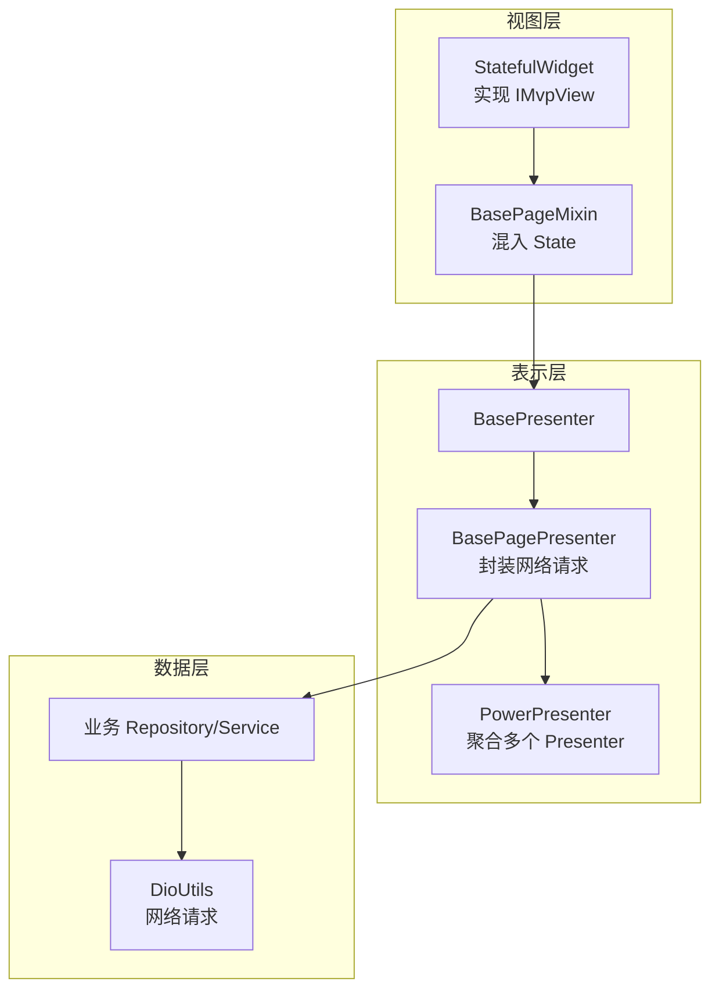
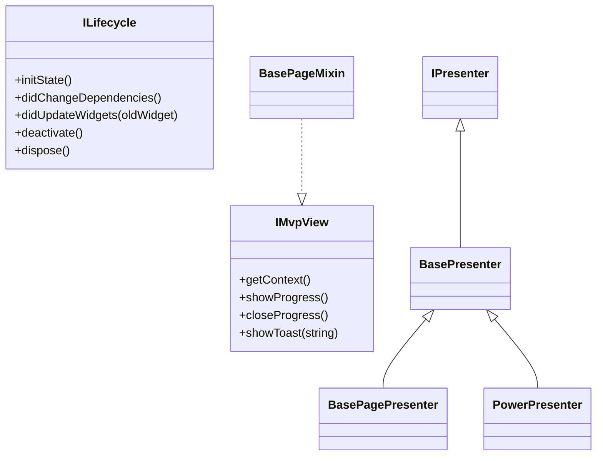
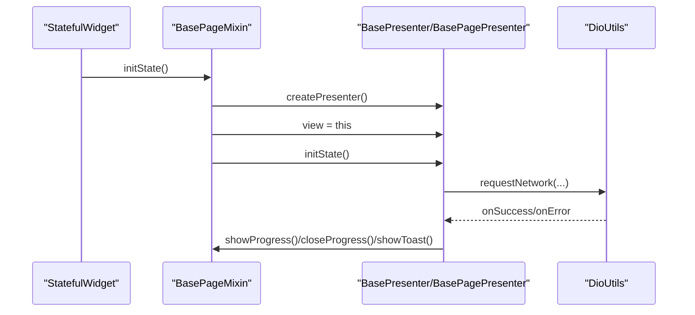
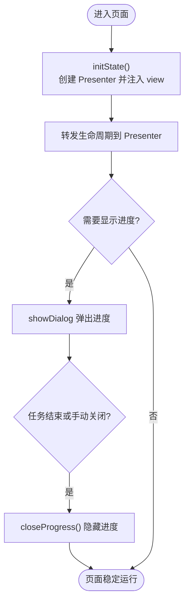
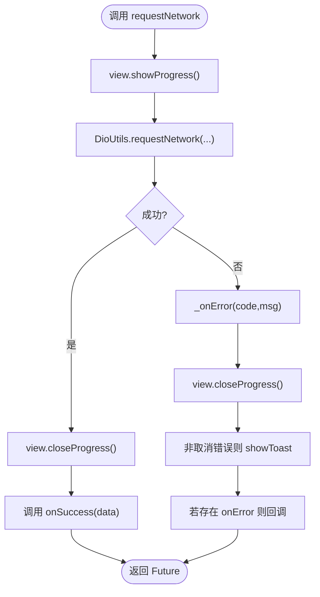
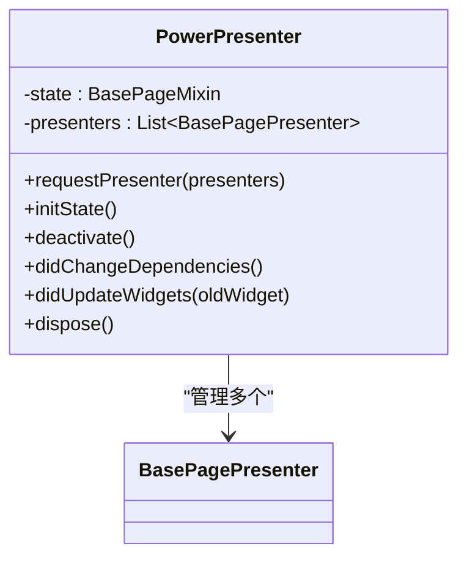
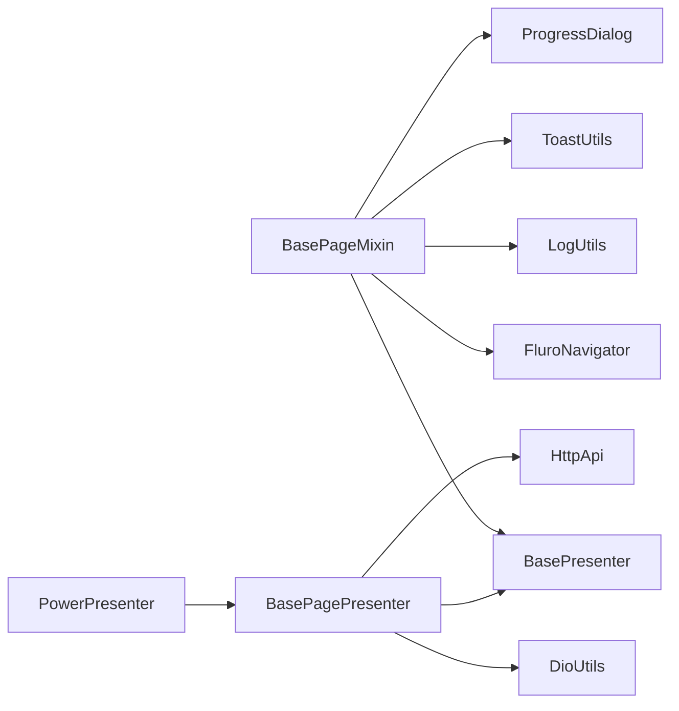

# MVP 架构模式

<cite>
**本文引用的文件**   
- [lib/mvp/i_lifecycle.dart](file://lib/mvp/i_lifecycle.dart)
- [lib/mvp/mvps.dart](file://lib/mvp/mvps.dart)
- [lib/mvp/base_presenter.dart](file://lib/mvp/base_presenter.dart)
- [lib/mvp/base_page.dart](file://lib/mvp/base_page.dart)
- [lib/mvp/base_page_presenter.dart](file://lib/mvp/base_page_presenter.dart)
- [lib/mvp/power_presenter.dart](file://lib/mvp/power_presenter.dart)
- [lib/net/dio_utils.dart](file://lib/net/dio_utils.dart)
- [lib/pages/home/table/table_repository.dart](file://lib/pages/home/table/table_repository.dart)
- [lib/pages/order/order_repository.dart](file://lib/pages/order/order_repository.dart)
</cite>

## 目录
1. [引言](#引言)
2. [项目结构中的 MVP 位置](#项目结构中的-mvp-位置)
3. [核心组件与职责](#核心组件与职责)
4. [架构总览](#架构总览)
5. [关键实现深度解析](#关键实现深度解析)
6. [依赖关系分析](#依赖关系分析)
7. [性能与健壮性考量](#性能与健壮性考量)
8. [在点餐业务中的应用建议](#在点餐业务中的应用建议)
9. [常见问题排查](#常见问题排查)
10. [结论](#结论)

## 引言
本文面向聚客美滋滋应用，围绕 Model-View-Presenter（MVP）架构模式进行系统性说明。重点解释：
- MVP 的核心理念与设计原则
- 为什么在该项目中采用 MVP 而不是 MVVM、Clean Architecture
- BasePageMixin 的生命周期管理、状态绑定与事件处理机制
- BasePresenter 的职责分离与 UI 回调规范
- PowerPresenter 的多 Presenter 管理与生命周期转发
- 结合网络请求封装 BasePagePresenter 的数据获取、错误处理和进度展示流程
- 在实际业务页面中如何正确使用这些基类，完成 Presenter 生命周期管理、UI 解耦和异常处理

## 项目结构中的 MVP 位置
MVP 相关代码集中在 lib/mvp 目录，并向上被业务页面通过 Repository/Service 层间接调用；向下通过 net 层的网络工具发起 HTTP 请求。整体分层如下：
- View 层：Flutter Stateful Widget + BasePageMixin
- Presenter 层：BasePresenter / BasePagePresenter / PowerPresenter
- 数据层：Repository/Service（业务仓储），网络层 DioUtils
- 契约接口：IMvpView、IPresenter、ILifecycle

**图示来源** 
- [lib/mvp/base_page.dart:1-103](file://lib/mvp/base_page.dart#L1-L103)
- [lib/mvp/base_presenter.dart:1-21](file://lib/mvp/base_presenter.dart#L1-L21)
- [lib/mvp/base_page_presenter.dart:1-120](file://lib/mvp/base_page_presenter.dart#L1-L120)
- [lib/mvp/power_presenter.dart:1-69](file://lib/mvp/power_presenter.dart#L1-L69)
- [lib/net/dio_utils.dart](file://lib/net/dio_utils.dart)

**章节来源**
- [lib/mvp/base_page.dart:1-103](file://lib/mvp/base_page.dart#L1-L103)
- [lib/mvp/base_presenter.dart:1-21](file://lib/mvp/base_presenter.dart#L1-L21)
- [lib/mvp/base_page_presenter.dart:1-120](file://lib/mvp/base_page_presenter.dart#L1-L120)
- [lib/mvp/power_presenter.dart:1-69](file://lib/mvp/power_presenter.dart#L1-L69)

## 核心组件与职责
- ILifecycle：定义统一生命周期接口，包括初始化、依赖变更、Widget 更新、停用与销毁。
- IMvpView：定义视图侧最小能力集，包括获取 BuildContext、显示/关闭进度、展示 Toast。
- IPresenter：继承 ILifecycle，作为所有 Presenter 的抽象基类。
- BasePresenter：提供空实现的生命周期钩子，便于子类按需覆盖。
- BasePageMixin：StatefulWidget 的混入，负责将 Flutter 生命周期桥接到 Presenter，并提供统一的进度与提示 UI。
- BasePagePresenter：在 BasePresenter 基础上增加网络请求封装、取消令牌管理和统一错误处理。
- PowerPresenter：聚合多个 BasePagePresenter，统一转发生命周期，提升复用度。

**图示来源**
- [lib/mvp/i_lifecycle.dart:1-13](file://lib/mvp/i_lifecycle.dart#L1-L13)
- [lib/mvp/mvps.dart:1-19](file://lib/mvp/mvps.dart#L1-L19)
- [lib/mvp/base_presenter.dart:1-21](file://lib/mvp/base_presenter.dart#L1-L21)
- [lib/mvp/base_page_presenter.dart:1-120](file://lib/mvp/base_page_presenter.dart#L1-L120)
- [lib/mvp/power_presenter.dart:1-69](file://lib/mvp/power_presenter.dart#L1-L69)
- [lib/mvp/base_page.dart:1-103](file://lib/mvp/base_page.dart#L1-L103)

**章节来源**
- [lib/mvp/i_lifecycle.dart:1-13](file://lib/mvp/i_lifecycle.dart#L1-L13)
- [lib/mvp/mvps.dart:1-19](file://lib/mvp/mvps.dart#L1-L19)
- [lib/mvp/base_presenter.dart:1-21](file://lib/mvp/base_presenter.dart#L1-L21)

## 架构总览
MVP 在本项目的执行顺序如下：
- StatefulWidget 通过 BasePageMixin 创建 Presenter，并将自身 IMvpView 注入 Presenter
- Presenter 执行业务逻辑与数据获取，通过 view.showProgress/closeProgress/showToast 与 UI 交互
- BasePagePresenter 统一封装网络请求，自动显示/关闭进度、统一错误处理
- PowerPresenter 聚合多个 BasePagePresenter，统一转发生命周期，避免重复代码

**图示来源**
- [lib/mvp/base_page.dart:1-103](file://lib/mvp/base_page.dart#L1-L103)
- [lib/mvp/base_page_presenter.dart:1-120](file://lib/mvp/base_page_presenter.dart#L1-L120)
- [lib/net/dio_utils.dart](file://lib/net/dio_utils.dart)

## 关键实现深度解析

### BasePageMixin：视图生命周期桥接与 UI 能力
- 生命周期桥接：重写 didChangeDependencies、dispose、deactivate、didUpdateWidget、initState，分别转发给 presenter，确保 Presenter 与 Flutter 生命周期同步。
- 视图能力：实现 IMvpView 的 getContext、showProgress、closeProgress、showToast。
- 进度对话框：使用 showDialog 弹出进度弹窗，设置 barrierDismissible=false，并通过 WillPopScope 拦截返回键，避免误关。
- 防重复显示：通过 _isShowDialog 标志位防止重复弹框；对未 build 完成的页面调用 showProgress 进行 try/catch 保护。
- 可定制进度控件：提供 buildProgress 方法，允许子类自定义加载界面。

**图示来源**
- [lib/mvp/base_page.dart:1-103](file://lib/mvp/base_page.dart#L1-L103)

**章节来源**
- [lib/mvp/base_page.dart:1-103](file://lib/mvp/base_page.dart#L1-L103)

### BasePresenter：职责分离与空实现
- 职责分离：BasePresenter 仅提供空的生命周期钩子，让子类按需覆写，避免样板代码。
- 解耦视图：通过泛型约束 V extends IMvpView，强制 Presenter 只能通过 IMvpView 提供的接口与 UI 交互，不直接持有 widget 引用。
- 可扩展性：新增业务特性时，优先在子类扩展，保持基础类的简洁与稳定。

**章节来源**
- [lib/mvp/base_presenter.dart:1-21](file://lib/mvp/base_presenter.dart#L1-L21)

### BasePagePresenter：网络请求封装与错误处理
- 统一网络入口：requestNetwork 与 asyncRequestNetwork 封装 DioUtils 的网络调用，自动处理进度显示与关闭。
- 取消令牌：内部维护 CancelToken，在 dispose 时取消未完成请求，避免内存泄漏和无效回调。
- 上传文件：uploadImg 封装图片上传，失败时通过 view.showToast 提示用户。
- 错误处理：_onError 统一关闭进度，根据异常码决定是否展示 Toast，并在页面已 dispose 时避免回调 onError。

**图示来源**
- [lib/mvp/base_page_presenter.dart:1-120](file://lib/mvp/base_page_presenter.dart#L1-L120)
- [lib/net/dio_utils.dart](file://lib/net/dio_utils.dart)

**章节来源**
- [lib/mvp/base_page_presenter.dart:1-120](file://lib/mvp/base_page_presenter.dart#L1-L120)

### PowerPresenter：多 Presenter 聚合与生命周期转发
- 多 Presenter 管理：通过 List<BasePagePresenter> 保存多个子 Presenter，支持按场景组合复用。
- 生命周期转发：在 deactivate、didChangeDependencies、didUpdateWidgets、dispose、initState 中统一转发给每个子 Presenter。
- 视图注入：在 requestPresenter 中将 BasePageMixin 注入到各子 Presenter 的 view 字段，确保子 Presenter 能访问 UI 能力。

**图示来源**
- [lib/mvp/power_presenter.dart:1-69](file://lib/mvp/power_presenter.dart#L1-L69)

**章节来源**
- [lib/mvp/power_presenter.dart:1-69](file://lib/mvp/power_presenter.dart#L1-L69)

## 依赖关系分析
- BasePageMixin 依赖：
  - BasePresenter：用于实例化和生命周期转发
  - FluroNavigator：用于关闭进度弹窗时返回上一页
  - LogUtils、ToastUtils、ProgressDialog：日志与 UI 反馈
- BasePagePresenter 依赖：
  - BasePresenter：继承基础能力
  - DioUtils：统一网络请求
  - HttpApi：上传等接口地址
- PowerPresenter 依赖：
  - BasePagePresenter：聚合与转发生命周期

**图示来源**
- [lib/mvp/base_page.dart:1-103](file://lib/mvp/base_page.dart#L1-L103)
- [lib/mvp/base_page_presenter.dart:1-120](file://lib/mvp/base_page_presenter.dart#L1-L120)
- [lib/mvp/power_presenter.dart:1-69](file://lib/mvp/power_presenter.dart#L1-L69)

**章节来源**
- [lib/mvp/base_page.dart:1-103](file://lib/mvp/base_page.dart#L1-L103)
- [lib/mvp/base_page_presenter.dart:1-120](file://lib/mvp/base_page_presenter.dart#L1-L120)
- [lib/mvp/power_presenter.dart:1-69](file://lib/mvp/power_presenter.dart#L1-L69)

## 性能与健壮性考量
- 生命周期一致性：BasePageMixin 将 Flutter 生命周期完整转发给 Presenter，避免 Presenter 长时间持有引用导致内存泄漏。
- 进度弹窗防抖：BasePageMixin 使用 _isShowDialog 防止重复弹窗，并对未 build 完成的页面进行异常捕获。
- 请求取消：BasePagePresenter 在 dispose 时主动取消未完成请求，减少无效回调与资源占用。
- 错误处理集中化：统一关闭进度并根据异常码决定是否提示用户，避免 UI 状态不一致。
- 多 Presenter 复用：PowerPresenter 统一管理多个子 Presenter，降低样板代码，提高复用率。

[本节为通用指导，不直接分析具体文件]

## 在点餐业务中的应用建议
虽然当前仓库中未找到直接使用 BasePresenter/BasePagePresenter/PowerPresenter 的业务页面，但基于现有 MVP 基础设施，建议在点餐相关页面中按以下方式使用：

- 订单列表页（如 order_page）：
  - 使用 BasePageMixin 作为 State 混入，实现 createPresenter 返回一个 BasePagePresenter 子类
  - 在 Presenter 中通过 requestNetwork 拉取订单数据，成功后刷新 UI 状态
  - 下拉刷新、上拉加载更多通过 BasePagePresenter 的 Future 返回值配合刷新组件

- 下单结算页（如 settle_page）：
  - 在 Presenter 中封装下单、支付等业务流程，调用 Repository/Service 层
  - 使用 BasePagePresenter.uploadImg 上传发票或凭证图片
  - 异常时通过 view.showToast 提示用户，必要时通过 view.closeProgress 关闭进度

- 桌台管理页（如 table_page）：
  - 使用 PowerPresenter 聚合多个子 Presenter，例如：连接状态 Presenter、桌台数据 Presenter、设备检查 Presenter
  - 通过 requestPresenter 注册子 Presenter，由 PowerPresenter 统一转发生命周期

参考仓库中的仓储示例，业务数据通常从 Repository 层获取，Presenter 负责编排流程并驱动 UI：
- [lib/pages/home/table/table_repository.dart](file://lib/pages/home/table/table_repository.dart)
- [lib/pages/order/order_repository.dart](file://lib/pages/order/order_repository.dart)

**章节来源**
- [lib/pages/home/table/table_repository.dart](file://lib/pages/home/table/table_repository.dart)
- [lib/pages/order/order_repository.dart](file://lib/pages/order/order_repository.dart)

## 常见问题排查
- 进度弹窗无法关闭：
  - 检查是否多次调用 showProgress 而未关闭 closeProgress
  - 确认页面是否在 build 前就调用 showProgress，需等待页面构建完成
- 网络请求未取消：
  - 确认 Presenter 是否正确调用 BasePagePresenter 的请求方法，保证 CancelToken 在 dispose 时取消
- 错误提示重复或不显示：
  - 检查 _onError 的异常码是否为取消错误，避免重复提示
  - 确认页面未 dispose 后再触发 onError 回调
- 多 Presenter 生命周期不同步：
  - 使用 PowerPresenter 统一管理，确保 requestPresenter 正确注入 view

**章节来源**
- [lib/mvp/base_page.dart:1-103](file://lib/mvp/base_page.dart#L1-L103)
- [lib/mvp/base_page_presenter.dart:1-120](file://lib/mvp/base_page_presenter.dart#L1-L120)
- [lib/mvp/power_presenter.dart:1-69](file://lib/mvp/power_presenter.dart#L1-L69)

## 结论
本项目采用 MVP 架构，通过 BasePageMixin、BasePresenter、BasePagePresenter 与 PowerPresenter 构建了清晰的职责分离体系：
- View 层仅负责 UI 渲染与用户交互
- Presenter 层负责业务编排与数据获取，并通过 IMvpView 与 UI 解耦
- 网络请求、错误处理、进度展示在 BasePagePresenter 中统一封装，提升一致性与可维护性
- PowerPresenter 提供多 Presenter 管理能力，适合复杂页面的场景组合

相比 MVVM 或 Clean Architecture，MVP 在该应用中具有更强的显式控制力与更低的侵入性，尤其适合以页面为中心的 Flutter 开发模式，便于逐步重构与测试。未来可在现有 MVP 基础上引入仓储层、服务层与状态管理策略，进一步提升模块化程度。