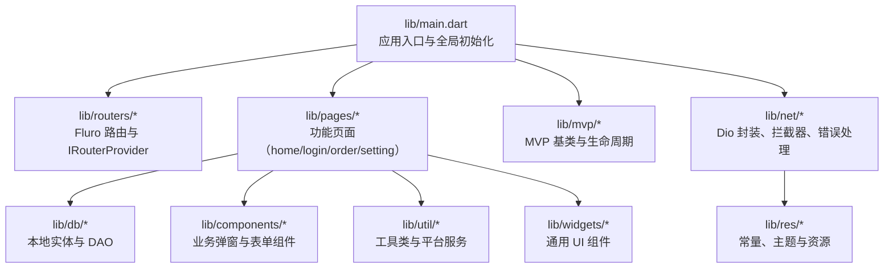
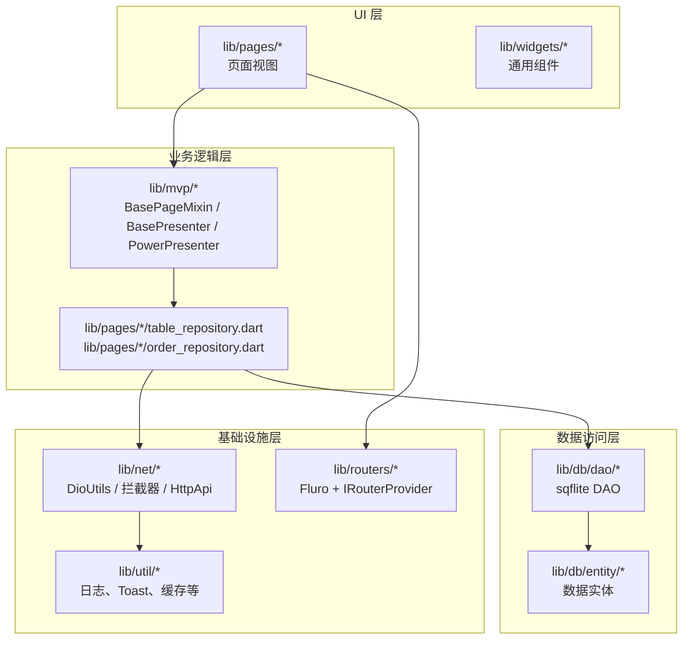
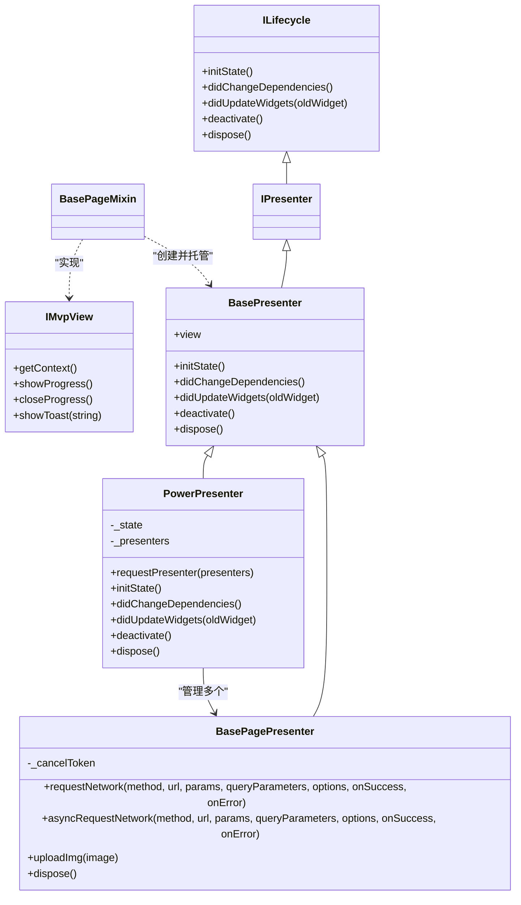
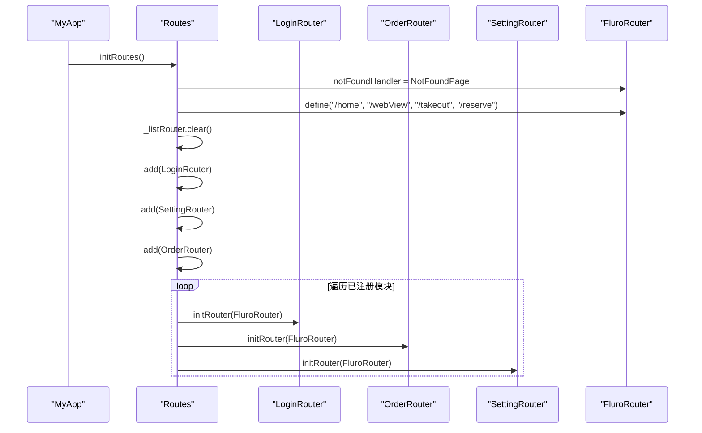
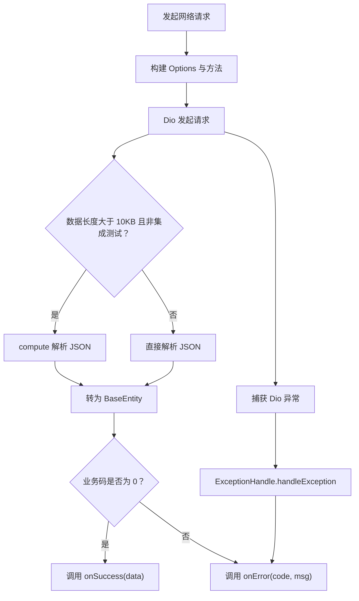
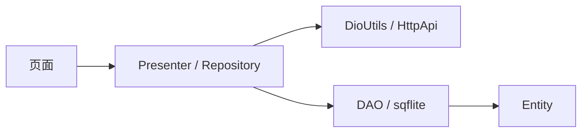
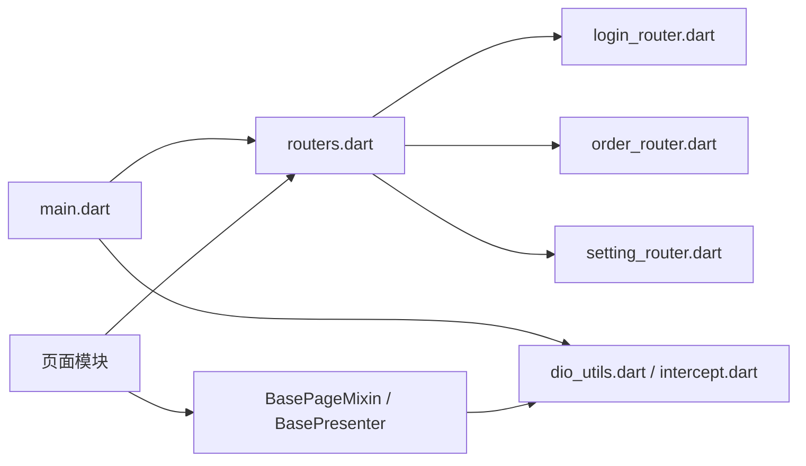

# 架构设计

<cite>
**本文引用的文件**   
- [main.dart](file://lib/main.dart)
- [pubspec.yaml](file://pubspec.yaml)
- [README.md](file://README.md)
- [routers.dart](file://lib/routers/routers.dart)
- [i_router.dart](file://lib/routers/i_router.dart)
- [fluro_navigator.dart](file://lib/routers/fluro_navigator.dart)
- [base_page_presenter.dart](file://lib/mvp/base_page_presenter.dart)
- [base_presenter.dart](file://lib/mvp/base_presenter.dart)
- [power_presenter.dart](file://lib/mvp/power_presenter.dart)
- [base_page.dart](file://lib/mvp/base_page.dart)
- [i_lifecycle.dart](file://lib/mvp/i_lifecycle.dart)
- [mvps.dart](file://lib/mvp/mvps.dart)
- [dio_utils.dart](file://lib/net/dio_utils.dart)
- [intercept.dart](file://lib/net/intercept.dart)
- [error_handle.dart](file://lib/net/error_handle.dart)
- [http_api.dart](file://lib/net/http_api.dart)
- [net.dart](file://lib/net/net.dart)
- [login_router.dart](file://lib/pages/login/login_router.dart)
- [order_router.dart](file://lib/pages/order/order_router.dart)
- [setting_router.dart](file://lib/setting/setting_router.dart)
</cite>

## 目录

1. [引言](#引言)
2. [项目结构](#项目结构)
3. [核心组件](#核心组件)
4. [架构总览](#架构总览)
5. [详细组件分析](#详细组件分析)
6. [依赖关系分析](#依赖关系分析)
7. [性能与可维护性](#性能与可维护性)
8. [故障排查指南](#故障排查指南)
9. [结论](#结论)

## 引言

本仓库是“聚客美滋滋”点餐应用的 Flutter 客户端。应用采用分层架构：UI 层、业务逻辑层、数据访问层和基础设施层相互解耦；在业务逻辑层中，广泛使用 MVP 模式进行职责分离；在网络层通过 Dio 统一封装拦截器链、错误处理和数据适配；路由系统基于 Fluro，并通过 `IRouterProvider` 接口实现模块化注册。整体目标是让页面展示、业务编排、数据获取和底层网络/数据库能力清晰分层，便于扩展点餐、结算、桌台管理、设置等模块。

## 项目结构

从顶层看，源码集中在 `lib/` 下，按功能域和组织层次划分：

**图示来源**
- [main.dart:1-159](file://lib/main.dart#L1-L159)
- [routers.dart:1-71](file://lib/routers/routers.dart#L1-L71)
- [dio_utils.dart:1-200](file://lib/net/dio_utils.dart#L1-L200)

项目根目录的 README 明确了主要目录含义：`mvp` 提供 MVP 基类，`net` 提供 Dio 与拦截器，`pages` 按模块组织页面，`routers` 提供模块化路由，`setting` 提供设置与主题，`util` 提供工具类，`widgets` 提供通用控件。依赖方面，`pubspec.yaml` 声明了 Dio、Fluro、Provider、sqflite、dart_amqp 等关键第三方库。

**章节来源**
- [README.md:1-50](file://README.md#L1-L50)
- [pubspec.yaml:1-111](file://pubspec.yaml#L1-L111)

## 核心组件

本节聚焦四类核心基础设施：

| 层次 | 核心组件 | 职责 |
|---|---|---|
| 应用启动层 | `main.dart` | 初始化日志、设备信息、Dio、路由，并根据登录状态决定首页 |
| 路由层 | `routers.dart`、`i_router.dart`、`fluro_navigator.dart` | 统一管理 Fluro Router，定义模块化路由注册接口和跳转工具 |
| 业务逻辑层 | `BasePageMixin`、`BasePresenter`、`BasePagePresenter`、`PowerPresenter` | 管理 Presenter 生命周期、请求进度、CancelToken、多 Presenter 复用 |
| 网络层 | `DioUtils`、拦截器链、`ExceptionHandle`、`HttpApi` | 单例 Dio、统一响应解析、错误分类、API 路径集中管理 |

这些组件共同构成“页面调用 Presenter，Presenter 调用 Repository/DAO，Repository/DAO 调用 Dio 或 sqflite”的典型分层链路。

**章节来源**
- [main.dart:20-159](file://lib/main.dart#L20-L159)
- [routers.dart:1-71](file://lib/routers/routers.dart#L1-L71)
- [base_page.dart:1-103](file://lib/mvp/base_page.dart#L1-L103)
- [dio_utils.dart:1-200](file://lib/net/dio_utils.dart#L1-L200)

## 架构总览

### 分层架构模型

应用采用经典分层架构：

该图描述的是代码层面的真实依赖方向：页面通过 Presenter 发起业务操作；Presenter 通常委托 Repository；Repository 再选择网络层或本地 DAO；路由独立于业务，负责页面导航；网络层依赖工具类和常量。

**图示来源**
- [base_page.dart:1-103](file://lib/mvp/base_page.dart#L1-L103)
- [base_page_presenter.dart:1-120](file://lib/mvp/base_page_presenter.dart#L1-L120)
- [dio_utils.dart:1-200](file://lib/net/dio_utils.dart#L1-L200)
- [routers.dart:1-71](file://lib/routers/routers.dart#L1-L71)

### 模块组织原则

应用按功能域组织页面与路由：

- `lib/pages/home`：首页、外卖、预订、桌台相关页面。
- `lib/pages/login`：登录、注册、短信登录、重置密码、数据交换页。
- `lib/pages/order`：点菜、确认订单、订单详情、结账、暂结订单。
- `lib/setting`：设置中心、主题、账户管理、交班、参数设置等。

每个功能模块通常拥有自己的路由文件，例如 `LoginRouter`、`OrderRouter`、`SettingRouter`，并在 `Routes.initRoutes()` 中集中注册。这样新增模块只需实现 `IRouterProvider` 并加入列表，即可自动完成路由发现。

**章节来源**
- [routers.dart:35-71](file://lib/routers/routers.dart#L35-L71)
- [login_router.dart:1-40](file://lib/pages/login/login_router.dart#L1-L40)
- [order_router.dart:1-148](file://lib/pages/order/order_router.dart#L1-L148)
- [setting_router.dart:1-39](file://lib/setting/setting_router.dart#L1-L39)

## 详细组件分析

### MVP 架构与生命周期

MVP 在本项目中由以下类型协作：

- `ILifecycle`：定义 Presenter 生命周期接口。
- `IPresenter`：继承生命周期接口，表示所有 Presenter 都应具备完整生命周期。
- `IMvpView`：定义 View 侧最小契约，包括获取上下文、显示/关闭进度、提示 Toast。
- `BasePresenter`：默认实现空生命周期方法，持有 `view` 引用。
- `BasePageMixin`：混入到页面 State，创建 Presenter，转发生命周期，并提供进度和 Toast。
- `BasePagePresenter`：扩展网络请求能力，封装 CancelToken、进度控制和图片上传。
- `PowerPresenter`：聚合多个 `BasePagePresenter`，用于一个页面复用多个业务 Presenter。

**图示来源**
- [i_lifecycle.dart:1-13](file://lib/mvp/i_lifecycle.dart#L1-L13)
- [mvps.dart:1-19](file://lib/mvp/mvps.dart#L1-L19)
- [base_presenter.dart:1-21](file://lib/mvp/base_presenter.dart#L1-L21)
- [base_page_presenter.dart:1-120](file://lib/mvp/base_page_presenter.dart#L1-L120)
- [power_presenter.dart:1-69](file://lib/mvp/power_presenter.dart#L1-L69)
- [base_page.dart:1-103](file://lib/mvp/base_page.dart#L1-L103)

#### BasePageMixin 的职责边界

`BasePageMixin` 是 UI 层与 Presenter 层的桥梁：

1. **Presenter 创建与注入**：通过 `createPresenter()` 抽象方法让具体页面返回 Presenter，并在 `initState` 中绑定 view 引用。
2. **生命周期转发**：将 `initState`、`didChangeDependencies`、`didUpdateWidgets`、`deactivate`、`dispose` 转发给 Presenter。
3. **UI 能力**：提供 `showProgress`、`closeProgress`、`showToast`，避免页面直接依赖具体对话框或 Toast 实现。
4. **防重复弹窗**：内部 `_isShowDialog` 标志防止重复弹出加载框。

这意味着页面只需关注布局和少量交互逻辑，复杂业务应下沉到 Presenter 或 Repository。

**章节来源**
- [base_page.dart:1-103](file://lib/mvp/base_page.dart#L1-L103)

#### BasePagePresenter 的网络职责

`BasePagePresenter` 将网络请求细节从页面剥离：

- 使用 `CancelToken` 避免页面销毁后继续执行回调。
- 根据 `isShow` 控制进度显示，并在成功或失败时关闭进度。
- 统一错误处理：非取消异常会显示 Toast，同时可选回调 `onError`。
- 提供 `uploadImg` 作为常用上传场景封装。

该 Presenter 适合大多数带网络请求的业务页面；若页面需要多个 Presenter，则推荐使用 `PowerPresenter`。

**章节来源**
- [base_page_presenter.dart:1-120](file://lib/mvp/base_page_presenter.dart#L1-L120)

#### PowerPresenter 的多 Presenter 复用

当页面包含多个相对独立的业务块时，例如“桌台信息加载”“菜品加载”“会员查询”，可以为每个块创建一个 `BasePagePresenter`，再通过 `PowerPresenter.requestPresenter` 批量初始化。它负责：

- 为每个 Presenter 注入当前页面作为 view。
- 统一转发生命周期。
- 在 `dispose` 中释放所有 Presenter。

这降低了页面内 Presenter 数量膨胀带来的耦合风险。

**章节来源**
- [power_presenter.dart:1-69](file://lib/mvp/power_presenter.dart#L1-L69)

### 路由系统设计与模块化注册

路由系统以 Fluro 为基础，但通过 `IRouterProvider` 抽象出模块化注册机制：

**图示来源**
- [routers.dart:1-71](file://lib/routers/routers.dart#L1-L71)
- [i_router.dart:1-7](file://lib/routers/i_router.dart#L1-L7)
- [login_router.dart:1-40](file://lib/pages/login/login_router.dart#L1-L40)
- [order_router.dart:1-148](file://lib/pages/order/order_router.dart#L1-L148)
- [setting_router.dart:1-39](file://lib/setting/setting_router.dart#L1-L39)

#### IRouterProvider 接口设计

`IRouterProvider` 只暴露一个 `initRouter(FluroRouter router)` 方法，使模块可以：

- 定义自身路由常量。
- 在 `initRouter` 中调用 `router.define` 注册页面。
- 在 handler 中解析 `arguments` 或 URL 参数。

#### 模块化路由示例

- `LoginRouter` 注册登录、注册、短信登录、重置密码、更新密码和数据交换页。
- `OrderRouter` 注册点菜、订单确认、订单详情、结账、结算完成、暂结订单，并在 handler 中将路由参数映射为页面构造参数。
- `SettingRouter` 注册设置中心、主题、账户管理、交班、参数设置、打印设置等页面。

#### NavigatorUtils 跳转工具

`NavigatorUtils` 是对 Fluro 跳转的轻量封装，提供：

- `push`：普通跳转。
- `pushResult`：带返回结果的跳转。
- `goBack`：返回上一页。
- `goBackWithParams`：带参数返回。
- `goWebViewPage`、`goAssetHtmlPage`：跳转到 WebView 页面。
- `unfocus`：避免焦点导致的多余 build。

**章节来源**
- [fluro_navigator.dart:1-72](file://lib/routers/fluro_navigator.dart#L1-L72)

### 网络层统一封装策略

网络层的核心是 `DioUtils`，它承担以下职责：

1. **配置入口**：`configDio` 接收超时时间、基础地址和拦截器列表，供 `main.dart` 初始化。
2. **单例模式**：通过 Dart 工厂构造函数和静态实例保证全局唯一。
3. **统一响应格式**：将所有响应解析为 `BaseEntity<T>`，由上层判断业务码。
4. **主流程封装**：`requestNetwork` 返回 Future，适合刷新、提交等场景。
5. **异步回调封装**：`asyncRequestNetwork` 以 Stream 广播形式回调，适合流式或一次性回调场景。
6. **错误统一处理**：将 Dio 异常、Socket 异常、HTTP 异常、解析异常转换为统一的 `NetError`。
7. **隔离解析优化**：对大于 10KB 的数据使用 `compute` 进行 JSON 解析，降低主线程压力。
8. **调试代理**：在非 Web 平台支持抓包代理，仅在特定条件启用。

**图示来源**
- [dio_utils.dart:1-200](file://lib/net/dio_utils.dart#L1-L200)
- [error_handle.dart:1-82](file://lib/net/error_handle.dart#L1-L82)

#### 拦截器链设计

`main.dart` 中初始化拦截器链：

| 拦截器 | 职责 |
|---|---|
| `AuthInterceptor` | 添加 Authorization 头，区分云服务与主设备请求 |
| `TokenInterceptor` | 401 时自动刷新 Token 并重试原请求 |
| `LoggingInterceptor` | 记录请求 URL、方法、参数、响应时间与响应体 |
| `AdapterInterceptor` | 将不同后端响应格式统一为标准结构 |

其中 `AuthInterceptor` 会根据路径判断是否属于云服务请求；`TokenInterceptor` 使用独立的 Dio 实例重试请求，避免循环触发拦截器。

**章节来源**
- [main.dart:45-90](file://lib/main.dart#L45-L90)
- [intercept.dart:1-219](file://lib/net/intercept.dart#L1-L219)

#### 错误处理机制

`ExceptionHandle` 定义了 HTTP 状态码、业务异常码和错误消息映射，并将 Dio 异常分类为连接超时、发送超时、接收超时、取消、未知异常等。`DioUtils` 在异常分支调用 `handleException`，最终向 Presenter 或页面传递稳定的 `code` 和 `msg`。

这种设计的优点是：

- 页面不需要关心底层是 Socket 异常还是 HTTP 异常。
- Presenter 可以统一处理取消请求和错误提示。
- 新增错误类型只需修改错误映射。

**章节来源**
- [error_handle.dart:1-82](file://lib/net/error_handle.dart#L1-L82)
- [dio_utils.dart:120-200](file://lib/net/dio_utils.dart#L120-L200)

#### API 路径集中管理

`HttpApi` 集中管理云端和主设备的接口路径，包括：

- 云服务和主设备的桌台区域、桌台信息、开台、消台、锁台。
- 菜品分类、商品、套餐、规格做法。
- 下单、会员支付、结账、清台。
- 交接班、参数设置、厨打列表、沽清标记等。

这使得环境切换和接口迁移集中在单一位置，减少散落的字符串路径。

**章节来源**
- [http_api.dart:1-200](file://lib/net/http_api.dart#L1-L200)

### 数据访问层与 Repository 定位

虽然本次文档重点在架构设计，但从目录结构可见数据访问层采用实体与 DAO 分离的方式：

- `lib/db/entity`：存放与数据库表对应的实体类。
- `lib/db/dao`：按表或业务维度组织 DAO，如产品、会员、门店、用户、桌台等。
- `lib/db` 下还有针对交班、押金、销售等业务 DAO。

结合 `lib/pages/*/table_repository.dart`、`lib/pages/*/order_repository.dart` 等命名，可以推断典型数据流向为：

**图示来源**
- [base_page_presenter.dart:1-120](file://lib/mvp/base_page_presenter.dart#L1-L120)
- [dio_utils.dart:1-200](file://lib/net/dio_utils.dart#L1-L200)

## 依赖关系分析

### 模块间依赖图

**图示来源**
- [main.dart:1-159](file://lib/main.dart#L1-L159)
- [routers.dart:1-71](file://lib/routers/routers.dart#L1-L71)
- [base_page.dart:1-103](file://lib/mvp/base_page.dart#L1-L103)

### 耦合与内聚评估

- **高内聚**：网络层将 Dio、拦截器、错误处理和 API 路径放在 `lib/net`；路由层将 Fluro 配置集中在 `lib/routers`；MVP 基类集中在 `lib/mvp`。
- **低耦合**：页面通过 Presenter 和业务 Repository 访问数据，而不是直接调用 Dio；路由通过 `IRouterProvider` 解耦模块注册；UI 通过 `IMvpView` 解耦 Presenter。
- **潜在循环依赖**：当前结构中未发现明显循环依赖；MVP 不依赖具体页面，页面依赖 Presenter，Presenter 依赖 Repository 或网络层。

**章节来源**
- [dio_utils.dart:1-200](file://lib/net/dio_utils.dart#L1-L200)
- [routers.dart:1-71](file://lib/routers/routers.dart#L1-L71)
- [base_page.dart:1-103](file://lib/mvp/base_page.dart#L1-L103)

## 性能与可维护性

### 性能特性

- **JSON 解析隔离**：对大数据响应使用 `compute`，避免阻塞主线程。
- **进度控制合理**：Presenter 层控制进度显示和关闭，避免页面频繁重建。
- **拦截器顺序明确**：认证、Token 刷新、日志、适配器各司其职，便于单独替换或禁用。
- **Web 代理保护**：非 Web 平台才强转 IO 客户端配置代理，避免 Web 端初始化失败。

### 可维护性建议

- 新增模块时应遵循现有约定：创建模块目录、编写 `xxx_router.dart`、在 `Routes.initRoutes()` 中注册。
- 页面复杂逻辑应放入 Presenter 或 Repository，避免在 UI 层写大量业务判断。
- 网络错误应优先使用 Presenter 的错误回调，而不是在页面分散处理。
- 新接口路径应添加到 `HttpApi`，不要散落字符串。
- 如果页面存在多个独立业务块，优先使用 `PowerPresenter` 管理多个 Presenter。

[本节为通用指导，不直接分析具体代码片段]

## 故障排查指南

### 常见问题与定位思路

| 问题现象 | 可能原因 | 排查位置 |
|---|---|---|
| 首次启动白屏或闪退 | 全局异常未捕获、Dio 初始化失败、路由未注册 | `main.dart` 中的 `handleError` 和 `initDio` |
| 登录后仍进入登录页 | token 未正确保存或读取 | `SpUtil` 与 `Constant.token` |
| 路由跳转 404 | 模块未注册或路径拼写错误 | `routers.dart` 和各模块 `*_router.dart` |
| 网络请求无响应或解析失败 | 拦截器异常、JSON 解析失败、baseUrl 错误 | `dio_utils.dart`、`intercept.dart`、`http_api.dart` |
| 401 后无法自动重试 | Token 刷新失败或重试请求再次被拦截 | `TokenInterceptor` |
| 页面销毁后仍有网络回调 | CancelToken 未正确传递或 Presenter 未 dispose | `BasePagePresenter` |
| WebView 中文乱码 | 参数未编码 | `NavigatorUtils.goWebViewPage` |

**章节来源**
- [main.dart:20-159](file://lib/main.dart#L20-L159)
- [fluro_navigator.dart:1-72](file://lib/routers/fluro_navigator.dart#L1-L72)
- [dio_utils.dart:1-200](file://lib/net/dio_utils.dart#L1-L200)
- [intercept.dart:1-219](file://lib/net/intercept.dart#L1-L219)

## 结论

“聚客美滋滋”应用以分层架构为基础，将 UI、业务、数据和基础设施清晰拆分；在业务层使用 MVP 模式，通过 `BasePageMixin`、`BasePresenter`、`BasePagePresenter` 和 `PowerPresenter` 建立页面与 Presenter 的稳定契约；在路由层通过 `IRouterProvider` 实现模块自注册；在网络层通过 `DioUtils` 和拦截器链统一处理认证、Token 刷新、日志、适配和错误分类。

对于新加入开发者，建议优先掌握三条主线：

1. **页面如何工作**：页面实现 `BasePageMixin`，创建 Presenter，Presenter 发起网络或数据请求。
2. **路由如何注册**：模块实现 `IRouterProvider`，在 `Routes.initRoutes()` 中注册。
3. **网络如何封装**：通过 `DioUtils` 和拦截器链发起请求，错误通过统一错误码处理。

这套设计既保证了当前点餐业务的可扩展性，也为后续接入更多商户、终端和设备能力提供了稳定基础。