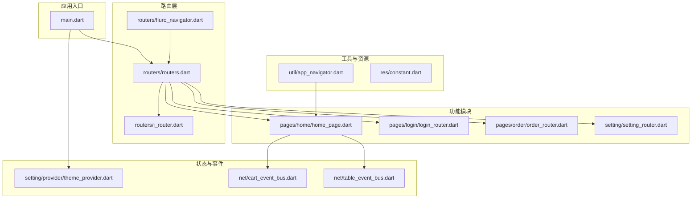
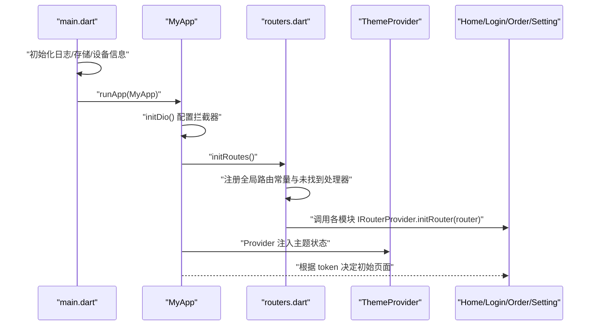
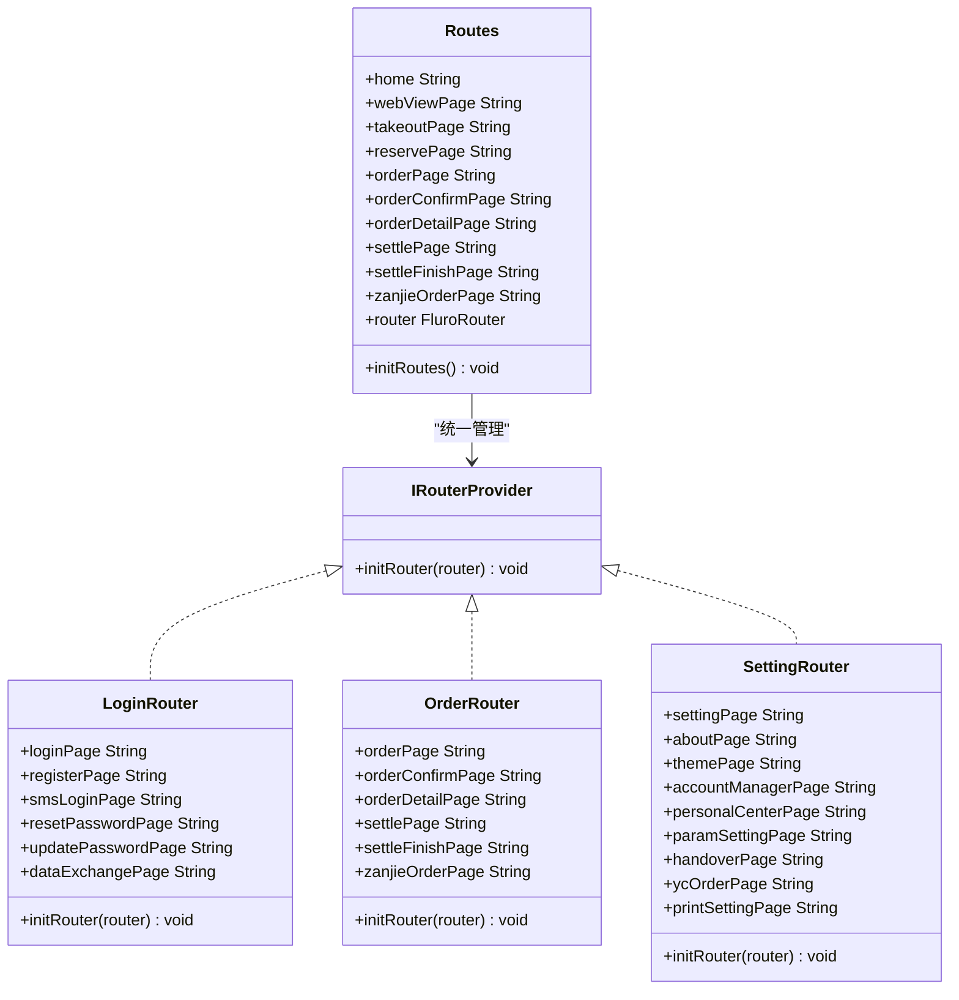
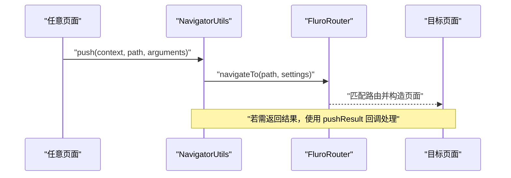
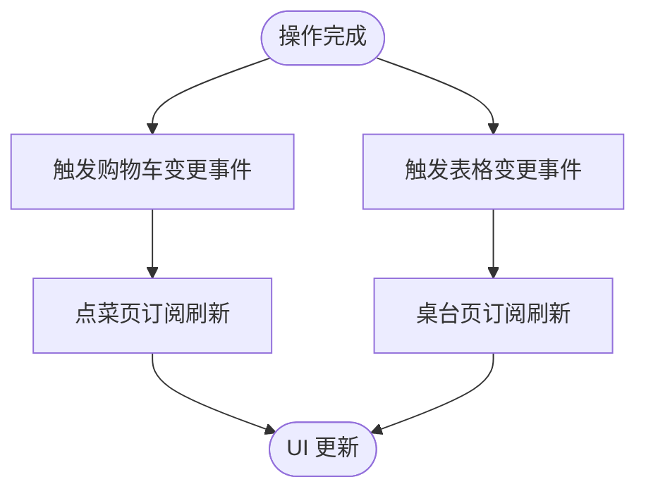
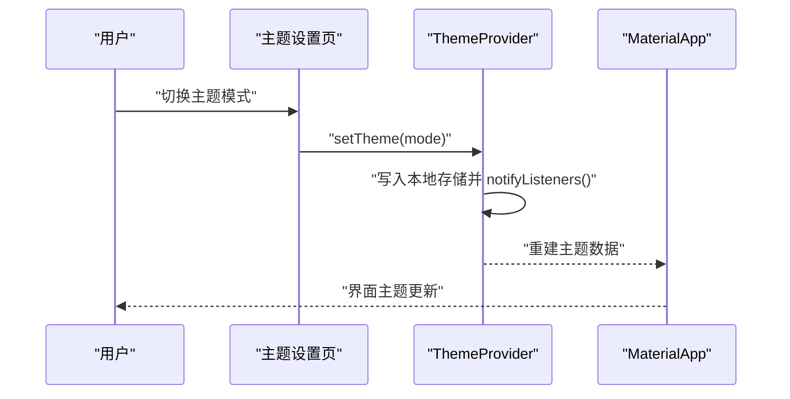
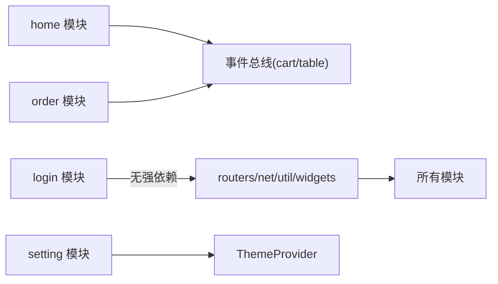
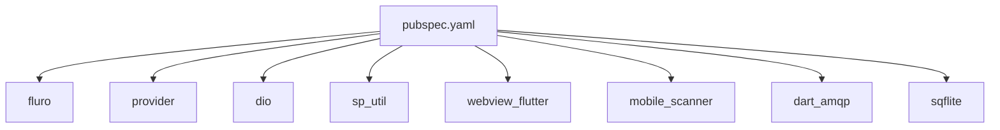

# 模块化设计

<cite>
**本文引用的文件**   
- [lib/main.dart](file://lib/main.dart)
- [pubspec.yaml](file://pubspec.yaml)
- [README.md](file://README.md)
- [lib/routers/i_router.dart](file://lib/routers/i_router.dart)
- [lib/routers/routers.dart](file://lib/routers/routers.dart)
- [lib/routers/fluro_navigator.dart](file://lib/routers/fluro_navigator.dart)
- [lib/util/app_navigator.dart](file://lib/util/app_navigator.dart)
- [lib/pages/home/home_page.dart](file://lib/pages/home/home_page.dart)
- [lib/pages/login/login_router.dart](file://lib/pages/login/login_router.dart)
- [lib/pages/order/order_router.dart](file://lib/pages/order/order_router.dart)
- [lib/setting/setting_router.dart](file://lib/setting/setting_router.dart)
- [lib/setting/provider/theme_provider.dart](file://lib/setting/provider/theme_provider.dart)
- [lib/net/cart_event_bus.dart](file://lib/net/cart_event_bus.dart)
- [lib/net/table_event_bus.dart](file://lib/net/table_event_bus.dart)
- [lib/res/constant.dart](file://lib/res/constant.dart)
- [lib/util/change_notifier_manage.dart](file://lib/util/change_notifier_manage.dart)
</cite>

## 目录
1. [引言](#引言)
2. [项目结构与模块划分原则](#项目结构与模块划分原则)
3. [核心组件与职责边界](#核心组件与职责边界)
4. [架构总览](#架构总览)
5. [详细组件分析](#详细组件分析)
6. [依赖关系分析](#依赖关系分析)
7. [性能与可维护性考量](#性能与可维护性考量)
8. [故障排查指南](#故障排查指南)
9. [结论](#结论)
10. [附录：新模块接入规范](#附录新模块接入规范)

## 引言
本文件为“聚客美滋滋”点餐应用的模块化设计文档，面向业务开发者与架构维护者。文档从仓库现有代码出发，梳理按功能域组织的模块边界、模块间通信机制、路由与状态共享方案，并给出新增模块的接入规范与最佳实践。目标是帮助读者在不深入源码细节的情况下，快速理解系统的组织方式，并在扩展时遵循一致的约定。

## 项目结构与模块划分原则
项目的 Flutter 代码集中在 `lib` 目录下，采用“功能域 + 基础设施”的分层组织方式：
- 功能页面模块：`pages/home`（首页桌台管理）、`pages/login`（用户认证）、`pages/order`（订单处理）等。
- 设置中心：`setting`（主题、账户、打印、交班等设置）。
- 基础设施层：`routers`（路由抽象与实现）、`net`（网络与事件总线）、`util`（工具类）、`widgets`（通用 UI 组件）、`res`（常量与样式资源）、`mvp`（MVP 基类）、`db`（数据库实体与 DAO）。

**图表来源**
- [lib/main.dart:1-159](file://lib/main.dart#L1-L159)
- [lib/routers/routers.dart:1-71](file://lib/routers/routers.dart#L1-L71)
- [lib/routers/i_router.dart:1-7](file://lib/routers/i_router.dart#L1-L7)
- [lib/routers/fluro_navigator.dart:1-72](file://lib/routers/fluro_navigator.dart#L1-L72)
- [lib/pages/home/home_page.dart:1-15](file://lib/pages/home/home_page.dart#L1-L15)
- [lib/pages/login/login_router.dart:1-40](file://lib/pages/login/login_router.dart#L1-L40)
- [lib/pages/order/order_router.dart:1-148](file://lib/pages/order/order_router.dart#L1-L148)
- [lib/setting/setting_router.dart:1-39](file://lib/setting/setting_router.dart#L1-L39)
- [lib/setting/provider/theme_provider.dart:1-92](file://lib/setting/provider/theme_provider.dart#L1-L92)
- [lib/net/cart_event_bus.dart:1-22](file://lib/net/cart_event_bus.dart#L1-L22)
- [lib/net/table_event_bus.dart:1-23](file://lib/net/table_event_bus.dart#L1-L23)
- [lib/util/app_navigator.dart:1-61](file://lib/util/app_navigator.dart#L1-L61)
- [lib/res/constant.dart:1-93](file://lib/res/constant.dart#L1-L93)

**章节来源**
- [README.md:1-50](file://README.md#L1-L50)
- [pubspec.yaml:1-111](file://pubspec.yaml#L1-L111)

## 核心组件与职责边界
- 应用入口与初始化
  - 负责全局异常捕获、日志与存储初始化、Dio 拦截器配置、MaterialApp 构建、初始页面选择（已登录进首页，未登录进登录页），以及主题 Provider 注册。
- 路由系统
  - 通过 Fluro 提供统一的路由能力；定义 `IRouterProvider` 接口，将各模块路由注册解耦；集中管理全局路由常量与未找到路由处理。
- 导航工具
  - 提供基于 Fluro 的 `NavigatorUtils` 和基于原生 Navigator 的 `AppNavigator`，屏蔽不同跳转方式的差异。
- 功能模块
  - home：首页桌台管理入口。
  - login：登录、注册、短信登录、密码重置与更新、数据交换页等认证相关页面。
  - order：点菜、确认、详情、结账、结算完成、暂结等订单流程页面。
  - setting：主题、账户、参数、交班、打印、对外订单等设置页。
- 状态与事件
  - `ThemeProvider`：使用 Provider 管理主题模式与主题数据，持久化到本地存储。
  - `CartEventBus`、`TableEventBus`：基于广播流的事件总线，用于购物车变更、桌台状态刷新等跨页面通知。
- 工具与资源
  - `Constant`：集中定义运行环境标志、存储键、业务开关等常量。
  - `ChangeNotifierMixin`：简化 `ChangeNotifier` 监听与释放的模板代码。

**章节来源**
- [lib/main.dart:1-159](file://lib/main.dart#L1-L159)
- [lib/routers/i_router.dart:1-7](file://lib/routers/i_router.dart#L1-L7)
- [lib/routers/routers.dart:1-71](file://lib/routers/routers.dart#L1-L71)
- [lib/routers/fluro_navigator.dart:1-72](file://lib/routers/fluro_navigator.dart#L1-L72)
- [lib/util/app_navigator.dart:1-61](file://lib/util/app_navigator.dart#L1-L61)
- [lib/setting/provider/theme_provider.dart:1-92](file://lib/setting/provider/theme_provider.dart#L1-L92)
- [lib/net/cart_event_bus.dart:1-22](file://lib/net/cart_event_bus.dart#L1-L22)
- [lib/net/table_event_bus.dart:1-23](file://lib/net/table_event_bus.dart#L1-L23)
- [lib/res/constant.dart:1-93](file://lib/res/constant.dart#L1-L93)
- [lib/util/change_notifier_manage.dart:1-79](file://lib/util/change_notifier_manage.dart#L1-L79)

## 架构总览
应用启动后，`main.dart` 完成基础设施初始化，创建 `MyApp`，在 `initRoutes` 中统一注册所有模块路由，并通过 `MultiProvider` 注入 `ThemeProvider`。页面之间通过 Fluro 路由跳转或事件总线进行松耦合交互。

**图表来源**
- [lib/main.dart:1-159](file://lib/main.dart#L1-L159)
- [lib/routers/routers.dart:1-71](file://lib/routers/routers.dart#L1-L71)
- [lib/setting/provider/theme_provider.dart:1-92](file://lib/setting/provider/theme_provider.dart#L1-L92)

## 详细组件分析

### 路由系统与 IRouterProvider 接口
- 设计理念
  - 将路由注册与具体页面解耦：每个模块实现 `IRouterProvider`，仅暴露 `initRouter(FluroRouter)`，由路由中心统一调度。
  - 路由常量集中管理：全局路由字符串在 `Routes` 与各模块 Router 中声明，避免魔法字符串散落。
- 关键行为
  - `Routes.initRoutes()` 定义全局路由（首页、WebView、外卖、预约），并依次调用各模块的 `initRouter`。
  - `fluro_navigator.dart` 封装 push、带参返回、WebView 跳转等常用操作，屏蔽焦点与错误处理细节。
  - `i_router.dart` 定义最小化接口，便于扩展新模块。

**图表来源**
- [lib/routers/i_router.dart:1-7](file://lib/routers/i_router.dart#L1-L7)
- [lib/routers/routers.dart:1-71](file://lib/routers/routers.dart#L1-L71)
- [lib/pages/login/login_router.dart:1-40](file://lib/pages/login/login_router.dart#L1-L40)
- [lib/pages/order/order_router.dart:1-148](file://lib/pages/order/order_router.dart#L1-L148)
- [lib/setting/setting_router.dart:1-39](file://lib/setting/setting_router.dart#L1-L39)

**章节来源**
- [lib/routers/i_router.dart:1-7](file://lib/routers/i_router.dart#L1-L7)
- [lib/routers/routers.dart:1-71](file://lib/routers/routers.dart#L1-L71)
- [lib/routers/fluro_navigator.dart:1-72](file://lib/routers/fluro_navigator.dart#L1-L72)

### 导航与页面跳转
- 推荐使用 `fluro_navigator.dart` 中的 `NavigatorUtils` 进行基于 Fluro 的页面跳转，支持替换、清空栈、携带参数与结果回调。
- 当需要直接持有 Widget 进行跳转时，可使用 `util/app_navigator.dart` 中的 `AppNavigator`，但项目中更推荐统一走 Fluro 路由以保持一致性与可测试性。
- WebView 与本地 HTML 页面跳转通过 `goWebViewPage`、`goAssetHtmlPage` 包装，内部对中文与参数进行编码处理。

**图表来源**
- [lib/routers/fluro_navigator.dart:1-72](file://lib/routers/fluro_navigator.dart#L1-L72)
- [lib/util/app_navigator.dart:1-61](file://lib/util/app_navigator.dart#L1-L61)

**章节来源**
- [lib/routers/fluro_navigator.dart:1-72](file://lib/routers/fluro_navigator.dart#L1-L72)
- [lib/util/app_navigator.dart:1-61](file://lib/util/app_navigator.dart#L1-L61)

### 事件总线与跨模块通信
- 购物车变更事件总线
  - 订单确认页等页面修改购物车后，触发 `CartEventBus.fireCartChanged()`，点菜页订阅 `onCartChanged` 刷新角标与合计金额。
- 桌台状态变更事件总线
  - 开台、锁台、消台、清台、结算等操作成功后，通过 `TableEventBus.fireTableChanged()` 通知桌台页刷新，避免等待定时轮询。

**图表来源**
- [lib/net/cart_event_bus.dart:1-22](file://lib/net/cart_event_bus.dart#L1-L22)
- [lib/net/table_event_bus.dart:1-23](file://lib/net/table_event_bus.dart#L1-L23)

**章节来源**
- [lib/net/cart_event_bus.dart:1-22](file://lib/net/cart_event_bus.dart#L1-L22)
- [lib/net/table_event_bus.dart:1-23](file://lib/net/table_event_bus.dart#L1-L23)

### Provider 状态共享与主题管理
- `ThemeProvider` 继承 `ChangeNotifier`，通过 `sp_util` 持久化主题模式，并提供亮色/暗色主题数据生成逻辑。
- `main.dart` 使用 `MultiProvider` 注入 `ThemeProvider`，并在 `MaterialApp` 中使用其主题与模式。
- 该模式可作为其他跨模块共享状态的参考范式。

**图表来源**
- [lib/setting/provider/theme_provider.dart:1-92](file://lib/setting/provider/theme_provider.dart#L1-L92)
- [lib/main.dart:1-159](file://lib/main.dart#L1-L159)

**章节来源**
- [lib/setting/provider/theme_provider.dart:1-92](file://lib/setting/provider/theme_provider.dart#L1-L92)
- [lib/main.dart:1-159](file://lib/main.dart#L1-L159)

### 模块职责边界与依赖关系
- home（首页桌台管理）
  - 作为桌面主入口，展示桌台卡片与状态，依赖事件总线接收桌台变化。
- login（用户认证）
  - 提供登录、注册、短信登录、密码重置与更新、数据交换等页面，独立于业务订单流程。
- order（订单处理）
  - 包含点菜、确认、详情、结账、结算完成、暂结等完整订单链路，依赖购物车事件与网络层。
- setting（设置中心）
  - 提供主题、账户、参数、打印、交班等设置项，依赖本地存储与主题 Provider。

**图表来源**
- [lib/pages/home/home_page.dart:1-15](file://lib/pages/home/home_page.dart#L1-L15)
- [lib/net/cart_event_bus.dart:1-22](file://lib/net/cart_event_bus.dart#L1-L22)
- [lib/net/table_event_bus.dart:1-23](file://lib/net/table_event_bus.dart#L1-L23)
- [lib/setting/provider/theme_provider.dart:1-92](file://lib/setting/provider/theme_provider.dart#L1-L92)

**章节来源**
- [lib/pages/home/home_page.dart:1-15](file://lib/pages/home/home_page.dart#L1-L15)
- [lib/pages/login/login_router.dart:1-40](file://lib/pages/login/login_router.dart#L1-L40)
- [lib/pages/order/order_router.dart:1-148](file://lib/pages/order/order_router.dart#L1-L148)
- [lib/setting/setting_router.dart:1-39](file://lib/setting/setting_router.dart#L1-L39)

## 依赖关系分析
- 外部依赖
  - fluro：路由框架。
  - provider：状态管理。
  - dio：网络请求与拦截器。
  - sp_util：本地存储。
  - webview_flutter：网页浏览。
  - mobile_scanner：条码/二维码扫描。
  - dart_amqp：RabbitMQ 客户端（桌台状态推送）。
  - sqflite：SQLite 本地数据库。
- 内部依赖
  - 模块之间通过 `IRouterProvider` 与事件总线解耦。
  - 全局常量集中在 `Constant`，减少硬编码。
  - 公共 UI 与工具类位于 `widgets` 与 `util`，被各模块复用。

**图表来源**
- [pubspec.yaml:1-111](file://pubspec.yaml#L1-L111)

**章节来源**
- [pubspec.yaml:1-111](file://pubspec.yaml#L1-L111)

## 性能与可维护性考量
- 路由性能
  - 使用 Fluro 的 native 过渡动画，减少复杂自定义动画带来的渲染开销。
  - 全局未找到路由处理统一返回 `NotFoundPage`，避免崩溃与白屏。
- 状态管理
  - 主题状态通过 Provider 管理，避免重复构建；必要时结合 `ChangeNotifierMixin` 简化监听生命周期。
- 事件驱动
  - 购物车与桌台变更使用广播流，降低轮询频率，提升实时性。
- 可维护性
  - 模块路由自描述：每个 Router 集中声明自身路由常量与注册逻辑，便于定位与维护。
  - 常量与配置集中：业务开关、存储 key 等集中在 `Constant`，减少散落的魔法值。

[本节为通用指导，不直接分析具体文件]

## 故障排查指南
- 路由未找到
  - 检查是否已在 `Routes.initRoutes()` 中注册对应模块的 Router。
  - 检查路径常量是否正确引用，避免手写字符串不一致。
- 页面传参为空
  - 确认使用 `NavigatorUtils.push` 或 `pushResult` 传递 `arguments`，并在目标页面的 `_args` 或 handler 中安全解析。
- 主题未生效
  - 确认 `ThemeProvider` 已通过 `MultiProvider` 注入，且设置页调用了 `setTheme`。
- 购物车或桌台未刷新
  - 确认相应事件已被订阅（如 `CartEventBus.onCartChanged`、`TableEventBus.onTableChanged`），并在合适时机触发 `fireCartChanged` / `fireTableChanged`。

**章节来源**
- [lib/routers/routers.dart:1-71](file://lib/routers/routers.dart#L1-L71)
- [lib/routers/fluro_navigator.dart:1-72](file://lib/routers/fluro_navigator.dart#L1-L72)
- [lib/setting/provider/theme_provider.dart:1-92](file://lib/setting/provider/theme_provider.dart#L1-L92)
- [lib/net/cart_event_bus.dart:1-22](file://lib/net/cart_event_bus.dart#L1-L22)
- [lib/net/table_event_bus.dart:1-23](file://lib/net/table_event_bus.dart#L1-L23)

## 结论
本项目采用“功能域模块 + 基础设施层”的清晰分层，通过 `IRouterProvider` 实现路由注册解耦，借助 Provider 与事件总线完成跨模块状态与通知。该设计降低了模块间的耦合度，提升了可扩展性与可维护性。新增模块只需遵循 Router 接口与命名规范，即可快速集成到整体系统中。

[本节为总结性内容，不直接分析具体文件]

## 附录：新模块接入规范
- 目录与命名
  - 在 `lib/pages/` 下新建模块目录，例如 `new_module`。
  - 页面与子组件按功能进一步细分（如 `page`、`widgets`）。
- 路由接入
  - 新建 `new_module_router.dart`，实现 `IRouterProvider`，集中声明路由常量与注册逻辑。
  - 在 `lib/routers/routers.dart` 中将该 Router 加入初始化列表。
- 导航方式
  - 优先使用 `NavigatorUtils` 进行跳转，避免直接使用原生 Navigator。
  - 如需 WebView 或本地 HTML，使用封装好的 WebView 跳转方法。
- 状态与事件
  - 若需要跨模块状态共享，优先考虑 Provider 模式；若仅需单向通知，使用事件总线。
  - 事件名应语义化，避免随意命名。
- 常量与配置
  - 新的业务开关或存储 key 应放入 `Constant`，保持统一管理与可读性。
- 测试策略
  - 单元测试：对工具类、算法与数据处理逻辑进行测试。
  - 组件测试：对独立 Widget 的行为与渲染进行测试。
  - 路由测试：验证路由注册与参数解析是否符合预期。
  - 黄金测试：对关键 UI 快照进行视觉回归对比（按需启用）。

**章节来源**
- [README.md:1-50](file://README.md#L1-L50)
- [lib/routers/i_router.dart:1-7](file://lib/routers/i_router.dart#L1-L7)
- [lib/routers/routers.dart:1-71](file://lib/routers/routers.dart#L1-L71)
- [lib/res/constant.dart:1-93](file://lib/res/constant.dart#L1-L93)