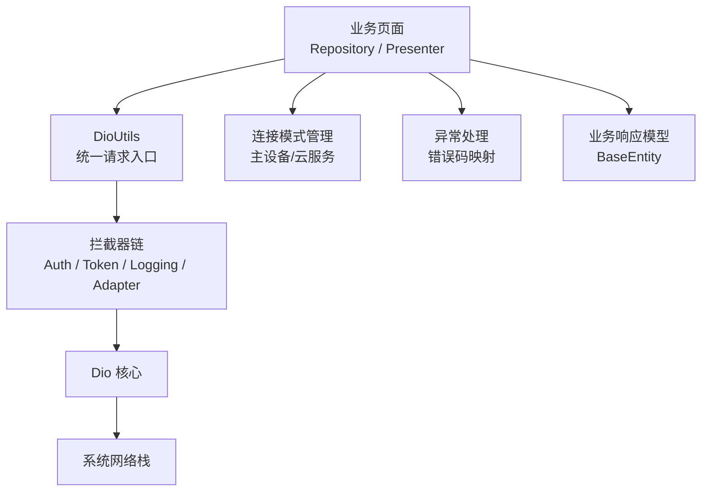
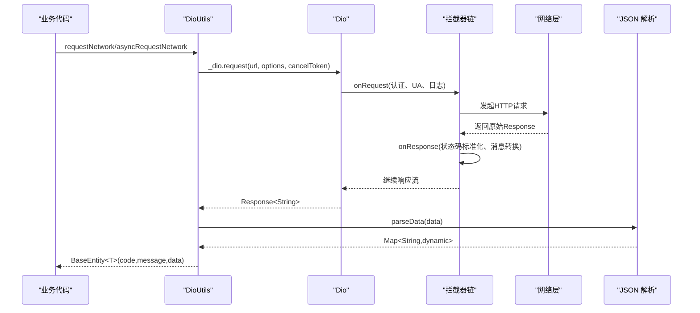
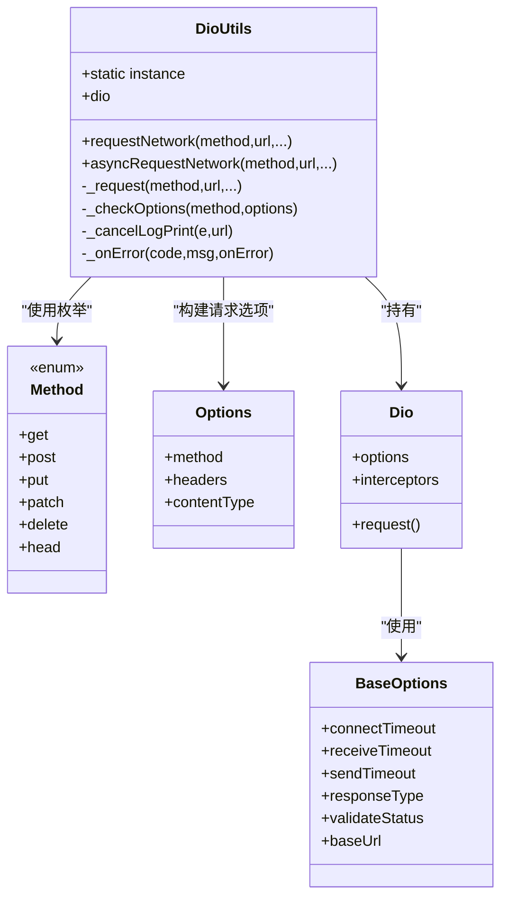
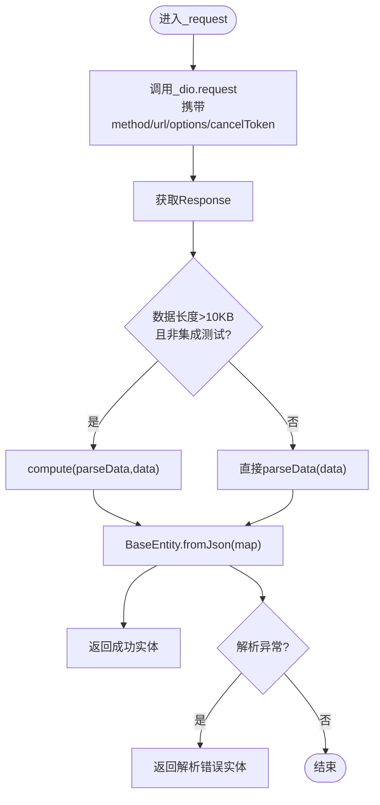
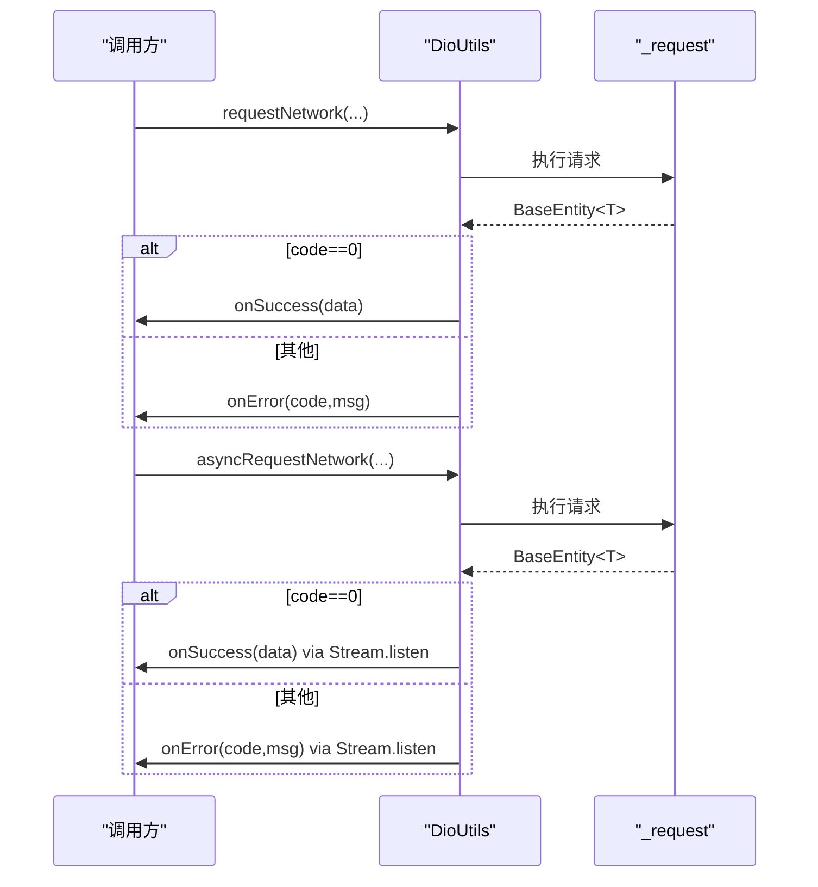
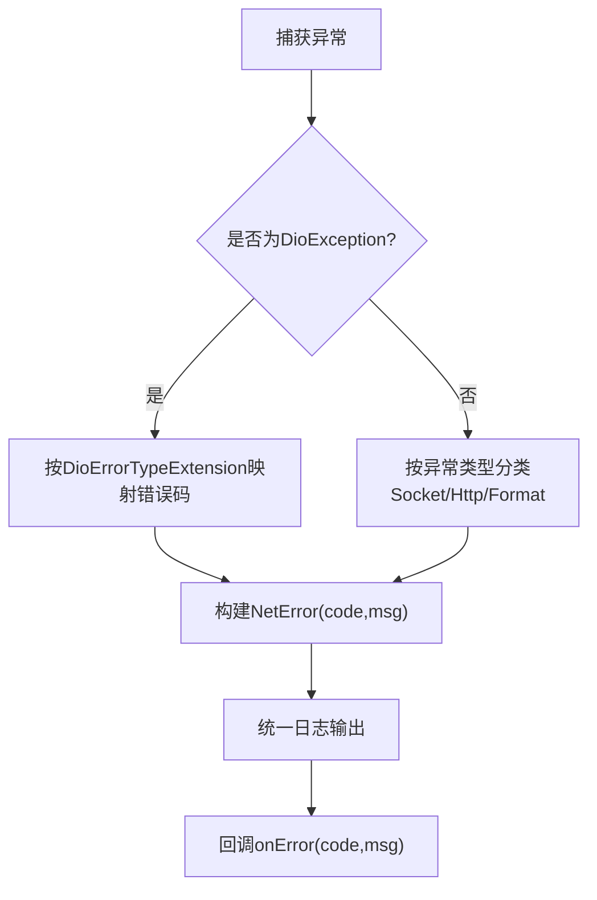
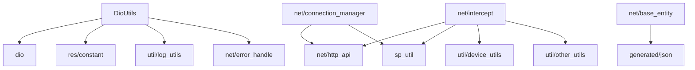

# Dio 客户端封装

<cite>
**本文引用的文件**   
- [dio_utils.dart](file://lib/net/dio_utils.dart)
- [intercept.dart](file://lib/net/intercept.dart)
- [connection_manager.dart](file://lib/net/connection_manager.dart)
- [error_handle.dart](file://lib/net/error_handle.dart)
- [base_entity.dart](file://lib/net/base_entity.dart)
- [pubspec.yaml](file://pubspec.yaml)
</cite>

## 目录
1. [引言](#引言)
2. [项目结构与定位](#项目结构与定位)
3. [核心组件总览](#核心组件总览)
4. [架构总览](#架构总览)
5. [DioUtils 单例与初始化配置](#dioutils-单例与初始化配置)
6. [请求处理流程与 _request 方法](#请求处理流程与-request-方法)
7. [两种调用方式：requestNetwork 与 asyncRequestNetwork](#两种调用方式requestnetwork-与-asyncrequestnetwork)
8. [Fiddler 抓包代理与证书验证](#fiddler-抓包代理与证书验证)
9. [拦截器体系与 Token 自动刷新](#拦截器体系与-token-自动刷新)
10. [错误处理与日志输出](#错误处理与日志输出)
11. [取消机制 CancelToken](#取消机制-canceltoken)
12. [使用示例与最佳实践](#使用示例与最佳实践)
13. [依赖关系分析](#依赖关系分析)
14. [性能与优化建议](#性能与优化建议)
15. [故障排查指南](#故障排查指南)
16. [结论](#结论)

## 引言
本文件围绕 `DioUtils` 单例类展开，系统化说明其基于 Dio 的 HTTP 客户端封装。内容涵盖连接超时、接收超时、发送超时的设置机制；`BaseOptions` 中 `responseType: plain` 的设计原因与自定义 JSON 解析流程；Fiddler 抓包代理的条件判断与证书验证；统一的 `_request` 实现、大数据量 isolate 解析策略；`requestNetwork` 与 `asyncRequestNetwork` 的差异与适用场景；`CancelToken` 取消机制与日志输出；以及 GET/POST 请求、错误处理和并发控制的实践建议。

## 项目结构与定位
本项目为 Flutter 点餐应用，网络层位于 `lib/net` 目录下，核心封装如下：
- `DioUtils`：Dio 客户端单例、统一请求入口、超时与 BaseOptions 配置、响应数据解析。
- `Intercept`：认证、Token 刷新、日志、适配器拦截器。
- `ConnectionManager`：主设备直连与云服务模式管理。
- `ExceptionHandle`：统一异常类型映射。
- `BaseEntity`：统一业务响应模型。

**图示来源**
- [dio_utils.dart:1-222](file://lib/net/dio_utils.dart#L1-L222)
- [intercept.dart:1-219](file://lib/net/intercept.dart#L1-L219)
- [connection_manager.dart:1-114](file://lib/net/connection_manager.dart#L1-L114)
- [error_handle.dart:1-82](file://lib/net/error_handle.dart#L1-L82)
- [base_entity.dart:1-33](file://lib/net/base_entity.dart#L1-L33)

**章节来源**
- [pubspec.yaml:1-111](file://pubspec.yaml#L1-L111)

## 核心组件总览
- `DioUtils`：提供全局 Dio 实例、统一请求方法与回调封装。
- `Method` 枚举及扩展：将 HTTP 方法名以字符串形式传入 Dio。
- `configDio`：在应用启动阶段可注入连接超时、基础 URL、拦截器等。
- `_request`：统一请求逻辑，负责参数校验、选项合并、响应解析和错误封装。
- `requestNetwork`：返回 Future 的统一请求方法。
- `asyncRequestNetwork`：通过 Stream 异步通知结果，适合 UI 主动订阅。
- `parseData`：自定义 JSON 解析函数，供 compute 使用。
- `ExceptionHandle`：网络异常到业务错误码的映射。
- `BaseEntity`：统一业务响应结构 `{code, message, data}`。
- `Intercept`：鉴权、Token 刷新、日志、适配器适配等拦截器。
- `ConnectionManager`：根据运行环境选择主设备或云服务地址。

**章节来源**
- [dio_utils.dart:1-222](file://lib/net/dio_utils.dart#L1-L222)
- [error_handle.dart:1-82](file://lib/net/error_handle.dart#L1-L82)
- [base_entity.dart:1-33](file://lib/net/base_entity.dart#L1-L33)
- [intercept.dart:1-219](file://lib/net/intercept.dart#L1-L219)
- [connection_manager.dart:1-114](file://lib/net/connection_manager.dart#L1-L114)

## 架构总览
下图展示一次典型请求从业务层到网络层的完整链路，包括拦截器、适配器、响应解析与错误处理。

**图示来源**
- [dio_utils.dart:60-180](file://lib/net/dio_utils.dart#L60-L180)
- [intercept.dart:1-219](file://lib/net/intercept.dart#L1-L219)
- [error_handle.dart:1-82](file://lib/net/error_handle.dart#L1-L82)
- [base_entity.dart:1-33](file://lib/net/base_entity.dart#L1-L33)

## DioUtils 单例与初始化配置
`DioUtils` 采用 Dart 工厂单例模式，内部维护静态 Dio 实例，并在构造时完成以下关键配置：
- 连接超时、接收超时、发送超时来自模块级变量，可通过 `configDio` 覆盖。
- `BaseOptions.responseType` 设置为 `plain`，表示返回 UTF-8 字符串，由业务侧自定义解析。
- `validateStatus` 始终返回 true，交由 `AdapterInterceptor` 进行业务状态码规范化。
- `baseUrl` 来自模块级变量，通常由 `ConnectionManager` 或上层服务决定。
- 非 Web 平台下配置 Fiddler 代理与证书忽略。
- 批量添加拦截器。

**图示来源**
- [dio_utils.dart:1-222](file://lib/net/dio_utils.dart#L1-L222)

**章节来源**
- [dio_utils.dart:1-120](file://lib/net/dio_utils.dart#L1-L120)

## 请求处理流程与 _request 方法
`_request` 是统一请求处理方法，职责包括：
- 使用 `_dio.request` 发起请求，并注入统一的方法、查询参数、选项与取消令牌。
- 将响应体作为 String 获取，随后进行 JSON 解析。
- 对大于约 10KB 且非集成测试的数据，使用 `compute(parseData, data)` 在 isolate 中解析，避免阻塞主线程。
- 将解析后的 Map 转换为 `BaseEntity<T>`。
- 捕获解析异常，返回带“数据解析错误”的业务错误对象。

**图示来源**
- [dio_utils.dart:120-170](file://lib/net/dio_utils.dart#L120-L170)

**章节来源**
- [dio_utils.dart:120-170](file://lib/net/dio_utils.dart#L120-L170)
- [base_entity.dart:1-33](file://lib/net/base_entity.dart#L1-L33)

## 两种调用方式：requestNetwork 与 asyncRequestNetwork
两者都基于 `_request`，区别在于返回方式和监听模型：
- `requestNetwork`：返回 Future，适合 await/then 风格；当业务码成功时调用 onSuccess，否则调用 onError。
- `asyncRequestNetwork`：内部将 Future 转为 Stream，并通过 listen 通知结果；适用于需要主动订阅的场景。

**图示来源**
- [dio_utils.dart:150-200](file://lib/net/dio_utils.dart#L150-L200)

**章节来源**
- [dio_utils.dart:150-200](file://lib/net/dio_utils.dart#L150-L200)

## Fiddler 抓包代理与证书验证
非 Web 环境下，`DioUtils` 将底层 HttpClient 替换为自定义工厂，条件如下：
- 仅在调试模式 (`kDebugMode`) 且用户标识 `spid == 154` 时启用代理。
- 代理地址固定为 `PROXY 192.168.8.175:8888`。
- 关闭证书校验 (`badCertificateCallback` 返回 true)，便于本地抓包。
- 首次启用代理时打印调试信息，包含当前模式、spid 与是否走代理。

该逻辑仅影响非 Web 平台，Web 端因使用浏览器客户端适配器，强转 IO 适配器会抛出类型错误，因此被保护分支排除。

**章节来源**
- [dio_utils.dart:40-110](file://lib/net/dio_utils.dart#L40-L110)

## 拦截器体系与 Token 自动刷新
拦截器链承担以下职责：
- `AuthInterceptor`：根据路径是否为云服务接口决定是否添加 Authorization 头；在非 Web 平台设置 User-Agent。
- `TokenInterceptor`：基于 QueuedInterceptor，当服务端返回未授权时自动刷新 token 并重试原请求。
- `LoggingInterceptor`：记录请求起止时间、URL、方法、头部、内容与耗时。
- `AdapterInterceptor`：将不同服务器响应格式统一为标准业务格式，并修正状态码，使 `BaseEntity` 能稳定解析。

**图示来源**
- [intercept.dart:1-219](file://lib/net/intercept.dart#L1-L219)

**章节来源**
- [intercept.dart:1-219](file://lib/net/intercept.dart#L1-L219)

## 错误处理与日志输出
`ExceptionHandle` 定义了标准错误码与消息，并将 Dio 异常映射为业务错误：
- 网络异常、解析异常、Socket 异常、HTTP 异常、各类超时、取消请求、未知异常均有明确错误码。
- `DioErrorTypeExtension` 将 Dio 内置错误类型映射为业务错误码。
- `DioUtils._onError` 统一输出错误日志，并在无 code 时填充默认值。
- 取消请求会在 `_cancelLogPrint` 中单独输出日志，便于区分正常取消与异常。

**图示来源**
- [error_handle.dart:1-82](file://lib/net/error_handle.dart#L1-L82)
- [dio_utils.dart:180-222](file://lib/net/dio_utils.dart#L180-L222)

**章节来源**
- [error_handle.dart:1-82](file://lib/net/error_handle.dart#L1-L82)
- [dio_utils.dart:180-222](file://lib/net/dio_utils.dart#L180-L222)

## 取消机制 CancelToken
- 请求可传入 `CancelToken`，用于后续主动取消。
- 若取消发生，Dio 抛出特定异常类型，`_cancelLogPrint` 识别并输出“取消请求接口： url”。
- 取消不会被视为业务失败，而是独立日志提示，方便排查前端取消行为。

**章节来源**
- [dio_utils.dart:150-200](file://lib/net/dio_utils.dart#L150-L200)

## 使用示例与最佳实践
以下为面向业务层的实践要点（不展示具体代码）：
- GET 请求：使用 `Method.get`、目标 URL、可选 queryParameters 与 CancelToken。
- POST 请求：使用 `Method.post`、params 作为 body，必要时通过 `Options.contentType` 指定表单或 JSON。
- 成功回调：在 onSuccess 中处理业务数据，注意 T 泛型对应数据结构。
- 失败回调：在 onError 中依据 code/msg 提示用户或执行降级逻辑。
- 取消请求：保存 CancelToken 并在页面销毁或导航离开时调用 cancel，避免后台任务残留。
- 并发控制：对于高频重复请求，可使用 TableConcurrencyGuard 或自身计数器限制并行度。

参考位置：
- 方法枚举与扩展定义：[dio_utils.dart:200-222](file://lib/net/dio_utils.dart#L200-L222)
- 统一请求入口：[dio_utils.dart:150-200](file://lib/net/dio_utils.dart#L150-L200)

**章节来源**
- [dio_utils.dart:150-222](file://lib/net/dio_utils.dart#L150-L222)

## 依赖关系分析
- `DioUtils` 依赖 Dio 核心、Flutter 平台判断、常量与工具类。
- `DioUtils` 组合拦截器，间接依赖 `http_api`、`constant`、`device_utils`、`log_utils`、`other_utils`、`sp_util`、`sprintf`。
- `BaseEntity` 依赖生成式 JSON 转换器与常量。
- `ExceptionHandle` 依赖 Dio 异常类型与 Flutter 调试开关。
- `ConnectionManager` 依赖 `http_api`、`constant`、`sp_util`，并暴露 pcAlive、serverType、localhost 等能力。

**图示来源**
- [dio_utils.dart:1-222](file://lib/net/dio_utils.dart#L1-L222)
- [intercept.dart:1-219](file://lib/net/intercept.dart#L1-L219)
- [base_entity.dart:1-33](file://lib/net/base_entity.dart#L1-L33)
- [connection_manager.dart:1-114](file://lib/net/connection_manager.dart#L1-L114)

**章节来源**
- [dio_utils.dart:1-222](file://lib/net/dio_utils.dart#L1-L222)
- [intercept.dart:1-219](file://lib/net/intercept.dart#L1-L219)
- [base_entity.dart:1-33](file://lib/net/base_entity.dart#L1-L33)
- [connection_manager.dart:1-114](file://lib/net/connection_manager.dart#L1-L114)

## 性能与优化建议
- JSON 解析隔离：对大于约 10KB 的数据使用 `compute` 在 isolate 中解析，降低主线程压力。
- 响应体类型：`responseType: plain` 避免 Dio 内部额外解析，减少内存分配与解析次数。
- 状态码处理：`validateStatus` 全放行，交由拦截器统一处理，避免多次判断与分支。
- 日志输出：请求日志集中化，避免在业务层重复打印；耗时统计有助于定位慢接口。
- 取消机制：合理取消长时间等待的请求，减少无效资源占用。

[本节为通用性能建议，无需引用具体文件]

## 故障排查指南
常见问题与排查步骤：
- 登录即提示“网络请求异常”：检查是否在 Web 平台启用了代理逻辑；应确保非 Web 才配置 IO 客户端适配器。
- 抓包未生效：确认处于调试模式且 `spid == 154`；检查代理地址可达性。
- Token 刷新失败：查看 Token 刷新接口日志，确认 refresh_token 有效；检查重试请求是否带上新的 Authorization。
- 解析错误：检查服务器返回体是否符合预期格式；关注 AdapterInterceptor 的标准化逻辑。
- 超时问题：调整 `configDio` 中的 connect/receive/send 超时；结合日志观察是哪一阶段超时。

参考位置：
- 代理与证书配置：[dio_utils.dart:40-110](file://lib/net/dio_utils.dart#L40-L110)
- Token 刷新逻辑：[intercept.dart:1-219](file://lib/net/intercept.dart#L1-L219)
- 异常映射与日志：[error_handle.dart:1-82](file://lib/net/error_handle.dart#L1-L82)

**章节来源**
- [dio_utils.dart:40-110](file://lib/net/dio_utils.dart#L40-L110)
- [intercept.dart:1-219](file://lib/net/intercept.dart#L1-L219)
- [error_handle.dart:1-82](file://lib/net/error_handle.dart#L1-L82)

## 结论
`DioUtils` 通过单例模式统一管理 Dio 客户端，结合拦截器、异常映射与统一响应模型，构建了稳定、可扩展的网络层。其设计重点包括：
- 可配置的超时与基础 URL。
- 自定义 JSON 解析流程，提升性能与灵活性。
- 条件化的 Fiddler 代理与证书验证，便于联调。
- 统一的 `_request` 处理与 isolate 优化。
- 双调用模式满足不同 UI 交互需求。
- 完善的错误处理与日志输出。
配合 `ConnectionManager` 的连接模式管理与拦截器的鉴权与日志能力，整体网络层具备高内聚、低耦合特性，适合在复杂业务场景中复用与演进。

[本节为总结性内容，无需引用具体文件]