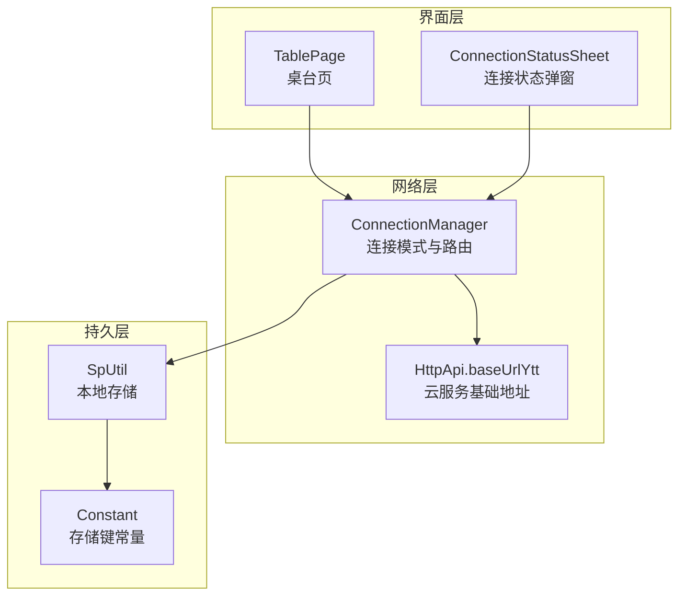
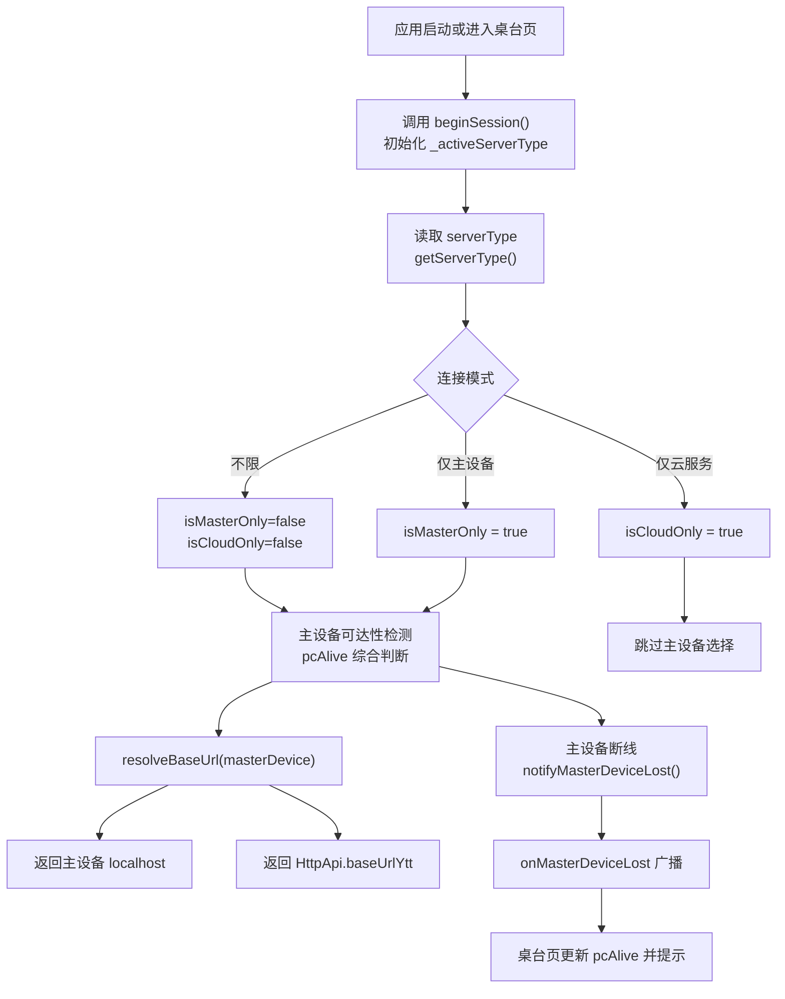
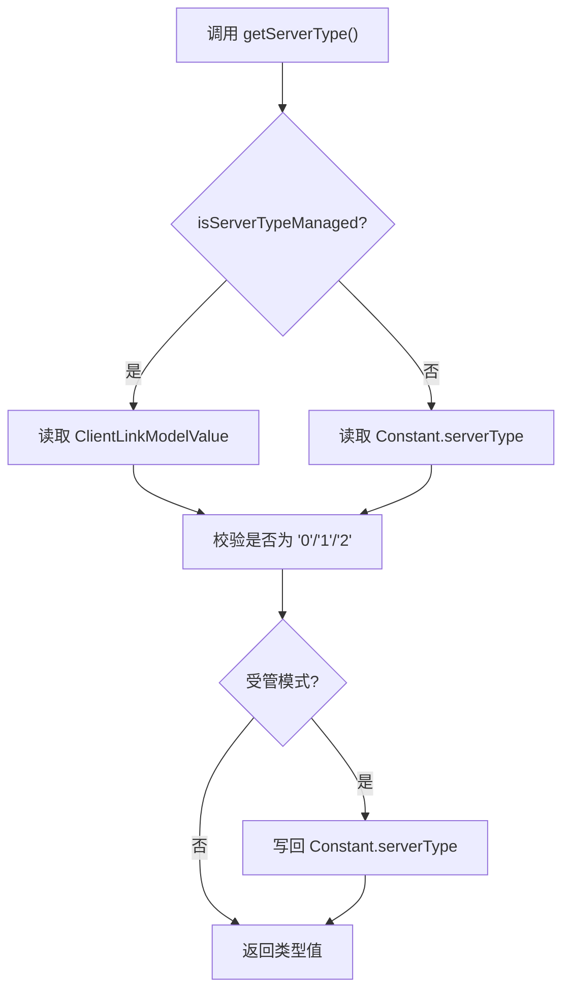
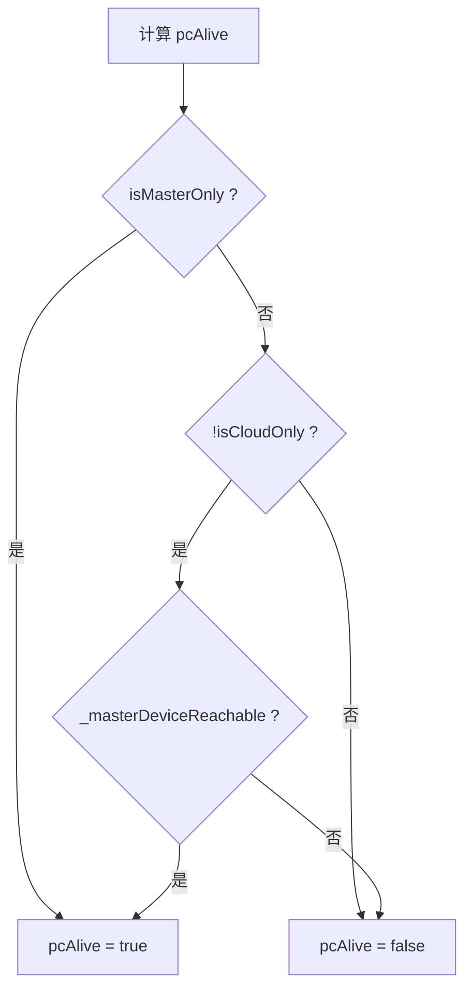
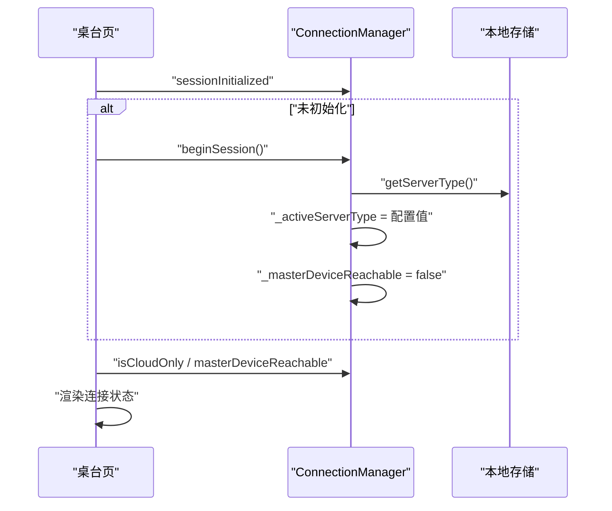
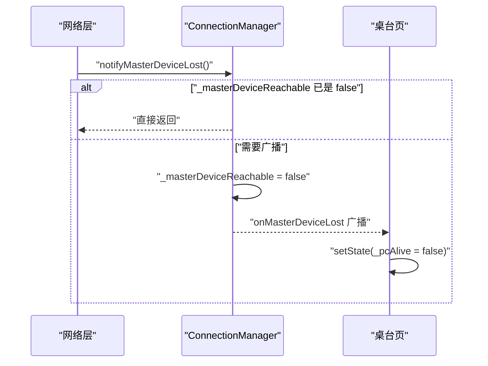
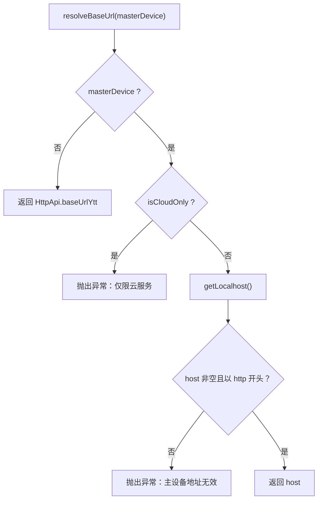
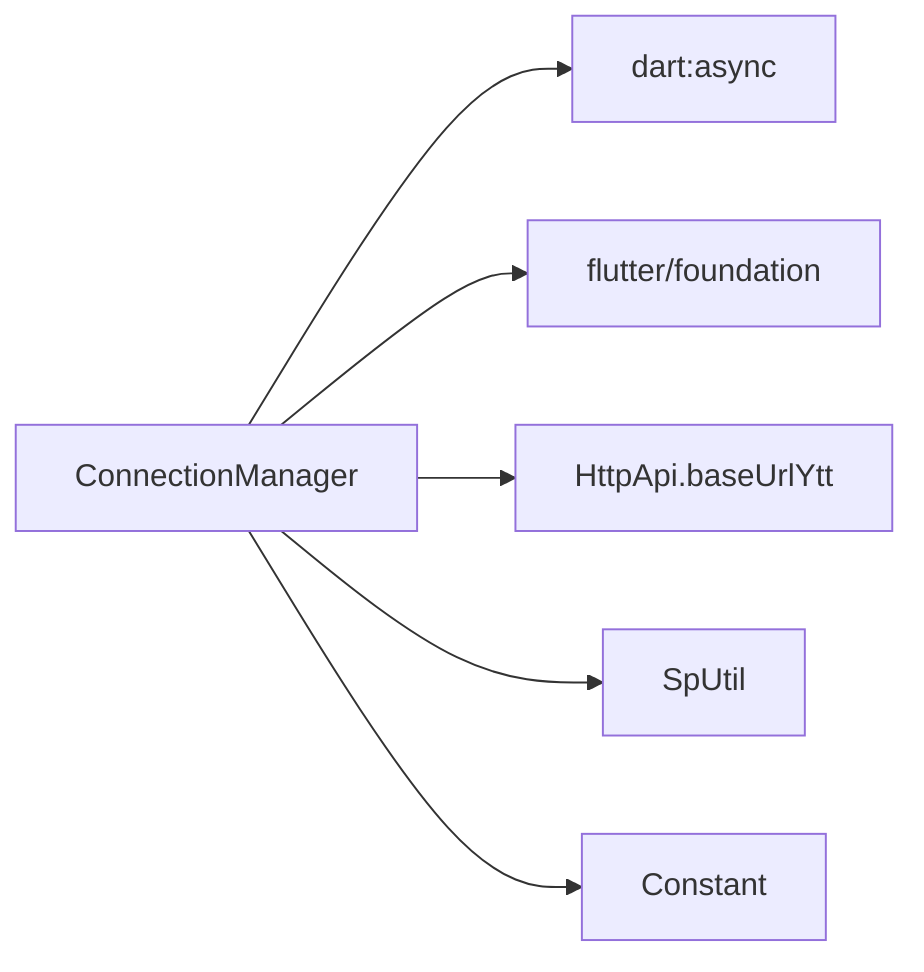

# 双连接模式管理

<cite>
**本文引用的文件 **
- [connection_manager.dart](file://lib/net/connection_manager.dart)
- [constant.dart](file://lib/res/constant.dart)
- [table_page.dart](file://lib/pages/home/table/table_page.dart)
- [connection_status_sheet.dart](file://lib/pages/home/table/widgets/connection_status_sheet.dart)
</cite>

## 目录
1. [引言](#引言)
2. [项目结构定位](#项目结构定位)
3. [核心组件总览](#核心组件总览)
4. [架构概览](#架构概览)
5. [详细组件分析](#详细组件分析)
6. [依赖关系分析](#依赖关系分析)
7. [性能与健壮性](#性能与健壮性)
8. [使用示例](#使用示例)
9. [故障排查指南](#故障排查指南)
10. [结论](#结论)

## 引言
本技术文档围绕“双连接模式管理器”展开，聚焦于 `ConnectionManager` 的设计目标、状态模型和调用契约。该组件负责在“云服务模式”和“主设备直连模式”之间进行路由决策，并维护以下关键能力：

- 根据 `serverType` 配置与主设备可达性，计算业务是否走主设备的 `pcAlive`。
- 提供 `beginSession` 初始化流程，并在会话生命周期内暴露 `onMasterDeviceLost` 事件流。
- 通过 `getServerType` / `setServerType` 管理连接模式配置，同时支持生产环境下的权限限制。
- 通过 `resolveBaseUrl` 构建请求基础地址，区分主设备和云服务两种网络出口。
- 通过 `debugLocalhostOverride` 和本地存储机制，实现调试期主设备地址覆盖与持久化。

这些能力共同支撑桌台页、订单页等前端模块在不同部署形态下选择正确的后端地址。

## 项目结构定位
双连接模式相关逻辑主要位于网络层与管理层交界处：

- 连接模式管理与状态定义：`lib/net/connection_manager.dart`
- 本地存储键值定义：`lib/res/constant.dart`
- 桌台页面订阅连接丢失事件并刷新 UI：`lib/pages/home/table/table_page.dart`
- 连接状态检测弹窗：`lib/pages/home/table/widgets/connection_status_sheet.dart`



**图表来源**
- [connection_manager.dart:1-114](file://lib/net/connection_manager.dart#L1-L114)
- [constant.dart:1-93](file://lib/res/constant.dart#L1-L93)
- [table_page.dart:120-210](file://lib/pages/home/table/table_page.dart#L120-L210)
- [connection_status_sheet.dart:1-120](file://lib/pages/home/table/widgets/connection_status_sheet.dart#L1-L120)

**章节来源**
- [connection_manager.dart:1-114](file://lib/net/connection_manager.dart#L1-L114)
- [constant.dart:1-93](file://lib/res/constant.dart#L1-L93)

## 核心组件总览
`ConnectionManager` 是一个单例风格的管理器，对外暴露静态属性和方法，承担以下职责：

| 类别 | 成员 | 作用 |
|---|---|---|
| 模式标志 | `isMasterOnly`、`isCloudOnly` | 基于当前激活的 `serverType` 判断是否仅允许主设备或仅允许云服务 |
| 可达性标志 | `pcAlive`、`masterDeviceReachable` | 表示业务是否应优先走主设备；内部维护实际主设备可达性 |
| 会话状态 | `sessionInitialized`、`beginSession` | 记录一次连接会话是否已初始化 |
| 事件流 | `onMasterDeviceLost`、`notifyMasterDeviceLost` | 主设备断线时广播事件 |
| 配置读写 | `getServerType`、`setServerType`、`isServerTypeManaged` | 读取、写入并控制 `serverType` 的可编辑性 |
| 地址解析 | `resolveBaseUrl`、`getLocalhost`、`saveLocalhost` | 根据模式选择主设备地址或云服务地址 |
| 调试能力 | `debugLocalhostOverride` | 非空时强制使用指定主设备地址 |

**章节来源**
- [connection_manager.dart:1-114](file://lib/net/connection_manager.dart#L1-L114)

## 架构概览
下图展示连接模式的核心数据流：从配置和可达性到最终 URL 选择，以及主设备断线后的事件传播路径。



**图表来源**
- [connection_manager.dart:1-114](file://lib/net/connection_manager.dart#L1-L114)
- [table_page.dart:120-210](file://lib/pages/home/table/table_page.dart#L120-L210)

## 详细组件分析

### ConnectionManager 设计模式
`ConnectionManager` 采用“工具类 + 单例状态”的设计：

- 私有构造函数 `ConnectionManager._()` 阻止外部直接实例化。
- 所有状态和方法均为静态，便于全局访问。
- 内部状态包括 `_masterDeviceReachable`、`_activeServerType` 和一个广播型 `StreamController`。
- 对外只暴露必要的 getter、setter 和行为方法，避免其他模块直接操作底层存储。

这种设计将“连接策略”“地址选择”“断线事件”集中到一个入口，降低跨模块耦合。

```mermaid
classDiagram
  class ConnectionManager {
    - static bool "_masterDeviceReachable"
    - static String? "_activeServerType"
    + static bool "pcAlive"
    + static set "pcAlive(bool)"
    + static bool "masterDeviceReachable"
    + static bool "sessionInitialized"
    + static bool "isMasterOnly"
    + static bool "isCloudOnly"
    + static void "beginSession()"
    + static Stream~void~ "onMasterDeviceLost"
    + static void "notifyMasterDeviceLost()"
    + static int "getNetMode()"
    + static bool "isServerTypeManaged"
    + static String "getServerType()"
    + static bool "setServerType(String)"
    + static String "getLocalhost()"
    + static void "saveLocalhost(String)"
    + static String "resolveBaseUrl({bool masterDevice})"
  }
```

**图表来源**
- [connection_manager.dart:1-114](file://lib/net/connection_manager.dart#L1-L114)

**章节来源**
- [connection_manager.dart:1-114](file://lib/net/connection_manager.dart#L1-L114)

### serverType 配置管理机制
`serverType` 是连接模式的字符串配置，取值语义如下：

| 值 | 含义 | 行为 |
|---|---|---|
| `'0'` | 不限 | 默认值；当主设备可达且未限制为云服务时，可走主设备 |
| `'1'` | 仅主设备 | 强制走主设备；即使主设备不可达，也不应降级到云服务 |
| `'2'` | 仅云服务 | 禁止走主设备；请求必须发往云服务 |

#### 读取逻辑
`getServerType()` 的读取优先级为：

1. 如果处于“受管模式”，则从 `ClientLinkModelValue` 读取。
2. 否则从 `Constant.serverType` 读取。
3. 如果读取值不是 `'0'`、`'1'`、`'2'` 之一，则回退为 `'0'`。
4. 如果是受管模式，还会把规范化后的值写回 `Constant.serverType`，用于兼容旧路径。

#### 写入逻辑
`setServerType(type)` 会先检查 `isServerTypeManaged`：

- 若为真，则拒绝写入并返回 `false`。
- 若为假，则将传入值写入 `Constant.serverType` 并返回 `true`。

#### 受管模式检测
`isServerTypeManaged` 的判断条件是：

- 不在调试模式；并且
- 本地存储 `ClientLinkModel` 等于 `'1'`。

这意味着在生产环境中，如果客户端被配置为“由外部系统管理连接模式”，则不能通过普通设置修改 `serverType`。



**图表来源**
- [connection_manager.dart:45-83](file://lib/net/connection_manager.dart#L45-L83)
- [constant.dart:38-44](file://lib/res/constant.dart#L38-L44)

**章节来源**
- [connection_manager.dart:45-83](file://lib/net/connection_manager.dart#L45-L83)
- [constant.dart:38-44](file://lib/res/constant.dart#L38-L44)

### pcAlive 与主设备可达性
`pcAlive` 是业务侧最重要的选路标志，表示“当前业务是否应该走主设备”。其计算逻辑为：

```text
pcAlive = isMasterOnly || (!isCloudOnly && _masterDeviceReachable)
```

由此可得三种情况：

| 条件 | `pcAlive` 结果 | 解释 |
|---|---:|---|
| `isMasterOnly == true` | `true` | 配置要求仅主设备，不依赖可达性 |
| `isCloudOnly == true` 且主设备可达 | `false` | 配置禁止主设备，必须走云服务 |
| `isMasterOnly == false` 且 `isCloudOnly == false` | 取决于 `_masterDeviceReachable` | 不限模式下，只有主设备可达才走主设备 |

注意：代码注释明确强调，“仅主设备断线时仍须保留 PC 路由，禁止降级到云端”。因此 `isMasterOnly` 具有最高优先级，不会因主设备不可达而自动切换到云服务。

`masterDeviceReachable` 是底层可达性标记，可通过 `pcAlive` setter 更新，也可由网络层在检测到主设备请求失败后通过 `notifyMasterDeviceLost()` 触发断线流程。



**图表来源**
- [connection_manager.dart:24-38](file://lib/net/connection_manager.dart#L24-L38)

**章节来源**
- [connection_manager.dart:24-38](file://lib/net/connection_manager.dart#L24-L38)

### beginSession 初始化与会话状态
`beginSession()` 的职责是启动一次连接会话：

1. 读取当前 `serverType` 并保存为 `_activeServerType`。
2. 将 `_masterDeviceReachable` 重置为 `false`。

`sessionInitialized` 用于判断是否已经调用过 `beginSession()`，即 `_activeServerType` 是否已有值。

桌台页在进入页面时通常会执行类似流程：

- 检查 `sessionInitialized`。
- 若未初始化，则调用 `beginSession()`。
- 根据 `isCloudOnly` 决定是否显示主设备相关提示或交互。
- 根据 `masterDeviceReachable` 更新 UI 上的连接状态。



**图表来源**
- [connection_manager.dart:34-44](file://lib/net/connection_manager.dart#L34-L44)
- [table_page.dart:150-165](file://lib/pages/home/table/table_page.dart#L150-L165)

**章节来源**
- [connection_manager.dart:34-44](file://lib/net/connection_manager.dart#L34-L44)
- [table_page.dart:150-165](file://lib/pages/home/table/table_page.dart#L150-L165)

### onMasterDeviceLost 事件流
`onMasterDeviceLost` 是一个广播事件流，用于向多个订阅者通知“主设备连接丢失”。

事件触发流程如下：

1. 网络层发现主设备接口请求失败。
2. 调用 `notifyMasterDeviceLost()`。
3. 如果当前 `_masterDeviceReachable` 已经是 `false`，则直接返回，避免重复广播。
4. 否则将 `_masterDeviceReachable` 置为 `false`。
5. 如果控制器未关闭，则通过 `add(null)` 广播事件。
6. 桌台页监听该事件，并将本地 `_pcAlive` 设为 `false`，从而触发 UI 提示。



**图表来源**
- [connection_manager.dart:46-64](file://lib/net/connection_manager.dart#L46-L64)
- [table_page.dart:120-135](file://lib/pages/home/table/table_page.dart#L120-L135)

**章节来源**
- [connection_manager.dart:46-64](file://lib/net/connection_manager.dart#L46-L64)
- [table_page.dart:120-135](file://lib/pages/home/table/table_page.dart#L120-L135)

### resolveBaseUrl URL 构建逻辑
`resolveBaseUrl({bool masterDevice = false})` 负责根据参数和当前模式返回最终基础地址。

规则如下：

| 参数 | 当前模式 | 行为 |
|---|---|---|
| `masterDevice = true` | `isCloudOnly = true` | 抛出异常，因为不允许连接主设备 |
| `masterDevice = true` | 非云服务 | 读取 `getLocalhost()`；若为空或以非 `http` 开头，则抛出异常 |
| `masterDevice = false` | 任意模式 | 返回云服务基础地址 `HttpApi.baseUrlYtt` |

主设备地址的来源是 `getLocalhost()`：

- 如果 `debugLocalhostOverride` 非空，则优先返回该覆盖地址。
- 否则从本地存储中读取 `Constant.localhost`。
- 新登录成功后通常通过 `saveLocalhost(host)` 持久化主设备地址。



**图表来源**
- [connection_manager.dart:88-114](file://lib/net/connection_manager.dart#L88-L114)

**章节来源**
- [connection_manager.dart:88-114](file://lib/net/connection_manager.dart#L88-L114)

### debugLocalhostOverride 调试功能
`debugLocalhostOverride` 是一个静态常量字段，用于开发或联调阶段强制指定主设备地址：

- 默认值为空字符串。
- 当非空时，`getLocalhost()` 总是返回该值，忽略登录返回的主设备地址。
- 使用时应在联调完成后清空，避免影响正常用户。

该机制适合以下场景：

- 同事本地调试主设备服务。
- 测试环境固定某个主设备 IP。
- 快速验证不同主设备地址对请求路由的影响。

**章节来源**
- [connection_manager.dart:17-22](file://lib/net/connection_manager.dart#L17-L22)
- [connection_manager.dart:88-97](file://lib/net/connection_manager.dart#L88-L97)

## 依赖关系分析
`ConnectionManager` 的依赖可以分为三类：

1. **Flutter 运行时依赖**
   - `dart:async`：用于 `StreamController`。
   - `flutter/foundation.dart`：用于 `kDebugMode`。

2. **业务 API 依赖**
   - `HttpApi.baseUrlYtt`：云服务基础地址。

3. **本地存储依赖**
   - `sp_util.SpUtil`：读写本地偏好。
   - `Constant`：定义存储键，如 `localhost`、`server_type`。



**图表来源**
- [connection_manager.dart:1-114](file://lib/net/connection_manager.dart#L1-L114)
- [constant.dart:1-93](file://lib/res/constant.dart#L1-L93)

**章节来源**
- [connection_manager.dart:1-114](file://lib/net/connection_manager.dart#L1-L114)
- [constant.dart:1-93](file://lib/res/constant.dart#L1-L93)

## 性能与健壮性
- **低开销状态访问**：`pcAlive`、`isMasterOnly`、`isCloudOnly` 等属性都是简单布尔或字符串比较，时间复杂度为 O(1)。
- **事件去重**：`notifyMasterDeviceLost()` 在 `_masterDeviceReachable` 已为 `false` 时直接返回，避免重复广播导致 UI 频繁刷新。
- **防御性校验**：`getServerType()` 对非法值进行归一化处理；`resolveBaseUrl()` 对主设备地址进行协议和存在性校验。
- **模式保护**：`isCloudOnly` 下调用 `resolveBaseUrl(masterDevice: true)` 会抛异常，防止错误路由到主设备。
- **可控降级**：`isMasterOnly` 优先于可达性，确保“仅主设备”模式不会静默降级到云服务。

需要注意的风险点：

- `pcAlive` 的 setter 直接修改 `_masterDeviceReachable`，若上层逻辑误用可能绕过网络层真实探测。
- `debugLocalhostOverride` 若长期保留非空值，会导致所有主设备请求都指向固定地址。
- 受管模式下 `setServerType` 返回 `false`，但调用方需要显式处理该返回值，否则会误以为配置已生效。

[本节为通用分析与建议，不直接分析具体代码行]

## 使用示例

### 示例一：桌面端登录后初始化连接会话
适用场景：用户完成登录后，初始化连接模式并准备发起后续请求。

步骤：

1. 登录成功保存主设备地址：调用 `ConnectionManager.saveLocalhost(host)`。
2. 进入业务页面前调用 `ConnectionManager.beginSession()`。
3. 根据 `ConnectionManager.isCloudOnly` 决定是否需要提示主设备连接信息。
4. 发起请求前根据需求选择基础地址：
   - 主设备请求：`ConnectionManager.resolveBaseUrl(masterDevice: true)`
   - 云服务请求：`ConnectionManager.resolveBaseUrl(masterDevice: false)`

### 示例二：桌台页订阅主设备断线事件
适用场景：桌台页需要实时感知主设备断线并提示用户。

步骤：

1. 在页面初始化时订阅 `ConnectionManager.onMasterDeviceLost`。
2. 在回调中将本地 `_pcAlive` 设为 `false`。
3. 根据 `ConnectionManager.isMasterOnly` 和当前 `masterDeviceReachable` 显示相应提示。
4. 页面销毁时注意移除监听，避免内存泄漏（Flutter 常规做法）。

### 示例三：仅在受限模式下修改连接模式
适用场景：设置页让用户切换连接模式，但在生产受管模式下禁用修改。

步骤：

1. 调用 `ConnectionManager.isServerTypeManaged` 判断是否受管。
2. 如果不受管，调用 `ConnectionManager.setServerType(type)` 并检查返回值。
3. 如果返回 `true`，再调用 `ConnectionManager.beginSession()` 重新加载配置。
4. 如果返回 `false`，应提示用户当前连接模式由系统管理，不可手动修改。

### 示例四：连接状态检测弹窗
适用场景：用户点击状态图标查看主设备和云服务连通性。

步骤：

1. 打开 `ConnectionStatusSheet`。
2. 并行检测主设备连通性和云服务连通性。
3. 根据 `ConnectionManager.getNetMode()` 判断当前主连接。
4. 在主设备或云服务为当前连接时显示“----当前连接”。

**章节来源**
- [connection_manager.dart:17-114](file://lib/net/connection_manager.dart#L17-L114)
- [table_page.dart:120-210](file://lib/pages/home/table/table_page.dart#L120-L210)
- [connection_status_sheet.dart:1-120](file://lib/pages/home/table/widgets/connection_status_sheet.dart#L1-L120)

## 故障排查指南

| 现象 | 可能原因 | 排查步骤 | 修复建议 |
|---|---|---|---|
| 主设备请求失败后仍尝试走主设备 | 未调用 `notifyMasterDeviceLost()` 或 `_masterDeviceReachable` 未被正确更新 | 检查网络层是否在失败分支调用 `notifyMasterDeviceLost()`；确认 `pcAlive` 是否变为 `false` | 确保网络失败路径正确触发断线事件 |
| 仅主设备模式下仍出现云服务请求 | 使用了错误的 `resolveBaseUrl` 参数或业务逻辑未遵循 `pcAlive` | 检查调用处是否传了 `masterDevice: false`；检查是否绕过了 `ConnectionManager.pcAlive` | 统一通过 `resolveBaseUrl(masterDevice: ConnectionManager.pcAlive)` 或按模式选择 |
| 主设备地址为空导致异常 | 登录后未保存 `localhost`，或登录响应未包含主设备地址 | 检查登录流程是否调用 `saveLocalhost`；检查服务端返回字段 | 补充主设备地址持久化逻辑 |
| 调试期间始终访问固定主设备 IP | `debugLocalhostOverride` 未清空 | 搜索源码中的 `debugLocalhostOverride` 赋值位置 | 联调结束后清空为默认空字符串 |
| 无法修改连接模式 | 生产环境处于受管模式 | 检查 `ClientLinkModel` 是否为 `'1'`；检查 `isServerTypeManaged` | 联系管理员调整连接管理模式 |
| 主设备断线后 UI 未刷新 | 桌台页未订阅 `onMasterDeviceLost` 或 setState 未执行 | 检查页面 `initState` 是否注册监听；检查回调中是否更新状态 | 完善监听和状态刷新逻辑 |

**章节来源**
- [connection_manager.dart:24-114](file://lib/net/connection_manager.dart#L24-L114)
- [table_page.dart:120-210](file://lib/pages/home/table/table_page.dart#L120-L210)

## 结论
`ConnectionManager` 是双连接模式的核心枢纽，它将连接策略、可达性判断、URL 选择和断线事件统一封装，使上层页面无需关心底层网络出口细节。其设计优点在于：

- 将“模式配置”“会话初始化”“地址选择”解耦为清晰的方法。
- 通过 `pcAlive` 提供统一的业务选路标志。
- 通过事件流解耦主设备断线与 UI 表现。
- 通过 `isServerTypeManaged` 支持生产环境的连接模式管控。
- 通过 `debugLocalhostOverride` 提供安全的调试入口。

在实际使用中，开发者应严格遵循：

- 登录后保存主设备地址。
- 进入页面前初始化会话。
- 主设备请求前先判断 `pcAlive` 或通过 `resolveBaseUrl` 获取地址。
- 在网络层失败时调用 `notifyMasterDeviceLost()`。
- 在受管模式下尊重 `setServerType` 的返回值，不擅自覆盖配置。

这样可以在不同部署环境下稳定地在云服务与主设备之间切换，并保持用户体验的一致性。

[本节为总结性内容，不直接分析具体代码行]