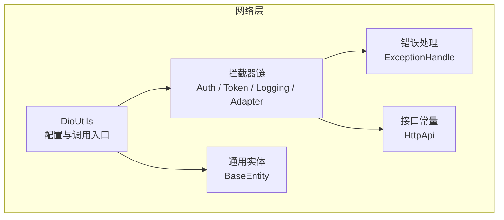
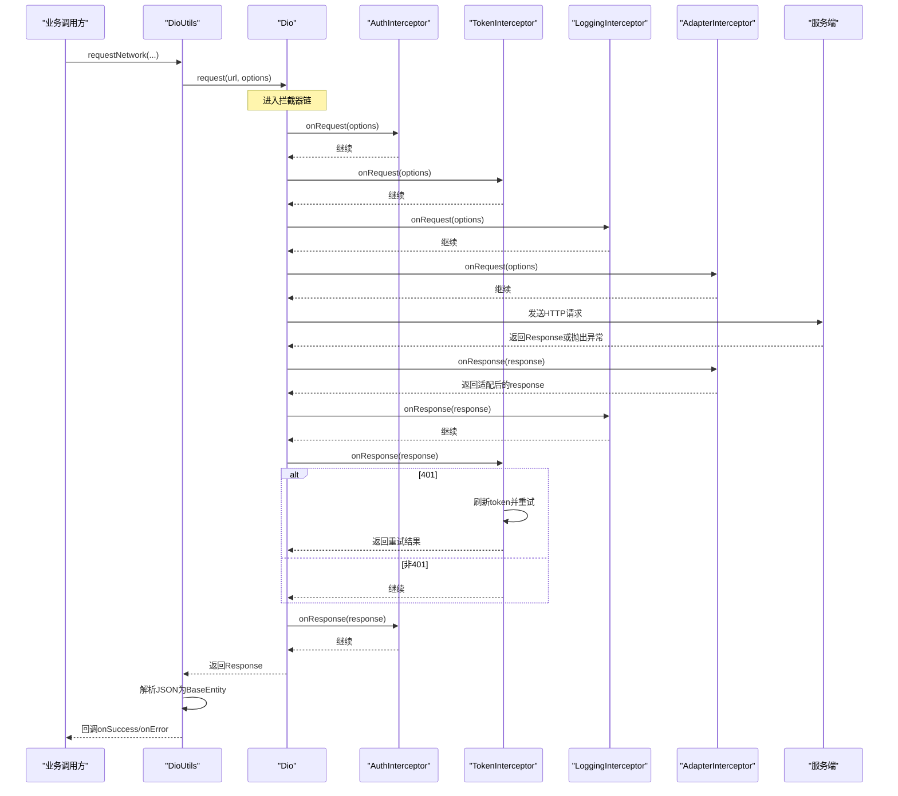
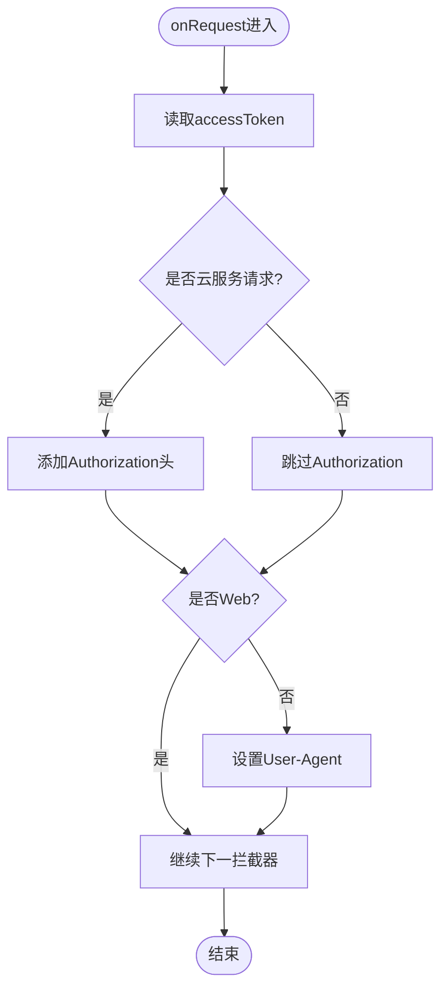
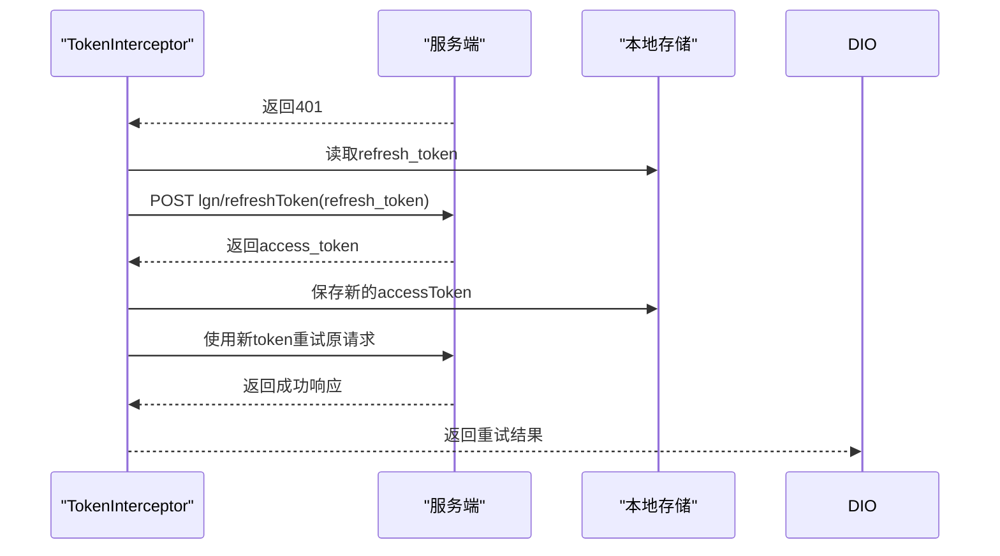
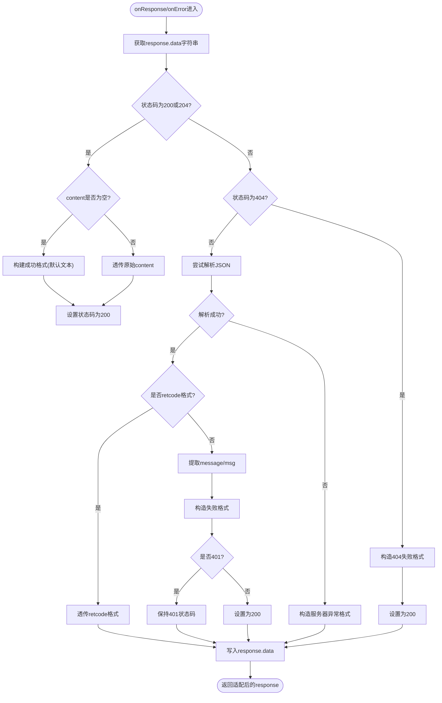
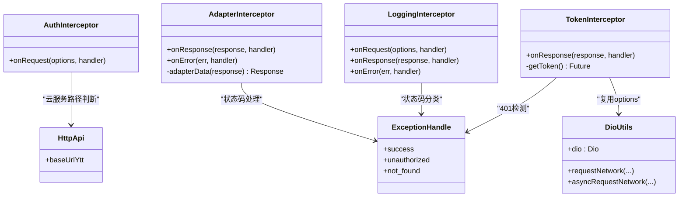

# 拦截器链机制

<cite>
**本文引用的文件**
- [intercept.dart](file://lib/net/intercept.dart)
- [dio_utils.dart](file://lib/net/dio_utils.dart)
- [http_api.dart](file://lib/net/http_api.dart)
- [error_handle.dart](file://lib/net/error_handle.dart)
- [base_entity.dart](file://lib/net/base_entity.dart)
</cite>

## 目录
1. [引言](#引言)
2. [项目结构](#项目结构)
3. [核心组件](#核心组件)
4. [架构总览](#架构总览)
5. [详细组件分析](#详细组件分析)
6. [依赖关系分析](#依赖关系分析)
7. [性能考虑](#性能考虑)
8. [故障排查指南](#故障排查指南)
9. [结论](#结论)

## 引言
本文聚焦网络层拦截器链系统，围绕以下四类拦截器展开：AuthInterceptor、TokenInterceptor、LoggingInterceptor、AdapterInterceptor。文档将解释它们在请求生命周期中的职责、执行顺序、关键分支逻辑（如云与主设备区分、自动刷新 Token、日志记录、响应体适配），并给出扩展自定义拦截器的实践建议与常见问题解决方案。

## 项目结构
本项目的网络层位于 lib/net 目录，其中拦截器实现集中在 intercept.dart；Dio 初始化、拦截器注册、统一解析和回调封装在 dio_utils.dart；业务接口常量与基础域名定义在 http_api.dart；HTTP 状态码与异常映射在 error_handle.dart；通用数据模型 BaseEntity 在 base_entity.dart。

**图表来源**
- [dio_utils.dart:1-120](file://lib/net/dio_utils.dart#L1-L120)
- [intercept.dart:1-219](file://lib/net/intercept.dart#L1-L219)
- [http_api.dart:1-120](file://lib/net/http_api.dart#L1-L120)
- [error_handle.dart:1-82](file://lib/net/error_handle.dart#L1-L82)
- [base_entity.dart:1-33](file://lib/net/base_entity.dart#L1-L33)

**章节来源**
- [dio_utils.dart:1-120](file://lib/net/dio_utils.dart#L1-L120)
- [intercept.dart:1-219](file://lib/net/intercept.dart#L1-L219)
- [http_api.dart:1-120](file://lib/net/http_api.dart#L1-L120)
- [error_handle.dart:1-82](file://lib/net/error_handle.dart#L1-L82)
- [base_entity.dart:1-33](file://lib/net/base_entity.dart#L1-L33)

## 核心组件
- AuthInterceptor：负责在符合条件的请求上注入 Authorization 头，并在非 Web 平台设置 User-Agent。
- TokenInterceptor：基于 QueuedInterceptor 实现令牌自动刷新，检测 401 后使用 refresh_token 换取新 token，并重试失败请求。
- LoggingInterceptor：记录请求开始时间、URL、方法、头信息、内容类型、请求体，以及响应状态、响应体与耗时。
- AdapterInterceptor：对响应数据进行统一适配，成功响应透传原始 JSON，404 特殊处理为统一失败格式，其他错误尝试从 message/msg 提取消息并转换为统一失败格式。

**章节来源**
- [intercept.dart:1-219](file://lib/net/intercept.dart#L1-L219)

## 架构总览
拦截器链由 Dio 在执行实际 HTTP 请求时依次触发 onRequest → 网络 IO → onResponse → onError。各拦截器按注册顺序参与请求与响应的预处理和后处理。

**图表来源**
- [dio_utils.dart:1-120](file://lib/net/dio_utils.dart#L1-L120)
- [intercept.dart:1-219](file://lib/net/intercept.dart#L1-L219)

## 详细组件分析

### AuthInterceptor
职责要点
- Authorization 头注入条件：
  - 仅当存在 accessToken 且请求路径属于云服务时添加 Authorization 头。
  - 云服务判定依据：路径以 HttpApi.baseUrlYtt 开头，或者路径不包含 /api/。
  - 主设备（直连 PC）请求路径通常以 /api/ 开头，因此不会注入 Authorization。
- User-Agent 头设置：非 Web 平台下设置 User-Agent，用于满足部分服务器要求。

关键流程
- 读取本地存储的 accessToken。
- 判断是否为云服务请求。
- 若满足条件则写入 Authorization 头。
- 若非 Web 平台，写入 User-Agent。
- 调用 super.onRequest 继续链路。

**图表来源**
- [intercept.dart:1-45](file://lib/net/intercept.dart#L1-L45)
- [http_api.dart:1-40](file://lib/net/http_api.dart#L1-L40)

**章节来源**
- [intercept.dart:1-45](file://lib/net/intercept.dart#L1-L45)
- [http_api.dart:1-40](file://lib/net/http_api.dart#L1-L40)

### TokenInterceptor
职责要点
- 基于 QueuedInterceptor 避免并发刷新导致的重复刷新问题。
- 检测到 401 状态码时触发自动刷新流程。
- 通过独立的 Dio 实例 _tokenDio 调用刷新接口 lgn/refreshToken，传入 refresh_token。
- 刷新成功后更新本地 accessToken，并使用该 token 重新发起原请求。
- 重试时使用 _tokenDio.request 直接发起，以避免再次进入 TokenInterceptor 造成循环。

自动刷新时序

**图表来源**
- [intercept.dart:46-110](file://lib/net/intercept.dart#L46-L110)

**章节来源**
- [intercept.dart:46-110](file://lib/net/intercept.dart#L46-L110)

### LoggingInterceptor
职责要点
- 在 onRequest 中记录请求开始时间、URL（含 queryParameters）、方法、头信息、内容类型、请求体。
- 在 onResponse 中记录响应状态码（成功用 Info 级别，失败用 Error 级别）、响应体 JSON、耗时（毫秒）。
- 在 onError 中记录错误事件，便于定位网络层异常。

记录字段
- 开始时间：DateTime.now()
- URL：baseUrl + path，queryParameters 为空时省略查询串
- 方法：options.method
- 头信息：options.headers
- 内容类型：options.contentType
- 请求体：options.data
- 响应状态码：response.statusCode
- 响应体：response.data.toString()
- 耗时：_endTime - _startTime（毫秒）

**章节来源**
- [intercept.dart:111-173](file://lib/net/intercept.dart#L111-L173)

### AdapterInterceptor
职责要点
- 统一响应体格式：
  - 成功响应（200/204）：透传原始响应数据；空内容时用默认文本占位。
  - 404：构造统一失败格式，并将状态码调整为成功，以便上层以 code/message 语义处理。
  - 其他错误：尝试解析响应体 JSON，提取 message 或 msg；无法识别时提示“未知异常”；解析失败时提示“服务器异常”。
- 将最终结果以字符串形式写回 response.data，供上层统一解析为 BaseEntity。

统一失败格式
- 标准失败格式：包含 code 与 message 字段的 JSON 字符串。
- 成功格式：code=0，data 为原始数据或默认文本，message 为空。

分支逻辑

**图表来源**
- [intercept.dart:174-219](file://lib/net/intercept.dart#L174-L219)

**章节来源**
- [intercept.dart:174-219](file://lib/net/intercept.dart#L174-L219)

## 依赖关系分析
- AuthInterceptor 依赖：
  - Dio Interceptor 接口
  - HttpApi.baseUrlYtt 用于云服务路径判断
  - Device.isWeb 用于平台判断
  - SpUtil 读取 accessToken
- TokenInterceptor 依赖：
  - Dio QueuedInterceptor
  - Dio 实例 _tokenDio，复用 DioUtils.dio.options
  - SpUtil 读写 refreshToken 与 accessToken
  - ExceptionHandle.unauthorized 判断 401
- LoggingInterceptor 依赖：
  - Dio Interceptor
  - Log 工具类进行日志输出
- AdapterInterceptor 依赖：
  - Dio Interceptor
  - ExceptionHandle.success/success_not_content/not_found/unauthorized
  - sprintf 格式化字符串
  - json.decode 解析 JSON

**图表来源**
- [intercept.dart:1-219](file://lib/net/intercept.dart#L1-L219)
- [dio_utils.dart:1-120](file://lib/net/dio_utils.dart#L1-L120)
- [http_api.dart:1-40](file://lib/net/http_api.dart#L1-L40)
- [error_handle.dart:1-82](file://lib/net/error_handle.dart#L1-L82)

**章节来源**
- [intercept.dart:1-219](file://lib/net/intercept.dart#L1-L219)
- [dio_utils.dart:1-120](file://lib/net/dio_utils.dart#L1-L120)
- [http_api.dart:1-40](file://lib/net/http_api.dart#L1-L40)
- [error_handle.dart:1-82](file://lib/net/error_handle.dart#L1-L82)

## 性能考虑
- 禁用 Dio 默认 JSON 解析：DioUtils 设置 responseType=plain，避免重复解析开销，交由业务层统一解析为 BaseEntity。
- 大体积响应异步解析：当响应大于 10KB 且非集成测试环境时，使用 compute 进行隔离解析，减少 UI 线程阻塞。
- Token 刷新节流：TokenInterceptor 继承 QueuedInterceptor，避免并发刷新导致多次刷新请求。
- 代理调试开关：仅在 Debug 模式且特定 spid 条件下启用 Fiddler 代理，减少生产环境的额外开销。

优化建议
- 对于高频小响应，可考虑在 AdapterInterceptor 中缓存热点数据的解析结果。
- 控制日志粒度：LoggingInterceptor 可在非调试环境下降低日志级别或关闭，以减少 I/O 压力。
- 合理设置超时参数：连接、发送、接收超时在 DioUtils 中集中管理，需根据业务场景调优。

**章节来源**
- [dio_utils.dart:1-120](file://lib/net/dio_utils.dart#L1-L120)
- [dio_utils.dart:121-222](file://lib/net/dio_utils.dart#L121-L222)

## 故障排查指南
常见问题与定位思路
- 未注入 Authorization 头：
  - 检查请求路径是否为云服务路径（以 baseUrlYtt 开头或不包含 /api/）。
  - 确认本地 accessToken 是否存在。
- 401 未触发自动刷新：
  - 检查响应状态码是否为 401。
  - 确认 refresh_token 是否存在且有效。
  - 观察 TokenInterceptor 的重试是否使用了 _tokenDio 以避免循环。
- 日志缺失或打印过多：
  - 确认 LoggingInterceptor 是否注册在拦截器链中。
  - 在非调试环境下降低日志级别或关闭。
- 响应体格式异常：
  - 检查 AdapterInterceptor 是否正确处理 404 与其他错误。
  - 确认后端返回 JSON 是否包含 message 或 msg。
  - 若后端返回 retcode 格式，AdapterInterceptor 会直接透传。

调试技巧
- 开启 Fiddler 抓包：在 Debug 模式且 spid 为特定值时启用代理。
- 使用 DioUtils.requestNetwork 或 asyncRequestNetwork 的 onError 回调捕获统一异常。
- 结合 Log 工具类查看请求/响应明细与耗时。

**章节来源**
- [intercept.dart:1-219](file://lib/net/intercept.dart#L1-L219)
- [dio_utils.dart:1-120](file://lib/net/dio_utils.dart#L1-L120)
- [error_handle.dart:1-82](file://lib/net/error_handle.dart#L1-L82)

## 结论
该拦截器链以清晰的分层职责完成认证、鉴权、日志与响应适配等横切关注点。AuthInterceptor 区分云与主设备请求，TokenInterceptor 提供可靠的自动刷新能力，LoggingInterceptor 提供完整的观测信息，AdapterInterceptor 统一了不同后端返回格式的兼容处理。通过 DioUtils 的统一配置与 BaseEntity 的标准化数据结构，上层业务代码获得一致的网络体验。扩展自定义拦截器时，应遵循现有生命周期钩子约定，注意与 TokenInterceptor 的顺序与行为配合，避免循环重试与重复刷新。