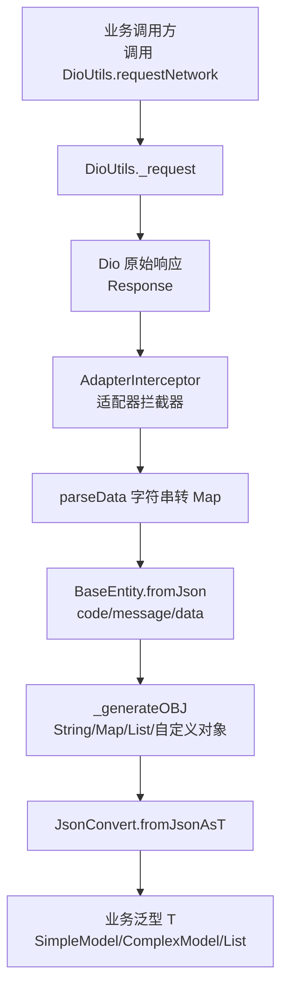
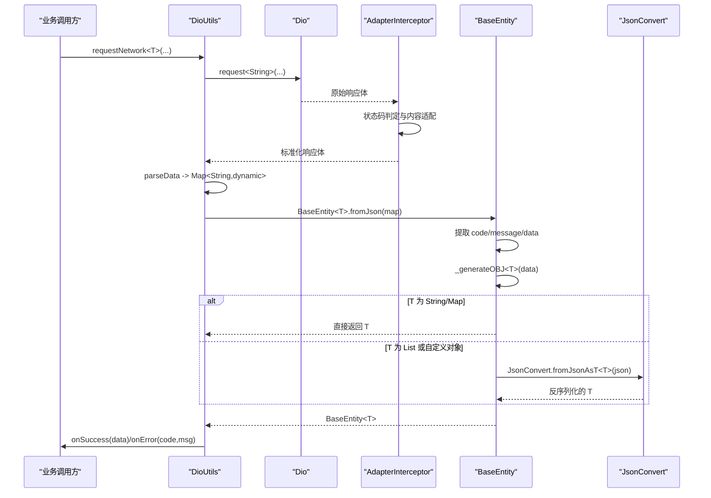
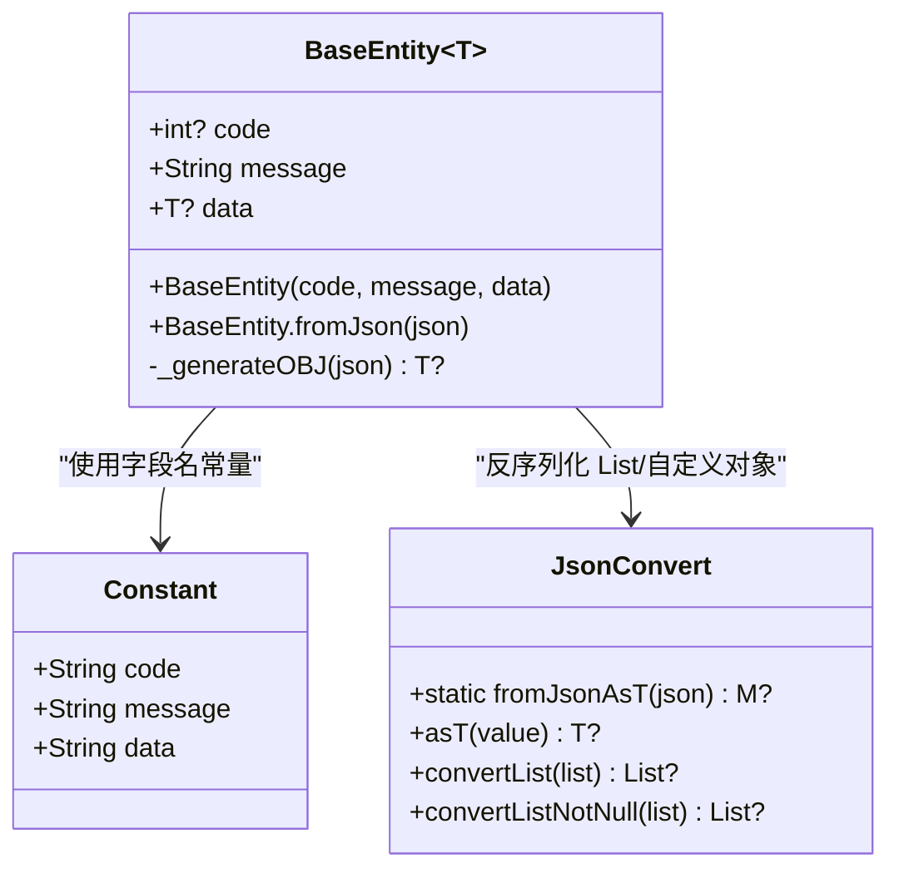
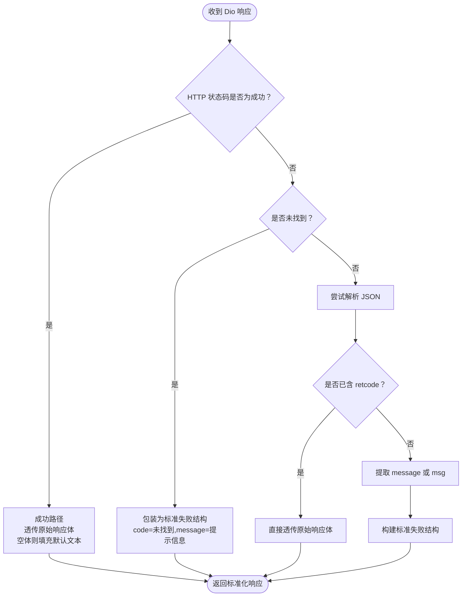
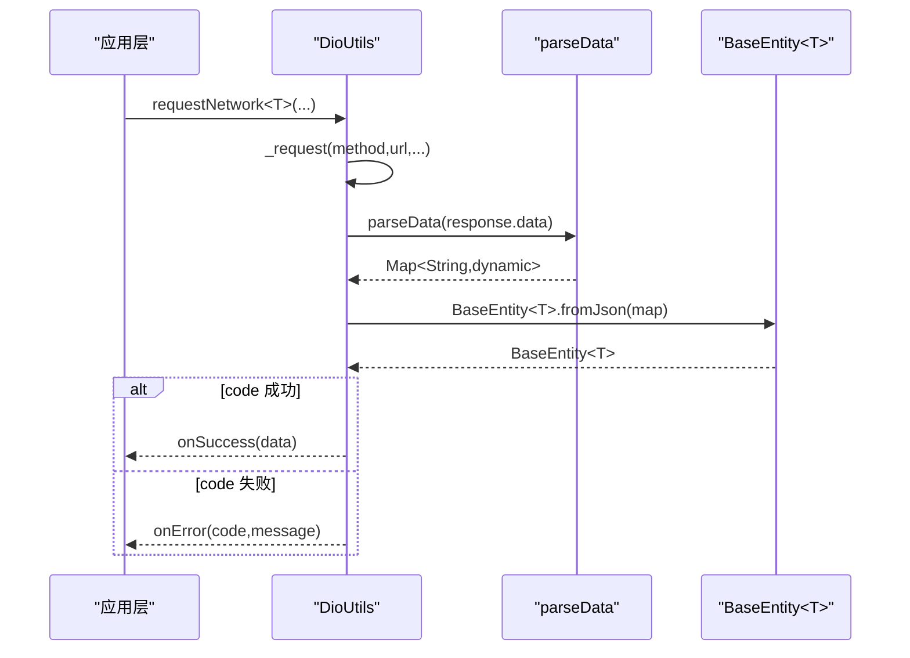
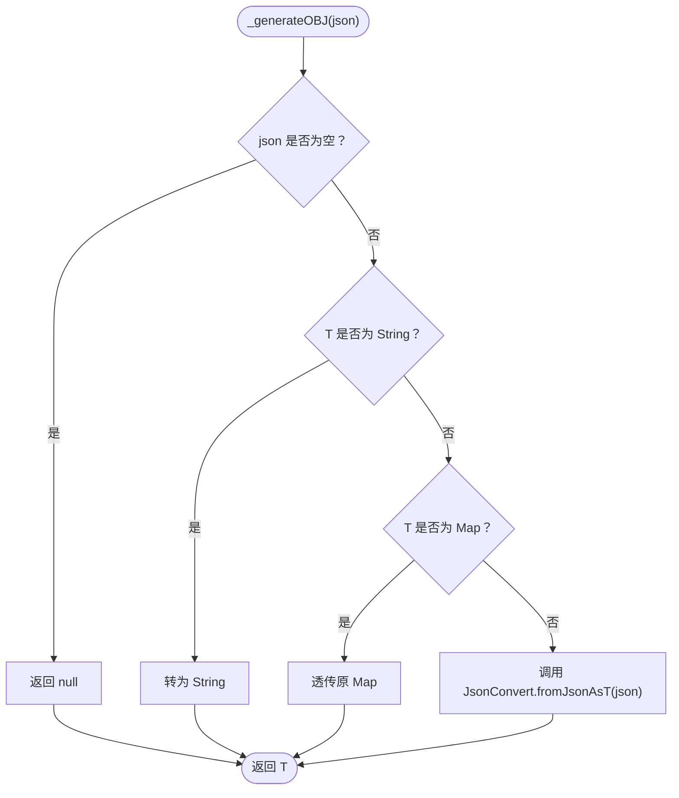
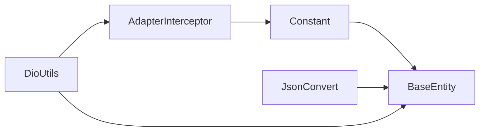

# 统一响应模型

<cite>
**本文引用的文件**   
- [base_entity.dart](file://lib/net/base_entity.dart)
- [constant.dart](file://lib/res/constant.dart)
- [dio_utils.dart](file://lib/net/dio_utils.dart)
- [intercept.dart](file://lib/net/intercept.dart)
- [json_convert_content.dart](file://lib/generated/json/base/json_convert_content.dart)
</cite>

## 目录
1. [引言](#引言)
2. [项目结构定位](#项目结构定位)
3. [核心组件总览](#核心组件总览)
4. [架构总览：从网络响应到泛型业务对象](#架构总览从网络响应到泛型业务对象)
5. [BaseEntity 详细设计](#baseentity-详细设计)
6. [适配器拦截器与数据格式预处理](#适配器拦截器与数据格式预处理)
7. [DioUtils 调用链与解析流程](#dioutils-调用链与解析流程)
8. [JsonConvert 类型转换机制](#jsonconvert-类型转换机制)
9. [API 响应使用模式与示例](#api-响应使用模式与示例)
10. [依赖关系分析](#依赖关系分析)
11. [性能与健壮性考量](#性能与健壮性考量)
12. [常见问题排查](#常见问题排查)
13. [最佳实践与常见陷阱](#最佳实践与常见陷阱)
14. [结论](#结论)

## 引言
本文围绕项目中统一响应模型 BaseEntity<T> 展开，说明其如何配合 Dio 拦截器、DioUtils 和 JsonConvert，把后端返回的 JSON 文本安全、一致地转换为带 code、message、data 的结构化响应。重点包括：
- BaseEntity<T> 的泛型设计优势与动态类型推断机制
- BaseEntity.fromJson 的解析策略
- _generateOBJ 的类型分支逻辑
- Constant.code/message/data 的配置化管理
- 与 AdapterInterceptor 的配合关系
- API 成功与错误响应的标准化结构
- 简单对象、复杂对象、列表数据的反序列化用法
- 类型安全的最佳实践与常见陷阱

## 项目结构定位
BaseEntity 位于网络层的核心位置，负责“协议体”建模；AdapterInterceptor 在 Dio 拦截器链中完成响应体格式化；DioUtils 负责发起请求、统一解析并回调业务结果；JsonConvert 提供自动生成的基础类型映射能力。

图示来源
- [dio_utils.dart:1-222](file://lib/net/dio_utils.dart#L1-L222)
- [intercept.dart:1-219](file://lib/net/intercept.dart#L1-L219)
- [base_entity.dart:1-33](file://lib/net/base_entity.dart#L1-L33)
- [json_convert_content.dart:1-100](file://lib/generated/json/base/json_convert_content.dart#L1-L100)

章节来源
- [dio_utils.dart:1-222](file://lib/net/dio_utils.dart#L1-L222)
- [intercept.dart:1-219](file://lib/net/intercept.dart#L1-L219)
- [base_entity.dart:1-33](file://lib/net/base_entity.dart#L1-L33)

## 核心组件总览
- BaseEntity<T>：统一响应体封装，包含 code、message、data 三个字段，并提供 fromJson 构造与内部类型生成方法。
- Constant：集中定义公共常量，包括 code、message、data 等键名。
- AdapterInterceptor：对 Dio 响应进行格式适配，保证后续解析面对一致的 JSON 结构。
- DioUtils：统一请求入口，将原始响应文本解析为 BaseEntity<T>，并按 code 分发成功或错误回调。
- JsonConvert：自动生成类型转换工具，支持基础类型、DateTime、List、以及自定义对象反序列化。

章节来源
- [base_entity.dart:1-33](file://lib/net/base_entity.dart#L1-L33)
- [constant.dart:1-93](file://lib/res/constant.dart#L1-L93)
- [intercept.dart:1-219](file://lib/net/intercept.dart#L1-L219)
- [dio_utils.dart:1-222](file://lib/net/dio_utils.dart#L1-L222)
- [json_convert_content.dart:1-100](file://lib/generated/json/base/json_convert_content.dart#L1-L100)

## 架构总览：从网络响应到泛型业务对象
整体流程如下：
1. 业务代码通过 DioUtils 发起请求。
2. Dio 以 ResponseType.plain 返回原始字符串。
3. AdapterInterceptor 根据 HTTP 状态码和业务约定，对响应体做规范化处理。
4. DioUtils 将字符串解析为 Map<String, dynamic>。
5. BaseEntity.fromJson 提取 code、message、data，并通过 _generateOBJ 得到目标类型 T。
6. 若 T 是 List 或自定义对象，则交由 JsonConvert 完成反序列化。
7. 最终由 DioUtils 按 code 决定 onSuccess 或 onError。

图示来源
- [dio_utils.dart:1-222](file://lib/net/dio_utils.dart#L1-L222)
- [intercept.dart:1-219](file://lib/net/intercept.dart#L1-L219)
- [base_entity.dart:1-33](file://lib/net/base_entity.dart#L1-L33)
- [json_convert_content.dart:1-100](file://lib/generated/json/base/json_convert_content.dart#L1-L100)

## BaseEntity 详细设计
BaseEntity<T> 是一个泛型类，承载接口响应的三要素：
- code：业务状态码，可为空整型。
- message：消息文本，始终存在且不可为空。
- data：业务数据，类型为 T?，可为空。

构造函数 withJson
- 从 Map<String, dynamic> 中读取 Constant.code、Constant.message、Constant.data。
- code 允许缺失，取值为空整型。
- message 必须存在。
- data 仅在键存在时执行类型转换；否则 data 保持为空。

_generateOBJ 类型转换
- 当 T 为 String 时，直接将 Object? 转为字符串。
- 当 T 为 Map 类型（例如 Map<String,dynamic>）时，透传原值。
- 其他情况，委托 JsonConvert.fromJsonAsT<T> 完成反序列化，包括 List 与自定义对象。

图示来源
- [base_entity.dart:1-33](file://lib/net/base_entity.dart#L1-L33)
- [constant.dart:1-93](file://lib/res/constant.dart#L1-L93)
- [json_convert_content.dart:1-100](file://lib/generated/json/base/json_convert_content.dart#L1-L100)

章节来源
- [base_entity.dart:1-33](file://lib/net/base_entity.dart#L1-L33)
- [constant.dart:1-93](file://lib/res/constant.dart#L1-L93)

## 适配器拦截器与数据格式预处理
AdapterInterceptor 的作用是把不同后端返回格式统一成可被 BaseEntity 稳定解析的形式：
- 成功状态码时，优先透传原始响应体；若为空，则补默认提示文本。
- 特定“未找到”状态码时，包装为标准失败结构。
- 其他失败状态码时，尝试从响应体中提取 message 或 msg，构建标准失败结构。
- 若响应体本身已经是 retcode 格式，则直接透传，不做二次包装。

这意味着，进入 BaseEntity.fromJson 的数据已经具备稳定的 key 集合：
- 成功响应：通常包含 data、message，以及业务约定的成功码。
- 失败响应：通常包含 message/msg，以及业务约定的失败码。

图示来源
- [intercept.dart:1-219](file://lib/net/intercept.dart#L1-L219)

章节来源
- [intercept.dart:1-219](file://lib/net/intercept.dart#L1-L219)

## DioUtils 调用链与解析流程
DioUtils 是统一的网络入口，关键行为如下：
- 使用 ResponseType.plain，避免 Dio 自动 JSON 解析，以便自行控制解析时机。
- validateStatus 始终返回 true，让 AdapterInterceptor 接管状态判断。
- 请求成功后，将 response.data 作为字符串传给 parseData，转为 Map<String, dynamic>。
- 用 BaseEntity<T>.fromJson(map) 构造响应对象。
- 若 code 为成功码，则调用 onSuccess(result.data)；否则调用 onError(code, message)。
- 异步流式版本 asyncRequestNetwork 同样基于 _request，但以 Stream 形式广播结果。

图示来源
- [dio_utils.dart:1-222](file://lib/net/dio_utils.dart#L1-L222)
- [base_entity.dart:1-33](file://lib/net/base_entity.dart#L1-L33)

章节来源
- [dio_utils.dart:1-222](file://lib/net/dio_utils.dart#L1-L222)

## JsonConvert 类型转换机制
JsonConvert 是自动生成的类型转换工具，承担以下职责：
- asT<T>：将任意值转换为指定类型，支持 String、int、double、DateTime、bool 及自定义对象。
- convertList<T>/convertListNotNull<T>：对 List<dynamic> 逐项转换。
- fromJsonAsT<M>：判断输入是 List 还是 Map，再分别走列表或单对象反序列化分支。

BaseEntity 的 _generateOBJ 会在 T 不是 String 且不是 Map 时，调用 JsonConvert.fromJsonAsT<T>，从而支持：
- List<T> 的反序列化
- 自定义实体对象的反序列化

图示来源
- [base_entity.dart:1-33](file://lib/net/base_entity.dart#L1-L33)
- [json_convert_content.dart:1-100](file://lib/generated/json/base/json_convert_content.dart#L1-L100)

章节来源
- [json_convert_content.dart:1-100](file://lib/generated/json/base/json_convert_content.dart#L1-L100)
- [base_entity.dart:1-33](file://lib/net/base_entity.dart#L1-L33)

## API 响应使用模式与示例
BaseEntity 的典型使用方式如下：
- 成功响应：code 为业务成功码，message 可能为空或简短描述，data 为 T。
- 错误响应：code 非成功码，message 携带错误信息，data 通常为 null。

类型 T 可以是：
- 简单对象：如用户信息、订单摘要等。
- 复杂对象：嵌套对象或包含多个子结构的对象。
- 列表数据：如商品列表、桌台列表等，T 为 List<Item>。

注意：
- BaseEntity.fromJson 会依据 Constant.code、Constant.message、Constant.data 三个键名解析响应。
- 如果后端返回的 data 键不存在，data 字段将为空。
- 对于 List 或自定义对象，请确保 JsonConvert 已生成对应类型的映射实现。

章节来源
- [base_entity.dart:1-33](file://lib/net/base_entity.dart#L1-L33)
- [dio_utils.dart:1-222](file://lib/net/dio_utils.dart#L1-L222)

## 依赖关系分析
BaseEntity 依赖 Constant 提供字段键名；DioUtils 依赖 BaseEntity 封装响应；AdapterInterceptor 依赖 Constant 与日志工具，用于构造标准化响应；JsonConvert 是底层类型转换支撑。

图示来源
- [constant.dart:1-93](file://lib/res/constant.dart#L1-L93)
- [base_entity.dart:1-33](file://lib/net/base_entity.dart#L1-L33)
- [dio_utils.dart:1-222](file://lib/net/dio_utils.dart#L1-L222)
- [intercept.dart:1-219](file://lib/net/intercept.dart#L1-L219)
- [json_convert_content.dart:1-100](file://lib/generated/json/base/json_convert_content.dart#L1-L100)

章节来源
- [constant.dart:1-93](file://lib/res/constant.dart#L1-L93)
- [base_entity.dart:1-33](file://lib/net/base_entity.dart#L1-L33)
- [dio_utils.dart:1-222](file://lib/net/dio_utils.dart#L1-L222)
- [intercept.dart:1-219](file://lib/net/intercept.dart#L1-L219)
- [json_convert_content.dart:1-100](file://lib/generated/json/base/json_convert_content.dart#L1-L100)

## 性能与健壮性考量
- 大响应体异步解析：DioUtils 对大于约 10KB 的响应体使用 compute 进行异步解析，减少主线程阻塞。
- 字符串响应：Dio 使用 ResponseType.plain，避免重复解析，提高可控性。
- 空数据保护：BaseEntity.fromJson 仅在 data 键存在时进行转换，避免空引用异常。
- 类型容错：JsonConvert 的基础类型转换包含 try/catch，失败时返回空或空列表，降低崩溃风险。

章节来源
- [dio_utils.dart:1-222](file://lib/net/dio_utils.dart#L1-L222)
- [base_entity.dart:1-33](file://lib/net/base_entity.dart#L1-L33)
- [json_convert_content.dart:1-100](file://lib/generated/json/base/json_convert_content.dart#L1-L100)

## 常见问题排查
- 解析错误导致 code 为解析错误码：检查后端返回是否为合法 JSON；确认 AdapterInterceptor 是否正确包装了失败结构。
- data 为空：确认后端返回是否包含 data 键；若确实没有业务数据，应判空处理。
- List 反序列化失败：确认 JsonConvert 是否生成了对应类型的映射；检查后端字段是否与实体类字段一致。
- message 获取不到：确认后端返回的是 message 还是 msg；AdapterInterceptor 已兼容两者，但 BaseEntity 只读 Constant.message。
- 自定义对象反序列化失败：检查 JsonConvert 的 fromJsonAsT 分支是否命中对应生成类；必要时检查字段命名与类型映射。

章节来源
- [intercept.dart:1-219](file://lib/net/intercept.dart#L1-L219)
- [base_entity.dart:1-33](file://lib/net/base_entity.dart#L1-L33)
- [json_convert_content.dart:1-100](file://lib/generated/json/base/json_convert_content.dart#L1-L100)

## 最佳实践与常见陷阱
- 始终显式声明泛型 T：例如 SimpleModel、ComplexModel、List<Item>，以获得编译期类型安全。
- 对 data 做空判断：即使 T 非空，也可能因后端未返回 data 而得到空值。
- 区分成功与失败：不要仅凭 HTTP 状态码判断业务成功；应以 BaseEntity.code 为准。
- 使用 Constant 提供的字段名：避免硬编码字符串，便于统一管理。
- 避免对 String 类型误用 JsonConvert：BaseEntity 已对 String 做特殊处理，无需额外转换。
- 谨慎处理 Map 类型：Map 会透传，不会走 JsonConvert；如需强类型，建议改用自定义对象。
- 关注大响应体：超过阈值会使用 compute 解析，合理拆分接口可减少单次响应体积。
- 调试时观察 AdapterInterceptor 输出：有助于快速定位后端返回格式不一致问题。

章节来源
- [base_entity.dart:1-33](file://lib/net/base_entity.dart#L1-L33)
- [dio_utils.dart:1-222](file://lib/net/dio_utils.dart#L1-L222)
- [intercept.dart:1-219](file://lib/net/intercept.dart#L1-L219)
- [json_convert_content.dart:1-100](file://lib/generated/json/base/json_convert_content.dart#L1-L100)

## 结论
BaseEntity<T> 以简洁的泛型设计统一了 API 响应结构，结合 Constant 的字段管理、AdapterInterceptor 的格式适配、DioUtils 的统一解析与 JsonConvert 的类型转换，形成一条从网络字符串到业务对象的完整链路。正确使用 BaseEntity<T>，可以在保证类型安全的同时，简化成功与错误响应的处理逻辑，提升网络层的可维护性与可扩展性。